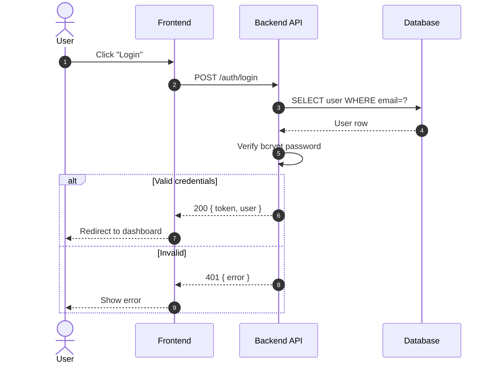
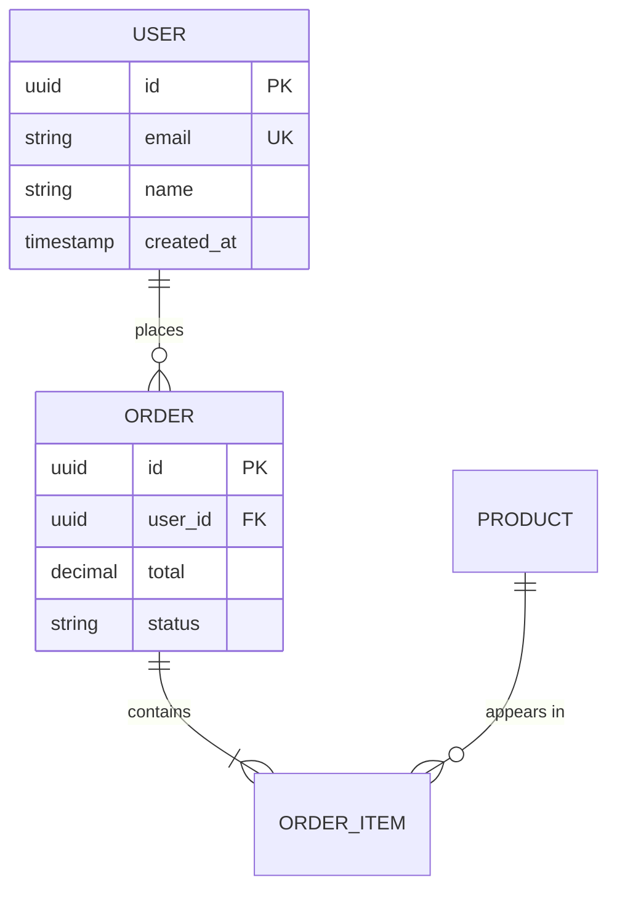
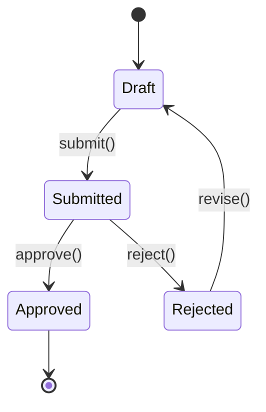
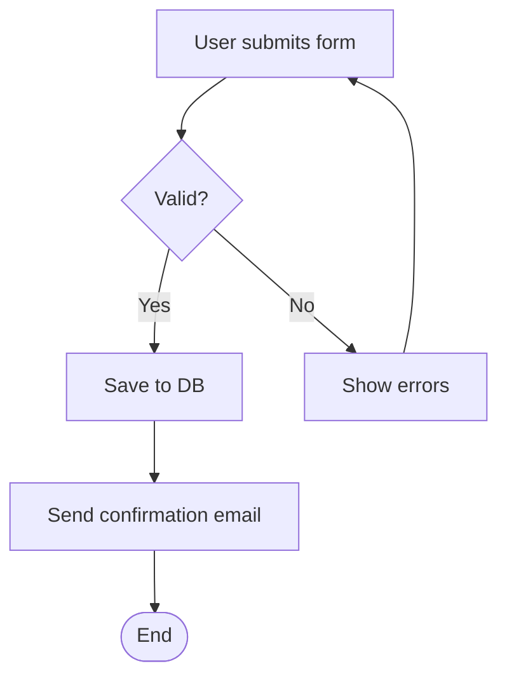

# skill: status-report

Use when a task that produces or checks project work ends (document, review, code, fix, release).

# รายงานสถานะเมื่อจบงาน

> **ภาษา:** ถ้อยคำทุกบรรทัดเขียนตาม [`human-writing`](../human-writing/SKILL.md) — skill นี้บอกรูปแบบและโครง ส่วน human-writing บอกวิธีเขียนให้คนอ่านรู้เรื่อง

> **กฎข้อเดียว:** จบงานทุกครั้ง ต้องมีตารางสถานะใน `docs/BUILD-PLAN.md` และตารางเดียวกันในคำตอบ
> งานที่ไม่มีตารางสถานะ ถือว่ายังไม่จบ
> **ยกเว้น** playbook ที่อ่านอย่างเดียว (`investigation` · `review`) — ใส่ตารางในคำตอบอย่างเดียว ไม่เขียนไฟล์

---

## 1 · เขียนที่ไหน — `docs/BUILD-PLAN.md` เสมอ

ทุกงาน ทั้งเอกสาร โค้ด การตรวจ การส่งมอบ เขียนที่ไฟล์เดียวนี้ เพื่อให้มีที่ดูสถานะที่เดียว

| สถานการณ์ | ทำอย่างไร |
|---|---|
| มีไฟล์อยู่แล้ว | แก้เฉพาะ 2 หัวข้อด้านล่าง — **ห้ามแตะตารางงานหรือหัวข้ออื่น** |
| ยังไม่มีไฟล์ | สร้างไฟล์ที่มีแค่ชื่อโปรเจกต์ แล้ว copy 2 หัวข้อจาก [`assets/build-plan-status.md`](assets/build-plan-status.md) มาเติม (ห้ามแต่งโครงเอง) แล้วเมื่อเริ่มเขียนโค้ดค่อยเพิ่มตารางงาน (`spec-to-code-loop`) **ระหว่าง** 2 หัวข้อนี้ |
| มี subagent หลายตัวทำงานพร้อมกัน | subagent **รายงานกลับ** อย่างเดียว ให้ตัวหลักเขียนไฟล์คนเดียว ไม่งั้นไฟล์พัง |

ลำดับหัวข้อในไฟล์ (ต่อจากชื่อโปรเจกต์): `## สถานะล่าสุด` → ตารางงาน → `## ประวัติสถานะ` → `## ตัดสินใจเอง` (`decision-log`)

2 หัวข้อที่ skill นี้ดูแล:

- `## สถานะล่าสุด` — **เขียนทับทั้งหัวข้อ** ทุกครั้ง เป็นภาพปัจจุบันภาพเดียว ไม่ใช่ต่อท้าย
- `## ประวัติสถานะ` — **เพิ่ม 1 บรรทัดบนสุด** ต่อ 1 งาน ไม่ลบของเดิม

---

## 2 · ตาราง `## สถานะล่าสุด`

```markdown
## สถานะล่าสุด

อัปเดต: 2026-10-01 14:20 · งานล่าสุด: เขียน SRS

| รายการ | ประเภท | สถานะ | ผลตรวจ | ค้าง / หมายเหตุ |
|---|---|---|---|---|
| SRS (`docs/srs.md`) | เอกสาร | DRAFT | ผ่าน — 42 FR ตรวจได้ทุกข้อ | FR-031 รอยืนยันตัวเลข |
| mockup (`mockup/`) | เอกสาร | REVIEW | ไม่ผ่าน — ปุ่มหลอก 3 จุด | แก้ `order.html` |
| FSD | เอกสาร | ยังไม่เริ่ม | — | รอ architecture |
| FR-001 ถึง FR-012 | โค้ด | เสร็จ | ผ่าน — test 48/48 | — |

**ค้างอยู่ (ต้องมีคนตัดสิน):**
1. FR-031 เวลาตอบสนองกี่วินาที — ถามผู้ว่าจ้าง

**รออนุมัติ:**
1. push branch `feat/search` — `git push -u origin feat/search`

**ถัดไป:** แก้ปุ่มหลอกใน mockup → เขียน architecture

**ข้อเสนอ:**
1. ย้ายตัวตรวจ input ไปไว้จุดเดียวที่ขอบ API — ลด if ซ้ำ 14 จุด · แรงกลาง
```

### ค่าที่ใช้ในแต่ละคอลัมน์ — ใช้เฉพาะค่าเหล่านี้

| คอลัมน์ | ค่าที่ใช้ได้ |
|---|---|
| ประเภท | `เอกสาร` · `โค้ด` · `ตรวจ` · `build` · `ส่งมอบ` — `build` คือไฟล์ release ที่สร้างแล้ว (APK · AAB · installer) ส่วน `ส่งมอบ` คือถึงมือผู้ใช้หรือขึ้นร้านค้าแล้ว |
| สถานะ (เอกสาร) | `ยังไม่เริ่ม` · `DRAFT` · `REVIEW` · `APPROVED` |
| สถานะ (โค้ด · build) | `รอทำ` · `กำลังทำ` · `เสร็จ` · `ติด` — ตรงกับตารางงานของ `spec-to-code-loop` และรหัสงานใช้รหัส FR ของ SRS ถ้ามี · ต่างจาก 5 คำของ `superuser` ใน plugin อื่นโดยตั้งใจ ส่วน "รออนุมัติ" กับ "ค้างอยู่" อยู่เป็นหัวข้อท้ายคำตอบ |
| ผลตรวจ | `ผ่าน — <หลักฐาน>` · `ไม่ผ่าน — <สิ่งที่ไม่ผ่าน>` · `ยังไม่ตรวจ` · `—` (ยังไม่มีอะไรให้ตรวจ) |

- **ผลตรวจต้องมีหลักฐานเสมอ** — ตัวเลข test ที่รันจริง จำนวนข้อที่ตรวจ ชื่อไฟล์ที่ดู ถ้าไม่ได้รันหรือไม่ได้ตรวจให้เขียน `ยังไม่ตรวจ` ห้ามเขียน `ผ่าน`
- **แอปมือถือ** หลักฐานต้องบอกเครื่องที่รัน — `ผ่าน — emulator Pixel 6 API 34 · ค่าเซนเซอร์ฉีดเข้า` หรือ `ผ่าน — เครื่องจริง <รุ่น> Android 14` ถ้ายังไม่ได้ลองเครื่องจริงให้เขียนไว้ในช่อง ค้าง
- `APPROVED` มีแต่คนที่เปลี่ยนได้ ส่วน agent ตั้งได้สูงสุด `DRAFT` หรือ `REVIEW`
- ตารางมีทุกรายการของโปรเจกต์ ไม่ใช่แค่งานรอบนี้ รายการที่รอบนี้ไม่ได้แตะให้คัดลอกค่าเดิมมา
- เอกสาร 1 ฉบับใช้ 1 แถว โค้ดที่สถานะเท่ากันรวมเป็นช่วงรหัสได้ (`FR-001 ถึง FR-012`) และตารางไม่ควรยาวเกิน 25 แถว

### "ค้างอยู่" กับ "ถัดไป"

- **ค้างอยู่** คือสิ่งที่ agent ไปต่อเองไม่ได้ ต้องมีคนตอบหรือตัดสิน ให้เขียนเป็นคำถามที่ตอบได้ พร้อมบอกว่าถามใคร ถ้าไม่มีให้เขียน `ไม่มี`
- **รออนุมัติ** คืองานที่เตรียมพร้อมแล้วแต่ย้อนไม่ได้ (superuser หัวข้อ 6) ให้บอกคำสั่งหรือไฟล์ที่พร้อมใช้ ถ้าไม่มีก็ไม่ต้องใส่หัวข้อ
- **ถัดไป** คืองานลำดับถัดไปไม่เกิน 3 อย่าง
- **ข้อเสนอ** คือการปรับปรุงนอกขอบเขตไม่เกิน 3 ข้อ บอกว่าได้อะไรและใช้แรงแค่ไหน ถ้าไม่มีก็ไม่ต้องใส่หัวข้อ

---

## 3 · บรรทัดใน `## ประวัติสถานะ`

1 บรรทัดต่อ 1 งาน ใหม่สุดอยู่บน:

```markdown
## ประวัติสถานะ

- 2026-10-01 14:20 · เขียน SRS · DRAFT · ผ่าน 42/42 FR · ค้าง 1
- 2026-09-30 10:05 · ตรวจ mockup · ไม่ผ่าน · ปุ่มหลอก 3 จุด
```

รูปแบบ: `วันที่ เวลา · งาน · สถานะ · ผล · ค้างกี่ข้อ` — ไม่เกิน 1 บรรทัด ไม่ใส่รายละเอียดที่อยู่ในตารางแล้ว ถ้ารอบนั้นตัดสินใจเองให้ต่อท้าย `· ตัดสินใจเอง <จำนวน>`

หัวข้อ `## ตัดสินใจเอง` ที่อยู่ถัดลงไป เป็นของ skill `decision-log` ซึ่ง skill นี้ไม่แก้และไม่ลบ

---

## 4 · ในคำตอบ

แสดงตาราง `สถานะล่าสุด` เฉพาะ **แถวที่เปลี่ยนในรอบนี้** + "ค้างอยู่" + "รออนุมัติ" (ถ้ามี) + "ข้อเสนอ" (ถ้ามี) + "ถัดไป" แล้วบอกว่าตารางเต็มอยู่ใน `docs/BUILD-PLAN.md` — ไม่ต้องแปะทั้งไฟล์

---

## 5 · รายการตรวจก่อนบอกว่าจบ

- [ ] อ่าน `docs/BUILD-PLAN.md` จากดิสก์ก่อนแก้ (คนอื่นอาจแก้ไปแล้ว)
- [ ] `## สถานะล่าสุด` เขียนทับ ไม่ได้ต่อท้าย และมีวันที่เวลา
- [ ] ทุกแถวที่เขียนว่า `ผ่าน` มีหลักฐาน
- [ ] ไม่ได้ตั้ง `APPROVED` เอง
- [ ] เพิ่มบรรทัดใน `## ประวัติสถานะ` 1 บรรทัด
- [ ] ไม่แตะตารางงานหรือหัวข้ออื่นในไฟล์
- [ ] รันตัวตรวจจนผ่าน (path นับจากโฟลเดอร์ skill นี้): `python ../polished-document-style/scripts/check_outline.py assets/build-plan-status.md <path ของ docs/BUILD-PLAN.md>` — จับหัวข้อหาย หัวข้อสลับ ช่องตัวหนาหาย หัวตารางเปลี่ยน และช่องที่ยังไม่เติม · หัวข้ออื่นในไฟล์ (ตารางงาน `## ตัดสินใจเอง`) ตัวตรวจปล่อยผ่าน
- [ ] คำตอบมีตารางเฉพาะแถวที่เปลี่ยน + ค้าง + รออนุมัติ (ถ้ามี) + ข้อเสนอ (ถ้ามี) + ถัดไป

---

## 6 · สิ่งที่ห้ามทำ

| อย่าทำ | เพราะ |
|---|---|
| เขียนว่า `ผ่าน` โดยไม่ได้รัน test หรือไม่ได้ตรวจจริง | ตารางสถานะที่โกหกแย่กว่าไม่มีตาราง |
| ต่อท้าย `## สถานะล่าสุด` ทุกรอบ | ไฟล์ยาวขึ้นเรื่อย ๆ และไม่รู้ว่าแถวไหนคือปัจจุบัน |
| สร้างไฟล์สถานะใหม่ (`STATUS.md` `progress.md`) | สถานะกระจายหลายที่ ไม่มีใครรู้ว่าดูที่ไหน |
| ซ่อนรายการที่ไม่ผ่านไว้ในร้อยแก้ว | คนอ่านตารางแล้วเข้าใจว่าผ่านหมด |
| ให้ subagent เขียน `BUILD-PLAN.md` เอง | เขียนชนกันแล้วไฟล์พัง |

---

## เชื่อมกับ skill อื่น

| ต้องการ | ใช้คู่กับ |
|---|---|
| ตารางงานและวงรอบเขียนโค้ด ในไฟล์เดียวกัน | `spec-to-code-loop` |
| ชุดเอกสารของโปรเจกต์และสถานะเอกสาร | `project-doc-set` |
| บันทึกบริบทเพื่อทำต่อในรอบสนทนาหน้า | `work-session-context` |
| ตารางการตัดสินใจเองในไฟล์เดียวกัน | `decision-log` |
| เลือก playbook และจบงานทุกชนิด | `superuser` |
| รูปแบบตารางและเอกสาร | `polished-document-style` |
| ชื่อและสถานะของไฟล์เอกสาร | `document-naming` |


---

# skill: fsd-writing

Use when writing or reviewing a Functional Specification Document (FSD) that screens are built from.

# เขียน Functional Specification Document (FSD)

> **ภาษา:** ถ้อยคำทุกบรรทัดเขียนตาม [`human-writing`](../human-writing/SKILL.md) — skill นี้บอกรูปแบบและโครง ส่วน human-writing บอกวิธีเขียนให้คนอ่านรู้เรื่อง

> **กฎข้อเดียว:** FSD เสร็จเมื่อ developer เปิดอ่านแล้ว**เขียนโค้ดได้โดยไม่ต้องเดาและไม่ต้องถาม**
> ทุกจุดที่ต้องเดา คือจุดที่จะกลายเป็นงานแก้หลังส่งมอบ

## เมื่อไหร่ใช้ skill นี้

- เขียน FSD หรือ Functional Spec ของฟีเจอร์ โมดูล หรือทั้งระบบ
- แปลง Software Requirements Specification (SRS) หรือ Business Requirements Document (BRD) ให้ละเอียดพอลงมือทำ
- รีวิว FSD ของคนอื่น แล้วต้องบอกให้ได้ว่าขาดอะไร
- developer ถามคำถามเดิมซ้ำ ๆ ระหว่างทำ — แปลว่า FSD ยังไม่ครบ

## เมื่อไหร่ **ไม่** ใช้

| งาน | ใช้ตัวนี้แทน |
|---|---|
| ข้อกำหนดระดับที่ลูกค้าเซ็นรับ | `srs-writing` |
| user story สำหรับ sprint | `user-story-writer` |
| ออกแบบ endpoint ของฟีเจอร์หนึ่ง | command `/api-design` |
| ข้อตกลงกลางของ API ทั้งระบบ | `api-conventions` |
| ตาราง คอลัมน์ ความสัมพันธ์ | `database-design` |
| หน้าตาหน้าจอ ระยะห่าง สถานะ | `ui-craft` + skill แพลตฟอร์ม |
| รูปแบบ markdown และธีมเอกสาร | `polished-document-style` |
| หน้าตาไฟล์ .docx ที่ส่งออก | `branded-document-design` |

## อ่านเพิ่มเมื่อ

| ไฟล์ | เปิดเมื่อ |
|---|---|
| [references/worked-examples.md](references/worked-examples.md) | ถ้าจะเขียน use case หน้าจอ ตารางสถานะ หรือกฎทางธุรกิจตัวแรกของเอกสาร ให้เปิดดูตัวอย่างเต็มแล้วลอกรูปแบบไปใช้ |
| [references/edge-cases.md](references/edge-cases.md) | ตอนเขียนหัวข้อข้อผิดพลาดและกรณีขอบ และตอนรีวิวก่อนส่ง เพื่อไล่ให้ครบทุกกรณี |
| [references/fsd-vs-srs.md](references/fsd-vs-srs.md) | ถ้ายังไม่แน่ใจว่าเนื้อหาชิ้นหนึ่งควรอยู่ใน SRS หรือใน FSD ให้เปิดตารางเทียบนี้ |
| [references/stakeholder-doc-templates.md](references/stakeholder-doc-templates.md) | ถ้าเขียน FSD แบบอ่านง่ายสำหรับผู้มีส่วนได้เสีย (Mode B) หรือต้องการแม่แบบ use case, API endpoint, data model และตัวอย่าง Mermaid |
| [references/figures.md](references/figures.md) | ตอนวางแผนว่าหัวข้อไหนต้องมีรูปชนิดไหน |
| [references/outline-sections.md](references/outline-sections.md) | ถ้าต้องตัดสินว่าหัวข้อไหนข้ามได้ ให้เปิดตารางนี้ ส่วนโครงเต็มที่ลอกไปกรอกได้อยู่ใน [assets/fsd-outline.md](assets/fsd-outline.md) |
| [references/related-skills.md](references/related-skills.md) | ถ้างานต้องใช้ skill อื่นคู่กัน เช่น รูป ข้อตกลง API หรือ test case ให้เปิดดูว่าใช้ตัวไหน |

## 1 · FSD ต่างจาก SRS ยังไง — เส้นแบ่งที่ต้องชัด

เอกสารสองฉบับนี้ปนกันบ่อยที่สุด ผลคือ SRS ยาวจนลูกค้าไม่อ่าน และ FSD ตื้นจน developer ต้องถาม
SRS บอกว่าระบบ**ต้องทำอะไรได้** ส่วน FSD บอกว่าระบบ**ทำสิ่งนั้นอย่างไร** ตารางเทียบทีละมิติอยู่ใน [references/fsd-vs-srs.md](references/fsd-vs-srs.md)

> 🚨 **ห้าม FSD สร้างข้อกำหนดใหม่เอง** — เจออะไรที่ SRS ไม่ได้ครอบคลุม ให้**ลงรายการคำถามค้าง** ใส่ `(รอยืนยัน)` แล้วทำส่วนอื่นต่อ
> ข้อนั้นต้องเพิ่มใน SRS ก่อน ไม่ใช่เขียนลง FSD เงียบ ๆ
> ข้อที่โผล่มาใน FSD โดยไม่มีที่มา คือข้อที่ลูกค้าจะปฏิเสธจ่ายตอนตรวจรับ

## 2 · ลำดับการทำงาน

1. อ่าน SRS หรือ BRD ให้จบก่อน แล้ว**ทำรายการข้อที่ยังคลุมเครือ** ถามรวมครั้งเดียวตอนเริ่มแบบเลือกคำตอบ ทุกตัวเลือกมีหลักฐาน (skill `superuser` หัวข้อ 6) เฉพาะข้อที่ตีความต่างแล้วงานออกมาต่างกันทั้งชุด (ตัวเลือก = การตีความที่เป็นไปได้ อ้างข้อใน SRS/BRD) ที่เหลือใส่ `(รอยืนยัน)` แล้วทำต่อ
2. ยืนยันว่าเอกสารนี้เขียนให้ใครอ่าน — developer อย่างเดียว หรือมีลูกค้าอ่านด้วย
3. ไล่ทีละ use case ไม่ใช่ทีละหน้าจอ — หน้าจอเกิดจาก use case ไม่ใช่ทางกลับกัน
4. เขียนกฎทางธุรกิจแยกออกมาก่อน แล้วค่อยอ้างถึงจากขั้นตอน (ข้อ 7)
5. ทำตารางสอบย้อนกลับไปพร้อมกัน ไม่ใช่ทำตอนจบ
6. รีวิวตามข้อ 11 ก่อนส่ง

## 3 · โครงเอกสาร

มี 11 หัวข้อ เรียงตามนี้: บทนำ · ผู้ใช้และสิทธิ์ · ภาพรวมกระบวนการ · use case · ข้อกำหนดหน้าจอ · ผังสถานะ · กฎทางธุรกิจ · ข้อมูลและการเชื่อมต่อ · ข้อผิดพลาดและกรณีขอบ · ตารางสอบย้อนกลับ · ประวัติการแก้ไข
ข้ามได้แค่ข้อกำหนดหน้าจอถ้าไม่มีหน้าจอ และผังสถานะถ้าไม่มีสถานะ โครงเต็มอยู่ใน **[`assets/fsd-outline.md`](assets/fsd-outline.md)** ส่วนตารางที่บอกว่าแต่ละหัวข้อตอบคำถามอะไรอยู่ใน [references/outline-sections.md](references/outline-sections.md)

## 4 · use case — รูปแบบเดียวทั้งเอกสาร

ทุก use case มีหัวตาราง (มาจาก · ผู้ทำ · เงื่อนไขก่อนเริ่ม · ผลเมื่อสำเร็จ · ความถี่) ตามด้วยตารางขั้นตอนหลัก ทางเลือกอื่น และกรณีผิดพลาด ตัวอย่างเต็ม UC-ORD-010 อยู่ใน [references/worked-examples.md](references/worked-examples.md)

**กฎของ use case:**

- **หนึ่ง use case = หนึ่งเป้าหมายของผู้ใช้** ไม่ใช่หนึ่งหน้าจอ
- ทุก use case ต้องมี **ทางเลือกอื่น** และ **กรณีผิดพลาด** อย่างน้อยอย่างละหนึ่ง —
  use case ที่มีแต่ทางที่ทุกอย่างราบรื่น คือ use case ที่ยังเขียนไม่เสร็จ
- คอลัมน์ "ระบบทำอะไรต่อ" ห้ามว่าง — ถ้าว่างแปลว่ายังไม่ได้คิดว่าระบบตอบสนองยังไง
- **เงื่อนไขก่อนเริ่มต้องตรวจซ้ำที่ฝั่งเซิร์ฟเวอร์เสมอ** การซ่อนปุ่มไม่ใช่การควบคุมสิทธิ์
- เขียนเป็น "ผู้ใช้ทำ → ระบบตอบ" สลับกัน ไม่ใช่เล่าเป็นย่อหน้า

## 5 · ข้อกำหนดหน้าจอ

ตัวอย่างเต็ม SC-ORD-020 พร้อมตารางฟิลด์อยู่ใน [references/worked-examples.md](references/worked-examples.md)

**ทุกหน้าจอต้องระบุครบ 6 อย่าง:**

| ต้องมี | รายละเอียด |
|---|---|
| ตารางฟิลด์ | ชนิด · บังคับไหม · กฎตรวจ · **ข้อความ error ตามจริง** · ค่าเริ่มต้น |
| สิทธิ์ต่อบทบาท | บทบาทไหนเห็น · แก้ได้ · แค่อ่าน · ไม่เห็นเลย |
| ห้าสถานะของหน้าจอ | ว่าง · กำลังโหลด · ผิดพลาด · มีบางส่วน · สำเร็จ (ดู `ui-craft`) |
| การกระทำและผลลัพธ์ | ปุ่มไหนพาไปไหน · ปุ่มไหนเปิดกล่องยืนยัน |
| กฎการแสดงผล | รูปแบบวันที่ · ทศนิยมของเงิน · การปัดเศษ · เขตเวลา |
| ที่มาของข้อมูล | ฟิลด์นี้มาจาก endpoint ไหนหรือตารางไหน |

> **"ข้อความ error ตามจริง" คือคำที่ผู้ใช้จะเห็นจริง ๆ** ไม่ใช่ "แสดงข้อความแจ้งเตือน"
> ถ้าไม่เขียน developer จะแต่งเอง แล้วทั้งระบบจะมีสำนวนคนละแบบสิบแบบ
>
> **กฎการแสดงผลต้องเขียนไว้** — "ยอดรวม" ที่ไม่บอกว่าปัดเศษยังไง
> คือบั๊กที่จะเจอตอนกระทบยอดสิ้นเดือน

## 6 · ผังสถานะ — จุดที่ FSD ลืมบ่อยที่สุด

ของที่มี "สถานะ" (คำสั่งซื้อ ใบลา ตั๋วงาน เอกสาร) ต้องมีตารางที่มีคอลัมน์ จาก · ไป · ใครทำได้ · เงื่อนไข · ผลข้างเคียง และ**ห้ามมีแค่รูป** ตัวอย่างตารางอยู่ใน [references/worked-examples.md](references/worked-examples.md)

**กฎ:**

- **การเปลี่ยนที่ไม่อยู่ในตาราง คือการเปลี่ยนที่ต้องถูกปฏิเสธ** เขียนบรรทัด "ทำไม่ได้" ไว้ให้ชัด
  เพราะสิ่งที่ห้ามทำคือสิ่งที่ทดสอบได้ยากที่สุดถ้าไม่มีใครเขียนไว้
- ทุกสถานะต้องมีทางออก ยกเว้นสถานะปลายทางที่ตั้งใจให้จบ
- ผลข้างเคียงที่เกิดกับระบบอื่น (อีเมล สต็อก บัญชี) ต้องอยู่ในตารางนี้ ไม่ใช่ซ่อนอยู่ในขั้นตอน

## 7 · กฎทางธุรกิจแยกออกมาจากขั้นตอน

กฎแต่ละข้อมีรหัส ชื่อ เนื้อกฎ และที่มา ตัวอย่าง BR-030 อยู่ใน [references/worked-examples.md](references/worked-examples.md)

- **กฎหนึ่งข้อเขียนที่เดียว** แล้วอ้างด้วยรหัสจากทุกที่ที่ใช้ — ถ้าลอกไปวางสามที่ สักวันจะแก้ไม่ครบ
- ทุกกฎต้องมี**ที่มา** กฎที่ไม่มีที่มาคือกฎที่ทีมคิดเอง
- กฎที่เปลี่ยนตามเวลา (อัตราภาษี ค่าธรรมเนียม) ต้องระบุว่า**เก็บไว้ที่ไหน** —
  ในโค้ด ในตารางตั้งค่า หรือให้ผู้ดูแลระบบแก้ได้เอง

## 8 · ข้อผิดพลาดและกรณีขอบที่ต้องตอบให้ครบ

ตารางกรณีขอบคือสิ่งที่ทีมทดสอบจะใช้ และคือสิ่งที่ FSD ส่วนใหญ่ขาด ตั้งแต่ไม่มีข้อมูล กดปุ่มรัว ๆ สองคนแก้พร้อมกัน ไปจนถึงสิทธิ์ไม่พอ ให้ไล่ทุกแถวใน [references/edge-cases.md](references/edge-cases.md) แล้วตอบทุกแถวที่เกี่ยวกับฟีเจอร์

## 9 · รหัสและการสอบย้อนกลับ

```
UC-<โมดูล>-<เลข 3 หลัก>      use case              UC-ORD-010
SC-<โมดูล>-<เลข 3 หลัก>      ข้อกำหนดหน้าจอ         SC-ORD-020
BR-<เลข 3 หลัก>              กฎทางธุรกิจ            BR-030
```

ใช้ระบบเดียวกับ `srs-writing` — **เว้นเลขทีละ 10** และ **รหัสที่ออกไปแล้วห้ามใช้ซ้ำ**

| SRS | FSD | หน้าจอ | test case | สถานะ |
|---|---|---|---|---|
| FR-ORD-040 | UC-ORD-010 | SC-ORD-020 | TC-ORD-010..014 | ทำแล้ว |
| FR-ORD-040 | UC-ORD-010 · 010-E1 | SC-ORD-020 | TC-ORD-015 | ทำแล้ว |

- **ทุก use case ต้องชี้กลับไปที่ข้อกำหนดใน SRS ได้** — ถ้าชี้ไม่ได้ แปลว่ามีของแถมที่ไม่มีใครสั่ง
- **ทุกข้อกำหนดใน SRS ต้องมี use case อย่างน้อยหนึ่งตัว** — ถ้าไม่มี แปลว่าลืมทำ
- ทางเลือกอื่นและกรณีผิดพลาดต้องมี test case ของตัวเอง ห้ามนับรวมกับทางหลัก

## 10 · รูปในเอกสาร

ตารางว่าหัวข้อไหนควรมีรูปชนิดไหนอยู่ใน [references/figures.md](references/figures.md) ข้อที่ต้องจำคือ state diagram ใช้**คู่กับตาราง ไม่ใช่แทนตาราง**

เลือกเครื่องมือตามปลายทางของเอกสาร: ถ้าเป็น markdown ใช้ `software-diagrams` (Mermaid)
ไฟล์ที่ลูกค้าเซ็นรับใช้ `diagram-figures` ส่วนภาพร่างหน้าจอใช้ `markdown-visuals`
**ทุกรูปในฉบับเดียวใช้ธีมสีชุดเดียวกัน** ตาม `doc-theme` (ดู `polished-document-style`)

## 11 · รีวิวความครบถ้วนก่อนส่ง

**ความครบ**

- [ ] ทุกข้อกำหนดใน SRS มี use case อย่างน้อยหนึ่งตัว
- [ ] ทุก use case มีทางเลือกอื่นและกรณีผิดพลาดอย่างน้อยอย่างละหนึ่ง
- [ ] ทุกหน้าจอมีตารางฟิลด์ครบ 5 คอลัมน์ และห้าสถานะ
- [ ] ทุกของที่มีสถานะ มีตารางการเปลี่ยนสถานะ รวมบรรทัดที่ "ทำไม่ได้"
- [ ] ตอบตารางกรณีขอบในข้อ 8 ครบทุกแถวที่เกี่ยวข้อง

**ความชัด**

- [ ] ไม่มีคำว่า "ตามความเหมาะสม" "โดยอัตโนมัติ" "ที่จำเป็น" โดยไม่บอกว่าคืออะไร
- [ ] ข้อความ error ทุกอันเขียนเป็นคำจริง ไม่ใช่ "แสดงข้อความแจ้งเตือน"
- [ ] ตัวเลขทุกตัวมีหน่วย และมีที่มา
- [ ] ชื่อฟิลด์ ชื่อสถานะ ชื่อ endpoint ใช้ภาษาอังกฤษตรงกับที่จะใช้ในโค้ดจริง

**ความสอดคล้อง**

- [ ] คำเดียวกันหมายถึงของเดียวกันทั้งเล่ม (มีอภิธานศัพท์)
- [ ] ชื่อสถานะในผัง ในตาราง และใน use case ตรงกันหมด
- [ ] ไม่มีข้อกำหนดใหม่ที่ไม่มีใน SRS

> **ทดสอบขั้นสุดท้าย:** ให้ developer ที่ไม่ได้อยู่ในที่ประชุมอ่านหนึ่งคน
> ทุกคำถามที่เขาถาม คือหนึ่งช่องว่างที่ต้องเติมก่อนส่ง

## 12 · Anti-patterns

- ❌ **คัดลอก SRS มาแล้วเติมคำว่า "ระบบจะ"** — ได้เอกสารสองฉบับที่พูดเรื่องเดียวกัน
- ❌ **use case ที่มีแต่ทางที่ราบรื่น** — ทางที่พังคือสิ่งที่ FSD มีไว้เพื่อบอก
- ❌ **"แสดงข้อความแจ้งเตือน"** โดยไม่บอกว่าข้อความว่าอะไร
- ❌ **"ระบบจะคำนวณโดยอัตโนมัติ"** โดยไม่บอกสูตรและการปัดเศษ
- ❌ **ผังสถานะเป็นรูปอย่างเดียว** — รูปบอกไม่ได้ว่าใครมีสิทธิ์และมีผลข้างเคียงอะไร
- ❌ **คุมสิทธิ์ด้วยการซ่อนปุ่ม** โดยไม่ระบุการตรวจฝั่งเซิร์ฟเวอร์
- ❌ **กฎทางธุรกิจกระจายอยู่ในขั้นตอน** — พอแก้ทีหลังก็ตกหล่น
- ❌ **หน้าจอที่ไม่บอกว่าข้อมูลมาจากไหน** — developer จะเดา endpoint เอง
- ❌ **เอา wireframe มาแทนข้อกำหนด** — รูปบอกไม่ได้ว่าอะไรบังคับ กฎตรวจคืออะไร
- ❌ **ไม่มีตารางสอบย้อนกลับ** — แล้วไม่มีใครรู้ว่าทำครบหรือยัง

## 13 · ตัวย่อ

- **FSD** — Functional Specification Document (เอกสารข้อกำหนดเชิงหน้าที่ ระดับที่ลงมือทำได้)
- **SRS** — Software Requirements Specification (เอกสารข้อกำหนดซอฟต์แวร์ ระดับที่ลูกค้าเซ็นรับ)
- **BRD** — Business Requirements Document (เอกสารความต้องการทางธุรกิจ)
- **use case** — กรณีการใช้งาน หนึ่งเป้าหมายของผู้ใช้ตั้งแต่เริ่มจนจบ
- **state machine** — ผังสถานะ บอกว่าของชิ้นหนึ่งเปลี่ยนจากสถานะไหนไปสถานะไหนได้บ้าง
- **ETag** — Entity Tag (รหัสระบุรุ่นของข้อมูล ใช้ตรวจว่ามีคนแก้ไปก่อนไหม)


## reference: edge-cases.md

# ข้อผิดพลาดและกรณีขอบที่ต้องตอบให้ครบ

ทีมทดสอบจะใช้ตารางนี้ และเป็นส่วนที่ FSD ส่วนใหญ่ขาด ให้ไล่ทุกแถวที่เกี่ยวกับฟีเจอร์ แล้วเขียนคำตอบลงหัวข้อ 9 ของเอกสาร

| กรณี | คำถามที่ต้องตอบ |
|---|---|
| ไม่มีข้อมูล | หน้าจอว่างเปล่าแสดงอะไร มีปุ่มพาไปทำอะไรต่อไหม |
| ข้อมูลเยอะมาก | กี่รายการต่อหน้า · เรียงยังไง · ค้นหาได้ไหม |
| กดปุ่มรัว ๆ | กันงานซ้ำยังไง (ดู idempotency key ใน `api-conventions`) |
| สองคนแก้พร้อมกัน | ใครชนะ · อีกคนเห็นอะไร (ดู ETag ใน `api-conventions`) |
| เน็ตหลุดกลางทาง | ข้อมูลที่กรอกหายไหม · ลองใหม่แล้วซ้ำไหม |
| หมดเวลา session | เด้งออกทันที หรือเก็บสิ่งที่กรอกไว้ |
| ค่าที่ขอบเขต | 0 · ค่าติดลบ · วันนี้ · วันสุดท้ายของเดือน · ปีอธิกสุรทิน |
| ข้อความยาวผิดปกติ | ชื่อ 200 ตัวอักษรทำให้เลย์เอาต์พังไหม |
| ภาษาไทยและอักขระพิเศษ | เรียงลำดับถูกไหม · ค้นหาเจอไหม · อีโมจิพังไหม |
| ระบบภายนอกไม่ตอบ | รอกี่วินาที · ลองใหม่กี่ครั้ง · ผู้ใช้เห็นอะไรระหว่างนั้น |
| สิทธิ์ไม่พอ | เห็นแต่กดไม่ได้ หรือไม่เห็นเลย — **ต้องเลือกให้ชัด** |


## reference: figures.md

# รูปในเอกสาร FSD

ตารางนี้บอกว่าหัวข้อไหนของ FSD ควรมีรูปชนิดไหน ส่วนเครื่องมือที่ใช้วาดและเรื่องธีมสีอยู่ใน `SKILL.md` ข้อ 10

| หัวข้อ | รูปที่ควรมี |
|---|---|
| 3 ภาพรวมกระบวนการ | ผังขั้นตอนงานตั้งแต่ต้นจนจบ |
| 4 use case ที่มีหลายฝ่าย | sequence diagram |
| 5 หน้าจอ | ภาพร่างหน้าจอ พร้อมหมายเลขชี้ไปที่ตารางฟิลด์ |
| 6 สถานะ | state diagram — **คู่กับตาราง ไม่ใช่แทนตาราง** |
| 8 ข้อมูล | ER diagram เฉพาะตารางที่เกี่ยวกับโมดูลนี้ |


## reference: fsd-vs-srs.md

# FSD ต่างจาก SRS ยังไง

ตารางเทียบเอกสารสองฉบับทีละมิติ ใช้ตอนต้องตัดสินว่าเนื้อหาชิ้นหนึ่งควรอยู่ใน SRS หรือใน FSD

| | SRS | FSD |
|---|---|---|
| ตอบคำถาม | ระบบ**ต้องทำอะไรได้** | ระบบ**ทำสิ่งนั้นอย่างไร** |
| คนอ่านหลัก | ลูกค้า · ผู้บริหาร · คนเซ็นรับ | developer · tester · ux |
| ระดับรายละเอียด | "ระบบต้องให้ผู้ใช้ยกเลิกคำสั่งซื้อได้" | ปุ่มอยู่ตรงไหน · ยกเลิกได้ในสถานะไหนบ้าง · ใครมีสิทธิ์ · ยืนยันด้วยอะไร · ข้อความตอนทำไม่ได้ว่าอะไร · ระบบทำอะไรต่อ |
| เปลี่ยนแปลง | ต้องผ่านการอนุมัติ มีผลต่อสัญญา | เปลี่ยนได้ในทีม ตราบใดที่ยังตอบ SRS ข้อเดิม |
| หน่วยเนื้อหา | ข้อกำหนด (`FR-…`) | use case (`UC-…`) + ข้อกำหนดหน้าจอ (`SC-…`) |
| ตัวเลข | มาจากลูกค้า | มาจาก SRS ห้ามคิดใหม่ |


## reference: outline-sections.md

# หัวข้อของ FSD และข้ามได้เมื่อไหร่

ตารางนี้สรุปว่าแต่ละหัวข้อของ FSD ตอบคำถามอะไร ส่วนโครงเต็มที่มีคำใบ้ให้กรอกอยู่ใน [`../assets/fsd-outline.md`](../assets/fsd-outline.md)

| # | หัวข้อ | ตอบคำถามว่า | ข้ามได้ไหม |
|---|---|---|---|
| 1 | บทนำ · ขอบเขต · เอกสารอ้างอิง | ฉบับนี้ครอบคลุมส่วนไหน อ้างอิง SRS ข้อไหน | ไม่ได้ |
| 2 | ผู้ใช้และสิทธิ์ | ใครทำอะไรได้บ้าง | ไม่ได้ |
| 3 | ภาพรวมกระบวนการ | งานไหลจากต้นจนจบยังไง | ไม่ได้ |
| 4 | use case รายตัว | แต่ละงานทำทีละขั้นยังไง | ไม่ได้ |
| 5 | ข้อกำหนดหน้าจอ | หน้าจอมีอะไร ฟิลด์ตรวจอะไร | ข้ามได้ถ้าไม่มีหน้าจอ |
| 6 | ผังสถานะ | ของชิ้นนี้เปลี่ยนสถานะไปไหนได้บ้าง | ข้ามได้ถ้าไม่มีสถานะ |
| 7 | กฎทางธุรกิจ | กฎอะไรบังคับอยู่ | ไม่ได้ |
| 8 | ข้อมูลและการเชื่อมต่อ | ใช้ข้อมูลอะไร ต่อกับระบบไหน | ไม่ได้ |
| 9 | ข้อผิดพลาดและกรณีขอบ | พังแบบไหนได้บ้าง แล้วผู้ใช้เห็นอะไร | ไม่ได้ |
| 10 | ตารางสอบย้อนกลับ | ข้อนี้มาจาก SRS ข้อไหน ทดสอบด้วยอะไร | ไม่ได้ |
| 11 | ประวัติการแก้ไข | ใครแก้อะไรเมื่อไหร่ | ไม่ได้ |


## reference: related-skills.md

# เชื่อมกับ skill อื่น

ถ้างานที่ทำอยู่ต้องใช้ความรู้นอกเหนือจาก FSD ให้เปิด skill ในคอลัมน์ขวาคู่กัน

| ต้องการ | ใช้คู่กับ |
|---|---|
| ระดับข้อกำหนดที่ลูกค้าเซ็นรับ | `srs-writing` |
| รูปแบบ markdown และธีมสีของเอกสาร | `polished-document-style` |
| หน้าตาไฟล์ .docx ที่ส่งออก | `branded-document-design` |
| รูปในเอกสาร | `software-diagrams` · `diagram-figures` · `markdown-visuals` |
| ข้อตกลงของ API ที่ FSD อ้างถึง | `api-conventions` |
| แบบจำลองข้อมูลที่ FSD อ้างถึง | `database-design` |
| ห้าสถานะของหน้าจอ และกฎงานออกแบบ | `ui-craft` + skill แพลตฟอร์ม |
| แปลง use case เป็น test case | `test-case-template` |
| แตกเป็น user story ตอนเริ่ม sprint | `user-story-writer` |
| ตัดสิ่งที่ไม่จำเป็นออกจากเอกสาร | `simplicity-first` |

**โครงเอกสารที่คัดลอกไปกรอกต่อได้ทันที** → [`../assets/fsd-outline.md`](../assets/fsd-outline.md)


## reference: stakeholder-doc-templates.md

# Stakeholder document (Mode B) — style, diagrams, templates

Moved from the system-analyst agent. Read when writing a Mode B document or a use case, API endpoint or data model section.

This is the "beautiful design" mode. Use Rich Markdown + Mermaid.

## Document Structure

Every stakeholder doc MUST follow this structure:

```markdown
# 📋 <Document Title>

> **Version:** 1.0 · **Date:** YYYY-MM-DD · **Status:** Draft | Review | Approved
> **Authors:** ... · **Reviewers:** ...

---

## 📑 Table of Contents

1. [Executive Summary](#executive-summary)
2. [Scope](#scope)
3. [Actors & Personas](#actors--personas)
4. [Use Cases](#use-cases)
5. [System Flows](#system-flows)
6. [API Specifications](#api-specifications)
7. [Data Model](#data-model)
8. [Business Rules](#business-rules)
9. [Non-Functional Requirements](#non-functional-requirements)
10. [Glossary](#glossary)

---

## 1. Executive Summary

> 💡 **For non-technical readers** — 1 paragraph explaining what this feature does and why.

<content>

---

## 2. Scope

### ✅ In Scope
- ...

### ❌ Out of Scope
- ...

[... continue all sections ...]
```

## Formatting Rules

### Hierarchy & Numbering
- H1 = document title (only ONE)
- H2 = numbered sections (1., 2., 3.)
- H3 = sub-sections (1.1, 1.2)
- Always add TOC for docs with 5+ sections
- Use anchor links in TOC

### Visual Markers (Emoji)

Use emoji **purposefully**, not decoratively:

| Marker | Meaning |
|--------|---------|
| 📋 | Document/list |
| 📑 | TOC/index |
| 💡 | Tip/insight |
| ⚠️ | Warning/caution |
| 🚨 | Critical |
| ✅ | Yes/approved/in scope |
| ❌ | No/rejected/out of scope |
| 🟢 🟡 🔴 | Status indicators |
| 🔒 | Security |
| ⚡ | Performance |
| 🎯 | Goal/objective |
| 👤 | Actor/user |
| 🔄 | Flow/process |
| 📊 | Data |
| 🌐 | API/integration |

### Callout Boxes (Blockquotes)

```markdown
> 💡 **Tip:** Brief insight here.

> ⚠️ **Warning:** Important caveat.

> 🚨 **Critical:** Must read before proceeding.

> 📝 **Note:** Additional context.
```

### Tables

Prefer tables over bullet lists when data has 2+ attributes:

```markdown
| Field | Type | Required | Description |
|-------|------|----------|-------------|
| email | string | ✅ | User's email |
| age | number | ❌ | Optional |
```

Align headers to data when helpful:
```markdown
| Field | Type | Required |
|:------|:-----|:--------:|
```

### Status Badges (in tables/inline)

```markdown
**Status:** 🟢 Approved
**Priority:** 🔴 High
**Risk:** 🟡 Medium
```

---

# 🔷 Mermaid Diagrams

Use Mermaid for ALL diagrams. They render in GitHub/Notion/VSCode.

## When to use which diagram

| Diagram | Use for |
|---------|---------|
| `flowchart` | Business processes, decision trees |
| `sequenceDiagram` | Interactions between systems/actors over time |
| `erDiagram` | Database/data models |
| `stateDiagram-v2` | Object lifecycle, status transitions |
| `classDiagram` | Object-oriented design |
| `gantt` | Timeline/schedule |
| `journey` | User experience journey |
| `mindmap` | Concept relationships |

## Example: Sequence Diagram

````markdown

````

## Example: ER Diagram

````markdown

````

## Example: State Diagram

````markdown

````

## Example: Flowchart

````markdown

````

---

# 📋 Templates

## Use Case Template (Mode B)

```markdown
### UC-001: <Use Case Name>

| Field | Value |
|-------|-------|
| **ID** | UC-001 |
| **Actor** | 👤 Customer |
| **Priority** | 🔴 High |
| **Status** | 🟢 Approved |
| **Trigger** | User clicks "Place Order" |

#### Preconditions
- ✅ User is authenticated
- ✅ Cart contains at least 1 item

#### Postconditions
- ✅ Order created with status `pending`
- ✅ Inventory reserved
- ✅ Confirmation email sent

#### Main Flow

| Step | Actor | Action | System Response |
|:----:|:------|:-------|:----------------|
| 1 | User | Reviews cart and clicks "Place Order" | Shows order summary |
| 2 | User | Confirms payment method | Validates payment info |
| 3 | System | Submits payment to gateway | Receives auth code |
| 4 | System | Creates order record | Returns order #ORD-XXXX |
| 5 | System | Sends confirmation email | — |
| 6 | User | Sees confirmation page | — |

#### Alternative Flows

> **A1: Payment declined at step 3**
> 3a. Gateway returns decline
> 3b. System shows error, suggests alternate payment
> 3c. Returns to step 2

#### Exception Flows

> **E1: Gateway timeout at step 3**
> 3a. System waits 30s
> 3b. Logs incident, marks order as `payment_pending`
> 3c. Sends "We'll retry" email to user

#### Sequence Diagram

\`\`\`mermaid
sequenceDiagram
    actor U as Customer
    participant UI
    participant API
    participant Pay as Payment Gateway
    participant DB

    U->>UI: Click "Place Order"
    UI->>API: POST /orders
    API->>Pay: Charge
    Pay-->>API: Auth code
    API->>DB: INSERT order
    DB-->>API: Order ID
    API-->>UI: 201 Created
    UI-->>U: Confirmation page
\`\`\`
```

## API Endpoint Template (Mode B)

```markdown
### 🌐 POST `/api/v1/orders`

> Create a new order from cart contents.

| Attribute | Value |
|-----------|-------|
| **Auth Required** | ✅ Yes (Bearer token) |
| **Rate Limit** | 10 req/min per user |
| **Idempotent** | ✅ Yes (use `Idempotency-Key` header) |

#### Request Headers

| Header | Required | Example |
|--------|:--------:|---------|
| `Authorization` | ✅ | `Bearer eyJ...` |
| `Idempotency-Key` | ⚠️ Recommended | `unique-request-id` |
| `Content-Type` | ✅ | `application/json` |

#### Request Body

\`\`\`json
{
  "items": [
    { "product_id": "uuid", "quantity": 2 }
  ],
  "shipping_address_id": "uuid",
  "payment_method_id": "uuid"
}
\`\`\`

#### Response: 201 Created

\`\`\`json
{
  "data": {
    "id": "ORD-12345",
    "status": "pending",
    "total": 1250.00,
    "created_at": "2025-01-15T10:30:00Z"
  }
}
\`\`\`

#### Error Responses

Every error body is `application/problem+json` (RFC 9457): `type` · `title` · `status` · `detail` · `requestId`, plus `errors[]` for validation. Shape and status rules: `web-service-essentials` §2.

| Code | When | `type` (suffix) |
|:----:|:-----|:-----|
| 🔴 401 | Missing/invalid token | `unauthorized` |
| 🟡 402 | Payment declined | `payment-declined` |
| 🟡 409 | Inventory unavailable | `out-of-stock` |
| 🔴 422 | Validation failed | `validation` + `errors[]` (`field` · `code` · `message`) |
| 🔴 429 | Rate limit exceeded | `rate-limited` + `Retry-After` header |
```

## Data Model Template (Mode B)

```markdown
## 📊 Data Model

### Entity Relationship Diagram

\`\`\`mermaid
erDiagram
    USER ||--o{ ORDER : places
    ORDER ||--|{ ORDER_ITEM : contains
\`\`\`

### Tables

#### `users`

| Column | Type | Constraints | Description |
|--------|------|-------------|-------------|
| `id` | UUID | PK | Unique identifier |
| `email` | VARCHAR(255) | UNIQUE, NOT NULL | Login email |
| `created_at` | TIMESTAMP | NOT NULL, DEFAULT NOW() | Account creation |

> 🔒 **Security:** `email` is encrypted at rest using AES-256.
```

---


## reference: worked-examples.md

# ตัวอย่างเต็มของ use case หน้าจอ ผังสถานะ และกฎทางธุรกิจ

ตัวอย่างทั้งไฟล์ใช้เรื่องเดียวกัน คือการยกเลิกคำสั่งซื้อ ลอกรูปแบบไปใช้ได้ทันที ส่วนกฎของแต่ละแบบอยู่ใน `SKILL.md`

## use case (ข้อ 4)

```markdown
### UC-ORD-010 · ยกเลิกคำสั่งซื้อ

| | |
|---|---|
| **มาจาก** | FR-ORD-040 |
| **ผู้ทำ** | ลูกค้า · เจ้าหน้าที่ฝ่ายขาย |
| **เงื่อนไขก่อนเริ่ม** | เข้าสู่ระบบแล้ว · คำสั่งซื้ออยู่ในสถานะ `confirmed` |
| **ผลเมื่อสำเร็จ** | คำสั่งซื้อเป็น `cancelled` · คืนจำนวนสินค้าเข้าคลัง · ส่งอีเมลแจ้ง |
| **ความถี่** | ประมาณ 30 ครั้งต่อวัน |

**ขั้นตอนหลัก**

| # | ผู้ทำ | การกระทำ | ระบบทำอะไรต่อ |
|:--:|---|---|---|
| 1 | ลูกค้า | เปิดหน้ารายละเอียดคำสั่งซื้อ | แสดงปุ่ม "ยกเลิก" เฉพาะเมื่อ BR-030 ผ่าน |
| 2 | ลูกค้า | กด "ยกเลิก" | เปิดกล่องยืนยัน พร้อมช่องเหตุผล (บังคับ) |
| 3 | ลูกค้า | เลือกเหตุผล แล้วกดยืนยัน | ตรวจ BR-030 อีกครั้งที่ฝั่งเซิร์ฟเวอร์ |
| 4 | ระบบ | — | เปลี่ยนสถานะ · คืนสต็อก · บันทึกผู้ทำและเวลา · ส่งอีเมล |
| 5 | ระบบ | — | แสดงข้อความสำเร็จ และปุ่มยกเลิกหายไป |

**ทางเลือกอื่น**

| รหัส | แยกที่ขั้น | เงื่อนไข | ผลลัพธ์ |
|---|:--:|---|---|
| 010-A1 | 3 | ผู้ทำเป็นเจ้าหน้าที่ | ข้ามช่องเหตุผล แต่บังคับกรอกหมายเหตุภายใน |

**กรณีผิดพลาด**

| รหัส | เกิดที่ขั้น | สาเหตุ | ผู้ใช้เห็นอะไร | ระบบทำอะไร |
|---|:--:|---|---|---|
| 010-E1 | 3 | มีคนเปลี่ยนสถานะไปก่อนแล้ว | "คำสั่งซื้อนี้ถูกจัดส่งแล้ว ยกเลิกไม่ได้" | ไม่เปลี่ยนอะไร · โหลดหน้าใหม่ |
| 010-E2 | 4 | คืนสต็อกไม่สำเร็จ | "ระบบขัดข้อง กรุณาลองใหม่" + รหัสอ้างอิง | ย้อนกลับทั้งรายการ · บันทึก log ระดับ error |
```

## ข้อกำหนดหน้าจอ (ข้อ 5)

```markdown
### SC-ORD-020 · หน้ารายละเอียดคำสั่งซื้อ

**เส้นทาง:** `/orders/{id}` · **ใช้ใน:** UC-ORD-010, UC-ORD-020

| ฟิลด์ | ชนิด | บังคับ | กฎตรวจ | ข้อความเมื่อไม่ผ่าน | ค่าเริ่มต้น |
|---|---|:--:|---|---|---|
| เหตุผลที่ยกเลิก | เลือกจากรายการ | ✅ | ต้องเป็นค่าในรายการ BR-031 | "กรุณาเลือกเหตุผล" | — |
| หมายเหตุ | ข้อความยาว | ❌ | ไม่เกิน 500 ตัวอักษร | "หมายเหตุยาวเกิน 500 ตัวอักษร" | ว่าง |
| วันที่ต้องการรับ | วันที่ | ✅ | ไม่ก่อนวันนี้ · ไม่เกิน 90 วัน | "เลือกวันที่ตั้งแต่วันนี้ถึง <วันที่>" | วันนี้ + 3 |
```

## ตารางการเปลี่ยนสถานะ (ข้อ 6)

| จาก | ไป | ใครทำได้ | เงื่อนไข | ผลข้างเคียง |
|---|---|---|---|---|
| `draft` | `confirmed` | ลูกค้า | มีสินค้าอย่างน้อย 1 รายการ · ที่อยู่ครบ | ตัดสต็อก · ส่งอีเมล |
| `confirmed` | `cancelled` | ลูกค้า · เจ้าหน้าที่ | BR-030 | คืนสต็อก · ส่งอีเมล |
| `confirmed` | `shipped` | เจ้าหน้าที่คลัง | มีเลขพัสดุ | ส่ง SMS |
| `shipped` | `cancelled` | — | **ทำไม่ได้** | — |

## กฎทางธุรกิจ (ข้อ 7)

```markdown
**BR-030 · ยกเลิกคำสั่งซื้อได้เมื่อไหร่**
ยกเลิกได้เมื่อสถานะเป็น `confirmed` และยังไม่เกิน 24 ชั่วโมงนับจากเวลายืนยัน
เจ้าหน้าที่ระดับหัวหน้าขึ้นไปยกเลิกได้โดยไม่จำกัดเวลา แต่ต้องกรอกหมายเหตุ
**ที่มา:** นโยบายคืนเงิน ฉบับ 2026-03 ข้อ 4.2
```


---

# skill: legacy-spec-recovery

Use when a legacy system has code but no spec and must change. As-is spec with evidence, impact.

# Legacy Spec Recovery

Turn an undocumented system into an as-is spec that a change request can be measured against. The code says **what** the system does; it cannot say whether that was **intended**. Every claim therefore carries a source and a confidence label, and everything the code cannot answer becomes a question for a person.

Use `reverse-engineering` instead when there is no source code, only binaries.

## ไม่ใช้เมื่อ

| งาน | ใช้ตัวนี้แทน |
|---|---|
| ไม่มีซอร์สโค้ด มีแต่ไฟล์ที่ compile แล้ว หรือรูปแบบไฟล์ที่ไม่รู้จัก | `reverse-engineering` |
| มีโค้ดและเอกสารพอ แค่จะแก้ส่วนเล็ก ๆ ที่ยังไม่ได้อ่าน | `code-orientation` |

## The four rules

1. **Every claim has a source.** `path:line`, a table name, a manual page — or it is not written down.
2. **Every claim has a label.**

   | Label | Shared label (`superuser` evidence) | Meaning | Example |
   |---|---|---|---|
   | ✅ code | `จากแหล่ง` · confidence high | Read in code or schema, can point to the line | `BookingContext.cs:412` rejects a booking when `QTY > 0` is false |
   | 📄 doc | `จากแหล่ง` · confidence medium | Stated in a manual or old document, not checked against code | User manual p.7 says approval needs 2 levels |
   | 🟡 inferred | `อนุมาน` | Guessed from names, UI text or data shape | Column `STS = 'C'` probably means cancelled |
   | ❓ ask | `ยังไม่ตรวจ` | Code cannot answer — goes to the question list | Is the 3-day limit a business rule or a bug workaround? |

   When 📄 and ✅ disagree, record both and raise a ❓. That disagreement is often the most valuable finding. Only something seen running (a log, a captured request, a test against a copy) is `ตรวจจริง`.

   Claims a change request will rest on get the full evidence record from `superuser` `references/evidence.md`: add the commit hash of the code version read (or the file's SHA-256 when there is no git), and what is still unseen (for example: production config not available).
3. **Wide and shallow first, deep only where a change will land.** Map the whole system at module level; write screen-level detail only for modules a change request touches. Coverage grows one change request at a time.
4. **Read only, outside the source tree.** Never edit, build, run migrations or execute the legacy system to "see what happens". Write output next to the code (`docs/as-is/`), not inside it. Never copy secrets: name a connection string or key, never its value.

## Where the evidence hides

Look in every layer — business rules in legacy systems are spread thin, not kept in one place.

| Layer | What to pull out |
|---|---|
| Routes, controllers, forms | Screen list, actions, who may call them |
| Data access code, stored procedures, views, triggers | The real rules: filters, status changes, calculations |
| Schema scripts, ORM models, `INFORMATION_SCHEMA` exports | Tables, keys, status code columns |
| Views and client scripts (`.cshtml`, `.aspx`, `.js`) | Validation the server never repeats, hidden fields, labels that name the business concept |
| Config files | Integrations, feature switches, environment names |
| Reports (`.rpt`, `.rdl`, `.pbix`) and ETL packages (SSIS, cron, jobs) | Calculations that exist only there, schedules |
| Enums and constant classes | The status vocabulary — decode it once, reuse everywhere |
| User manuals, old emails, ticket history | 📄 intent, to compare with ✅ behaviour |
| Commented-out code, `_old`, `Copy of` files | Previous rules; note them, do not treat as current |

Stack-specific locations: [references/evidence-by-stack.md](references/evidence-by-stack.md).

## Workflow

### Step 1 — Inventory (one pass, no reading of logic)

Count before reading. File counts by type, projects or modules, largest files, generated folders to ignore (`bin/`, `obj/`, `node_modules/`, publish output, vendored plugins). Write it to `docs/as-is/README.md` as a coverage table: every module listed, depth = none.

**Ask for the database scripts on day one.** Code calls stored procedures, views, triggers and functions whose source is usually not in the repository — and that is where tariff, tax and numbering rules live. Request a script-out of all database objects (and an export of menu and role tables if menus come from the database) before Step 2; until it arrives, those rules can only be 🟡 or ❓, and the coverage table must say so.

If the system is larger than one context can hold (it usually is), hand each layer to a subagent and tell it exactly what to bring back: a table with columns and the `path:line` per row, written to a file — not prose, not file dumps. Seven layers worked in practice: screens and permissions · data and status codes · one deep-dive module · rules for each half of the modules · integrations, jobs, reports and ETL · manuals. Then one analyst assembles. Budget for it: a system of about 55,000 lines took 8 subagents and about 2 million tokens.

### Step 2 — System map (whole system, shallow)

Produce, using the existing skills for format:

| File | Content | Skill |
|---|---|---|
| `01-system-overview.md` | Purpose in one paragraph, context diagram, components, integrations, tech stack and versions | `software-diagrams` |
| `02-module-inventory.md` | Module → screens / endpoints / reports / jobs → main tables | — |
| `03-data-dictionary.md` | Tables grouped by module, key columns, status codes decoded, core ER diagram | `database-design` |
| `04-business-rules.md` | Rule register — [assets/business-rule-register.md](assets/business-rule-register.md) | — |
| `05-open-questions.md` | Every ❓, grouped by who can answer, top 5 first | — |
| `06-findings.md` | Defects and security weaknesses found on the way — not rules | `security-gate` severity |

**Documenting a legacy system always turns up bugs and security holes.** Keep them out of the rule register: a rule is what the system does on purpose, a finding is what it does wrong. When unsure which, it is a ❓. `06-findings.md` gives location and a one-line fix, never exploitation steps or secret values, and is marked for the system owner only. Check these in every legacy web system, they are nearly always present: permission enforced only by hiding buttons, server never re-checking status order, SQL built by joining user input, secrets in config files under version control, document numbers issued without a lock.

### Step 3 — Deep dive (only the module a change touches)

`modules/<module>.md` at the level of `fsd-writing`: each screen, its fields and validation with the exact error text, status transitions as a state diagram, the queries behind each list, and every rule found added to the register with its ID. Keep the label on each line.

Then propose **characterization tests** — tests that record what the system does today so a change that breaks something else is caught. For legacy code that cannot be unit-tested, record at the edge: fixed inputs to a stored procedure, view or report, and the output saved as a golden file to compare after the change. List them; build them only when asked, and never against production data.

### Step 4 — Change request

For each request, fill [assets/change-request.md](assets/change-request.md):

1. Restate the request as a before/after against the as-is spec: which rule IDs, screens and tables change.
2. Impact: search the code for every table, column, procedure and status code touched, and list each hit. Callers outside the main application — reports, ETL, mobile clients, other systems reading the same database — are the ones usually missed.
3. Open ❓ items that block the change go to the requester first.
4. The characterization tests for the touched area must pass before and after.
5. After the change ships, update the as-is spec — it is now the to-be.

## Rules of thumb

- Name things the way the users do. Take screen titles and menu labels from the views, not class names.
- Decode a status code once in the data dictionary and link to it; never re-explain it per screen.
- Dead code is a finding, not a rule. Check whether a route is reachable from the menu before documenting the screen.
- Copy-pasted logic that differs slightly between modules is a ❓, not two rules — ask which one is right.
- Stop a module at the depth the change needs. A finished spec of a module nobody will change is waste.
- Report what was not read. The coverage table in the README is part of the deliverable.
- Status values hard-coded as strings with no enum are common. Harvest them with a search for quoted upper-case literals next to status columns, then decode them once in the data dictionary.
- Manuals lie by omission. Check for one manual that is a copy of another, or a cover page with nothing behind it. Scanned Thai PDFs often have no text layer, so they have to be read page by page as images — slow, so give them their own subagent.
- The order of the process across screens is rarely written anywhere. Rebuild it from which status each screen lists, not from the manual's table of contents.


## reference: evidence-by-stack.md

# Where evidence lives, by stack

Ignore build output everywhere: `bin/`, `obj/`, `publish*/`, `dist/`, `build/`, `node_modules/`, `packages/`, `vendor/`, minified `*.min.js`, and third-party plugin folders. They duplicate source and can triple every count.

## ASP.NET MVC / Web API (.NET Framework)

| Look at | For |
|---|---|
| `Controllers/*.cs` — each public method returning `ActionResult` / `JsonResult` | Screen and endpoint list; `[Authorize(Roles=...)]` and custom filters for permissions |
| `Models/*Context.cs`, `*Repository.cs`, any `SqlCommand` / `ExecuteReader` / Dapper call | Inline SQL and stored procedure names — the real rules |
| `Views/<Controller>/*.cshtml` | Screen title, field labels, client validation, which actions the form posts to |
| `Views/Shared/_Layout.cshtml`, menu partials | Which screens are reachable, and by which role |
| `Web.config` — `connectionStrings`, `appSettings`, `system.serviceModel` | Databases, integrations (SAP RFC, SOAP, mail), switches. Names only, never values |
| `App_Start/RouteConfig.cs`, `FilterConfig.cs`, `Startup.Auth.cs` | Routing quirks, global filters, login method |
| `*.asmx`, `*.svc` | SOAP services other systems call into |
| `*.rpt` (Crystal Reports) | Formulas and record selection hidden inside the binary; list them, ask for an export if needed |

## SQL Server

| Look at | For |
|---|---|
| Schema scripts, `INFORMATION_SCHEMA.COLUMNS` exports | Data dictionary |
| Stored procedures, views, functions, triggers | Rules that run regardless of which application writes |
| SSIS packages (`.dtsx`) | Imports, exports, schedules, transformations — open as XML, search `SqlCommand` and connection names |
| SQL Agent jobs | When batch rules run |

## Other common stacks

| Stack | First places to look |
|---|---|
| Classic ASP / Web Forms | `.aspx` + code-behind, `Page_Load`, `Button_Click`, `include` files |
| PHP | Entry scripts, `include`/`require` chains, raw `mysqli_query` strings |
| Java EE / Spring | `@Controller`/`@RequestMapping`, `*Mapper.xml` (MyBatis), `persistence.xml`, `@Scheduled` |
| VB6 / Access / Delphi | Forms, modules, embedded queries — often only the database is readable; start there |
| COBOL / RPG | Copybooks for record layouts, JCL for job flow |
| Node / JavaScript SPA | Router config, API client module, form schemas, `.env.example` |
| Mobile (Xamarin, native) | API base URL and endpoint list, offline storage schema |
