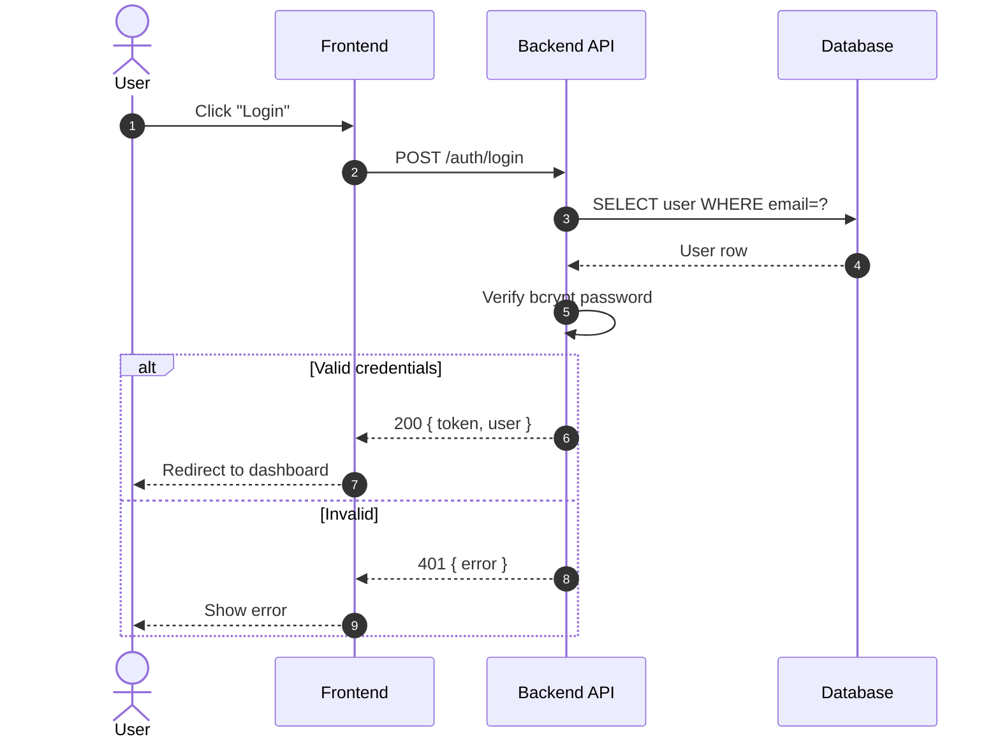
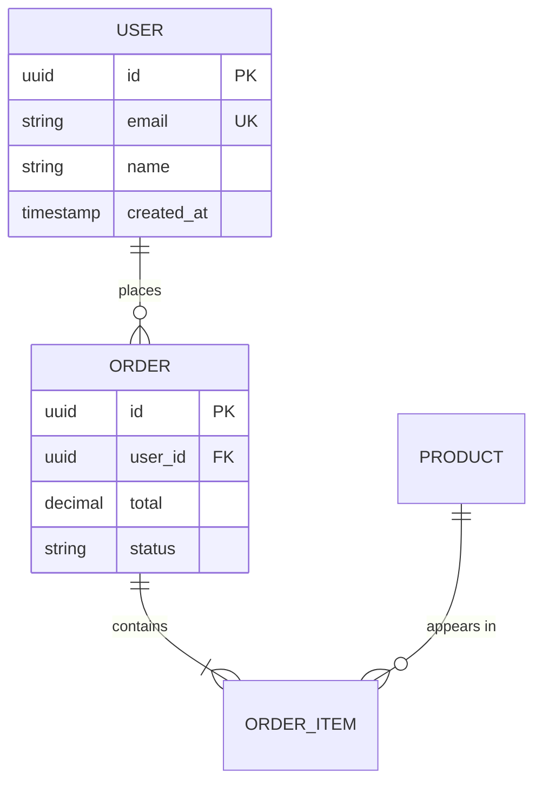
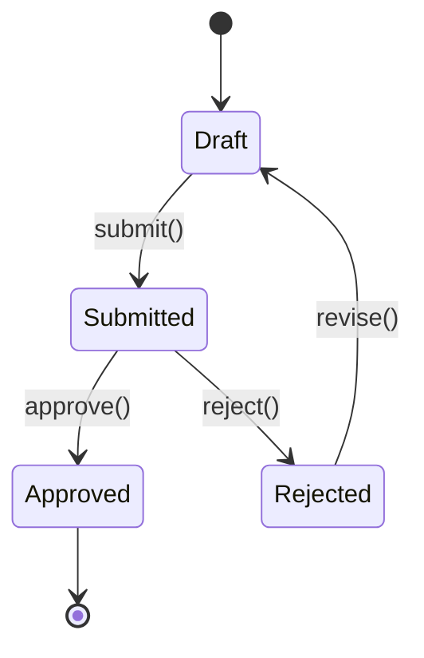
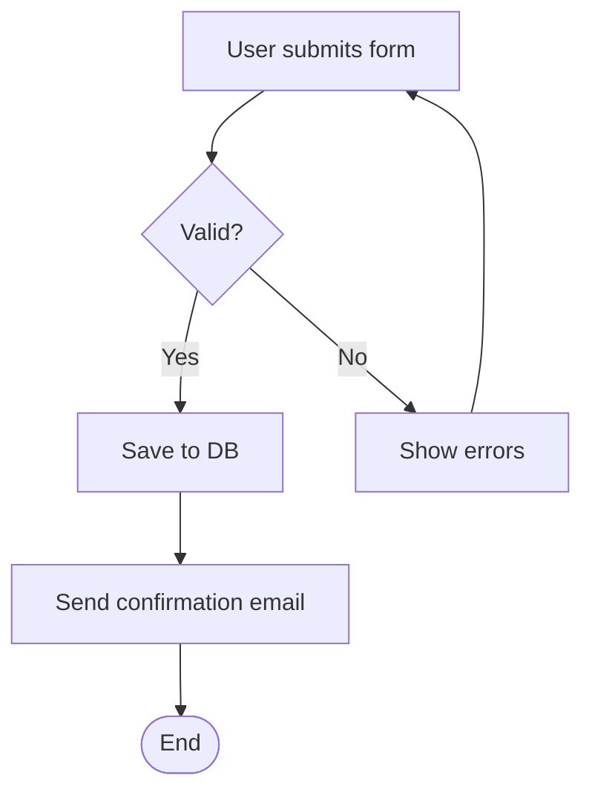

# skill: docker-sandbox

Use when a project should run in its own Docker container, not on the host, or the user says sandbox.

# docker-sandbox — ห้องทดลองต่อโปรเจกต์

> เครื่องเราเป็นคนสั่ง ห้องทดลองเป็นที่ลงมือ
> ข้างในติดตั้ง ลบ รันเซิร์ฟเวอร์ ทำฐานข้อมูลทดสอบได้เต็มที่ เพราะพังแล้วล้างทิ้งสร้างใหม่ได้ในคำสั่งเดียว
> ข้างนอก (เครื่องจริง · ระบบจริง · บัญชีจริง) แตะไม่ได้ เพราะไม่มีทางเข้าจากข้างใน

ใช้คู่กับ [`superuser`](../superuser/SKILL.md) — โปรเจกต์ที่มี `.sandbox/` งานติดตั้งและรันทุกอย่างทำในห้องนี้

---

## 1 · หนึ่งโปรเจกต์ = หนึ่งห้อง

- **ห้องเดียวต่อโปรเจกต์** ชื่อ `sandbox-agent-<ชื่อโฟลเดอร์>-<วันที่สร้าง>` (เช่น `sandbox-agent-sample-app-20260125`)
  - ตั้งชื่อครั้งเดียวตอน `up` แรก แล้วเก็บในไฟล์ `.sandbox/.name-<ชื่อโฟลเดอร์>` คำสั่งทีหลังอ่านชื่อจากไฟล์นี้ ชื่อจึงไม่เปลี่ยนตามวัน
  - prefix `sandbox-agent-` บอกว่า agent สร้างห้องนี้ ไม่ใช่คนตั้ง ส่วนวันที่สร้างเก็บซ้ำไว้ใน label `sqt.created`
  - ถ้าโปรเจกต์ต้องมีฐานข้อมูล cache หรือเบราว์เซอร์ ให้เพิ่มเป็น service ใน**ห้องเดียวกัน** (stack เดียว) ไม่แยกห้องใหม่
- **image ฐานใช้ร่วมกันทั้งเครื่อง** — `sqt-sandbox-base:1` (Node · Python · Git · Playwright Chromium · Claude Code) build ครั้งเดียว ส่วน image ของแต่ละโปรเจกต์เพิ่มแค่ชั้นบาง ๆ ที่โปรเจกต์นั้นต้องใช้ จึงไม่กินดิสก์ซ้ำ
- **ห้องที่หยุดอยู่ไม่กิน CPU และหน่วยความจำ** กินแค่ดิสก์ จบงานแล้วให้ `stop` และเลิกงานทั้งวันให้ `stop-all`
- **ห้องเพิ่มชั่วคราว** (`-Name <โปรเจกต์>-a1`) ใช้เฉพาะตอนลองหลายทางพร้อมกันที่ต้องแยกเครื่องจริง (งานลองหลายทางทั่วไปใช้ git worktree ต่อตัวตาม `parallel-split-and-merge` เร็วกว่า) แล้ว `destroy` ทิ้งทันทีที่เลือกได้
- **ไม่รวมหลายโปรเจกต์ไว้ห้องเดียว** — เพราะของที่ติดตั้งจะชนกัน โปรเจกต์หนึ่งพังแล้วลามไปอีกโปรเจกต์ และล้างทีละโปรเจกต์ไม่ได้

## 2 · สองแบบ เลือกตามงาน

| | **mount** (ค่าเริ่ม) | **isolated** (`-Isolated`) |
|---|---|---|
| ไฟล์โปรเจกต์ | โฟลเดอร์จริงต่อเข้าไปที่ `/work` แก้แล้วเห็นบนเครื่องทันที | สำเนาอยู่ใน volume โฟลเดอร์จริงต่อเข้าไปแบบอ่านอย่างเดียวที่ `/src` |
| ใครแก้ไฟล์ | Claude Code บนเครื่องแก้ไฟล์ตามปกติ | Claude Code **ในห้อง** (`sandbox.ps1 claude`) |
| ใครรันคำสั่ง | ส่งเข้าห้องด้วย `sandbox.ps1 exec "..."` | Claude Code ในห้องรันเอง ไม่มีหน้าต่างขออนุญาต |
| ผลกลับมาอย่างไร | อยู่ในโฟลเดอร์แล้ว | `sandbox.ps1 sync` → patch ใน `_to_delete\sandbox\` แล้วคนสั่ง `git apply` |
| ใช้เมื่อ | งานประจำวันที่คนดูอยู่ | งานทั้งคืน · งานเสี่ยง · ลองหลายทางที่ต้องแยกเครื่องจริง (ห้องละทาง) |

เพิ่ม `-Locked` ได้ทั้งสองแบบ — ปิดอินเทอร์เน็ตขาออก เหลือเฉพาะโฮสต์ใน `allowlist.txt` เหมาะกับงานที่รันโค้ดที่ยังไม่ไว้ใจ

---

## 3 · ตั้งห้องให้โปรเจกต์ (ครั้งแรก)

1. ตรวจว่า Docker Desktop รันอยู่ — `docker version` ต้องเห็นทั้ง Client และ Server ถ้าไม่เห็น ให้บอกผู้ใช้ให้เปิด Docker Desktop แล้วหยุดเฉพาะงานนี้
2. คัดลอกทุกไฟล์ใน `assets/` ของ skill นี้ไปที่ `<โปรเจกต์>/.sandbox/` (ที่ราก) แล้วประกาศ `.sandbox/` เป็นข้อยกเว้นของรากใน README ของโฟลเดอร์โค้ด ตาม `project-doc-set` ข้อ 1
3. ปรับ `Dockerfile` (ชั้นของโปรเจกต์)
   - ถ้าเป็น .NET ให้ตั้ง `INSTALL_DOTNET=1` แล้วเพิ่ม `apt-get install` ของที่โปรเจกต์ต้องใช้
   - **อย่าแก้ `base.Dockerfile`** ถ้าไม่จำเป็น เพราะทุกโปรเจกต์ใช้ร่วมกัน
   - ถ้าต้องมีฐานข้อมูลทดสอบ ให้เพิ่มเป็น service ใหม่ใน `compose.yaml` (ไม่เปิด port ออกนอก)
4. เพิ่ม `.sandbox/.mode-*` และ `.sandbox/.name-*` ใน `.gitignore`
5. เปิดห้อง — `.\.sandbox\sandbox.ps1 up` (หรือ `up -Isolated` · `up -Browser`) โปรเจกต์แรกของเครื่องต้อง build image ฐานก่อน ใช้เวลาราว 5–15 นาที ส่วนโปรเจกต์ถัดไปจะเร็วขึ้นมาก
6. **พิสูจน์ว่าใช้ได้** — `sandbox.ps1 exec "node -v && python3 --version && git status"` ถ้าโปรเจกต์มีคำสั่ง test ให้รันผ่าน `exec` 1 ครั้ง ส่วนโหมด `-Locked` ต้องเห็นบรรทัด `check passed`
7. ลงใน `docs/README.md` ของโปรเจกต์ — ชื่อห้อง (`sandbox-agent-<ชื่อโฟลเดอร์>-<วันที่>`) · โหมด · port · คำสั่ง test ในห้อง

**ทดสอบจริงแล้ว** บน Windows + Docker Desktop 4.46 (2026-10-05, โปรเจกต์ `sample-app`) — build ห้องได้ · unit test ผ่าน 15/15 · e2e บน Chromium ผ่าน 14/14 ในห้อง

บั๊กที่เจอระหว่างทดสอบแก้ในสคริปต์แล้ว: PowerShell 5.1 กับ stderr · Playwright คนละรุ่นกับ image ฐาน · พอร์ตชน

ถ้าสคริปต์พังบนเครื่องอื่น ให้ใช้ playbook `bug-fix` กับตัวสคริปต์

**พอร์ต** — `up` หาพอร์ตว่างเอง เริ่มที่ 3000 แล้วบอกว่าได้พอร์ตไหน
- ในห้องตั้งตัวแปร `APP_PORT` และ `PORT` เป็นพอร์ตนั้น และ `HOST=0.0.0.0`
- แอปต้องฟังที่ `HOST` เพราะถ้าฟังแค่ `127.0.0.1` ในห้อง เครื่องจะเข้าไม่ถึง
- ฝั่งเครื่องยังเปิดแค่ `127.0.0.1` เหมือนเดิม จึงเข้าจากเครื่องที่ `http://127.0.0.1:<พอร์ต>`

**Playwright คนละรุ่น** — image ฐานมี Chromium รุ่นล่าสุด ถ้าโปรเจกต์ล็อก Playwright รุ่นอื่นไว้ ให้รัน `npx playwright install chromium` ในห้อง 1 ครั้งหลัง `npm ci` (ไม่ต้อง `--with-deps` เพราะ image มีให้แล้ว)

---

## 4 · ใช้ทุกวัน

| ต้องการ | คำสั่ง (รันที่รากโปรเจกต์บนเครื่อง) |
|---|---|
| รันคำสั่งในห้อง (agent ใช้อันนี้) | `.\.sandbox\sandbox.ps1 exec "npm test"` |
| เปิด shell ในห้อง | `.\.sandbox\sandbox.ps1 shell` |
| ให้ Claude Code ทำงานในห้องเต็มที่ | `.\.sandbox\sandbox.ps1 claude` (ล็อกอินครั้งแรกครั้งเดียว volume เก็บไว้) |
| เอางานจากห้อง isolated ออกมา | `.\.sandbox\sandbox.ps1 sync` แล้วอ่าน patch ก่อน `git apply` |
| ห้องทั้งหมดในเครื่อง | `.\.sandbox\sandbox.ps1 list` |
| ล้างห้องให้สะอาด เริ่มใหม่ | `reset` แล้ว `up` |
| หยุดทุกห้องในเครื่อง คืนหน่วยความจำ | `.\.sandbox\sandbox.ps1 stop-all` |
| ห้องหลายห้องของโปรเจกต์เดียว | ใส่ `-Name <โปรเจกต์>-a1` ทุกคำสั่ง |

**กฎของ agent เมื่อโปรเจกต์มี `.sandbox/`**
- install · build · test · dev server · migration และสคริปต์ใด ๆ ให้รันผ่าน `sandbox.ps1 exec` ไม่รันบนเครื่อง
- skill ตรวจแอปของโปรเจกต์ (`app-verifier-setup`) รัน Playwright ในห้องแบบไม่มีหน้าจอ แล้วคัดภาพออกด้วย `docker compose cp` มาไว้ `_to_delete/`
- ถ้าห้องหยุดอยู่ ให้ `up` เองได้เลย (ย้อนได้) ถ้าห้องพังจนแก้ไม่ได้ ก็ `reset` เองได้ เพราะของในห้องไม่ใช่ของผู้ใช้ — **ยกเว้น** ห้อง isolated ที่ยังไม่ได้ `sync` ต้อง sync ก่อนแล้วค่อย reset

---

## 5 · เบราว์เซอร์เสมือนสำหรับทดสอบ

| แบบ | ใช้เมื่อ | วิธี |
|---|---|---|
| headless ในห้อง (ค่าเริ่ม) | test อัตโนมัติ · verify skill · ไม่ต้องมีใครดู | Playwright Chromium มากับ image ฐานแล้ว |
| **มองเห็นได้** (`up -Browser`) | อยากดู agent กดจริงทีละขั้น · ตรวจหน้าจอด้วยตา · อัดภาพ | เบราว์เซอร์จริงในคอนเทนเนอร์แยก ดูสดที่ `http://127.0.0.1:7900` และ Playwright ในห้องจะขับผ่าน `SELENIUM_REMOTE_URL` ให้เอง (Playwright เรียกความสามารถนี้ว่ายังทดลอง) |
| ให้ Claude Code ในห้องคุมเบราว์เซอร์เอง | งานสำรวจหน้าเว็บที่ยังไม่มีสคริปต์ | ติดตั้ง Playwright MCP server ในห้อง (`.mcp.json` ของโปรเจกต์) ให้ทำงานแบบ headless |

- เบราว์เซอร์ในห้องไม่มีบัญชี ไม่มีคุกกี้ ไม่มีรหัสผ่านของผู้ใช้ — ล็อกอินด้วยบัญชีทดสอบของโปรเจกต์เท่านั้น
- ภาพและวิดีโอจากการทดสอบ คัดออกมาที่ `_to_delete/` ด้วย `docker compose cp`
- เบราว์เซอร์ของผู้ใช้บนเครื่อง (Chrome ที่ล็อกอินอยู่) ใช้กับเว็บจริงที่ต้องใช้บัญชีจริงเท่านั้น และทำตามกติกาของเครื่องมือนั้น ไม่ใช่ที่ทดสอบ

## 6 · CAPTCHA

- **ระบบของเราเอง** — CAPTCHA ไม่ควรขวางการทดสอบตั้งแต่ต้น
  - ใช้ค่าทดสอบ (test site key) ที่ผู้ให้บริการแจกไว้ ซึ่งผ่านทุกครั้ง reCAPTCHA · hCaptcha · Cloudflare Turnstile มีให้ทุกเจ้า ดูค่าได้จากเอกสารผู้ให้บริการ
  - หรือปิดด้วยค่าตั้งเฉพาะ environment ทดสอบ (`CAPTCHA_ENABLED=false`)
  - **ค่าทดสอบต้องไม่หลุดไปถึงระบบจริง** — ใส่ตัวตรวจตอนเริ่มระบบว่า production ห้ามใช้ test key (`config-and-secrets`)
- **เว็บของคนอื่น** — agent **ไม่แก้ CAPTCHA และไม่หาทางหลบ** (ไม่ใช้บริการรับแก้ ไม่ปลอมตัวเป็นคน) ถ้าเจอ CAPTCHA ให้หยุดขั้นนั้น บอกผู้ใช้ให้ทำเอง แล้วทำส่วนอื่นต่อ ถ้าต้องดึงข้อมูลจากเว็บนั้นบ่อย ให้หา API ทางการแทน
- เหตุผล — CAPTCHA คือเจ้าของเว็บบอกว่า "ห้ามบอท" การหลบจึงเท่ากับฝ่าข้อตกลงของเขา และทำให้ IP หรือบัญชีถูกแบน

## 7 · ในห้องทำได้เต็มที่

ติดตั้งโปรแกรม (`sudo apt-get` · `npm -g` · `pip`) · ลบไฟล์ในห้อง · รันเซิร์ฟเวอร์และฐานข้อมูลทดสอบ · ดาวน์โหลด dependency · commit ในสำเนาของโหมด isolated · ทดลองทำลายแล้วสร้างใหม่

เรื่องที่ยังอยู่ใน "รออนุมัติ" แม้อยู่ในห้อง (เตรียมไว้ ไม่ทำเอง) — เพราะผลออกไปนอกห้อง:
- ส่งข้อมูล อีเมล ข้อความ หรือเรียก API ที่มีผลจริงกับคนหรือระบบภายนอก
- ใช้บัญชีจริง ค่าลับจริง ฐานข้อมูลจริง
- push ขึ้น remote · deploy
- ในโหมด mount — ลบหรือเขียนทับไฟล์ของผู้ใช้ใน `/work` ที่ไม่ใช่ผลงานของรอบนี้ (มันคือโฟลเดอร์จริง)

---

## 8 · ห้ามแก้ compose ให้มีสิ่งเหล่านี้

| ห้าม | เพราะ |
|---|---|
| `privileged: true` · `pid: host` · `network_mode: host` | ห้องจะมองเห็นและแตะเครื่องจริงได้ |
| mount `/var/run/docker.sock` หรือ `//./pipe/docker_engine` | คุม Docker ได้ = คุมเครื่องได้ |
| mount โฟลเดอร์ home · `.ssh` · `.aws` · `.azure` · `.claude` ของเครื่อง · โปรไฟล์เบราว์เซอร์ · ไดรฟ์ทั้งลูก | ค่าลับหลุดได้ทันทีที่โค้ดในห้องอ่าน |
| เปิด port แบบ `"3000:3000"` (ทุกการ์ดแลน) | คนในเครือข่ายเดียวกันเข้าถึงได้ — ใช้ `127.0.0.1:` เสมอ |
| ใส่ค่าลับจริงใน `Dockerfile` หรือ image | ค่าลับติดไปกับ image ตลอด |
| ปิดหรือเพิ่ม limit `cpus` `mem_limit` `pids_limit` จนเครื่องค้าง | ห้องที่วนไม่จบจะกินเครื่องทั้งเครื่อง |

เอกสารของ Claude Code เตือนไว้ว่า แม้ในคอนเทนเนอร์ การรันแบบไม่มีหน้าต่างขออนุญาต (`--dangerously-skip-permissions`) ยังกันไม่ได้ถ้าโค้ดในโปรเจกต์ตั้งใจขโมยของที่อยู่ในห้อง รวมถึง token ของ Claude Code เอง — ใช้กับ repo ที่ไว้ใจเท่านั้น และใช้ `-Locked` เมื่อไม่แน่ใจ

---

## 9 · หมายเหตุ Windows

- Docker Desktop ใช้ WSL 2 ไฟล์บนไดรฟ์ `C:` ที่ mount เข้าไปจึงช้ากว่าไฟล์ใน volume ถ้า build หรือ test ช้ามาก ให้ใช้ `-Isolated` (ตรวจจริง: `npm ci` แค่ 2 แพ็กเกจใช้ 52 วินาทีบนโฟลเดอร์ OneDrive)
- **โปรเจกต์ในโฟลเดอร์ OneDrive** — โหมด mount จะทำให้ `node_modules` และไฟล์ build ถูก sync ขึ้นคลาวด์ จึงควรใช้ `-Isolated` หรือย้ายโปรเจกต์ออกจาก OneDrive
- ถ้ารัน `sandbox.ps1` ไม่ได้ ให้ใช้ `powershell -ExecutionPolicy Bypass -File .\.sandbox\sandbox.ps1 <คำสั่ง>`
- `-Locked` อ่าน IP ของโฮสต์ครั้งเดียวตอนเปิด บริการที่เปลี่ยน IP บ่อยอาจหลุด ให้ `up -Locked` ใหม่

## เชื่อมกับ skill อื่น

- [`parallel-attempts-pick-best`](../parallel-attempts-pick-best/SKILL.md) — ปกติผู้แข่งใช้ git worktree ต่อตัว · ใช้ห้อง isolated ต่อตัว (`-Name <โปรเจกต์>-a1` …) เฉพาะงานที่ต้องแยกเครื่องจริง
- [`app-verifier-setup`](../app-verifier-setup/SKILL.md) — สคริปต์ `start` ของ verify skill รันในห้อง
- `config-and-secrets` — ค่าทดสอบใส่ `.env` ที่ไม่เข้า git และไม่ bake ลง image
- playbook `housekeeping` ของ `superuser` — เก็บกวาดห้องและ image เก่า


---

# skill: project-doc-set

Use when a project needs its doc set decided (which docs, order, where they live) or DRAFT open items listed in one Excel.

# ชุดเอกสารโปรเจกต์

> **กฎข้อเดียว:** เอกสารทุกชิ้นต้องตอบได้ว่า **ใครอ่าน** และ **อ่านแล้วตัดสินใจอะไร**
> ถ้าตอบไม่ได้ ก็ไม่ต้องเขียน

---

## เมื่อไหร่ใช้ skill นี้

เปิดโปรเจกต์ใหม่แล้วต้องตัดสินว่ามีเอกสารอะไร · เอกสารกระจัดกระจายไม่รู้ว่าอันไหนตัวจริง · ลูกค้าถามว่าส่งมอบอะไรบ้าง · จะเขียนเอกสารแต่ไม่แน่ใจว่าต้องมีอะไรก่อน

## เมื่อไหร่ **ไม่** ใช้

| สถานการณ์ | ใช้แทน |
|---|---|
| โครงโฟลเดอร์ของ**โค้ด** (รวม `docs/` ในโค้ดของแบบ A) · README · CHANGELOG · linter | `project-bootstrap` |
| ตั้ง**ชื่อไฟล์** และเลขเวอร์ชันของเอกสาร | `document-naming` |
| ลงมือเขียนเอกสารชิ้นใดชิ้นหนึ่ง | skill ของเอกสารนั้น (ตารางข้อ 4) |
| จัดรูปแบบหน้าเอกสารให้สวย | `branded-document-design` |

---

## 1 · เอกสารอยู่ในหรืออยู่นอก repo

**ตัดสินข้อนี้ก่อน** (ย้ายทีหลังต้องแก้ลิงก์ทั้งโปรเจกต์) · **ค่าเริ่มต้นคือแบบ B** แม้เอกสารเป็น markdown ล้วน โค้ดอยู่ใน `<project-name>/` (ตัวพิมพ์เล็กคั่น `-`) · แบบ A เมื่อผู้ใช้ขอเท่านั้น

- **แบบ B** (เอกสารนอก repo) — ใช้กับทุกขนาดชุด (S · M · L) · `.docx` / `.xlsx` / mockup / PNG ที่ลูกค้าต้องเห็นไม่ปนใน pull request · ผังรากอยู่ข้างล่าง (ข้อนี้คือเจ้าของผังราก)
- **แบบ A** (เอกสารใน repo) — เฉพาะเมื่อผู้ใช้ขอ และเอกสารเป็น markdown ล้วน · เอกสารกับโค้ดเปลี่ยนใน pull request เดียวกัน · รากเหมือนแบบ B แต่ไม่มี `docs/` ที่ราก — `docs/` อยู่ในโฟลเดอร์โค้ด ผังข้างในเป็นของ `project-bootstrap` ข้อ 1
- แบบ A ที่โตจนมีเอกสารส่งมอบ → ย้ายเป็นแบบ B **ทั้งชุดในครั้งเดียว** เอกสารที่อยู่ 2 ที่คือมี 2 เวอร์ชัน

### โครงของแบบ B

```
<ชื่อโปรเจกต์>/
├─ ref/                 ของที่ได้รับมา — TOR · บันทึกประชุม · ภาพหน้าจอระบบเดิม · ไฟล์จากลูกค้า  **อ่านอย่างเดียว ห้ามแก้**
├─ docs/                เอกสารทุกชิ้นที่เราเขียน — .docx ส่งมอบ และ .md เชิงเทคนิค อยู่ด้วยกัน
│  ├─ figures/          รูปที่ export แล้ว — .png เท่านั้น        [มีเมื่อมีรูปในเอกสารส่งมอบ]
│  │  └─ src/           ไฟล์ต้นทางของรูป (.html · .mmd · .drawio)
│  ├─ decisions/        ADR-NNNN-<slug>.md หนึ่งการตัดสินใจต่อไฟล์  [ทางเลือก]
│  ├─ runbook-<เรื่อง>.md  คู่มือเมื่อระบบมีปัญหา ไฟล์ละเรื่อง        [ทางเลือก]
│  └─ research/         research แอปต้นแบบ (`reference-app-research`) [ทางเลือก]
├─ mockup/              .html ที่เปิดแล้วกดได้จริง
├─ qa/                  test case · ผลทดสอบ · bugs/ รายงานบั๊ก
├─ assets/              โลโก้ · ไอคอนทุกขนาด · favicon · wordmark (ต้นทาง .svg + ไฟล์ export)
├─ _to_delete/          ของชั่วคราวทุกอย่าง
├─ .claude/            skill ของโปรเจกต์ (เช่น verify) — ต้องอยู่ที่ที่เปิด Claude Code
│  └─ superuser/        ไฟล์ทำงานของ SuperUser — CONTEXT.md · HISTORY.md · IMPROVEMENTS.md · log/ · inbox/ · learn/
└─ <project-name>/      repo โค้ด ชื่อโปรเจกต์ตัวพิมพ์เล็กคั่น `-` — โครงข้างในเป็นของ `project-bootstrap`
```

**ไฟล์ของ SuperUser** (`.claude/superuser/` · `docs/BRIEF.md` · `AGENTS.md`/`GEMINI.md`) — ต้นฉบับอยู่ที่ [`superuser/references/team-files.md`](../superuser/references/team-files.md) ที่เดียว

**ADR และ runbook อยู่ใน `docs/` ที่ราก ไม่ใช่ `<project-name>/docs/`** (แบบ A ย้ายทั้ง `docs/` เข้าโฟลเดอร์โค้ด ผังข้างในเหมือนกัน) (`docs/decisions/ADR-NNNN-<slug>.md` · `docs/runbook-<เรื่อง>.md`) — ข้อนี้คือที่เดียวที่กำหนด

**ข้อยกเว้นของราก:** `.sandbox/` อยู่ที่รากได้เมื่อใช้ `docker-sandbox` · `AGENTS.md` / `GEMINI.md` ตามเงื่อนไขข้างบน — ทุกข้อยกเว้นต้องประกาศใน README ของโฟลเดอร์โค้ด

**โฟลเดอร์สร้างเมื่อมีของจริง ไม่สร้างเผื่อ:** `ref/` เมื่อได้ไฟล์จากลูกค้าหรือระบบเดิม (ห้ามปนใน `docs/`) · `docs/figures/` เมื่อมีรูปวาดเองในเอกสารส่งมอบ (ไม่งั้นรูปติดอยู่ใน `.docx` แก้ไม่ได้) · `docs/decisions/` เมื่อมีการตัดสินใจที่ต้องอธิบายทีหลัง · `docs/research/` เมื่อผู้ใช้อยากได้แอปแบบที่มีอยู่ · `qa/` เมื่อมี test case (test case อยู่ที่นี่เสมอ `docs/test-plan.md` มีแค่แผน) · `assets/` เมื่อมีโลโก้หรือไอคอน

**โปรเจกต์แบบ ecosystem** (sub-project ≥ 2 ตัว แต่ละตัวมีเอกสารชุดของตัวเอง) → โฟลเดอร์ชื่อ `ecosystem/` เสมอ (ห้าม `projects/` `modules/` `apps/`) · `ecosystem/<รหัส>-<SUB>/` มี `docs/` `mockup/` `qa/` และ repo ของตัวเอง · เอกสารที่ครอบทุกตัวอยู่ `docs/` ที่รากที่เดียว · ผังและกฎเต็ม → [`references/ecosystem.md`](references/ecosystem.md)


**กฎของโฟลเดอร์ (ใช้ได้ทั้ง 2 แบบ):**

- **`.docx` กับ `.md` อยู่ใน `docs/` เดียวกันได้** ไม่ต้องแยกโฟลเดอร์ เพราะนามสกุลบอกอยู่แล้วว่าใครอ่าน
- **ไฟล์ต้นทางของรูปห้ามหาย** เพราะถ้าปีหน้าต้องแก้รูปแล้วเหลือแต่ PNG ก็ต้องวาดใหม่ทั้งใบ
- **ทุกปุ่มใน mockup ต้องกดได้จริง** เพราะปุ่มหลอกทำให้รีวิวผิด
- **`.docx` / `.xlsx` อยู่ใน `docs/` และ `qa/` เท่านั้น** ไม่กระจายไปรากโปรเจกต์
- **ของชั่วคราวลง `_to_delete/`** (`temp-file-discipline`)
- **`docs/README.md` เป็นสารบัญ** บอกว่าอ่านอะไรก่อนและใครเป็นเจ้าของ (แม่แบบใน `project-bootstrap` → `assets/starter-files.md`)

---

## 2 · เลือกชุดเอกสารตามขนาดงาน

ขนาดวัดจาก **ระยะเวลา × จำนวนคนที่ต้องเห็นพ้องกัน** ไม่ใช่จำนวนบรรทัดโค้ด

**S** ≤ 2 สัปดาห์ · ทีมเดียว · ไม่มีใครนอกทีมต้องเซ็น — **M** 1–3 เดือน · ผู้ว่าจ้างภายใน · ส่งมอบเป็นรอบ — **L** > 3 เดือน · ลูกค้าภายนอกเซ็นรับ · มีข้อผูกพันตามสัญญา

### 2.1 · เอกสารส่งมอบ — คนอ่านและเซ็น

| เอกสาร | รูปแบบ | ผู้อ่าน | S | M | L |
|---|---|---|:-:|:-:|:-:|
| Project Plan | `.docx` | ผู้ว่าจ้าง · ทีม | ○ | ● | ● |
| SRS | `.docx` | dev · ผู้ว่าจ้าง | ○ | ● | ● |
| Architecture | `.docx` | dev · ops | ○ | ● | ● |
| Test Plan | `.docx` | QA · ผู้ว่าจ้าง | ○ | ● | ● |
| คู่มือผู้ใช้ (`MAN`) | `.docx` → `.pdf` | ผู้ใช้ปลายทาง | ○ | ● | ● |
| FSD | `.docx` | dev · QA | ○ | ○ | ● |
| BRD | `.docx` | ฝ่ายธุรกิจ | ○ | ○ | ● |
| Document Checklist | `.docx` | ทุกฝ่าย | ○ | ○ | ● |
| Test Cases | `.xlsx` | QA | ○ | ○ | ● |

● ต้องมี · ○ ไม่ต้อง เว้นแต่มีเหตุผลเฉพาะ
**ชุด S ไม่มีเอกสารกลุ่มนี้เลย** — ถูกแล้ว

---

### 2.2 · เอกสารเชิงเทคนิค — ทีมและ agent ใช้ระหว่างสร้าง

เป็น markdown ทั้งหมด และ**ขึ้นกับว่าโปรเจกต์มีอะไร** ไม่ใช่ขนาดงาน · ตารางเต็ม (ไฟล์ · ตอบคำถามอะไร) → [`references/technical-docs.md`](references/technical-docs.md)

- **เสมอ:** `<project-name>/README.md` · `docs/BUILD-PLAN.md`
- **มีเงื่อนไข:** USER-STORIES และ `docs/sprints/sprint-NN.md` (ทำงานเป็น sprint) · AGENT-LOOP (agent เขียนโค้ดเป็นรอบ) · API-SPEC (มี API ที่คนอื่นเรียก) · DATA-DICTIONARY (มีฐานข้อมูล) · EVALUATION-POLICY และ PROMPT-LIBRARY (ใช้ LLM) · `docs/decisions/ADR-NNNN-<slug>.md` (การตัดสินใจที่จะถูกถามซ้ำ) · `docs/runbook-<เรื่อง>.md` (ระบบรันจริงและมีคนอยู่เวร)
- ตัวที่คนลืมบ่อยสุดคือ 4 ตัวเรื่อง LLM · API · ฐานข้อมูล แล้วต้องถาม agent ซ้ำทุกรอบว่า prompt ตัวไหนคือตัวจริง

---

## 3 · ลำดับการเขียน

**สายส่งมอบ** — ห้ามข้ามขั้นที่อยู่ในชุดของขนาดงานนั้น (ขั้นที่ไม่อยู่ในชุด เช่น BRD · FSD ของชุด M ให้ข้ามไป)

```
Project Plan ─► BRD ─► SRS ─┬─► mockup
                            └─► Architecture ─► FSD
                                                 │
              User Guide ◄─ Test Cases ◄─ Test Plan
```

**ชิ้นถัดไปเขียนต่อบนฉบับ DRAFT ของชิ้นก่อนหน้าได้** ข้อที่ยังไม่ยืนยันใส่ `(รอยืนยัน)` ไว้ทั้งสองชิ้น · ห้ามเปลี่ยนสถานะชิ้นถัดไปเป็น APPROVED ก่อนชิ้นก่อนหน้า เพราะถ้าชิ้นต้นทางเปลี่ยนต้องรื้อทั้งสาย
ข้อยกเว้นเดียว: **mockup ทำคู่ไปกับ SRS ได้** เพราะภาพหน้าจอช่วยให้ SRS ถูกยืนยันเร็วขึ้น

### 3.1 · ทะเบียนจุดค้าง — ผู้ใช้ถามว่า "ยังติดตรงไหน" ตอบเป็นไฟล์ Excel ไม่ใช่ข้อความในแชต

ป้าย `(รอยืนยัน)` · `(รอวัดใน Phase 0)` และตารางคำถามกระจายอยู่ทุกเอกสาร ผู้ตัดสินใจจึงไม่เห็นภาพรวม · รวมเป็นไฟล์เดียวด้วยสคริปต์ ไม่ไล่อ่านเอง:

```
python scripts/open_items.py docs/ docs/<CODE>-OPEN-ITEMS.xlsx --project <CODE>    # ทดสอบสคริปต์: --self-test
```

- อ่านทุก `.docx` ใน `docs/`: ตารางคำถาม · ตารางข้อสมมติที่ยังไม่ตัดสิน · ตารางลงนามที่ยัง "รอ" · ป้ายในเนื้อหา · ข้ามประวัติการแก้ไข สารบัญ บรรทัดอธิบายป้าย และ `(รอบหลัง)`
- แผ่น **สรุป** นับตามเอกสาร × ประเภทด้วยสูตร · แผ่น **รายการค้าง** มีหัวข้อในเอกสาร · ใครตอบ · ตัดสินภายใน · ค่าที่ใช้ไปก่อน · ข้อที่อ้างถึงกัน · ช่อง "สถานะ" และ "คำตอบ" ให้กรอก
- ประเภท: **เจ้าของตัดสิน** (ค้นเว็บแล้วปิดไม่ได้) · **ทีมตัดสิน** (BA · SA) · **กฎหมาย** · **วัดจริง** (ไม่มีตัวเลขเผยแพร่) · **ลงนาม** — คำถามที่อ้างคำถามของเจ้าของในเอกสารอื่นถูกนับเป็น "เจ้าของตัดสิน" ด้วย
- **ก่อนส่ง เปิดอ่านรายการด้วยตาเอง** — สคริปต์จับจากถ้อยคำ แถวที่ตอบไปแล้วแต่เขียนไม่ตรงคำว่า "ตอบแล้ว · ปิดแล้ว · ตัดสินแล้ว" ยังติดมา · ใน LiteNet v0.5 (6 ฉบับ) ได้ 75 รายการ มีแถวแบบนี้ราว 3 แถว
- ผู้ใช้กรอกคำตอบแล้ว → เติมคำตอบลงเอกสารต้นทาง ลบป้าย บันทึกในประวัติการแก้ไข แล้วรันสคริปต์ซ้ำ · ไฟล์นี้เป็นรายการงาน ไม่ใช่ต้นฉบับ อย่าแก้คำตอบในไฟล์นี้แทนเอกสาร

**สายเทคนิค** — เขียนเมื่อถึงจุดที่ต้องใช้ ไม่ต้องรอใคร: README · BUILD-PLAN ก่อนโค้ดบรรทัดแรก · DATA-DICTIONARY ตอนออกแบบตารางแรก · API-SPEC ตอน endpoint แรก · PROMPT-LIBRARY ตอน prompt แรกที่ใช้จริง · ADR ตอนตัดสินใจ (ไม่ใช่ตอนสรุปท้าย เพราะเหตุผลจริงหายแล้ว) · Runbook ก่อนขึ้นระบบจริง — ตารางเต็มใน [`references/technical-docs.md`](references/technical-docs.md)

---

## 4 · ใครเขียนชิ้นไหน ด้วย skill อะไร

ตารางเต็ม (agent · skill ต่อเอกสาร 16 ชนิด) → [`references/technical-docs.md`](references/technical-docs.md) · หลัก ๆ: SRS → `srs-writing` · FSD → `fsd-writing` · ADR → `adr-writer` · Test → `test-case-template` · mockup → `web-app-design` + `ui-craft` · README → `project-bootstrap`

---

## 5 · รูปในเอกสาร — เลือกให้ถูกตั้งแต่ต้น

- รูปใน README · PR · เอกสารในทีม → Mermaid (`software-diagrams`) ฝังใน `.md`
- รูปในเอกสารที่ลูกค้าเซ็น · สไลด์ · งานพิมพ์ → `diagram-figures` เก็บ `docs/figures/` + ต้นทางใน `src/` · **Mermaid ค่าเริ่มต้นห้ามเข้าเอกสารส่งมอบ** (สีสุ่มไม่มีความหมาย ไทยล้นกรอบ ย่อลง A4 แล้วอ่านไม่ออก)

**หัวรูปทุกใบต้องมีครบ 5 อย่าง** — ชื่อ · คำขยาย 1 บรรทัด · เลขรูป · เวอร์ชันกับวันที่ · เจ้าของ
รูปสถาปัตยกรรมถูกก๊อปไปวางในอีเมลและสไลด์แล้วอยู่ต่ออีกเป็นปี **รูปที่ไม่มีวันที่ ไม่มีใครกล้าแก้**

---

## 6 · ธีมสีของชุดเอกสาร

ประกาศครั้งเดียวต่อโปรเจกต์ บนหัวไฟล์ต้นทางของทุกเอกสาร:

```markdown
<!-- doc-theme: accent=#5B4BE8 -->
```

`branded-document-design` · `presentation-design` · `diagram-figures`
อ่านค่านี้แทนการเลือกสีเอง เอกสาร สไลด์ และรูปทุกใบจึงเป็นชุดเดียวกัน

**สีมาจากเนื้องาน ไม่ใช่จากรสนิยม** — มีสีแบรนด์ใช้สีแบรนด์ · ยังไม่มีใช้สีประจำบ้านของ `branded-document-design` เขียน `(รอยืนยัน)` แล้วทำต่อ ไม่หยุดถาม
ข้อยกเว้นที่ไม่เปลี่ยนตามธีม: สีโลโก้ผู้ให้บริการ · สีเทาของเส้นโครงสร้าง · เขียว = ผ่าน / แดง = ไม่ผ่าน

---

## 7 · รายการตรวจก่อนส่งมอบชุดเอกสาร

- [ ] ทุกไฟล์ `.docx` เปิด Navigation Pane แล้ว**เห็นหัวข้อครบ** (ใช้ Heading style จริง ไม่ใช่ตัวหนา)
- [ ] ทุกเอกสารมีหน้าประวัติการแก้ไข · เลขเวอร์ชัน · วันที่ · ผู้จัดทำ
- [ ] ทุกรูปมีเลขรูปและถูกอ้างในเนื้อความอย่างน้อย 1 ครั้ง
- [ ] ไฟล์ต้นทางของทุกรูปอยู่ใน `docs/figures/src/` (ถ้ามีโฟลเดอร์นี้)
- [ ] เอกสารเชิงเทคนิคที่เข้าเงื่อนไขในข้อ 2.2 มีครบ เช่น ถ้ามี API ต้องมี API-SPEC และถ้าใช้ LLM ต้องมี PROMPT-LIBRARY
- [ ] ตัวย่อทุกตัวเขียนเต็มครั้งแรกที่ปรากฏ
- [ ] ชื่อไฟล์ตรงตาม `document-naming` — ไม่มี `final2` ไม่มี `ล่าสุด`
- [ ] เอกสารในชุดอ้างเวอร์ชันของกันและกันตรงกัน
- [ ] รัน `scripts/open_items.py` แล้วทะเบียนจุดค้างไม่มีแถวสถานะ "เปิด" (หรือผู้ว่าจ้างรับรู้ทุกแถวที่ยังเปิด)
- [ ] `_to_delete/` ว่าง หรือถูกลบไปแล้ว

---

## 8 · Anti-patterns

❌ `.docx` ไม่มี Heading style · เก็บแต่ PNG ไม่เก็บต้นทาง · `.docx` และ mockup ใน repo โค้ด (ถึงจุดนี้ต้องย้ายเป็นแบบ B) · เอกสารอยู่ 2 ที่ (= 2 เวอร์ชัน) · FSD ก่อน SRS ยืนยัน · ใช้ LLM แต่ไม่มี PROMPT-LIBRARY · sub-project ชื่อ `projects/` `modules/` `apps/` · โฟลเดอร์ว่างสร้างเผื่อ · เอกสารชิ้นเดียวตอบทุกคำถาม

---

## 9 · ตัวย่อ

ADR Architecture Decision Record · BRD Business Requirements Document · FSD Functional Specification Document · QA Quality Assurance · SRS Software Requirements Specification · TOC Table of Contents

---

## 10 · เชื่อมกับ skill อื่น

นอกจากตาราง "ไม่ใช้" ด้านบน: วาดรูป → `diagram-figures` (ส่งมอบ) · `software-diagrams` (ในทีม) · ของชั่วคราว → `temp-file-discipline` · สถานะเอกสารใน `docs/BUILD-PLAN.md` → `status-report` · รายการตรวจฉบับพิมพ์ → `assets/doc-set-checklist.md`

**อ่านเพิ่มเมื่อต้องใช้:** [`references/writer-templates.md`](references/writer-templates.md) — แม่แบบเอกสารของ


## reference: ecosystem.md

# โปรเจกต์แบบ ecosystem — 1 ระบบ แบ่งเป็นหลาย sub-project

อ่านเมื่อโปรเจกต์มี sub-project ตั้งแต่ 2 ตัวและแต่ละตัวมีเอกสารชุดของตัวเอง · กฎย่ออยู่ใน `SKILL.md` ข้อ 1

ใช้เมื่อโปรเจกต์เป็นชุดผลิตภัณฑ์ที่มี sub-project ตั้งแต่ 2 ตัวขึ้นไป และแต่ละตัวมีเอกสารชุดของตัวเอง (SRS · mockup · สถาปัตยกรรม) เช่น Quanton ที่แบ่งเป็น CONNECT · LAB · INTEL · DESK
**ชื่อโฟลเดอร์ต้องเป็น `ecosystem/` เสมอ** ห้ามใช้ `projects/` `modules/` หรือ `apps/` เพราะพอเปิดโฟลเดอร์แล้วต้องรู้ทันทีว่าทุกตัวข้างในเป็นชิ้นของระบบเดียวกัน

```
<ชื่อโปรเจกต์>/
├─ docs/                เอกสารระดับ ecosystem — README (สารบัญ) · BUILD-PLAN · project-plan · BRD · figures/
├─ ecosystem/
│  └─ <รหัส>-<SUB>/     1 โฟลเดอร์ต่อ 1 sub-project เช่น QTN-CONNECT
│     ├─ docs/          srs.md · architecture.md · decisions/ · figures/ · fsd-*.md · test-plan.md
│     ├─ mockup/
│     ├─ qa/
│     └─ <sub-name>/    repo โค้ดของ sub-project นี้ (ตัวพิมพ์เล็กคั่น `-`)
├─ ref/ · assets/ · _to_delete/ · .claude/   ใช้ร่วมกันทั้ง ecosystem (กติกาเดียวกับแบบ B)
```

- เอกสารที่ครอบทุก sub-project (BRD · แผนโครงการ · BUILD-PLAN) อยู่ใน `docs/` ที่รากที่เดียว ห้ามก๊อปไปไว้ในแต่ละ sub-project
- สร้างโฟลเดอร์ sub-project เมื่อเริ่มเขียนเอกสารของตัวนั้นจริง ไม่สร้างเผื่อ
- ชื่อโฟลเดอร์ sub-project = รหัสโปรเจกต์ + ชื่อ sub-project ตัวพิมพ์ใหญ่ (`QTN-CONNECT`) ใช้รหัสเดียวกับที่เอกสารอ้าง
- โปรเจกต์ที่ใช้ `projects/` อยู่แล้ว → เปลี่ยนชื่อเป็น `ecosystem/` แล้วแก้ path ในเอกสารและสคริปต์ทุกไฟล์ในรอบเดียวกัน
- โปรเจกต์ที่มีผลิตภัณฑ์เดียว ไม่ต้องมี `ecosystem/` ใช้แบบ B ตามปกติ


## reference: technical-docs.md

# เอกสารเชิงเทคนิค — ตาราง ลำดับเขียน และใครเขียน

อ่านเมื่อเลือกชุดเอกสารเชิงเทคนิค หรือกำลังจะเขียนชิ้นใดชิ้นหนึ่ง · สรุปอยู่ใน `SKILL.md` ข้อ 2.2–4

## เอกสารเชิงเทคนิค (ข้อ 2.2)

กลุ่มนี้เป็น **markdown ทั้งหมด** และ**ไม่ได้ขึ้นกับขนาดงาน** แต่ขึ้นกับว่าโปรเจกต์มีอะไร

| เอกสาร | ไฟล์ | ตอบคำถามว่า | ต้องมีเมื่อ |
|---|---|---|---|
| README | `<project-name>/README.md` | ติดตั้งและรันยังไง | **เสมอ** |
| BUILD-PLAN | `docs/BUILD-PLAN.md` | จะสร้างอะไรก่อนหลัง · ตอนนี้ถึงไหนแล้ว | **เสมอ** |
| USER-STORIES | `docs/USER-STORIES.md` | จะสร้างอะไรให้ใคร · story ไหนพร้อมเข้า sprint · AC คืออะไร | ทำงานเป็น sprint หรือมี backlog (`user-story-writer`) |
| Sprint plan | `docs/sprints/sprint-NN.md` | sprint นี้รับ story ไหน · เป้าหมายคืออะไร · เสี่ยงอะไร | ทำงานเป็น sprint (`/sprint-plan`) — ไฟล์ละ sprint ไม่เขียนทับของเก่า |
| AGENT-LOOP | `docs/AGENT-LOOP.md` | agent ทำงานเป็นวงจรแบบไหน · อะไรคือเงื่อนไขว่าจบ | ให้ agent เขียนโค้ดเป็นรอบ ๆ (`spec-to-code-loop`) |
| API-SPEC | `docs/API-SPEC.md` | endpoint ไหนรับอะไร คืนอะไร พังยังไง | มี API ที่คนอื่นเรียก (`api-conventions`) |
| DATA-DICTIONARY | `docs/DATA-DICTIONARY.md` | ฟิลด์นี้แปลว่าอะไร · ค่าที่เป็นไปได้มีอะไรบ้าง | มีฐานข้อมูลหรือสคีมาข้อมูล (`database-design`) |
| EVALUATION-POLICY | `docs/EVALUATION-POLICY.md` | วัดว่าผลลัพธ์ดีพอหรือยังด้วยอะไร · เกณฑ์ผ่านเท่าไร | ผลลัพธ์มาจากโมเดลหรือ LLM ที่ไม่ได้ถูกเสมอ |
| PROMPT-LIBRARY | `docs/PROMPT-LIBRARY.md` | prompt ตัวจริงคือตัวไหน เวอร์ชันอะไร เปลี่ยนอะไรไป | ใช้ LLM ในเส้นทางหลักของระบบ |
| ADR | `docs/decisions/ADR-*.md` | ทำไมถึงเลือกทางนี้ ไม่เลือกทางนั้น | มีการตัดสินใจที่จะถูกถามซ้ำ (`adr-writer`) |
| Runbook | `docs/runbook-<เรื่อง>.md` ไฟล์ละเรื่อง | ระบบล่มตอนตี 2 ต้องทำอะไร | มีระบบที่รันอยู่จริงและมีคนอยู่เวร |

> **เอกสาร 4 ตัวที่มีเงื่อนไขเรื่อง LLM · API · ฐานข้อมูล คือตัวที่คนลืมบ่อยที่สุด**
> แล้วไปจบด้วยการถาม agent ซ้ำทุกรอบว่า "prompt ตัวไหนคือตัวจริง" หรือ "ฟิลด์นี้แปลว่าอะไร"

## สายเทคนิค — เขียนเมื่อไหร่ (ข้อ 3)

| เขียนเมื่อ | เอกสาร |
|---|---|
| ก่อนเขียนโค้ดบรรทัดแรก | README · BUILD-PLAN |
| ก่อนปล่อย agent ทำงานเป็นรอบ | AGENT-LOOP |
| ตอนออกแบบตารางแรก | DATA-DICTIONARY |
| ตอนออกแบบ endpoint แรก | API-SPEC |
| ตอนเขียน prompt ตัวแรกที่จะใช้จริง | PROMPT-LIBRARY · EVALUATION-POLICY |
| ตอนตัดสินใจเรื่องที่จะถูกถามซ้ำ | ADR |
| ก่อนขึ้นระบบจริง | Runbook |

> **ADR กับ DATA-DICTIONARY เขียนตอนที่ตัดสินใจ ไม่ใช่ตอนสรุปท้ายโปรเจกต์**
> เขียนย้อนหลังก็ได้ แต่ตอนนั้นเหตุผลจริงหายไปแล้ว

## ใครเขียนชิ้นไหน ด้วย skill อะไร (ข้อ 4)

| เอกสาร | agent | skill ที่ใช้ |
|---|---|---|
| README · CHANGELOG | `technical-writer` | `project-bootstrap` |
| Project Plan | `project-manager` | `branded-document-design` |
| BRD · user story | `business-analyst` | `user-story-writer` |
| SRS | `system-analyst` | `srs-writing` |
| FSD | `system-analyst` | `fsd-writing` |
| Architecture | `solution-architect` | `architecture-patterns` · `diagram-figures` |
| ADR | `solution-architect` | `adr-writer` |
| Test Plan · Test Cases | `qa-tester` | `test-case-template` |
| mockups | `ux-designer` | `web-app-design` · `ui-craft` |
| คู่มือผู้ใช้ (`MAN`) | `technical-writer` | `polished-document-style` |
| Runbook | `devops-engineer` | `incident-runbook-template` |
| BUILD-PLAN | `project-manager` | `simplicity-first` |
| AGENT-LOOP | `developer` | `spec-to-code-loop` |
| API-SPEC | `system-analyst` | `api-conventions` |
| DATA-DICTIONARY | `system-analyst` | `database-design` |
| PROMPT-LIBRARY · EVALUATION-POLICY | `developer` | — (คู่กับ skill `llm-engineering`) |


## reference: writer-templates.md

# แม่แบบของ technical-writer — README · tutorial · API reference · release notes

ย้ายมาจาก agent `technical-writer` · เปิดเมื่อต้องเขียนเอกสารชนิดนี้จริง · ส่วนที่ไม่รู้ใส่ `(รอยืนยัน)`

## Standard Outputs

### README Template

```markdown
# Project Name

> One-line description that fits in a tweet.

[![badges]](#)

**Demo:** [link] · **Docs:** [link] · **Discord:** [link]

---

## ✨ Features

- 🚀 What makes this special — feature 1
- ⚡ Killer feature 2
- 🔒 Reassuring feature 3

## 🚀 Quick Start

\`\`\`bash
npm install package-name
\`\`\`

\`\`\`typescript
import { thing } from 'package-name';

const result = thing({ option: 'value' });
\`\`\`

That's it. You're done.

## 📚 Documentation

- [Getting Started](#) — 10-minute tutorial
- [How-To Guides](#) — Solve specific problems
- [API Reference](#) — Full API spec
- [Concepts](#) — Why and how it works

## 🤝 Contributing

See [CONTRIBUTING.md](#).

## 📄 License

MIT
```

### Tutorial Template

```markdown
# 🎓 Tutorial: Build Your First X in 10 Minutes

> 💡 **What you'll learn:** by the end, you'll have built Y and understand Z.

## What You'll Need

- ✅ Node.js 18+
- ✅ A free account at example.com
- ⏱️ 10 minutes

## Step 1: Set Up

Run:
\`\`\`bash
npx create-thing my-project
cd my-project
\`\`\`

> 💡 **What just happened?** Brief explanation.

You should see:
\`\`\`
✓ Project created
\`\`\`

## Step 2: Configure

...

## Step 3: Run It

...

## ✅ Congratulations!

You've built X. Try these next:

- [Add feature A](#how-to-add-a) (how-to)
- [Understand B](#concept-b) (explanation)
- [Full API](#reference) (reference)
```

### API Reference Template (per endpoint)

```markdown
## POST `/api/v1/resource`

Create a new resource.

### Authentication

🔒 Required. Bearer token in `Authorization` header.

### Request

\`\`\`http
POST /api/v1/resource HTTP/1.1
Content-Type: application/json
Authorization: Bearer <token>

{
  "name": "string (required)",
  "tags": ["string (optional)"]
}
\`\`\`

### Parameters

| Field | Type | Required | Description |
|-------|------|:--------:|-------------|
| `name` | string | ✅ | Display name, 1-100 chars |
| `tags` | string[] | ❌ | Up to 10 tags |

### Response: 201 Created

\`\`\`json
{
  "id": "res_abc123",
  "name": "...",
  "created_at": "2025-01-15T10:30:00Z"
}
\`\`\`

### Errors

| Code | When |
|:----:|------|
| 400 | Validation failed (see body) |
| 401 | Missing/invalid token |
| 429 | Rate limit (60 req/min) |

### Code Examples

\`\`\`typescript
const res = await fetch('/api/v1/resource', {
  method: 'POST',
  headers: { Authorization: `Bearer ${token}` },
  body: JSON.stringify({ name: 'My Resource' })
});
\`\`\`
```

### Release Notes Template

```markdown
# 🚀 Release v2.1.0 — YYYY-MM-DD

## ✨ Highlights

> The TL;DR for busy readers.

- **New:** X feature — try it: `command`
- **Improved:** Y is now 50% faster
- **Fixed:** Z bug affecting users on platform A

## 🆕 New Features

### Feature Name

Description with user-facing benefit.

\`\`\`bash
# Example usage
command --new-flag
\`\`\`

📖 [Read the docs](#)

## 🔧 Improvements

- Faster initial load time
- Better error messages for X

## 🐛 Bug Fixes

- Fix issue where ... ([#1234](#))
- Resolve crash when ... ([#5678](#))

## ⚠️ Breaking Changes

### `api.oldMethod()` removed

**Before:**
\`\`\`typescript
api.oldMethod(arg)
\`\`\`

**After:**
\`\`\`typescript
api.newMethod({ arg })
\`\`\`

📖 [Migration guide](#)

## 🙏 Contributors

Thanks to: @alice, @bob, @charlie
```


---

# skill: temp-file-discipline

Use when a task writes temporary files (extracts, previews, backups, one-off scripts) into a project.

# ระเบียบไฟล์ชั่วคราว

> **กฎข้อเดียว:** อะไรที่ไม่ใช่ผลงานจริง ต้องอยู่ใน `_to_delete/` เท่านั้น
> ห้ามวางไว้ที่รากโปรเจกต์ ห้ามวางปนกับไฟล์งาน

---

## เลือกที่วาง

| ไฟล์นั้นคืออะไร | วางที่ |
|---|---|
| ของชั่วคราวของงานในโปรเจกต์ผู้ใช้ (ภาพตรวจ · log · สคริปต์ครั้งเดียว · ผลรัน) | `_to_delete/` ที่รากโปรเจกต์ ผู้ใช้จะได้ตรวจย้อนได้ |
| ขั้นกลางที่ไม่ผูกกับโปรเจกต์ใด (ไม่ได้ทำงานในโฟลเดอร์ผู้ใช้) | พื้นที่ทำงานของเซสชัน |
| ผลงานที่ผู้ใช้จะเก็บไว้ | โฟลเดอร์ปลายทางของงานนั้น |

**รากโปรเจกต์ต้องไม่มีไฟล์ชั่วคราวเลย**
- ถ้า agent สร้างไฟล์ชั่วคราวแล้วไปตกที่ราก (log · ภาพ · สคริปต์ลอง) ให้ย้ายเข้า `_to_delete/` ทันที
- ถ้าไม่แน่ใจว่าผู้ใช้สร้างหรือใช้ไฟล์นั้นอยู่ ไม่ต้องย้ายเอง ให้บอกผู้ใช้
- คำสั่งที่รันจากในโฟลเดอร์โค้ด (`<project-name>/` ดู `project-bootstrap`) ให้เขียนของชั่วคราวไปที่ `_to_delete/` ของ**รากโปรเจกต์** ไม่สร้าง `_to_delete/` ซ้อนในโฟลเดอร์โค้ด

---

## อะไรคือไฟล์ชั่วคราว

- ไฟล์บีบอัดที่ส่งผ่านแชทเพื่อเอาไฟล์ลงเครื่อง และโฟลเดอร์ที่แตกออกมา
- ภาพที่เรนเดอร์ไว้ตรวจงาน · ภาพหน้าจอ · ไฟล์ตัวอย่างที่ทำไว้เทียบ
- สำเนาสำรองของไฟล์ที่กำลังแก้ · ไฟล์ `.bak` `.old` `.tmp` `ไฟล์ (1).xlsx`
- สคริปต์ที่เขียนขึ้นใช้ครั้งเดียว · ไฟล์ log จากการรันครั้งเดียว
- ไฟล์รูปแบบกลางระหว่างแปลง เช่น `.svg` ที่แปลงต่อเป็น `.png` แล้ว
- **เอกสารที่แปลงรูปแบบมาเพื่อให้อ่านหรือประมวลผลง่าย** — `.docx` หรือ `.pdf` ที่แปลงเป็น `.md`
  ต้นฉบับคือของจริง ส่วนตัวที่แปลงคือของชั่วคราว **ห้ามวางปนกันในโฟลเดอร์เอกสาร**
  ไม่งั้นอีก 3 เดือนไม่มีใครรู้ว่าไฟล์ไหนคือฉบับที่ลูกค้าเซ็นรับ
- เวอร์ชันเก่าของไฟล์ที่เพิ่งแทนที่ไป

**ไฟล์ที่เลิกใช้แล้วก็คือไฟล์ชั่วคราว** — เมื่อแทนที่ไฟล์เก่าด้วยของใหม่แล้ว ให้ย้ายตัวเก่าเข้า `_to_delete/`
ไม่ทิ้งไว้ข้าง ๆ กัน

---

## อะไรไม่ใช่

- ผลงานที่ผู้ใช้ขอ
- ไฟล์ต้นทางของผลงาน เช่น `.py` ที่ผลิตรูป หรือ `.html` ที่เป็นแหล่งที่มาของภาพ —
  **ปีหน้าจะแก้ก็ต้องมีไฟล์ต้นทาง** จึงเก็บไว้ในโฟลเดอร์ย่อยข้างผลงาน ไม่ใช่ `_to_delete/`
- ไฟล์ที่ผู้ใช้วางไว้เอง แม้จะดูเหมือนขยะ — **ห้ามย้ายของผู้ใช้โดยไม่ถาม**
- output ของเครื่องมือ build (`build/` · `.dart_tool/` · `node_modules/` · `bin/` `obj/`) — ปล่อยไว้ที่เครื่องมือวาง แค่ตรวจว่าอยู่ใน `.gitignore` และห้ามย้ายเข้า `_to_delete/`

---

## วิธีใช้

```
โปรเจกต์/
├── ผลงานจริง
└── _to_delete/
    ├── transfer.zip
    └── render-check/
```

- มีโฟลเดอร์เดียวที่**รากของโปรเจกต์** ไม่ต้องแยกย่อยตามวันที่ ยกเว้นของเยอะจริง
- โฟลเดอร์ย่อยมาตรฐานที่ skill อื่นใช้ — ใช้ชื่อเดียวกันนี้เท่านั้น:

  | โฟลเดอร์ย่อย | ใส่อะไร | skill ที่ใช้ |
  |---|---|---|
  | `verify-runs/` | ภาพหน้าจอและผลรันของแอปจริงตอนตรวจ (หลักฐาน verify) | `app-verifier-setup` · `spec-to-code-loop` |
  | `screenshots/` | ภาพเรนเดอร์ของดีไซน์หรือ mockup | `mobile-app-design` · `web-app-design` · `windows-app-design` |
  | `security/` | ผลสแกนดิบ | `security-gate` |
  | `logs/` | log จากการรันครั้งเดียว | ทุกตัว |
  | `check/` | ชื่อเดิมของ `spec-to-code-loop` สำหรับภาพตรวจ ส่วนงานใหม่ใช้ `verify-runs/` แทน | `spec-to-code-loop` |
- ใส่ `_to_delete/` ลงใน `.gitignore` ทุกโปรเจกต์ที่ใช้ git — ตรวจก่อน ถ้ายังไม่มีให้เพิ่ม
- โปรเจกต์ที่มีชื่อโฟลเดอร์ชั่วคราวอยู่แล้ว (`tmp/` `scratch/` `.cache/`) ให้ใช้ของเดิม อย่าสร้างซ้ำ

---

## ตอนจบงาน

1. **บอกว่ามีอะไรค้างอยู่ใน `_to_delete/`** เป็นบรรทัดเดียว ไม่ต้องลงรายการยาว
2. **ห้ามลบเอง** — ลบเมื่อผู้ใช้สั่งเท่านั้น การลบในโฟลเดอร์ผู้ใช้กู้คืนไม่ได้
3. ถ้าลบไม่ได้เพราะไม่มีสิทธิ์ ให้ย้ายเข้า `_to_delete/` แล้วบอกผู้ใช้ อย่าทิ้งไว้ที่เดิม

---

## Anti-patterns

- ❌ **แตกไฟล์ zip ลงรากโปรเจกต์** แล้วค่อยเก็บกวาดทีหลัง — ทีหลังไม่เคยมาถึง
- ❌ **ตั้งชื่อ `ไฟล์-v2` `ไฟล์-final` `ไฟล์-ใหม่จริง`** วางไว้ข้างของเดิม
- ❌ **ลบไฟล์ผู้ใช้เพราะคิดว่าไม่ใช้แล้ว**
- ❌ **ทิ้งไฟล์ชั่วคราวของงานในโปรเจกต์ไว้ในพื้นที่เซสชัน** — เซสชันจบแล้วผู้ใช้ตรวจย้อนไม่ได้
- ❌ **ตั้งโฟลเดอร์ย่อยชื่อใหม่ให้ของเดิม** (`shots/` `img-check/`) — ใช้ชื่อในตารางข้างบน
- ❌ **เก็บไฟล์ต้นทางของผลงานไว้ใน `_to_delete/`** — นั่นไม่ใช่ของชั่วคราว
- ❌ **ทิ้งไฟล์ค้างโดยไม่บอก** — ผู้ใช้จะมาเจอเองอีกหลายเดือนถัดไป

---

## ตัวย่อ

- **zip** — ไฟล์บีบอัดรูปแบบ ZIP
- **git** — ระบบควบคุมเวอร์ชัน Git


---

# skill: code-gardener

Use when patrolling a codebase for misleading patterns (duplication, dead code, naming drift) or says garden.

# code-gardener — คนสวนที่จดก่อน ยังไม่ตัด

> ถ้าแก้ทุกอย่างทันทีที่เห็น จะได้การแก้ 100 ครั้งที่ไม่เห็นภาพรวม
> ถ้าจดไว้ก่อน แล้ววันหลังค่อยมองรวม จะเห็นว่า 100 ข้อนั้นจริง ๆ คือ 3 เรื่อง

## ไฟล์เดียวที่ใช้ — `docs/GARDEN.md`

```markdown
## บันทึก (ต่อท้ายทุกรอบ ไม่แก้ของเก่า)
| วันที่ | ไฟล์:บรรทัด | สิ่งที่เห็น | ทำไมน่ากังวล | รูปแบบ |

## ทบทวนแล้ว
| วันที่ | ธีม | จำนวนข้อ | ทำอะไรต่อ | ไฟล์งาน |
```

## รอบสำรวจ (ทุกวัน หรือหลังมี commit ใหม่)

1. อ่าน `docs/GARDEN.md` ส่วน "ทบทวนแล้ว" — ธีมที่ตัดสินแล้วไม่ต้องจดซ้ำ
2. ดูเฉพาะไฟล์ที่เปลี่ยนตั้งแต่รอบก่อน (`git log --since`) ส่วนการดูทั้ง repo ทำแค่สัปดาห์ละครั้ง และงานใหญ่ให้แบ่งด้วย [`parallel-split-and-merge`](../parallel-split-and-merge/SKILL.md)
3. มองหา: logic ซ้ำ · เรียกข้ามชั้น (หน้าจอคุยฐานข้อมูลตรง) · กับดักของ framework ที่ใช้ · โค้ดตาย · ชื่อที่ไม่ตรงกับ `readable-code` · test ที่ผ่านทั้งที่โค้ดผิด · ของที่ขัดกับ `docs/AGENT-RULES.md`
4. **ต่อท้ายลงตารางบันทึก ห้ามแก้โค้ด** ช่อง "รูปแบบ" ให้ใส่คำสั้นที่ใช้ซ้ำได้ จะได้จัดกลุ่มง่าย
5. ถ้าไม่เจออะไรก็ไม่ต้องเขียน

## รอบทบทวน (ทุก 2–3 วัน หรือบันทึกเกิน 20 แถว)

1. จัดกลุ่มบันทึกที่ยังไม่ทบทวนตาม "รูปแบบ" และต้นเหตุ
2. ทุกธีมเลือกทางเดียว
   - ถ้าเกิดซ้ำได้อีก ให้ใช้ [`repeated-mistakes-to-checks`](../repeated-mistakes-to-checks/SKILL.md) เปลี่ยนเป็นตัวกันในโค้ด: โครงสร้าง · type หรือ lint
   - ถ้าของที่มีอยู่แล้วต้องจัดใหม่ ให้ใช้ playbook `refactor` ของ [`superuser`](../superuser/SKILL.md)
   - ถ้าไม่คุ้มแก้ ให้เขียนเหตุผลไว้
3. ลงตาราง "ทบทวนแล้ว" แล้วเสนอผู้ใช้ว่าจะทำธีมไหนก่อน และเริ่มแก้จริงเมื่อผู้ใช้เลือกแล้ว
4. สรุปผลด้วย `status-report`

## ตั้งให้รันเอง

ตั้ง scheduled task ในแอป Claude หรือ Windows Task Scheduler: รัน `claude -p "ใช้ code-gardener รอบสำรวจ"` ทุกวัน และ `"... รอบทบทวน"` ทุกวันจันทร์และพฤหัส ถ้ารันโดยไม่มีคนดู ให้ใช้ sandbox (`.sandbox/`, ดู `docker-sandbox`) แบบ `-Isolated -Locked` และอนุญาตเฉพาะเครื่องมือที่ skill นี้ใช้ · รอบไม่มีคนดูทำแค่รอบสำรวจและรอบทบทวน (เขียน log) ไม่แก้โค้ด ไม่ commit


---

# skill: fsd-writing

Use when writing or reviewing a Functional Specification Document (FSD) that screens are built from.

# เขียน Functional Specification Document (FSD)

> **ภาษา:** ถ้อยคำทุกบรรทัดเขียนตาม [`human-writing`](../human-writing/SKILL.md) — skill นี้บอกรูปแบบและโครง ส่วน human-writing บอกวิธีเขียนให้คนอ่านรู้เรื่อง

> **กฎข้อเดียว:** FSD เสร็จเมื่อ developer เปิดอ่านแล้ว**เขียนโค้ดได้โดยไม่ต้องเดาและไม่ต้องถาม**
> ทุกจุดที่ต้องเดา คือจุดที่จะกลายเป็นงานแก้หลังส่งมอบ

## เมื่อไหร่ใช้ skill นี้

- เขียน FSD หรือ Functional Spec ของฟีเจอร์ โมดูล หรือทั้งระบบ
- แปลง Software Requirements Specification (SRS) หรือ Business Requirements Document (BRD) ให้ละเอียดพอลงมือทำ
- รีวิว FSD ของคนอื่น แล้วต้องบอกให้ได้ว่าขาดอะไร
- developer ถามคำถามเดิมซ้ำ ๆ ระหว่างทำ — แปลว่า FSD ยังไม่ครบ

## เมื่อไหร่ **ไม่** ใช้

| งาน | ใช้ตัวนี้แทน |
|---|---|
| ข้อกำหนดระดับที่ลูกค้าเซ็นรับ | `srs-writing` |
| user story สำหรับ sprint | `user-story-writer` |
| ออกแบบ endpoint ของฟีเจอร์หนึ่ง | command `/api-design` |
| ข้อตกลงกลางของ API ทั้งระบบ | `api-conventions` |
| ตาราง คอลัมน์ ความสัมพันธ์ | `database-design` |
| หน้าตาหน้าจอ ระยะห่าง สถานะ | `ui-craft` + skill แพลตฟอร์ม |
| รูปแบบ markdown และธีมเอกสาร | `polished-document-style` |
| หน้าตาไฟล์ .docx ที่ส่งออก | `branded-document-design` |

## อ่านเพิ่มเมื่อ

| ไฟล์ | เปิดเมื่อ |
|---|---|
| [references/worked-examples.md](references/worked-examples.md) | ถ้าจะเขียน use case หน้าจอ ตารางสถานะ หรือกฎทางธุรกิจตัวแรกของเอกสาร ให้เปิดดูตัวอย่างเต็มแล้วลอกรูปแบบไปใช้ |
| [references/edge-cases.md](references/edge-cases.md) | ตอนเขียนหัวข้อข้อผิดพลาดและกรณีขอบ และตอนรีวิวก่อนส่ง เพื่อไล่ให้ครบทุกกรณี |
| [references/fsd-vs-srs.md](references/fsd-vs-srs.md) | ถ้ายังไม่แน่ใจว่าเนื้อหาชิ้นหนึ่งควรอยู่ใน SRS หรือใน FSD ให้เปิดตารางเทียบนี้ |
| [references/stakeholder-doc-templates.md](references/stakeholder-doc-templates.md) | ถ้าเขียน FSD แบบอ่านง่ายสำหรับผู้มีส่วนได้เสีย (Mode B) หรือต้องการแม่แบบ use case, API endpoint, data model และตัวอย่าง Mermaid |
| [references/figures.md](references/figures.md) | ตอนวางแผนว่าหัวข้อไหนต้องมีรูปชนิดไหน |
| [references/outline-sections.md](references/outline-sections.md) | ถ้าต้องตัดสินว่าหัวข้อไหนข้ามได้ ให้เปิดตารางนี้ ส่วนโครงเต็มที่ลอกไปกรอกได้อยู่ใน [assets/fsd-outline.md](assets/fsd-outline.md) |
| [references/related-skills.md](references/related-skills.md) | ถ้างานต้องใช้ skill อื่นคู่กัน เช่น รูป ข้อตกลง API หรือ test case ให้เปิดดูว่าใช้ตัวไหน |

## 1 · FSD ต่างจาก SRS ยังไง — เส้นแบ่งที่ต้องชัด

เอกสารสองฉบับนี้ปนกันบ่อยที่สุด ผลคือ SRS ยาวจนลูกค้าไม่อ่าน และ FSD ตื้นจน developer ต้องถาม
SRS บอกว่าระบบ**ต้องทำอะไรได้** ส่วน FSD บอกว่าระบบ**ทำสิ่งนั้นอย่างไร** ตารางเทียบทีละมิติอยู่ใน [references/fsd-vs-srs.md](references/fsd-vs-srs.md)

> 🚨 **ห้าม FSD สร้างข้อกำหนดใหม่เอง** — เจออะไรที่ SRS ไม่ได้ครอบคลุม ให้**ลงรายการคำถามค้าง** ใส่ `(รอยืนยัน)` แล้วทำส่วนอื่นต่อ
> ข้อนั้นต้องเพิ่มใน SRS ก่อน ไม่ใช่เขียนลง FSD เงียบ ๆ
> ข้อที่โผล่มาใน FSD โดยไม่มีที่มา คือข้อที่ลูกค้าจะปฏิเสธจ่ายตอนตรวจรับ

## 2 · ลำดับการทำงาน

1. อ่าน SRS หรือ BRD ให้จบก่อน แล้ว**ทำรายการข้อที่ยังคลุมเครือ** ถามรวมครั้งเดียวตอนเริ่มแบบเลือกคำตอบ ทุกตัวเลือกมีหลักฐาน (skill `superuser` หัวข้อ 6) เฉพาะข้อที่ตีความต่างแล้วงานออกมาต่างกันทั้งชุด (ตัวเลือก = การตีความที่เป็นไปได้ อ้างข้อใน SRS/BRD) ที่เหลือใส่ `(รอยืนยัน)` แล้วทำต่อ
2. ยืนยันว่าเอกสารนี้เขียนให้ใครอ่าน — developer อย่างเดียว หรือมีลูกค้าอ่านด้วย
3. ไล่ทีละ use case ไม่ใช่ทีละหน้าจอ — หน้าจอเกิดจาก use case ไม่ใช่ทางกลับกัน
4. เขียนกฎทางธุรกิจแยกออกมาก่อน แล้วค่อยอ้างถึงจากขั้นตอน (ข้อ 7)
5. ทำตารางสอบย้อนกลับไปพร้อมกัน ไม่ใช่ทำตอนจบ
6. รีวิวตามข้อ 11 ก่อนส่ง

## 3 · โครงเอกสาร

มี 11 หัวข้อ เรียงตามนี้: บทนำ · ผู้ใช้และสิทธิ์ · ภาพรวมกระบวนการ · use case · ข้อกำหนดหน้าจอ · ผังสถานะ · กฎทางธุรกิจ · ข้อมูลและการเชื่อมต่อ · ข้อผิดพลาดและกรณีขอบ · ตารางสอบย้อนกลับ · ประวัติการแก้ไข
ข้ามได้แค่ข้อกำหนดหน้าจอถ้าไม่มีหน้าจอ และผังสถานะถ้าไม่มีสถานะ โครงเต็มอยู่ใน **[`assets/fsd-outline.md`](assets/fsd-outline.md)** ส่วนตารางที่บอกว่าแต่ละหัวข้อตอบคำถามอะไรอยู่ใน [references/outline-sections.md](references/outline-sections.md)

## 4 · use case — รูปแบบเดียวทั้งเอกสาร

ทุก use case มีหัวตาราง (มาจาก · ผู้ทำ · เงื่อนไขก่อนเริ่ม · ผลเมื่อสำเร็จ · ความถี่) ตามด้วยตารางขั้นตอนหลัก ทางเลือกอื่น และกรณีผิดพลาด ตัวอย่างเต็ม UC-ORD-010 อยู่ใน [references/worked-examples.md](references/worked-examples.md)

**กฎของ use case:**

- **หนึ่ง use case = หนึ่งเป้าหมายของผู้ใช้** ไม่ใช่หนึ่งหน้าจอ
- ทุก use case ต้องมี **ทางเลือกอื่น** และ **กรณีผิดพลาด** อย่างน้อยอย่างละหนึ่ง —
  use case ที่มีแต่ทางที่ทุกอย่างราบรื่น คือ use case ที่ยังเขียนไม่เสร็จ
- คอลัมน์ "ระบบทำอะไรต่อ" ห้ามว่าง — ถ้าว่างแปลว่ายังไม่ได้คิดว่าระบบตอบสนองยังไง
- **เงื่อนไขก่อนเริ่มต้องตรวจซ้ำที่ฝั่งเซิร์ฟเวอร์เสมอ** การซ่อนปุ่มไม่ใช่การควบคุมสิทธิ์
- เขียนเป็น "ผู้ใช้ทำ → ระบบตอบ" สลับกัน ไม่ใช่เล่าเป็นย่อหน้า

## 5 · ข้อกำหนดหน้าจอ

ตัวอย่างเต็ม SC-ORD-020 พร้อมตารางฟิลด์อยู่ใน [references/worked-examples.md](references/worked-examples.md)

**ทุกหน้าจอต้องระบุครบ 6 อย่าง:**

| ต้องมี | รายละเอียด |
|---|---|
| ตารางฟิลด์ | ชนิด · บังคับไหม · กฎตรวจ · **ข้อความ error ตามจริง** · ค่าเริ่มต้น |
| สิทธิ์ต่อบทบาท | บทบาทไหนเห็น · แก้ได้ · แค่อ่าน · ไม่เห็นเลย |
| ห้าสถานะของหน้าจอ | ว่าง · กำลังโหลด · ผิดพลาด · มีบางส่วน · สำเร็จ (ดู `ui-craft`) |
| การกระทำและผลลัพธ์ | ปุ่มไหนพาไปไหน · ปุ่มไหนเปิดกล่องยืนยัน |
| กฎการแสดงผล | รูปแบบวันที่ · ทศนิยมของเงิน · การปัดเศษ · เขตเวลา |
| ที่มาของข้อมูล | ฟิลด์นี้มาจาก endpoint ไหนหรือตารางไหน |

> **"ข้อความ error ตามจริง" คือคำที่ผู้ใช้จะเห็นจริง ๆ** ไม่ใช่ "แสดงข้อความแจ้งเตือน"
> ถ้าไม่เขียน developer จะแต่งเอง แล้วทั้งระบบจะมีสำนวนคนละแบบสิบแบบ
>
> **กฎการแสดงผลต้องเขียนไว้** — "ยอดรวม" ที่ไม่บอกว่าปัดเศษยังไง
> คือบั๊กที่จะเจอตอนกระทบยอดสิ้นเดือน

## 6 · ผังสถานะ — จุดที่ FSD ลืมบ่อยที่สุด

ของที่มี "สถานะ" (คำสั่งซื้อ ใบลา ตั๋วงาน เอกสาร) ต้องมีตารางที่มีคอลัมน์ จาก · ไป · ใครทำได้ · เงื่อนไข · ผลข้างเคียง และ**ห้ามมีแค่รูป** ตัวอย่างตารางอยู่ใน [references/worked-examples.md](references/worked-examples.md)

**กฎ:**

- **การเปลี่ยนที่ไม่อยู่ในตาราง คือการเปลี่ยนที่ต้องถูกปฏิเสธ** เขียนบรรทัด "ทำไม่ได้" ไว้ให้ชัด
  เพราะสิ่งที่ห้ามทำคือสิ่งที่ทดสอบได้ยากที่สุดถ้าไม่มีใครเขียนไว้
- ทุกสถานะต้องมีทางออก ยกเว้นสถานะปลายทางที่ตั้งใจให้จบ
- ผลข้างเคียงที่เกิดกับระบบอื่น (อีเมล สต็อก บัญชี) ต้องอยู่ในตารางนี้ ไม่ใช่ซ่อนอยู่ในขั้นตอน

## 7 · กฎทางธุรกิจแยกออกมาจากขั้นตอน

กฎแต่ละข้อมีรหัส ชื่อ เนื้อกฎ และที่มา ตัวอย่าง BR-030 อยู่ใน [references/worked-examples.md](references/worked-examples.md)

- **กฎหนึ่งข้อเขียนที่เดียว** แล้วอ้างด้วยรหัสจากทุกที่ที่ใช้ — ถ้าลอกไปวางสามที่ สักวันจะแก้ไม่ครบ
- ทุกกฎต้องมี**ที่มา** กฎที่ไม่มีที่มาคือกฎที่ทีมคิดเอง
- กฎที่เปลี่ยนตามเวลา (อัตราภาษี ค่าธรรมเนียม) ต้องระบุว่า**เก็บไว้ที่ไหน** —
  ในโค้ด ในตารางตั้งค่า หรือให้ผู้ดูแลระบบแก้ได้เอง

## 8 · ข้อผิดพลาดและกรณีขอบที่ต้องตอบให้ครบ

ตารางกรณีขอบคือสิ่งที่ทีมทดสอบจะใช้ และคือสิ่งที่ FSD ส่วนใหญ่ขาด ตั้งแต่ไม่มีข้อมูล กดปุ่มรัว ๆ สองคนแก้พร้อมกัน ไปจนถึงสิทธิ์ไม่พอ ให้ไล่ทุกแถวใน [references/edge-cases.md](references/edge-cases.md) แล้วตอบทุกแถวที่เกี่ยวกับฟีเจอร์

## 9 · รหัสและการสอบย้อนกลับ

```
UC-<โมดูล>-<เลข 3 หลัก>      use case              UC-ORD-010
SC-<โมดูล>-<เลข 3 หลัก>      ข้อกำหนดหน้าจอ         SC-ORD-020
BR-<เลข 3 หลัก>              กฎทางธุรกิจ            BR-030
```

ใช้ระบบเดียวกับ `srs-writing` — **เว้นเลขทีละ 10** และ **รหัสที่ออกไปแล้วห้ามใช้ซ้ำ**

| SRS | FSD | หน้าจอ | test case | สถานะ |
|---|---|---|---|---|
| FR-ORD-040 | UC-ORD-010 | SC-ORD-020 | TC-ORD-010..014 | ทำแล้ว |
| FR-ORD-040 | UC-ORD-010 · 010-E1 | SC-ORD-020 | TC-ORD-015 | ทำแล้ว |

- **ทุก use case ต้องชี้กลับไปที่ข้อกำหนดใน SRS ได้** — ถ้าชี้ไม่ได้ แปลว่ามีของแถมที่ไม่มีใครสั่ง
- **ทุกข้อกำหนดใน SRS ต้องมี use case อย่างน้อยหนึ่งตัว** — ถ้าไม่มี แปลว่าลืมทำ
- ทางเลือกอื่นและกรณีผิดพลาดต้องมี test case ของตัวเอง ห้ามนับรวมกับทางหลัก

## 10 · รูปในเอกสาร

ตารางว่าหัวข้อไหนควรมีรูปชนิดไหนอยู่ใน [references/figures.md](references/figures.md) ข้อที่ต้องจำคือ state diagram ใช้**คู่กับตาราง ไม่ใช่แทนตาราง**

เลือกเครื่องมือตามปลายทางของเอกสาร: ถ้าเป็น markdown ใช้ `software-diagrams` (Mermaid)
ไฟล์ที่ลูกค้าเซ็นรับใช้ `diagram-figures` ส่วนภาพร่างหน้าจอใช้ `markdown-visuals`
**ทุกรูปในฉบับเดียวใช้ธีมสีชุดเดียวกัน** ตาม `doc-theme` (ดู `polished-document-style`)

## 11 · รีวิวความครบถ้วนก่อนส่ง

**ความครบ**

- [ ] ทุกข้อกำหนดใน SRS มี use case อย่างน้อยหนึ่งตัว
- [ ] ทุก use case มีทางเลือกอื่นและกรณีผิดพลาดอย่างน้อยอย่างละหนึ่ง
- [ ] ทุกหน้าจอมีตารางฟิลด์ครบ 5 คอลัมน์ และห้าสถานะ
- [ ] ทุกของที่มีสถานะ มีตารางการเปลี่ยนสถานะ รวมบรรทัดที่ "ทำไม่ได้"
- [ ] ตอบตารางกรณีขอบในข้อ 8 ครบทุกแถวที่เกี่ยวข้อง

**ความชัด**

- [ ] ไม่มีคำว่า "ตามความเหมาะสม" "โดยอัตโนมัติ" "ที่จำเป็น" โดยไม่บอกว่าคืออะไร
- [ ] ข้อความ error ทุกอันเขียนเป็นคำจริง ไม่ใช่ "แสดงข้อความแจ้งเตือน"
- [ ] ตัวเลขทุกตัวมีหน่วย และมีที่มา
- [ ] ชื่อฟิลด์ ชื่อสถานะ ชื่อ endpoint ใช้ภาษาอังกฤษตรงกับที่จะใช้ในโค้ดจริง

**ความสอดคล้อง**

- [ ] คำเดียวกันหมายถึงของเดียวกันทั้งเล่ม (มีอภิธานศัพท์)
- [ ] ชื่อสถานะในผัง ในตาราง และใน use case ตรงกันหมด
- [ ] ไม่มีข้อกำหนดใหม่ที่ไม่มีใน SRS

> **ทดสอบขั้นสุดท้าย:** ให้ developer ที่ไม่ได้อยู่ในที่ประชุมอ่านหนึ่งคน
> ทุกคำถามที่เขาถาม คือหนึ่งช่องว่างที่ต้องเติมก่อนส่ง

## 12 · Anti-patterns

- ❌ **คัดลอก SRS มาแล้วเติมคำว่า "ระบบจะ"** — ได้เอกสารสองฉบับที่พูดเรื่องเดียวกัน
- ❌ **use case ที่มีแต่ทางที่ราบรื่น** — ทางที่พังคือสิ่งที่ FSD มีไว้เพื่อบอก
- ❌ **"แสดงข้อความแจ้งเตือน"** โดยไม่บอกว่าข้อความว่าอะไร
- ❌ **"ระบบจะคำนวณโดยอัตโนมัติ"** โดยไม่บอกสูตรและการปัดเศษ
- ❌ **ผังสถานะเป็นรูปอย่างเดียว** — รูปบอกไม่ได้ว่าใครมีสิทธิ์และมีผลข้างเคียงอะไร
- ❌ **คุมสิทธิ์ด้วยการซ่อนปุ่ม** โดยไม่ระบุการตรวจฝั่งเซิร์ฟเวอร์
- ❌ **กฎทางธุรกิจกระจายอยู่ในขั้นตอน** — พอแก้ทีหลังก็ตกหล่น
- ❌ **หน้าจอที่ไม่บอกว่าข้อมูลมาจากไหน** — developer จะเดา endpoint เอง
- ❌ **เอา wireframe มาแทนข้อกำหนด** — รูปบอกไม่ได้ว่าอะไรบังคับ กฎตรวจคืออะไร
- ❌ **ไม่มีตารางสอบย้อนกลับ** — แล้วไม่มีใครรู้ว่าทำครบหรือยัง

## 13 · ตัวย่อ

- **FSD** — Functional Specification Document (เอกสารข้อกำหนดเชิงหน้าที่ ระดับที่ลงมือทำได้)
- **SRS** — Software Requirements Specification (เอกสารข้อกำหนดซอฟต์แวร์ ระดับที่ลูกค้าเซ็นรับ)
- **BRD** — Business Requirements Document (เอกสารความต้องการทางธุรกิจ)
- **use case** — กรณีการใช้งาน หนึ่งเป้าหมายของผู้ใช้ตั้งแต่เริ่มจนจบ
- **state machine** — ผังสถานะ บอกว่าของชิ้นหนึ่งเปลี่ยนจากสถานะไหนไปสถานะไหนได้บ้าง
- **ETag** — Entity Tag (รหัสระบุรุ่นของข้อมูล ใช้ตรวจว่ามีคนแก้ไปก่อนไหม)


## reference: edge-cases.md

# ข้อผิดพลาดและกรณีขอบที่ต้องตอบให้ครบ

ทีมทดสอบจะใช้ตารางนี้ และเป็นส่วนที่ FSD ส่วนใหญ่ขาด ให้ไล่ทุกแถวที่เกี่ยวกับฟีเจอร์ แล้วเขียนคำตอบลงหัวข้อ 9 ของเอกสาร

| กรณี | คำถามที่ต้องตอบ |
|---|---|
| ไม่มีข้อมูล | หน้าจอว่างเปล่าแสดงอะไร มีปุ่มพาไปทำอะไรต่อไหม |
| ข้อมูลเยอะมาก | กี่รายการต่อหน้า · เรียงยังไง · ค้นหาได้ไหม |
| กดปุ่มรัว ๆ | กันงานซ้ำยังไง (ดู idempotency key ใน `api-conventions`) |
| สองคนแก้พร้อมกัน | ใครชนะ · อีกคนเห็นอะไร (ดู ETag ใน `api-conventions`) |
| เน็ตหลุดกลางทาง | ข้อมูลที่กรอกหายไหม · ลองใหม่แล้วซ้ำไหม |
| หมดเวลา session | เด้งออกทันที หรือเก็บสิ่งที่กรอกไว้ |
| ค่าที่ขอบเขต | 0 · ค่าติดลบ · วันนี้ · วันสุดท้ายของเดือน · ปีอธิกสุรทิน |
| ข้อความยาวผิดปกติ | ชื่อ 200 ตัวอักษรทำให้เลย์เอาต์พังไหม |
| ภาษาไทยและอักขระพิเศษ | เรียงลำดับถูกไหม · ค้นหาเจอไหม · อีโมจิพังไหม |
| ระบบภายนอกไม่ตอบ | รอกี่วินาที · ลองใหม่กี่ครั้ง · ผู้ใช้เห็นอะไรระหว่างนั้น |
| สิทธิ์ไม่พอ | เห็นแต่กดไม่ได้ หรือไม่เห็นเลย — **ต้องเลือกให้ชัด** |


## reference: figures.md

# รูปในเอกสาร FSD

ตารางนี้บอกว่าหัวข้อไหนของ FSD ควรมีรูปชนิดไหน ส่วนเครื่องมือที่ใช้วาดและเรื่องธีมสีอยู่ใน `SKILL.md` ข้อ 10

| หัวข้อ | รูปที่ควรมี |
|---|---|
| 3 ภาพรวมกระบวนการ | ผังขั้นตอนงานตั้งแต่ต้นจนจบ |
| 4 use case ที่มีหลายฝ่าย | sequence diagram |
| 5 หน้าจอ | ภาพร่างหน้าจอ พร้อมหมายเลขชี้ไปที่ตารางฟิลด์ |
| 6 สถานะ | state diagram — **คู่กับตาราง ไม่ใช่แทนตาราง** |
| 8 ข้อมูล | ER diagram เฉพาะตารางที่เกี่ยวกับโมดูลนี้ |


## reference: fsd-vs-srs.md

# FSD ต่างจาก SRS ยังไง

ตารางเทียบเอกสารสองฉบับทีละมิติ ใช้ตอนต้องตัดสินว่าเนื้อหาชิ้นหนึ่งควรอยู่ใน SRS หรือใน FSD

| | SRS | FSD |
|---|---|---|
| ตอบคำถาม | ระบบ**ต้องทำอะไรได้** | ระบบ**ทำสิ่งนั้นอย่างไร** |
| คนอ่านหลัก | ลูกค้า · ผู้บริหาร · คนเซ็นรับ | developer · tester · ux |
| ระดับรายละเอียด | "ระบบต้องให้ผู้ใช้ยกเลิกคำสั่งซื้อได้" | ปุ่มอยู่ตรงไหน · ยกเลิกได้ในสถานะไหนบ้าง · ใครมีสิทธิ์ · ยืนยันด้วยอะไร · ข้อความตอนทำไม่ได้ว่าอะไร · ระบบทำอะไรต่อ |
| เปลี่ยนแปลง | ต้องผ่านการอนุมัติ มีผลต่อสัญญา | เปลี่ยนได้ในทีม ตราบใดที่ยังตอบ SRS ข้อเดิม |
| หน่วยเนื้อหา | ข้อกำหนด (`FR-…`) | use case (`UC-…`) + ข้อกำหนดหน้าจอ (`SC-…`) |
| ตัวเลข | มาจากลูกค้า | มาจาก SRS ห้ามคิดใหม่ |


## reference: outline-sections.md

# หัวข้อของ FSD และข้ามได้เมื่อไหร่

ตารางนี้สรุปว่าแต่ละหัวข้อของ FSD ตอบคำถามอะไร ส่วนโครงเต็มที่มีคำใบ้ให้กรอกอยู่ใน [`../assets/fsd-outline.md`](../assets/fsd-outline.md)

| # | หัวข้อ | ตอบคำถามว่า | ข้ามได้ไหม |
|---|---|---|---|
| 1 | บทนำ · ขอบเขต · เอกสารอ้างอิง | ฉบับนี้ครอบคลุมส่วนไหน อ้างอิง SRS ข้อไหน | ไม่ได้ |
| 2 | ผู้ใช้และสิทธิ์ | ใครทำอะไรได้บ้าง | ไม่ได้ |
| 3 | ภาพรวมกระบวนการ | งานไหลจากต้นจนจบยังไง | ไม่ได้ |
| 4 | use case รายตัว | แต่ละงานทำทีละขั้นยังไง | ไม่ได้ |
| 5 | ข้อกำหนดหน้าจอ | หน้าจอมีอะไร ฟิลด์ตรวจอะไร | ข้ามได้ถ้าไม่มีหน้าจอ |
| 6 | ผังสถานะ | ของชิ้นนี้เปลี่ยนสถานะไปไหนได้บ้าง | ข้ามได้ถ้าไม่มีสถานะ |
| 7 | กฎทางธุรกิจ | กฎอะไรบังคับอยู่ | ไม่ได้ |
| 8 | ข้อมูลและการเชื่อมต่อ | ใช้ข้อมูลอะไร ต่อกับระบบไหน | ไม่ได้ |
| 9 | ข้อผิดพลาดและกรณีขอบ | พังแบบไหนได้บ้าง แล้วผู้ใช้เห็นอะไร | ไม่ได้ |
| 10 | ตารางสอบย้อนกลับ | ข้อนี้มาจาก SRS ข้อไหน ทดสอบด้วยอะไร | ไม่ได้ |
| 11 | ประวัติการแก้ไข | ใครแก้อะไรเมื่อไหร่ | ไม่ได้ |


## reference: related-skills.md

# เชื่อมกับ skill อื่น

ถ้างานที่ทำอยู่ต้องใช้ความรู้นอกเหนือจาก FSD ให้เปิด skill ในคอลัมน์ขวาคู่กัน

| ต้องการ | ใช้คู่กับ |
|---|---|
| ระดับข้อกำหนดที่ลูกค้าเซ็นรับ | `srs-writing` |
| รูปแบบ markdown และธีมสีของเอกสาร | `polished-document-style` |
| หน้าตาไฟล์ .docx ที่ส่งออก | `branded-document-design` |
| รูปในเอกสาร | `software-diagrams` · `diagram-figures` · `markdown-visuals` |
| ข้อตกลงของ API ที่ FSD อ้างถึง | `api-conventions` |
| แบบจำลองข้อมูลที่ FSD อ้างถึง | `database-design` |
| ห้าสถานะของหน้าจอ และกฎงานออกแบบ | `ui-craft` + skill แพลตฟอร์ม |
| แปลง use case เป็น test case | `test-case-template` |
| แตกเป็น user story ตอนเริ่ม sprint | `user-story-writer` |
| ตัดสิ่งที่ไม่จำเป็นออกจากเอกสาร | `simplicity-first` |

**โครงเอกสารที่คัดลอกไปกรอกต่อได้ทันที** → [`../assets/fsd-outline.md`](../assets/fsd-outline.md)


## reference: stakeholder-doc-templates.md

# Stakeholder document (Mode B) — style, diagrams, templates

Moved from the system-analyst agent. Read when writing a Mode B document or a use case, API endpoint or data model section.

This is the "beautiful design" mode. Use Rich Markdown + Mermaid.

## Document Structure

Every stakeholder doc MUST follow this structure:

```markdown
# 📋 <Document Title>

> **Version:** 1.0 · **Date:** YYYY-MM-DD · **Status:** Draft | Review | Approved
> **Authors:** ... · **Reviewers:** ...

---

## 📑 Table of Contents

1. [Executive Summary](#executive-summary)
2. [Scope](#scope)
3. [Actors & Personas](#actors--personas)
4. [Use Cases](#use-cases)
5. [System Flows](#system-flows)
6. [API Specifications](#api-specifications)
7. [Data Model](#data-model)
8. [Business Rules](#business-rules)
9. [Non-Functional Requirements](#non-functional-requirements)
10. [Glossary](#glossary)

---

## 1. Executive Summary

> 💡 **For non-technical readers** — 1 paragraph explaining what this feature does and why.

<content>

---

## 2. Scope

### ✅ In Scope
- ...

### ❌ Out of Scope
- ...

[... continue all sections ...]
```

## Formatting Rules

### Hierarchy & Numbering
- H1 = document title (only ONE)
- H2 = numbered sections (1., 2., 3.)
- H3 = sub-sections (1.1, 1.2)
- Always add TOC for docs with 5+ sections
- Use anchor links in TOC

### Visual Markers (Emoji)

Use emoji **purposefully**, not decoratively:

| Marker | Meaning |
|--------|---------|
| 📋 | Document/list |
| 📑 | TOC/index |
| 💡 | Tip/insight |
| ⚠️ | Warning/caution |
| 🚨 | Critical |
| ✅ | Yes/approved/in scope |
| ❌ | No/rejected/out of scope |
| 🟢 🟡 🔴 | Status indicators |
| 🔒 | Security |
| ⚡ | Performance |
| 🎯 | Goal/objective |
| 👤 | Actor/user |
| 🔄 | Flow/process |
| 📊 | Data |
| 🌐 | API/integration |

### Callout Boxes (Blockquotes)

```markdown
> 💡 **Tip:** Brief insight here.

> ⚠️ **Warning:** Important caveat.

> 🚨 **Critical:** Must read before proceeding.

> 📝 **Note:** Additional context.
```

### Tables

Prefer tables over bullet lists when data has 2+ attributes:

```markdown
| Field | Type | Required | Description |
|-------|------|----------|-------------|
| email | string | ✅ | User's email |
| age | number | ❌ | Optional |
```

Align headers to data when helpful:
```markdown
| Field | Type | Required |
|:------|:-----|:--------:|
```

### Status Badges (in tables/inline)

```markdown
**Status:** 🟢 Approved
**Priority:** 🔴 High
**Risk:** 🟡 Medium
```

---

# 🔷 Mermaid Diagrams

Use Mermaid for ALL diagrams. They render in GitHub/Notion/VSCode.

## When to use which diagram

| Diagram | Use for |
|---------|---------|
| `flowchart` | Business processes, decision trees |
| `sequenceDiagram` | Interactions between systems/actors over time |
| `erDiagram` | Database/data models |
| `stateDiagram-v2` | Object lifecycle, status transitions |
| `classDiagram` | Object-oriented design |
| `gantt` | Timeline/schedule |
| `journey` | User experience journey |
| `mindmap` | Concept relationships |

## Example: Sequence Diagram

````markdown

````

## Example: ER Diagram

````markdown

````

## Example: State Diagram

````markdown

````

## Example: Flowchart

````markdown

````

---

# 📋 Templates

## Use Case Template (Mode B)

```markdown
### UC-001: <Use Case Name>

| Field | Value |
|-------|-------|
| **ID** | UC-001 |
| **Actor** | 👤 Customer |
| **Priority** | 🔴 High |
| **Status** | 🟢 Approved |
| **Trigger** | User clicks "Place Order" |

#### Preconditions
- ✅ User is authenticated
- ✅ Cart contains at least 1 item

#### Postconditions
- ✅ Order created with status `pending`
- ✅ Inventory reserved
- ✅ Confirmation email sent

#### Main Flow

| Step | Actor | Action | System Response |
|:----:|:------|:-------|:----------------|
| 1 | User | Reviews cart and clicks "Place Order" | Shows order summary |
| 2 | User | Confirms payment method | Validates payment info |
| 3 | System | Submits payment to gateway | Receives auth code |
| 4 | System | Creates order record | Returns order #ORD-XXXX |
| 5 | System | Sends confirmation email | — |
| 6 | User | Sees confirmation page | — |

#### Alternative Flows

> **A1: Payment declined at step 3**
> 3a. Gateway returns decline
> 3b. System shows error, suggests alternate payment
> 3c. Returns to step 2

#### Exception Flows

> **E1: Gateway timeout at step 3**
> 3a. System waits 30s
> 3b. Logs incident, marks order as `payment_pending`
> 3c. Sends "We'll retry" email to user

#### Sequence Diagram

\`\`\`mermaid
sequenceDiagram
    actor U as Customer
    participant UI
    participant API
    participant Pay as Payment Gateway
    participant DB

    U->>UI: Click "Place Order"
    UI->>API: POST /orders
    API->>Pay: Charge
    Pay-->>API: Auth code
    API->>DB: INSERT order
    DB-->>API: Order ID
    API-->>UI: 201 Created
    UI-->>U: Confirmation page
\`\`\`
```

## API Endpoint Template (Mode B)

```markdown
### 🌐 POST `/api/v1/orders`

> Create a new order from cart contents.

| Attribute | Value |
|-----------|-------|
| **Auth Required** | ✅ Yes (Bearer token) |
| **Rate Limit** | 10 req/min per user |
| **Idempotent** | ✅ Yes (use `Idempotency-Key` header) |

#### Request Headers

| Header | Required | Example |
|--------|:--------:|---------|
| `Authorization` | ✅ | `Bearer eyJ...` |
| `Idempotency-Key` | ⚠️ Recommended | `unique-request-id` |
| `Content-Type` | ✅ | `application/json` |

#### Request Body

\`\`\`json
{
  "items": [
    { "product_id": "uuid", "quantity": 2 }
  ],
  "shipping_address_id": "uuid",
  "payment_method_id": "uuid"
}
\`\`\`

#### Response: 201 Created

\`\`\`json
{
  "data": {
    "id": "ORD-12345",
    "status": "pending",
    "total": 1250.00,
    "created_at": "2025-01-15T10:30:00Z"
  }
}
\`\`\`

#### Error Responses

Every error body is `application/problem+json` (RFC 9457): `type` · `title` · `status` · `detail` · `requestId`, plus `errors[]` for validation. Shape and status rules: `web-service-essentials` §2.

| Code | When | `type` (suffix) |
|:----:|:-----|:-----|
| 🔴 401 | Missing/invalid token | `unauthorized` |
| 🟡 402 | Payment declined | `payment-declined` |
| 🟡 409 | Inventory unavailable | `out-of-stock` |
| 🔴 422 | Validation failed | `validation` + `errors[]` (`field` · `code` · `message`) |
| 🔴 429 | Rate limit exceeded | `rate-limited` + `Retry-After` header |
```

## Data Model Template (Mode B)

```markdown
## 📊 Data Model

### Entity Relationship Diagram

\`\`\`mermaid
erDiagram
    USER ||--o{ ORDER : places
    ORDER ||--|{ ORDER_ITEM : contains
\`\`\`

### Tables

#### `users`

| Column | Type | Constraints | Description |
|--------|------|-------------|-------------|
| `id` | UUID | PK | Unique identifier |
| `email` | VARCHAR(255) | UNIQUE, NOT NULL | Login email |
| `created_at` | TIMESTAMP | NOT NULL, DEFAULT NOW() | Account creation |

> 🔒 **Security:** `email` is encrypted at rest using AES-256.
```

---


## reference: worked-examples.md

# ตัวอย่างเต็มของ use case หน้าจอ ผังสถานะ และกฎทางธุรกิจ

ตัวอย่างทั้งไฟล์ใช้เรื่องเดียวกัน คือการยกเลิกคำสั่งซื้อ ลอกรูปแบบไปใช้ได้ทันที ส่วนกฎของแต่ละแบบอยู่ใน `SKILL.md`

## use case (ข้อ 4)

```markdown
### UC-ORD-010 · ยกเลิกคำสั่งซื้อ

| | |
|---|---|
| **มาจาก** | FR-ORD-040 |
| **ผู้ทำ** | ลูกค้า · เจ้าหน้าที่ฝ่ายขาย |
| **เงื่อนไขก่อนเริ่ม** | เข้าสู่ระบบแล้ว · คำสั่งซื้ออยู่ในสถานะ `confirmed` |
| **ผลเมื่อสำเร็จ** | คำสั่งซื้อเป็น `cancelled` · คืนจำนวนสินค้าเข้าคลัง · ส่งอีเมลแจ้ง |
| **ความถี่** | ประมาณ 30 ครั้งต่อวัน |

**ขั้นตอนหลัก**

| # | ผู้ทำ | การกระทำ | ระบบทำอะไรต่อ |
|:--:|---|---|---|
| 1 | ลูกค้า | เปิดหน้ารายละเอียดคำสั่งซื้อ | แสดงปุ่ม "ยกเลิก" เฉพาะเมื่อ BR-030 ผ่าน |
| 2 | ลูกค้า | กด "ยกเลิก" | เปิดกล่องยืนยัน พร้อมช่องเหตุผล (บังคับ) |
| 3 | ลูกค้า | เลือกเหตุผล แล้วกดยืนยัน | ตรวจ BR-030 อีกครั้งที่ฝั่งเซิร์ฟเวอร์ |
| 4 | ระบบ | — | เปลี่ยนสถานะ · คืนสต็อก · บันทึกผู้ทำและเวลา · ส่งอีเมล |
| 5 | ระบบ | — | แสดงข้อความสำเร็จ และปุ่มยกเลิกหายไป |

**ทางเลือกอื่น**

| รหัส | แยกที่ขั้น | เงื่อนไข | ผลลัพธ์ |
|---|:--:|---|---|
| 010-A1 | 3 | ผู้ทำเป็นเจ้าหน้าที่ | ข้ามช่องเหตุผล แต่บังคับกรอกหมายเหตุภายใน |

**กรณีผิดพลาด**

| รหัส | เกิดที่ขั้น | สาเหตุ | ผู้ใช้เห็นอะไร | ระบบทำอะไร |
|---|:--:|---|---|---|
| 010-E1 | 3 | มีคนเปลี่ยนสถานะไปก่อนแล้ว | "คำสั่งซื้อนี้ถูกจัดส่งแล้ว ยกเลิกไม่ได้" | ไม่เปลี่ยนอะไร · โหลดหน้าใหม่ |
| 010-E2 | 4 | คืนสต็อกไม่สำเร็จ | "ระบบขัดข้อง กรุณาลองใหม่" + รหัสอ้างอิง | ย้อนกลับทั้งรายการ · บันทึก log ระดับ error |
```

## ข้อกำหนดหน้าจอ (ข้อ 5)

```markdown
### SC-ORD-020 · หน้ารายละเอียดคำสั่งซื้อ

**เส้นทาง:** `/orders/{id}` · **ใช้ใน:** UC-ORD-010, UC-ORD-020

| ฟิลด์ | ชนิด | บังคับ | กฎตรวจ | ข้อความเมื่อไม่ผ่าน | ค่าเริ่มต้น |
|---|---|:--:|---|---|---|
| เหตุผลที่ยกเลิก | เลือกจากรายการ | ✅ | ต้องเป็นค่าในรายการ BR-031 | "กรุณาเลือกเหตุผล" | — |
| หมายเหตุ | ข้อความยาว | ❌ | ไม่เกิน 500 ตัวอักษร | "หมายเหตุยาวเกิน 500 ตัวอักษร" | ว่าง |
| วันที่ต้องการรับ | วันที่ | ✅ | ไม่ก่อนวันนี้ · ไม่เกิน 90 วัน | "เลือกวันที่ตั้งแต่วันนี้ถึง <วันที่>" | วันนี้ + 3 |
```

## ตารางการเปลี่ยนสถานะ (ข้อ 6)

| จาก | ไป | ใครทำได้ | เงื่อนไข | ผลข้างเคียง |
|---|---|---|---|---|
| `draft` | `confirmed` | ลูกค้า | มีสินค้าอย่างน้อย 1 รายการ · ที่อยู่ครบ | ตัดสต็อก · ส่งอีเมล |
| `confirmed` | `cancelled` | ลูกค้า · เจ้าหน้าที่ | BR-030 | คืนสต็อก · ส่งอีเมล |
| `confirmed` | `shipped` | เจ้าหน้าที่คลัง | มีเลขพัสดุ | ส่ง SMS |
| `shipped` | `cancelled` | — | **ทำไม่ได้** | — |

## กฎทางธุรกิจ (ข้อ 7)

```markdown
**BR-030 · ยกเลิกคำสั่งซื้อได้เมื่อไหร่**
ยกเลิกได้เมื่อสถานะเป็น `confirmed` และยังไม่เกิน 24 ชั่วโมงนับจากเวลายืนยัน
เจ้าหน้าที่ระดับหัวหน้าขึ้นไปยกเลิกได้โดยไม่จำกัดเวลา แต่ต้องกรอกหมายเหตุ
**ที่มา:** นโยบายคืนเงิน ฉบับ 2026-03 ข้อ 4.2
```


---

# skill: flag-and-propose

Use when something found mid-task changes what happens next (stale file, blocked step) and needs a decision.

# แจ้งสิ่งที่เจอ แล้วเสนอทางไป

> **ภาษา:** ถ้อยคำทุกบรรทัดเขียนตาม [`human-writing`](../human-writing/SKILL.md) — skill นี้บอกรูปแบบและโครง ส่วน human-writing บอกวิธีเขียนให้คนอ่านรู้เรื่อง

> **กฎข้อเดียว:** เปิดด้วย**ผลกระทบ** ปิดด้วย**คำถามเดียว**
> ตรงกลางคือหลักฐานกับข้อเสนอ ไม่ใช่การเล่าว่าเจอมาได้ยังไง

## เมื่อไหร่ใช้ skill นี้

- เจอของที่ทำให้แผนเดิมใช้ไม่ได้ ระหว่างทำงานอย่างอื่นอยู่
- ตัวเลข ไฟล์ หรือเอกสารไม่ตรงกัน แล้วต้องรู้ว่าจะยึดอันไหน — เฉพาะเมื่อเลือกผิดแล้วย้อนไม่ได้ · ถ้าย้อนได้ ให้เลือกเองแล้วลง [`decision-log`](../decision-log/SKILL.md)
- มีทางไปต่อหลายทางที่ย้อนไม่ได้ เสียเงินหรือเวลามาก หรือส่งออกไปถึงคนนอก และต้องให้ผู้ใช้เลือกก่อน · ใน SuperUser ทำส่วนอื่นให้ครบก่อน แล้วเขียนเรื่องนี้ใต้ **รออนุมัติ** ตอนจบ ไม่หยุดถามกลางงาน
- เสนอให้เพิ่มหรือเปลี่ยนอะไรบางอย่าง ที่ผู้ใช้ยังไม่ได้ขอ

## เมื่อไหร่ใช้ตัวอื่นแทน หรือใช้คู่กัน

| งาน | skill | |
|---|---|---|
| ตอบคำถามที่ผู้ใช้ถามมา | `answer-shape` | แทน |
| ทางเลือกที่ย้อนได้ (เปลี่ยนทีหลังได้ไม่เสียอะไร) | `principle-proceed-on-reversible-work` — ทำเลย แล้วลง `decision-log` | แทน |
| ข้อเท็จจริงที่ไม่รู้ (ตัวเลข ชื่อ วันที่ งบ) | ใส่ `(รอยืนยัน)` แล้วทำต่อ ไม่ต้องหยุดถาม | แทน |
| รายงานผลงานที่ทำเสร็จแล้ว | `human-writing` · `status-report` | แทน |
| อธิบายเรื่องซับซ้อนให้เข้าใจ | `answer-shape` | แทน |
| เขียนเป็นเอกสารให้คนอื่นอ่าน | `polished-document-style` | แทน |
| งานพังจริงและต้องแก้ทันที | `targeted-fix` — แก้ก่อน แล้วค่อยรายงาน | แทน |
| กางตัวย่อและศัพท์เฉพาะในคำตอบ | `spell-out-abbreviations` | คู่ |
| สิ่งที่เจอคือเหตุขัดข้องของระบบจริง | `incident-runbook-template` · `postmortem-template` | คู่ |

---

## 1 · โครงคำตอบ 4 บล็อก

| บล็อก | ความยาว | กฎ |
|---|---|---|
| 1 · สิ่งที่เจอ + ผลถ้าไม่แก้ | 1–2 บรรทัด | **ขึ้นก่อนเสมอ** ไม่มีคำเกริ่น ไม่ทวนคำถาม |
| 2 · หลักฐาน | ตาราง ≤ 5 แถว | ตัวเลขที่ขัดกันเท่านั้น ไม่ต้องเล่าวิธีตรวจ |
| 3 · ข้อเสนอ | ตาราง ≤ 5 แถว | ทำอะไร → **ได้อะไร** ไม่ใช่ทำอะไร → ทำยังไง |
| 4 · คำถามปิด | 1 คำถาม | คำถามเดียว แบบเลือกคำตอบ ทุกตัวเลือกมีหลักฐาน (ข้อ 6) |

บล็อก 2 ตัดได้ถ้าไม่มีตัวเลข ส่วนบล็อก 3 ตัดได้ถ้ายังไม่มีข้อเสนอจริง ๆ
**บล็อก 1 กับ 4 ตัดไม่ได้**

**ทั้งคำตอบควรจบใน 1 หน้าจอ** — ยาวกว่านั้นแปลว่ากำลังอธิบายกระบวนการ ไม่ใช่ขอการตัดสินใจ

---

## 2 · บล็อกที่ 1 — สูตรประโยคเดียว

```
<อะไรผิด> เพราะ <สาเหตุสั้น ๆ> · ต้อง <ทำอะไร> ก่อน <ขั้นถัดไป> ไม่งั้น <ผลเสียที่เป็นรูปธรรม>
```

| ❌ เขียนแบบเล่าเรื่อง | ✅ เขียนแบบขึ้นด้วยผลกระทบ |
|---|---|
| "ระหว่างตรวจผมพบว่าไฟล์ BUILD-PLAN.md ที่สร้างเมื่อเช้านี้นั้นได้อ่านข้อมูลมาจากโฟลเดอร์ extracted ซึ่งเป็นฉบับก่อนที่จะมีการแก้ไข…" | "**BUILD-PLAN.md ตัวเลขเก่า** เพราะอ่านจากไฟล์ฉบับก่อนแก้ ต้อง re-extract ก่อนปล่อย agent เขียนโค้ด ไม่งั้นมันข้าม FR-14.x กับ PLT ทั้งชุด" |

- **"ไม่งั้น…" ต้องเป็นรูปธรรม** — "ข้าม FR-14.x ทั้งชุด" ไม่ใช่ "อาจมีปัญหาตามมา"
- ไม่ต้องบอกว่าเจอตอนไหนหรือเจอได้ยังไง เว้นแต่วิธีเจอจะเปลี่ยนสิ่งที่ต้องทำ
- ตัวหนาใช้กับ**คำที่เปลี่ยนการตัดสินใจ**เท่านั้น ไม่ใช่ทุกคำสำคัญ

---

## 3 · ตัวเลขที่ขัดกัน = ตารางเทียบเสมอ

สองค่าขึ้นไปที่ไม่ตรงกัน อ่านจากประโยคยากกว่าอ่านจากตารางทุกครั้ง

```markdown
| | ที่บันทึกไว้ | ของจริง |
|---|---|---|
| FR ถึง | 13.9 | **14.12** |
| Test case | 214 | **245** |
| PLT | ไม่มี | **มี** |
```

- หัวคอลัมน์บอกว่า**ค่าไหนเชื่อได้** — "ที่บันทึกไว้ / ของจริง" ไม่ใช่ "เก่า / ใหม่"
- ตัวหนาที่ฝั่งที่ถูกต้อง เพื่อให้กวาดตาแล้วรู้ทันทีว่าต้องยึดอะไร
- แถวที่ตรงกันอยู่แล้ว **ไม่ต้องใส่**

**คำถามหรือสมมติฐานเดิมที่ตกไปเพราะข้อมูลใหม่ ให้ตัดทิ้งในหนึ่งบรรทัด**
เช่น "คำถามข้อ 1 เรื่องเลขไม่ตรง — ตกไปเอง" แล้วไปต่อ อย่าอธิบายว่าทำไมถึงตก

---

## 4 · ข้อเสนอเป็นตาราง "ทำอะไร → ได้อะไร"

```markdown
| ไฟล์ | ได้อะไร |
|---|---|
| `docs/README.md` | สารบัญ — อ่านอะไรก่อน ใครเป็นเจ้าของ |
| ประวัติการแก้ไขในหน้าแรกของ docx | รู้ว่าถืออยู่ฉบับไหน — ตรงกับปัญหาที่เพิ่งเจอ |
```

- คอลัมน์ขวาคือ **ประโยชน์** ไม่ใช่ขั้นตอน — คนอ่านกำลังตัดสินใจว่าคุ้มไหม ไม่ได้กำลังลงมือทำ
- เรียงจากคุ้มที่สุดลงมา ไม่ใช่เรียงตามลำดับการทำ
- **ผูกข้อเสนอกับปัญหาที่เพิ่งเจอถ้าผูกได้** — เป็นเหตุผลที่หนักแน่นที่สุดที่มี
- เกิน 5 แถวเมื่อไหร่ แปลว่ากำลังเสนอหลายเรื่องปนกัน ให้แยกเป็นคนละรอบ

---

## 5 · บอกสิ่งที่**ไม่**ทำด้วย

หนึ่งบรรทัด พร้อมเหตุผลและเวลาที่ควรทำแทน

> FSD กับ API spec ไม่ทำตอนนี้ — ทำตอนเริ่มเขียนโค้ดของแต่ละหน้าจอ

บรรทัดนี้กัน **"แล้วอันนั้นล่ะ ทำไมไม่ทำ"** ซึ่งเป็นคำถามที่ตามมาเกือบทุกครั้ง
และบอกกลาย ๆ ว่าคิดครบแล้ว ไม่ได้ลืม

---

## 6 · ปิดด้วยคำถามเดียว

```
เริ่มจากอันไหนดีครับ หรือทำทั้ง 4 แล้วปิดท้ายด้วย re-extract + อัปเดต BUILD-PLAN
```

| กฎ | เหตุผล |
|---|---|
| **หนึ่งคำถาม** ต่อหนึ่งคำตอบ | ถ้าถามสองคำถามขึ้นไป จะได้คำตอบแค่ข้อเดียว |
| ตอบได้ด้วยไม่กี่คำ | "ทั้ง 4" · "เริ่มข้อ 2" |
| มีตัวเลือก "เอาทั้งหมด" ให้ | ส่วนใหญ่ผู้ใช้เลือกอันนี้ ถ้าต้องพิมพ์เองจะเสียเวลา |
| ถ้ามีลำดับที่แนะนำ ใส่ไว้ในคำถามเลย | เขาจะได้ตอบว่า "ตามนั้น" คำเดียว |
| **ถามแบบเลือกคำตอบ ทุกตัวเลือกมีหลักฐาน** ตามกฎ "ถามครั้งเดียว" ใน `CLAUDE.md` ของผู้ใช้ และ `superuser` §6 | กดเลือกได้เลย และไม่เลือกจากตัวเลือกที่สมมุติขึ้น |

**ห้ามปิดด้วยการถามว่า "มีอะไรให้ช่วยเพิ่มไหม"** — ไม่ใช่คำถามที่ขอการตัดสินใจ

---

## 7 · ตัวอย่างเต็ม

ตัวอย่างก่อนและหลังแก้ อยู่ใน [`references/example.md`](references/example.md)

---


## 8 · Anti-patterns

- ❌ **เปิดด้วย "ระหว่างตรวจผมพบว่า…"** — ผู้อ่านต้องอ่านถึงท้ายย่อหน้าถึงจะรู้ว่าต้องทำอะไร
- ❌ **ตัวเลขที่ขัดกันเขียนเป็นประโยค** — "เดิม 214 ตอนนี้ 245" ตาต้องกระโดดไปมา
- ❌ **อธิบายว่าปัญหาเกิดได้ยังไง** ทั้งที่ไม่เปลี่ยนสิ่งที่ต้องทำ
- ❌ **ข้อเสนอที่บอกวิธีทำแทนที่จะบอกประโยชน์** — ยังตัดสินใจไม่ได้อยู่ดี
- ❌ **ถามสามคำถามในย่อหน้าเดียว** — จะได้คำตอบข้อเดียว แล้วต้องถามซ้ำ
- ❌ **ปิดด้วย "แจ้งได้เลยครับ"** — ไม่ได้ขอการตัดสินใจอะไร
- ❌ **ขอโทษยาว ๆ ที่พลาด** — บอกว่าอะไรผิดและแก้ยังไง พอแล้ว
- ❌ **รายงานอย่างเดียวโดยไม่เสนอ** — ผลักภาระคิดกลับไปให้ผู้ใช้ทั้งหมด


## reference: example.md

# flag-and-propose — ตัวอย่างเต็ม

ย้ายมาจาก [SKILL.md](../SKILL.md) §7

**❌ ก่อน — 1 ย่อหน้ายาว 3 ก้อน อ่านจบแล้วยังไม่รู้ว่าต้องตอบอะไร**

> เรื่องด่วนที่เจอระหว่างตรวจ — BUILD-PLAN.md ที่สร้างเมื่อเช้านี้อ่านจาก
> `_to_delete/extracted/*.md` ซึ่งเป็นฉบับก่อนที่ผมจะแก้ มันจึงบันทึกไว้ว่า
> "FR ถึง FR-13.9 · TC 214 ข้อ · ไม่มี PLT" และตั้งคำถามข้อ 1 ว่าเลข 239 ไม่ตรง
> ตอนนี้เอกสารจริงเป็น FR-14.12 และ 245 กรณีแล้ว ต้อง extract ใหม่แล้วอัปเดต
> BUILD-PLAN ก่อนให้ agent เขียนโค้ดต่อ ไม่งั้นมันจะสร้างระบบตามสเปกเก่าและข้าม
> FR-14.x กับ PLT ทั้งหมด … ถ้าจะทำให้ชุดนี้เป็นตัวอย่างของโปรเจกต์ถัดไป ผมเสนอให้
> เติม 4 ไฟล์ที่คุ้มที่สุดก่อน คือ docs/README.md เป็นสารบัญบอกว่าอ่านอะไรก่อนและ
> ใครเป็นเจ้าของ, เพิ่มตารางประวัติการแก้ไขในหน้าแรกของทั้ง 4 docx, …

**✅ หลัง — โครงเดียวกัน 4 บล็อก**

> **ด่วน — `BUILD-PLAN.md` ตัวเลขเก่า** เพราะอ่านจาก `_to_delete/extracted/` ฉบับก่อนคุณแก้
> ต้อง re-extract ก่อนปล่อย agent เขียนโค้ด ไม่งั้นมันสร้างตามสเปกเก่าและข้าม FR-14.x กับ PLT ทั้งชุด
>
> | | ที่บันทึกไว้ | ของจริง |
> |---|---|---|
> | FR ถึง | 13.9 | **14.12** |
> | Test case | 214 | **245** |
> | PLT | ไม่มี | **มี** |
>
> คำถามข้อ 1 ที่ตั้งไว้ว่าเลข 239 ไม่ตรง — ตกไปเอง
>
> **ทำเป็นแม่แบบ: 4 ไฟล์ที่คุ้มสุด**
>
> | ไฟล์ | ได้อะไร |
> |---|---|
> | `docs/README.md` | สารบัญ — อ่านอะไรก่อน ใครเป็นเจ้าของ |
> | ประวัติการแก้ไข หน้าแรกของ docx ทั้ง 4 | รู้ว่าถืออยู่ฉบับไหน — ตรงกับปัญหาที่เพิ่งเจอพอดี |
> | `docs/DESIGN-SYSTEM.md` | ดึง token ออกจาก mockup มาเขียนเป็นเอกสาร |
> | `docs/decisions/` | แยก ADR-1..12 เป็นไฟล์ละข้อ |
>
> FSD กับ API spec ไม่ทำตอนนี้ — ทำตอนเริ่มเขียนโค้ดของแต่ละหน้าจอ
>
> เริ่มจากอันไหนดีครับ หรือทำทั้ง 4 แล้วปิดท้ายด้วย re-extract + อัปเดต BUILD-PLAN

**สิ่งที่หายไป ทั้งที่ข้อมูลครบเท่าเดิม:** คำเกริ่น · การเล่าว่าตรวจเจอยังไง ·
ชื่อไฟล์เต็มที่ไม่ได้ช่วยตัดสินใจ · คำอธิบายว่าทำไมคำถามเดิมถึงตกไป ·
รายละเอียดวิธีทำของแต่ละข้อเสนอ
