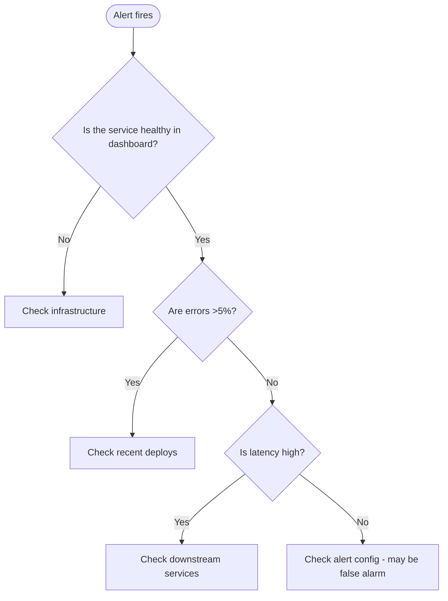

# skill: markdown-visuals

Use when a markdown doc needs a picture. Pick inline SVG, image file, ASCII or Mermaid by where it is read (GitHub drops inline SVG).

# Markdown Visuals

> **ด่านก่อนลงมือ (ทุกครั้ง):** อ่านธีมเจ้าของ → ค้นต้นแบบสด → 3 แนวที่ต่างกันจริง → ตรวจ `no-ai-look` ก่อนส่ง · ทำตามหัวข้อ "ด่านก่อนลงมือ" ของ `design-references` (plugin `superuser`) แม้มีแบรนด์แล้ว (แบรนด์คุมสีและฟอนต์ ส่วนการค้นใช้หาโครงของชิ้นนี้) · ปิดงานด้วยบรรทัด `ด่านก่อนลงมือ:`

> **ภาษา:** ถ้อยคำทุกบรรทัดเขียนตาม `human-writing` — skill นี้บอกรูปแบบและโครง ส่วน human-writing บอกวิธีเขียนให้คนอ่านรู้เรื่อง

> **Scope:** this skill decides *how a picture goes into a markdown file* (inline SVG · image file · ASCII · Mermaid) and how to embed it. What a diagram should show lives in `software-diagrams` (plugin `software-company`) (Mermaid in the house theme) and `diagram-figures` (designed figures). Document formatting around the picture lives in `polished-document-style`.

> **Rule:** Every plan, process, design, spec, or architecture doc must show — not just tell. If you wrote "the button sits top-right," you owe the reader a picture.

## When to use this skill

- A picture *inside a markdown file* — sketch, flow or state in a business plan, report, process guide, spec or README
- Writing a plan, Functional Specification Document (FSD), Business Requirements Document (BRD), Architecture Decision Record (ADR) or architecture doc that describes layout, flow, or relationships (the diagrams themselves follow the routing rule below)
- Explaining state transitions, user journeys, or system interactions
- Comparing 2+ visual options for the user
- The user asked "show me how it looks" inside a markdown doc or chat reply

**If the doc has zero visuals and is about anything visual or structural — stop and add one.**

## When NOT to use

| Task | Use instead |
|---|---|
| "Make a mockup" — clickable HTML screens in `mockup/<CODE>-mockup.html` | `ui-craft` + platform skill (`web-app-design` · `windows-app-design` · `mobile-app-design`) (plugin `software-company`) |
| Chart colours and chart design in an app or dashboard | `web-app-design` (plugin `software-company`) → `references/tokens.md` "สีข้อมูล (กราฟ)" |
| Designed figure for a proposal, slide or print | `diagram-figures` |

## Decision tree: which format?

```
What are you showing?
│
├─ UI sketch in a doc / component state / icon → Inline SVG (doc read on GitHub → same SVG as a `.svg` file, §2)
├─ Layout sketch / box diagram / state map  →  ASCII art (boxes & arrows)
├─ Flow / process / money flow / decision   →  repo note (README · Pull Request (PR) · code note) → Mermaid (`software-diagrams`, plugin `software-company`)
│                                              project document (BRD · Software Requirements Specification (SRS) · FSD · ADR) or read outside the team → `diagram-figures`
├─ Architecture / Entity-Relationship (ER) / class → same rule as the line above
├─ Designed figure (proposal, slide, print) →  diagram-figures → embed the PNG as an image file (§2)
├─ Data viz (chart, pie, quadrant)          →  Mermaid pie/quadrant OR inline SVG, colours from web-app-design (plugin `software-company`) tokens.md "สีข้อมูล (กราฟ)"
├─ Photo, screenshot, complex illustration  →  External file →  (file in `docs/figures/`)
└─ Quick concept in chat reply              →  Inline SVG or ASCII (no external file)
```

**Routing rule (same in `software-diagrams` and `diagram-figures`):** markdown in a repo read by the team (README · PR · code note) → Mermaid via `software-diagrams` · a project document (BRD · SRS · FSD · ADR · ER · flows) or anything people outside the team read → `diagram-figures`.

**Follow the tree above.** Where the doc will be read decides inline SVG vs image file:

- **Inline `<svg>` renders** in VS Code preview, Obsidian, many static-site generators and chat replies.
- **Inline `<svg>` does not render on GitHub** — GitHub's sanitizer drops the `<svg>` element, so the reader sees nothing. Other hosts (GitLab, Bitbucket): preview before relying on it.
- **Doc will be read on GitHub** → save the SVG as `docs/figures/x.svg` and reference it with `` or `` (§2). It still versions cleanly in git and stays editable.

## 1 · Inline SVG (for viewers that render it — not GitHub)

### Boilerplate

```markdown
<p align="center">
<svg xmlns="http://www.w3.org/2000/svg" viewBox="0 0 640 280" role="img" aria-label="<what this shows>">
  <!-- background = bg-canvas of the project palette (see สี below) -->
  <rect width="640" height="280" rx="14" fill="<bg-canvas>"/>

  <!-- content goes here -->
</svg>
</p>
```

**Required attributes:**
- `xmlns="http://www.w3.org/2000/svg"` — required when the same markup is saved as a `.svg` file (GitHub shows `.svg` files only through `` / ``, and only with `xmlns`)
- `viewBox` — sets the coordinate space; lets the SVG scale responsively
- `role="img"` + `aria-label` — accessibility, screen readers
- `<p align="center">` wrapper — centers in the rendered page

**Sizing:** Use `viewBox` (not width/height) so it scales. Common sizes:
- Sketch of a UI bar: `viewBox="0 0 640 200"` (wide, short)
- Component state: `viewBox="0 0 400 300"` (squarer)
- Icon / chip: `viewBox="0 0 64 64"`
- Full screen layout: `viewBox="0 0 800 500"`

### สี

ถ้าเอกสารหรือโปรเจกต์มีชุดสีอยู่แล้ว ให้ใช้ชุดนั้น ส่วนถ้ายังไม่มี ให้ค้นต้นแบบตาม `design-references` (plugin `superuser`) ประเภท `document` แล้วถอดสีจากงานที่เลือก · ค้นสดไม่ได้จึงใช้ค่าประจำบ้าน `#2A78D6` เขียน `(รอยืนยัน)` แล้วทำต่อ ไม่หยุดถาม (ลำดับใน `diagram-figures` ข้อ 5 · ตารางโทนตามเนื้องาน [`colour-by-domain.md`](../diagram-figures/references/colour-by-domain.md)) ส่วน token ตามหน้าที่ (`bg-canvas` · `accent-primary` · `state-*` …) ดูได้ใน [references/svg-snippets.md](references/svg-snippets.md) และ **1 เอกสารใช้ชุดสีเดียว**

### Reusable snippets

Window chrome, phone frame, button, card, status badge, running dot and tooltip snippets, plus the UI-state worked example, are in [references/svg-snippets.md](references/svg-snippets.md). Copy the structure and swap in the agreed colour tokens.

## 2 · External image files

Use when:
- The doc will be read on GitHub (inline `<svg>` is dropped there) — save the SVG as a file
- Photo or screenshot
- Illustration too complex to author as SVG by hand (50+ shapes)
- Reusing the same image across many docs
- Generated by a design tool (Figma export, etc.)

### Folder convention

```
docs/
  figures/
    01-hover-state.svg
    02-empty-state.png
    architecture-overview.svg
    src/                      editable sources (.mmd · .drawio · .html)
```

- Put figures in `docs/figures/` (editable sources in `docs/figures/src/`) — relative to the doc · brand files (logo, icons) live in the project-root `assets/`, not here
- Name files `<doc-section-number>-<short-slug>.<ext>` so they sort with the doc
- Prefer `.svg` over `.png` when possible (scales, smaller, diff-friendly)

### Reference syntax

```markdown

```

- **Alt text** describes what the image shows, for accessibility — not "screenshot.png"
- Path is **relative to the markdown file**, not absolute
- For centered + sized images, wrap in HTML:

```markdown
<p align="center">
  
</p>
```

### Creating SVG files

When the visual is too big to inline (>50 lines of SVG markup), save it as a file instead. Use the `Write` tool to create the SVG file in `docs/figures/`.

## 3 · ASCII art

For quick layouts, state diagrams, and structural sketches that don't need pixel-perfect visuals. Renders identically in every viewer and in terminal/diff output.

Box-drawing characters plus worked layout sketch, state machine and curve examples are in [references/ascii-patterns.md](references/ascii-patterns.md).

Always wrap ASCII in a fenced code block (` ``` `) so spacing is preserved.

## 4 · Mermaid

**การเลือกชนิดไดอะแกรม ธีม กติกาความอ่านง่าย และป้ายภาษาไทย อยู่ใน `software-diagrams` (plugin `software-company`) ข้อ 1–5 และ `assets/mermaid-theme.md`** · Mermaid ในเอกสารโปรเจกต์ที่ต้องแปลงเป็นรูปลง Word ใช้ตัวแปลงใน `diagram-figures` → `references/engine-mermaid.md`
ที่นี่บอกแค่ว่า *เมื่อไหร่ควรเลือก Mermaid แทนรูปแบบอื่น*

| เลือก Mermaid เมื่อ | เลือกอย่างอื่นเมื่อ |
|---|---|
| เป็นกล่องกับลูกศรที่เครื่องจัดวางให้ได้ | ถ้าต้องคุมตำแหน่งเองให้ใช้ inline SVG ส่วนรูปที่ต้องดูออกแบบมาให้ใช้ `diagram-figures` (HTML layout หรือ engine-svg-python) แล้วฝังเป็นไฟล์ภาพ |
| อยู่ในไฟล์ที่ต้อง diff ใน git | เป็นภาพหน้าจอจริง ให้ใช้ไฟล์ภาพ |
| ผู้อ่านเปิดใน GitHub หรือ Notion | ผู้อ่านเปิดในเอกสาร Word หรือสไลด์ ให้ใช้ไฟล์ภาพ |

## Combining formats in one doc

A full design spec usually mixes formats (SVG mockup, reference table, ASCII sketch, Mermaid state diagram, acceptance table). The 6-part pattern is in [references/combining-formats.md](references/combining-formats.md). Don't force everything into one format.

## Accessibility checklist

For every visual:

- [ ] **Inline SVG** has `role="img"` and `aria-label="<description>"`
- [ ] **Image file** has descriptive alt text (not "image.png")
- [ ] **Mermaid** diagrams have a 1-sentence caption above or below
- [ ] **ASCII art** has a prose summary nearby — screen readers will read the characters literally
- [ ] **Colour** is not the only signal — pair red badges with `!`, green dots with a label
- [ ] **Contrast** for text in SVG ≥ 4.5:1 against its background

## Anti-patterns

- **Text-only design docs** — "the icon is in the top-right" with no picture
- **Linking to Figma / external design tools as the only source** — visuals must render in the repo
- **PNG screenshots of text** — use the text, in a code block
- **Inline `<svg>` in a doc read on GitHub** — GitHub drops it; save as `docs/figures/x.svg` and use `` · a `.svg` file without `xmlns` also fails
- **Inline SVG over 50 lines** — extract to `docs/figures/x.svg` and reference it
- **ASCII art outside a code fence** — proportional fonts will mangle alignment
- **Mermaid syntax newer than the viewer** — GitHub's Mermaid version changes; check it with a ```` ```mermaid ```` block containing `info` before using new diagram types
- **Generated images checked in without source** — commit the `.svg` source, not just the `.png` export
- **Decorative emoji as visuals** — emoji ≠ a mockup; pair them with real diagrams

## Quick-start recipe

When a markdown doc needs a design picture (clickable app screens go to the platform design skill, `mockup/<CODE>-mockup.html`):

1. **Identify what kinds of visuals are needed** (UI state? flow? architecture?)
2. **Pick the format(s)** using the decision tree above
3. **For each visual:**
   - State a one-line caption
   - Emit the SVG/Mermaid/ASCII
   - Add `role="img"` + `aria-label` (SVG) or alt text (file)
4. **Add a feature reference table** below the visuals — what each element means
5. **Cross-check accessibility checklist** before delivery

Not sure a visual will render? Preview it in the viewer the reader will use (GitHub, Notion, VS Code) before delivery.

## Related skills

- `polished-document-style` — overall doc formatting, figure captions, callout boxes
- `simplicity-first` (plugin `software-company`) — don't over-design the diagram; show what's needed
- `software-diagrams` (plugin `software-company`) — which diagram type answers which question, plus the shared Mermaid theme
- `diagram-figures` — designed figures for proposals, slides and print (HTML layouts or engine-svg-python)
- `ui-craft` (plugin `software-company`) — spacing, hierarchy and states when the picture is a screen

## ไม่ให้ดูเหมือน AI ทำ

ก่อนส่ง ไล่ข้อ 3 ของ `no-ai-look` — งาน HTML รันสคริปต์ของมัน · ทุกงานต้องผ่านด่านตา 3.2 ด้วย (หน้าเว็บตอบเพิ่มข้อ 10–14) เพราะสคริปต์ 0 ข้อยังไม่ใช่ผ่าน · ข้อห้ามในไฟล์นี้เป็นส่วนเฉพาะของงานนี้ รายการเต็มทุกสื่ออยู่ที่นั่น

## ตัวย่อ

เขียนตัวย่อเต็มครั้งแรกเสมอ แล้ววงเล็บตัวย่อไว้ — เช่น Model Context Protocol (MCP)
หลังจากนั้นใช้ตัวย่อได้เลย ดูรายละเอียดใน skill `spell-out-abbreviations`


## reference: ascii-patterns.md

# ASCII patterns

Worked ASCII examples for markdown docs · used by [SKILL.md](../SKILL.md) §3 · always wrap ASCII in a fenced code block so spacing is preserved

## Box-drawing characters

```
┌─────┐  ┏━━━━━┓  ╭─────╮  ┌╌╌╌╌╌┐
│     │  ┃     ┃  │     │  ╎     ╎
└─────┘  ┗━━━━━┛  ╰─────╯  └╌╌╌╌╌┘
 light    heavy   rounded   dashed
```

Corners: `┌ ┐ └ ┘` ‧ `┏ ┓ ┗ ┛` ‧ `╭ ╮ ╰ ╯`
Lines:   `─ │` ‧ `━ ┃` ‧ `═ ║`
Joins:   `├ ┤ ┬ ┴ ┼`
Arrows:  `→ ← ↑ ↓ ▲ ▼ ▶ ◀ ↔ ↕ ⇒ ⇐`
Dots:    `• · ◦ ● ○ ▪ ▫`

## Common patterns

**Layout sketch:**
```
┌─────────────────────────────────────┐
│ Header        [Search]      [👤]    │
├──────────┬──────────────────────────┤
│ Sidebar  │ Main content             │
│  • Item  │                          │
│  • Item  │  ┌────────────────────┐  │
│          │  │  Primary CTA       │  │
│          │  └────────────────────┘  │
└──────────┴──────────────────────────┘
```

**State machine:**
```
┌─────────┐  hover  ┌──────────┐  click  ┌─────────┐
│  REST   │────────►│ MAGNIFIED│────────►│ LAUNCH  │
└─────────┘◄────────└──────────┘◄────────└─────────┘
            exit               done
```

**Curve / chart:**
```
scale
 ↑
1.7│         ╱╲
1.4│       ╱    ╲
1.2│     ╱        ╲
1.0│___╱            ╲___
   └──────────┬──────────→ cursor X
         tile.Center
```


## reference: combining-formats.md

# Combining formats in one doc

Used by [SKILL.md](../SKILL.md) · a full design spec usually mixes formats.

The 6-part pattern for a design spec:

```
1. Inline SVG mockup of each UI state              ← "what it looks like"
2. Feature reference table                          ← "what it does"
3. ASCII layout sketch with measurements           ← "how it's positioned"
4. Mermaid state diagram                            ← "how it transitions"
5. ASCII / inline-SVG zoom curve                    ← "the math"
6. Acceptance criteria table                        ← "how we verify"
```

Don't force everything into one format. Each format is best at something different.


## reference: svg-snippets.md

# Inline SVG snippets

Reusable building blocks for inline SVG pictures of a screen inside .md docs (the real mockup is HTML) · used by [SKILL.md](../SKILL.md) §1

## สี — มาจากเนื้องาน ไม่ใช่จากตารางสำเร็จรูป

ถ้าเอกสารหรือโปรเจกต์มีชุดสีอยู่แล้ว ให้ใช้ชุดนั้น
ถ้ายังไม่มี ให้ใช้ค่าประจำบ้าน `#2A78D6` เขียน `(รอยืนยัน)` แล้วทำต่อ ไม่หยุดถาม และเสนอโทนจากเนื้องานไว้ในรายงาน — การแพทย์เขียว · การเงินน้ำเงินเข้ม ·
อุตสาหกรรมเหลืองอำพัน · ราชการกรมท่า · ซอฟต์แวร์ทั่วไปน้ำเงิน (ตารางเต็มอยู่ใน [`diagram-figures/references/colour-by-domain.md`](../../diagram-figures/references/colour-by-domain.md))

กำหนดเป็น **token ตามหน้าที่** ไว้บนสุดของเอกสาร แล้วใช้ค่าเดียวกันทุกรูปในเอกสารนั้น:

| Token | หน้าที่ | ได้มาจาก |
|---|---|---|
| `bg-canvas` | พื้นหลังของรูป | เฉดเข้มสุด (โหมดมืด) หรืออ่อนสุด (โหมดสว่าง) |
| `bg-surface` | แผ่น พาเนล การ์ด | ต่างจาก canvas พอให้เห็นขอบโดยไม่ต้องตีเส้น |
| `bg-elevated` | ไทล์ที่ลอยขึ้นมาอีกชั้น | |
| `accent-primary` | จุดเน้น สถานะที่กำลังทำงาน | **สีแบรนด์** (ไม่มี → `#2A78D6` + `(รอยืนยัน)`) |
| `text-primary` | ข้อความหลัก | contrast ≥ 4.5:1 กับพื้นที่มันวางอยู่ |
| `text-muted` | ข้อความรอง placeholder | `rgba(...,0.55)` ของ `text-primary` |
| `state-success` · `state-warning` · `state-danger` | สถานะ | **ไม่เปลี่ยนตามแบรนด์** — เขียวคือผ่าน แดงคือไม่ผ่านเสมอ |

**1 เอกสารใช้ชุดสีเดียว** — รูป 10 รูปในเอกสารเดียวที่สีไม่ตรงกัน อ่านยากกว่ารูปไม่สวยแต่สีตรงกัน

## Snippets

> ตัวอย่างข้างล่างใช้ชุดสีโหมดมืดชุดหนึ่งเป็นตัวแทนเท่านั้น
> **เปลี่ยนค่าสีให้ตรงกับชุดที่ตกลงไว้ก่อนใช้** โครงสร้างคือสิ่งที่ต้องคัดลอก ไม่ใช่ค่าสี

**Window chrome (desktop app mockup):**
```xml
<rect x="20" y="20" width="600" height="360" rx="10" fill="#2a3245"/>
<circle cx="42" cy="42" r="6" fill="#ff5f57"/>
<circle cx="62" cy="42" r="6" fill="#febc2e"/>
<circle cx="82" cy="42" r="6" fill="#28c940"/>
<text x="320" y="46" text-anchor="middle" fill="#fff" font-family="system-ui" font-size="12">Window title</text>
<line x1="20" y1="64" x2="620" y2="64" stroke="rgba(255,255,255,0.08)"/>
```

**Phone frame (mobile mockup):**
```xml
<rect x="100" y="20" width="200" height="400" rx="28" fill="#0a0d14" stroke="#2a3245" stroke-width="2"/>
<rect x="120" y="50" width="160" height="340" rx="6" fill="#1c2230"/>
<rect x="170" y="28" width="60" height="14" rx="7" fill="#0a0d14"/>
```

**Button:**
```xml
<rect x="40" y="100" width="120" height="40" rx="8" fill="#0078d4"/>
<text x="100" y="125" text-anchor="middle" fill="#fff" font-family="system-ui" font-size="14" font-weight="500">Click me</text>
```

**Card with title and body:**
```xml
<rect x="40" y="40" width="240" height="120" rx="12" fill="#2a3245"/>
<text x="60" y="72" fill="#fff" font-family="system-ui" font-size="14" font-weight="600">Card title</text>
<text x="60" y="96" fill="rgba(255,255,255,0.7)" font-family="system-ui" font-size="12">Supporting body text goes here.</text>
<rect x="60" y="116" width="80" height="28" rx="6" fill="#0078d4"/>
<text x="100" y="134" text-anchor="middle" fill="#fff" font-family="system-ui" font-size="12">Action</text>
```

**Status badge (top-right of tile):**
```xml
<circle cx="<tile-right-x>" cy="<tile-top-y>" r="9" fill="#e24b4a"/>
<text x="<tile-right-x>" y="<tile-top-y + 4>" text-anchor="middle" fill="#fff" font-family="system-ui" font-size="13" font-weight="500">!</text>
```

**Running dot (indicator below tile):**
```xml
<circle cx="<tile-center-x>" cy="<tile-bottom-y + 12>" r="4" fill="#4cc2ff"/>
```

**Tooltip text (no balloon — plain floating text):**
```xml
<text x="<tile-center-x>" y="<tile-top-y - 12>" text-anchor="middle" fill="#fff" font-family="system-ui" font-size="12" font-weight="500">Tooltip label</text>
```

## Worked example — UI state mockup

Use this pattern by default for showing UI feature states. On GitHub, save the SVG as a file in `docs/figures/` and reference it (inline `<svg>` is dropped there).


---

# skill: software-diagrams

Use when a README, PR or code note needs a quick Mermaid diagram. Diagrams in project docs (BRD, SRS, FSD, ER, flows) → diagram-figures.

# Software Diagrams

> **ภาษา:** ถ้อยคำทุกบรรทัดเขียนตาม `human-writing` — skill นี้บอกรูปแบบและโครง ส่วน human-writing บอกวิธีเขียนให้คนอ่านรู้เรื่อง

> **กฎข้อเดียวของ skill นี้:** ไดอะแกรมตอบ**คำถามเดียว**
> ถ้าตอบ 2 คำถาม ให้วาด 2 รูป

> **ปลายทางตัดสินเครื่องมือ:** skill นี้วาดไดอะแกรมด่วนด้วย Mermaid ธีมประจำบ้าน สำหรับ README · Pull Request · โน้ตในโค้ดเท่านั้น
> ส่วนรูปในเอกสารโปรเจกต์ (BRD · SRS · FSD · ADR · ER · ผังขั้นตอน) ข้อเสนอลูกค้า สไลด์ และงานพิมพ์ ให้ไปที่ `diagram-figures` · ตารางเลือกทางฉบับเต็มอยู่ที่หัว skill นั้น
>
> **สีในรูปต้องสื่อความหมาย ไม่ใช่ตกแต่ง** และถ้าเอกสารต้นทางประกาศ `doc-theme` ไว้แล้ว ให้ใช้ค่านั้น ไม่ต้องเลือกสีใหม่รายรูป (ค่าเริ่มต้นคือชุดประจำบ้านใน `polished-document-style` · ความหมายของสีดู `branded-document-design/references/tokens-and-type.md`):
> ไดอะแกรมด่วนใช้ **สีหลักสีเดียว** = "ของที่เรากำลังพูดถึง" · เทา = ระบบภายนอก/ปิดอยู่ · ขาวเส้นเทา (`store`) = ที่เก็บข้อมูล · กล่องอื่นใช้ค่าตั้งต้น (3 คลาส `focus` · `ext` · `store` ใน `assets/mermaid-theme.md`) · ถ้าต้องแยกจุดพัง/ข้อยกเว้น/สำเร็จด้วยสีหลายสี แปลว่าตอบหลายคำถามในรูปเดียว ให้แยกเป็นรูปใหม่หรือใช้ `diagram-figures`

## เมื่อไหร่ใช้ skill นี้

ใน README · Pull Request · โน้ตในโค้ด:

- อธิบายสถาปัตยกรรมระบบ
- อธิบายลำดับการทำงานข้ามหลายส่วน
- อธิบายสถานะของข้อมูล
- ออกแบบฐานข้อมูล
- บอกว่าอะไรรันอยู่บนเครื่องไหน
- รีวิวไดอะแกรมที่คนอื่นวาด

## เมื่อไหร่ **ไม่** ใช้

| งาน | ใช้ตัวนี้แทน |
|---|---|
| เลือกว่าจะใช้ภาพแบบไหน (SVG / ASCII / Mermaid) | `markdown-visuals` |
| ภาพหน้าจอ · wireframe | `ui-craft` + skill แพลตฟอร์ม |
| กราฟข้อมูล | `web-app-design` → `references/tokens.md` หัวข้อ "สีข้อมูล (กราฟ)" |
| ตัดสินใจเลือกสถาปัตยกรรม | `architecture-patterns` |

## 1 · คำถามไหน วาดแบบไหน

**เริ่มจากคำถาม ไม่ใช่เริ่มจากชนิดไดอะแกรม** — คนวาดผิดเพราะเลือกชนิดก่อนแล้วค่อยยัดเนื้อหาลงไป

| คำถามที่ผู้อ่านมีในหัว | ไดอะแกรม |
|---|---|
| "ระบบนี้คุยกับใครข้างนอกบ้าง" | C4 ระดับ 1 — System Context |
| "ข้างในระบบมีอะไรบ้าง รันแยกกันไหม" | C4 ระดับ 2 — Container |
| "ใน service ตัวนี้แบ่งเป็นส่วนอะไร" | C4 ระดับ 3 — Component |
| "กดปุ่มนี้แล้วเกิดอะไรขึ้นบ้าง ตามลำดับ" | Sequence |
| "เอกสารนี้เปลี่ยนสถานะยังไงได้บ้าง" | State |
| "ตารางไหนเชื่อมกับตารางไหน" | Entity Relationship (ER) |
| "ของจริงรันอยู่บนเครื่องอะไร กี่ตัว" | Deployment |
| "ใครอนุมัติต่อจากใคร" | Flowchart (ขั้นตอนงาน) |
| "ผังคลาวด์ใน repo ที่มีโลโก้ AWS / Azure จริง ๆ" | Infrastructure — ข้อ 3 |
| "อยากได้รูปสวย ๆ ไว้ใส่ข้อเสนอลูกค้า" | ไม่ใช่งานของ skill นี้ — `diagram-figures` |

> **C4 model** คือวิธีวาดสถาปัตยกรรมเป็นชั้น ๆ เหมือนซูมแผนที่ —
> ระดับ 1 มองจากนอกระบบ · ระดับ 2 เปิดฝาดูข้างใน · ระดับ 3 ซูมเข้าไปในกล่องเดียว
> **วาดระดับ 1 กับ 2 ให้ครบก่อนเสมอ** ระดับ 3 วาดเฉพาะส่วนที่ซับซ้อนจริง

## 2 · ธีม — ใช้ชุดเดียวทั้งโปรเจกต์

วางบรรทัด `%%{init: ...}%%` ไว้**บรรทัดแรกสุด**ของทุกไดอะแกรม แล้วใช้สีหลักสีเดียวกับ 3 คลาส `focus` · `ext` · `store` ซึ่งสีหลักสงวนไว้ให้ "ของที่เรากำลังพูดถึง" เท่านั้น
บรรทัดธีม ตัวแทนค่าสี คลาส และตัวอย่างที่เรนเดอร์แล้วอยู่ใน [`assets/mermaid-theme.md`](assets/mermaid-theme.md) ส่วนตารางที่จับคู่เนื้องานกับโทนสีอยู่ใน `diagram-figures/references/colour-by-domain.md`

> ระวัง: **`fontFamily` ต้องอยู่นอก `themeVariables`** ถ้าใส่ไว้ข้างใน จะถูกเมินเงียบ ๆ แล้วกลับไปใช้ฟอนต์เริ่มต้นของ Mermaid

**ตรวจด้วยเครื่องก่อนส่งทุกครั้ง** — กฎข้อนี้ถูกลืมบ่อยที่สุด (โปรเจกต์ทดสอบหนึ่งมี 63 จาก 66 รูปที่ไม่มีบรรทัดธีม และไม่มีใครเห็น):

สคริปต์อยู่ในโฟลเดอร์ `scripts/` ของ skill นี้ — รันด้วย path เต็มของสคริปต์ กับโฟลเดอร์ `docs` ของโปรเจกต์ที่ตรวจ (`<path ของ skill>` = โฟลเดอร์ที่ติดตั้ง skill นี้):

```bash
node <path ของ skill>/scripts/check-mermaid-theme.mjs docs          # exit 1 พร้อม ไฟล์:บรรทัด ของบล็อกที่ไม่มี %%{init
node <path ของ skill>/scripts/check-mermaid-theme.mjs --self-test   # พิสูจน์ว่าตัวตรวจยังจับได้
```

agent ที่ไม่มี shell รันเองไม่ได้ → agent หลักรันหลังรับงาน

## 3 · ผังที่ต้องมีโลโก้จริง (infrastructure)

ถ้าผังโครงสร้างพื้นฐานที่อยู่ใน repo ต้องมีไอคอน Amazon Web Services (AWS) · Azure · Kubernetes ของจริง ซึ่ง Mermaid วาดให้ไม่ได้ ให้ใช้ไลบรารี **`diagrams`** (Python + Graphviz) โดยเริ่มจาก [`assets/infra-diagram.py`](assets/infra-diagram.py)
วิธีติดตั้ง กติกา node ที่ใช้บ่อย และกับดักอยู่ใน [`assets/diagrams-python.md`](assets/diagrams-python.md) · ส่วนผังคลาวด์ที่ลูกค้าหรือสไลด์จะเห็น ให้ใช้ `diagram-figures`

## 4 · กฎที่ทำให้อ่านรู้เรื่อง

**ไม่เกิน 7 กล่อง** — เกินนี้คนอ่านเลิกอ่าน (นับกล่องจริง ไม่นับ subgraph)

**นับกล่องก่อนวาด ไม่ใช่หลังวาด** — ถ้าเกิน 7 ให้**แยกรูปตามลำดับเรื่องก่อนวาด** จดการแยกลง `decision-log` แล้วบอกในคำตอบ
ห้ามวาดจนครบแล้วค่อยบอกทีหลัง

```
เนื้อหาที่ให้มามี 20 กล่อง เกินเพดานสามเท่า ขอแยกเป็น 3 รูป:
  รูปที่ 1 — ตอนทดลอง: อะไรเข้า อะไรออก
  รูปที่ 2 — ตอนรันชุดการทดลอง
  รูปที่ 3 — ตอนออกรายงาน
อยากแบ่งแบบอื่น บอกได้ — แยกใหม่ได้
```

> **"แยกคนละไฟล์ก็ได้" แปลว่าต้องแยก** — ถ้าคำขอเปิดช่องให้แยก และเนื้อหาเกินเพดาน
> ให้ถือว่าเป็นคำสั่งให้แยก ไม่ใช่ทางเลือก

**3 อย่างนี้ห้ามอยู่ในไดอะแกรม** — เป็นเนื้อหาของคู่มือ ไม่ใช่รูป และทำให้กล่องบานจนผังเบี้ยว

| ห้ามใส่ | ไปอยู่ที่ไหน |
|---|---|
| ตัวเลือกบรรทัดคำสั่ง `--all` `--resume` `--limit N` | `README` หรือ `docs/cli.md` |
| รายการ input/output ของหลายตัว | **ตารางข้างรูป** — คอลัมน์: ส่วนประกอบ · รับอะไร · ให้อะไร · เก็บที่ไหน |
| ชื่อไฟล์หรือ path ครบทุกตัว | ตารางเดียวกัน ใส่ในรูปเฉพาะตัวที่เป็นใจความ |

**คำขอว่า "บอก input/output ด้วย" ไม่ได้แปลว่าให้วาดทุกอย่างเป็นกล่อง** —
กล่องคือสิ่งที่ *ทำงาน* สิ่งที่ *ไหลผ่าน* เป็นป้ายบนเส้น ส่วน *รายละเอียด* ไปอยู่ในตาราง

**ระดับรายละเอียดเดียวกันทั้งรูป** — มี `PostgreSQL` กับ `OrderRepository.cs` อยู่ในรูปเดียวกัน
คือสัญญาณว่าผสม 2 ระดับ

**ทุกเส้นต้องมีป้าย** และป้ายต้องบอก**อะไรไหลผ่าน** ไม่ใช่ว่าต่อกันอยู่

```
ผิด: api --> db
ผิด: api -->|ใช้| db
ถูก: api -->|SQL · อ่าน-เขียนคำสั่งซื้อ| db
```

**ทิศทางเดียว** — บนลงล่าง (`TB`) หรือซ้ายไปขวา (`LR`) เลือกแล้วอย่าให้มีเส้นวิ่งย้อน
เส้นย้อนแปลว่าเรียงลำดับกล่องผิด ไม่ใช่ว่าต้องวาดลูกศร 2 หัว

**ชื่อกล่อง = สิ่งที่มันทำ ไม่ใช่เทคโนโลยี** เทคโนโลยีใส่บรรทัดที่สองตัวเล็ก

```
ผิด: [Redis]
ถูก: ["ที่พักข้อมูลชั่วคราว<br><small>Redis</small>"]
```

**มีคำอธิบายสัญลักษณ์ (legend) เมื่อใช้สีหรือรูปทรงสื่อความหมาย** —
ถ้าอธิบายไม่ได้ว่าทำไมกล่องนี้สีต่าง แปลว่าสีนั้นไม่ควรมี

## 5 · ภาษาไทยในไดอะแกรม

- **ป้ายเส้นภาษาไทยยาวเกิน 3 คำจะทับเส้น** — ตัดให้สั้น หรือใส่ `<br>` เอง
- **ห้ามใช้ `()` `[]` `{}` ในข้อความ** จะไปชนกับไวยากรณ์ Mermaid — ครอบด้วย `"..."` เสมอ
- **วรรณยุกต์ลอยเหนือกล่อง** เมื่อ `fontSize` เล็กกว่า 12px — อย่าลดต่ำกว่านี้
- ชื่อตารางและชื่อฟิลด์ในไดอะแกรม ER ใช้ภาษาอังกฤษ (ตรงกับฐานข้อมูลจริง)
  ส่วนคำอธิบายใช้ไทยได้

## 6 · เรนเดอร์ดูจริง — ห้ามข้าม

ไดอะแกรมที่ไม่เคยเรนเดอร์ยังเป็นแค่ข้อความ ไม่ใช่รูป เพราะไวยากรณ์ผิดบางแบบ Mermaid ไม่แจ้ง error
และบ่อยครั้งวาดออกมาไม่ตรงกับที่คิด

```bash
# ไม่ติดตั้งลงเครื่อง · pin รุ่นที่ทดสอบธีมไว้ (11.17.0 · รุ่นล่าสุด 12.0.0 ณ 2026-10-14 ยังไม่ได้ทดสอบธีม)
npx -y @mermaid-js/mermaid-cli@11.17.0 -i diagram.mmd -o diagram.png -b white -s 2
```

แล้ว**เปิดไฟล์ภาพดูด้วยตา** ไล่ตามนี้:

- [ ] กล่องไม่เกิน 7 ใบใช่ไหม
- [ ] ทุกเส้นมีป้ายไหม และป้ายบอกว่าอะไรไหลผ่านไหม
- [ ] มีเส้นวิ่งย้อนทิศไหม
- [ ] ป้ายทับเส้นหรือทับกล่องไหม
- [ ] ข้อความไทยครบ ไม่มีสระหาย
- [ ] ระดับรายละเอียดเดียวกันทั้งรูป
- [ ] คนที่ไม่เคยเห็นระบบนี้อ่านแล้วตอบคำถามต้นทางได้ไหม

**ข้อจำกัดของ Mermaid ที่ต้องรู้ก่อนเสียเวลา:**

| อาการ | สาเหตุ |
|---|---|
| `direction LR` ใน subgraph ไม่ทำงาน | ถูกเมินเมื่อ subgraph มีเส้นเชื่อมออกนอก — ต้องจัดลำดับกล่องเอา |
| กล่องกว้างผิดปกติ | มีข้อความยาวบรรทัดเดียว — ใส่ `<br>` เอง Mermaid ไม่ตัดบรรทัดให้ |
| เส้นทับกันมั่ว | กล่องเยอะเกินไป — Mermaid ไม่มีการจัดเส้นแบบฉลาด ต้องลดกล่อง |
| ฟอนต์ไม่เปลี่ยน | `fontFamily` อยู่ผิดที่ (ดูข้อ 2) |

ถ้าจัดวางเองไม่ได้ดั่งใจจริง ๆ และรูปยังอยู่ในเอกสาร markdown ให้วาด inline SVG ตาม `markdown-visuals` · ส่วนถ้ารูปต้องดูออกแบบมา ให้ไปที่ `diagram-figures`

## 7 · Anti-patterns

- **ไดอะแกรมสถาปัตยกรรม 40 กล่อง** — ไม่มีใครอ่าน แยกเป็น C4 หลายระดับ
- **วาดจนเกินเพดานแล้วค่อยบอก** — ต้องแยกตั้งแต่นับได้ว่าเกิน
- **ยัดตัวเลือกบรรทัดคำสั่งลงในกล่อง** — กล่องบาน ตัวอักษรเล็ก อ่านไม่ออกทั้งรูป
- **เส้นไม่มีป้าย** — ผู้อ่านเดาเองว่าอะไรไหลผ่าน แล้วเดาผิด
- **ผสมระดับรายละเอียด** — `Kubernetes` อยู่ข้าง ๆ `UserService.validate()`
- **สีรุ้ง** — สีต้องมีความหมาย ไม่ใช่ใส่ให้ไม่น่าเบื่อ
- **วาดทุกกรณี error ใน sequence เดียว** — วาดทางหลักก่อน แล้วแยกรูปกรณีพิเศษ
- **ER ที่มีทุกตารางในระบบ** — แยกตามโดเมน
- **ไดอะแกรมที่ไม่มีวันที่และเจ้าของ** — ผ่านไป 1 ปีไม่มีใครกล้าแก้
- **ส่งไดอะแกรมโดยไม่เคยเรนเดอร์ดู**
- **ธีมต่างกันทุกรูปในเอกสารเดียว**

## 8 · เชื่อมกับ skill อื่น

| ต้องการ | ใช้คู่กับ |
|---|---|
| เลือกรูปแบบภาพในเอกสาร markdown | `markdown-visuals` |
| เอกสารรอบ ๆ ไดอะแกรม | `polished-document-style` |
| ฝังในไฟล์ Word / PowerPoint | `branded-document-design` |
| ไดอะแกรมในเอกสาร SRS | `srs-writing` |
| เลือกสถาปัตยกรรมก่อนวาด | `architecture-patterns` |
| รูปที่ต้องดูออกแบบมาหรือต้องเซ็นรับ | `diagram-figures` |
| บันทึกเหตุผลที่เลือกแบบนี้ | `adr-writer` |

## ไม่ให้ดูเหมือน AI ทำ

ก่อนส่ง ไล่ข้อ 3 ของ `no-ai-look` — งาน HTML รันสคริปต์ของมัน · ทุกงานต้องผ่านด่านตา 3.2 ด้วย (หน้าเว็บตอบเพิ่มข้อ 10–14) เพราะสคริปต์ 0 ข้อยังไม่ใช่ผ่าน · ข้อห้ามในไฟล์นี้เป็นส่วนเฉพาะของงานนี้ รายการเต็มทุกสื่ออยู่ที่นั่น

## ตัวย่อ

เขียนตัวย่อเต็มครั้งแรกเสมอ แล้ววงเล็บตัวย่อไว้ — เช่น Model Context Protocol (MCP)
หลังจากนั้นใช้ตัวย่อได้ ดูรายละเอียดใน skill `spell-out-abbreviations`


---

# skill: incident-runbook-template

Use when writing an operational runbook, on-call guide or what-to-do-when-X-breaks playbook.

# Incident Runbook Template

> **ภาษา:** ถ้อยคำทุกบรรทัดเขียนตาม `human-writing` — skill นี้บอกรูปแบบและโครง ส่วน human-writing บอกวิธีเขียนให้คนอ่านรู้เรื่อง

## When to use this skill

- Writing a runbook for a known failure mode
- Documenting on-call procedures
- Creating playbooks for common alerts
- After a postmortem finds "we need a runbook for X"
- Onboarding new on-call engineers

## ไม่ใช้เมื่อ

| งาน | ใช้ตัวนี้แทน |
|---|---|
| เหตุจบแล้ว ต้องสรุปว่าเกิดอะไรและป้องกันยังไง | `postmortem-template` |
| ตั้ง metric alert หรือ dashboard | `observability-basics` |

## อ่านเพิ่มเมื่อ

| ไฟล์ | เปิดเมื่อ |
|---|---|
| [references/runbook-template.md](references/runbook-template.md) | ทุกครั้งที่เริ่มเขียน runbook ใหม่ ให้คัดลอกแม่แบบเต็มจากไฟล์นี้ไปกรอก |
| [references/index-and-alert-links.md](references/index-and-alert-links.md) | ถ้าทีมยังไม่มีหน้ารวม runbook หรือ alert ยังไม่มีลิงก์ไปหา runbook ให้เปิดดูตัวอย่างในไฟล์นี้ |
| [references/game-days.md](references/game-days.md) | ตอนวางแผนซ้อมรับมือเหตุขัดข้องเพื่อทดสอบว่า runbook ใช้ได้จริง |

## What's a Runbook?

A **runbook** answers: "Alert X fired. What do I do?"

It's NOT:
- A postmortem (that analyses the incident afterwards)
- Architecture documentation (that explains the bigger picture)
- Training material (that goes into too much detail)

It IS:
- Step-by-step actions
- Decision flowcharts
- Commands to copy-paste
- Escalation paths

## Runbook Quality Standards

A good runbook is:

| Property | Test |
|----------|------|
| **Actionable** | Can a tired engineer at 3am follow it? |
| **Concrete** | Are commands copy-pasteable? |
| **Tested** | Has someone followed it during a real incident? |
| **Updated** | Was it last reviewed less than 6 months ago? |
| **Discoverable** | Can on-call find it from the alert link? |
| **Concise** | Under 1 page for common cases |

## Runbook Template

แม่แบบเต็มอยู่ใน [references/runbook-template.md](references/runbook-template.md) ทุกฉบับมีส่วนตามลำดับนี้ และแต่ละส่วนต้องมีของต่อไปนี้

| ส่วน | ต้องมี |
|---|---|
| ส่วนหัว | Severity · Service · Owner Team · Last Reviewed · Linked Alert |
| TL;DR (30 seconds) | ย่อหน้าเดียวว่าอะไรพัง ต้องทำอะไรก่อน และต้องโทรหาใคร |
| How to Detect | อาการที่ผู้ใช้เห็นและที่เห็นภายใน · alert ที่ดัง · dashboard ที่ต้องเปิด |
| Diagnosis (60 seconds) | ผัง flowchart ตัดสินใจ และ quick checks ที่เป็นคำสั่งคัดลอกไปรันได้ เรียงตามลำดับ |
| Mitigation Steps | ขั้นตอนเรียงจากความเสี่ยงต่ำไปสูง (ลำดับเดียวกับ `incident-response` Phase 3) ทุกขั้นบอก Expected effect · **VERIFY** (คำสั่งหรือกราฟที่ต้องดู และค่าที่ต้องเห็น — ไม่เห็นค่านั้นถือว่าขั้นนี้ยังไม่สำเร็จ ห้ามข้ามไปขั้นถัดไปโดยไม่รู้ว่าขั้นก่อนทำอะไร) และ Caveats หรือ If doesn't work · agent แค่เสนอคำสั่งกับผลที่คาด คน on-call เป็นคนรันหรืออนุมัติก่อนแตะ production |
| Escalation Path | ใครต้องถูกเรียกเมื่อไหร่ เป็นนาทีที่ชัดเจน |
| Verification | รายการตรวจว่าแก้แล้วจริง |
| After Resolution | บันทึกในช่องเหตุการณ์ → อัปเดตหน้าสถานะ → เปิดตั๋ว postmortem → อัปเดต runbook นี้ |
| Related Runbooks · Background | ลิงก์ไป runbook ที่เกี่ยวข้อง และที่มาของปัญหาแบบสั้น (ไม่บังคับ) |

**ลำดับ mitigation ในแม่แบบ:** Reduce load (low risk) → Scale up (medium risk) → Rollback recent deploy (higher risk) → Failover to backup region (last resort)

**ลำดับ escalation ในแม่แบบ:** ถ้าแก้ไม่ได้ใน 15 นาที ให้เรียก secondary on-call ถ้าสองคนแก้ไม่ได้ใน 30 นาที ให้เรียกทีมเจ้าของ service ถ้ายังเป็น SEV1 หลัง 45 นาที ให้เรียก incident commander (IC) และถ้า SEV1 เกิน 1 ชั่วโมง ให้เรียกผู้บริหารฝ่ายวิศวกรรม

**ถือว่าแก้แล้วเมื่อ** error rate กลับสู่ระดับปกติ · latency p95 ต่ำกว่าเกณฑ์ · หน้าสถานะเป็น "Operational" · ไม่มี alert ใหม่ · ลูกค้าหยุดแจ้งปัญหา และเฝ้าดูต่ออีก 30 นาทีแล้ว

> Use `postmortem-template` skill for the full analysis

## Runbook Index and Alert Links

ทำหน้ารวม runbook ไว้ที่เดียว ให้ค้นได้ทั้งตาม service ตามชื่อ alert และตามเหตุที่เกิดบ่อยใน 90 วันล่าสุด

alert ทุกตัว**ต้อง**มีลิงก์ไป runbook ผ่าน annotation `runbook_url:` ของ alert และควรใส่ `dashboard:` คู่กันด้วย ส่วนตัวอย่างหน้ารวมและตัวอย่าง Prometheus alerting rule อยู่ใน [references/index-and-alert-links.md](references/index-and-alert-links.md)

## What Makes Runbooks Fail

| Problem | Fix |
|---------|-----|
| Out of date | Review every 6 months, update after every incident |
| Too long | Split into 1 runbook per failure mode |
| Too generic | Be specific to YOUR service |
| No commands | Include actual copy-paste commands |
| Not discoverable | Link it from the alert and the index page |
| No ownership | Each runbook has a team owner |
| Not tested | Run game days, and follow it during real incidents |
| Commands rot silently | CI job on every change to `runbooks/`: pull every fenced `bash` block → `bash -n` (parses) · every `./scripts/*.sh` it names exists in the repo · every `kubectl` resource name exists in staging (`kubectl get ... -n staging`) · fail the build on any miss — คำสั่งที่รันไม่ได้ตอนตี 3 แย่กว่าไม่มี runbook (แนวคิดจาก wshobson/agents incident-runbook-templates) |

## Game Days

ทดสอบ runbook ด้วยการจำลองเหตุขัดข้องโดยตั้งใจ ทุกไตรมาสให้เลือก runbook หนึ่งฉบับ จำลองเหตุใน staging แล้วให้ on-call ทำตาม จากนั้นอัปเดต runbook ตามช่องโหว่ที่เจอ รายการตรวจเต็มอยู่ใน [references/game-days.md](references/game-days.md)

## Anti-patterns

- **Theoretical runbooks** written by someone who never saw the failure
- **Long background text** before the first action
- **"Contact the team"** without saying who or how
- **Treating mitigation as the root-cause fix** (mitigation should be FAST; the fix comes later)
- **Runbook in a wiki nobody can find** — link from alert
- **Update postmortems but not runbooks** — every postmortem should lead to a runbook update

## Document Look

This skill decides **what goes in** the document. It does not decide **how it looks** —
load the matching skill before writing, not after:

| What is being handed over | Load |
|---|---|
| Markdown someone reads (repo, wiki, issue tracker) | `polished-document-style` |
| A rendered `.docx` / `.pptx` / PDF a stakeholder signs off on | `branded-document-design` |
| The point needs a picture to land | `markdown-visuals`, then `software-diagrams` |

Default formatting is not neutral — it reads as unfinished work.


## reference: game-days.md

# Game Days

รายการตรวจของการซ้อมรับมือเหตุขัดข้องเพื่อทดสอบ runbook ใช้ตอนวางแผนซ้อมรายไตรมาส

Test runbooks by faking failures on purpose:

```markdown
## Game Day Checklist

Quarterly:
- [ ] Pick a runbook to test
- [ ] Simulate the failure in staging (chaos engineering)
- [ ] On-call engineer follows runbook
- [ ] Identify gaps
- [ ] Update runbook based on learnings
- [ ] Repeat with different runbook next quarter
```


## reference: index-and-alert-links.md

# Runbook Index และการผูก runbook กับ alert

ตัวอย่างหน้ารวม runbook และตัวอย่างการใส่ลิงก์ runbook ลงใน alert ใช้ตอนตั้งระบบ runbook ของทีมครั้งแรก

## Runbook Index Pattern

Maintain a central index (`docs/runbook-index.md`). Each runbook is one file `docs/runbook-<service>-<เรื่อง>.md` per `document-naming`:

```markdown
# Runbook Index

## By Service
- API Service
  - [High error rate](runbook-api-high-error-rate.md)
  - [Memory leak](runbook-api-memory-leak.md)
- Database
  - [Connection pool exhausted](runbook-db-conn-pool.md)
  - [Replication lag](runbook-db-repl-lag.md)

## By Alert Name
| Alert | Runbook |
|-------|---------|
| `api_5xx_rate_high` | [API: High error rate](link) |
| `db_connections_high` | [DB: Connection pool](link) |
| `disk_full_warn` | [Generic: Disk full](link) |

## Most Common Incidents (last 90 days)
1. High error rate on payment service — [runbook](link) (12 times)
2. DB replication lag — [runbook](link) (8 times)
3. Cache invalidation storm — [runbook](link) (5 times)
```

## Linking Runbook to Alert

Every alert MUST link to a runbook:

```yaml
# Prometheus alerting rule (rule file loaded by Prometheus; Alertmanager only routes the alert)
- alert: APIHighErrorRate
  # share of requests that are 5xx — needs the denominator, otherwise it is requests per second
  expr: |
    sum(rate(http_requests_total{status=~"5.."}[5m]))
      / sum(rate(http_requests_total[5m])) > 0.05
  for: 5m
  annotations:
    summary: "API error rate > 5%"
    runbook_url: "https://runbooks.example.com/api/high-error-rate"
    dashboard: "https://grafana.example.com/d/api-overview"
```


## reference: runbook-template.md

# Runbook Template

**สารบัญ:** แม่แบบเต็ม 1 บล็อก: TL;DR · How to Detect · Diagnosis · Mitigation Steps (ขั้น 1–5) · Escalation Path · Verification · After Resolution · Related Runbooks · Background

- [แม่แบบทั้งไฟล์](#runbook-template) อยู่ในบล็อกเดียว ให้คัดลอกทั้งบล็อกไปเป็นไฟล์ runbook ใหม่

แม่แบบเต็มของ runbook หนึ่งฉบับ ให้คัดลอกไปกรอกต่อได้ทันที ส่วนกฎว่าแต่ละส่วนต้องมีอะไรอยู่ใน `SKILL.md`

````markdown
# Runbook: <Alert Name or Failure Mode>

| | |
|--|--|
| **Severity** | SEV1 \| SEV2 \| SEV3 \| SEV4 (table in `postmortem-template`) |
| **Service** | service-name |
| **Owner Team** | @team-name |
| **Last Reviewed** | YYYY-MM-DD |
| **Linked Alert** | [Grafana/PagerDuty link] |

---

## TL;DR (30 seconds)

> One paragraph: what's broken, what to do first, who to call.

## How to Detect

**Symptoms:**
- User-facing: ...
- Internal: ...

**Alerts that fire:**
- [Alert Name](link) — fires when ...
- [Another Alert](link) — fires when ...

**Dashboards to check:**
- [Main Dashboard](link)
- [Service Health](link)

## Diagnosis (60 seconds)



### Quick checks (run in order)

**1. Is service responding?**
```bash
curl -fsS https://api.example.com/health || echo "DOWN"
```

**2. Are recent deploys suspicious?**
```bash
gh release list --repo our-org/service --limit 5
```

**3. Check error rate in logs:**
```bash
# Last 10 min of 5xx errors
kubectl logs -n prod deployment/api --since=10m | grep -c '"status":5'
```

**4. Check downstream dependencies:**
- Database: [Dashboard link]
- Redis: [Dashboard link]
- External API: [Status page link]

## Mitigation Steps

> **Human approval:** an agent only proposes the command and its expected effect. A human on-call runs it or approves it before it touches production (`principle-proceed-on-reversible-work`, `incident-response` Phase 3).

Try mitigations in order of risk (lowest first) — the same order as `incident-response` Phase 3:

### Step 1: Disable the broken feature or reduce load (low risk)
```bash
# Turn off the feature flag of the suspect feature
./scripts/flag.sh set new-checkout off --env prod

# Or enable rate limiting
kubectl set env deployment/api -n prod RATE_LIMIT_AGGRESSIVE=true
```

**Expected effect:** Error rate drops within 2 min
**VERIFY:** `./scripts/flag.sh get new-checkout --env prod` → `off` · dashboard 5xx panel < 1% for 2 min
**If doesn't work:** Go to Step 2

### Step 2: Scale up (medium risk)
```bash
kubectl scale deployment/api -n prod --replicas=10
```

**Expected effect:** Latency improves within 3 min
**VERIFY:** `kubectl get deployment/api -n prod` → READY `10/10` · p95 panel back under threshold
**Caveats:** Will increase cost, monitor budget alerts

### Step 3: Rollback recent deploy (higher risk)
```bash
kubectl rollout undo deployment/api -n prod
```

**Expected effect:** Reverts to previous version
**VERIFY:** `kubectl rollout status deployment/api -n prod` → `successfully rolled out` · running image tag = previous release
**Caveats:** Check for schema migrations before rolling back. A rollout undo does not delete data, but old code may break on a schema the new release already migrated — roll back only if the migration is backward-compatible

### Step 4: Block bad traffic at the WAF or firewall (high risk)
```bash
# Block the abusive IP range / path at the web application firewall (WAF)
./scripts/waf-block.sh --cidr 203.0.113.0/24 --ttl 1h
```

**Expected effect:** Abusive traffic stops reaching the service
**VERIFY:** `./scripts/waf-block.sh list` shows the CIDR with TTL · requests from that range in access log → 0 · request rate from real users unchanged
**Caveats:** Can block real users; set a TTL (time to live) and check the allow list

### Step 5: Failover to backup region (last resort)
```bash
# Update DNS to point to backup region
./scripts/failover-to-us-west.sh
```

**Expected effect:** All traffic shifts to backup
**VERIFY:** `dig +short api.example.com` → backup region IP · backup region request rate ≈ previous primary rate · primary → 0
**Caveats:** Some user data may need migration, full rollback complex

## Escalation Path

```
You can't resolve in 15 min
  ↓
1. Page secondary on-call (PagerDuty group: team-secondary)
  ↓
You both can't in 30 min
  ↓
2. Page service owner team (team-owner)
  ↓
Still SEV1 after 45 min
  ↓
3. Page incident commander on-call (IC)
  ↓
SEV1 still active after 1h
  ↓
4. Page engineering leadership
```

## Verification (after mitigation)

Confirm the issue is resolved:

- [ ] Error rate back to baseline
- [ ] Latency p95 < threshold
- [ ] Status page updated to "Operational"
- [ ] No new alerts firing
- [ ] Customer reports stopped
- [ ] Monitor for 30 min before considering resolved

## After Resolution

1. **Document in incident channel**: what happened, what you did
2. **Update status page**: clear incident, post resolution message
3. **Create postmortem ticket**: if SEV1/SEV2, schedule postmortem
4. **Update this runbook**: if you learned something new

> Use `postmortem-template` skill for the full analysis

## Related Runbooks

- [Database connection issues](link)
- [Cache failure](link)
- [Authentication service down](link)

## Background / Why this happens

Optional section: brief context on why this failure mode exists.
Useful for new on-call engineers.
````


---

# skill: logging-standards

Use when writing or reviewing code that logs (format, levels, correlation ids, redaction).

# Logging Standards

> **กฎข้อเดียว:** log มีไว้ให้คนอ่านตอนตี 3 ที่ระบบล่ม ไม่ใช่ตอนเขียนโค้ด
> ถ้าบรรทัดไหนไม่ช่วยตอบว่า "เกิดอะไรขึ้น กับใคร เมื่อไหร่" ก็อย่าเขียนลงไป

## เมื่อไหร่ใช้ skill นี้

- เริ่มโปรเจกต์ใหม่ทุกชนิด (service, API, worker, batch, desktop, frontend)
- มีคนขอ "ให้มี log file" หรือถามเรื่องรูปแบบและระดับของ log
- ไล่ปัญหา production แล้วพบว่า log ที่มีอยู่ใช้ไม่ได้

## เมื่อไหร่ **ไม่** ใช้

- ต้องการ metrics หรือ tracing (Prometheus, OpenTelemetry) เพราะเป็นคนละเรื่องกับ log ให้ไปใช้ `observability-basics`
- ทำ endpoint สุขภาพของ service ให้ไปใช้ `web-service-essentials`

---

## 1 · รูปแบบบรรทัด — เหมือนกันทุกภาษา

```
2026-08-31 09:42:13.482 +07:00  INFO   [a3f9c1b2] orders  สร้างคำสั่งซื้อสำเร็จ  orderId=1042 userId=57 ms=134
└────────── เวลา + timezone ──────────┘ └level┘  └ cid ┘ └source┘ └── ข้อความ ──┘ └──── context k=v ────┘
```

| ส่วน | กฎ |
|---|---|
| เวลา | `YYYY-MM-DD HH:mm:ss.SSS ±HH:MM` — **ต้องมี timezone** ไม่งั้นเทียบ log ข้ามเครื่องไม่ได้ |
| level | ชิดซ้าย กว้าง 5 ตัวอักษร (`INFO ` `WARN ` `ERROR` `DEBUG` `FATAL`) — คอลัมน์จะได้ตรงกัน |
| cid | correlation id 8 ตัวในวงเล็บเหลี่ยม ถ้าไม่มีให้ใส่ `[--------]` (8 ตัวเท่ากัน คอลัมน์จะได้ตรง) |
| source | โมดูลหรือคลาสที่เขียน log ไม่ใช่ชื่อไฟล์ |
| ข้อความ | ประโยคเดียว ไม่ฝังตัวแปรใน string |
| context | `key=value` คั่นด้วยช่องว่าง ถ้าค่ามีช่องว่างให้ครอบด้วย `"` |

**ทำไมไม่ใช่ JSON:** ไฟล์นี้มีไว้ให้คนเปิดอ่านและ `grep` เป็นหลัก รูปแบบนี้ยัง
`grep "\[a3f9c1b2\]"` หรือ `awk` ได้อยู่ แต่ตาอ่านออกทันทีโดยไม่ต้องพึ่งเครื่องมือ
วันที่ต้องส่งเข้าระบบรวม log อย่าง Grafana Loki หรือ Elasticsearch, Logstash, Kibana (ELK) ให้เพิ่ม sink (ปลายทางที่ส่ง log ไป) แบบ JSON อีก 1 ตัว แต่**อย่าทิ้งไฟล์ข้อความ**

**1 event = 1 บรรทัด** ยกเว้น stack trace ที่ต่อท้ายโดยเยื้อง 4 ช่อง

---

## 2 · ระดับ log — เขียนให้ตรงความหมาย

| ระดับ | ใช้เมื่อ | ตัวอย่าง |
|---|---|---|
| `FATAL` | แอปกำลังจะตาย ทำงานต่อไม่ได้ | ต่อ DB ตอน start ไม่ได้ |
| `ERROR` | งานนี้ล้มเหลว **และต้องมีคนมาดู** | บันทึกคำสั่งซื้อไม่สำเร็จ |
| `WARN` | ผิดปกติแต่ระบบยังไปต่อได้ | retry ครั้งที่ 2, disk เหลือ 10% |
| `INFO` | เหตุการณ์สำคัญทางธุรกิจ | สร้างคำสั่งซื้อ, ผู้ใช้ล็อกอิน, job เริ่ม/จบ |
| `DEBUG` | รายละเอียดสำหรับไล่ปัญหา — **ปิดใน production** | ค่าที่คำนวณได้ระหว่างทาง |
| `TRACE` | ละเอียดระดับทุก step — เปิดเฉพาะตอนไล่จริง ๆ | payload ดิบ |

> ระวัง: **`ERROR` ที่ไม่มีใครต้องทำอะไร คือ `WARN`** — ถ้า ERROR ขึ้นทุกนาทีจนคนเลิกดู
> คุณเพิ่งทำลายระบบเตือนภัยของตัวเอง

ค่าเริ่มต้นของ dev คือ `DEBUG` ส่วน production คือ `INFO` และปรับได้ด้วย env `LOG_LEVEL` **ไม่ต้อง build ใหม่ แค่ restart (หรือ reload config)** — .NET อ่านจาก `appsettings.json` แทน (ดู `references/per-stack.md`)

---

## 3 · Correlation id — สิ่งที่ทำให้ log ใช้งานได้จริง

1 request ใช้ id เดียวตั้งแต่ต้นจนจบ ทุกบรรทัดที่เกิดจาก request นั้นจึงมี id เดียวกัน

```
Client ──X-Request-Id?── API Gateway ──┬── Service A ──┐
                        (ไม่มีก็สร้าง)   └── Service B ──┴─→ ทุกบรรทัดมี cid เดียวกัน
```

- รับจาก header **`X-Request-Id`** เฉพาะเมื่อตรง `^[A-Za-z0-9-]{1,64}$` · ไม่มีหรือไม่ตรง → สร้างใหม่ (`uuid v4` ตัด 8 ตัวแรก) · เหตุผลดู `web-service-essentials` ข้อ 3
- **ส่งกลับใน response header เสมอ** เพื่อให้ลูกค้าส่ง id มาตอนแจ้งปัญหา แล้วเราตามได้ทันที
- ส่งต่อไปยัง service ปลายทางทุกครั้งที่เรียกข้ามระบบ
- เก็บด้วยกลไกที่แยกตาม request: `AsyncLocalStorage` (Node) · `ContextVar` (Python)
  · `IHttpContextAccessor`/`LogContext` (.NET) — **ห้ามใช้ตัวแปร global** เพราะจะปนกันทันทีที่มีหลาย request พร้อมกัน

---

## 4 · ไฟล์ log

```
logs/
  app-20260831.log        ทุกระดับ · หมุนเที่ยงคืน · เก็บ 30 วัน · ไฟล์ละไม่เกิน 100MB
  error-20260831.log      เฉพาะ ERROR/FATAL · เก็บ 90 วัน
  fatal.log               exception ที่ไม่ถูกจับ (แอปตาย)
```

- โฟลเดอร์กำหนดด้วย env `LOG_DIR` — **ห้าม hardcode path**
- บีบไฟล์เก่า (`.gz`) และ**ต้องมี retention** ไม่อย่างนั้นดิสก์จะเต็มจนระบบล่มเพราะ log ของตัวเอง
- ใน container ให้ log ออก stdout ด้วย (นอกเหนือจากไฟล์) เพื่อให้ `docker logs` ใช้ได้
- `logs/` ต้องอยู่ใน `.gitignore`

---

## 5 · สิ่งที่ห้ามลง log เด็ดขาด

รหัสผ่าน · token/API key · cookie/Authorization header · OTP/PIN · เลขบัตรเครดิต/CVV ·
**เลขบัตรประชาชน** · ข้อมูลสุขภาพ · payload เต็มที่มีข้อมูลส่วนบุคคล

ตัวช่วยที่มีให้แล้ว: ฟังก์ชัน redaction (ปิดค่าลับ) ดู**ว่าชื่อคีย์มีคำต้องห้ามอยู่ข้างในไหม** (`userPassword`, `pwd`,
`accessToken` โดนหมด) แล้วแทนค่าด้วย `***` โดยตรวจลึกลงไปได้ 4 ชั้นของ object

> 🚨 **Log injection** — ค่าที่มาจากผู้ใช้อาจมี `\n` ถ้าปล่อยผ่าน ผู้ใช้จะ "แต่ง" บรรทัด log
> ปลอมขึ้นมาเองได้ ทำให้คนอ่านเข้าใจผิดและ parser พัง โค้ดที่ให้มาจึงตัด `\r\n\t` ทิ้งจากทุกค่าและจากข้อความหลัก

---

## 6 · โค้ดที่พร้อมใช้

| ไฟล์ | สแต็ก | สถานะ |
|---|---|---|
| `assets/logger.node.js` | Node/TS — winston + winston-daily-rotate-file | ✓ รันทดสอบแล้ว 2026-10-25 (Node 22.23.2 · winston 3.19.0 · winston-daily-rotate-file 5.0.0 · ปิดรหัสผ่าน · correlation id · ตัดขึ้นบรรทัดในข้อความหลักและค่า) |
| `assets/logger_py.py` | Python — stdlib ล้วน ไม่ต้องลงอะไร | ✓ รันทดสอบแล้ว 2026-10-25 (Python 3.13.5 · ชุดทดสอบเดียวกัน) |
| `references/per-stack.md` | .NET (Serilog) + Angular | ระวัง ยังไม่ได้คอมไพล์ทดสอบ |

```js
// Node
const { withCorrelation } = require('./logger.node');
const log = withCorrelation(req.id).child({ source: 'orders' });
log.info('สร้างคำสั่งซื้อสำเร็จ', { orderId: 1042, ms: 134 });
log.error('บันทึกไม่สำเร็จ', err);          // ส่ง Error ตรง ๆ ได้ stack ให้เอง
```

```python
# Python
from logger_py import setup_logging, get_logger, set_correlation_id
setup_logging(app_name="myapi")             # ครั้งเดียวตอนแอปเริ่ม
log = get_logger("orders")
log.info("สร้างคำสั่งซื้อสำเร็จ", extra={"ctx": {"order_id": 1042, "ms": 134}})
log.exception("บันทึกไม่สำเร็จ")             # ใน except — ได้ stack ให้เอง
```

---

## 7 · ตรวจงาน

```bash
# ไม่มี print/console.log หลงเหลือในโค้ด production
grep -rnE "console\.(log|error)|Console\.WriteLine|^\s*print\(" src/ --include="*.ts" \
  --include="*.js" --include="*.cs" --include="*.py" | grep -v test

# log ที่ออกมาอ่านได้จริงและ grep ได้
tail -f logs/app-*.log
grep "a3f9c1b2" logs/app-*.log          # ตาม request เดียวได้ครบทุกบรรทัดไหม
```

- [ ] ทุกบรรทัดมีครบ: เวลา+timezone · level · cid · source
- [ ] `grep` ด้วย cid เดียวแล้วเห็นเรื่องราวของ request นั้นตั้งแต่ต้นจนจบ
- [ ] ไม่มีความลับหลุด: ลอง log object ที่มี `password`, `token` แล้วต้องเห็น `***`
- [ ] ยิงค่าที่มี `\n` เข้าไปแล้วไม่เกิดบรรทัดปลอม
- [ ] ตั้ง `LOG_LEVEL=INFO` แล้ว DEBUG หายไปจริง
- [ ] ไฟล์หมุนตามวันและมี retention (ปล่อยไว้ 1 เดือนดิสก์ต้องไม่เต็ม)
- [ ] `logs/` อยู่ใน `.gitignore`
- [ ] response ส่ง `X-Request-Id` กลับมาให้ลูกค้า

---

## 8 · Anti-patterns

- **`console.log` / `print()` ในโค้ดจริง** — ไม่มี level ไม่มีเวลา ไม่มี cid ไม่ลงไฟล์
- **log ทุกอย่าง** — ไฟล์ใหญ่จนหาอะไรไม่เจอ ราคาแพง และช้า
- **`try { } catch (e) { }` เงียบ ๆ** — ต้อง log อย่างน้อย 1 บรรทัด
- **log แล้ว throw ต่อ** — ปัญหาเดียวจะโผล่ 3 ครั้งในไฟล์ ให้ log ที่ชั้นบนสุดซึ่งจัดการ error จริงแทน
- **ตัวแปรฝังในข้อความ** (`` `บันทึก order ${id} ไม่สำเร็จ` ``) — ทำให้ group log ไม่ได้
  ใช้ข้อความคงที่ + context แทน
- **log ในลูปที่วนหลายพันรอบ** — ให้สรุปทีเดียวตอนจบลูป
- **timestamp ไม่มี timezone** — server ใช้ UTC แต่คนไทยอ่านเป็น +07:00 จึงเทียบเวลาผิดไป 7 ชั่วโมง
- **ไม่มี retention** — วันหนึ่งดิสก์เต็มแล้วระบบล่มเพราะ log ของตัวเอง

---

## 9 · เชื่อมกับ skill อื่น

| ต้องการ | ใช้คู่กับ |
|---|---|
| endpoint health/ping/version | `web-service-essentials` |
| เขียน test ให้ครอบคลุม | `testing-standards` |
| runbook ตอน incident | `incident-runbook-template` |
| postmortem หลังเหตุ | `postmortem-template` |


## reference: per-stack.md

# ตั้งค่า logger ให้ได้รูปแบบเดียวกัน — .NET และ Angular

> ระวัง: โค้ดในไฟล์นี้ **ยังไม่ได้คอมไพล์ทดสอบ** (ต่างจาก `assets/logger.node.js` และ
> `assets/logger_py.py` ที่รันจริงแล้ว) โค้ดนี้ใช้การตั้งค่ามาตรฐานของแต่ละไลบรารี
> ตอน build ครั้งแรกให้เทียบบรรทัดที่ออกมากับรูปแบบใน SKILL.md ข้อ 1

---

## สารบัญ

1. [.NET / C# — Serilog](#net--c--serilog)
2. [Angular / frontend](#angular--frontend)
3. [ตารางเทียบ](#ตารางเทียบ)

---

## .NET / C# — Serilog

```bash
dotnet add package Serilog.AspNetCore
dotnet add package Serilog.Sinks.File
```

`appsettings.json` — เก็บการตั้งค่าไว้นอกโค้ด เปลี่ยนระดับ log ได้โดยไม่ต้อง build ใหม่:

```json
{
  "Serilog": {
    "MinimumLevel": {
      "Default": "Information",
      "Override": {
        "Microsoft.AspNetCore": "Warning",
        "Microsoft.EntityFrameworkCore.Database.Command": "Warning"
      }
    }
  }
}
```

`Program.cs`:

```csharp
using Serilog;
using Serilog.Events;

const string LineTemplate =
    "{Timestamp:yyyy-MM-dd HH:mm:ss.fff zzz}  {Level:u5}  " +
    "[{CorrelationId}] {SourceContext}  {Message:lj}  {Context:l}{NewLine}{Exception}";

Log.Logger = new LoggerConfiguration()
    .ReadFrom.Configuration(builder.Configuration)
    .Enrich.FromLogContext()
    .Enrich.WithProperty("CorrelationId", "--------") // ค่าตั้งต้นเมื่อไม่มี request (8 ตัว)
    .Enrich.WithProperty("Context", "")              // ค่าว่างเมื่อไม่มี context k=v
    .WriteTo.Console(outputTemplate: LineTemplate)
    .WriteTo.File(
        path: Path.Combine(Environment.GetEnvironmentVariable("LOG_DIR") ?? "logs", "app-.log"),
        rollingInterval: RollingInterval.Day,
        retainedFileCountLimit: 30,
        fileSizeLimitBytes: 100 * 1024 * 1024,
        rollOnFileSizeLimit: true,
        outputTemplate: LineTemplate)
    .WriteTo.File(
        path: Path.Combine(Environment.GetEnvironmentVariable("LOG_DIR") ?? "logs", "error-.log"),
        restrictedToMinimumLevel: LogEventLevel.Error,
        rollingInterval: RollingInterval.Day,
        retainedFileCountLimit: 90,
        outputTemplate: LineTemplate)
    .CreateLogger();

builder.Host.UseSerilog();
```

> `{Level:u5}` คือตัวพิมพ์ใหญ่กว้าง 5 ตัวอักษร จึงได้ `INFO ` `WARN ` `ERROR` ตรงกับสแต็กอื่น
> `{Message:lj}` และ `{Context:l}` คือไม่ครอบ string ด้วย `"` ซ้ำอีกชั้น

### Middleware correlation id

```csharp
using System.Text.RegularExpressions;

public sealed class CorrelationIdMiddleware(RequestDelegate next)
{
    public const string Header = "X-Request-Id";
    // รับค่าจากลูกค้าเฉพาะตัวอักษร ตัวเลข และ - ยาวไม่เกิน 36 ตัว — กันคนยัดข้อความยาวหรือ \n เข้า log
    private static readonly Regex Valid = new("^[A-Za-z0-9-]{1,36}$", RegexOptions.Compiled);

    public async Task Invoke(HttpContext ctx)
    {
        var cid = ctx.Request.Headers[Header].FirstOrDefault();
        if (cid is null || !Valid.IsMatch(cid))
            cid = Guid.NewGuid().ToString("N")[..8];   // ไม่มีหรือไม่ผ่าน → สร้างใหม่

        var logCid = cid.Length > 8 ? cid[..8] : cid;   // log ใช้ 8 ตัวแรกให้ตรงคอลัมน์ cid (เหมือน Node/Python) — header ส่งค่าเต็มกลับ

        ctx.Response.Headers[Header] = cid;          // ส่งกลับให้ลูกค้าอ้างอิงได้

        // LogContext ผูกกับ async flow ของ request นี้เท่านั้น — ไม่ปนกับ request อื่น
        using (Serilog.Context.LogContext.PushProperty("CorrelationId", logCid))
            await next(ctx);
    }
}
```

### เขียน log

```csharp
// ถูก: ข้อความคงที่ + ค่าไปอยู่ใน {Context} เป็น k=v ตามรูปแบบ SKILL.md ข้อ 1
//    ผลลัพธ์: ... INFO   [a3f9c1b2] Orders  สร้างคำสั่งซื้อสำเร็จ  orderId=1042 ms=134
using (Serilog.Context.LogContext.PushProperty("Context", $"orderId={orderId} ms={sw.ElapsedMilliseconds}"))
    _logger.LogInformation("สร้างคำสั่งซื้อสำเร็จ");

// ผิด: ตัวแปรฝังใน string — ทุกบรรทัดกลายเป็นข้อความคนละอัน group ไม่ได้
_logger.LogInformation($"สร้างคำสั่งซื้อ {orderId} สำเร็จ");
```

### ปิดข้อมูลลับ

Serilog ไม่ปิดค่าลับให้อัตโนมัติ ทางที่ชัวร์ที่สุดคือ**อย่าส่ง object ทั้งก้อนเข้า log**
ให้เลือกเฉพาะ field ที่ต้องการ ถ้าจำเป็นต้องส่งทั้งก้อนให้เขียน `IDestructuringPolicy`
หรือใส่ `[NotLogged]` ผ่าน `Destructure.ByTransforming<T>()`

---

## Angular / frontend

หลักการต่างจาก backend: **เบราว์เซอร์เขียนไฟล์ไม่ได้** log ที่สำคัญจึงต้องส่งขึ้น backend

```ts
// core/logger.service.ts
import { Injectable, inject, isDevMode } from '@angular/core';
import { HttpClient } from '@angular/common/http';

type Level = 'DEBUG' | 'INFO' | 'WARN' | 'ERROR';

@Injectable({ providedIn: 'root' })
export class LoggerService {
  private http = inject(HttpClient);
  private buffer: unknown[] = [];

  private write(level: Level, message: string, ctx: Record<string, unknown> = {}) {
    // dev: ออก console เพื่อไล่ปัญหา — prod: เงียบ ยกเว้น WARN ขึ้นไปที่ส่งขึ้น server
    if (isDevMode()) console[level === 'ERROR' ? 'error' : 'log'](level, message, ctx);
    if (level === 'DEBUG' || (!isDevMode() && level === 'INFO')) return;   // prod ส่งเฉพาะ WARN ขึ้นไป

    this.buffer.push({ ts: new Date().toISOString(), level, message, ctx });
    if (this.buffer.length >= 10 || level === 'ERROR') this.flush();
  }

  /** ส่งเป็นชุด ไม่ยิงทีละบรรทัด — ไม่งั้น network tab เต็มไปด้วย request ของ log เอง */
  flush() {
    if (!this.buffer.length) return;
    const batch = this.buffer.splice(0);
    this.http.post('/api/client-logs', { entries: batch }).subscribe({ error: () => {} });
  }

  debug = (m: string, c?: Record<string, unknown>) => this.write('DEBUG', m, c);
  info  = (m: string, c?: Record<string, unknown>) => this.write('INFO', m, c);
  warn  = (m: string, c?: Record<string, unknown>) => this.write('WARN', m, c);
  error = (m: string, c?: Record<string, unknown>) => this.write('ERROR', m, c);
}
```

จับ error ที่หลุดทุกตัว:

```ts
// core/global-error.handler.ts
import { ErrorHandler, Injectable, inject, isDevMode } from '@angular/core';
import { LoggerService } from './logger.service';

@Injectable()
export class GlobalErrorHandler implements ErrorHandler {
  private log = inject(LoggerService);
  handleError(err: unknown) {
    const e = err as Error;
    this.log.error(e?.message ?? 'unknown error', { stack: e?.stack?.slice(0, 2000) });
    if (isDevMode()) console.error(err);
  }
}
// app.config.ts → providers: [{ provide: ErrorHandler, useClass: GlobalErrorHandler }]
```

ส่ง correlation id ในทุก request เพื่อให้ log ฝั่ง client กับ server ต่อกันติด:

```ts
// core/correlation.interceptor.ts
import { HttpInterceptorFn } from '@angular/common/http';

export const correlationInterceptor: HttpInterceptorFn = (req, next) =>
  next(req.clone({ setHeaders: { 'X-Request-Id': crypto.randomUUID().slice(0, 8) } }));
```

**ฝั่ง backend** ต้องมี endpoint `POST /api/client-logs` ที่:
- จำกัดขนาด body และทำ rate limit ไม่อย่างนั้นจะกลายเป็นช่องให้คนยิง log ถล่ม
- เขียนลงไฟล์แยก `logs/client-YYYYMMDD.log`
- **ถือว่าเนื้อหาเป็นข้อมูลที่เชื่อไม่ได้** จึงต้องตัด `\r\n` ออกจากทุกค่าเหมือน log ปกติ

---

## ตารางเทียบ

| เรื่อง | .NET | Node | Python | Angular |
|---|---|---|---|---|
| ไลบรารี | Serilog | winston | stdlib `logging` | เขียนเอง (บาง) |
| หมุนไฟล์ | `rollingInterval: Day` | `winston-daily-rotate-file` | `TimedRotatingFileHandler` | — (ส่งขึ้น backend) |
| correlation | `LogContext.PushProperty` | `AsyncLocalStorage` + `child()` | `ContextVar` | header `X-Request-Id` |
| ระดับ | `LogEventLevel` | `level` | `setLevel` | enum ของตัวเอง |
| ตั้งค่าจากภายนอก | `appsettings.json` | env `LOG_LEVEL` | env `LOG_LEVEL` | `isDevMode()` |


---

# skill: web-service-essentials

Use when building or reviewing any HTTP service or backend (health endpoints, RFC 9457 errors).

# Web Service Essentials

> **กฎข้อเดียว:** ก่อนเขียน endpoint ธุรกิจตัวแรก service ต้องตอบได้ว่า
> "ยังอยู่ไหม · พร้อมรับงานไหม · ตอนนี้รันเวอร์ชันอะไร" ถ้าตอบไม่ได้ วันที่ระบบล่มคุณจะต้องเดาล้วน ๆ

## เมื่อไหร่ใช้ skill นี้

- เริ่ม service / REST API / microservice ใหม่
- มีคนขอ health check, ping, readiness, liveness, version endpoint
- จะ deploy ขึ้น production ครั้งแรก หรือย้ายเข้า Docker/Kubernetes
- ต้องกำหนดรูปแบบ error ของ API ให้เหมือนกันทั้งระบบ

## เมื่อไหร่ **ไม่** ใช้

- ออกแบบ endpoint ทางธุรกิจ ให้ใช้ command `/api-design`
- รูปแบบ URL · paging · วันที่ · id ของ API ให้ใช้ `api-conventions`
- รูปแบบ log ให้ใช้ `logging-standards`
- เลือกสถาปัตยกรรม ให้ใช้ `architecture-patterns`

---

## 1 · endpoint พื้นฐาน 4 ตัว

| Endpoint | ตอบอะไร | auth | เช็ค dependency | ใครเรียก |
|---|---|:---:|:---:|---|
| `GET /ping` | `pong` (text) | ไม่ | ไม่ | load balancer ทุกวินาที |
| `GET /health/live` | process ยังอยู่ | ไม่ | **ไม่** | orchestrator (restart ถ้าตาย) |
| `GET /health/ready` | พร้อมรับ traffic | ไม่ | ใช่ | orchestrator (ตัดออกจาก pool) |
| `GET /version` | รันอะไรอยู่ | ไม่* | ไม่ | คน ตอนไล่ปัญหา |

> 🚨 **live ห้ามเช็ค dependency** นี่คือความผิดพลาดที่เจอบ่อยที่สุด
> ถ้า `/health/live` เช็คฐานข้อมูล (database · DB) แล้ว DB ล่มชั่วคราว Kubernetes จะ**ฆ่า pod ทิ้งทั้งหมด**
> ทั้งที่แอปยังปกติดี พอ DB กลับมาก็ไม่มี pod เหลือรับ traffic แล้ว
> การเช็ค dependency ต้องอยู่ที่ `/health/ready` ซึ่งแค่ตัด pod ออกจาก pool ชั่วคราว

\* ถ้าไม่อยากให้คนทั่วไปเห็น commit hash ใน `/version` ให้จำกัดให้เรียกได้เฉพาะเครือข่ายภายใน

**ผูกกับ Kubernetes แบบนี้** (ปรับจาก secondsky `health-check-endpoints` · MIT) — live กับ ready ต้องชี้คนละ path ไม่งั้นข้อข้างบนไร้ความหมาย

```yaml
livenessProbe:            # ตาย → restart container
  httpGet: { path: /health/live, port: 3000 }
  initialDelaySeconds: 15 # ให้แอปขึ้นก่อน ไม่งั้นโดนฆ่าตั้งแต่ยังไม่ทัน listen
  periodSeconds: 10
  failureThreshold: 3     # พลาด 3 ครั้งติด (30 วินาที) ค่อย restart
readinessProbe:           # ไม่พร้อม → ตัดออกจาก Service ชั่วคราว ไม่ restart
  httpGet: { path: /health/ready, port: 3000 }
  initialDelaySeconds: 5
  periodSeconds: 10
```

แอปที่ warm-up นาน (โหลดโมเดล · cache ใหญ่) เพิ่ม `startupProbe` ชี้ `/health/live` พร้อม `failureThreshold` สูง แทนการยืด `initialDelaySeconds` ของ liveness

### รูปร่าง response (เหมือนกันทุกภาษา)

```jsonc
// GET /health/ready → 200 ปกติ · 503 เมื่อ dependency ที่ critical ล่ม
{
  "status": "up",                       // up | degraded | down
  "timestamp": "2026-08-31T09:42:13.482Z",
  "checks": {
    "db":    { "status": "up",   "durationMs": 12 },
    "redis": { "status": "up",   "durationMs": 3 },
    "mail":  { "status": "down", "durationMs": 3001, "error": "smtp timeout" }
  }
}
```

```jsonc
// GET /version → 200
{
  "name": "orders-api", "version": "1.4.0", "commit": "abc1234",
  "buildTime": "2026-08-31T09:00:00Z", "env": "production", "host": "pod-7f9c"
}
```

**3 สถานะ ไม่ใช่ 2:**
- `up` — ทุกอย่างปกติ → 200
- `degraded` — dependency ที่**ไม่ critical** ล่ม (เช่น อีเมล) แต่ยังรับ traffic ได้ → 200
- `down` — dependency ที่ critical ล่ม (เช่น DB) → **503**

**ทุก check ต้องมี timeout** (ค่าเริ่มต้น 3 วินาที) ไม่งั้น dependency ที่ค้าง
จะทำให้ health endpoint ค้างตาม แล้ว orchestrator ตัดสินใจผิดทั้งระบบ

**ห้ามส่ง stack trace หรือ connection string ออกทาง endpoint นี้** เพราะ endpoint นี้ใครก็เรียกได้

---

## 2 · รูปแบบ error ที่เหมือนกันทั้งระบบ

ยึด **RFC 9457 (`application/problem+json`)** ซึ่งเป็นมาตรฐานจริง ไม่ต้องคิดเอง

```jsonc
// 422 — รูปแบบถูก แต่ข้อมูลไม่ผ่านกฎ (ดูตารางล่าง)
{
  "type": "https://api.example.com/errors/validation",
  "title": "ข้อมูลที่ส่งมาไม่ถูกต้อง",
  "status": 422,
  "detail": "จำนวนสินค้าต้องมากกว่า 0",
  "instance": "/api/v1/orders",
  "requestId": "a3f9c1b2",              // ตรงกับ cid ใน log — ตามเรื่องได้ทันที
  "errors": [                           // เฉพาะ validation · ครบทุกฟิลด์ในครั้งเดียว
    { "field": "items[0].qty", "code": "min_value", "message": "ต้องมากกว่า 0" }
  ]
}
```

- `field` เป็นเส้นทางเต็มรวมดัชนีอาเรย์ · `code` ให้โปรแกรมอ่าน · `message` ให้คนอ่าน

| สถานะ | ใช้เมื่อ |
|---|---|
| 400 | ข้อมูลผิดรูป |
| 401 | ยังไม่ได้ยืนยันตัวตน |
| 403 | ยืนยันแล้วแต่ไม่มีสิทธิ์ |
| 404 | ไม่มีสิ่งนี้ |
| 409 | ชนกับสถานะปัจจุบัน (ซ้ำ, แก้ทับ) |
| 422 | รูปแบบถูกแต่ผิดกฎธุรกิจ |
| 429 | เรียกถี่เกิน — ต้องมี `Retry-After` |
| 500 | ฝั่งเราพัง — **ห้ามส่งรายละเอียดภายในออกไป** ส่ง `requestId` แทน |

> **500 ต้องบอกแค่ "เกิดข้อผิดพลาด กรุณาแจ้ง requestId นี้"** รายละเอียดจริงอยู่ใน log
> การส่ง stack trace ออกไปก็เหมือนแจกแผนผังระบบให้คนที่กำลังหาช่องโจมตี

---

## 3 · Request id

- รับจาก header **`X-Request-Id`** เฉพาะเมื่อตรง `^[A-Za-z0-9-]{1,64}$` · ไม่มีหรือไม่ตรง → สร้างใหม่ (uuid ตัด 8 ตัว)
  ค่านี้ลงทุกบรรทัด log ถ้ารับมาตรง ๆ ผู้ส่งจะแทรกขึ้นบรรทัดใหม่หรือข้อความปลอมลง log ได้ (log injection)
- **ส่งกลับใน response header ทุกครั้ง** รวมทั้งตอน error
- ใส่ในทุกบรรทัด log (ดู `logging-standards`) และใน error body
- ส่งต่อไป service ปลายทางทุกครั้งที่เรียกข้ามระบบ

พอลูกค้าโทรมาบอกว่า "มันพัง" ก็ขอ requestId แล้ว `grep` ครั้งเดียวเจอทั้งเรื่อง

---

## 4 · Graceful shutdown

ตอน deploy ใหม่ orchestrator จะส่ง `SIGTERM` มา ถ้าแอปตายทันที request ที่ทำอยู่จะขาดกลางคัน

```
SIGTERM → 1. หยุดรับ request ใหม่ (ให้ /health/ready ตอบ down ทันที)
          2. รอ request ที่ค้างอยู่ทำงานจบ (timeout 15–30 วิ)
          3. ปิด DB pool / คิว / ไฟล์
          4. exit(0)
```

> ข้อ 1 สำคัญกว่าที่คิด ต้องให้ `/health/ready` ตอบ `down` **ก่อน** ปิดจริงสัก 5 วินาที
> เพื่อให้ load balancer ตัดเราออกจาก pool ทัน ไม่งั้นยังมี traffic วิ่งเข้ามาตอนกำลังปิด

---

## 5 · สิ่งที่ต้องมีก่อน deploy (ไม่ใช่ทางเลือก)

- **Timeout ทุกทาง** ทั้ง request เข้า การเรียกออก และ query DB ถ้าไม่มี timeout ปลายทางช้าเมื่อไร ทั้งระบบจะค้างตาม
- **จำกัดขนาด body** (เช่น 1MB) เพื่อกัน memory ระเบิดจาก payload ใหญ่
- **Cross-Origin Resource Sharing (CORS) ระบุ origin ชัดเจน** — `*` ใช้ได้เฉพาะ API สาธารณะที่ไม่มี cookie
- **Rate limit** อย่างน้อยที่ endpoint ล็อกอินและที่ที่ส่งรหัสผ่านใช้ครั้งเดียว (One-Time Password · OTP)/อีเมล
- **Security headers**: `X-Content-Type-Options: nosniff` · `Content-Security-Policy: frame-ancestors 'none'` (ตัวแทนของ `X-Frame-Options` ที่เป็น header รุ่นเก่า · ใส่ `X-Frame-Options: DENY` คู่ไว้ให้เบราว์เซอร์เก่า) ·
  `Strict-Transport-Security` (HTTP Strict Transport Security · HSTS)
  Node: `helmet` ตั้งครบในบรรทัดเดียว · .NET: `UseHsts()` ตั้งแค่ HSTS ที่เหลือต้องเขียน middleware สั้น ๆ หรือใช้แพ็กเกจ `NetEscapades.AspNetCore.SecurityHeaders` (ตัวอย่างใน `references/per-stack.md`)
- **ปิดหน้าโชว์ error เต็ม ๆ ใน production** (`app.UseDeveloperExceptionPage()` เฉพาะ dev)
- **ตั้งเวอร์ชันไว้ใน path**: `/api/v1/...` ตั้งแต่วันแรก เพราะย้ายทีหลังแพงกว่ามาก
- **OpenAPI** ที่ generate จากโค้ดจริง ไม่ใช่เขียนมือแล้วลืมอัปเดต

---

## 6 · โค้ดที่พร้อมใช้

| ไฟล์ | สแต็ก | สถานะ |
|---|---|---|
| `assets/health.node.js` | Node / Express | ✓ รันทดสอบครบทั้ง 4 endpoint + เคส degraded/down/timeout |
| `assets/health_py.py` | Python / FastAPI | ✓ รันทดสอบครบเหมือนกัน ผลตรงกันทุก field |
| `references/per-stack.md` | .NET (ASP.NET Core health checks) + Angular | ระวัง ยังไม่ได้คอมไพล์ทดสอบ |

```js
// Node
app.use(createHealthRouter({
  version: { name: 'orders-api', version: '1.4.0', commit: process.env.GIT_SHA },
  checks: {
    db:   async () => { await pool.query('SELECT 1'); },          // critical
    mail: { critical: false, run: async () => { await smtp.verify(); } },
  },
}));
```

```python
# Python
app.include_router(make_health_router(
    version={"name": "orders-api", "version": "1.4.0", "commit": os.getenv("GIT_SHA")},
    checks={"db": lambda: db.execute("SELECT 1"),
            "mail": {"critical": False, "run": smtp.verify}},
))
```

---

## 7 · ตรวจงาน

```bash
curl -i localhost:8080/ping                    # 200 pong
curl -s localhost:8080/health/live  | jq
curl -s localhost:8080/health/ready | jq
curl -s localhost:8080/version      | jq

# ปิด DB แล้วยิงซ้ำ — ready ต้องเป็น 503 แต่ live ต้องยัง 200
docker stop mydb && curl -i localhost:8080/health/ready && curl -i localhost:8080/health/live
```

- [ ] `/health/live` **ไม่** แตะ DB — ปิด DB แล้วยังตอบ 200
- [ ] `/health/ready` ตอบ 503 เมื่อ dependency ที่ critical ล่ม
- [ ] dependency ที่ไม่ critical ล่มแล้วได้ `degraded` + 200 (ยังรับ traffic)
- [ ] ทุก check มี timeout — ลองทำให้ dependency ค้าง แล้ว endpoint ต้องตอบภายใน ~3 วิ
- [ ] `/version` ตรงกับ commit ที่ deploy จริง
- [ ] ทุก response มี `X-Request-Id` รวมทั้งตอน 500
- [ ] ยิง 500 แล้วไม่มี stack trace / connection string หลุดออกมา
- [ ] `SIGTERM` แล้ว request ที่ค้างอยู่ทำงานจบก่อนแอปปิด
- [ ] `/ping` ไม่ถูกเขียนลง log (ไม่งั้นไฟล์เต็มไปด้วย ping)

---

## 8 · Anti-patterns

- **`/health` ตัวเดียวเช็คทุกอย่าง** — orchestrator แยกไม่ออกว่าควร restart หรือแค่ตัด traffic
- **liveness เช็ค DB** — DB สะดุด 10 วินาที = pod ตายยกแถว
- **health check ไม่มี timeout** — dependency ค้าง แล้ว health ค้างตาม
- **ส่ง stack trace / connection string ใน health หรือ error 500**
- **health ต้อง login** — orchestrator ไม่มี token ให้
- **รูปแบบ error ต่างกันทุก endpoint** — client ต้องเขียนโค้ดแกะ 5 แบบ
- **`/ping` เขียนลง log** — ทุกวินาที × 86400 = ขยะเต็มไฟล์
- **ไม่มี graceful shutdown** — deploy ทีไรลูกค้าเจอ error ทุกที
- **`Access-Control-Allow-Origin: *` คู่กับ cookie** — เปิดช่องให้เว็บอื่นยิงแทนผู้ใช้

---

## 9 · เชื่อมกับ skill อื่น

| ต้องการ | ใช้คู่กับ |
|---|---|
| รูปแบบ log และ correlation id | `logging-standards` |
| test ให้ endpoint พวกนี้ | `testing-standards` |
| ตรวจ response ตรงกับ OpenAPI ใน CI · contract กับทีม frontend · เช็ค breaking change | `api-conventions` [`references/contract-testing.md`](../api-conventions/references/contract-testing.md) |
| ออกแบบ endpoint ธุรกิจ | command `/api-design` |
| runbook ตอน service ล่ม | `incident-runbook-template` |
| ตรวจความปลอดภัย | `security-engineer` + command `/security-scan` |


## reference: per-stack.md

# .NET และ Angular

> ระวัง: โค้ดในไฟล์นี้ **ยังไม่ได้คอมไพล์ทดสอบ** (ต่างจาก `assets/health.node.js` และ
> `assets/health_py.py` ที่รันจริงครบทุก endpoint แล้ว) โค้ดนี้เป็นการตั้งค่ามาตรฐานของ
> ASP.NET Core ตอนรันครั้งแรกให้เทียบ response กับรูปร่างใน SKILL.md ข้อ 1

---

## สารบัญ

1. [ASP.NET Core — health checks](#aspnet-core--health-checks)
2. [Angular — ฝั่งที่เรียกใช้](#angular--ฝั่งที่เรียกใช้)
3. [ตารางเทียบ](#ตารางเทียบ)

---

## ASP.NET Core — health checks

```bash
dotnet add package AspNetCore.HealthChecks.NpgSql
dotnet add package AspNetCore.HealthChecks.Redis
dotnet add package AspNetCore.HealthChecks.Network   # AddSmtpHealthCheck อยู่ในแพ็กเกจนี้
```

```csharp
builder.Services.AddHealthChecks()
    // tag "ready" = ตัวที่ /health/ready จะเรียก · ไม่ติด tag = ไม่ถูกเรียกที่ไหนเลย
    .AddNpgSql(cs, name: "db", timeout: TimeSpan.FromSeconds(3), tags: ["ready", "critical"])
    .AddRedis(redisCs, name: "redis", timeout: TimeSpan.FromSeconds(3), tags: ["ready", "critical"])
    .AddSmtpHealthCheck(o => { }, name: "mail",
        failureStatus: HealthStatus.Degraded,          // ไม่ critical → degraded ไม่ใช่ down
        tags: ["ready"])
    // ตอนกำลังปิด → Unhealthy → /health/ready ตอบ 503 (ดู "Graceful shutdown" ข้างล่าง)
    .AddCheck<ShutdownHealthCheck>("shutdown", tags: ["ready", "critical"]);
```

```csharp
// ---- ping: เบาที่สุด ไม่ผ่าน middleware ที่ไม่จำเป็น ----
app.MapGet("/ping", () => Results.Text("pong")).ExcludeFromDescription();

// ---- liveness: ไม่เรียก check ตัวไหนเลย (predicate = _ => false) ----
// ถ้าเผลอให้เช็ค DB ตรงนี้ DB สะดุด = Kubernetes ฆ่า pod ยกแถว
app.MapHealthChecks("/health/live", new HealthCheckOptions
{
    Predicate = _ => false,
    ResponseWriter = WriteLive,
});

// ---- readiness: เฉพาะ check ที่ติด tag "ready" ----
app.MapHealthChecks("/health/ready", new HealthCheckOptions
{
    Predicate = c => c.Tags.Contains("ready"),
    ResponseWriter = WriteReady,
    ResultStatusCodes =
    {
        [HealthStatus.Healthy]   = StatusCodes.Status200OK,
        [HealthStatus.Degraded]  = StatusCodes.Status200OK,     // ยังรับ traffic ได้
        [HealthStatus.Unhealthy] = StatusCodes.Status503ServiceUnavailable,
    },
});

app.MapGet("/version", () => Results.Ok(new
{
    name = "orders-api",
    version = typeof(Program).Assembly.GetName().Version?.ToString() ?? "0.0.0",
    commit = Environment.GetEnvironmentVariable("GIT_SHA") ?? "unknown",
    buildTime = Environment.GetEnvironmentVariable("BUILD_TIME") ?? "unknown",
    env = app.Environment.EnvironmentName,
    host = Environment.MachineName,
}));
```

ให้ response ตรงรูปแบบเดียวกับสแต็กอื่น:

```csharp
static Task WriteReady(HttpContext ctx, HealthReport report)
{
    ctx.Response.ContentType = "application/json; charset=utf-8";
    return ctx.Response.WriteAsJsonAsync(new
    {
        status = report.Status switch
        {
            HealthStatus.Healthy  => "up",
            HealthStatus.Degraded => "degraded",
            _                     => "down",
        },
        timestamp = DateTimeOffset.UtcNow,
        checks = report.Entries.ToDictionary(
            e => e.Key,
            e => new
            {
                status = e.Value.Status == HealthStatus.Healthy ? "up" : "down",
                durationMs = (int)e.Value.Duration.TotalMilliseconds,
                // ข้อความเท่านั้น ห้ามส่ง exception เต็ม ๆ — endpoint นี้เปิดสาธารณะ
                error = e.Value.Exception?.Message,
            }),
    });
}

static Task WriteLive(HttpContext ctx, HealthReport _)
{
    ctx.Response.ContentType = "application/json; charset=utf-8";
    return ctx.Response.WriteAsJsonAsync(new { status = "up", timestamp = DateTimeOffset.UtcNow });
}
```

### Error envelope (RFC 9457)

ASP.NET Core มี `ProblemDetails` มาให้อยู่แล้ว ให้ใช้ของที่มี อย่าประดิษฐ์รูปแบบเอง

```csharp
builder.Services.AddProblemDetails(o => o.CustomizeProblemDetails = ctx =>
{
    ctx.ProblemDetails.Instance = ctx.HttpContext.Request.Path;
    ctx.ProblemDetails.Extensions["requestId"] =
        ctx.HttpContext.Response.Headers["X-Request-Id"].ToString();
});

app.UseExceptionHandler();      // แปลง exception ที่หลุดเป็น problem+json ให้อัตโนมัติ
app.UseStatusCodePages();
```

### Graceful shutdown

ให้ `/health/ready` ตอบ down ก่อนปิดจริงสักพัก เพื่อให้ load balancer ตัดเราออกจาก pool ทัน
ใช้ `IHostedLifecycleService.StoppingAsync` (.NET 8 ขึ้นไป) เพราะ host เรียกมัน**ก่อน**หยุด Kestrel (หลัง `ApplicationStopping`)
จึงรอแบบ `await Task.Delay` ได้โดยไม่บล็อกเธรด และ server ยังตอบ 503 ให้ load balancer เห็น

```csharp
// สถานะร่วม: ตัวรอปิดเขียน · health check อ่าน
public sealed class ReadinessState { public volatile bool IsShuttingDown; }

public sealed class ShutdownHealthCheck(ReadinessState state) : IHealthCheck
{
    public Task<HealthCheckResult> CheckHealthAsync(HealthCheckContext context, CancellationToken ct = default) =>
        Task.FromResult(state.IsShuttingDown
            ? HealthCheckResult.Unhealthy("shutting down")
            : HealthCheckResult.Healthy());
}

public sealed class DrainOnShutdown(ReadinessState state) : IHostedLifecycleService
{
    public async Task StoppingAsync(CancellationToken ct)
    {
        state.IsShuttingDown = true;                       // /health/ready → 503 ทันที
        await Task.Delay(TimeSpan.FromSeconds(5), ct);     // รอ load balancer ตัดออก
    }
    public Task StartingAsync(CancellationToken ct) => Task.CompletedTask;
    public Task StartAsync(CancellationToken ct)    => Task.CompletedTask;
    public Task StartedAsync(CancellationToken ct)  => Task.CompletedTask;
    public Task StopAsync(CancellationToken ct)     => Task.CompletedTask;
    public Task StoppedAsync(CancellationToken ct)  => Task.CompletedTask;
}

// ก่อน builder.Build()
builder.Services.AddSingleton<ReadinessState>();
builder.Services.AddHostedService<DrainOnShutdown>();
builder.Services.Configure<HostOptions>(o =>
    o.ShutdownTimeout = TimeSpan.FromSeconds(30));   // รวมเวลารอ 5 วินาทีข้างบน + request ที่ค้าง
```

ลำดับตอนปิดของ host (.NET 8+): `ApplicationStopping` → `StoppingAsync` → `StopAsync` ของ hosted service (รวม Kestrel) → `StoppedAsync` → `ApplicationStopped` — ตามหน้า .NET Generic Host ที่ learn.microsoft.com (ตรวจ 22 ต.ค. 2569)

### สิ่งที่ต้องเปิดก่อน deploy

ลงทะเบียน service ได้**ก่อน** `builder.Build()` เท่านั้น — หลัง Build รายการ service เป็นแบบอ่านอย่างเดียว เรียก `builder.Services.Add…` ตอนนั้นจะได้ `InvalidOperationException` ตอนเริ่มแอป

```csharp
// ---- ก่อน Build: ลงทะเบียน service ----
builder.Services.Configure<KestrelServerOptions>(o => o.Limits.MaxRequestBodySize = 1_048_576);
builder.Services.AddRateLimiter(o =>
{
    o.RejectionStatusCode = StatusCodes.Status429TooManyRequests;
    // อย่างน้อยที่ /login และที่ส่งรหัสผ่านใช้ครั้งเดียว (One-Time Password · OTP)
    o.AddFixedWindowLimiter("login", w => { w.PermitLimit = 5; w.Window = TimeSpan.FromMinutes(1); });
});
builder.Services.AddCors(o => o.AddDefaultPolicy(p =>
    p.WithOrigins("https://app.example.com")   // ระบุ origin ห้าม AllowAnyOrigin คู่กับ cookie
     .AllowAnyHeader().AllowAnyMethod().AllowCredentials()));

var app = builder.Build();

// ---- หลัง Build: ลำดับ middleware ----
if (!app.Environment.IsDevelopment())
    app.UseHsts();                             // ตั้งแค่ Strict-Transport-Security · ไม่ใช้ตอน dev เพราะเบราว์เซอร์จำค่าไว้
app.UseHttpsRedirection();
app.Use(async (ctx, next) =>                   // header ที่ UseHsts ไม่ได้ตั้งให้
{
    ctx.Response.Headers["X-Content-Type-Options"] = "nosniff";
    ctx.Response.Headers["Content-Security-Policy"] = "frame-ancestors 'none'";
    ctx.Response.Headers["X-Frame-Options"] = "DENY";   // สำหรับเบราว์เซอร์เก่า
    await next();
});
app.UseCors();
app.UseRateLimiter();

app.MapPost("/api/v1/login", Login).RequireRateLimiting("login");
```

ไม่อยากเขียน middleware เอง → แพ็กเกจ `NetEscapades.AspNetCore.SecurityHeaders` (`app.UseSecurityHeaders()`) ตั้งชุด header พื้นฐานให้ครบ

---

## Angular — ฝั่งที่เรียกใช้

**Interceptor ใส่ request id ทุก request** (คู่กับ `logging-standards`):

```ts
export const requestIdInterceptor: HttpInterceptorFn = (req, next) => {
  const id = crypto.randomUUID().slice(0, 8);
  return next(req.clone({ setHeaders: { 'X-Request-Id': id } }));
};
```

**แกะ problem+json ให้เป็นข้อความที่ผู้ใช้อ่านรู้เรื่อง**:

```ts
export const errorInterceptor: HttpInterceptorFn = (req, next) => {
  const toast = inject(ToastService);
  return next(req).pipe(
    catchError((e: HttpErrorResponse) => {
      const p = e.error;                       // ProblemDetails
      // 500 ไม่มีรายละเอียดให้แสดง — โชว์ requestId เพื่อให้ผู้ใช้แจ้งทีมได้
      const msg = p?.detail || p?.title || 'เกิดข้อผิดพลาด';
      toast.error(p?.requestId ? `${msg} (รหัสอ้างอิง ${p.requestId})` : msg);
      return throwError(() => e);
    }),
  );
};
```

**หน้าสถานะระบบ** ให้ทีมซัพพอร์ตเปิดดูเองได้โดยไม่ต้องเรียกนักพัฒนา:

```ts
this.http.get<ReadyResponse>('/health/ready').subscribe(r => this.status.set(r));
// r.status = 'up' | 'degraded' | 'down' → แสดงเป็น pill สีเขียว/เหลือง/แดง
// (ใช้คลาส .pill-green / .pill-amber / .pill-red จาก web-app-design)
```

---

## ตารางเทียบ

| เรื่อง | .NET | Node/Express | Python/FastAPI |
|---|---|---|---|
| health | `AddHealthChecks()` + tag | `createHealthRouter()` | `make_health_router()` |
| error envelope | `ProblemDetails` (มีในตัว) | `express-problem-json` หรือเขียน middleware | `HTTPException` + custom handler |
| request id | middleware + `LogContext` | `AsyncLocalStorage` | `ContextVar` + middleware |
| graceful shutdown | `IHostedLifecycleService.StoppingAsync` | `server.close()` ใน `SIGTERM` | `lifespan` context ของ FastAPI |
| security headers | `UseHsts()` (HTTP Strict Transport Security (HSTS) เท่านั้น) + middleware สั้น ๆ หรือ `NetEscapades.AspNetCore.SecurityHeaders` | `helmet` | `secure` middleware |
| OpenAPI | `Microsoft.AspNetCore.OpenApi` (`AddOpenApi()` + `MapOpenApi()` · มากับ template ตั้งแต่ .NET 9) · ทางเลือก: Swashbuckle / NSwag | `swagger-jsdoc` | มีในตัว `/docs` |
| rate limit | `AddRateLimiter` | `express-rate-limit` | `slowapi` |
