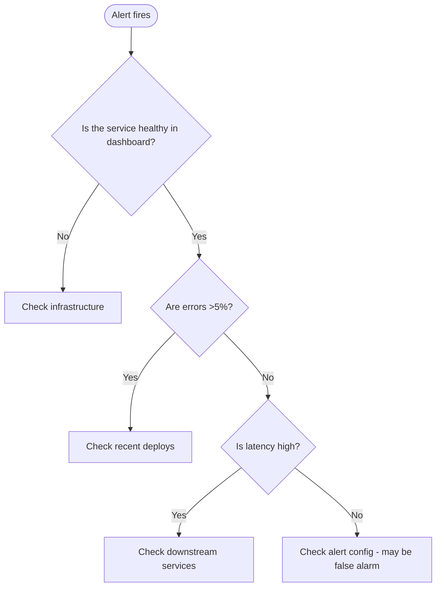

# skill: incident-runbook-template

Use when writing an operational runbook, on-call guide or what-to-do-when-X-breaks playbook.

# Incident Runbook Template

> **ภาษา:** ถ้อยคำทุกบรรทัดเขียนตาม `human-writing` — skill นี้บอกรูปแบบและโครง ส่วน human-writing บอกวิธีเขียนให้คนอ่านรู้เรื่อง

## When to use this skill

- Writing a runbook for a known failure mode
- Documenting on-call procedures
- Creating playbooks for common alerts
- After a postmortem finds "we need a runbook for X"
- Onboarding new on-call engineers

## ไม่ใช้เมื่อ

| งาน | ใช้ตัวนี้แทน |
|---|---|
| เหตุจบแล้ว ต้องสรุปว่าเกิดอะไรและป้องกันยังไง | `postmortem-template` |
| ตั้ง metric alert หรือ dashboard | `observability-basics` |

## อ่านเพิ่มเมื่อ

| ไฟล์ | เปิดเมื่อ |
|---|---|
| [references/runbook-template.md](references/runbook-template.md) | ทุกครั้งที่เริ่มเขียน runbook ใหม่ ให้คัดลอกแม่แบบเต็มจากไฟล์นี้ไปกรอก |
| [references/index-and-alert-links.md](references/index-and-alert-links.md) | ถ้าทีมยังไม่มีหน้ารวม runbook หรือ alert ยังไม่มีลิงก์ไปหา runbook ให้เปิดดูตัวอย่างในไฟล์นี้ |
| [references/game-days.md](references/game-days.md) | ตอนวางแผนซ้อมรับมือเหตุขัดข้องเพื่อทดสอบว่า runbook ใช้ได้จริง |

## What's a Runbook?

A **runbook** answers: "Alert X fired. What do I do?"

It's NOT:
- ❌ A postmortem (that analyses the incident afterwards)
- ❌ Architecture documentation (that explains the bigger picture)
- ❌ Training material (that goes into too much detail)

It IS:
- ✅ Step-by-step actions
- ✅ Decision flowcharts
- ✅ Commands to copy-paste
- ✅ Escalation paths

## Runbook Quality Standards

A good runbook is:

| Property | Test |
|----------|------|
| **Actionable** | Can a tired engineer at 3am follow it? |
| **Concrete** | Are commands copy-pasteable? |
| **Tested** | Has someone followed it during a real incident? |
| **Updated** | Was it last reviewed less than 6 months ago? |
| **Discoverable** | Can on-call find it from the alert link? |
| **Concise** | Under 1 page for common cases |

## Runbook Template

แม่แบบเต็มอยู่ใน [references/runbook-template.md](references/runbook-template.md) ทุกฉบับมีส่วนตามลำดับนี้ และแต่ละส่วนต้องมีของต่อไปนี้

| ส่วน | ต้องมี |
|---|---|
| ส่วนหัว | Severity · Service · Owner Team · Last Reviewed · Linked Alert |
| TL;DR (30 seconds) | ย่อหน้าเดียวว่าอะไรพัง ต้องทำอะไรก่อน และต้องโทรหาใคร |
| How to Detect | อาการที่ผู้ใช้เห็นและที่เห็นภายใน · alert ที่ดัง · dashboard ที่ต้องเปิด |
| Diagnosis (60 seconds) | ผัง flowchart ตัดสินใจ และ quick checks ที่เป็นคำสั่งคัดลอกไปรันได้ เรียงตามลำดับ |
| Mitigation Steps | ขั้นตอนเรียงจากความเสี่ยงต่ำไปสูง (ลำดับเดียวกับ `incident-response` Phase 3) ทุกขั้นบอก Expected effect และ Caveats หรือ If doesn't work · agent แค่เสนอคำสั่งกับผลที่คาด คน on-call เป็นคนรันหรืออนุมัติก่อนแตะ production |
| Escalation Path | ใครต้องถูกเรียกเมื่อไหร่ เป็นนาทีที่ชัดเจน |
| Verification | รายการตรวจว่าแก้แล้วจริง |
| After Resolution | บันทึกในช่องเหตุการณ์ → อัปเดตหน้าสถานะ → เปิดตั๋ว postmortem → อัปเดต runbook นี้ |
| Related Runbooks · Background | ลิงก์ไป runbook ที่เกี่ยวข้อง และที่มาของปัญหาแบบสั้น (ไม่บังคับ) |

**ลำดับ mitigation ในแม่แบบ:** Reduce load (low risk) → Scale up (medium risk) → Rollback recent deploy (higher risk) → Failover to backup region (last resort)

**ลำดับ escalation ในแม่แบบ:** ถ้าแก้ไม่ได้ใน 15 นาที ให้เรียก secondary on-call ถ้าสองคนแก้ไม่ได้ใน 30 นาที ให้เรียกทีมเจ้าของ service ถ้ายังเป็น SEV1 หลัง 45 นาที ให้เรียก incident commander (IC) และถ้า SEV1 เกิน 1 ชั่วโมง ให้เรียกผู้บริหารฝ่ายวิศวกรรม

**ถือว่าแก้แล้วเมื่อ** error rate กลับสู่ระดับปกติ · latency p95 ต่ำกว่าเกณฑ์ · หน้าสถานะเป็น "Operational" · ไม่มี alert ใหม่ · ลูกค้าหยุดแจ้งปัญหา และเฝ้าดูต่ออีก 30 นาทีแล้ว

> Use `postmortem-template` skill for the full analysis

## Runbook Index and Alert Links

ทำหน้ารวม runbook ไว้ที่เดียว ให้ค้นได้ทั้งตาม service ตามชื่อ alert และตามเหตุที่เกิดบ่อยใน 90 วันล่าสุด

alert ทุกตัว**ต้อง**มีลิงก์ไป runbook ผ่าน annotation `runbook_url:` ของ alert และควรใส่ `dashboard:` คู่กันด้วย ส่วนตัวอย่างหน้ารวมและตัวอย่าง Prometheus alerting rule อยู่ใน [references/index-and-alert-links.md](references/index-and-alert-links.md)

## What Makes Runbooks Fail

| Problem | Fix |
|---------|-----|
| Out of date | Review every 6 months, update after every incident |
| Too long | Split into 1 runbook per failure mode |
| Too generic | Be specific to YOUR service |
| No commands | Include actual copy-paste commands |
| Not discoverable | Link it from the alert and the index page |
| No ownership | Each runbook has a team owner |
| Not tested | Run game days, and follow it during real incidents |

## Game Days

ทดสอบ runbook ด้วยการจำลองเหตุขัดข้องโดยตั้งใจ ทุกไตรมาสให้เลือก runbook หนึ่งฉบับ จำลองเหตุใน staging แล้วให้ on-call ทำตาม จากนั้นอัปเดต runbook ตามช่องโหว่ที่เจอ รายการตรวจเต็มอยู่ใน [references/game-days.md](references/game-days.md)

## Anti-patterns

- ❌ **Theoretical runbooks** written by someone who never saw the failure
- ❌ **Long background text** before the first action
- ❌ **"Contact the team"** without saying who or how
- ❌ **Treating mitigation as the root-cause fix** (mitigation should be FAST; the fix comes later)
- ❌ **Runbook in a wiki nobody can find** — link from alert
- ❌ **Update postmortems but not runbooks** — every postmortem should lead to a runbook update

## Document Look

This skill decides **what goes in** the document. It does not decide **how it looks** —
load the matching skill before writing, not after:

| What is being handed over | Load |
|---|---|
| Markdown someone reads (repo, wiki, issue tracker) | `polished-document-style` |
| A rendered `.docx` / `.pptx` / PDF a stakeholder signs off on | `branded-document-design` |
| The point needs a picture to land | `markdown-visuals`, then `software-diagrams` |

Default formatting is not neutral — it reads as unfinished work.


## reference: game-days.md

# Game Days

รายการตรวจของการซ้อมรับมือเหตุขัดข้องเพื่อทดสอบ runbook ใช้ตอนวางแผนซ้อมรายไตรมาส

Test runbooks by faking failures on purpose:

```markdown
## Game Day Checklist

Quarterly:
- [ ] Pick a runbook to test
- [ ] Simulate the failure in staging (chaos engineering)
- [ ] On-call engineer follows runbook
- [ ] Identify gaps
- [ ] Update runbook based on learnings
- [ ] Repeat with different runbook next quarter
```


## reference: index-and-alert-links.md

# Runbook Index และการผูก runbook กับ alert

ตัวอย่างหน้ารวม runbook และตัวอย่างการใส่ลิงก์ runbook ลงใน alert ใช้ตอนตั้งระบบ runbook ของทีมครั้งแรก

## Runbook Index Pattern

Maintain a central index (`docs/runbook-index.md`). Each runbook is one file `docs/runbook-<service>-<เรื่อง>.md` per `document-naming`:

```markdown
# Runbook Index

## By Service
- API Service
  - [High error rate](runbook-api-high-error-rate.md)
  - [Memory leak](runbook-api-memory-leak.md)
- Database
  - [Connection pool exhausted](runbook-db-conn-pool.md)
  - [Replication lag](runbook-db-repl-lag.md)

## By Alert Name
| Alert | Runbook |
|-------|---------|
| `api_5xx_rate_high` | [API: High error rate](link) |
| `db_connections_high` | [DB: Connection pool](link) |
| `disk_full_warn` | [Generic: Disk full](link) |

## Most Common Incidents (last 90 days)
1. High error rate on payment service — [runbook](link) (12 times)
2. DB replication lag — [runbook](link) (8 times)
3. Cache invalidation storm — [runbook](link) (5 times)
```

## Linking Runbook to Alert

Every alert MUST link to a runbook:

```yaml
# Prometheus alerting rule (rule file loaded by Prometheus; Alertmanager only routes the alert)
- alert: APIHighErrorRate
  # share of requests that are 5xx — needs the denominator, otherwise it is requests per second
  expr: |
    sum(rate(http_requests_total{status=~"5.."}[5m]))
      / sum(rate(http_requests_total[5m])) > 0.05
  for: 5m
  annotations:
    summary: "API error rate > 5%"
    runbook_url: "https://runbooks.example.com/api/high-error-rate"
    dashboard: "https://grafana.example.com/d/api-overview"
```


## reference: runbook-template.md

# Runbook Template

- [แม่แบบทั้งไฟล์](#runbook-template) อยู่ในบล็อกเดียว ให้คัดลอกทั้งบล็อกไปเป็นไฟล์ runbook ใหม่

แม่แบบเต็มของ runbook หนึ่งฉบับ ให้คัดลอกไปกรอกต่อได้ทันที ส่วนกฎว่าแต่ละส่วนต้องมีอะไรอยู่ใน `SKILL.md`

````markdown
# Runbook: <Alert Name or Failure Mode>

| | |
|--|--|
| **Severity** | SEV1 \| SEV2 \| SEV3 |
| **Service** | service-name |
| **Owner Team** | @team-name |
| **Last Reviewed** | YYYY-MM-DD |
| **Linked Alert** | [Grafana/PagerDuty link] |

---

## TL;DR (30 seconds)

> One paragraph: what's broken, what to do first, who to call.

## How to Detect

**Symptoms:**
- User-facing: ...
- Internal: ...

**Alerts that fire:**
- [Alert Name](link) — fires when ...
- [Another Alert](link) — fires when ...

**Dashboards to check:**
- [Main Dashboard](link)
- [Service Health](link)

## Diagnosis (60 seconds)



### Quick checks (run in order)

**1. Is service responding?**
```bash
curl -fsS https://api.example.com/health || echo "DOWN"
```

**2. Are recent deploys suspicious?**
```bash
gh release list --repo our-org/service --limit 5
```

**3. Check error rate in logs:**
```bash
# Last 10 min of 5xx errors
kubectl logs -n prod deployment/api --since=10m | grep -c '"status":5'
```

**4. Check downstream dependencies:**
- Database: [Dashboard link]
- Redis: [Dashboard link]
- External API: [Status page link]

## Mitigation Steps

> **Human approval:** an agent only proposes the command and its expected effect. A human on-call runs it or approves it before it touches production (`principle-proceed-on-reversible-work`, `incident-response` Phase 3).

Try mitigations in order of risk (lowest first) — the same order as `incident-response` Phase 3:

### Step 1: Disable the broken feature or reduce load (low risk)
```bash
# Turn off the feature flag of the suspect feature
./scripts/flag.sh set new-checkout off --env prod

# Or enable rate limiting
kubectl set env deployment/api -n prod RATE_LIMIT_AGGRESSIVE=true
```

**Expected effect:** Error rate drops within 2 min
**If doesn't work:** Go to Step 2

### Step 2: Scale up (medium risk)
```bash
kubectl scale deployment/api -n prod --replicas=10
```

**Expected effect:** Latency improves within 3 min
**Caveats:** Will increase cost, monitor budget alerts

### Step 3: Rollback recent deploy (higher risk)
```bash
kubectl rollout undo deployment/api -n prod
```

**Expected effect:** Reverts to previous version
**Caveats:** Check for schema migrations before rolling back. A rollout undo does not delete data, but old code may break on a schema the new release already migrated — roll back only if the migration is backward-compatible

### Step 4: Block bad traffic at the WAF or firewall (high risk)
```bash
# Block the abusive IP range / path at the web application firewall (WAF)
./scripts/waf-block.sh --cidr 203.0.113.0/24 --ttl 1h
```

**Expected effect:** Abusive traffic stops reaching the service
**Caveats:** Can block real users; set a TTL (time to live) and check the allow list

### Step 5: Failover to backup region (last resort)
```bash
# Update DNS to point to backup region
./scripts/failover-to-us-west.sh
```

**Expected effect:** All traffic shifts to backup
**Caveats:** Some user data may need migration, full rollback complex

## Escalation Path

```
You can't resolve in 15 min
  ↓
1. Page secondary on-call (PagerDuty group: team-secondary)
  ↓
You both can't in 30 min
  ↓
2. Page service owner team (team-owner)
  ↓
Still SEV1 after 45 min
  ↓
3. Page incident commander on-call (IC)
  ↓
SEV1 still active after 1h
  ↓
4. Page engineering leadership
```

## Verification (after mitigation)

Confirm the issue is resolved:

- [ ] Error rate back to baseline
- [ ] Latency p95 < threshold
- [ ] Status page updated to "Operational"
- [ ] No new alerts firing
- [ ] Customer reports stopped
- [ ] Monitor for 30 min before considering resolved

## After Resolution

1. **Document in incident channel**: what happened, what you did
2. **Update status page**: clear incident, post resolution message
3. **Create postmortem ticket**: if SEV1/SEV2, schedule postmortem
4. **Update this runbook**: if you learned something new

> Use `postmortem-template` skill for the full analysis

## Related Runbooks

- [Database connection issues](link)
- [Cache failure](link)
- [Authentication service down](link)

## Background / Why this happens

Optional section: brief context on why this failure mode exists.
Useful for new on-call engineers.
````


---

# skill: logging-standards

Use when writing or reviewing code that logs (format, levels, correlation ids, redaction).

# Logging Standards

> **กฎข้อเดียว:** log มีไว้ให้คนอ่านตอนตี 3 ที่ระบบล่ม ไม่ใช่ตอนเขียนโค้ด
> ถ้าบรรทัดไหนไม่ช่วยตอบว่า "เกิดอะไรขึ้น กับใคร เมื่อไหร่" ก็อย่าเขียนลงไป

## เมื่อไหร่ใช้ skill นี้

- เริ่มโปรเจกต์ใหม่ทุกชนิด (service, API, worker, batch, desktop, frontend)
- มีคนขอ "ให้มี log file" หรือถามเรื่องรูปแบบและระดับของ log
- ไล่ปัญหา production แล้วพบว่า log ที่มีอยู่ใช้ไม่ได้

## เมื่อไหร่ **ไม่** ใช้

- ต้องการ metrics หรือ tracing (Prometheus, OpenTelemetry) เพราะเป็นคนละเรื่องกับ log ให้ไปใช้ `observability-basics`
- ทำ endpoint สุขภาพของ service ให้ไปใช้ `web-service-essentials`

---

## 1 · รูปแบบบรรทัด — เหมือนกันทุกภาษา

```
2026-08-31 09:42:13.482 +07:00  INFO   [a3f9c1b2] orders  สร้างคำสั่งซื้อสำเร็จ  orderId=1042 userId=57 ms=134
└────────── เวลา + timezone ──────────┘ └level┘  └ cid ┘ └source┘ └── ข้อความ ──┘ └──── context k=v ────┘
```

| ส่วน | กฎ |
|---|---|
| เวลา | `YYYY-MM-DD HH:mm:ss.SSS ±HH:MM` — **ต้องมี timezone** ไม่งั้นเทียบ log ข้ามเครื่องไม่ได้ |
| level | ชิดซ้าย กว้าง 5 ตัวอักษร (`INFO ` `WARN ` `ERROR` `DEBUG` `FATAL`) — คอลัมน์จะได้ตรงกัน |
| cid | correlation id 8 ตัวในวงเล็บเหลี่ยม ถ้าไม่มีให้ใส่ `[--------]` (8 ตัวเท่ากัน คอลัมน์จะได้ตรง) |
| source | โมดูลหรือคลาสที่เขียน log ไม่ใช่ชื่อไฟล์ |
| ข้อความ | ประโยคเดียว ไม่ฝังตัวแปรใน string |
| context | `key=value` คั่นด้วยช่องว่าง ถ้าค่ามีช่องว่างให้ครอบด้วย `"` |

**ทำไมไม่ใช่ JSON:** ไฟล์นี้มีไว้ให้คนเปิดอ่านและ `grep` เป็นหลัก รูปแบบนี้ยัง
`grep "\[a3f9c1b2\]"` หรือ `awk` ได้อยู่ แต่ตาอ่านออกทันทีโดยไม่ต้องพึ่งเครื่องมือ
วันที่ต้องส่งเข้าระบบรวม log อย่าง Grafana Loki หรือ Elasticsearch, Logstash, Kibana (ELK) ให้เพิ่ม sink (ปลายทางที่ส่ง log ไป) แบบ JSON อีก 1 ตัว แต่**อย่าทิ้งไฟล์ข้อความ**

**1 event = 1 บรรทัด** ยกเว้น stack trace ที่ต่อท้ายโดยเยื้อง 4 ช่อง

---

## 2 · ระดับ log — เขียนให้ตรงความหมาย

| ระดับ | ใช้เมื่อ | ตัวอย่าง |
|---|---|---|
| `FATAL` | แอปกำลังจะตาย ทำงานต่อไม่ได้ | ต่อ DB ตอน start ไม่ได้ |
| `ERROR` | งานนี้ล้มเหลว **และต้องมีคนมาดู** | บันทึกคำสั่งซื้อไม่สำเร็จ |
| `WARN` | ผิดปกติแต่ระบบยังไปต่อได้ | retry ครั้งที่ 2, disk เหลือ 10% |
| `INFO` | เหตุการณ์สำคัญทางธุรกิจ | สร้างคำสั่งซื้อ, ผู้ใช้ล็อกอิน, job เริ่ม/จบ |
| `DEBUG` | รายละเอียดสำหรับไล่ปัญหา — **ปิดใน production** | ค่าที่คำนวณได้ระหว่างทาง |
| `TRACE` | ละเอียดระดับทุก step — เปิดเฉพาะตอนไล่จริง ๆ | payload ดิบ |

> ⚠️ **`ERROR` ที่ไม่มีใครต้องทำอะไร คือ `WARN`** — ถ้า ERROR ขึ้นทุกนาทีจนคนเลิกดู
> คุณเพิ่งทำลายระบบเตือนภัยของตัวเอง

ค่าเริ่มต้นของ dev คือ `DEBUG` ส่วน production คือ `INFO` และปรับได้ด้วย env `LOG_LEVEL` **ไม่ต้อง build ใหม่ แค่ restart (หรือ reload config)** — .NET อ่านจาก `appsettings.json` แทน (ดู `references/per-stack.md`)

---

## 3 · Correlation id — สิ่งที่ทำให้ log ใช้งานได้จริง

1 request ใช้ id เดียวตั้งแต่ต้นจนจบ ทุกบรรทัดที่เกิดจาก request นั้นจึงมี id เดียวกัน

```
Client ──X-Request-Id?── API Gateway ──┬── Service A ──┐
                        (ไม่มีก็สร้าง)   └── Service B ──┴─→ ทุกบรรทัดมี cid เดียวกัน
```

- รับจาก header **`X-Request-Id`** ถ้าไม่มีให้สร้าง (`uuid v4` ตัด 8 ตัวแรก)
- **ส่งกลับใน response header เสมอ** เพื่อให้ลูกค้าส่ง id มาตอนแจ้งปัญหา แล้วเราตามได้ทันที
- ส่งต่อไปยัง service ปลายทางทุกครั้งที่เรียกข้ามระบบ
- เก็บด้วยกลไกที่แยกตาม request: `AsyncLocalStorage` (Node) · `ContextVar` (Python)
  · `IHttpContextAccessor`/`LogContext` (.NET) — **ห้ามใช้ตัวแปร global** เพราะจะปนกันทันทีที่มีหลาย request พร้อมกัน

---

## 4 · ไฟล์ log

```
logs/
  app-20260831.log        ทุกระดับ · หมุนเที่ยงคืน · เก็บ 30 วัน · ไฟล์ละไม่เกิน 100MB
  error-20260831.log      เฉพาะ ERROR/FATAL · เก็บ 90 วัน
  fatal.log               exception ที่ไม่ถูกจับ (แอปตาย)
```

- โฟลเดอร์กำหนดด้วย env `LOG_DIR` — **ห้าม hardcode path**
- บีบไฟล์เก่า (`.gz`) และ**ต้องมี retention** ไม่อย่างนั้นดิสก์จะเต็มจนระบบล่มเพราะ log ของตัวเอง
- ใน container ให้ log ออก stdout ด้วย (นอกเหนือจากไฟล์) เพื่อให้ `docker logs` ใช้ได้
- `logs/` ต้องอยู่ใน `.gitignore`

---

## 5 · สิ่งที่ห้ามลง log เด็ดขาด

รหัสผ่าน · token/API key · cookie/Authorization header · OTP/PIN · เลขบัตรเครดิต/CVV ·
**เลขบัตรประชาชน** · ข้อมูลสุขภาพ · payload เต็มที่มีข้อมูลส่วนบุคคล

ตัวช่วยที่มีให้แล้ว: ฟังก์ชัน redaction (ปิดค่าลับ) ดู**ว่าชื่อคีย์มีคำต้องห้ามอยู่ข้างในไหม** (`userPassword`, `pwd`,
`accessToken` โดนหมด) แล้วแทนค่าด้วย `***` โดยตรวจลึกลงไปได้ 4 ชั้นของ object

> 🚨 **Log injection** — ค่าที่มาจากผู้ใช้อาจมี `\n` ถ้าปล่อยผ่าน ผู้ใช้จะ "แต่ง" บรรทัด log
> ปลอมขึ้นมาเองได้ ทำให้คนอ่านเข้าใจผิดและ parser พัง โค้ดที่ให้มาจึงตัด `\r\n\t` ทิ้งจากทุกค่า

---

## 6 · โค้ดที่พร้อมใช้

| ไฟล์ | สแต็ก | สถานะ |
|---|---|---|
| `assets/logger.node.js` | Node/TS — winston + winston-daily-rotate-file | ✅ รันทดสอบแล้ว |
| `assets/logger_py.py` | Python — stdlib ล้วน ไม่ต้องลงอะไร | ✅ รันทดสอบแล้ว |
| `references/per-stack.md` | .NET (Serilog) + Angular | ⚠️ ยังไม่ได้คอมไพล์ทดสอบ |

```js
// Node
const { withCorrelation } = require('./logger.node');
const log = withCorrelation(req.id).child({ source: 'orders' });
log.info('สร้างคำสั่งซื้อสำเร็จ', { orderId: 1042, ms: 134 });
log.error('บันทึกไม่สำเร็จ', err);          // ส่ง Error ตรง ๆ ได้ stack ให้เอง
```

```python
# Python
from logger_py import setup_logging, get_logger, set_correlation_id
setup_logging(app_name="myapi")             # ครั้งเดียวตอนแอปเริ่ม
log = get_logger("orders")
log.info("สร้างคำสั่งซื้อสำเร็จ", extra={"ctx": {"order_id": 1042, "ms": 134}})
log.exception("บันทึกไม่สำเร็จ")             # ใน except — ได้ stack ให้เอง
```

---

## 7 · ตรวจงาน

```bash
# ไม่มี print/console.log หลงเหลือในโค้ด production
grep -rnE "console\.(log|error)|Console\.WriteLine|^\s*print\(" src/ --include="*.ts" \
  --include="*.js" --include="*.cs" --include="*.py" | grep -v test

# log ที่ออกมาอ่านได้จริงและ grep ได้
tail -f logs/app-*.log
grep "a3f9c1b2" logs/app-*.log          # ตาม request เดียวได้ครบทุกบรรทัดไหม
```

- [ ] ทุกบรรทัดมีครบ: เวลา+timezone · level · cid · source
- [ ] `grep` ด้วย cid เดียวแล้วเห็นเรื่องราวของ request นั้นตั้งแต่ต้นจนจบ
- [ ] ไม่มีความลับหลุด: ลอง log object ที่มี `password`, `token` แล้วต้องเห็น `***`
- [ ] ยิงค่าที่มี `\n` เข้าไปแล้วไม่เกิดบรรทัดปลอม
- [ ] ตั้ง `LOG_LEVEL=INFO` แล้ว DEBUG หายไปจริง
- [ ] ไฟล์หมุนตามวันและมี retention (ปล่อยไว้ 1 เดือนดิสก์ต้องไม่เต็ม)
- [ ] `logs/` อยู่ใน `.gitignore`
- [ ] response ส่ง `X-Request-Id` กลับมาให้ลูกค้า

---

## 8 · Anti-patterns

- ❌ **`console.log` / `print()` ในโค้ดจริง** — ไม่มี level ไม่มีเวลา ไม่มี cid ไม่ลงไฟล์
- ❌ **log ทุกอย่าง** — ไฟล์ใหญ่จนหาอะไรไม่เจอ ราคาแพง และช้า
- ❌ **`try { } catch (e) { }` เงียบ ๆ** — ต้อง log อย่างน้อย 1 บรรทัด
- ❌ **log แล้ว throw ต่อ** — ปัญหาเดียวจะโผล่ 3 ครั้งในไฟล์ ให้ log ที่ชั้นบนสุดซึ่งจัดการ error จริงแทน
- ❌ **ตัวแปรฝังในข้อความ** (`` `บันทึก order ${id} ไม่สำเร็จ` ``) — ทำให้ group log ไม่ได้
  ใช้ข้อความคงที่ + context แทน
- ❌ **log ในลูปที่วนหลายพันรอบ** — ให้สรุปทีเดียวตอนจบลูป
- ❌ **timestamp ไม่มี timezone** — server ใช้ UTC แต่คนไทยอ่านเป็น +07:00 จึงเทียบเวลาผิดไป 7 ชั่วโมง
- ❌ **ไม่มี retention** — วันหนึ่งดิสก์เต็มแล้วระบบล่มเพราะ log ของตัวเอง

---

## 9 · เชื่อมกับ skill อื่น

| ต้องการ | ใช้คู่กับ |
|---|---|
| endpoint health/ping/version | `web-service-essentials` |
| เขียน test ให้ครอบคลุม | `testing-standards` |
| runbook ตอน incident | `incident-runbook-template` |
| postmortem หลังเหตุ | `postmortem-template` |


## reference: per-stack.md

# ตั้งค่า logger ให้ได้รูปแบบเดียวกัน — .NET และ Angular

> ⚠️ โค้ดในไฟล์นี้ **ยังไม่ได้คอมไพล์ทดสอบ** (ต่างจาก `assets/logger.node.js` และ
> `assets/logger_py.py` ที่รันจริงแล้ว) โค้ดนี้ใช้การตั้งค่ามาตรฐานของแต่ละไลบรารี
> ตอน build ครั้งแรกให้เทียบบรรทัดที่ออกมากับรูปแบบใน SKILL.md ข้อ 1

---

## สารบัญ

1. [.NET / C# — Serilog](#net--c--serilog)
2. [Angular / frontend](#angular--frontend)
3. [ตารางเทียบ](#ตารางเทียบ)

---

## .NET / C# — Serilog

```bash
dotnet add package Serilog.AspNetCore
dotnet add package Serilog.Sinks.File
```

`appsettings.json` — เก็บการตั้งค่าไว้นอกโค้ด เปลี่ยนระดับ log ได้โดยไม่ต้อง build ใหม่:

```json
{
  "Serilog": {
    "MinimumLevel": {
      "Default": "Information",
      "Override": {
        "Microsoft.AspNetCore": "Warning",
        "Microsoft.EntityFrameworkCore.Database.Command": "Warning"
      }
    }
  }
}
```

`Program.cs`:

```csharp
using Serilog;
using Serilog.Events;

const string LineTemplate =
    "{Timestamp:yyyy-MM-dd HH:mm:ss.fff zzz}  {Level:u5}  " +
    "[{CorrelationId}] {SourceContext}  {Message:lj}  {Context:l}{NewLine}{Exception}";

Log.Logger = new LoggerConfiguration()
    .ReadFrom.Configuration(builder.Configuration)
    .Enrich.FromLogContext()
    .Enrich.WithProperty("CorrelationId", "--------") // ค่าตั้งต้นเมื่อไม่มี request (8 ตัว)
    .Enrich.WithProperty("Context", "")              // ค่าว่างเมื่อไม่มี context k=v
    .WriteTo.Console(outputTemplate: LineTemplate)
    .WriteTo.File(
        path: Path.Combine(Environment.GetEnvironmentVariable("LOG_DIR") ?? "logs", "app-.log"),
        rollingInterval: RollingInterval.Day,
        retainedFileCountLimit: 30,
        fileSizeLimitBytes: 100 * 1024 * 1024,
        rollOnFileSizeLimit: true,
        outputTemplate: LineTemplate)
    .WriteTo.File(
        path: Path.Combine(Environment.GetEnvironmentVariable("LOG_DIR") ?? "logs", "error-.log"),
        restrictedToMinimumLevel: LogEventLevel.Error,
        rollingInterval: RollingInterval.Day,
        retainedFileCountLimit: 90,
        outputTemplate: LineTemplate)
    .CreateLogger();

builder.Host.UseSerilog();
```

> `{Level:u5}` คือตัวพิมพ์ใหญ่กว้าง 5 ตัวอักษร จึงได้ `INFO ` `WARN ` `ERROR` ตรงกับสแต็กอื่น
> `{Message:lj}` และ `{Context:l}` คือไม่ครอบ string ด้วย `"` ซ้ำอีกชั้น

### Middleware correlation id

```csharp
using System.Text.RegularExpressions;

public sealed class CorrelationIdMiddleware(RequestDelegate next)
{
    public const string Header = "X-Request-Id";
    // รับค่าจากลูกค้าเฉพาะตัวอักษร ตัวเลข และ - ยาวไม่เกิน 36 ตัว — กันคนยัดข้อความยาวหรือ \n เข้า log
    private static readonly Regex Valid = new("^[A-Za-z0-9-]{1,36}$", RegexOptions.Compiled);

    public async Task Invoke(HttpContext ctx)
    {
        var cid = ctx.Request.Headers[Header].FirstOrDefault();
        if (cid is null || !Valid.IsMatch(cid))
            cid = Guid.NewGuid().ToString("N")[..8];   // ไม่มีหรือไม่ผ่าน → สร้างใหม่

        var logCid = cid.Length > 8 ? cid[..8] : cid;   // log ใช้ 8 ตัวแรกให้ตรงคอลัมน์ cid (เหมือน Node/Python) — header ส่งค่าเต็มกลับ

        ctx.Response.Headers[Header] = cid;          // ส่งกลับให้ลูกค้าอ้างอิงได้

        // LogContext ผูกกับ async flow ของ request นี้เท่านั้น — ไม่ปนกับ request อื่น
        using (Serilog.Context.LogContext.PushProperty("CorrelationId", logCid))
            await next(ctx);
    }
}
```

### เขียน log

```csharp
// ✅ ข้อความคงที่ + ค่าไปอยู่ใน {Context} เป็น k=v ตามรูปแบบ SKILL.md ข้อ 1
//    ผลลัพธ์: ... INFO   [a3f9c1b2] Orders  สร้างคำสั่งซื้อสำเร็จ  orderId=1042 ms=134
using (Serilog.Context.LogContext.PushProperty("Context", $"orderId={orderId} ms={sw.ElapsedMilliseconds}"))
    _logger.LogInformation("สร้างคำสั่งซื้อสำเร็จ");

// ❌ ตัวแปรฝังใน string — ทุกบรรทัดกลายเป็นข้อความคนละอัน group ไม่ได้
_logger.LogInformation($"สร้างคำสั่งซื้อ {orderId} สำเร็จ");
```

### ปิดข้อมูลลับ

Serilog ไม่ปิดค่าลับให้อัตโนมัติ ทางที่ชัวร์ที่สุดคือ**อย่าส่ง object ทั้งก้อนเข้า log**
ให้เลือกเฉพาะ field ที่ต้องการ ถ้าจำเป็นต้องส่งทั้งก้อนให้เขียน `IDestructuringPolicy`
หรือใส่ `[NotLogged]` ผ่าน `Destructure.ByTransforming<T>()`

---

## Angular / frontend

หลักการต่างจาก backend: **เบราว์เซอร์เขียนไฟล์ไม่ได้** log ที่สำคัญจึงต้องส่งขึ้น backend

```ts
// core/logger.service.ts
import { Injectable, inject, isDevMode } from '@angular/core';
import { HttpClient } from '@angular/common/http';

type Level = 'DEBUG' | 'INFO' | 'WARN' | 'ERROR';

@Injectable({ providedIn: 'root' })
export class LoggerService {
  private http = inject(HttpClient);
  private buffer: unknown[] = [];

  private write(level: Level, message: string, ctx: Record<string, unknown> = {}) {
    // dev: ออก console เพื่อไล่ปัญหา — prod: เงียบ ยกเว้น WARN ขึ้นไปที่ส่งขึ้น server
    if (isDevMode()) console[level === 'ERROR' ? 'error' : 'log'](level, message, ctx);
    if (level === 'DEBUG' || (!isDevMode() && level === 'INFO')) return;   // prod ส่งเฉพาะ WARN ขึ้นไป

    this.buffer.push({ ts: new Date().toISOString(), level, message, ctx });
    if (this.buffer.length >= 10 || level === 'ERROR') this.flush();
  }

  /** ส่งเป็นชุด ไม่ยิงทีละบรรทัด — ไม่งั้น network tab เต็มไปด้วย request ของ log เอง */
  flush() {
    if (!this.buffer.length) return;
    const batch = this.buffer.splice(0);
    this.http.post('/api/client-logs', { entries: batch }).subscribe({ error: () => {} });
  }

  debug = (m: string, c?: Record<string, unknown>) => this.write('DEBUG', m, c);
  info  = (m: string, c?: Record<string, unknown>) => this.write('INFO', m, c);
  warn  = (m: string, c?: Record<string, unknown>) => this.write('WARN', m, c);
  error = (m: string, c?: Record<string, unknown>) => this.write('ERROR', m, c);
}
```

จับ error ที่หลุดทุกตัว:

```ts
// core/global-error.handler.ts
import { ErrorHandler, Injectable, inject, isDevMode } from '@angular/core';
import { LoggerService } from './logger.service';

@Injectable()
export class GlobalErrorHandler implements ErrorHandler {
  private log = inject(LoggerService);
  handleError(err: unknown) {
    const e = err as Error;
    this.log.error(e?.message ?? 'unknown error', { stack: e?.stack?.slice(0, 2000) });
    if (isDevMode()) console.error(err);
  }
}
// app.config.ts → providers: [{ provide: ErrorHandler, useClass: GlobalErrorHandler }]
```

ส่ง correlation id ในทุก request เพื่อให้ log ฝั่ง client กับ server ต่อกันติด:

```ts
// core/correlation.interceptor.ts
import { HttpInterceptorFn } from '@angular/common/http';

export const correlationInterceptor: HttpInterceptorFn = (req, next) =>
  next(req.clone({ setHeaders: { 'X-Request-Id': crypto.randomUUID().slice(0, 8) } }));
```

**ฝั่ง backend** ต้องมี endpoint `POST /api/client-logs` ที่:
- จำกัดขนาด body และทำ rate limit ไม่อย่างนั้นจะกลายเป็นช่องให้คนยิง log ถล่ม
- เขียนลงไฟล์แยก `logs/client-YYYYMMDD.log`
- **ถือว่าเนื้อหาเป็นข้อมูลที่เชื่อไม่ได้** จึงต้องตัด `\r\n` ออกจากทุกค่าเหมือน log ปกติ

---

## ตารางเทียบ

| เรื่อง | .NET | Node | Python | Angular |
|---|---|---|---|---|
| ไลบรารี | Serilog | winston | stdlib `logging` | เขียนเอง (บาง) |
| หมุนไฟล์ | `rollingInterval: Day` | `winston-daily-rotate-file` | `TimedRotatingFileHandler` | — (ส่งขึ้น backend) |
| correlation | `LogContext.PushProperty` | `AsyncLocalStorage` + `child()` | `ContextVar` | header `X-Request-Id` |
| ระดับ | `LogEventLevel` | `level` | `setLevel` | enum ของตัวเอง |
| ตั้งค่าจากภายนอก | `appsettings.json` | env `LOG_LEVEL` | env `LOG_LEVEL` | `isDevMode()` |


---

# skill: web-service-essentials

Use when building or reviewing any HTTP service or backend (health endpoints, RFC 9457 errors).

# Web Service Essentials

> **กฎข้อเดียว:** ก่อนเขียน endpoint ธุรกิจตัวแรก service ต้องตอบได้ว่า
> "ยังอยู่ไหม · พร้อมรับงานไหม · ตอนนี้รันเวอร์ชันอะไร" ถ้าตอบไม่ได้ วันที่ระบบล่มคุณจะต้องเดาล้วน ๆ

## เมื่อไหร่ใช้ skill นี้

- เริ่ม service / REST API / microservice ใหม่
- มีคนขอ health check, ping, readiness, liveness, version endpoint
- จะ deploy ขึ้น production ครั้งแรก หรือย้ายเข้า Docker/Kubernetes
- ต้องกำหนดรูปแบบ error ของ API ให้เหมือนกันทั้งระบบ

## เมื่อไหร่ **ไม่** ใช้

- ออกแบบ endpoint ทางธุรกิจ ให้ใช้ command `/api-design`
- รูปแบบ URL · paging · วันที่ · id ของ API ให้ใช้ `api-conventions`
- รูปแบบ log ให้ใช้ `logging-standards`
- เลือกสถาปัตยกรรม ให้ใช้ `architecture-patterns`

---

## 1 · endpoint พื้นฐาน 4 ตัว

| Endpoint | ตอบอะไร | auth | เช็ค dependency | ใครเรียก |
|---|---|:---:|:---:|---|
| `GET /ping` | `pong` (text) | ไม่ | ไม่ | load balancer ทุกวินาที |
| `GET /health/live` | process ยังอยู่ | ไม่ | **ไม่** | orchestrator (restart ถ้าตาย) |
| `GET /health/ready` | พร้อมรับ traffic | ไม่ | ใช่ | orchestrator (ตัดออกจาก pool) |
| `GET /version` | รันอะไรอยู่ | ไม่* | ไม่ | คน ตอนไล่ปัญหา |

> 🚨 **live ห้ามเช็ค dependency** นี่คือความผิดพลาดที่เจอบ่อยที่สุด
> ถ้า `/health/live` เช็คฐานข้อมูล (database · DB) แล้ว DB ล่มชั่วคราว Kubernetes จะ**ฆ่า pod ทิ้งทั้งหมด**
> ทั้งที่แอปยังปกติดี พอ DB กลับมาก็ไม่มี pod เหลือรับ traffic แล้ว
> การเช็ค dependency ต้องอยู่ที่ `/health/ready` ซึ่งแค่ตัด pod ออกจาก pool ชั่วคราว

\* ถ้าไม่อยากให้คนทั่วไปเห็น commit hash ใน `/version` ให้จำกัดให้เรียกได้เฉพาะเครือข่ายภายใน

### รูปร่าง response (เหมือนกันทุกภาษา)

```jsonc
// GET /health/ready → 200 ปกติ · 503 เมื่อ dependency ที่ critical ล่ม
{
  "status": "up",                       // up | degraded | down
  "timestamp": "2026-08-31T09:42:13.482Z",
  "checks": {
    "db":    { "status": "up",   "durationMs": 12 },
    "redis": { "status": "up",   "durationMs": 3 },
    "mail":  { "status": "down", "durationMs": 3001, "error": "smtp timeout" }
  }
}
```

```jsonc
// GET /version → 200
{
  "name": "orders-api", "version": "1.4.0", "commit": "abc1234",
  "buildTime": "2026-08-31T09:00:00Z", "env": "production", "host": "pod-7f9c"
}
```

**3 สถานะ ไม่ใช่ 2:**
- `up` — ทุกอย่างปกติ → 200
- `degraded` — dependency ที่**ไม่ critical** ล่ม (เช่น อีเมล) แต่ยังรับ traffic ได้ → 200
- `down` — dependency ที่ critical ล่ม (เช่น DB) → **503**

**ทุก check ต้องมี timeout** (ค่าเริ่มต้น 3 วินาที) ไม่งั้น dependency ที่ค้าง
จะทำให้ health endpoint ค้างตาม แล้ว orchestrator ตัดสินใจผิดทั้งระบบ

**ห้ามส่ง stack trace หรือ connection string ออกทาง endpoint นี้** เพราะ endpoint นี้ใครก็เรียกได้

---

## 2 · รูปแบบ error ที่เหมือนกันทั้งระบบ

ยึด **RFC 9457 (`application/problem+json`)** ซึ่งเป็นมาตรฐานจริง ไม่ต้องคิดเอง

```jsonc
// 422 — รูปแบบถูก แต่ข้อมูลไม่ผ่านกฎ (ดูตารางล่าง)
{
  "type": "https://api.example.com/errors/validation",
  "title": "ข้อมูลที่ส่งมาไม่ถูกต้อง",
  "status": 422,
  "detail": "จำนวนสินค้าต้องมากกว่า 0",
  "instance": "/api/v1/orders",
  "requestId": "a3f9c1b2",              // ตรงกับ cid ใน log — ตามเรื่องได้ทันที
  "errors": [                           // เฉพาะ validation · ครบทุกฟิลด์ในครั้งเดียว
    { "field": "items[0].qty", "code": "min_value", "message": "ต้องมากกว่า 0" }
  ]
}
```

- `field` เป็นเส้นทางเต็มรวมดัชนีอาเรย์ · `code` ให้โปรแกรมอ่าน · `message` ให้คนอ่าน

| สถานะ | ใช้เมื่อ |
|---|---|
| 400 | ข้อมูลผิดรูป |
| 401 | ยังไม่ได้ยืนยันตัวตน |
| 403 | ยืนยันแล้วแต่ไม่มีสิทธิ์ |
| 404 | ไม่มีสิ่งนี้ |
| 409 | ชนกับสถานะปัจจุบัน (ซ้ำ, แก้ทับ) |
| 422 | รูปแบบถูกแต่ผิดกฎธุรกิจ |
| 429 | เรียกถี่เกิน — ต้องมี `Retry-After` |
| 500 | ฝั่งเราพัง — **ห้ามส่งรายละเอียดภายในออกไป** ส่ง `requestId` แทน |

> **500 ต้องบอกแค่ "เกิดข้อผิดพลาด กรุณาแจ้ง requestId นี้"** รายละเอียดจริงอยู่ใน log
> การส่ง stack trace ออกไปก็เหมือนแจกแผนผังระบบให้คนที่กำลังหาช่องโจมตี

---

## 3 · Request id

- รับจาก header **`X-Request-Id`** เฉพาะเมื่อตรง `^[A-Za-z0-9-]{1,64}$` · ไม่มีหรือไม่ตรง → สร้างใหม่ (uuid ตัด 8 ตัว)
  ค่านี้ลงทุกบรรทัด log ถ้ารับมาตรง ๆ ผู้ส่งจะแทรกขึ้นบรรทัดใหม่หรือข้อความปลอมลง log ได้ (log injection)
- **ส่งกลับใน response header ทุกครั้ง** รวมทั้งตอน error
- ใส่ในทุกบรรทัด log (ดู `logging-standards`) และใน error body
- ส่งต่อไป service ปลายทางทุกครั้งที่เรียกข้ามระบบ

พอลูกค้าโทรมาบอกว่า "มันพัง" ก็ขอ requestId แล้ว `grep` ครั้งเดียวเจอทั้งเรื่อง

---

## 4 · Graceful shutdown

ตอน deploy ใหม่ orchestrator จะส่ง `SIGTERM` มา ถ้าแอปตายทันที request ที่ทำอยู่จะขาดกลางคัน

```
SIGTERM → 1. หยุดรับ request ใหม่ (ให้ /health/ready ตอบ down ทันที)
          2. รอ request ที่ค้างอยู่ทำงานจบ (timeout 15–30 วิ)
          3. ปิด DB pool / คิว / ไฟล์
          4. exit(0)
```

> ข้อ 1 สำคัญกว่าที่คิด ต้องให้ `/health/ready` ตอบ `down` **ก่อน** ปิดจริงสัก 5 วินาที
> เพื่อให้ load balancer ตัดเราออกจาก pool ทัน ไม่งั้นยังมี traffic วิ่งเข้ามาตอนกำลังปิด

---

## 5 · สิ่งที่ต้องมีก่อน deploy (ไม่ใช่ทางเลือก)

- **Timeout ทุกทาง** ทั้ง request เข้า การเรียกออก และ query DB ถ้าไม่มี timeout ปลายทางช้าเมื่อไร ทั้งระบบจะค้างตาม
- **จำกัดขนาด body** (เช่น 1MB) เพื่อกัน memory ระเบิดจาก payload ใหญ่
- **Cross-Origin Resource Sharing (CORS) ระบุ origin ชัดเจน** — `*` ใช้ได้เฉพาะ API สาธารณะที่ไม่มี cookie
- **Rate limit** อย่างน้อยที่ endpoint ล็อกอินและที่ที่ส่งรหัสผ่านใช้ครั้งเดียว (One-Time Password · OTP)/อีเมล
- **Security headers**: `X-Content-Type-Options: nosniff` · `Content-Security-Policy: frame-ancestors 'none'` (ตัวแทนของ `X-Frame-Options` ที่เป็น header รุ่นเก่า · ใส่ `X-Frame-Options: DENY` คู่ไว้ให้เบราว์เซอร์เก่า) ·
  `Strict-Transport-Security` (HTTP Strict Transport Security · HSTS)
  Node: `helmet` ตั้งครบในบรรทัดเดียว · .NET: `UseHsts()` ตั้งแค่ HSTS ที่เหลือต้องเขียน middleware สั้น ๆ หรือใช้แพ็กเกจ `NetEscapades.AspNetCore.SecurityHeaders` (ตัวอย่างใน `references/per-stack.md`)
- **ปิดหน้าโชว์ error เต็ม ๆ ใน production** (`app.UseDeveloperExceptionPage()` เฉพาะ dev)
- **ตั้งเวอร์ชันไว้ใน path**: `/api/v1/...` ตั้งแต่วันแรก เพราะย้ายทีหลังแพงกว่ามาก
- **OpenAPI** ที่ generate จากโค้ดจริง ไม่ใช่เขียนมือแล้วลืมอัปเดต

---

## 6 · โค้ดที่พร้อมใช้

| ไฟล์ | สแต็ก | สถานะ |
|---|---|---|
| `assets/health.node.js` | Node / Express | ✅ รันทดสอบครบทั้ง 4 endpoint + เคส degraded/down/timeout |
| `assets/health_py.py` | Python / FastAPI | ✅ รันทดสอบครบเหมือนกัน ผลตรงกันทุก field |
| `references/per-stack.md` | .NET (ASP.NET Core health checks) + Angular | ⚠️ ยังไม่ได้คอมไพล์ทดสอบ |

```js
// Node
app.use(createHealthRouter({
  version: { name: 'orders-api', version: '1.4.0', commit: process.env.GIT_SHA },
  checks: {
    db:   async () => { await pool.query('SELECT 1'); },          // critical
    mail: { critical: false, run: async () => { await smtp.verify(); } },
  },
}));
```

```python
# Python
app.include_router(make_health_router(
    version={"name": "orders-api", "version": "1.4.0", "commit": os.getenv("GIT_SHA")},
    checks={"db": lambda: db.execute("SELECT 1"),
            "mail": {"critical": False, "run": smtp.verify}},
))
```

---

## 7 · ตรวจงาน

```bash
curl -i localhost:8080/ping                    # 200 pong
curl -s localhost:8080/health/live  | jq
curl -s localhost:8080/health/ready | jq
curl -s localhost:8080/version      | jq

# ปิด DB แล้วยิงซ้ำ — ready ต้องเป็น 503 แต่ live ต้องยัง 200
docker stop mydb && curl -i localhost:8080/health/ready && curl -i localhost:8080/health/live
```

- [ ] `/health/live` **ไม่** แตะ DB — ปิด DB แล้วยังตอบ 200
- [ ] `/health/ready` ตอบ 503 เมื่อ dependency ที่ critical ล่ม
- [ ] dependency ที่ไม่ critical ล่มแล้วได้ `degraded` + 200 (ยังรับ traffic)
- [ ] ทุก check มี timeout — ลองทำให้ dependency ค้าง แล้ว endpoint ต้องตอบภายใน ~3 วิ
- [ ] `/version` ตรงกับ commit ที่ deploy จริง
- [ ] ทุก response มี `X-Request-Id` รวมทั้งตอน 500
- [ ] ยิง 500 แล้วไม่มี stack trace / connection string หลุดออกมา
- [ ] `SIGTERM` แล้ว request ที่ค้างอยู่ทำงานจบก่อนแอปปิด
- [ ] `/ping` ไม่ถูกเขียนลง log (ไม่งั้นไฟล์เต็มไปด้วย ping)

---

## 8 · Anti-patterns

- ❌ **`/health` ตัวเดียวเช็คทุกอย่าง** — orchestrator แยกไม่ออกว่าควร restart หรือแค่ตัด traffic
- ❌ **liveness เช็ค DB** — DB สะดุด 10 วินาที = pod ตายยกแถว
- ❌ **health check ไม่มี timeout** — dependency ค้าง แล้ว health ค้างตาม
- ❌ **ส่ง stack trace / connection string ใน health หรือ error 500**
- ❌ **health ต้อง login** — orchestrator ไม่มี token ให้
- ❌ **รูปแบบ error ต่างกันทุก endpoint** — client ต้องเขียนโค้ดแกะ 5 แบบ
- ❌ **`/ping` เขียนลง log** — ทุกวินาที × 86400 = ขยะเต็มไฟล์
- ❌ **ไม่มี graceful shutdown** — deploy ทีไรลูกค้าเจอ error ทุกที
- ❌ **`Access-Control-Allow-Origin: *` คู่กับ cookie** — เปิดช่องให้เว็บอื่นยิงแทนผู้ใช้

---

## 9 · เชื่อมกับ skill อื่น

| ต้องการ | ใช้คู่กับ |
|---|---|
| รูปแบบ log และ correlation id | `logging-standards` |
| test ให้ endpoint พวกนี้ | `testing-standards` |
| ออกแบบ endpoint ธุรกิจ | command `/api-design` |
| runbook ตอน service ล่ม | `incident-runbook-template` |
| ตรวจความปลอดภัย | `security-engineer` + command `/security-scan` |


## reference: per-stack.md

# .NET และ Angular

> ⚠️ โค้ดในไฟล์นี้ **ยังไม่ได้คอมไพล์ทดสอบ** (ต่างจาก `assets/health.node.js` และ
> `assets/health_py.py` ที่รันจริงครบทุก endpoint แล้ว) โค้ดนี้เป็นการตั้งค่ามาตรฐานของ
> ASP.NET Core ตอนรันครั้งแรกให้เทียบ response กับรูปร่างใน SKILL.md ข้อ 1

---

## สารบัญ

1. [ASP.NET Core — health checks](#aspnet-core--health-checks)
2. [Angular — ฝั่งที่เรียกใช้](#angular--ฝั่งที่เรียกใช้)
3. [ตารางเทียบ](#ตารางเทียบ)

---

## ASP.NET Core — health checks

```bash
dotnet add package AspNetCore.HealthChecks.NpgSql
dotnet add package AspNetCore.HealthChecks.Redis
dotnet add package AspNetCore.HealthChecks.Network   # AddSmtpHealthCheck อยู่ในแพ็กเกจนี้
```

```csharp
builder.Services.AddHealthChecks()
    // tag "ready" = ตัวที่ /health/ready จะเรียก · ไม่ติด tag = ไม่ถูกเรียกที่ไหนเลย
    .AddNpgSql(cs, name: "db", timeout: TimeSpan.FromSeconds(3), tags: ["ready", "critical"])
    .AddRedis(redisCs, name: "redis", timeout: TimeSpan.FromSeconds(3), tags: ["ready", "critical"])
    .AddSmtpHealthCheck(o => { }, name: "mail",
        failureStatus: HealthStatus.Degraded,          // ไม่ critical → degraded ไม่ใช่ down
        tags: ["ready"])
    // ตอนกำลังปิด → Unhealthy → /health/ready ตอบ 503 (ดู "Graceful shutdown" ข้างล่าง)
    .AddCheck<ShutdownHealthCheck>("shutdown", tags: ["ready", "critical"]);
```

```csharp
// ---- ping: เบาที่สุด ไม่ผ่าน middleware ที่ไม่จำเป็น ----
app.MapGet("/ping", () => Results.Text("pong")).ExcludeFromDescription();

// ---- liveness: ไม่เรียก check ตัวไหนเลย (predicate = _ => false) ----
// ถ้าเผลอให้เช็ค DB ตรงนี้ DB สะดุด = Kubernetes ฆ่า pod ยกแถว
app.MapHealthChecks("/health/live", new HealthCheckOptions
{
    Predicate = _ => false,
    ResponseWriter = WriteLive,
});

// ---- readiness: เฉพาะ check ที่ติด tag "ready" ----
app.MapHealthChecks("/health/ready", new HealthCheckOptions
{
    Predicate = c => c.Tags.Contains("ready"),
    ResponseWriter = WriteReady,
    ResultStatusCodes =
    {
        [HealthStatus.Healthy]   = StatusCodes.Status200OK,
        [HealthStatus.Degraded]  = StatusCodes.Status200OK,     // ยังรับ traffic ได้
        [HealthStatus.Unhealthy] = StatusCodes.Status503ServiceUnavailable,
    },
});

app.MapGet("/version", () => Results.Ok(new
{
    name = "orders-api",
    version = typeof(Program).Assembly.GetName().Version?.ToString() ?? "0.0.0",
    commit = Environment.GetEnvironmentVariable("GIT_SHA") ?? "unknown",
    buildTime = Environment.GetEnvironmentVariable("BUILD_TIME") ?? "unknown",
    env = app.Environment.EnvironmentName,
    host = Environment.MachineName,
}));
```

ให้ response ตรงรูปแบบเดียวกับสแต็กอื่น:

```csharp
static Task WriteReady(HttpContext ctx, HealthReport report)
{
    ctx.Response.ContentType = "application/json; charset=utf-8";
    return ctx.Response.WriteAsJsonAsync(new
    {
        status = report.Status switch
        {
            HealthStatus.Healthy  => "up",
            HealthStatus.Degraded => "degraded",
            _                     => "down",
        },
        timestamp = DateTimeOffset.UtcNow,
        checks = report.Entries.ToDictionary(
            e => e.Key,
            e => new
            {
                status = e.Value.Status == HealthStatus.Healthy ? "up" : "down",
                durationMs = (int)e.Value.Duration.TotalMilliseconds,
                // ข้อความเท่านั้น ห้ามส่ง exception เต็ม ๆ — endpoint นี้เปิดสาธารณะ
                error = e.Value.Exception?.Message,
            }),
    });
}

static Task WriteLive(HttpContext ctx, HealthReport _)
{
    ctx.Response.ContentType = "application/json; charset=utf-8";
    return ctx.Response.WriteAsJsonAsync(new { status = "up", timestamp = DateTimeOffset.UtcNow });
}
```

### Error envelope (RFC 9457)

ASP.NET Core มี `ProblemDetails` มาให้อยู่แล้ว ให้ใช้ของที่มี อย่าประดิษฐ์รูปแบบเอง

```csharp
builder.Services.AddProblemDetails(o => o.CustomizeProblemDetails = ctx =>
{
    ctx.ProblemDetails.Instance = ctx.HttpContext.Request.Path;
    ctx.ProblemDetails.Extensions["requestId"] =
        ctx.HttpContext.Response.Headers["X-Request-Id"].ToString();
});

app.UseExceptionHandler();      // แปลง exception ที่หลุดเป็น problem+json ให้อัตโนมัติ
app.UseStatusCodePages();
```

### Graceful shutdown

ให้ `/health/ready` ตอบ down ก่อนปิดจริงสักพัก เพื่อให้ load balancer ตัดเราออกจาก pool ทัน
ใช้ `IHostedLifecycleService.StoppingAsync` (.NET 8 ขึ้นไป) เพราะ host เรียกมัน**ก่อน**หยุด Kestrel (หลัง `ApplicationStopping`)
จึงรอแบบ `await Task.Delay` ได้โดยไม่บล็อกเธรด และ server ยังตอบ 503 ให้ load balancer เห็น

```csharp
// สถานะร่วม: ตัวรอปิดเขียน · health check อ่าน
public sealed class ReadinessState { public volatile bool IsShuttingDown; }

public sealed class ShutdownHealthCheck(ReadinessState state) : IHealthCheck
{
    public Task<HealthCheckResult> CheckHealthAsync(HealthCheckContext context, CancellationToken ct = default) =>
        Task.FromResult(state.IsShuttingDown
            ? HealthCheckResult.Unhealthy("shutting down")
            : HealthCheckResult.Healthy());
}

public sealed class DrainOnShutdown(ReadinessState state) : IHostedLifecycleService
{
    public async Task StoppingAsync(CancellationToken ct)
    {
        state.IsShuttingDown = true;                       // /health/ready → 503 ทันที
        await Task.Delay(TimeSpan.FromSeconds(5), ct);     // รอ load balancer ตัดออก
    }
    public Task StartingAsync(CancellationToken ct) => Task.CompletedTask;
    public Task StartAsync(CancellationToken ct)    => Task.CompletedTask;
    public Task StartedAsync(CancellationToken ct)  => Task.CompletedTask;
    public Task StopAsync(CancellationToken ct)     => Task.CompletedTask;
    public Task StoppedAsync(CancellationToken ct)  => Task.CompletedTask;
}

// ก่อน builder.Build()
builder.Services.AddSingleton<ReadinessState>();
builder.Services.AddHostedService<DrainOnShutdown>();
builder.Services.Configure<HostOptions>(o =>
    o.ShutdownTimeout = TimeSpan.FromSeconds(30));   // รวมเวลารอ 5 วินาทีข้างบน + request ที่ค้าง
```

ลำดับตอนปิดของ host (.NET 8+): `ApplicationStopping` → `StoppingAsync` → `StopAsync` ของ hosted service (รวม Kestrel) → `StoppedAsync` → `ApplicationStopped` — ตามหน้า .NET Generic Host ที่ learn.microsoft.com (ตรวจ 22 ต.ค. 2569)

### สิ่งที่ต้องเปิดก่อน deploy

ลงทะเบียน service ได้**ก่อน** `builder.Build()` เท่านั้น — หลัง Build รายการ service เป็นแบบอ่านอย่างเดียว เรียก `builder.Services.Add…` ตอนนั้นจะได้ `InvalidOperationException` ตอนเริ่มแอป

```csharp
// ---- ก่อน Build: ลงทะเบียน service ----
builder.Services.Configure<KestrelServerOptions>(o => o.Limits.MaxRequestBodySize = 1_048_576);
builder.Services.AddRateLimiter(o =>
{
    o.RejectionStatusCode = StatusCodes.Status429TooManyRequests;
    // อย่างน้อยที่ /login และที่ส่งรหัสผ่านใช้ครั้งเดียว (One-Time Password · OTP)
    o.AddFixedWindowLimiter("login", w => { w.PermitLimit = 5; w.Window = TimeSpan.FromMinutes(1); });
});
builder.Services.AddCors(o => o.AddDefaultPolicy(p =>
    p.WithOrigins("https://app.example.com")   // ระบุ origin ห้าม AllowAnyOrigin คู่กับ cookie
     .AllowAnyHeader().AllowAnyMethod().AllowCredentials()));

var app = builder.Build();

// ---- หลัง Build: ลำดับ middleware ----
if (!app.Environment.IsDevelopment())
    app.UseHsts();                             // ตั้งแค่ Strict-Transport-Security · ไม่ใช้ตอน dev เพราะเบราว์เซอร์จำค่าไว้
app.UseHttpsRedirection();
app.Use(async (ctx, next) =>                   // header ที่ UseHsts ไม่ได้ตั้งให้
{
    ctx.Response.Headers["X-Content-Type-Options"] = "nosniff";
    ctx.Response.Headers["Content-Security-Policy"] = "frame-ancestors 'none'";
    ctx.Response.Headers["X-Frame-Options"] = "DENY";   // สำหรับเบราว์เซอร์เก่า
    await next();
});
app.UseCors();
app.UseRateLimiter();

app.MapPost("/api/v1/login", Login).RequireRateLimiting("login");
```

ไม่อยากเขียน middleware เอง → แพ็กเกจ `NetEscapades.AspNetCore.SecurityHeaders` (`app.UseSecurityHeaders()`) ตั้งชุด header พื้นฐานให้ครบ

---

## Angular — ฝั่งที่เรียกใช้

**Interceptor ใส่ request id ทุก request** (คู่กับ `logging-standards`):

```ts
export const requestIdInterceptor: HttpInterceptorFn = (req, next) => {
  const id = crypto.randomUUID().slice(0, 8);
  return next(req.clone({ setHeaders: { 'X-Request-Id': id } }));
};
```

**แกะ problem+json ให้เป็นข้อความที่ผู้ใช้อ่านรู้เรื่อง**:

```ts
export const errorInterceptor: HttpInterceptorFn = (req, next) => {
  const toast = inject(ToastService);
  return next(req).pipe(
    catchError((e: HttpErrorResponse) => {
      const p = e.error;                       // ProblemDetails
      // 500 ไม่มีรายละเอียดให้แสดง — โชว์ requestId เพื่อให้ผู้ใช้แจ้งทีมได้
      const msg = p?.detail || p?.title || 'เกิดข้อผิดพลาด';
      toast.error(p?.requestId ? `${msg} (รหัสอ้างอิง ${p.requestId})` : msg);
      return throwError(() => e);
    }),
  );
};
```

**หน้าสถานะระบบ** ให้ทีมซัพพอร์ตเปิดดูเองได้โดยไม่ต้องเรียกนักพัฒนา:

```ts
this.http.get<ReadyResponse>('/health/ready').subscribe(r => this.status.set(r));
// r.status = 'up' | 'degraded' | 'down' → แสดงเป็น pill สีเขียว/เหลือง/แดง
// (ใช้คลาส .pill-green / .pill-amber / .pill-red จาก web-app-design)
```

---

## ตารางเทียบ

| เรื่อง | .NET | Node/Express | Python/FastAPI |
|---|---|---|---|
| health | `AddHealthChecks()` + tag | `createHealthRouter()` | `make_health_router()` |
| error envelope | `ProblemDetails` (มีในตัว) | `express-problem-json` หรือเขียน middleware | `HTTPException` + custom handler |
| request id | middleware + `LogContext` | `AsyncLocalStorage` | `ContextVar` + middleware |
| graceful shutdown | `IHostedLifecycleService.StoppingAsync` | `server.close()` ใน `SIGTERM` | `lifespan` context ของ FastAPI |
| security headers | `UseHsts()` (HTTP Strict Transport Security (HSTS) เท่านั้น) + middleware สั้น ๆ หรือ `NetEscapades.AspNetCore.SecurityHeaders` | `helmet` | `secure` middleware |
| OpenAPI | `Microsoft.AspNetCore.OpenApi` (`AddOpenApi()` + `MapOpenApi()` · มากับ template ตั้งแต่ .NET 9) · ทางเลือก: Swashbuckle / NSwag | `swagger-jsdoc` | มีในตัว `/docs` |
| rate limit | `AddRateLimiter` | `express-rate-limit` | `slowapi` |


---

# skill: human-writing

Use before writing or editing anything a person reads — answer, email, report, README, .docx, slide, label — in Thai or English.

# human-writing — เขียนภาษาคน อ่านลื่น เข้าใจง่าย

ใช้กับทุกอย่างที่คนจะอ่าน ตั้งแต่แชตถึงป้ายใน diagram · ตัวอย่างของทุกข้อและที่มา → [`headings-and-examples`](references/headings-and-examples.md) · อยู่ใน plugin `superuser` ที่เดียว plugin อื่นใช้ร่วมผ่าน `dependencies`

## 1 · หลักใหญ่

- เขียนเหมือนอธิบายให้เพื่อนร่วมงานที่เก่งแต่ไม่ได้อยู่ในโปรเจกต์ฟัง ถ้าอ่านออกเสียงแล้วสะดุดให้เขียนใหม่
- คำตอบหรือข้อสรุปขึ้นก่อน แล้วค่อยเหตุผล ไม่เกริ่น ไม่ทวนคำถาม
- 1 ประโยค 1 ความคิด ถ้าต่อด้วย "ซึ่ง" "โดย" "จึง" หลายชั้น ให้แยกเป็นหลายประโยค
- ภาษาอังกฤษใช้หลักเดียวกัน: ประโยคไม่เกิน 25 คำ · ใครทำอะไร (active voice) · คำธรรมดา

## 2 · สัญลักษณ์และตัวเลข

- `→` ลำดับขั้นหรือผลที่ตามมา · `·` คั่นคำนามสั้นในบรรทัดเดียว · `:` ตามด้วยรายละเอียด · จำนวนทุกชนิดเขียนเป็นเลข · คำรอบสัญลักษณ์ต้องเป็นภาษาคน
- **เงื่อนไขและคำสั่งเขียนเป็นประโยคเต็ม มีคำเชื่อม** (ถ้า … ให้ … · แล้ว · ส่วน · เพราะ) ไม่ใช้ `→` หรือ `·` ต่อประโยคเป็นท่อน ๆ
- ในตารางใช้ข้อความสั้นได้ แต่ยังต้องอ่านเป็นภาษาคน ไม่ใช่รหัส
- สัญลักษณ์ห้ามแทนคำจนต้องถอดรหัส ถ้าคนนอกต้องเดาว่าลูกศรหมายถึงอะไร ให้เติมคำ
- **ไม่ใส่อีโมจิหรือไอคอน** (📌 ✅ 💡 🚀 👀) ในหัวข้อ เนื้อหา ตาราง ป้าย และกล่องข้อความ เพราะคนอ่านเห็นแล้วรู้ทันทีว่า AI เขียน ให้ใช้คำตัวหนาแทน เช่น **หมายเหตุ** · ช่องใช่/ไม่ในตารางใช้ `✓` `✗` ได้ · ระดับความรุนแรงใช้คำ `วิกฤต · สูง · กลาง · ต่ำ` ไม่ใช้จุดสี · อีโมจิที่เจ้าของงานเขียนไว้เองไม่ต้องลบ และไม่ต้องลอกตาม · ข้อยกเว้นเดียวคือข้อความแชตถึงลูกค้าที่ skill ของงานนั้นกำหนดไว้
- ทุกตัวเลขบอกว่าหมายถึงอะไร · เทียบให้เห็นภาพ (เท่า อ่านง่ายกว่า %) · ผลยังไม่แน่นอนให้บอกตรง ๆ ว่าเพราะอะไร
- **ตัวเลขที่เปลี่ยนตามเวลา** (ราคา · อัตราภาษี · กฎหมาย · กำหนดยื่น) บอกแหล่งและวันที่ตรวจ · อ้างได้เฉพาะแหล่งที่เปิดอ่านจริง ใส่ลิงก์หรือ DOI · ตัวเลขสมมุติหรือข้อมูลจำลอง ติดป้าย `ตัวอย่าง` ตั้งแต่จุดแรกที่เห็น
- **วันที่** ในเนื้อหาภาษาไทยใช้ พ.ศ. หรือ ค.ศ. แบบเดียวทั้งชุด · ชื่อไฟล์ รหัส และข้อมูลที่เครื่องอ่านใช้ `YYYY-MM-DD` แบบ ค.ศ.
- **สถานะงาน** ใช้ 5 คำนี้ทุกเอกสาร: `เสร็จ · ทำอยู่ · ติด · รออนุมัติ · ค้างอยู่` · ผลตรวจใช้ `ผ่าน · ไม่ผ่าน`

## 3 · คำ

- ใช้คำที่คนพูดจริง ไม่ใช้คำราชการหรือศัพท์แปลตรงตัว
- ศัพท์ที่คนในวงการใช้อยู่แล้ว (token · prompt · API · OCR) คงภาษาอังกฤษไว้
- ตัวย่อเขียนเต็มครั้งแรกแล้ววงเล็บ จากนั้นใช้ตัวย่อ · คำที่ตั้งเองหรือชวนงง อธิบายครั้งแรกที่ใช้
- สิ่งเดียวกันเรียกคำเดียวทั้งชุด ทั้งแชต สไลด์ เอกสาร และ diagram
- เอกสาร 2 ภาษา: เลือกภาษาหลัก 1 ภาษา อีกภาษาอยู่ในวงเล็บหรือคอลัมน์ที่ 2 ไม่สลับไปมาในประโยค
- ตัดคำฟุ่มเฟือย ("ทำการ" · "มีการ" · "ในส่วนของ" · "ได้มีการ" · "เป็นการ")
- เลี่ยงท่าที่ดูเหมือน AI เขียน: คำคมเปิดเรื่อง · "ไม่ใช่แค่… แต่ยัง…" · จัดทุกอย่างเป็นชุดละ 3 · ชมว่าสำคัญเกินจริง · ตัวหนาทุกบรรทัด · สรุปซ้ำตอนจบ · เปิดด้วย "แน่นอน" · ปิดด้วย "หวังว่าจะช่วยได้" · ใช้ "หลาย" ทั้งที่รู้ตัวเลข · ออกตัวซ้อนหลายชั้น (ออกตัวครั้งเดียวตรงจุดที่ไม่แน่ใจจริง)
- งานที่คนดู (หน้าจอ · สไลด์ · โฆษณา) เลี่ยงเพิ่ม: คำโฆษณากว้าง ๆ (ยกระดับ · ไร้รอยต่อ · ล้ำสมัย · supercharge) · ขีดยาวทุกประโยค · ประโยคเปิดสำเร็จรูป ("ในยุคดิจิทัลที่…") · ท่อนสั้นมีจุดคั่น ("เร็ว. ง่าย. ครบ.") · คำอ้างที่ใช้กับคู่แข่งได้ ให้ใส่ชื่อหรือตัวเลขจริงแทน · หน้าตาของงานใช้ `no-ai-look`

## 4 · ตอบในแชต

- ประโยคแรกตอบตรง ๆ แล้วค่อยเหตุผล
- คำถามสั้นให้ตอบสั้น 2–3 ประโยค ไม่ต้องมีหัวข้อหรือตาราง
- ใช้ตารางเมื่อเทียบตั้งแต่ 2 ตัวเลือกหรือหลายตัวเลข ส่วนรายการใช้เมื่อมีหลายข้อที่ต้องไล่อ่าน · bullet ไม่ซ้อน (เรื่องย่อยแยกเป็นหัวข้อตัวหนาใหม่) · 2–3 ข้อสั้นเขียนบรรทัดเดียวคั่นด้วย ` · ` · ใส่เท่าที่ผู้อ่านต้องรู้
- งานที่ทำแล้วบอกด้วยผล ไม่เล่าขั้นตอน
- เคยบอกผิดให้บอกว่าผิดตรงไหน ที่ถูกคืออะไร ไม่ขอโทษยืดยาว · ไม่แน่ใจให้บอกว่าตรงไหนและตรวจได้อย่างไร ไม่เดาให้ฟังดูมั่นใจ
- ให้ผู้ใช้ตัดสินใจ: เสนอตัวเลือก บอกข้อที่แนะนำและเหตุผล ปิดด้วยคำถามเดียวที่ตอบง่าย
- ยาวเกิน 1 หน้าจอ: ตอบส่วนสำคัญก่อน เสนอฉบับละเอียดไว้ 1 บรรทัด (ไม่หยุดถาม)
- ผู้ใช้บอก "งง" หรือ "พูดง่าย ๆ": เขียนคำตอบล่าสุดใหม่ สั้นลงครึ่งหนึ่ง ไม่มีศัพท์ที่ไม่ได้อธิบาย ไม่เพิ่มเนื้อหา
- ลงท้ายด้วยสิ่งที่ทำต่อได้จริง 1 อย่าง ไม่สรุปซ้ำ
- **ตอบจากเอกสารหรือเว็บ** — เล่าใหม่ด้วยคำของตัวเอง ไม่แปลทีละประโยค · เหตุต่อผลในย่อหน้าเดียว · ข้อยกเว้นเล็กใส่วงเล็บ · ป้ายตัวหนา 2–3 อันพอ · ที่มารวมไว้ท้ายคำตอบ

## 5 · เอกสารและรายงาน

- ย่อหน้าแรกคือข้อสรุป อ่านแค่ย่อหน้านี้ต้องได้เรื่อง
- หัวข้อบอกเนื้อหา ไม่ใช่ชื่อหมวด · ย่อหน้าละไม่เกิน 5 ประโยค
- หัวคอลัมน์บอกว่าวัดอะไร · 1 คอลัมน์ 1 ความหมาย
- เชิงอรรถมีไว้สำหรับนิยามและที่มาของตัวเลข · ข้อสรุปสำคัญห้ามซ่อนในเชิงอรรถ
- สรุปงานและรายงานสถานะ: หัวข้อตัวหนาเท่าที่จำเป็น **ผล** → **ที่ทำ** → **ต่อไป** (เพิ่มหัวข้อเมื่อมีของจริง เช่น รออนุมัติ) · ตัดวิธีทำเบื้องหลัง ปัญหาที่แก้แล้วไม่กระทบคนอ่าน และตัวเลขที่ไม่ได้ใช้ตัดสินใจ · ทุกข้ออ้างติดป้าย `ตรวจจริง` · `จากแหล่ง` · `อนุมาน` · `ยังไม่ได้ตรวจ` (ความหมายใน `superuser` `references/evidence.md`)
- เอกสารตามแบบ (หนังสือราชการ · สัญญา · ใบกำกับภาษี) ใช้ถ้อยคำตามแบบ ไฟล์นี้ใช้กับส่วนที่เขียนเองได้

## 6 · สไลด์ และหัวข้อทุกชนิด

ใช้กับหัวสไลด์ ชื่อรูป หัวข้อเอกสาร และหัวกล่องใน diagram · กฎเต็มและตารางก่อน → หลังอยู่ใน reference เดียวกัน

- หัวสไลด์ = ข้อสรุปของหน้า ไม่ใช่ชื่อหัวข้อ · ไม่เกิน 2 บรรทัด (ราว 15 คำ) รายละเอียดลงเนื้อหน้า
- **หัวที่มี 2 ท่อนต้องมีคำเชื่อมที่ตรงกับความสัมพันธ์จริง** ("เพราะ" หรือ "จึง" เมื่อเป็นเหตุผล · "ส่วน" เมื่อแบ่งหน้าที่ · "แต่" เมื่อขัดกัน) · 1 หัว 1 คำเชื่อม ถ้าต้องใช้ 2 แปลว่ายัดเกิน
- ใช้วลีที่คนพูดจริง ไม่ใช่คำนามเรียงกัน · เลือกคำตามคนอ่าน
- กริยาตรงกับสิ่งที่หน้านั้นแสดง · ไม่ใช้ "คน" กับสิ่งที่ไม่ใช่คน
- บรรทัดใต้รูปต้องบอกสิ่งที่รูปไม่ได้บอก ถ้าซ้ำกับรูปให้ตัด · โครงหน้า ปัญหา → วิธีแก้ → ผล · สคริปต์พูดเขียนแบบที่พูดจริง
- **ทดสอบ:** อ่านหัวให้คนนอกฟังครั้งเดียว ถ้าเขาเล่าต่อไม่ได้ ให้เขียนใหม่

## 7 · Diagram

- ป้ายในกล่องเป็นคำนามสั้น 1–4 คำที่คนเข้าใจ · ป้ายบนลูกศรเป็นกริยา · ลูกศรไม่มีป้ายต้องเดาไม่ผิด
- คำในรูปตรงกับเอกสาร · ชื่อรูปเป็นข้อสรุป ใต้รูป 1 ประโยคบอกว่าควรดูอะไร · มี house style ให้ใช้ตามนั้น

## 8 · ตรวจก่อนส่ง 6 ข้อ

1. อ่านออกเสียงแล้วลื่นไหม · ไม่เหมือนภาษาแปล
2. คนนอกอ่านแล้วเข้าใจโดยไม่ต้องถามไหม · สัญลักษณ์ทุกตัวอ่านออกไหม
3. ประโยคแรกตอบคำถามหรือบอกข้อสรุปแล้วหรือยัง
4. ศัพท์และตัวเลขตรงกันทุกไฟล์ในชุดเดียวกันไหม
5. มีคำไหนตัดออกได้โดยความหมายไม่เปลี่ยนไหม ถ้ามีให้ตัด
6. หัวข้อทุกอันผ่านหัวข้อ 6: 2 ท่อนมีคำเชื่อม · เป็นวลีที่คนพูด · คำเหมาะกับคนอ่าน · กริยาตรงกับที่รูปแสดง


## reference: headings-and-examples.md

# หัวข้อ · สไลด์ · diagram และตัวอย่าง ก่อน → หลัง (ฉบับเต็ม)

อ่านเมื่อเขียนหัวสไลด์ ชื่อรูป ป้ายใน diagram หรืออยากดูตัวอย่างการแก้ · กฎย่ออยู่ใน `SKILL.md` ข้อ 6–7

## สไลด์ และหัวข้อทุกชนิด

- หัวสไลด์ = ข้อสรุปของหน้า ไม่ใช่ชื่อหัวข้อ: "ยิ่ง Tier 1 เติมค่าเอง Gate ยิ่งมองไม่เห็นค่าผิด"

**เขียนหัวให้ลื่น ไม่กำกวม** — ใช้กับหัวสไลด์ ชื่อรูป หัวข้อเอกสาร และหัวกล่องใน diagram

- **หัวที่มี 2 ท่อนต้องมีคำเชื่อม** (ส่วน · แต่ · เพราะ · จึง) ห้ามวาง 2 วลีเรียงกันเฉย ๆ เพราะคนอ่านต้องเดาเองว่า 2 ท่อนเกี่ยวกันอย่างไร
- **คำเชื่อมต้องตรงกับความสัมพันธ์จริง** ใช้ "เพราะ" หรือ "จึง" เฉพาะเมื่อท่อนหนึ่งเป็นเหตุของอีกท่อนจริง ถ้า 2 ท่อนแค่แบ่งหน้าที่กัน ใช้ "ส่วน" ถ้าขัดกัน ใช้ "แต่" · หัวหนึ่งใช้คำเชื่อมได้ 1 คำ ถ้าต้องใช้ 2 คำแปลว่ายัดเกินไป ให้ตัดเหลือเรื่องเดียว
- **หัวยังต้องสั้น** หัวสไลด์ไม่เกิน 2 บรรทัด (ประมาณ 15 คำ) ถ้ายาวกว่านี้ ให้ตัดรายละเอียดลงไปในเนื้อหน้า อย่าเติมคำเชื่อมจนกลายเป็นย่อหน้า
- **ใช้วลีที่คนพูดจริง** ถ้าย่อจนกลายเป็นคำนามเรียงกัน เช่น "AI ทำงานภาษา" ให้หากริยาที่คนใช้จริง เช่น "AI ช่วยเขียนคำตอบ"
- **เลือกคำตามคนอ่าน** ถ้าผู้อ่านไม่ใช่สายเทคนิค ใช้ "ระบบ" แทน "โค้ด" ใช้ "ตรวจขาเข้า" แทน "Guard" ส่วนศัพท์เทคนิคใช้ได้เมื่อผู้อ่านเป็นทีมเทคนิค
- **กริยาต้องตรงกับสิ่งที่หน้านั้นแสดง** ถ้ากล่องในรูปคือขั้นตรวจ ให้ใช้ "ตรวจ" หรือ "ตัดสิน" ไม่ใช้ "ตัดสินใจ" ซึ่งให้ความรู้สึกว่าเป็นการเลือกทาง
- **ไม่ใช้ "คน" กับสิ่งที่ไม่ใช่คน**: "ระบบเป็นคนตัดสิน" → "ให้ระบบตัดสิน"
- **บรรทัดสรุปใต้รูปต้องบอกสิ่งที่รูปไม่ได้บอก** ถ้าเป็นแค่ลูกศรไล่ขั้นซ้ำกับรูป ให้ตัดทิ้ง หรือเปลี่ยนเป็นประโยคเดียวที่บอกว่าทำไมรูปนี้สำคัญ
- **ทดสอบ**: อ่านหัวให้คนนอกโปรเจกต์ฟังครั้งเดียว ถ้าเขาเล่าต่อด้วยคำของตัวเองไม่ได้ หรือต้องถามว่า "หมายถึงอะไร" ให้เขียนใหม่
- โครงหน้า: ปัญหา → วิธีแก้ → ผล · แต่ละส่วนอ่านจบในแวบเดียว
- สคริปต์พูดเขียนแบบที่พูดจริง อ่านออกเสียงได้ไม่สะดุด

## Diagram

- ป้ายในกล่องเป็นคำนามสั้น 1–4 คำ ที่คนเข้าใจ: "รับข้อมูลเข้า" ไม่ใช่ "Ingress Layer Handler"
- ป้ายบนลูกศรเป็นกริยา: "ส่งไฟล์" · "ตรวจสิทธิ์" · ลูกศรที่ไม่มีป้ายต้องเดาไม่ผิด
- คำในรูปต้องตรงกับคำในเอกสารทุกคำ
- ชื่อรูปเป็นข้อสรุป เหมือนหัวสไลด์ · ใต้รูปมี 1 ประโยคบอกว่าควรดูอะไร
- ถ้าโปรเจกต์มีแบบรูปประจำ (house style) ให้ใช้ตามนั้น ส่วนวิธีวาดดูใน skill รูปของ plugin นั้น

## ตัวอย่าง ก่อน → หลัง

เงื่อนไขเขียนเป็นประโยคเต็ม มีคำเชื่อม (ข้อ 2):

  - ก่อน: `ไม่แน่ใจว่าขนาดไหน → ถือเป็นขนาดที่ใหญ่กว่า 1 ขั้น`
  - หลัง: `ถ้าไม่แน่ใจว่างานขนาดไหน ให้ถือว่าใหญ่ขึ้นอีก 1 ขั้น`
  - ก่อน: `ย้อนได้ → ทำเลย · ไม่รู้ → ค้นเอง · ย้อนไม่ได้ → เตรียมไว้ใน "รออนุมัติ"`
  - หลัง: `งานที่ย้อนได้ให้ทำเลย ไม่รู้ให้ค้นเอง ส่วนงานที่ย้อนไม่ได้ให้เตรียมไว้ใน "รออนุมัติ"`

| ก่อน | หลัง |
|---|---|
| ขอบระบบ (รับ input) → service (กฎธุรกิจ) → data | แยกโค้ด 3 ชั้น: รับข้อมูลเข้า → กฎธุรกิจ → เก็บข้อมูล |
| ตรวจ input ที่ขอบ · พังแบบปิด | ตรวจข้อมูลจากภายนอกทันทีที่เข้ามา ถ้าเกิดข้อผิดพลาดให้ปฏิเสธไว้ก่อน |
| เล็กพลาดหรือตรวจไม่ผ่าน → ขยับขึ้นหนึ่งระดับ | ถ้าโมเดลเล็กทำพลาด ให้ขยับขึ้น 1 ระดับ ไม่ลองซ้ำกับตัวเดิม |
| มีผลเหนือค่าเริ่มของ playbook แต่ไม่เหนือรายการ "รออนุมัติ" | ถ้าไฟล์นี้กับ playbook ขัดกัน ให้ทำตามไฟล์นี้ ยกเว้นเรื่องที่ต้องรออนุมัติ |
| เมื่อความต้องการมีการนำเข้าหรือส่งออกไฟล์ | เมื่องานต้องนำเข้าหรือส่งออกไฟล์ |
| ทุกข้อความผ่าน 8 ขั้น: AI ทำงานภาษา โค้ดตัดสินเรื่องสำคัญ | ทุกข้อความผ่าน 8 ขั้น: AI ช่วยเขียนคำตอบ ส่วนเรื่องสำคัญให้ระบบตัดสิน |
| Guard ขาเข้า (ในรูปที่ทำให้คนทั่วไปดู) | ตรวจขาเข้า |
| guard ขาเข้า → ค้นคลังความรู้ → แนบกฎร้าน → Typhoon → guard ขาออก (บรรทัดใต้รูปที่ซ้ำกับรูป) | AI มีหน้าที่เขียนให้อ่านง่าย ส่วนเรื่องเงิน เวลา และกฎร้าน ระบบตรวจทุกครั้ง |
| ทีมที่ดีไม่ได้เก่งเพราะแต่ละคนเก่ง แต่เพราะ… | วิธีทำงานของทีม: เลือกแผน → แจกงาน → ตรวจผล → จดบันทึก |
| คำค้น 12/12 จากประกาศงานอยู่ใน CV | คำค้นจากประกาศงานอยู่ใน CV ครบ 12 คำ · ตรวจแล้ว |
| margin 32–35% หลังทุกค่าธรรมเนียม | หักค่าธรรมเนียมแล้วเหลือกำไร 32–35% ของราคาขาย |
| hook จะทำงานเฉพาะโฟลเดอร์ที่มีการสร้างโฟลเดอร์ .claude/superuser ไว้แล้วเท่านั้น | hook (สคริปต์จด log) ทำงานเฉพาะโฟลเดอร์ที่มี `.claude/superuser/` |
| ตรวจด้วย validate ผ่าน ไม่มี error และ warning แต่ยังต้อง build ใหม่ | ตัวตรวจผ่านหมด · เหลือ build ใหม่บนเครื่องคุณ |
| `${CLAUDE_PLUGIN_ROOT}` คือ path ของ version ที่ติดตั้งอยู่ และจะเปลี่ยนเมื่อ plugin อัปเดต ส่วนโฟลเดอร์เก่าระบบจะลบทิ้งเองภายหลัง [ที่มา] | แต่ละ version ติดตั้งเป็นโฟลเดอร์ของตัวเอง พออัปเดตก็ชี้ไปโฟลเดอร์ใหม่ แล้วลบโฟลเดอร์เก่าทิ้ง |
| ข้อยกเว้น: plugin จาก marketplace บน claude.ai … จะไม่ถูก pin ด้วยฟิลด์นี้ (แยกย่อหน้า) | … ไม่งั้นเครื่องที่ลงไว้จะใช้ชุดเก่าต่อ (ยกเว้น plugin จาก marketplace บน claude.ai ซึ่งเห็นการแก้ทันที) |

## ตัวอย่างประกอบกฎใน SKILL.md (ย้ายมาจาก SKILL.md)

| หัวข้อ | กฎ | ตัวอย่าง |
|---|---|---|
| 1 | คำธรรมดา (อังกฤษ) | buy ไม่ใช่ purchase |
| 2 | `→` ลำดับขั้น | เข้าใจ → วางแผน → ลงมือ |
| 2 | `·` คั่นคำนาม | ทำอะไร · ได้อะไร · ใช้แรงแค่ไหน |
| 2 | `:` ตามด้วยรายละเอียด | แยกโค้ด 3 ชั้น: รับข้อมูล → กฎธุรกิจ → เก็บข้อมูล |
| 2 | ตัวเลขเขียนเป็นเลข | 3 ชั้น · 12 คำ · 1 ระดับ |
| 2 | ตัวเลขบอกความหมาย | "กำไร 32% ของราคาขาย" ไม่ใช่ "margin 32%" ลอย ๆ |
| 2 | เทียบให้เห็นภาพ | "เร็วขึ้น 3.2 เท่า" อ่านง่ายกว่า "ลดลง 69%" |
| 2 | ผลยังไม่แน่นอน | "รันรอบเดียว ยังสรุปไม่ได้" |
| 3 | คำที่คนพูดจริง | "ยกระดับ" → "ส่งต่อ" · "ผลสุดท้ายขัดกฎ" → "คำตอบไม่ผ่านกฎ" |
| 3 | ตัวย่อครั้งแรก | Large Language Model (LLM) |
| 3 | คำที่ตั้งเอง | "hook (สคริปต์จด log อัตโนมัติ)" |
| 3 | ตัดคำฟุ่มเฟือย | "ทำการตรวจสอบ" → "ตรวจ" · "มีการนำเข้า" → "นำเข้า" |
| 3 | ออกตัวซ้อน | อาจจะ · น่าจะ · ในบางกรณี ในประโยคเดียว |
| 4 | ประโยคแรกตอบตรง | ถาม "ใส่ในรายงานดีไหม" → "ควรใส่ครับ" แล้วค่อยเหตุผล |
| 4 | บอกด้วยผล | "แก้แล้ว 8 จุด เปิดไฟล์ได้ปกติ" |
| 4 | เหตุต่อผลในย่อหน้าเดียว | "แต่ละ version ติดตั้งแยกโฟลเดอร์ พออัปเดตก็ชี้ไปโฟลเดอร์ใหม่แล้วลบของเก่า skill ที่ลบออกจึงหายไป" |
| 4 | ป้ายตัวหนา | **ระวัง:** · **สิ่งที่ยังอยู่:** ไม่ใช่ "**ระวัง (เจอบ่อย):**" |
| 5 | หัวข้อบอกเนื้อหา | "ระบบส่งต่อลดการเรียก LLM ได้ครึ่งหนึ่ง" ดีกว่า "ผลการทดลอง" |
| 5 | หัวคอลัมน์ | "เรียก LLM" · "คำตอบไม่ผ่านกฎ" |
| 6 | วลีที่คนพูด | "AI ช่วยเขียนคำตอบ" ไม่ใช่ "AI ทำงานภาษา" |
| 6 | คำตามคนอ่าน | คนทั่วไป: "ระบบ" "ตรวจขาเข้า" แทน "โค้ด" "Guard" |
| 6 | ไม่ใช้ "คน" กับสิ่งที่ไม่ใช่คน | "ให้ระบบตัดสิน" |

ที่มา: ISO 24495-1 (plain language) · GOV.UK clear language · Microsoft Writing Style Guide · Wikipedia: Signs of AI writing · คู่มือการร่างเอกสารภาษาไทย
