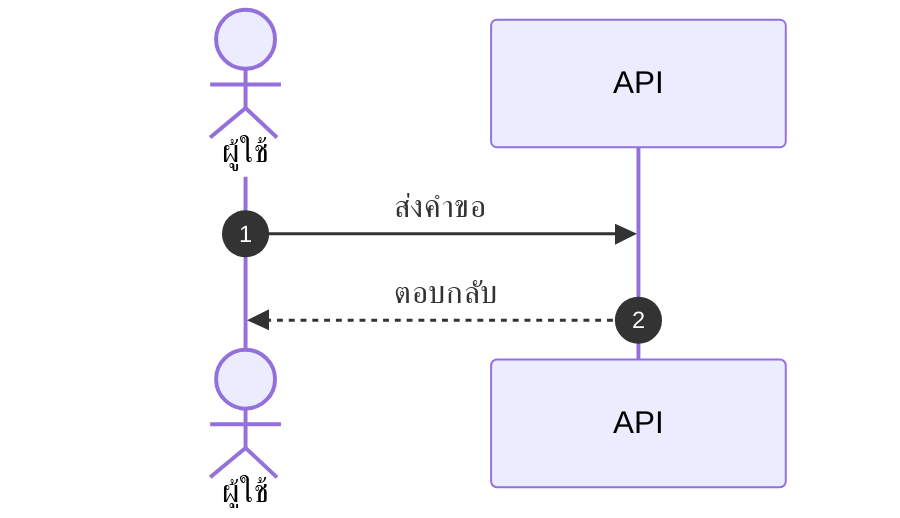

# skill: polished-document-style

Use when a stakeholder Markdown document (BRD, FSD, ADR, status report) needs polished formatting.

# Polished Document Style

> **ภาษา:** ถ้อยคำทุกบรรทัดเขียนตาม [`human-writing`](../human-writing/SKILL.md) — skill นี้บอกรูปแบบและโครง ส่วน human-writing บอกวิธีเขียนให้คนอ่านรู้เรื่อง

## When to use this skill

- Output is meant for **non-developers** to read (PMs, executives, clients)
- Document needs **sign-off** or formal review
- Output will be **shared widely** or converted to PDF/Word later
- Any doc with 3+ sections or 500+ words

## When NOT to use

- Internal developer-only specs (keep them concise)
- Quick scratch notes
- Code comments / inline docs
- A whole Markdown report that must come out as one .docx → `markdown-report-docx`

> ℹ️ **Note:** This skill governs the *markdown source*. When the deliverable is a
> rendered **.docx / .pptx / .pdf** that a stakeholder will open, use
> `branded-document-design` on top of it — that skill carries the design tokens,
> the typography scale, Thai typography rules, and the `brandkit.py` builder.

## อ่านเพิ่มเมื่อ

| ไฟล์ | เปิดเมื่อ |
|---|---|
| [references/markdown-patterns.md](references/markdown-patterns.md) | ถ้าจะเขียนส่วนหัว สารบัญ กล่องข้อความ ตาราง ป้ายสถานะ cover block ตารางเทียบตัวเลือก ส่วนเซ็นรับ หรืออภิธานศัพท์ ให้เปิดดูตัวอย่าง markdown แล้วลอกไปใช้ |
| [scripts/check_outline.py](scripts/check_outline.py) | ถ้า skill ที่เขียนเอกสารมีไฟล์แบบใน `assets/` ให้รัน `python scripts/check_outline.py <แบบ.md> <เอกสาร.md>` ก่อนส่ง — ตรวจหัวข้อครบและเรียงตามแบบ ช่องตัวหนาครบ หัวตารางตรง และไม่มีช่องที่ยังไม่เติม · ในแบบ ใส่ `<!-- optional -->` ท้ายหัวข้อหรือช่องที่ไม่บังคับ · แก้ตัวตรวจแล้วรัน `--self-test` ก่อน |
| [references/theme-colors.md](references/theme-colors.md) | ถ้าต้องใส่สีจริงลงรูป ไฟล์ .docx หรือสไลด์ ให้เปิดดูว่าใครคุมสีส่วนไหน และค่าสีตั้งต้นประจำบ้านคืออะไร |

## Document Header (Always)

Every polished doc MUST start with ส่วนหัวชุดเดียวกัน คือ H1 ที่มีอิโมจิกำกับ ตามด้วยกล่อง quote ที่บอกเวอร์ชัน วันที่ สถานะ ผู้เขียน ผู้รีวิว และแท็ก แล้วปิดด้วย `---` ตัวอย่างเต็มอยู่ใน [references/markdown-patterns.md](references/markdown-patterns.md)

Status values:
- 🟡 **Draft** — work in progress
- 🔵 **Review** — under stakeholder review
- 🟢 **Approved** — signed off
- ⚪ **Archived** — historical reference

## Section Hierarchy

- **H1** — Document title (exactly one)
- **H2** — Numbered sections (`## 1. Section`)
- **H3** — Sub-sections (`### 1.1 Sub-topic`)
- **H4** — Rare, use only if needed

**Always add Table of Contents** for docs with 5+ sections และต้องกดลิงก์ในสารบัญแล้วไปถึงหัวข้อจริง ตัวอย่างอยู่ใน [references/markdown-patterns.md](references/markdown-patterns.md)

## ธีมของเอกสาร — ตัดสินใจครั้งเดียว ใช้ทุกที่ในเอกสารนั้น

เอกสาร 1 ฉบับผ่านหลาย skill: markdown (skill นี้) · รูปจาก `software-diagrams` ·
ไฟล์ .docx จาก `branded-document-design` · สไลด์จาก `presentation-design`
ถ้าแต่ละตัวเลือกสีเอง ผู้อ่านจะได้เอกสารที่รูปสีหนึ่ง หัวข้อสีหนึ่ง และสไลด์อีกสีหนึ่ง

**markdown เป็นต้นฉบับหลัก (source of truth) จึงประกาศธีมไว้ที่นี่** — ใส่ไว้ท้ายส่วนหัวของเอกสารหรือในไฟล์ข้างกัน:

```markdown
<!-- doc-theme: accent=<สีหลัก> · ที่มา=<แบรนด์ลูกค้า / เสนอจากเนื้องาน> · ยืนยันเมื่อ=YYYY-MM-DD -->
```

**สีหลักมาจากเนื้องาน ไม่ใช่จากค่าเริ่มต้นของเครื่องมือ**
ถ้ามีสีแบรนด์อยู่แล้วให้ใช้สีนั้น ถ้ายังไม่มีให้ใช้ค่าตั้งต้นประจำบ้าน เขียน `(รอยืนยัน)` แล้วทำต่อ ไม่หยุดถาม และเสนอโทนที่เข้ากับเนื้องานไว้ในรายงาน
(ตารางจับคู่เนื้องานกับโทนสีอยู่ใน [`colour-by-domain`](../diagram-figures/references/colour-by-domain.md))

markdown เองไม่มีสี จึงใช้อิโมจิและน้ำหนักตัวอักษรแทน ส่วนไดอะแกรม รูป ไฟล์ .docx และสไลด์อ่านค่าจาก `doc-theme` ถ้า `doc-theme` ยังไม่ประกาศ accent เฉพาะงาน ให้ใช้ค่าตั้งต้นประจำบ้าน ตารางทั้งสองอยู่ใน [references/theme-colors.md](references/theme-colors.md)

**สีสถานะไม่ขึ้นกับธีม** — 🔴 วิกฤต · 🟢 ผ่าน ต้องคงความหมายเดิมไม่ว่าธีมจะเป็นสีอะไร

## Emoji Vocabulary

ใช้ให้**คงที่ทั้งเอกสาร** และใช้เพื่อ**หาของเจอเร็วขึ้น** ไม่ใช่เพื่อความน่ารัก

| ใช้ทำอะไร | ชุดที่ใช้ |
|---|---|
| ระดับความสำคัญ | 🔴 วิกฤต · 🟠 สูง · 🟡 กลาง · 🟢 ต่ำ |
| สถานะ | ✅ เสร็จ · 🚧 กำลังทำ · ⏳ รอ · ❌ ไม่ผ่าน · ⚠️ ต้องระวัง |
| ชนิดกล่องข้อความ | 💡 ข้อแนะนำ · 📌 ข้อควรจำ · 🚨 อันตราย · 📋 รายการตรวจ |
| หมวดเนื้อหา | 🎯 เป้าหมาย · 🏗️ สถาปัตยกรรม · 🔐 ความปลอดภัย · 📊 ตัวเลข · 🧪 การทดสอบ |

**1 อิโมจิต่อหัวข้อ ไม่ใช่ต่อบรรทัด** — เอกสารที่ทุกบรรทัดมีอิโมจิอ่านยากกว่าเอกสารที่ไม่มีเลย

## Callout Boxes

Use blockquotes with emoji prefix มี 5 ชนิด คือ 💡 **Tip** · ⚠️ **Warning** · 🚨 **Critical** · ℹ️ **Note** · ❓ **Open Question** ตัวอย่างอยู่ใน [references/markdown-patterns.md](references/markdown-patterns.md)

**Rules:**
- Keep callouts to 1-3 sentences
- One callout per topic — don't stack
- Don't overuse — max 3-5 per page

## Tables — When and How

Use tables when items have **2+ attributes** ถ้าเขียนเป็น bullet แล้วแต่ละบรรทัดมีหลายค่าคั่นด้วยจุลภาค ให้เปลี่ยนเป็นตาราง ตัวอย่างเทียบกันอยู่ใน [references/markdown-patterns.md](references/markdown-patterns.md)

- Left-align text, center checkmarks/numbers, right-align money
- Use `—` (em dash) for "not applicable", not `-` or blank
- Keep cells short — long content goes in body paragraphs
- Bold key columns: `**email**`

ถ้าเอกสารต้องเทียบตัวเลือกหรือชั่งข้อดีข้อเสีย (architect, PM, SEO recommendations) ให้ใช้ตารางเทียบที่มีคอลัมน์ Recommendation ส่วนเอกสารที่ต้องอนุมัติให้ปิดท้ายด้วยตาราง Sign-off และเอกสารที่มีศัพท์เทคนิค 5 คำขึ้นไปให้มีอภิธานศัพท์ ตัวอย่างทั้งสามแบบอยู่ใน [references/markdown-patterns.md](references/markdown-patterns.md)

## Mermaid Diagrams

**ตัวเลือกชนิดไดอะแกรม กติกาความอ่านง่าย ธีม และการจัดการป้ายภาษาไทย อยู่ใน `software-diagrams`**
skill นี้คุมเฉพาะเรื่องการวางไดอะแกรมลงในเอกสาร markdown

- วางไว้**หลังย่อหน้าที่อธิบายว่ารูปนี้ตอบคำถามอะไร** ไม่ใช่ลอยขึ้นมาเฉย ๆ
- ทุกรูปมีคำบรรยายใต้รูป 1 บรรทัด ขึ้นต้นด้วย **รูปที่ N —**
- รูปเดียวกันอย่าใส่ซ้ำหลายที่ในเอกสาร ให้อ้างถึงเลขรูปแทน
- รูปที่ต้องส่งให้คนนอกทีมหรือใส่สไลด์ ใช้ `diagram-figures` แล้วฝังเป็นไฟล์ภาพ

## Status Badges and Cover Block

ช่องสำคัญในส่วนหัวหรือในตารางให้ใช้ป้ายสถานะแบบอิโมจิพร้อมคำกำกับ เช่น `**Status:** 🟢 Approved` ส่วนเอกสารทางการ (BRD, FSD, ADR, postmortem) ให้เปิดด้วย cover block ที่บอกชนิดเอกสาร เวอร์ชัน สถานะ วันที่ ผู้เขียน ผู้รีวิว และเอกสารที่เกี่ยวข้อง ตัวอย่างอยู่ใน [references/markdown-patterns.md](references/markdown-patterns.md)

## Lists and Code Blocks

**Rule:** Max 2 levels of nesting. More nesting = use a table.
ตัวอย่างรายการที่ดีและรายการที่ซ้อนเกินอยู่ใน [references/markdown-patterns.md](references/markdown-patterns.md)

Code blocks ต้องระบุภาษาทุกครั้ง (Always specify language) และถ้าโค้ดยาว ให้ใส่ชื่อไฟล์เป็นคอมเมนต์ในบรรทัดแรก ตัวอย่างอยู่ใน [references/markdown-patterns.md](references/markdown-patterns.md)

## Quality Checklist

Before delivering any polished doc:

- [ ] H1 title with emoji marker
- [ ] Cover block with version, date, status, authors
- [ ] TOC if 5+ sections
- [ ] All sections numbered consistently
- [ ] Anchor links in TOC actually work
- [ ] Status badges where applicable
- [ ] Tables used (not bullets) where data has 2+ attributes
- [ ] At least one Mermaid diagram for any flow/relationship
- [ ] Callout boxes for tips/warnings (not just paragraphs)
- [ ] Code blocks have language hints
- [ ] Glossary for docs with 5+ acronyms
- [ ] No placeholder text (TBD, TODO, Lorem ipsum) — `(รอยืนยัน)` markers listed in the pending-confirmation list are not placeholders; keep them
- [ ] Tested rendering in GitHub preview

> ไดอะแกรมในเอกสาร: ชนิดไหนตอบคำถามไหน และธีม Mermaid ชุดเดียวกันทั้งโปรเจกต์
> อยู่ใน `software-diagrams` ส่วนเรื่องเอกสาร SRS โดยเฉพาะอยู่ใน `srs-writing`

## Anti-patterns

- ❌ **Emoji spam** — emoji in every heading just for decoration
- ❌ **All emoji, no labels** — `🔴 High` reads better than `🔴` alone
- ❌ **Deep nesting** — bullets 4+ levels deep, use tables instead
- ❌ **Walls of text** — paragraphs longer than 5 lines
- ❌ **Inconsistent terminology** — "user" in one section, "customer" in next
- ❌ **Diagrams that duplicate text** — diagram should add insight, not repeat
- ❌ **Tables of paragraphs** — if cells are >2 sentences, use headings instead
- ❌ **Skipping the cover block** — readers need version/status/date

## ตัวย่อ

เขียนตัวย่อเต็มครั้งแรกเสมอ แล้ววงเล็บตัวย่อไว้ — เช่น Model Context Protocol (MCP)
หลังจากนั้นใช้ตัวย่อได้เลย ดูรายละเอียดใน skill `spell-out-abbreviations`


## reference: markdown-patterns.md

# รูปแบบ markdown พร้อมตัวอย่าง

ตัวอย่างโค้ด markdown ของทุกรูปแบบที่ `SKILL.md` อ้างถึง ให้ลอกไปใช้ได้ทันที ส่วนกฎว่าใช้เมื่อไหร่อยู่ใน `SKILL.md`

## Document Header (Always)

Every polished doc MUST start with:

```markdown
# 📋 <Document Title>

> **Version:** 1.0 · **Date:** YYYY-MM-DD · **Status:** 🟡 Draft
> **Authors:** <names> · **Reviewers:** <names>
> **Tags:** `<area>` `<topic>`

---
```

Status values:
- 🟡 **Draft** — work in progress
- 🔵 **Review** — under stakeholder review
- 🟢 **Approved** — signed off
- ⚪ **Archived** — historical reference

## Table of Contents

**Always add Table of Contents** for docs with 5+ sections:

```markdown
## 📑 Table of Contents

1. [Executive Summary](#1-executive-summary)
2. [Scope](#2-scope)
3. [Details](#3-details)
```

## Callout Boxes

Use blockquotes with emoji prefix:

```markdown
> 💡 **Tip:** Brief actionable insight.

> ⚠️ **Warning:** Important caveat or limitation.

> 🚨 **Critical:** Must-read before proceeding.

> ℹ️ **Note:** Additional context or background.

> ❓ **Open Question:** Needs decision/clarification.
```

## Tables — When and How

### When to use tables instead of bullets

Use tables when items have **2+ attributes**:

❌ Don't use bullets:
```markdown
- email: string, required, unique
- age: number, optional
- role: enum, required, default "user"
```

✅ Use a table:
```markdown
| Field | Type   | Required | Default | Description       |
|-------|--------|:--------:|:-------:|-------------------|
| email | string | ✅       | —       | Unique login email|
| age   | number | ❌       | —       | Optional          |
| role  | enum   | ✅       | `user`  | Access level      |
```

## Mermaid Diagrams

````markdown

````

*รูปที่ 3 — ลำดับการเรียกเมื่อผู้ใช้กดบันทึก*

## Status Badges (Inline)

For key fields in headers/tables:

```markdown
**Status:** 🟢 Approved
**Priority:** 🔴 High
**Risk Level:** 🟡 Medium
**SLA:** ⚡ < 200ms
```

Multiple badges in a header:

```markdown
> 🟢 **Approved** · 🔴 **High Priority** · 👤 @alice · 🗓️ Due 2025-03-15
```

## Cover Block Pattern

For formal documents (BRD, FSD, ADR, postmortem):

```markdown
# 📋 <Title>

| | |
|--|--|
| **Document Type** | BRD \| FSD \| ADR \| Postmortem |
| **Version** | 1.2 |
| **Status** | 🟢 Approved |
| **Date** | 2025-01-15 |
| **Author(s)** | @alice, @bob |
| **Reviewer(s)** | @charlie |
| **Related** | [BRD-001](link), [FSD-005](link) |

---
```

## Comparison / Decision Tables

For trade-off analysis (architect, PM, SEO recommendations):

```markdown
| Option | Cost | Effort | Risk | Time-to-Value | Recommendation |
|--------|:----:|:------:|:----:|:-------------:|:--------------:|
| **A**  | 💰💰 | 🟡 Med | 🟢 Low | 🟢 Fast | ✅ Recommended |
| B      | 💰   | 🟢 Low | 🔴 High | 🟡 Med | ❌ Not recommended |
| C      | 💰💰💰| 🔴 High| 🟢 Low | 🔴 Slow | ⚪ Future consideration |
```

## Lists — When to nest, when to flatten

### ✅ Good list
```markdown
- Email is unique across all users
- Passwords must be 8+ characters with mixed case
- Sessions expire after 30 days of inactivity
```

### ❌ Bad list (over-nested)
```markdown
- Users
  - Email
    - Must be unique
    - Required
  - Password
    - 8+ chars
    - Mixed case
```

→ Should be a table instead.

## Code Blocks

Always specify language:

````markdown
```typescript
const user: User = { id: 1, email: 'a@b.com' };
```

```bash
npm install
```

```sql
SELECT * FROM users WHERE id = $1;
```
````

For long blocks, put the file name in a comment on the first line:

```typescript
// src/services/auth.ts
export async function login(email: string, password: string) {
  // ...
}
```

## Approval/Sign-off Section (End of Doc)

For documents needing formal approval:

```markdown
## ✍️ Sign-off

| Role | Name | Status | Date |
|------|------|:------:|------|
| Product Owner | @alice | 🟢 Approved | 2025-01-15 |
| Tech Lead | @bob | 🔵 Reviewing | — |
| QA Lead | @charlie | ⚪ Not started | — |
| Security | @dave | ❌ Rejected | 2025-01-14 |
```

## Glossary Section

For docs with 5+ technical terms:

```markdown
## 📖 Glossary

| Term | Definition |
|------|------------|
| **API** | Application Programming Interface |
| **JWT** | JSON Web Token, used for stateless auth |
| **SLA** | Service Level Agreement |
```

Define acronyms on first use, then add to glossary.


## reference: theme-colors.md

# ตารางสีของธีมเอกสาร

ไฟล์นี้บอกว่าส่วนไหนของเอกสารใครเป็นคนคุมสี และค่าสีตั้งต้นประจำบ้านคืออะไร ใช้ตอนต้องใส่สีจริงลงรูป ไฟล์ .docx หรือสไลด์

## ใครคุมสีส่วนไหน

| ส่วนของเอกสาร | ใครคุมสี | อ่านค่าจาก |
|---|---|---|
| หัวข้อ ตาราง กล่องข้อความใน markdown | markdown ไม่มีสี ใช้อิโมจิและน้ำหนักตัวอักษรแทน | — |
| ไดอะแกรม Mermaid | `software-diagrams` ข้อ 2 | `doc-theme` |
| รูปที่เป็นไฟล์ภาพ | `diagram-figures` | `doc-theme` |
| ไฟล์ .docx / .pdf ที่ส่งออก | `branded-document-design` ข้อ 0–1 | `doc-theme` |
| สไลด์ | `presentation-design` | `doc-theme` |

## ค่าตั้งต้นประจำบ้าน (house default)

ถ้า `doc-theme` ยังไม่ประกาศ accent เฉพาะงาน ทุก skill ใช้ชุดนี้เป็นค่าตั้งต้น เพื่อให้รูป เอกสาร และสไลด์เป็นชุดสีเดียวกันตั้งแต่แรก ชุดนี้คือชุดเดียวกับ `presentation-design` และ `branded-document-design`:

| token | ค่า | ใช้กับ |
|---|---|---|
| brand | `#2A78D6` | สีหลัก · หัวข้อ · เส้น accent |
| brand-deep | `#2A4C86` | หัวตาราง · H2 · ชื่อระบบ |
| brand-2 | `#6A5CD6` | accent รอง (ม่วง) |
| tint | `#EDF1FB` | พื้นหัวตาราง · พื้นกล่องเน้น |
| ink / body | `#333B4A` / `#414957` | หัวข้อ / เนื้อความ |
| muted / faint | `#7D8492` / `#A9AEB9` | คำบรรยาย / หมายเหตุ |
| line | `#E4E7EE` | เส้นขอบ · เส้นเชื่อม |
| exception | `#C77A11` | ทาง/โซนที่ไม่ใช่เส้นทางหลัก (ต่างจาก brand เสมอ) |
| ฟอนต์ | Tahoma (เอกสาร/สไลด์) · Noto Sans Thai → Tahoma (ภาพ) | ทั้งไทยและอังกฤษ |

เมื่อประกาศ accent เฉพาะงานแล้ว ให้ใช้ค่านั้นแทน brand ส่วนสีอื่นคำนวณจาก accent ตัวนั้น


---

# skill: human-writing

Use when writing anything a person will read (answer, report, document, slide, label) in Thai or English.

# human-writing — เขียนภาษาคน อ่านลื่น เข้าใจง่าย

ใช้กับทุกอย่างที่คนจะอ่าน ตั้งแต่แชตถึงป้ายใน diagram · ตัวอย่างของทุกข้อและที่มา → [`headings-and-examples`](references/headings-and-examples.md) · ต้นฉบับอยู่ plugin `superuser` (แก้แล้วรัน `node scripts/sync/sync-superuser.mjs`)

## 1 · หลักใหญ่

- เขียนเหมือนอธิบายให้เพื่อนร่วมงานที่เก่งแต่ไม่ได้อยู่ในโปรเจกต์ฟัง ถ้าอ่านออกเสียงแล้วสะดุดให้เขียนใหม่
- คำตอบหรือข้อสรุปขึ้นก่อน แล้วค่อยเหตุผล ไม่เกริ่น ไม่ทวนคำถาม
- 1 ประโยค 1 ความคิด ถ้าต่อด้วย "ซึ่ง" "โดย" "จึง" หลายชั้น ให้แยกเป็นหลายประโยค
- ภาษาอังกฤษใช้หลักเดียวกัน: ประโยคไม่เกิน 25 คำ · ใครทำอะไร (active voice) · คำธรรมดา

## 2 · สัญลักษณ์และตัวเลข

- `→` ลำดับขั้นหรือผลที่ตามมา · `·` คั่นคำนามสั้นในบรรทัดเดียว · `:` ตามด้วยรายละเอียด · จำนวนทุกชนิดเขียนเป็นเลข · คำรอบสัญลักษณ์ต้องเป็นภาษาคน
- **เงื่อนไขและคำสั่งเขียนเป็นประโยคเต็ม มีคำเชื่อม** (ถ้า … ให้ … · แล้ว · ส่วน · เพราะ) ไม่ใช้ `→` หรือ `·` ต่อประโยคเป็นท่อน ๆ
- ในตารางใช้ข้อความสั้นได้ แต่ยังต้องอ่านเป็นภาษาคน ไม่ใช่รหัส
- สัญลักษณ์ห้ามแทนคำจนต้องถอดรหัส ถ้าคนนอกต้องเดาว่าลูกศรหมายถึงอะไร ให้เติมคำ
- ทุกตัวเลขบอกว่าหมายถึงอะไร · เทียบให้เห็นภาพ (เท่า อ่านง่ายกว่า %) · ผลยังไม่แน่นอนให้บอกตรง ๆ ว่าเพราะอะไร

## 3 · คำ

- ใช้คำที่คนพูดจริง ไม่ใช้คำราชการหรือศัพท์แปลตรงตัว
- ศัพท์ที่คนในวงการใช้อยู่แล้ว (token · prompt · API · OCR) คงภาษาอังกฤษไว้
- ตัวย่อเขียนเต็มครั้งแรกแล้ววงเล็บ จากนั้นใช้ตัวย่อ · คำที่ตั้งเองหรือชวนงง อธิบายครั้งแรกที่ใช้
- สิ่งเดียวกันเรียกคำเดียวทั้งชุด ทั้งแชต สไลด์ เอกสาร และ diagram
- ตัดคำฟุ่มเฟือย ("ทำการ" · "มีการ" · "ในส่วนของ" · "ได้มีการ" · "เป็นการ")
- เลี่ยงท่าที่ดูเหมือน AI เขียน: คำคมเปิดเรื่อง · "ไม่ใช่แค่… แต่ยัง…" · จัดทุกอย่างเป็นชุดละ 3 · ชมว่าสำคัญเกินจริง · ตัวหนาทุกบรรทัด · สรุปซ้ำตอนจบ · เปิดด้วย "แน่นอน" · ปิดด้วย "หวังว่าจะช่วยได้" · ใช้ "หลาย" ทั้งที่รู้ตัวเลข · ออกตัวซ้อนหลายชั้น (ออกตัวครั้งเดียวตรงจุดที่ไม่แน่ใจจริง)

## 4 · ตอบในแชต

- ประโยคแรกตอบตรง ๆ แล้วค่อยเหตุผล
- คำถามสั้นให้ตอบสั้น 2–3 ประโยค ไม่ต้องมีหัวข้อหรือตาราง
- ใช้ตารางเมื่อเทียบตั้งแต่ 2 ตัวเลือกหรือหลายตัวเลข ส่วนรายการใช้เมื่อมีหลายข้อที่ต้องไล่อ่าน
- งานที่ทำแล้วบอกด้วยผล ไม่เล่าขั้นตอน
- เคยบอกผิดให้บอกว่าผิดตรงไหน ที่ถูกคืออะไร ไม่ขอโทษยืดยาว · ไม่แน่ใจให้บอกว่าตรงไหนและตรวจได้อย่างไร ไม่เดาให้ฟังดูมั่นใจ
- ให้ผู้ใช้ตัดสินใจ: เสนอตัวเลือก บอกข้อที่แนะนำและเหตุผล ปิดด้วยคำถามเดียวที่ตอบง่าย
- ยาวเกิน 1 หน้าจอ: ตอบส่วนสำคัญก่อน เสนอฉบับละเอียดไว้ 1 บรรทัด (ไม่หยุดถาม)
- ผู้ใช้บอก "งง" หรือ "พูดง่าย ๆ": เขียนคำตอบล่าสุดใหม่ สั้นลงครึ่งหนึ่ง ไม่มีศัพท์ที่ไม่ได้อธิบาย ไม่เพิ่มเนื้อหา
- ลงท้ายด้วยสิ่งที่ทำต่อได้จริง 1 อย่าง ไม่สรุปซ้ำ
- **ตอบจากเอกสารหรือเว็บ** — เล่าใหม่ด้วยคำของตัวเอง ไม่แปลทีละประโยค · เหตุต่อผลในย่อหน้าเดียว · ข้อยกเว้นเล็กใส่วงเล็บ · ป้ายตัวหนา 2–3 อันพอ · ที่มารวมไว้ท้ายคำตอบ

## 5 · เอกสารและรายงาน

- ย่อหน้าแรกคือข้อสรุป อ่านแค่ย่อหน้านี้ต้องได้เรื่อง
- หัวข้อบอกเนื้อหา ไม่ใช่ชื่อหมวด · ย่อหน้าละไม่เกิน 5 ประโยค
- หัวคอลัมน์บอกว่าวัดอะไร · 1 คอลัมน์ 1 ความหมาย
- เชิงอรรถมีไว้สำหรับนิยามและที่มาของตัวเลข · ข้อสรุปสำคัญห้ามซ่อนในเชิงอรรถ
- รายงานสถานะ: ผลต่อคนใช้ก่อน → ตารางสถานะ → สิ่งที่รออนุมัติ และทุกข้ออ้างติดป้าย `ตรวจจริง` · `จากแหล่ง` · `อนุมาน` · `ยังไม่ตรวจ` (ความหมายใน `superuser` `references/evidence.md`)
- เอกสารตามแบบ (หนังสือราชการ · สัญญา · ใบกำกับภาษี) ใช้ถ้อยคำตามแบบ ไฟล์นี้ใช้กับส่วนที่เขียนเองได้

## 6 · สไลด์ และหัวข้อทุกชนิด

ใช้กับหัวสไลด์ ชื่อรูป หัวข้อเอกสาร และหัวกล่องใน diagram · กฎเต็มและตาราง 17 แถวอยู่ใน reference เดียวกัน

- หัวสไลด์ = ข้อสรุปของหน้า ไม่ใช่ชื่อหัวข้อ · ไม่เกิน 2 บรรทัด (ราว 15 คำ) รายละเอียดลงเนื้อหน้า
- **หัวที่มี 2 ท่อนต้องมีคำเชื่อมที่ตรงกับความสัมพันธ์จริง** ("เพราะ" หรือ "จึง" เมื่อเป็นเหตุผล · "ส่วน" เมื่อแบ่งหน้าที่ · "แต่" เมื่อขัดกัน) · 1 หัว 1 คำเชื่อม ถ้าต้องใช้ 2 แปลว่ายัดเกิน
- ใช้วลีที่คนพูดจริง ไม่ใช่คำนามเรียงกัน · เลือกคำตามคนอ่าน
- กริยาตรงกับสิ่งที่หน้านั้นแสดง · ไม่ใช้ "คน" กับสิ่งที่ไม่ใช่คน
- บรรทัดใต้รูปต้องบอกสิ่งที่รูปไม่ได้บอก ถ้าซ้ำกับรูปให้ตัด · โครงหน้า ปัญหา → วิธีแก้ → ผล · สคริปต์พูดเขียนแบบที่พูดจริง
- **ทดสอบ:** อ่านหัวให้คนนอกฟังครั้งเดียว ถ้าเขาเล่าต่อไม่ได้ ให้เขียนใหม่

## 7 · Diagram

- ป้ายในกล่องเป็นคำนามสั้น 1–4 คำที่คนเข้าใจ · ป้ายบนลูกศรเป็นกริยา · ลูกศรไม่มีป้ายต้องเดาไม่ผิด
- คำในรูปตรงกับเอกสาร · ชื่อรูปเป็นข้อสรุป ใต้รูป 1 ประโยคบอกว่าควรดูอะไร · มี house style ให้ใช้ตามนั้น

## 8 · ตรวจก่อนส่ง 6 ข้อ

1. อ่านออกเสียงแล้วลื่นไหม · ไม่เหมือนภาษาแปล
2. คนนอกอ่านแล้วเข้าใจโดยไม่ต้องถามไหม · สัญลักษณ์ทุกตัวอ่านออกไหม
3. ประโยคแรกตอบคำถามหรือบอกข้อสรุปแล้วหรือยัง
4. ศัพท์และตัวเลขตรงกันทุกไฟล์ในชุดเดียวกันไหม
5. มีคำไหนตัดออกได้โดยความหมายไม่เปลี่ยนไหม ถ้ามีให้ตัด
6. หัวข้อทุกอันผ่านหัวข้อ 6: 2 ท่อนมีคำเชื่อม · เป็นวลีที่คนพูด · คำเหมาะกับคนอ่าน · กริยาตรงกับที่รูปแสดง


## reference: headings-and-examples.md

# หัวข้อ · สไลด์ · diagram และตัวอย่าง ก่อน → หลัง (ฉบับเต็ม)

อ่านเมื่อเขียนหัวสไลด์ ชื่อรูป ป้ายใน diagram หรืออยากดูตัวอย่างการแก้ · กฎย่ออยู่ใน `SKILL.md` ข้อ 6–7

ไฟล์นี้เหมือนกันทุก plugin ต้นฉบับอยู่ที่ plugin `superuser` แก้ที่นั่นแล้วรัน `node scripts/sync/sync-superuser.mjs`

## สไลด์ และหัวข้อทุกชนิด

- หัวสไลด์ = ข้อสรุปของหน้า ไม่ใช่ชื่อหัวข้อ: "ยิ่ง Tier 1 เติมค่าเอง Gate ยิ่งมองไม่เห็นค่าผิด"

**เขียนหัวให้ลื่น ไม่กำกวม** — ใช้กับหัวสไลด์ ชื่อรูป หัวข้อเอกสาร และหัวกล่องใน diagram

- **หัวที่มี 2 ท่อนต้องมีคำเชื่อม** (ส่วน · แต่ · เพราะ · จึง) ห้ามวาง 2 วลีเรียงกันเฉย ๆ เพราะคนอ่านต้องเดาเองว่า 2 ท่อนเกี่ยวกันอย่างไร
- **คำเชื่อมต้องตรงกับความสัมพันธ์จริง** ใช้ "เพราะ" หรือ "จึง" เฉพาะเมื่อท่อนหนึ่งเป็นเหตุของอีกท่อนจริง ถ้า 2 ท่อนแค่แบ่งหน้าที่กัน ใช้ "ส่วน" ถ้าขัดกัน ใช้ "แต่" · หัวหนึ่งใช้คำเชื่อมได้ 1 คำ ถ้าต้องใช้ 2 คำแปลว่ายัดเกินไป ให้ตัดเหลือเรื่องเดียว
- **หัวยังต้องสั้น** หัวสไลด์ไม่เกิน 2 บรรทัด (ประมาณ 15 คำ) ถ้ายาวกว่านี้ ให้ตัดรายละเอียดลงไปในเนื้อหน้า อย่าเติมคำเชื่อมจนกลายเป็นย่อหน้า
- **ใช้วลีที่คนพูดจริง** ถ้าย่อจนกลายเป็นคำนามเรียงกัน เช่น "AI ทำงานภาษา" ให้หากริยาที่คนใช้จริง เช่น "AI ช่วยเขียนคำตอบ"
- **เลือกคำตามคนอ่าน** ถ้าผู้อ่านไม่ใช่สายเทคนิค ใช้ "ระบบ" แทน "โค้ด" ใช้ "ตรวจขาเข้า" แทน "Guard" ส่วนศัพท์เทคนิคใช้ได้เมื่อผู้อ่านเป็นทีมเทคนิค
- **กริยาต้องตรงกับสิ่งที่หน้านั้นแสดง** ถ้ากล่องในรูปคือขั้นตรวจ ให้ใช้ "ตรวจ" หรือ "ตัดสิน" ไม่ใช้ "ตัดสินใจ" ซึ่งให้ความรู้สึกว่าเป็นการเลือกทาง
- **ไม่ใช้ "คน" กับสิ่งที่ไม่ใช่คน**: "ระบบเป็นคนตัดสิน" → "ให้ระบบตัดสิน"
- **บรรทัดสรุปใต้รูปต้องบอกสิ่งที่รูปไม่ได้บอก** ถ้าเป็นแค่ลูกศรไล่ขั้นซ้ำกับรูป ให้ตัดทิ้ง หรือเปลี่ยนเป็นประโยคเดียวที่บอกว่าทำไมรูปนี้สำคัญ
- **ทดสอบ**: อ่านหัวให้คนนอกโปรเจกต์ฟังครั้งเดียว ถ้าเขาเล่าต่อด้วยคำของตัวเองไม่ได้ หรือต้องถามว่า "หมายถึงอะไร" ให้เขียนใหม่
- โครงหน้า: ปัญหา → วิธีแก้ → ผล · แต่ละส่วนอ่านจบในแวบเดียว
- สคริปต์พูดเขียนแบบที่พูดจริง อ่านออกเสียงได้ไม่สะดุด

## Diagram

- ป้ายในกล่องเป็นคำนามสั้น 1–4 คำ ที่คนเข้าใจ: "รับข้อมูลเข้า" ไม่ใช่ "Ingress Layer Handler"
- ป้ายบนลูกศรเป็นกริยา: "ส่งไฟล์" · "ตรวจสิทธิ์" · ลูกศรที่ไม่มีป้ายต้องเดาไม่ผิด
- คำในรูปต้องตรงกับคำในเอกสารทุกคำ
- ชื่อรูปเป็นข้อสรุป เหมือนหัวสไลด์ · ใต้รูปมี 1 ประโยคบอกว่าควรดูอะไร
- ถ้าโปรเจกต์มีแบบรูปประจำ (house style) ให้ใช้ตามนั้น ส่วนวิธีวาดดูใน skill รูปของ plugin นั้น

## ตัวอย่าง ก่อน → หลัง

เงื่อนไขเขียนเป็นประโยคเต็ม มีคำเชื่อม (ข้อ 2):

  - ก่อน: `ไม่แน่ใจว่าขนาดไหน → ถือเป็นขนาดที่ใหญ่กว่า 1 ขั้น`
  - หลัง: `ถ้าไม่แน่ใจว่างานขนาดไหน ให้ถือว่าใหญ่ขึ้นอีก 1 ขั้น`
  - ก่อน: `ย้อนได้ → ทำเลย · ไม่รู้ → ค้นเอง · ย้อนไม่ได้ → เตรียมไว้ใน "รออนุมัติ"`
  - หลัง: `งานที่ย้อนได้ให้ทำเลย ไม่รู้ให้ค้นเอง ส่วนงานที่ย้อนไม่ได้ให้เตรียมไว้ใน "รออนุมัติ"`

| ก่อน | หลัง |
|---|---|
| ขอบระบบ (รับ input) → service (กฎธุรกิจ) → data | แยกโค้ด 3 ชั้น: รับข้อมูลเข้า → กฎธุรกิจ → เก็บข้อมูล |
| ตรวจ input ที่ขอบ · พังแบบปิด | ตรวจข้อมูลจากภายนอกทันทีที่เข้ามา ถ้าเกิดข้อผิดพลาดให้ปฏิเสธไว้ก่อน |
| เล็กพลาดหรือตรวจไม่ผ่าน → ขยับขึ้นหนึ่งระดับ | ถ้าโมเดลเล็กทำพลาด ให้ขยับขึ้น 1 ระดับ ไม่ลองซ้ำกับตัวเดิม |
| มีผลเหนือค่าเริ่มของ playbook แต่ไม่เหนือรายการ "รออนุมัติ" | ถ้าไฟล์นี้กับ playbook ขัดกัน ให้ทำตามไฟล์นี้ ยกเว้นเรื่องที่ต้องรออนุมัติ |
| เมื่อความต้องการมีการนำเข้าหรือส่งออกไฟล์ | เมื่องานต้องนำเข้าหรือส่งออกไฟล์ |
| ทุกข้อความผ่าน 8 ขั้น: AI ทำงานภาษา โค้ดตัดสินเรื่องสำคัญ | ทุกข้อความผ่าน 8 ขั้น: AI ช่วยเขียนคำตอบ ส่วนเรื่องสำคัญให้ระบบตัดสิน |
| Guard ขาเข้า (ในรูปที่ทำให้คนทั่วไปดู) | ตรวจขาเข้า |
| guard ขาเข้า → ค้นคลังความรู้ → แนบกฎร้าน → Typhoon → guard ขาออก (บรรทัดใต้รูปที่ซ้ำกับรูป) | AI มีหน้าที่เขียนให้อ่านง่าย ส่วนเรื่องเงิน เวลา และกฎร้าน ระบบตรวจทุกครั้ง |
| ทีมที่ดีไม่ได้เก่งเพราะแต่ละคนเก่ง แต่เพราะ… | วิธีทำงานของทีม: เลือกแผน → แจกงาน → ตรวจผล → จดบันทึก |
| คำค้น 12/12 จากประกาศงานอยู่ใน CV | คำค้นจากประกาศงานอยู่ใน CV ครบ 12 คำ · ตรวจแล้ว |
| margin 32–35% หลังทุกค่าธรรมเนียม | หักค่าธรรมเนียมแล้วเหลือกำไร 32–35% ของราคาขาย |
| hook จะทำงานเฉพาะโฟลเดอร์ที่มีการสร้างโฟลเดอร์ .claude/superuser ไว้แล้วเท่านั้น | hook (สคริปต์จด log) ทำงานเฉพาะโฟลเดอร์ที่มี `.claude/superuser/` |
| ตรวจด้วย validate ผ่าน ไม่มี error และ warning แต่ยังต้อง build ใหม่ | ตัวตรวจผ่านหมด · เหลือ build ใหม่บนเครื่องคุณ |
| `${CLAUDE_PLUGIN_ROOT}` คือ path ของ version ที่ติดตั้งอยู่ และจะเปลี่ยนเมื่อ plugin อัปเดต ส่วนโฟลเดอร์เก่าระบบจะลบทิ้งเองภายหลัง [ที่มา] | แต่ละ version ติดตั้งเป็นโฟลเดอร์ของตัวเอง พออัปเดตก็ชี้ไปโฟลเดอร์ใหม่ แล้วลบโฟลเดอร์เก่าทิ้ง |
| ข้อยกเว้น: plugin จาก marketplace บน claude.ai … จะไม่ถูก pin ด้วยฟิลด์นี้ (แยกย่อหน้า) | … ไม่งั้นเครื่องที่ลงไว้จะใช้ชุดเก่าต่อ (ยกเว้น plugin จาก marketplace บน claude.ai ซึ่งเห็นการแก้ทันที) |

## ตัวอย่างประกอบกฎใน SKILL.md (ย้ายมาจาก SKILL.md)

| หัวข้อ | กฎ | ตัวอย่าง |
|---|---|---|
| 1 | คำธรรมดา (อังกฤษ) | buy ไม่ใช่ purchase |
| 2 | `→` ลำดับขั้น | เข้าใจ → วางแผน → ลงมือ |
| 2 | `·` คั่นคำนาม | ทำอะไร · ได้อะไร · ใช้แรงแค่ไหน |
| 2 | `:` ตามด้วยรายละเอียด | แยกโค้ด 3 ชั้น: รับข้อมูล → กฎธุรกิจ → เก็บข้อมูล |
| 2 | ตัวเลขเขียนเป็นเลข | 3 ชั้น · 12 คำ · 1 ระดับ |
| 2 | ตัวเลขบอกความหมาย | "กำไร 32% ของราคาขาย" ไม่ใช่ "margin 32%" ลอย ๆ |
| 2 | เทียบให้เห็นภาพ | "เร็วขึ้น 3.2 เท่า" อ่านง่ายกว่า "ลดลง 69%" |
| 2 | ผลยังไม่แน่นอน | "รันรอบเดียว ยังสรุปไม่ได้" |
| 3 | คำที่คนพูดจริง | "ยกระดับ" → "ส่งต่อ" · "ผลสุดท้ายขัดกฎ" → "คำตอบไม่ผ่านกฎ" |
| 3 | ตัวย่อครั้งแรก | Large Language Model (LLM) |
| 3 | คำที่ตั้งเอง | "hook (สคริปต์จด log อัตโนมัติ)" |
| 3 | ตัดคำฟุ่มเฟือย | "ทำการตรวจสอบ" → "ตรวจ" · "มีการนำเข้า" → "นำเข้า" |
| 3 | ออกตัวซ้อน | อาจจะ · น่าจะ · ในบางกรณี ในประโยคเดียว |
| 4 | ประโยคแรกตอบตรง | ถาม "ใส่ในรายงานดีไหม" → "ควรใส่ครับ" แล้วค่อยเหตุผล |
| 4 | บอกด้วยผล | "แก้แล้ว 8 จุด เปิดไฟล์ได้ปกติ" |
| 4 | เหตุต่อผลในย่อหน้าเดียว | "แต่ละ version ติดตั้งแยกโฟลเดอร์ พออัปเดตก็ชี้ไปโฟลเดอร์ใหม่แล้วลบของเก่า skill ที่ลบออกจึงหายไป" |
| 4 | ป้ายตัวหนา | **ระวัง:** · **สิ่งที่ยังอยู่:** ไม่ใช่ "**ระวัง (เจอบ่อย):**" |
| 5 | หัวข้อบอกเนื้อหา | "ระบบส่งต่อลดการเรียก LLM ได้ครึ่งหนึ่ง" ดีกว่า "ผลการทดลอง" |
| 5 | หัวคอลัมน์ | "เรียก LLM" · "คำตอบไม่ผ่านกฎ" |
| 6 | วลีที่คนพูด | "AI ช่วยเขียนคำตอบ" ไม่ใช่ "AI ทำงานภาษา" |
| 6 | คำตามคนอ่าน | คนทั่วไป: "ระบบ" "ตรวจขาเข้า" แทน "โค้ด" "Guard" |
| 6 | ไม่ใช้ "คน" กับสิ่งที่ไม่ใช่คน | "ให้ระบบตัดสิน" |

ที่มา: ISO 24495-1 (plain language) · GOV.UK clear language · Microsoft Writing Style Guide · Wikipedia: Signs of AI writing · คู่มือการร่างเอกสารภาษาไทย
