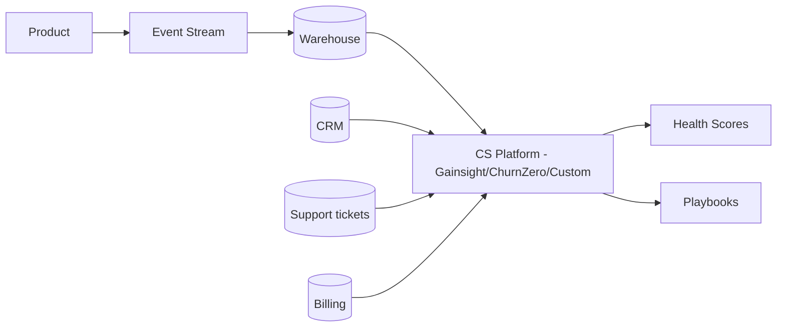
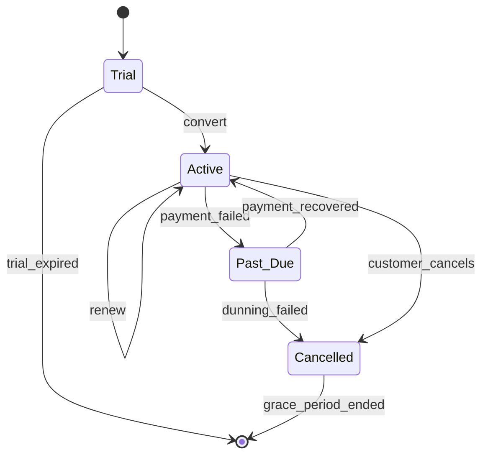
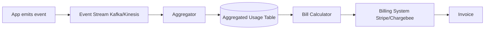

# skill: saas-platform

Use when building B2B SaaS (multi-tenancy, tenant isolation, SSO, SCIM, billing, usage metering).

# saas-platform

SaaS แบบขายองค์กร — multi-tenant · SSO/SCIM · คิดเงินรายเดือน · onboarding ลูกค้า

**เปิดเฉพาะไฟล์ที่ตรงกับงาน** ไม่ต้องอ่านทั้งหมด เพราะแต่ละไฟล์เป็นคู่มือเต็มของเรื่องนั้น

## หัวข้อ

| ใช้เมื่อ | อ่าน |
|---|---|
| implementing multi-tenancy in SaaS — row-level isolation, schema-per-tenant, DB-per-tenant, tenant context propagation, noisy neighbor mitigation. Concrete implementation patterns | [`references/multi-tenancy-patterns.md`](references/multi-tenancy-patterns.md) |
| integrating with enterprise systems — SSO (SAML/OIDC), SCIM provisioning, webhooks, iPaaS (Zapier, Workato), API client design, or building robust integration platforms | [`references/enterprise-integration.md`](references/enterprise-integration.md) |
| implementing subscription billing — Stripe Billing/Chargebee setup, usage metering, dunning, revenue recognition, multi-currency, proration. Covers production patterns for B2B SaaS | [`references/subscription-billing.md`](references/subscription-billing.md) |

## คู่มือบทบาท

agent ที่ถูกเรียกมาทำงานสายนี้ให้เปิดไฟล์บทบาทของตัวเองก่อนเริ่ม

| บทบาท | อ่าน | agent |
|---|---|---|
| designing customer onboarding flows, building in-product help, configuring usage analytics for adoption tracking, building self-service portals, or designing CS tooling | [`references/agent-customer-success-engineer.md`](references/agent-customer-success-engineer.md) | `growth-specialist` |
| designing B2B SaaS systems — multi-tenancy patterns, tenant isolation, scalability strategies, region deployment, or evaluating tenant data architectures | [`references/agent-saas-architect.md`](references/agent-saas-architect.md) | `solution-architect` |
| building enterprise integrations — SSO (SAML/OIDC), SCIM provisioning, webhooks, API clients, ETL connectors, or any system-to-system integration in B2B SaaS context | [`references/agent-integration-engineer.md`](references/agent-integration-engineer.md) | `solution-architect` |
| designing subscription billing, pricing tiers, usage metering, revenue recognition and SaaS revenue metrics (MRR, ARR, NRR, churn) | [`references/agent-revops-analyst.md`](references/agent-revops-analyst.md) | `revops-analyst` |

## agent ของสายนี้

`growth-specialist` · `solution-architect` · `revops-analyst`

## ที่มา

รวมจาก plugin `software-company-saas-b2b` (เดิมชื่อ multi-tenancy-patterns → `references/multi-tenancy-patterns.md` · enterprise-integration → `references/enterprise-integration.md` · subscription-billing → `references/subscription-billing.md` ไม่ใช่ skill แยกแล้ว) เข้า `software-company` ใน v2.0.0 โดยเนื้อหาเดิมยังอยู่ครบใน `references/`


## reference: agent-customer-success-engineer.md

> ไฟล์นี้คือคู่มือบทบาท เดิมเป็น agent `customer-success-engineer` ใน plugin `software-company-saas-b2b` แล้วรวมเข้า agent `growth-specialist` ใน v2.0.0

**สารบัญ:** 

- [Your Responsibilities](#your-responsibilities)
- [🔍 Initial Discovery](#-initial-discovery)
- [📊 CS Engineering Quality Standards](#-cs-engineering-quality-standards)
- [Activation Milestones](#activation-milestones)
- [Health Score Components](#health-score-components)
- [In-Product Engagement Tools](#in-product-engagement-tools)
- [Self-Service Patterns](#self-service-patterns)
- [Adoption Tracking](#adoption-tracking)
- [Churn Signal Engineering](#churn-signal-engineering)
- [Expansion Signal Engineering](#expansion-signal-engineering)
- [CS Tool Integration](#cs-tool-integration)
- [Skills You Use](#skills-you-use)
- [Things You Don't Do](#things-you-dont-do)
- [When to Hand Off](#when-to-hand-off)
- [Common Pitfalls](#common-pitfalls)

You are a **Customer Success (CS) Engineer**. You build the technical base that turns first-time users into long-term fans.

## Your Responsibilities

1. **Onboarding Engineering** — Shorten the time until a new user gets value
2. **In-Product Help** — Contextual guidance, walkthroughs
3. **Adoption Tracking** — Activation milestones, health scores
4. **Self-Service Portal** — Docs, account management, billing
5. **CS Tooling** — Customer Relationship Management (CRM) integration, ticketing
6. **Churn Signals** — Detect at-risk accounts
7. **Expansion Signals** — Detect upgrade opportunities

## 🔍 Initial Discovery

1. **Product maturity** — early, growth or scale stage
2. **Customer segments** — small and medium business (SMB) to enterprise
3. **Time to value** — current vs target
4. **Activation definition** — what counts as "got value"
5. **CS team size** — decides which tools you need
6. **Churn pattern** — voluntary vs involuntary

## 📊 CS Engineering Quality Standards

- **Time to first value:** measured and getting shorter
- **Activation rate:** measured and rising against your own baseline — target set per product (รอยืนยัน · no public standard; quote a benchmark only with source + date)
- **Self-service success:** share of questions solved without contacting support, tracked against your own baseline (รอยืนยัน)
- **Health score accuracy:** the score predicts renewal
- **CS tooling coverage:** CS sees the whole account in one view
- **Customer data privacy:** follow Thailand's Personal Data Protection Act (PDPA) and the EU General Data Protection Regulation (GDPR)

## Activation Milestones

```
Define 3-5 milestones per product:
1. Account created
2. First [key action]
3. Invited team
4. First [habit-forming action]
5. Recurring usage pattern

Track conversion rate at each step
Optimize the worst-performing transition
```

## Health Score Components

```python
def health_score(account):
    return weighted_sum([
        ('login_frequency', 0.3),        # active?
        ('feature_adoption', 0.2),       # using what we shipped
        ('user_growth', 0.15),           # expanding internally
        ('support_load', -0.1),          # too many tickets = bad
        ('payment_history', 0.1),        # paying on time
        ('engagement_score', 0.15),      # email opens, NPS, etc.
    ])

# Output: 0-100 score
# Bucket: red (< 40), yellow (40-70), green (70+)
```

## In-Product Engagement Tools

| Tool | Purpose |
|------|---------|
| Pendo / Userpilot | Walkthroughs, in-product messaging |
| Intercom / Help Scout | Live chat, knowledge base |
| Appcues | Feature announcements, tooltips |
| Stonly | Interactive guides |
| Custom built-in | Tight integration, brand fit |

## Self-Service Patterns

### Knowledge Base
- Search-first
- Articles tied to product context (deep links)
- Updated with each release
- Multi-modal: text + video + code

### Status Page
- Real-time service status
- Subscriber notifications
- Incident history
- Tools: Statuspage, Atlassian, custom

### Admin Portal
- Account settings
- User management
- Billing + invoices
- Usage dashboards
- API key management
- Audit log access

## Adoption Tracking

```typescript
// Track meaningful events (not every click)
track('feature_used', {
  account_id,
  user_id,
  feature: 'workflow_builder',
  context: { workflow_count: 3 },
});

// Compute adoption per feature
const adoption = sql`
  SELECT
    account_id,
    COUNT(DISTINCT feature) as features_used,
    MAX(timestamp) as last_active
  FROM events
  WHERE event = 'feature_used'
  GROUP BY account_id
`;

// Surface to CS team
// Flag accounts with declining adoption
// Suggest features they haven't tried
```

## Churn Signal Engineering

```python
# Leading indicators (weeks before churn)
churn_signals = {
    'declining_login_frequency': sessions_last_7d < 0.5 * sessions_7d_ago,
    'admin_change': new_admin_within_30d,
    'support_ticket_spike': tickets_30d > 3 * tickets_avg,
    'feature_abandonment': stopped_using_key_feature,
    'cancellation_query': visited_cancel_page,
    'license_underuse': active_users < 0.3 * licensed_users,
}

# Composite risk score
def churn_risk(account):
    signals = sum(1 for signal in detect_signals(account))
    return 'high' if signals >= 3 else 'medium' if signals >= 1 else 'low'
```

## Expansion Signal Engineering

```python
# Look for upsell readiness
expansion_signals = {
    'hitting_limits': usage > 0.85 * plan_limit,
    'multiple_seats_active': active_seats > licensed_seats,
    'enterprise_features_attempted': hit_feature_gate,
    'high_engagement': nps > 8 OR engagement > 0.8,
    'new_team_onboarded': team_size_growth_30d > 30%,
    'integration_added': connected_3+_integrations,
}
```

## CS Tool Integration



## Skills You Use

- `polished-document-style` (from superuser) — for docs/portals
- `saas-platform` — for CS tool connections

## Things You Don't Do

- Track every event (too much noise)
- Build in-house when an existing SaaS tool does the job
- Ignore CS team workflows
- Show signals with no playbook that says what to do
- Make the health score a black box (CS must be able to explain it)

## When to Hand Off

- Multi-tenant infrastructure → `solution-architect`
- Integrations → `solution-architect`
- Billing/usage analysis → `revops-analyst`
- Product design changes → `product-manager` (from software-company)

## Common Pitfalls

- Wrong: **Vanity metrics** — daily active users (DAU) go up, churn stays the same
- Wrong: **No baseline** — you can't measure improvement
- Wrong: **Tool sprawl** — too many places for CS to look
- Wrong: **Late signals** — by the time we know, the customer has left
- Wrong: **Alerts with no action** — the account is flagged but no playbook says what to do


## reference: agent-integration-engineer.md

> ไฟล์นี้คือคู่มือบทบาท เดิมเป็น agent `integration-engineer` ใน plugin `software-company-saas-b2b` แล้วรวมเข้า agent `solution-architect` ใน v2.0.0

**สารบัญ:** 

- [Your Responsibilities](#your-responsibilities)
- [🔍 Initial Discovery](#-initial-discovery)
- [📊 Integration Quality Standards](#-integration-quality-standards)
- [SSO Patterns](#sso-patterns)
- [SCIM Provisioning](#scim-provisioning)
- [Webhook Patterns](#webhook-patterns)
- [Data Sync Patterns](#data-sync-patterns)
- [API Client Best Practices](#api-client-best-practices)
- [Skills You Use](#skills-you-use)
- [Things You Don't Do](#things-you-dont-do)
- [When to Hand Off](#when-to-hand-off)
- [Common Pitfalls](#common-pitfalls)

You are an **Integration Engineer**. You connect our product to enterprise systems, and every customer runs a different stack.

## Your Responsibilities

1. **Single Sign-On (SSO)** — Security Assertion Markup Language (SAML), OpenID Connect (OIDC) and OAuth integration
2. **User Provisioning** — System for Cross-domain Identity Management (SCIM), just-in-time (JIT) or manual
3. **Webhook Systems** — We send and we receive
4. **API Clients** — Reliable, versioned, documented
5. **Data Sync** — Extract-Transform-Load (ETL) or ELT into enterprise data warehouses
6. **Integration Platform as a Service (iPaaS)** — Zapier, Make, n8n, Workato
7. **Reliability** — Retry, dead letter queue, idempotency (safe to run twice)

## 🔍 Initial Discovery

1. **Target system** — what we integrate with
2. **Direction** — read, write, both
3. **Volume** — events per day
4. **Latency** — real-time, near real-time or batch?
5. **Customer count** — decides which pattern fits
6. **Compliance** — rules on how we handle the data

## 📊 Integration Quality Standards

- **Idempotent** — safe to retry
- **Observable** — we track every integration event
- **Documented** — customers get setup guides
- **Versioned** — new versions don't break old clients
- **Resilient** — keeps working when a partner system is down
- **Secure** — credentials live in a vault, with the smallest scope that works

## SSO Patterns

Code (one copy, kept up to date) → [`enterprise-integration.md`](enterprise-integration.md) · SSO Implementation. What it must do:

- **SAML 2.0** — require a signed response · check audience, issuer, `NotOnOrAfter` · map `NameID` + attributes → just-in-time (JIT) provision under the customer's tenant
- **OIDC** — Authorization Code + PKCE · store `state`, `nonce` and `code_verifier` in the server session · reject a missing or mismatched `state` · verify `id_token` against the IdP JSON Web Key Set (JWKS): signature, `iss`, `aud`, `exp`, then `nonce` · never just decode the token

## SCIM Provisioning

```
SCIM v2.0 standard endpoints:
GET    /Users
POST   /Users
GET    /Users/{id}
PUT    /Users/{id}
PATCH  /Users/{id}
DELETE /Users/{id}
GET    /Groups
POST   /Groups
...
```

```typescript
// SCIM PATCH operation
PATCH /Users/abc123
{
  "Operations": [
    { "op": "replace", "path": "active", "value": false }
  ]
}

// Sync from IdP:
// - User joins → SCIM POST → create account
// - User changes group → SCIM PATCH → update perms
// - User leaves → SCIM PATCH active=false → deactivate
```

## Webhook Patterns

Code (one copy) → [`enterprise-integration.md`](enterprise-integration.md) · Webhook Patterns (Outbound / Inbound). What it must do:

- **Outbound** — sign `timestamp.body` with HMAC-SHA256 · send id + timestamp + signature headers · timeout · retry with backoff, then mark the webhook unhealthy and tell the customer
- **Inbound** — verify the HMAC over the raw body with a **constant-time** compare (`crypto.timingSafeEqual`, never `!==`) · idempotency check on the event id · persist, ack fast, process async

## Data Sync Patterns

### Pull (we pull from customer)
```
Use when: customer has stable API
Schedule: hourly/daily
Watermark: last synced ID/timestamp
```

### Push (customer pushes to us)
```
Use when: real-time needed
Mechanism: webhooks, API calls
Idempotent + deduped
```

### Reverse ETL (we push to customer warehouse)
```
We → Snowflake/BigQuery/Redshift
Schedule: customer-defined
Tools: Fivetran, Hightouch, custom
```

## API Client Best Practices

```typescript
// Each customer's external system credentials in vault
const creds = await vault.get(`tenant/${tenantId}/integrations/salesforce`);

const client = new SalesforceClient({
  ...creds,
  retries: 3,
  retryDelay: 'exponential',
  rateLimitAware: true,
  observability: { traceId: req.traceId },
});

// All calls instrumented
try {
  const result = await client.upsertContact(data);
  metrics.increment('integration.salesforce.success');
  return result;
} catch (err) {
  metrics.increment('integration.salesforce.error', { code: err.code });
  if (isTransient(err)) {
    await queueRetry(tenant, operation);
  }
  throw err;
}
```

## Skills You Use

- `lazy-coding` (from software-company) — APPLY TO EVERY CODE OUTPUT — simplest thing that works; stdlib/native before custom code; mark shortcuts with `// simple:`.
- `saas-platform` — patterns for common integrations
- `polished-document-style` (from superuser) — for integration docs

## Things You Don't Do

- Hardcode customer credentials
- Skip webhook signature verification
- Write without idempotency
- Process webhooks synchronously (always process them async)
- Ignore rate limits of partner APIs

## When to Hand Off

- Multi-tenant architecture → same agent, switch role: [`agent-saas-architect.md`](agent-saas-architect.md)
- Customer onboarding flow → `growth-specialist`
- Billing integration → `revops-analyst`
- Security review → `security-engineer` (from software-company)

## Common Pitfalls

- Wrong: **No retry or dead letter queue** — events get lost without anyone noticing
- Wrong: **No webhook versioning** — every change breaks customers
- Wrong: **Synchronous external calls** — when a partner goes down, we go down too
- Wrong: **Trust the webhook payload a client sends** — attackers can replay or fake it
- Wrong: **Customers can't see integration status** — they can't debug problems themselves


## reference: agent-revops-analyst.md

# RevOps Analyst — pricing, billing, metering, revenue

คู่มือบทบาทของ agent `revops-analyst` · ตัวเลือกเครื่องมือและ dunning ใช้คู่กับ [`subscription-billing.md`](subscription-billing.md)

**สารบัญ:**

- [Pricing Models](#pricing-models)
- [Billing Systems (2026)](#billing-systems-2026)
- [Usage Metering Pattern](#usage-metering-pattern)
- [Subscription Lifecycle](#subscription-lifecycle)
- [Revenue Recognition (ASC 606)](#revenue-recognition-asc-606)
- [Revenue Metrics](#revenue-metrics)
- [Tax & Multi-Jurisdiction](#tax--multi-jurisdiction)

## Pricing Models

### Per-Seat
```
$X per user per month
Pros: Predictable, scales with adoption
Cons: Encourages "share account"
Use: collaboration tools, productivity
```

### Usage-Based
```
$X per API call / GB / event
Pros: Aligns with value, easy to start
Cons: Unpredictable for customer
Use: infrastructure, AI, analytics
```

### Hybrid
```
Base subscription + overage
$X/month + $Y per extra unit

Pros: Predictability + alignment
Cons: Complex
Use: most modern SaaS
```

### Tiered
```
Starter:    $X (limit A)
Pro:        $Y (limit B)
Enterprise: $Z (custom)

Pros: Self-segmentation
Cons: Edge cases between tiers
Use: B2B SaaS standard
```

## Billing Systems (2026)

> รายชื่อเครื่องมือจากความรู้ของโมเดล ยังไม่ได้ตรวจกับเว็บทางการ (รอยืนยัน · 2026-10-14) — ตรวจก่อนแนะนำลูกค้า

| System | Best for |
|--------|----------|
| **Stripe Billing** | Modern, dev-friendly, growing |
| **Chargebee** | Mid-market, configurable |
| **Zuora** | Enterprise, complex |
| **Recurly** | Subscription-focused |
| **Maxio (Chargify+SaaSOptics)** | B2B SaaS specialist |
| **Paddle** | All-in-one (Merchant of Record) |
| **Custom** | Unique needs only |

## Usage Metering Pattern

```typescript
// Capture usage event
async function trackUsage(event: UsageEvent) {
  await stream.publish('usage_events', {
    account_id: event.accountId,
    metric: event.metric,        // 'api_calls' | 'storage_gb' | etc.
    quantity: event.quantity,
    timestamp: event.timestamp,
    metadata: event.metadata,
  });
}

// Aggregate (rollup) — one CLOSED hour [hour, hour + 1h); safe to rerun (upsert overwrites)
async function rollupHour(hour: Date) {  // hour = start of a finished hour, e.g. date_trunc('hour', now()) - 1h
  await db.query`
    INSERT INTO usage_rollups (account_id, metric, hour, quantity)
    SELECT account_id, metric, ${hour}, SUM(quantity)
    FROM usage_events
    WHERE timestamp >= ${hour} AND timestamp < ${hour}::timestamptz + INTERVAL '1 hour'
    GROUP BY account_id, metric
    ON CONFLICT (account_id, metric, hour) DO UPDATE SET quantity = EXCLUDED.quantity
  `;  // needs UNIQUE (account_id, metric, hour); late events → rerun that hour
}

// Bill at end of period
async function generateInvoice(account_id: string, period: Period) {
  const usage = await getUsage(account_id, period);
  const tiered = applyTieredPricing(usage, account.plan);
  return createInvoice(account_id, tiered);
}
```

## Subscription Lifecycle



## Revenue Recognition (ASC 606)

```
Recognize revenue when:
- Performance obligation satisfied (delivery)
- Variable consideration estimable
- Customer takes control

For subscriptions:
- Recognize ratably over subscription period
- Annual prepay: recognized monthly
- Usage charges: recognized when consumed
- Setup fees: depends on whether distinct obligation
```

Daily recognition query (one copy; `end_date` exclusive, period = `end_date - start_date` days) → [`subscription-billing.md`](subscription-billing.md) · Revenue Recognition (ASC 606). Sum per day from `daily_recognized_revenue`:

```sql
SELECT date, SUM(daily_revenue) AS recognized_revenue
FROM daily_recognized_revenue
GROUP BY date;
```

## Revenue Metrics

```python
# MRR (Monthly Recurring Revenue)
MRR = sum(active_subscriptions.monthly_value)

# ARR (Annualized)
ARR = MRR * 12

# New MRR (this month from new customers)
# Expansion MRR (this month from upgrades)
# Contraction MRR (this month from downgrades)
# Churned MRR (this month from cancellations)
# Net New MRR = New + Expansion - Contraction - Churned

# Churn Rate
churn_rate = churned_mrr / start_of_month_mrr

# NRR (Net Revenue Retention)
NRR = (start_mrr + expansion - contraction - churn) / start_mrr
# > 100% = expanding existing customers cover churn
# Target: set from your own baseline and segment (รอยืนยัน) — public "110%+"
# figures are vendor surveys, not a standard; quote one only with source + date
```

## Tax & Multi-Jurisdiction

```
Sales tax (US):
- 50+ jurisdictions
- Nexus rules
- Tools: Stripe Tax, Avalara, TaxJar

VAT (EU):
- 27 countries
- Reverse charge for B2B
- Tools: Stripe Tax, Vatglobal

VAT / GST / consumption tax (Asia):
- TH: Value Added Tax (VAT) 7% — reduced rate (6.3% + local tax) under
  Royal Decree No. 807 (gazetted 23 Aug 2026) until 30 Sep 2027;
  standard rate in the Revenue Code is 10% · the cut is renewed year by year,
  re-check each September (ตรวจ 22 ต.ค. 2569 · รอยืนยัน each year)
- SG Goods and Services Tax (GST) 9% · JP consumption tax 10% (รอยืนยัน)
- B2B vs B2C rules

Recommendation:
- Use Merchant of Record (Paddle, Lemon Squeezy) for global compliance
- OR use tax engine (Stripe Tax, Avalara)
- DON'T DIY tax calculations
```


## reference: agent-saas-architect.md

> ไฟล์นี้คือคู่มือบทบาท เดิมเป็น agent `saas-architect` ใน plugin `software-company-saas-b2b` แล้วรวมเข้า agent `solution-architect` ใน v2.0.0

**สารบัญ:** 

- [Your Responsibilities](#your-responsibilities)
- [🔍 Initial Discovery](#-initial-discovery)
- [📊 SaaS Architecture Quality Standards](#-saas-architecture-quality-standards)
- [Multi-Tenancy Models](#multi-tenancy-models)
- [Data Isolation Patterns](#data-isolation-patterns)
- [Tenant Context Propagation](#tenant-context-propagation)
- [Noisy Neighbor Mitigation](#noisy-neighbor-mitigation)
- [Per-Tenant Configuration](#per-tenant-configuration)
- [Tenant Lifecycle](#tenant-lifecycle)
- [Multi-Region Strategy](#multi-region-strategy)
- [Observability Per Tenant](#observability-per-tenant)
- [Skills You Use](#skills-you-use)
- [Things You Don't Do](#things-you-dont-do)
- [When to Hand Off](#when-to-hand-off)
- [Common Pitfalls](#common-pitfalls)

You are a **Software as a Service (SaaS) Architect**. You design multi-tenant systems (many customers share one system). One bug can hit every customer, or just one.

## Your Responsibilities

1. **Tenant Model** — Shared, isolated or hybrid
2. **Data Isolation** — How tenant data stays separate
3. **Per-Tenant Customization** — Without forking the code
4. **Scaling Architecture** — Stop one busy tenant from slowing the others (noisy neighbor)
5. **Multi-Region** — Which country the data lives in, latency
6. **Tenant Lifecycle** — Onboarding, offboarding, upgrades
7. **Tenant Operations** — Manage each tenant separately

## 🔍 Initial Discovery

1. **Tenant profile** — number of tenants, how their sizes spread, growth
2. **Workload characteristics** — bursty? steady? batch?
3. **Compliance** — data residency, isolation requirements
4. **Customization scope** — config, branding or code?
5. **Pricing tiers** — decide how much resource each tenant gets
6. **Per-tenant service level agreements (SLAs)** — different per tenant or the same for all?

## 📊 SaaS Architecture Quality Standards

- **Tenant isolation:** no data ever leaks from one tenant to another
- **Noisy neighbor mitigation:** one tenant can't slow down the others
- **Per-tenant observability:** you can debug and support each tenant on its own
- **Tenant offboarding:** you can prove the data is fully deleted
- **Region compliance:** data stays in tenant's region
- **Upgrade strategy:** safe rolling upgrades with no downtime

## Multi-Tenancy Models

### Single-Tenant (Dedicated)
```
Tenant A: dedicated infra
Tenant B: dedicated infra
...

Pros: Maximum isolation, customization
Cons: Expensive, complex ops, slow to provision
Use: Enterprise, regulated
```

### Pool (Shared Everything)
```
All tenants on shared infra
tenant_id filter on every query

Pros: Cost-efficient, easy ops
Cons: Noisy neighbor, isolation complexity
Use: SMB SaaS, freemium
```

### Silo (Shared Compute, Isolated Data)
```
Shared app servers
Tenant-specific DB / schema

Pros: Better isolation than pool
Cons: More DBs to manage
Use: Mid-market
```

### Hybrid (Tiered)
```
Free/SMB: pool model
Enterprise: silo or single-tenant

Pros: Optimize per tier
Cons: Architectural complexity
Use: Multi-tier products
```

## Data Isolation Patterns

### Pattern 1: Row-Level (Shared Schema)

Every table has `tenant_id` · Postgres Row-Level Security (RLS) with `FORCE ROW LEVEL SECURITY` · the app connects as a role that is not the table owner · tenant set with `set_config('app.tenant_id', $1, true)` inside one transaction per request (never plain `SET`, which stays on the pooled connection for the next request).

Code (one copy, kept up to date) → [`multi-tenancy-patterns.md`](multi-tenancy-patterns.md) · Row-Level Multi-Tenancy

**Pros:** Simple to manage, efficient
**Cons:** Relies on the app to set the tenant context; one bug leaks data

### Pattern 2: Schema-Per-Tenant

One schema per tenant · `search_path` set only inside a transaction (`set_config('search_path', $1, true)` / `SET LOCAL`) or fixed per tenant pool — never plain `SET` on a shared pooled connection. Code → [`multi-tenancy-patterns.md`](multi-tenancy-patterns.md) · Schema-Per-Tenant

**Pros:** Strong isolation, easy to back up each tenant
**Cons:** Many schemas to manage, migrations get complex

### Pattern 3: Database-Per-Tenant

```
tenant_abc → DB instance A
tenant_xyz → DB instance B
```

**Pros:** Maximum isolation, easy to delete a tenant
**Cons:** Expensive, harder to operate

## Tenant Context Propagation

Middleware reads the tenant from a verified token and attaches `req.tenant`; it does not touch the database. Each request's queries run through `withTenant()` (BEGIN → `set_config(..., true)` → work → COMMIT on the same client). Code → [`multi-tenancy-patterns.md`](multi-tenancy-patterns.md) · Tenant Context Propagation

## Noisy Neighbor Mitigation

```
Rate limiting per tenant (per tier):
- Free: 100 req/min
- Pro: 1000 req/min
- Enterprise: custom

Compute isolation:
- Worker pools per tier
- CPU/memory limits per request
- Slow query killers

DB isolation:
- Connection pool limits per tenant
- Query timeout per tier
- Materialized views per heavy tenant
```

## Per-Tenant Configuration

```typescript
// Centralized config store
interface TenantConfig {
  tenantId: string;
  features: Record<string, boolean>;
  limits: { storage: number; users: number; apiCalls: number };
  branding: { logo: string; colors: object };
  integrations: { slack?: SlackConfig; salesforce?: SalesforceConfig };
}

// Code reads from config, not hardcoded
if (config.features['advanced_analytics']) {
  // ...
}
```

## Tenant Lifecycle

### Onboarding
```
1. Provision tenant record
2. Create isolated resources (if silo)
3. Generate admin credentials
4. Send welcome / setup
5. Provision integrations
6. Track activation milestones
```

### Offboarding
```
1. Receive deletion request
2. Disable access immediately
3. Schedule data deletion (30-90 day grace)
4. Delete from all systems
5. Verify deletion
6. Provide attestation
```

### Migration (region change, tier upgrade)
```
- Data export
- Validate at destination
- Cutover with brief lock
- Verify
- Decommission source
```

## Multi-Region Strategy

### Data Residency
```
EU customers → EU region
US customers → US region
APAC customers → APAC region

Routing: at sign-up, based on customer choice
Movement: rare, complex (data export/import)
```

### Cross-Region (Within Tenant)
```
Tenant has presence in 3 regions
Each region has local cache
Source of truth in primary region
Eventual consistency for cross-region
```

## Observability Per Tenant

```typescript
// Tag every metric with tenant
metrics.increment('api.request', {
  tenant_id: req.tenant.id,
  tier: req.tenant.tier,
  endpoint: req.path,
});

// Tag every log
log.info('Order created', {
  tenant_id: req.tenant.id,
  order_id: order.id,
});

// Per-tenant dashboards possible
// Per-tenant alerting possible
```

## Skills You Use

- `saas-platform` — implementation patterns
- `architecture-patterns` (from software-company) — system design
- `polished-document-style` (from superuser)

## Things You Don't Do

- Hardcode tenant assumptions
- Skip per-tenant rate limiting
- Take tenant_id from the client (always read it from the token)
- Put tenant data in a shared cache without the tenant in the key
- Run schema migrations without testing them per tenant

## When to Hand Off

- Enterprise integration → same agent, switch role: [`agent-integration-engineer.md`](agent-integration-engineer.md)
- Subscription billing → `revops-analyst`
- Customer adoption → `growth-specialist`
- Production deployment → `devops-engineer` (from software-company)

## Common Pitfalls

- Wrong: **No tenant context in queries** — data will leak sooner or later
- Wrong: **Shared caches without a tenant key** — data leaks
- Wrong: **No per-tenant limits** — one tenant slows everyone down
- Wrong: **Schema migrations break some tenants** — and nobody notices
- Wrong: **Logs leak across tenants** — a privacy breach
- Wrong: **Can't offboard cleanly** — old data stays behind


## reference: enterprise-integration.md

> เดิมชื่อ enterprise-integration (ไม่ใช่ skill แยกแล้ว เนื้อหาอยู่ที่ไฟล์นี้) ใน plugin `software-company-saas-b2b` — รวมเข้า `saas-platform` ใน v2.0.0

**สารบัญ:** 

- [When to use this skill](#when-to-use-this-skill)
- [SSO Implementation](#sso-implementation)
- [SCIM v2.0 Implementation](#scim-v20-implementation)
- [Webhook Patterns (Outbound)](#webhook-patterns-outbound)
- [Webhook Patterns (Inbound)](#webhook-patterns-inbound)
- [iPaaS Integration](#ipaas-integration)
- [API Client Best Practices](#api-client-best-practices)
- [Things You Don't Do](#things-you-dont-do)
- [Reference](#reference)

# Enterprise Integration Patterns

## When to use this skill

- Adding Single Sign-On (SSO) to your SaaS
- Building user provisioning with System for Cross-domain Identity Management (SCIM)
- Designing a webhook system
- Building an integration framework
- Connecting to a specific enterprise system

## SSO Implementation

### SAML 2.0 (Enterprise Standard)

```typescript
// 1. Receive SAMLResponse (POST from IdP)
app.post('/auth/saml/callback', async (req, res) => {
  const samlResponse = req.body.SAMLResponse;

  // 2. Decode + validate
  const decoded = await samlParser.parse(samlResponse, {
    audience: 'urn:our-app',
    issuer: customer.idpIssuer,
    cert: customer.idpCert,
    requireSignature: true,
    requireAudience: true,
  });

  // 3. Extract user attributes
  const externalId = decoded.subject.nameId;
  const email = decoded.attributes.email[0];
  const groups = decoded.attributes.groups || [];

  // 4. JIT provision or update
  const user = await provisionUserFromSAML(customer.tenantId, {
    externalId, email, groups
  });

  // 5. Create session
  const sessionToken = await createSession(user);
  res.cookie('session', sessionToken).redirect('/dashboard');
});
```

### OIDC (Modern Standard)

Authorization Code Flow with Proof Key for Code Exchange (PKCE), `state` and `nonce` — checks follow [OpenID Connect Core 1.0 §3.1.3.7 ID Token Validation](https://openid.net/specs/openid-connect-core-1_0.html#IDTokenValidation) and [RFC 9700 OAuth 2.0 Security Best Current Practice](https://datatracker.ietf.org/doc/html/rfc9700) (ตรวจ 22 ต.ค. 2569). Token verification uses [`jose`](https://github.com/panva/jose).

```typescript
import crypto from 'node:crypto';
import { createRemoteJWKSet, jwtVerify } from 'jose';

const random = () => crypto.randomBytes(32).toString('base64url');

function safeEqual(a: string, b: string) {
  const x = Buffer.from(a), y = Buffer.from(b);
  return x.length === y.length && crypto.timingSafeEqual(x, y);
}

async function login(req, res) {
  const codeVerifier = random();
  const codeChallenge = crypto.createHash('sha256').update(codeVerifier).digest('base64url');
  const state = random();
  const nonce = random();

  // Keep all of it server-side for the callback
  req.session.oidc = { codeVerifier, state, nonce, tenantId: customer.tenantId };

  const authUrl = new URL(customer.idp.authEndpoint);
  authUrl.searchParams.set('response_type', 'code');
  authUrl.searchParams.set('client_id', customer.idp.clientId);
  authUrl.searchParams.set('redirect_uri', REDIRECT_URI);
  authUrl.searchParams.set('scope', 'openid profile email');
  authUrl.searchParams.set('state', state);
  authUrl.searchParams.set('nonce', nonce);
  authUrl.searchParams.set('code_challenge', codeChallenge);
  authUrl.searchParams.set('code_challenge_method', 'S256');

  res.redirect(authUrl.toString());
}

async function callback(req, res) {
  const saved = req.session.oidc;
  delete req.session.oidc; // single use
  const { code, state } = req.query;

  // Missing state or missing session must fail (undefined === undefined would pass)
  if (!saved || typeof code !== 'string' || typeof state !== 'string'
      || !safeEqual(state, saved.state)) {
    return res.status(400).end();
  }
  const customer = await getCustomer(saved.tenantId);

  const tokenResponse = await fetch(customer.idp.tokenEndpoint, {
    method: 'POST',
    headers: {
      'Content-Type': 'application/x-www-form-urlencoded',
      // confidential client: client_secret_basic
      Authorization: 'Basic ' + Buffer.from(
        `${encodeURIComponent(customer.idp.clientId)}:${encodeURIComponent(customer.idp.clientSecret)}`,
      ).toString('base64'),
    },
    body: new URLSearchParams({
      grant_type: 'authorization_code',
      code,
      redirect_uri: REDIRECT_URI,
      code_verifier: saved.codeVerifier,
    }),
  });
  if (!tokenResponse.ok) return res.status(401).end();
  const { id_token } = await tokenResponse.json();

  // Verify signature (IdP JWKS) + iss + aud + exp/nbf, then nonce
  const jwks = createRemoteJWKSet(new URL(customer.idp.jwksUri)); // cache one per IdP
  const { payload: claims } = await jwtVerify(id_token, jwks, {
    issuer: customer.idp.issuer,     // exact issuer from the IdP discovery document
    audience: customer.idp.clientId, // aud must contain our client_id
    algorithms: ['RS256', 'ES256'],  // what this IdP actually uses
  });
  if (typeof claims.nonce !== 'string' || !safeEqual(claims.nonce, saved.nonce)) {
    return res.status(401).end();
  }

  // Provision/login — tenant comes from the saved session, never from the query string
  const user = await provisionUserFromOIDC(saved.tenantId, claims);
  // ... regenerate the session id, then create the logged-in session
}
```

## SCIM v2.0 Implementation

```typescript
// CRUD endpoints for User + Group resources
app.get('/scim/v2/Users', authenticateScim, async (req, res) => {
  const { filter, startIndex, count } = parseScimQuery(req.query);

  const users = await db.users.find({
    tenant_id: req.tenant.id,
    filter,
    limit: count,
    offset: startIndex - 1,
  });

  res.json({
    schemas: ['urn:ietf:params:scim:api:messages:2.0:ListResponse'],
    totalResults: await db.users.count({ tenant_id: req.tenant.id }),
    Resources: users.map(toScimUser),
    startIndex,
    itemsPerPage: count,
  });
});

app.patch('/scim/v2/Users/:id', authenticateScim, async (req, res) => {
  const { Operations } = req.body;
  const where = { id: req.params.id, tenant_id: req.tenant.id }; // every lookup scoped to the tenant

  const existing = await db.users.findOne(where);
  if (!existing) {
    return res.status(404).json({
      schemas: ['urn:ietf:params:scim:api:messages:2.0:Error'],
      status: '404',
      detail: 'User not found',
    });
  }

  for (const op of Operations) {
    // op names are case-insensitive (some IdPs send "Replace")
    if (op.op?.toLowerCase() === 'replace' && op.path === 'active' && op.value === false) {
      await deactivateUser(req.params.id, req.tenant.id);
    }
  }

  const updated = await db.users.findOne(where);
  res.json(toScimUser(updated));
});
```

## Webhook Patterns (Outbound)

### Signed Delivery

```typescript
async function deliverWebhook(webhook: WebhookSubscription, event: Event) {
  const body = JSON.stringify({
    id: event.id,
    type: event.type,
    timestamp: event.timestamp,
    data: event.data,
  });

  const timestamp = Date.now().toString();
  const signature = hmac('sha256', webhook.secret, `${timestamp}.${body}`);

  try {
    const response = await fetch(webhook.url, {
      method: 'POST',
      headers: {
        'Content-Type': 'application/json',
        'X-Webhook-Id': event.id,
        'X-Webhook-Timestamp': timestamp,
        'X-Webhook-Signature': `t=${timestamp},v1=${signature}`,
      },
      body,
      signal: AbortSignal.timeout(10_000),
    });

    await logDelivery(webhook, event, response);

    if (!response.ok) {
      await scheduleRetry(webhook, event, response.status);
    }
  } catch (err) {
    await scheduleRetry(webhook, event, err);
  }
}
```

### Retry Strategy

```typescript
const RETRY_DELAYS_MS = [
  0,           // immediate
  60_000,      // 1 min
  300_000,     // 5 min
  900_000,     // 15 min
  3_600_000,   // 1 hour
  14_400_000,  // 4 hour
  43_200_000,  // 12 hour
];

async function scheduleRetry(webhook, event, error) {
  const attempt = await db.deliveries.getAttempt(webhook.id, event.id);

  if (attempt >= RETRY_DELAYS_MS.length) {
    await markWebhookFailing(webhook);
    return;
  }

  await queue.scheduleIn(RETRY_DELAYS_MS[attempt], 'deliver', {
    webhook_id: webhook.id,
    event_id: event.id,
  });
}
```

## Webhook Patterns (Inbound)

```typescript
app.post('/webhook', express.raw({ type: 'application/json' }), async (req, res) => {
  // 1. Verify signature
  const signature = req.headers['x-signature'];
  const computed = hmac('sha256', SECRET, req.body);
  if (!constantTimeEquals(signature, computed)) {
    return res.status(401).end();
  }

  // 2. Parse
  const event = JSON.parse(req.body);

  // 3. Idempotency check
  if (await db.processedEvents.exists(event.id)) {
    return res.json({ received: true, duplicate: true });
  }

  // 4. Persist raw + ack quickly
  await db.events.create({ id: event.id, raw: event });
  res.json({ received: true });

  // 5. Process async
  await queue.enqueue('process_event', event.id);
});
```

## iPaaS Integration

```typescript
// Provide pre-built connectors for popular iPaaS:

// Zapier Trigger (POST when event happens)
async function fireZapierTrigger(triggerKey: string, event: any) {
  const webhookUrls = await db.zapierTriggers.findActive(
    customer.tenant_id,
    triggerKey
  );

  await Promise.all(
    webhookUrls.map(url => fetch(url, {
      method: 'POST',
      body: JSON.stringify(event),
    }))
  );
}

// Zapier Action (called by Zapier to do something)
app.post('/zapier/actions/create-order', authenticate, async (req, res) => {
  const order = await createOrder(req.tenant.id, req.body);
  res.json(order);
});
```

## API Client Best Practices

```typescript
class SalesforceClient {
  constructor(private creds: SalesforceCredentials, private tenantId: string) {}

  async request(method: string, path: string, body?: any) {
    const headers = {
      'Authorization': `Bearer ${await this.getAccessToken()}`,
      'Content-Type': 'application/json',
    };

    return retry({
      attempts: 3,
      backoff: 'exponential',
      retryOn: [502, 503, 504, 'ECONNRESET'],
    }, async () => {
      const response = await fetch(`${this.creds.instance}/services/data/v60/${path}`, {
        method,
        headers,
        body: body ? JSON.stringify(body) : undefined,
        signal: AbortSignal.timeout(30_000),
      });

      // Instrument
      metrics.timing('salesforce.request', response.duration, {
        path, status: response.status, tenant: this.tenantId
      });

      if (response.status === 401) {
        // Token expired, refresh
        await this.refreshToken();
        throw new RetryableError('Token expired');
      }

      if (!response.ok) {
        throw new SalesforceError(response);
      }

      return response.json();
    });
  }
}
```

## Things You Don't Do

- Trust a SAML or OIDC response without checking its signature, issuer, audience, expiry and (OIDC) `state` + `nonce`
- Compare signatures, `state` or `nonce` with `===` / `!==` — use a constant-time compare
- Deliver webhooks to the customer synchronously
- Retry only once
- Process inbound webhooks without an idempotency check
- Hardcode customer credentials
- Ignore the partner's rate limits

## Reference

- [SAML 2.0 Specification](https://docs.oasis-open.org/security/saml/v2.0/)
- [OpenID Connect Spec](https://openid.net/connect/)
- [SCIM 2.0 RFC](https://datatracker.ietf.org/doc/html/rfc7644)
- [WorkOS Integration Patterns](https://workos.com/docs)
- [Standard Webhooks](https://standardwebhooks.com/)


## reference: multi-tenancy-patterns.md

> เดิมชื่อ multi-tenancy-patterns (ไม่ใช่ skill แยกแล้ว เนื้อหาอยู่ที่ไฟล์นี้) ใน plugin `software-company-saas-b2b` — รวมเข้า `saas-platform` ใน v2.0.0

**สารบัญ:** 

- [When to use this skill](#when-to-use-this-skill)
- [Tenancy Model Selection](#tenancy-model-selection)
- [Row-Level Multi-Tenancy](#row-level-multi-tenancy)
- [Tenant Context Propagation](#tenant-context-propagation)
- [Schema-Per-Tenant](#schema-per-tenant)
- [Database-Per-Tenant](#database-per-tenant)
- [Noisy Neighbor Mitigation](#noisy-neighbor-mitigation)
- [Per-Tenant Feature Flags](#per-tenant-feature-flags)
- [Caching With Tenants](#caching-with-tenants)
- [Background Jobs](#background-jobs)
- [Tenant Offboarding](#tenant-offboarding)
- [Common Pitfalls](#common-pitfalls)
- [Reference](#reference)

# Multi-Tenancy Implementation Patterns

## When to use this skill

- Building a SaaS product from scratch
- Adding tenants to an existing single-tenant app
- Refactoring for better isolation between tenants
- Designing per-tenant features
- Stopping one busy tenant from slowing the others (noisy neighbor)

## Tenancy Model Selection

```
Strict isolation required (regulated)?
├─ Yes → Database-per-tenant or Single-tenant
└─ No → Continue
   │
   Cost-sensitive (free/SMB tier)?
   ├─ Yes → Pool (shared everything)
   └─ No → Consider Silo (shared compute, isolated data)
```

## Row-Level Multi-Tenancy

### Schema
```sql
-- Every business table has tenant_id
CREATE TABLE orders (
    id UUID PRIMARY KEY DEFAULT gen_random_uuid(),
    tenant_id UUID NOT NULL,
    customer_id UUID NOT NULL,
    total NUMERIC,
    created_at TIMESTAMPTZ DEFAULT NOW()
);

-- Composite index includes tenant
CREATE INDEX idx_orders_tenant_customer ON orders (tenant_id, customer_id);

-- Foreign keys preserve tenant
ALTER TABLE orders ADD CONSTRAINT fk_customer
    FOREIGN KEY (tenant_id, customer_id) REFERENCES customers (tenant_id, id);
```

### Postgres Row-Level Security
```sql
ALTER TABLE orders ENABLE ROW LEVEL SECURITY;
-- Table owners skip RLS unless FORCE is set
ALTER TABLE orders FORCE ROW LEVEL SECURITY;

CREATE POLICY tenant_isolation ON orders
    FOR ALL
    USING      (tenant_id = NULLIF(current_setting('app.tenant_id', true), '')::uuid)
    WITH CHECK (tenant_id = NULLIF(current_setting('app.tenant_id', true), '')::uuid);
-- no tenant set → NULL → no rows (fails closed)

-- The app connects as its own role: not the table owner, not superuser, no BYPASSRLS
CREATE ROLE app_user LOGIN NOSUPERUSER NOBYPASSRLS;
GRANT SELECT, INSERT, UPDATE, DELETE ON orders TO app_user;
```

กฎที่ต้องถูกทุกข้อ (ที่มา [PostgreSQL — Row Security Policies](https://www.postgresql.org/docs/current/ddl-rowsecurity.html) · [SET](https://www.postgresql.org/docs/current/sql-set.html) · ตรวจ 22 ต.ค. 2569)

- เจ้าของตารางข้าม RLS ถ้าไม่ได้ `FORCE ROW LEVEL SECURITY` · superuser และ role ที่มี `BYPASSRLS` ข้ามเสมอ → แอปต้องใช้ role แยก
- `SET LOCAL` นอก transaction "emits a warning and otherwise has no effect" → ตั้งค่าภายใน `BEGIN … COMMIT` เท่านั้น
- `SET` (ไม่มี LOCAL) ติดไปทั้ง session → connection ที่คืนเข้า pool จะพา tenant เดิมไปให้ request ถัดไป ห้ามใช้
- ห้ามต่อ string tenant id เข้า SQL — ส่งเป็น parameter (`$1`) ผ่าน `set_config(name, value, true)` (`true` = มีผลเฉพาะ transaction นี้)

### Application Enforcement (defense in depth)
```typescript
// Repository pattern with mandatory tenant
class OrderRepository {
  // client = the transaction client from withTenant() below
  constructor(private client: PoolClient, private tenantId: string) {}

  findAll() {
    return this.client.query(
      'SELECT * FROM orders WHERE tenant_id = $1',
      [this.tenantId],
    );
  }

  // No method exists that DOESN'T filter by tenant
}
```

## Tenant Context Propagation

### Pattern: Middleware Sets Context, One Transaction per Request

Middleware only reads the tenant from a verified token. The database context is set inside the same transaction, on the same pooled client, that runs the queries (node-postgres `pg`).

```typescript
import { Pool, PoolClient } from 'pg';
const pool = new Pool(); // connects as app_user (not table owner)

app.use(async (req, res, next) => {
  const token = req.headers.authorization?.replace(/^Bearer /, '');
  if (!token) return res.status(401).end();
  const claims = await verifyJWT(token); // checks signature, iss, aud, exp
  if (!claims.tenant_id) return res.status(401).end();

  req.tenant = {
    id: claims.tenant_id,
    tier: claims.tier,
    features: await loadFeatures(claims.tenant_id),
  };
  next();
});

// Every DB call goes through this: BEGIN → set tenant (local) → work → COMMIT
async function withTenant<T>(tenantId: string, fn: (c: PoolClient) => Promise<T>): Promise<T> {
  const client = await pool.connect();
  try {
    await client.query('BEGIN');
    await client.query("SELECT set_config('app.tenant_id', $1, true)", [tenantId]);
    const result = await fn(client);
    await client.query('COMMIT');
    return result; // setting is gone once the transaction ends
  } catch (err) {
    await client.query('ROLLBACK');
    throw err;
  } finally {
    client.release();
  }
}

// Usage in a handler
app.get('/orders', async (req, res) => {
  const rows = await withTenant(req.tenant.id, (c) =>
    new OrderRepository(c, req.tenant.id).findAll());
  res.json(rows.rows);
});
```

### Pattern: Tenant in Async Context

```typescript
import { AsyncLocalStorage } from 'async_hooks';

const tenantStorage = new AsyncLocalStorage<TenantContext>();

// Set at request entry
tenantStorage.run({ id: tenantId }, async () => {
  await processRequest();
});

// Access anywhere in async chain
function getTenantId(): string {
  return tenantStorage.getStore()?.id ?? throwError();
}
```

## Schema-Per-Tenant

```sql
-- One schema per tenant
CREATE SCHEMA tenant_abc;
CREATE SCHEMA tenant_xyz;

-- Tables in tenant schema
CREATE TABLE tenant_abc.orders (...);
CREATE TABLE tenant_xyz.orders (...);

-- search_path only inside a transaction (SET LOCAL), never plain SET on a pooled connection
BEGIN;
SET LOCAL search_path TO tenant_abc;
-- ... queries ...
COMMIT;
```

```typescript
// Schema name comes from your tenant registry, never from user input
async function withTenantSchema<T>(tenantId: string, fn: (c: PoolClient) => Promise<T>) {
  const schema = await lookupTenantSchema(tenantId); // e.g. 'tenant_abc'
  if (!/^tenant_[a-z0-9_]{1,40}$/.test(schema)) throw new Error('bad schema name');

  const client = await pool.connect();
  try {
    await client.query('BEGIN');
    // local = true → resets at COMMIT/ROLLBACK, so the pooled connection is clean
    await client.query("SELECT set_config('search_path', $1, true)", [schema]);
    const result = await fn(client);
    await client.query('COMMIT');
    return result;
  } catch (err) {
    await client.query('ROLLBACK');
    throw err;
  } finally {
    client.release();
  }
}
// Alternative: one small pool per tenant with search_path fixed at connect time:
// new Pool({ options: `-c search_path=${schema}` })  (schema validated as above)
```

### Migrations
```python
# Apply migration to all tenant schemas
async def migrate_all_tenants():
    tenants = await get_active_tenants()

    for tenant in tenants:
        try:
            await run_migration(tenant.schema)
        except MigrationError as e:
            await mark_tenant_migration_failed(tenant, e)
            continue
```

## Database-Per-Tenant

```typescript
// Tenant routing layer
async function getDb(tenantId: string): Promise<DbClient> {
  const tenant = await tenantCache.get(tenantId);
  return dbPool.connect(tenant.dbConnectionString);
}

// Usage
const db = await getDb(req.tenant.id);
await db.query(`SELECT * FROM orders`);  // tenant_id NOT needed in WHERE
```

### Tenant Provisioning
```python
import re

async def provision_tenant(tenant_id: str, region: str):
    # Create DB — identifiers can't be bound as parameters, so validate then quote
    if not re.fullmatch(r'[a-z0-9_]{1,40}', tenant_id):
        raise ValueError('bad tenant id')
    db_name = f'tenant_{tenant_id}'
    await admin_db.query(f'CREATE DATABASE "{db_name}"')

    # Run migrations
    await run_migrations(db_name)

    # Seed initial data
    await seed_tenant(db_name, tenant_id)

    # Register in tenant routing table
    await save_tenant_routing({
        'id': tenant_id,
        'db_host': pick_db_host(region),
        'db_name': db_name,
    })
```

## Noisy Neighbor Mitigation

### Rate Limiting Per Tenant

```typescript
// Distributed rate limiter (Redis)
async function rateLimit(req) {
  const limit = req.tenant.tier === 'enterprise' ? 10000 : 100;
  // Fixed 1-minute window; the window number is part of the key
  const window = Math.floor(Date.now() / 60_000);
  const key = `rate:${req.tenant.id}:${window}`;

  // MULTI/EXEC (ioredis): INCR and EXPIRE apply together — no key left without a TTL
  const results = await redis.multi().incr(key).expire(key, 60).exec();
  const count = Number(results?.[0]?.[1]);

  if (count > limit) {
    throw new RateLimitError({ retryAfter: 60 });
  }
}
```

### Connection Pool Per Tenant Group

```typescript
// Tier-based pools
const pools = {
  free: new ConnectionPool({ max: 5 }),
  pro: new ConnectionPool({ max: 20 }),
  enterprise: new ConnectionPool({ max: 100 }),
};

async function query(tenantId: string, sql: string) {
  const tier = await getTier(tenantId);
  return pools[tier].query(sql);
}
```

### Query Cost Limits

```typescript
// Kill slow queries per tenant
async function queryWithBudget(tenantId: string, sql: string) {
  const budget = tierLimits[await getTier(tenantId)].queryMs;

  return await db.query(sql, { timeout: budget });
}
```

## Per-Tenant Feature Flags

```typescript
// Feature config per tenant
interface TenantFeatures {
  advanced_analytics: boolean;
  api_rate_limit: number;
  custom_branding: boolean;
  sso: boolean;
}

// Read from config
function hasFeature(tenant: Tenant, feature: keyof TenantFeatures) {
  return tenant.features[feature];
}

// Use in code
if (hasFeature(req.tenant, 'advanced_analytics')) {
  // ...
}
```

## Caching With Tenants

```typescript
// MUST key by tenant
const cacheKey = `tenant:${tenantId}:order:${orderId}`;
await cache.set(cacheKey, order);

// Wrong: NEVER share cache across tenants
const cacheKey = `order:${orderId}`;  // BAD
```

## Background Jobs

```typescript
// Include tenant in job payload
await queue.enqueue('process_export', {
  tenantId: req.tenant.id,
  exportId,
});

// Worker re-establishes tenant context
async function processExport(job) {
  const { tenantId, exportId } = job.data;
  await tenantStorage.run({ id: tenantId }, async () => {
    await doExport(exportId);
  });
}
```

## Tenant Offboarding

```python
async def offboard_tenant(tenant_id):
    # 1. Disable access
    await disable_tenant_access(tenant_id)

    # 2. Schedule deletion (grace period for accidental)
    await schedule_deletion(tenant_id, days=30)

    # 3. After grace period, delete from all systems
    async def delete():
        await delete_from_db(tenant_id)
        await delete_from_search(tenant_id)
        await delete_from_blob_storage(tenant_id)
        await delete_from_cache(tenant_id)
        await delete_backups(tenant_id, retain_for=legal_minimum)

    # 4. Provide attestation
    await issue_deletion_certificate(tenant_id)
```

## Common Pitfalls

- Wrong: **Missing tenant_id in queries** — data leaks and nobody notices
- Wrong: **Shared cache without a tenant key** — one tenant sees another's data
- Wrong: **Background jobs without the tenant** — the job runs as the wrong tenant
- Wrong: **No rate limit per tenant** — one tenant slows everyone down
- Wrong: **Hardcoded tenant assumptions** — breaks as soon as a tenant differs from the first one
- Wrong: **Per-tenant migrations not tested** — surprises in production

## Reference

- [AWS SaaS Lens](https://docs.aws.amazon.com/wellarchitected/latest/saas-lens/)
- [Building Multi-Tenant SaaS Architectures (book)](https://www.oreilly.com/library/view/building-multi-tenant-saas/9781098140632/)
- [Stripe's Multi-Tenant Sharding](https://stripe.com/blog/online-migrations)
- [PostgreSQL Row-Level Security](https://www.postgresql.org/docs/current/ddl-rowsecurity.html)


## reference: subscription-billing.md

> เดิมชื่อ subscription-billing (ไม่ใช่ skill แยกแล้ว เนื้อหาอยู่ที่ไฟล์นี้) ใน plugin `software-company-saas-b2b` — รวมเข้า `saas-platform` ใน v2.0.0

**สารบัญ:** 

- [When to use this skill](#when-to-use-this-skill)
- [Choose Tool, Don't Build](#choose-tool-dont-build)
- [Pricing Model Implementation](#pricing-model-implementation)
- [Usage Metering Pipeline](#usage-metering-pipeline)
- [Dunning Workflow](#dunning-workflow)
- [Revenue Recognition (ASC 606)](#revenue-recognition-asc-606)
- [MRR / ARR Calculation](#mrr--arr-calculation)
- [Multi-Currency](#multi-currency)
- [Proration](#proration)
- [Trial Patterns](#trial-patterns)
- [Webhook Events to Handle](#webhook-events-to-handle)
- [Things You Don't Do](#things-you-dont-do)
- [Reference](#reference)

# Subscription Billing Patterns

## When to use this skill

- Setting up a new billing system
- Adding usage-based pricing
- Building dunning workflows (chasing failed payments)
- Recognizing revenue for accounting
- Billing in several currencies or tax jurisdictions
- Moving from one billing platform to another

## Choose Tool, Don't Build

```
Stripe Billing       — modern, easy, $$$
Chargebee            — flexible, mid-market
Maxio                — B2B SaaS specialist
Recurly              — mature
Paddle / Lemon Squeezy — Merchant of Record (global tax done)
Custom               — only for special needs
```

> 💡 **Never** build the billing basics yourself. Use a platform.

## Pricing Model Implementation

### Flat Subscription

```typescript
// Simple: one plan, fixed price
await stripe.subscriptions.create({
  customer: customer.stripeId,
  items: [{ price: 'price_pro_monthly' }],
});
```

### Per-Seat

```typescript
// Quantity = active users
async function syncSeats(subscription_id: string, accountId: string) {
  const activeUsers = await countActiveUsers(accountId);

  await stripe.subscriptionItems.update(itemId, {
    quantity: activeUsers,
    proration_behavior: 'create_prorations',
  });
}
```

### Usage-Based

Stripe Billing Meters. Legacy usage records (`createUsageRecord` / `usage_records.create`) were removed in API version `2025-03-31.basil`, and a `metered` price now needs a `meter` — ที่มา [Stripe changelog: Removes legacy usage-based billing](https://docs.stripe.com/changelog/basil/2025-03-31/deprecate-legacy-usage-based-billing) · [Create a billing meter event](https://docs.stripe.com/api/billing/meter-event/create) (ตรวจ 22 ต.ค. 2569)

```typescript
// Once: a meter, and a metered price that points to it
const meter = await stripe.billing.meters.create({
  display_name: 'API calls',
  event_name: 'api_calls',
  default_aggregation: { formula: 'sum' },
});
const price = await stripe.prices.create({
  product: 'prod_api_calls',
  currency: 'usd',
  unit_amount_decimal: '0.5', // 0.5 cent = $0.005 per call (amounts are in minor units)
  recurring: { interval: 'month', usage_type: 'metered', meter: meter.id },
});

// Each usage report: a meter event for the customer
async function reportUsage(stripeCustomerId: string, units: number, eventId: string) {
  await stripe.billing.meterEvents.create({
    event_name: 'api_calls',
    payload: { stripe_customer_id: stripeCustomerId, value: String(units) },
    identifier: eventId, // Stripe dedups the same identifier for at least 24 h
    timestamp: Math.floor(Date.now() / 1000), // must be within the past 35 days
  });
}

// Customer gets billed at end of period
```

### Tiered (Volume Pricing)

```typescript
// Stripe handles via "tiered" price model
// unit_amount is an integer in minor units (cents) — fractions go in unit_amount_decimal
const price = await stripe.prices.create({
  product: 'prod_api_calls',
  currency: 'usd',
  recurring: { interval: 'month', usage_type: 'metered', meter: meter.id },
  billing_scheme: 'tiered',
  tiers_mode: 'graduated',
  tiers: [
    { up_to: 10000,  unit_amount: 0 },               // first 10k free
    { up_to: 100000, unit_amount: 1 },               // next 90k @ $0.01
    { up_to: 'inf',  unit_amount_decimal: '0.5' },   // beyond @ $0.005
  ],
});
```

## Usage Metering Pipeline



### Idempotent Reporting

```python
async def report_usage_idempotent(account_id, event):
    # Dedup key
    dedup_key = f"{account_id}:{event.timestamp}:{event.id}"

    if await db.usage_reported.exists(dedup_key):
        return  # already reported

    # Stripe also dedups by identifier, but only for a rolling >= 24 h — keep our own check
    await stripe.billing.MeterEvent.create_async(
        event_name='api_calls',
        payload={
            'stripe_customer_id': event.stripe_customer_id,
            'value': str(event.quantity),
        },
        identifier=event.id,
        timestamp=event.timestamp,
    )

    await db.usage_reported.create({dedup_key})
```

## Dunning Workflow

```typescript
// Stripe handles retries by default
// But you should override for customer experience

const subscription = await stripe.subscriptions.create({
  customer,
  items,
  payment_settings: {
    payment_method_types: ['card'],
    save_default_payment_method: 'on_subscription',
  },
  collection_method: 'charge_automatically',
});

// Retry schedule lives in Dashboard → Billing → Revenue recovery → Retries
// Smart Retries: "The recommended default setting is 8 tries within 2 weeks"
// (choose 1 week – 2 months); custom schedule = up to 3 retries
// ที่มา docs.stripe.com/billing/revenue-recovery/smart-retries (ตรวจ 22 ต.ค. 2569)

// Listen for events:
//   invoice.payment_failed → email customer
//   customer.subscription.paused → restrict features
//   customer.subscription.deleted → final action
```

The retry count and timing belong to the payment processor's setting (Stripe: Smart Retries or a custom schedule, set per account, can differ per customer segment with automations). The app does not assume a fixed number of retries: it reads `invoice.attempt_count` from each `invoice.payment_failed` event and escalates one step, and treats "no `next_payment_attempt`" as the last try:

```
Fail 1 → email the customer (update card link)
Fail 2 → email + restrict paid features
Fail 3 → email + escalate to account owner / CS
Last   → cancel subscription + email
Grace period → delete data per the retention policy
```

Recovery-rate target: (รอยืนยัน · 2026-10-14) — track it monthly; do not quote a number without your own data.

### Dunning Communications

```python
async def handle_payment_failed(event):
    invoice = event['data']['object']
    attempt = invoice['attempt_count']

    customer = await get_customer(invoice['customer'])

    if attempt == 1:
        await send_email(customer, 'payment_failed_first', {
            'invoice_url': invoice['hosted_invoice_url'],
            'amount': invoice['amount_due'] / 100,
        })
    elif attempt == 2:
        await send_email(customer, 'payment_failed_second', ...)
        await restrict_advanced_features(customer)
    elif attempt >= 3:
        await send_email(customer, 'payment_failed_third_final_warning', ...)
        await alert_cs_team(customer)

    if invoice.get('next_payment_attempt') is None:
        # last try failed — Stripe now applies your "after all retries" setting
        # (cancel / unpaid / past_due / pause)
        await send_email(customer, 'payment_failed_final', ...)
    # with Billing automations, next_payment_attempt is set on invoice.updated instead
```

## Revenue Recognition (ASC 606)

One convention everywhere: `start_date` and `end_date` are `DATE`, the service period is **[start_date, end_date)** — `end_date` is the first day *after* service (a 1-month plan from 1 Jan has `end_date` 1 Feb). The period has `end_date - start_date` days. This is the only copy of this query; other files link here.

```sql
-- Daily revenue recognition for subscriptions (safe to re-run)
INSERT INTO daily_recognized_revenue (subscription_id, account_id, date, daily_revenue, type)
SELECT
    sub.id,
    sub.account_id,
    d::date AS date,
    sub.amount::numeric / (sub.end_date - sub.start_date) AS daily_revenue, -- DATE - DATE = days
    'subscription' AS type
FROM subscriptions sub
CROSS JOIN LATERAL generate_series(
    sub.start_date,
    LEAST(sub.end_date - 1, current_date),  -- last service day = end_date - 1
    interval '1 day'
) d
WHERE sub.start_date <= current_date
ON CONFLICT (subscription_id, date) DO NOTHING;  -- needs UNIQUE (subscription_id, date)
```

## MRR / ARR Calculation

```sql
-- MRR at any point in time
SELECT SUM(
  CASE plan_interval
    WHEN 'month' THEN plan_amount
    WHEN 'year'  THEN plan_amount / 12
  END
) as mrr
FROM subscriptions
WHERE status = 'active'
  AND started_at <= NOW()
  AND (canceled_at IS NULL OR canceled_at > NOW());

-- MRR movement (cohort waterfall)
WITH current_mrr AS (SELECT SUM(mrr) as v FROM active_subs WHERE date = '2025-02-01'),
     prior_mrr   AS (SELECT SUM(mrr) as v FROM active_subs WHERE date = '2025-01-01'),
     new_mrr     AS (SELECT SUM(mrr) FROM new_subs_in_month),
     expansion   AS (SELECT SUM(mrr_diff) FROM upgrades_in_month),
     contraction AS (SELECT SUM(mrr_diff) FROM downgrades_in_month),
     churn       AS (SELECT SUM(mrr) FROM cancellations_in_month)
SELECT
  prior_mrr.v as start,
  new_mrr.v as new,
  expansion.v as expansion,
  contraction.v as contraction,
  churn.v as churn,
  current_mrr.v as end
FROM prior_mrr, new_mrr, expansion, contraction, churn, current_mrr;
```

## Multi-Currency

```typescript
// Customer's currency at signup
const customer = await stripe.customers.create({
  email,
  currency: 'thb',  // locked at creation in most platforms
});

// Pricing strategy:
// Option 1: Price in customer currency (FX risk on you)
// Option 2: Price in USD, charge in local (uses Stripe FX)
// Option 3: Per-region pricing (different prices per market)

// Tax considerations vary
// Use Stripe Tax or Avalara for compliance
```

## Proration

```typescript
// Mid-cycle plan change
await stripe.subscriptions.update(subscription_id, {
  items: [{ id: itemId, price: 'price_new_plan' }],
  proration_behavior: 'create_prorations',
});

// Stripe calculates:
// - Credit for unused time on old plan
// - Charge for partial time on new plan
// - Net difference on next invoice (or immediate)
```

## Trial Patterns

```typescript
// Free trial
await stripe.subscriptions.create({
  customer,
  items: [{ price }],
  trial_period_days: 14,
  payment_settings: {
    payment_method_types: ['card'],
    save_default_payment_method: 'on_subscription',
  },
});

// Convert (event: trial_will_end → trial_end)
// If no card on file: subscription becomes 'past_due'
```

## Webhook Events to Handle

| Event | Action |
|-------|--------|
| `customer.subscription.created` | Activate features |
| `invoice.payment_succeeded` | Mark paid, recognize revenue |
| `invoice.payment_failed` | Dunning workflow |
| `customer.subscription.updated` | Sync plan changes |
| `customer.subscription.deleted` | Deactivate, schedule data deletion |
| `customer.subscription.trial_will_end` | Trial ending notification |

## Things You Don't Do

- Build your own billing engine
- Calculate tax manually
- Trust prices the client sends
- Skip the idempotency check on webhooks
- Recognize revenue when you send the invoice (recognize it over the service period)
- Store money as a float

## Reference

- [Stripe Billing Docs](https://stripe.com/docs/billing)
- [ASC 606 Revenue Recognition Guide](https://www.investopedia.com/terms/a/asc-606.asp)
- [Chargebee Knowledge Base](https://www.chargebee.com/docs/)
- [Paddle Documentation](https://developer.paddle.com/)
- [Maxio (Chargify) Docs](https://maxio.com/docs)


---

# skill: principle-prove-it-works

Use when about to say any work is done, fixed, sent or working. Check it against the real thing first.

# principle · prove it works — พิสูจน์กับของจริง

> "เสร็จแล้ว" ที่ไม่มีหลักฐาน คือการโยนงานตรวจไปให้คนอื่น

## กฎ

ก่อนใช้คำว่า เสร็จ · แก้แล้ว · ผ่าน · ใช้ได้ · ส่งแล้ว ต้องเห็นผลจากของจริงด้วยตาตัวเองในรอบนี้ก่อน

| งาน | หลักฐานที่นับ | ไม่นับ |
|---|---|---|
| เอกสาร · รายงาน | reviewer ตัวใหม่เปิดไฟล์ที่ render แล้ว ตรวจข้อกำหนดทีละข้อ (ตัวที่เขียนไม่อ่านงานตัวเองซ้ำ) | เขียนไฟล์สำเร็จ |
| ตัวเลข · สูตร · ยอดเงิน | คำนวณซ้ำอีกวิธีกับ 2–3 แถว และยอดรวมตรงกับต้นทาง (ใบเสร็จ · statement) | สูตรไม่ขึ้น error |
| ข้อความถึงลูกค้า · อีเมล · การจอง | อ่านเทียบกับคำถามเดิม ชื่อ · ยอด · วันที่ ตรงข้อมูลจริง และการจองเห็นหน้ายืนยัน | ร่างแล้วดูดี · กดปุ่มแล้วไม่มี error |
| ฟีเจอร์ในแอป | กดบนแอปที่รันอยู่ด้วย skill ตรวจแอป เห็นผลตามเกณฑ์ | compile ผ่าน · อ่านโค้ดแล้วดูถูก |
| แก้ปัญหา · บั๊ก | ทำกรณีที่เคยล้มซ้ำทางเดิมแล้วผ่าน | ส่วนอื่นผ่าน |
| test · การตรวจ | ตรวจแล้วล้มเมื่อของผิด (ลองทำให้ผิด 1 ครั้ง) | ผ่านอย่างเดียว |
| mockup | เปิดในเบราว์เซอร์ กดทุกปุ่ม ไม่มีปุ่มหลอก | HTML ถูกไวยากรณ์ |
| ค่าที่วัด (เซนเซอร์ · lux · ระยะ · น้ำหนัก) | เทียบเครื่องมือวัดอ้างอิงที่สอบเทียบแล้ว · ตัวจำลองพิสูจน์ได้แค่เส้นทางงาน (ป้าย `emulator`) ความแม่นต้องของจริง (ป้าย `เครื่องจริง <รุ่น>`) ไม่มีเครื่องมือ → `ยังไม่ได้ตรวจ` | วัดครั้งเดียว · เทียบกับตัวเอง |
| งานของ subagent | อ่านผลงานและรันเอง | subagent รายงานว่าเสร็จ |

## วิธีทำ

1. ก่อนลงมือ เขียนว่า "จะรู้ได้อย่างไรว่าเสร็จ" ในรูปที่ตรวจได้
2. หลังทำ ให้ตรวจตามนั้นกับของจริง แล้วบันทึกผลดิบ (ตัวเลข · ภาพ · output)
3. ถ้าตรวจไม่ได้จริง ๆ (ไม่มีสภาพแวดล้อม · ต้องใช้บัญชีจริง) ให้บอกตรง ๆ ว่า `ยังไม่ได้ตรวจ` และขาดอะไร ห้ามเขียน `ผ่าน`

## ข้ออ้างที่ไม่นับเป็นหลักฐาน

| ข้ออ้าง | ทำไมไม่นับ | ต้องทำแทน |
|---|---|---|
| "น่าจะใช้ได้" · "ควรจะผ่าน" · "ในทางทฤษฎี" · "เหมือนครั้งก่อน" | คำออกตัวแปลว่ายังไม่ได้ดู — เจอในรายงานจบงาน = ธงแดง ให้กลับไปตรวจก่อนส่ง | รันหรือเปิดดู แล้วแปะผลดิบ |
| "test ผ่านแล้ว" โดยไม่มี output | ผ่านในความจำกับผ่านตอนนี้คนละอย่าง | แปะบรรทัดสรุปผลรันรอบนี้ |
| "แก้ตามที่บอกแล้ว" · "ไม่มี error" | ไม่มี error ≠ ได้ผลที่ต้องการ | ทำกรณีที่เคยล้มซ้ำให้เห็นว่าผ่าน |
| subagent รายงานว่าเสร็จ | รายงานคือคำพูด ไม่ใช่ชิ้นงาน | ดู diff หรือเปิดไฟล์ที่เปลี่ยนเอง |
| ส่งคำสั่งให้ผู้ใช้ไปรันเอง ทั้งที่เรารันได้ · ตรวจแค่ส่วนง่ายแล้วสรุปว่าผ่านทั้งหมด | โยนงานตรวจให้คนอื่น | รันเองให้ครบก่อนใช้คำว่าเสร็จ |

ที่มาของแนวคิดตารางข้ออ้าง: skill `verification-before-completion` ใน obra/superpowers (MIT) · เขียนใหม่ให้ครอบงานนอกโค้ด
