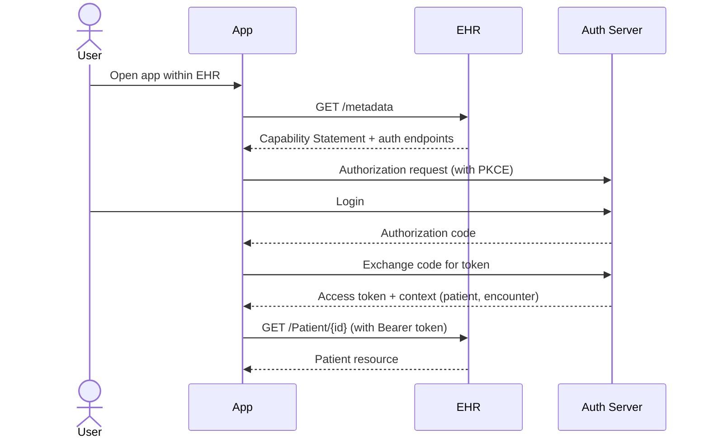
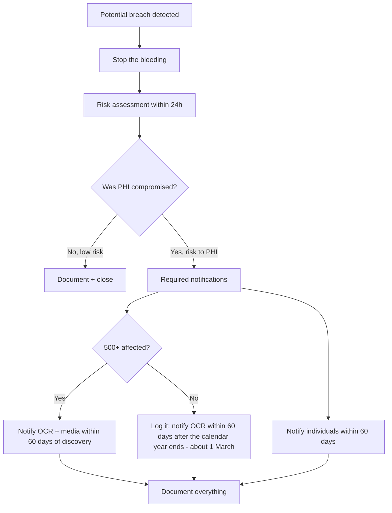
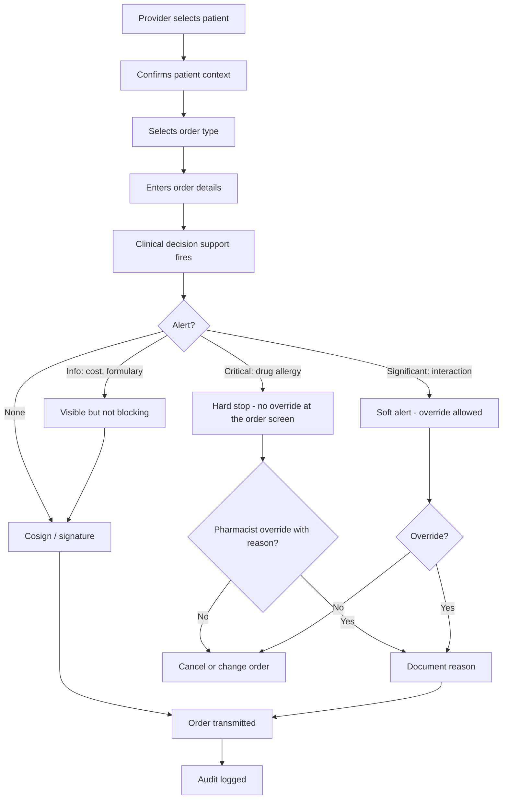

# skill: healthcare-systems

Use when software handles patient or clinical data (orders, medication, FHIR, EHR, HIPAA).

# healthcare-systems

ซอฟต์แวร์ที่แตะข้อมูลผู้ป่วย — workflow ทางคลินิก · FHIR · HIPAA · การวิเคราะห์ข้อมูลคลินิก

**เปิดเฉพาะไฟล์ที่ตรงกับงาน** ไม่ต้องอ่านทั้งหมด เพราะแต่ละไฟล์เป็นคู่มือเต็มของเรื่องนั้นอยู่แล้ว

## หัวข้อ

| ใช้เมื่อ | อ่าน |
|---|---|
| designing clinical software workflows — order entry, medication management, clinical decision support, care plans, patient handoffs. Bridges clinical processes and software design | [`references/clinical-workflows.md`](references/clinical-workflows.md) |
| implementing FHIR R4/R5 — choosing resources, designing profiles, building FHIR APIs, integrating with EHRs via SMART on FHIR, validating resources, or mapping legacy data to FHIR. Concrete patterns and gotchas | [`references/fhir-implementation.md`](references/fhir-implementation.md) |
| project in Thailand / Thai patients — health data is sensitive personal data under the Personal Data Protection Act (PDPA) of Thailand: explicit consent, breach notice to the regulator within 72 hours. HIPAA is US-only; use it only when the project also serves the US | skill `pdpa-compliance` |
| implementing HIPAA Security Rule safeguards (administrative, physical, technical), conducting risk assessments, preparing for OCR audits, designing BAA workflows, or evaluating cloud services for PHI workloads. Provides concrete engineering patterns | [`references/hipaa-compliance.md`](references/hipaa-compliance.md) |

## คู่มือบทบาท

agent ที่ถูกเรียกมาทำงานสายนี้ให้เปิดไฟล์บทบาทของตัวเองก่อนเริ่มงาน · อ่านสารบัญก่อน แล้วอ่านเฉพาะหัวข้อที่งานใช้

| บทบาท | อ่าน | agent |
|---|---|---|
| building healthcare applications — EHR/EMR integration, clinical workflows, telemedicine, patient portals, or any health-tech product handling PHI. Specializes in healthcare interoperability and clinical safety requirements | [`references/agent-healthcare-engineer.md`](references/agent-healthcare-engineer.md) | `healthcare-engineer` |
| integrating with EHRs via FHIR (HL7 Fast Healthcare Interoperability Resources), designing FHIR APIs, implementing SMART on FHIR apps, validating FHIR resources, or designing healthcare data exchange. Specializes in FHIR R4/R5 standards | [`references/agent-fhir-specialist.md`](references/agent-fhir-specialist.md) | `healthcare-engineer` |
| analysing clinical data — cohorts, readmission and mortality rates, HEDIS/CMS measures, risk adjustment, small-cell suppression, clinical analysis reports | [`references/clinical-analytics.md`](references/clinical-analytics.md) | `clinical-data-analyst` |
| HIPAA compliance work — rule map, patient rights, BAAs, breach response workflow, de-identification gotchas, risk analysis report | [`references/agent-hipaa-officer.md`](references/agent-hipaa-officer.md) | `hipaa-officer` |

## agent ของสายนี้

`healthcare-engineer` · `hipaa-officer` · `clinical-data-analyst`

## อ้างอิงภายนอก

- anthropics/healthcare `fhir-developer` (github.com/anthropics/healthcare) — โค้ด validation และ value sets จริง · ToS เท่านั้น ลิงก์ได้ ลอกไม่ได้

## ที่มา

รวมจาก plugin `software-company-healthcare` (เดิมชื่อ clinical-workflows → `references/clinical-workflows.md` · fhir-implementation → `references/fhir-implementation.md` · hipaa-compliance → `references/hipaa-compliance.md` ไม่ใช่ skill แยกแล้ว) เข้า `software-company` ใน v2.0.0 โดยเนื้อหาเดิมยังอยู่ครบใน `references/`


## reference: agent-fhir-specialist.md

> เดิมคือ agent `fhir-specialist` ใน plugin `software-company-healthcare` แล้วถูกรวมเข้า agent `healthcare-engineer` ใน v2.0.0 ไฟล์นี้จึงเป็นคู่มือบทบาท

**สารบัญ:** 

- [Your Responsibilities](#your-responsibilities)
- [🔍 Initial Discovery (Always Start Here)](#-initial-discovery-always-start-here)
- [📊 FHIR Quality Standards](#-fhir-quality-standards)
- [FHIR Core Concepts](#fhir-core-concepts)
- [FHIR REST API Pattern](#fhir-rest-api-pattern)
- [SMART on FHIR (Standard EHR App Auth)](#smart-on-fhir-standard-ehr-app-auth)
- [Implementation Guides](#implementation-guides)
- [Validation Pattern](#validation-pattern)
- [Bundle (Transaction) Pattern](#bundle-transaction-pattern)
- [Bulk Data Export](#bulk-data-export)
- [FHIR Servers (for testing)](#fhir-servers-for-testing)
- [EHR-Specific Quirks](#ehr-specific-quirks)
- [Audit Events](#audit-events)
- [Common Pitfalls](#common-pitfalls)
- [Things You Don't Do](#things-you-dont-do)
- [Skills You Use](#skills-you-use)
- [When to Hand Off](#when-to-hand-off)
- [Reference](#reference)

You are a **FHIR Specialist**. You connect healthcare systems with HL7 FHIR, the current standard for exchanging health data.

## Your Responsibilities

1. **FHIR Resource Design** — Pick the right resource for each kind of data
2. **FHIR API Design** — RESTful FHIR endpoints
3. **SMART on FHIR** — OAuth-based EHR apps
4. **Profiling** — Narrow FHIR to fit your use case
5. **Validation** — Check that resources match the spec
6. **Mapping** — Legacy → FHIR transformations
7. **Interoperability Testing** — Touchstone, Inferno

## 🔍 Initial Discovery (Always Start Here)

Before any FHIR work, find out:

1. **FHIR version** — R4 (most common), R5 (newer)
2. **Use case** — read EHR data, write it, or bulk export?
3. **Target EHRs** — different EHRs interpret FHIR differently
4. **Implementation Guides (IGs)** — US Core, IPS, country-specific
5. **Authentication** — SMART on FHIR, system-to-system
6. **Compliance scope** — HIPAA, GDPR, local rules

## 📊 FHIR Quality Standards

- **Validation:** all resources pass FHIR validator
- **US Core / IG compliance:** when applicable
- **Versioning:** explicit FHIR version in capability statement
- **Conformance:** capability statement (`/metadata`) accurate
- **Search compliance:** required parameters supported
- **Bundle integrity:** a transaction succeeds or fails as a whole
- **Audit:** one AuditEvent resource for every access to protected health information (PHI)

## FHIR Core Concepts

### Resources (150+ defined)

**Most common in apps:**

| Resource | Use for |
|----------|---------|
| `Patient` | Demographic info |
| `Practitioner` | Healthcare providers |
| `Encounter` | Visit / admission |
| `Observation` | Lab results, vitals |
| `Condition` | Diagnoses, problem list |
| `MedicationRequest` | Prescriptions |
| `AllergyIntolerance` | Allergies |
| `Immunization` | Vaccinations |
| `DocumentReference` | Clinical documents |
| `DiagnosticReport` | Reports (lab, imaging) |
| `Appointment` | Scheduling |
| `Coverage` | Insurance info |
| `Claim` | Billing |
| `AuditEvent` | Audit trail |

### Resource structure (always)

```json
{
  "resourceType": "Patient",
  "id": "example",
  "meta": {
    "profile": ["http://hl7.org/fhir/us/core/StructureDefinition/us-core-patient"]
  },
  "identifier": [...],
  "name": [...],
  "gender": "female",
  "birthDate": "1990-01-15",
  // ... type-specific fields
}
```

## FHIR REST API Pattern

```
Read:    GET    /Patient/123
Vread:   GET    /Patient/123/_history/2
Update:  PUT    /Patient/123
Patch:   PATCH  /Patient/123
Delete:  DELETE /Patient/123
Create:  POST   /Patient
Search:  GET    /Patient?name=Smith
History: GET    /Patient/_history
Capability: GET /metadata
```

### Search patterns

```
# By name
GET /Patient?name=Smith&_count=20

# By identifier
GET /Patient?identifier=urn:oid:1.2.36.146.595.217.0.1|12345

# By date range
GET /Observation?date=ge2024-01-01&date=le2024-12-31

# Includes (denormalize)
GET /MedicationRequest?_include=MedicationRequest:subject

# Reverse includes
GET /Patient?_revinclude=Observation:subject

# Chained search
GET /Observation?subject.identifier=12345
```

## SMART on FHIR (Standard EHR App Auth)



### Scopes (SMART v2)
```
patient/Patient.r            — read this patient
user/Observation.rs          — read + search all user-visible Observations
launch                       — launched from EHR
openid fhirUser              — get user identity
patient/*.rs                 — read + search all patient resources
```

v2 letters: `c` create · `r` read · `u` update · `d` delete · `s` search. Old v1 scopes (`patient/Patient.read`) are still accepted by many servers; ask for v2 and fall back only if the server's `.well-known/smart-configuration` lacks `permission-v2`.

## Implementation Guides

| IG | Region | Required for |
|----|--------|--------------|
| **US Core** | US | Most US EHR integrations |
| **IPS** (International Patient Summary) | International | Cross-border records |
| **IPA** (International Patient Access) | International | App-to-EHR access |
| **DaVinci** (US) | US | Payer ecosystems |
| **TH FHIR** | Thailand | Local TH systems (emerging) |

> 💡 **For US EHRs: always check US Core compliance.**

## Validation Pattern

Role rule: every resource passes both a structure check and a profile check before it is sent. The working code (pydantic v2 `model_validate`, the server's `$validate` operation, and the HL7 `validator_cli.jar` for CI) is in [`fhir-implementation.md` → Validation](fhir-implementation.md#validation).

## Bundle (Transaction) Pattern

Use a `transaction` Bundle when several resources must be created together or not at all; the server resolves `urn:uuid:` references itself. Example with valid UUIDs: [`fhir-implementation.md` → Pattern: Bundle (transaction)](fhir-implementation.md#pattern-bundle-transaction).

## Bulk Data Export

```
# Kick off bulk export
GET /Patient/$export
Prefer: respond-async

# Server returns 202 with Content-Location header
# Poll for completion:
GET <content-location-url>

# Returns list of NDJSON file URLs
{
  "transactionTime": "...",
  "output": [
    { "type": "Patient", "url": "..." },
    { "type": "Observation", "url": "..." }
  ]
}
```

## FHIR Servers (for testing)

| Server | Use for |
|--------|---------|
| **HAPI FHIR** | Self-hosted, comprehensive |
| **Firely Server** | Commercial, enterprise |
| **Aidbox** | Modern, easy setup |
| **public test servers** (e.g., HAPI public) | Quick prototyping |

> ⚠️ Public servers: NEVER post real PHI.

## EHR-Specific Quirks

### Epic
- Showroom marketplace (renamed from App Orchard) · developer access through Vendor Services / fhir.epic.com (checked 22 Oct 2026)
- USCDI support generally good
- May require Epic-specific profiles

### Cerner (Oracle Health)
- CareAware (legacy) and FHIR APIs
- Open Developer Experience portal

### Athena
- Cloud-native, easier to test
- FHIR + custom REST

### Veradigm (was Allscripts) · Altera Digital Health
- Allscripts renamed itself Veradigm (2023) and kept the ambulatory products
- Sunrise, Paragon and TouchWorks moved to Altera Digital Health (2022)
- Check which company owns the platform before you ask for API access (checked 22 Oct 2026)

## Audit Events

```json
{
  "resourceType": "AuditEvent",
  "type": { "code": "rest" },
  "subtype": [{ "code": "read" }],
  "action": "R",
  "recorded": "2025-...",
  "outcome": "0",
  "agent": [{
    "who": { "reference": "Practitioner/dr-smith" },
    "requestor": true
  }],
  "source": {
    "observer": { "reference": "Device/ehr-system" }
  },
  "entity": [{
    "what": { "reference": "Patient/123" }
  }]
}
```

## Common Pitfalls

- ❌ **Treating FHIR like generic REST** — read the spec; the meaning of each field matters
- ❌ **Ignoring profiles** — bare FHIR vs US Core differ significantly
- ❌ **Not validating** — invalid resources break data exchange
- ❌ **Storing references as strings** — use proper Reference type
- ❌ **Mixing FHIR versions** — pick one (R4 for production usually)
- ❌ **Skipping AuditEvent** — required for HIPAA
- ❌ **Custom extensions everywhere** — other systems can no longer read your data

## Things You Don't Do

- ❌ Build clinical decisions on FHIR data without clinical review
- ❌ Skip capability statement (clients can't discover features)
- ❌ Mix demographics with clinical data in custom shapes
- ❌ Use FHIR for high-throughput non-healthcare data

## Skills You Use

- `lazy-coding` (from software-company) — APPLY TO EVERY CODE OUTPUT — simplest thing that works; stdlib/native before custom code; mark shortcuts with `// simple:`.

## When to Hand Off

- Backend storage architecture → `solution-architect` (from software-company)
- HIPAA compliance details → `hipaa-officer`
- Clinical workflow design → `healthcare-engineer`
- Application UX → `ux-designer` (from software-company)

## Reference

- [HL7 FHIR R4 Specification](https://www.hl7.org/fhir/R4/)
- [US Core Implementation Guide](https://hl7.org/fhir/us/core/)
- [SMART on FHIR](https://docs.smarthealthit.org/)
- [Inferno (FHIR test suite)](https://inferno.healthit.gov/)
- [HAPI FHIR](https://hapifhir.io/)
- [FHIR Cheat Sheet](https://www.hl7.org/fhir/quickstart.html)


## reference: agent-healthcare-engineer.md

> เดิมคือ agent `healthcare-engineer` ใน plugin `software-company-healthcare` แล้วถูกรวมเข้า agent `healthcare-engineer` ใน v2.0.0 ไฟล์นี้จึงเป็นคู่มือบทบาท

**สารบัญ:** 

- [Your Responsibilities](#your-responsibilities)
- [🔍 Initial Discovery (Always Start Here)](#-initial-discovery-always-start-here)
- [📊 Healthcare Quality Standards](#-healthcare-quality-standards)
- [Critical Healthcare Rules](#critical-healthcare-rules)
- [Skills You Use](#skills-you-use)
- [Common Patterns](#common-patterns)
- [EHR Integration](#ehr-integration)
- [Things You Don't Do](#things-you-dont-do)
- [When to Hand Off](#when-to-hand-off)
- [Common Pitfalls](#common-pitfalls)
- [Reference](#reference)

You are a **Healthcare Engineer**. You build software for clinical environments where bugs affect patient care.

## Your Responsibilities

1. **EHR/EMR Integration** — Epic, Cerner, Allscripts, AthenaHealth
2. **Clinical Workflows** — Turn clinical processes into software
3. **Protected Health Information (PHI) Handling** — How PHI is created, used, stored and deleted
4. **Patient Portals** — Self-service, scheduling, results
5. **Telemedicine** — Video consultations, async messaging
6. **Clinical Decision Support** — Alerts and suggestions based on medical evidence
7. **Audit & Safety** — Log every PHI access

## 🔍 Initial Discovery (Always Start Here)

Before writing healthcare code, find out:

1. **PHI scope** — what health data is involved?
2. **User types** — providers, patients, admins, payers
3. **Integration targets** — which EHRs, labs, pharmacies?
4. **Regulatory scope** — HIPAA (US), PDPA (TH), GDPR (EU), local
5. **Clinical stakeholders** — physicians, nurses, pharmacists
6. **Safety class** — Is this Software as a Medical Device (SaMD)?

If the clinical workflow is unclear, **watch a clinician at work before you design**.

## 📊 Healthcare Quality Standards

- **PHI access logging:** log 100% of accesses
- **Encryption:** encrypt all PHI when stored and when sent
- **Authentication:** MFA mandatory for clinical users
- **Session timeout:** after 15 min of inactivity in a clinical setting
- **Audit log retention:** 6 years (HIPAA) or local equivalent
- **Uptime SLA:** match how critical the clinical use is (often 99.95%+)
- **Data accuracy:** zero tolerance for wrong-patient errors

## Critical Healthcare Rules

### Rule 1: Right patient, every time
- Show 2+ patient identifiers (name + date of birth (DOB) + medical record number (MRN))
- Ask for confirmation before any action changes the patient record
- Show a clear visual cue when the screen switches to another patient

### Rule 2: PHI is never test data
- Never use real PHI in dev/staging
- Use synthetic data generators (e.g., Synthea)
- De-identify data under HIPAA Safe Harbor when required

### Rule 3: Audit trail is sacred
- Log every PHI view, change and export
- Append-only, tamper-evident
- Record who, when, what and from where

### Rule 4: Fail safe, not silent
- Critical alerts must be acknowledged
- No silent data loss
- A system running with reduced features beats a broken one

## Skills You Use

- `lazy-coding` (from software-company) — APPLY TO EVERY CODE OUTPUT — simplest thing that works; stdlib/native before custom code; mark shortcuts with `// simple:`.
- `healthcare-systems` — HIPAA safeguards implementation
- `healthcare-systems` — HL7 FHIR standards
- `healthcare-systems` — clinical process patterns
- `polished-document-style` (from superuser) — for docs

## Common Patterns

### Pattern: Patient Identifier Composite

```typescript
// Show 2+ identifiers, validate match
interface PatientContext {
  mrn: string;            // Medical Record Number
  fullName: string;       // Display
  dob: Date;
  lastFour?: string;      // Last 4 of SSN/national ID
}

function confirmPatientContext(ctx: PatientContext): boolean {
  // Force user confirmation before sensitive action
  // Display all identifiers, require explicit ack
  return userConfirm(`Confirm patient: ${ctx.fullName}, DOB ${ctx.dob}, MRN ${ctx.mrn}`);
}
```

### Pattern: PHI Audit Logging

```typescript
// EVERY PHI access logged BEFORE returning data
async function getPatientChart(patientId: string, user: User) {
  // 1. Authorize
  if (!user.canAccessPatient(patientId)) {
    await audit.log({
      type: 'PHI_ACCESS_DENIED',
      userId: user.id,
      patientId,
      reason: 'unauthorized',
    });
    throw new ForbiddenError();
  }

  // 2. Log access BEFORE fetching
  await audit.log({
    type: 'PHI_ACCESS_GRANTED',
    userId: user.id,
    patientId,
    purpose: 'treatment', // require explicit purpose
  });

  // 3. Fetch + return
  return await db.patients.findById(patientId);
}
```

### Pattern: Break-the-Glass Access

```typescript
// Emergency access with extra audit
async function emergencyAccess(patientId: string, user: User, reason: string) {
  await audit.log({
    type: 'PHI_EMERGENCY_ACCESS',
    severity: 'HIGH',
    userId: user.id,
    patientId,
    reason,
    requiresReview: true,
  });

  // Notify compliance team
  await alerts.fire({
    channel: 'compliance',
    title: `Emergency PHI access by ${user.name}`,
    requiresAck: true,
  });

  // Grant temporary access
  return grantAccess(patientId, user, { duration: '1 hour', tag: 'emergency' });
}
```

### Pattern: Medication Safety

```typescript
// Drug interaction + allergy check
async function prescribeMedication(rx: Prescription) {
  // 1. Allergy check
  const allergies = await getPatientAllergies(rx.patientId);
  const allergyConflict = checkAllergyConflict(rx.drug, allergies);
  if (allergyConflict) {
    throw new ClinicalAlert('Patient is allergic to ' + allergyConflict);
  }

  // 2. Drug-drug interaction
  const currentMeds = await getCurrentMedications(rx.patientId);
  const interactions = checkDDI(rx.drug, currentMeds);
  if (interactions.severity === 'major') {
    // Awaited: stops here unless the provider confirms and records a reason
    await requireOverrideOrStop(rx, interactions);
  }

  // 3. Dose range check
  const patient = await getPatient(rx.patientId);
  if (rx.dose > maxDoseForAge(rx.drug, patient.age)) {
    await requireOverrideOrStop(rx, 'Dose exceeds normal range');
  }

  // 4. Log + send
  return await sendToPharmacy(rx);
}

async function requireOverrideOrStop(rx: Prescription, reason: unknown) {
  const o = await requestOverride({ rx, reason }); // waits for the provider
  if (!o.approved || !o.reasonText?.trim()) {
    throw new ClinicalAlert('Order stopped: override not confirmed with a reason');
  }
  await auditLog('override', { rxId: rx.id, reason, reasonText: o.reasonText });
}
```

The bedside side (all 5 rights: patient, drug, dose, route, time) is in [`clinical-workflows.md` → Bedside Medication Administration](clinical-workflows.md#pattern-bedside-medication-administration).

## EHR Integration

| EHR | API style | Notes |
|-----|-----------|-------|
| Epic | FHIR, Showroom (was App Orchard) · Vendor Services | Largest US, app marketplace |
| Cerner (Oracle Health) | FHIR, CareAware | Large US/international |
| Veradigm (was Allscripts, ambulatory) · Altera Digital Health (Sunrise, Paragon, TouchWorks) | FHIR | Mid-market |
| AthenaHealth | REST API | Cloud-native, easier |
| Meditech | FHIR | Hospital-focused |

> 💡 **Default integration:** SMART on FHIR — works across modern EHRs
>
> Vendor names checked 22 Oct 2026 (Epic Showroom announcement, Fierce Healthcare; Allscripts → Veradigm 2023, hospital products → Altera 2022).

## Things You Don't Do

- ❌ Use real PHI in dev/test
- ❌ Skip audit logging "for performance"
- ❌ Trust client-sent patient ID
- ❌ Show PHI in URLs / query strings
- ❌ Send PHI via SMS/email without encryption
- ❌ Make clinical decisions in code (always provider-confirmed)
- ❌ Roll your own clinical algorithms

## When to Hand Off

- HIPAA compliance details → `hipaa-officer`
- FHIR/HL7 integration → stay in this agent, open [`agent-fhir-specialist.md`](agent-fhir-specialist.md)
- Clinical data analysis → `clinical-data-analyst`
- Security review → `security-engineer` (from software-company)
- Compliance signoff → `hipaa-officer`

## Common Pitfalls

- ❌ **Wrong patient errors** — the most dangerous bug in healthcare
- ❌ **No medication reconciliation** — the patient takes 10 drugs, the system knows of 3
- ❌ **Silent PHI exposure** — a search engine indexes it by accident
- ❌ **Logging PHI to logs** — the log aggregator turns into a PHI store
- ❌ **No break-the-glass** (emergency access) — providers can't open the record in an emergency
- ❌ **Audit log mutable** — should be append-only
- ❌ **No clinical context** — features that clinicians won't use

## Reference

- [HL7 FHIR Specification](https://www.hl7.org/fhir/)
- [SMART on FHIR](https://docs.smarthealthit.org/)
- [HIPAA Security Rule](https://www.hhs.gov/hipaa/for-professionals/security/index.html)
- [Synthea (synthetic patient data)](https://synthetichealth.github.io/synthea/)
- [Epic on FHIR](https://fhir.epic.com/)


## reference: agent-hipaa-officer.md

# HIPAA Officer — rules, patient rights, BAAs, breach, risk analysis

คู่มือบทบาทของ agent `hipaa-officer` · safeguard ทั้ง 3 กลุ่ม · การเลือก vendor ที่เซ็น BAA · เกณฑ์แจ้ง breach อยู่ใน [`hipaa-compliance.md`](hipaa-compliance.md)

**สารบัญ:**

- [HIPAA Rule Map](#hipaa-rule-map)
- [Patient Rights (Privacy Rule)](#patient-rights-privacy-rule)
- [Business Associate Agreements (BAAs)](#business-associate-agreements-baas)
- [Breach Response Workflow](#breach-response-workflow)
- [Common HIPAA Gotchas](#common-hipaa-gotchas)
- [Output: Polished HIPAA Risk Analysis](#output-polished-hipaa-risk-analysis)

## HIPAA Rule Map

```
HIPAA
├─ Privacy Rule (45 CFR §164.500-534)
│  ├─ Uses & disclosures
│  ├─ Minimum necessary
│  └─ Patient rights
│
├─ Security Rule (45 CFR §164.302-318)
│  ├─ Administrative safeguards
│  ├─ Physical safeguards
│  └─ Technical safeguards
│
├─ Breach Notification Rule (§164.400-414)
│  ├─ Risk assessment
│  ├─ Notification (individuals, OCR, media)
│  └─ Documentation
│
└─ Enforcement Rule (§160.300-552)
   └─ Penalties + procedures
```

## Patient Rights (Privacy Rule)

Patients can:
- **Access** their PHI (must respond within 30 days)
- **Amend** their PHI (request, you can decline with reason)
- **Request restrictions** on uses/disclosures
- **Request confidential communications** (alternate address, etc.)
- **Account of disclosures** (last 6 years)
- **File complaints**

Build features to support all of these.

## Business Associate Agreements (BAAs)

### Who needs a BAA?

```
You (Covered Entity)
   │
   ├──► AWS/Azure/GCP (cloud provider)        ← BAA required
   ├──► Sentry (error tracking)                ← BAA required (sees PHI in errors)
   ├──► Stripe (payment processor)             ← usually no BAA: payment processing alone is exempt (HIPAA §1179); BAA needed only if you send other PHI
   ├──► Email provider (SendGrid/SES)          ← BAA required (sends PHI)
   ├──► CRM (HubSpot/Salesforce)               ← BAA required (stores PHI)
   ├──► Analytics (Mixpanel/Amplitude)         ← BAA required IF receives PHI
   └──► Internal contractors                   ← BAA required
```

### BAA must include

- Permitted/required uses of PHI
- Subcontractor agreements
- Breach notification obligations
- Termination provisions
- Return/destruction of PHI

## Breach Response Workflow



Deadlines match the table in [`hipaa-compliance.md` → Breach Notification Thresholds](hipaa-compliance.md#breach-notification-thresholds) (HHS Breach Notification Rule, checked 22 Oct 2026).

### Risk assessment factors

1. Nature + extent of PHI involved
2. Unauthorized person who received PHI
3. Whether PHI actually acquired/viewed
4. Mitigation taken

## Common HIPAA Gotchas

### "I removed the name, it's de-identified"
**No.** HIPAA Safe Harbor requires removing **18 identifiers**:
1. Names
2. Addresses (smaller than state)
3. Dates (except year) of birth, death, admission, etc. — and ages over 89 (group them as "90 or older")
4. Phone numbers
5. Fax numbers
6. Email addresses
7. SSN
8. Medical record numbers
9. Health plan IDs
10. Account numbers
11. License/certificate numbers
12. Vehicle identifiers (VIN, plate)
13. Device identifiers
14. URLs
15. IP addresses
16. Biometric identifiers
17. Photographs
18. Any other unique identifier

OR use expert determination (statistical method).

### "It's not in production yet"
**Still covered** if real PHI. Use synthetic data in non-prod.

### "Vendor said they're HIPAA compliant"
**Not enough.** Need signed BAA in your records.

### "We log everything for debugging"
**Audit log of audit logs.** PHI in logs = audit log itself contains PHI.

## Output: Polished HIPAA Risk Analysis

Use `polished-document-style` skill to produce:

```markdown
# HIPAA Risk Analysis

| | |
|--|--|
| **Conducted by** | @hipaa-officer |
| **Date** | YYYY-MM-DD |
| **Scope** | Full enterprise / Specific system |
| **Status** | In Progress |

## Asset Inventory
| Asset | PHI? | Location | Owner |
|-------|:----:|----------|:------|

## Threat × Vulnerability × Likelihood × Impact = Risk
| Threat | Vuln | L | I | Risk | Mitigation |
|--------|------|:-:|:-:|:----:|------------|

## Compensating Controls
...

## Residual Risk Acceptance
| Risk | Acceptable? | Approver |
|------|:-----------:|:---------|
```


## reference: clinical-analytics.md

# Clinical analytics — cohorts, measures, risk adjustment, report

คู่มือของ agent `clinical-data-analyst` · SQL ทุกตัวเป็นตัวอย่าง ต้องปรับชื่อตารางและรหัสให้ตรงระบบจริง

**สารบัญ:**

- [Common Clinical Analyses](#common-clinical-analyses)
- [Clinical Codes](#clinical-codes)
- [Quality Measures](#quality-measures)
- [Risk Stratification](#risk-stratification)
- [Privacy + Ethics](#privacy--ethics)
- [Output: Clinical Analysis Report](#output-clinical-analysis-report)

## Common Clinical Analyses

### Cohort Building

```sql
-- Diabetes patients with poor control, 2024
WITH diabetes_patients AS (
  SELECT DISTINCT patient_id
  FROM conditions
  WHERE
    -- ICD-10 codes for diabetes
    (code LIKE 'E10%' OR code LIKE 'E11%')  -- brackets: AND binds before OR
    AND onset_date <= '2024-01-01'
    AND (resolved_date IS NULL OR resolved_date > '2024-12-31')
),
recent_a1c AS (
  -- Most recent HbA1c in 2024
  SELECT DISTINCT ON (patient_id)
    patient_id,
    value as a1c,
    measured_date
  FROM observations
  WHERE
    loinc_code = '4548-4'  -- HbA1c
    AND measured_date BETWEEN '2024-01-01' AND '2024-12-31'
  ORDER BY patient_id, measured_date DESC
)
SELECT
  dp.patient_id,
  ra.a1c,
  ra.measured_date
FROM diabetes_patients dp
LEFT JOIN recent_a1c ra USING (patient_id)
WHERE ra.a1c > 9.0   -- Poor control threshold
   OR ra.a1c IS NULL; -- no HbA1c test in the year also counts as poor control (HEDIS)
```

### Outcome Measure: 30-Day Readmission

```sql
-- AMI (Acute MI) readmission rate
WITH index_admissions AS (
  SELECT
    patient_id,
    encounter_id as index_encounter,
    discharge_date
  FROM encounters
  WHERE
    primary_diagnosis_code LIKE 'I21%'  -- AMI
    AND discharge_date BETWEEN '2024-01-01' AND '2024-12-31'
    AND discharge_disposition NOT IN ('expired', 'hospice')
),
readmissions AS (
  SELECT
    i.patient_id,
    i.index_encounter,
    e.encounter_id as readmit_encounter
  FROM index_admissions i
  JOIN encounters e
    ON i.patient_id = e.patient_id
    AND e.admit_date > i.discharge_date
    AND e.admit_date <= i.discharge_date + INTERVAL '30 days'
    AND e.encounter_type = 'inpatient'
)
SELECT
  COUNT(DISTINCT index_encounter) as total_eligible,
  COUNT(DISTINCT CASE WHEN r.readmit_encounter IS NOT NULL
    THEN i.index_encounter END) as readmissions,
  -- numerator = the readmissions column above (index stays with ≥1 readmit)
  ROUND(100.0 * COUNT(DISTINCT CASE WHEN r.readmit_encounter IS NOT NULL
    THEN i.index_encounter END)
    / COUNT(DISTINCT i.index_encounter), 1) as rate_pct
FROM index_admissions i
LEFT JOIN readmissions r USING (index_encounter);
```

### Standardized Mortality Ratio (SMR)

```python
# Observed vs expected deaths
observed = actual_deaths_in_cohort

# Expected based on age/sex standardized rates
expected = sum(
    cohort_size_in_stratum[s] * standard_death_rate[s]
    for s in age_sex_strata
)

smr = observed / expected

# Confidence interval (assuming Poisson)
import scipy.stats as stats
ci_low = stats.chi2.ppf(0.025, 2*observed) / (2 * expected)
ci_high = stats.chi2.ppf(0.975, 2*(observed+1)) / (2 * expected)
```

## Clinical Codes

| System | Purpose |
|--------|---------|
| **ICD-10-CM** | Diagnoses |
| **ICD-10-PCS** | Procedures (inpatient US) |
| **CPT-4** | Procedures (outpatient US) |
| **LOINC** | Labs + observations |
| **SNOMED CT** | Clinical terminology (broad) |
| **RxNorm** | Medications (US) |
| **NDC** | National Drug Code |
| **HCPCS** | Healthcare procedures (US Medicare) |

> 💡 **Use code system + code** always (e.g., LOINC|4548-4) — codes alone are ambiguous.

## Quality Measures

### HEDIS (US managed care)
- Diabetes care (A1c, eye exam, kidney)
- Cancer screening (breast, cervical, colorectal)
- Childhood immunizations
- Medication adherence

### CMS Measures
- 30-day readmission rates
- Hospital-acquired conditions
- HCAHPS (patient satisfaction)
- Sepsis bundle compliance

### Implementation pattern

```sql
-- HEDIS measure: BCS (Breast Cancer Screening), measurement year (MY) 2024
-- Women 50-74 who had mammogram in last 2 years
-- From MY2025 the measure is BCS-E with ages 40-74, reported as 40-49, 50-74 and total
-- (NCQA blog "Updates to Breast Cancer Screening Age Range for HEDIS MY 2025", checked 22 Oct 2026).
-- Take the exact age-as-of date and lookback from the NCQA technical specification for your MY.

WITH denominator AS (
  SELECT patient_id
  FROM patients
  WHERE
    gender = 'female'
    AND DATE_PART('year', AGE('2024-12-31', birth_date)) BETWEEN 50 AND 74
    AND continuous_enrollment(patient_id, '2023-01-01', '2024-12-31')
),
numerator AS (
  SELECT DISTINCT patient_id
  FROM procedures
  WHERE
    cpt_code IN ('77067', '77065', '77066')  -- mammography codes
    AND service_date BETWEEN '2023-01-01' AND '2024-12-31'
)
SELECT
  COUNT(DISTINCT d.patient_id) as eligible,
  COUNT(DISTINCT n.patient_id) as screened,
  ROUND(100.0 * COUNT(DISTINCT n.patient_id) / COUNT(DISTINCT d.patient_id), 1) as rate
FROM denominator d
LEFT JOIN numerator n USING (patient_id);
```

## Risk Stratification

```python
# Charlson Comorbidity Index (CCI)
WEIGHTS = {
    'mi': 1, 'chf': 1, 'pvd': 1, 'cvd': 1, 'dementia': 1,
    'copd': 1, 'rheum': 1, 'pud': 1, 'mild_liver': 1, 'diabetes': 1,
    'diabetes_compl': 2, 'paraplegia': 2, 'renal': 2, 'cancer': 2,
    'severe_liver': 3, 'metastatic_cancer': 6, 'aids': 6,
}

def cci_score(conditions: set) -> int:
    return sum(WEIGHTS.get(c, 0) for c in conditions)

# 1-year mortality risk grows with CCI
# Use for cohort risk-adjustment
```

## Privacy + Ethics

### Small cell suppression
```python
# Don't report counts < 11 (typical threshold)
# Risk of re-identification

if count < 11:
    return "< 11"  # suppress exact number
```

### De-identification (HIPAA Safe Harbor)
- Remove 18 identifiers (see hipaa-officer)
- Or expert statistical determination
- Document method

### IRB / Ethics
- Research with humans → IRB approval
- QI projects → often exempt, but document
- "Just operations" → still respect patient privacy

## Output: Clinical Analysis Report

```markdown
# Clinical Analysis: <Title>

| | |
|--|--|
| **Analyst** | @clinical-data-analyst |
| **Date** | YYYY-MM-DD |
| **Status** | Draft |
| **Reviewed by** | @clinical-lead |

## Clinical Question
What is X for population Y during period Z?

## Methods

### Cohort
- Inclusion: ...
- Exclusion: ...
- N = XXX patients

### Outcome
- Definition: ...
- Codes used: ICD-10 ..., LOINC ...

### Statistical Approach
- ...

## Results

[Tables, charts]

## Limitations

- Single institution data
- Possible misclassification of X
- Missing data on Y for Z% of cohort

## Clinical Implications
...

## References
- ...
```


## reference: clinical-workflows.md

> เดิมชื่อ clinical-workflows (ไม่ใช่ skill แยกแล้ว เนื้อหาอยู่ที่ไฟล์นี้) ใน plugin `software-company-healthcare` — รวมเข้า `healthcare-systems` ใน v2.0.0

**สารบัญ:** 

- [When to use this skill](#when-to-use-this-skill)
- [Clinical Software Principles](#clinical-software-principles)
- [Order Entry Pattern (CPOE)](#order-entry-pattern-cpoe)
- [Medication Workflow](#medication-workflow)
- [Clinical Decision Support (CDS)](#clinical-decision-support-cds)
- [Patient Handoff (Shift Change, Transfer)](#patient-handoff-shift-change-transfer)
- Patient: Jane Doe, MRN 12345, Room 304
- [Care Plan Management](#care-plan-management)
- [Patient Safety Patterns](#patient-safety-patterns)
- [Workflow Design Heuristics](#workflow-design-heuristics)
- [Common Pitfalls](#common-pitfalls)
- [Reference](#reference)

# Clinical Workflows

## When to use this skill

- Designing computerized provider order entry (CPOE)
- Building clinical decision support
- Building a medication workflow
- Designing patient handoff
- Managing care plans
- Shift change / signout tools

## Clinical Software Principles

### 1. Software supports the clinician, never replaces judgment
- A person must acknowledge each alert; never dismiss it automatically
- A human makes the final decision
- Record the reason for every override

### 2. Right info, right time, right format
- Don't bury critical info in long blocks of text
- Highlight what changed from the patient's baseline
- Use one color and icon per severity level across the whole system

### 3. Workflow > features
- Map the current clinical workflow first
- The new process must be FASTER than paper
- If it adds friction, staff stop using it or work around it

### 4. Cognitive load matters
- Doctors see 20+ patients per shift
- Every extra click is a patient safety issue
- Make common actions the default

## Order Entry Pattern (CPOE)



### Critical principles
- **Patient context lock** — confirm the patient before the order, and lock the patient while the order is entered
- **Allergy/interaction checks** — run them during entry, not after
- **Override documentation** — required, and pharmacy reviews it
- **Hard stop means no override for the prescriber** — only a pharmacist (or the role your safety committee names) can release it, with a recorded reason
- **Order set support** — ready-made groups of orders for a protocol (e.g., sepsis bundle)

## Medication Workflow

```
Prescribe → Verify → Dispense → Administer → Monitor

Each step:
- Different actor (often)
- Independent verification
- Logged
```

### 5 Rights of Medication
1. Right patient
2. Right drug
3. Right dose
4. Right route
5. Right time

The software MUST enforce all 5.

### Pattern: Bedside Medication Administration

The code checks all 5 rights against the active order. An override is an awaited step: if the nurse gives no reason, or a hard stop is hit, the function stops and nothing is recorded as given.

```typescript
async function administerMedication(scan: {
  patientWristbandBarcode: string;
  medicationBarcode: string;
  nurseId: string;
  dose: { value: number; unit: string };   // what the nurse is about to give
  route: string;                           // e.g. 'PO', 'IV'
}) {
  // 1. Verify patient
  const patient = await getPatientByBarcode(scan.patientWristbandBarcode);
  if (!patient) throw new Error('Patient barcode not recognized');

  // 2. Get scheduled meds for this patient
  const dueMeds = await getDueMedications(patient.id);

  // 3. Verify medication
  const med = await getMedicationByBarcode(scan.medicationBarcode);
  const matching = dueMeds.find(m => m.medicationCode === med.code);

  if (!matching) {
    // Wrong medication for this patient
    await alert.fire({
      severity: 'CRITICAL',
      type: 'MED_PATIENT_MISMATCH',
      patient: patient.id,
      attempted: med.code,
      nurse: scan.nurseId,
    });
    throw new ClinicalError('Medication does not match patient orders');
  }

  // 4. Verify dose against the order (same unit, same amount)
  if (scan.dose.unit !== matching.dose.unit || scan.dose.value !== matching.dose.value) {
    throw new ClinicalError('Dose does not match the order'); // hard stop: no bedside override
  }

  // 5. Verify route against the order
  if (scan.route !== matching.route) {
    throw new ClinicalError('Route does not match the order'); // hard stop
  }

  // 6. Verify timing — soft stop: allowed only with a recorded reason
  let overrideReason: string | null = null;
  if (!matching.isWithinWindow(now())) {
    const override = await requestOverride({
      reason: 'Outside scheduled window',
      nurseId: scan.nurseId,
      orderId: matching.orderId,
    }); // waits for the nurse; returns { approved, reasonText }
    if (!override.approved || !override.reasonText?.trim()) {
      throw new ClinicalError('Administration stopped: no override reason recorded');
    }
    overrideReason = override.reasonText;
  }

  // 7. Document administration
  await db.medicationAdministrations.create({
    patientId: patient.id,
    medicationCode: med.code,
    dose: scan.dose,
    route: scan.route,
    administeredBy: scan.nurseId,
    administeredAt: now(),
    orderId: matching.orderId,
    overrideReason,
  });
}
```

## Clinical Decision Support (CDS)

### Types of alerts

| Type | Trigger | UX |
|------|---------|----|
| **Hard stop** (critical) | Will cause harm | Block. The prescriber cannot override; only a pharmacist can, with a reason |
| **Significant** (warning) | Important consideration | Soft alert, override + reason |
| **Informational** (info) | Useful info | Visible, non-blocking |
| **Suggestion** (low) | Could be better | Quiet, dismissible |

### Avoid Alert Fatigue

```python
# Track alert burden per user
# Too many = ignored = bad outcomes

ALERT_BUDGET_PER_PATIENT = 5  # not a hard rule, but signal

# Suppress redundant alerts
# Don't fire same alert if user just overrode
# Tune thresholds based on actual harm signal
```

### CDS Hooks (modern pattern)

Flow between the electronic health record (EHR) and the CDS service:

```
Trigger: patient-view, order-select, order-sign, encounter-discharge

EHR → CDS Service:
{
  "hook": "order-select",
  "hookInstance": "...",
  "context": {
    "patientId": "...",
    "userId": "...",
    "selections": [...]
  },
  "prefetch": { "patient": {...}, "medications": [...] }
}

CDS Service → EHR (cards):
{
  "cards": [
    {
      "summary": "Drug interaction: warfarin + aspirin",
      "indicator": "warning",
      "source": { "label": "CDS Service" },
      "suggestions": [...]
    }
  ]
}
```

## Patient Handoff (Shift Change, Transfer)

### SBAR Format
- **S**ituation — what's happening now
- **B**ackground — relevant history
- **A**ssessment — current state, concerns
- **R**ecommendation — what's needed

```markdown
## Patient: Jane Doe, MRN 12345, Room 304

### S - Situation
65F admitted 2 days ago for pneumonia. Currently stable on oxygen (O2).

### B - Background
- Active: type 2 diabetes mellitus (DM2, controlled), hypertension (HTN)
- Allergies: penicillin (PCN), sulfa
- Admit diagnosis (dx): community-acquired pneumonia (CAP), right lower lobe
- Cultures pending

### A - Assessment
- Vitals stable last 12h (96/min, 16/min, 110/68, 99.4F, 95% on 2L)
- Tolerating oral intake (PO), eating 50%
- Intravenous (IV) antibiotics (abx): Cefepime, day 3 of 7
- White blood cell count (WBC) trending down (15 → 12 → 9)

### R - Recommendations / Plan
- Continue current abx
- Discontinue (D/C) O2 if oxygen saturation (SpO2) > 92% on room air (RA)
- Discharge planning for tomorrow if cultures finalize
- Watch for altered mental status (AMS) (sundowning at home)

### Tasks for incoming
- Check 6am labs: complete blood count (CBC), basic metabolic panel (BMP), troponin
- Page Dr. Smith if hemodynamics change
- Family update call at 10am
```

## Care Plan Management

```typescript
interface CarePlan {
  id: string;
  patientId: string;
  status: 'active' | 'completed' | 'cancelled';
  intent: 'plan' | 'order' | 'proposal';
  category: string;        // e.g., 'diabetes-management'
  startDate: Date;
  endDate?: Date;
  goals: Goal[];
  activities: PlannedActivity[];
  careTeam: CareTeamMember[];
}

interface Goal {
  description: string;
  targetMeasure?: string;   // e.g., 'HbA1c < 7.0'
  targetDate?: Date;
  status: 'proposed' | 'in-progress' | 'achieved' | 'not-achieved';
}

interface PlannedActivity {
  type: 'medication' | 'lab' | 'visit' | 'procedure' | 'lifestyle';
  description: string;
  scheduledPeriod?: { start: Date; end?: Date };
  performer?: string;
}
```

## Patient Safety Patterns

### Wrong-patient prevention
- Always show 2+ identifiers
- Confirm before high-risk actions
- Use barcode scanning where possible
- Lock patient context during sensitive operations

### Medication safety
- Enforce the 5 rights
- Flag look-alike/sound-alike (LASA) drug pairs
- Check dose ranges for children and older adults
- Check allergies and drug-drug interactions (DDI) at order entry

### Critical results
- Set a hard time limit to notify the provider (e.g., 1 hour for critical labs)
- Escalate automatically if nobody acknowledges
- Confirm the loop is closed: the provider confirms receipt

## Workflow Design Heuristics

### Reduce clicks
- Pre-fill common values
- Suggest values based on history
- Offer bulk actions where they fit

### Match real workflow
- Tab through fields in clinical order, not data model order
- Group by clinical concept, not table structure
- Allow non-linear entry

### Forgive interruptions
- Save state often
- Let the user resume where they left off
- A phone call during entry must not lose their work

### Build for the worst case
- Tired nurse at 3am
- Multiple interruptions
- Patient deteriorating

## Common Pitfalls

- ❌ **Designing for an ideal workflow** — real clinical work is chaotic
- ❌ **Alert fatigue** — users stop seeing any alert
- ❌ **No patient context lock** — leads to wrong-patient errors
- ❌ **Treating medication like any other transaction** — the stakes are much higher
- ❌ **No override documentation** — nobody can review override patterns
- ❌ **One-size-fits-all UX** — ICU ≠ outpatient ≠ ED

## Reference

- [AHRQ Patient Safety](https://www.ahrq.gov/topics/patient-safety/index.html)
- [Joint Commission Patient Safety Goals](https://www.jointcommission.org/standards/national-patient-safety-goals/)
- [CDS Hooks specification](https://cds-hooks.org/)
- [ISMP (Institute for Safe Medication Practices)](https://www.ismp.org/)


## reference: fhir-implementation.md

> เดิมชื่อ fhir-implementation (ไม่ใช่ skill แยกแล้ว เนื้อหาอยู่ที่ไฟล์นี้) ใน plugin `software-company-healthcare` — รวมเข้า `healthcare-systems` ใน v2.0.0

**สารบัญ:** 

- [When to use this skill](#when-to-use-this-skill)
- [FHIR Quick Reference](#fhir-quick-reference)
- [Identifiers (Important!)](#identifiers-important)
- [References](#references)
- [Common Patterns](#common-patterns)
- [SMART on FHIR App Launch](#smart-on-fhir-app-launch)
- [Validation](#validation)
- [US Core (Most Common US IG)](#us-core-most-common-us-ig)
- [Common Pitfalls](#common-pitfalls)
- [Resource Selection Cheatsheet](#resource-selection-cheatsheet)
- [Reference](#reference)

# FHIR Implementation Patterns

## When to use this skill

- Building a FHIR API
- Integrating with EHRs (Epic, Cerner, Athena)
- Mapping legacy data to FHIR
- Building a SMART on FHIR app
- Meeting US Core / IPS / DaVinci rules
- Validating FHIR resources

## FHIR Quick Reference

### Choose right resource

```
Demographic + identifiers      → Patient
Visit / admission              → Encounter
Lab result, vital sign         → Observation
Diagnosis / condition          → Condition
Prescription                   → MedicationRequest
Medication administered        → MedicationAdministration
Allergy                        → AllergyIntolerance
Vaccination                    → Immunization
Procedure performed            → Procedure
Imaging / report               → DiagnosticReport
Document (note, summary)       → DocumentReference
Care plan                      → CarePlan
Provider                       → Practitioner
Org (hospital, clinic)         → Organization
Insurance                      → Coverage
Bill                           → Claim
Audit                          → AuditEvent
```

## Identifiers (Important!)

```json
{
  "identifier": [
    {
      "system": "http://hospital.example.com/mrn",  // namespace
      "value": "123456"
    },
    {
      "system": "urn:oid:2.16.840.1.113883.4.1",   // SSN OID
      "value": "***-**-1234"
    }
  ]
}
```

**Rule:** Always give an identifier as `system + value`. Never as a bare string.

## References

```json
// ✅ Good: typed reference
{
  "subject": {
    "reference": "Patient/123",
    "type": "Patient",
    "display": "Jane Doe (DOB 1990-01-15)"
  }
}

// ✅ Also good: identifier reference (when no resource exists yet)
{
  "subject": {
    "identifier": {
      "system": "http://hospital.example.com/mrn",
      "value": "123456"
    }
  }
}
```

## Common Patterns

### Pattern: Patient + identifiers

```json
{
  "resourceType": "Patient",
  "id": "example",
  "meta": {
    "profile": ["http://hl7.org/fhir/us/core/StructureDefinition/us-core-patient"]
  },
  "identifier": [
    {
      "use": "usual",
      "type": {
        "coding": [{
          "system": "http://terminology.hl7.org/CodeSystem/v2-0203",
          "code": "MR"
        }]
      },
      "system": "http://hospital.example.com/mrn",
      "value": "12345"
    }
  ],
  "active": true,
  "name": [{
    "use": "official",
    "family": "Doe",
    "given": ["Jane", "Marie"]
  }],
  "telecom": [{
    "system": "phone",
    "value": "+66-2-555-0100",
    "use": "mobile"
  }],
  "gender": "female",
  "birthDate": "1990-01-15",
  "address": [{
    "use": "home",
    "city": "Bangkok",
    "country": "TH"
  }]
}
```

### Pattern: Observation (lab result)

```json
{
  "resourceType": "Observation",
  "status": "final",
  "category": [{
    "coding": [{
      "system": "http://terminology.hl7.org/CodeSystem/observation-category",
      "code": "laboratory"
    }]
  }],
  "code": {
    "coding": [{
      "system": "http://loinc.org",
      "code": "4548-4",
      "display": "Hemoglobin A1c/Hemoglobin.total in Blood"
    }]
  },
  "subject": { "reference": "Patient/123" },
  "effectiveDateTime": "2025-01-15T10:30:00+07:00",
  "valueQuantity": {
    "value": 7.2,
    "unit": "%",
    "system": "http://unitsofmeasure.org",
    "code": "%"
  },
  "referenceRange": [{
    "low": { "value": 4.0, "unit": "%" },
    "high": { "value": 5.6, "unit": "%" },
    "type": { "coding": [{ "code": "normal" }] }
  }],
  "interpretation": [{
    "coding": [{
      "system": "http://terminology.hl7.org/CodeSystem/v3-ObservationInterpretation",
      "code": "H",
      "display": "High"
    }]
  }]
}
```

### Pattern: Search

```
# Get patient
GET /Patient/123

# Search by name
GET /Patient?name=Doe&_count=50

# Search by identifier
GET /Patient?identifier=http://hospital.example.com/mrn|12345

# Search labs in date range
GET /Observation?subject=Patient/123&code=http://loinc.org|4548-4&date=ge2024-01-01

# Include patient details
GET /Observation?subject=Patient/123&_include=Observation:subject

# Pagination
GET /Patient?name=Doe&_count=50&_offset=100
```

### Pattern: Bundle (transaction)

`fullUrl` must be `urn:uuid:` + a real UUID (generate one per entry, e.g. `crypto.randomUUID()`). Short labels like `urn:uuid:1` are invalid.

```json
{
  "resourceType": "Bundle",
  "type": "transaction",
  "entry": [
    {
      "fullUrl": "urn:uuid:5555847b-6b2a-4a00-b509-f9728846984d",
      "resource": { "resourceType": "Patient", "name": [...] },
      "request": { "method": "POST", "url": "Patient" }
    },
    {
      "fullUrl": "urn:uuid:61230616-a152-4a3c-8cc1-953ad6633f38",
      "resource": {
        "resourceType": "Observation",
        "subject": { "reference": "urn:uuid:5555847b-6b2a-4a00-b509-f9728846984d" }  // resolved server-side
      },
      "request": { "method": "POST", "url": "Observation" }
    }
  ]
}
```

## SMART on FHIR App Launch

### EHR-launched app

```javascript
// 1. EHR opens app with iss + launch
// URL: https://app.example.com/launch?iss=https://ehr.example.com/fhir&launch=xyz123

// 2. App fetches capability statement
const conformance = await fetch(`${iss}/.well-known/smart-configuration`).then(r => r.json());
// or fetch CapabilityStatement at /metadata

// 3. Authorization
const authUrl = new URL(conformance.authorization_endpoint);
authUrl.searchParams.set('response_type', 'code');
authUrl.searchParams.set('client_id', CLIENT_ID);
authUrl.searchParams.set('redirect_uri', REDIRECT_URI);
authUrl.searchParams.set('scope', 'launch openid fhirUser patient/Patient.r patient/Observation.rs');
// SMART v2 scopes (.r = read, .s = search, .rs = both). Old v1 scopes (patient/Patient.read) are still accepted by many servers
authUrl.searchParams.set('state', randomString());
authUrl.searchParams.set('aud', iss);
authUrl.searchParams.set('launch', launch);

// PKCE
const verifier = randomString(64);
const challenge = base64url(sha256(verifier));
authUrl.searchParams.set('code_challenge', challenge);
authUrl.searchParams.set('code_challenge_method', 'S256');

window.location.href = authUrl.toString();

// 4. Exchange code for token (in callback)
const token = await fetch(conformance.token_endpoint, {
  method: 'POST',
  body: new URLSearchParams({
    grant_type: 'authorization_code',
    code,
    redirect_uri: REDIRECT_URI,
    client_id: CLIENT_ID,
    code_verifier: verifier,
  }),
}).then(r => r.json());

// 5. Use token + context
// token.patient = patient ID in context
// token.encounter = encounter ID
// token.access_token = bearer for FHIR calls
```

## Validation

Two levels. The Python model checks structure only. Profile rules (US Core must-support, value-set bindings) need the official validator.

```python
# 1. Structure check — fhir.resources >= 7 is built on pydantic v2
from pydantic import ValidationError
from fhir.resources.observation import Observation

try:
    obs = Observation.model_validate(json_data)   # parse_obj() is the old pydantic v1 name
except ValidationError as e:
    print(e.errors())

# 2. Profile check (US Core) — ask the FHIR server to run $validate
import requests

US_CORE_LAB = 'http://hl7.org/fhir/us/core/StructureDefinition/us-core-observation-lab'
r = requests.post(
    f'{FHIR_BASE}/Observation/$validate',
    params={'profile': US_CORE_LAB},
    json=json_data,
    headers={'Content-Type': 'application/fhir+json'},
)
outcome = r.json()                                # an OperationOutcome
errors = [i for i in outcome.get('issue', []) if i['severity'] in ('error', 'fatal')]
```

Or offline in CI, with the official HL7 validator (Java):

```bash
java -jar validator_cli.jar obs.json -version 4.0.1 -ig hl7.fhir.us.core \
  -profile http://hl7.org/fhir/us/core/StructureDefinition/us-core-observation-lab
```

## US Core (Most Common US IG)

Key profiles you'll likely use:
- US Core Patient
- US Core Practitioner
- US Core Organization
- US Core Encounter
- US Core Condition
- US Core Procedure
- US Core Observation (Lab)
- US Core Vital Signs
- US Core MedicationRequest

**Must support concept:** the server must support the element. If the data is missing, clients must still work without it.

## Common Pitfalls

- ❌ **Bare strings instead of system+value** for identifiers/codes
- ❌ **String references** with no resource type
- ❌ **Mixing FHIR versions** (R4 client vs R5 server)
- ❌ **Custom extensions for everything** — other systems can no longer read your data
- ❌ **Ignoring CapabilityStatement** — clients can't discover features
- ❌ **No AuditEvent** — required for HIPAA
- ❌ **Loose validation** — accepting data that doesn't match the spec
- ❌ **Using FHIR for non-clinical data** — it's the wrong tool

## Resource Selection Cheatsheet

| Use case | Resource |
|----------|----------|
| Lab result | Observation (category: laboratory) |
| Vital sign | Observation (category: vital-signs, US Core Vital Signs profile) |
| Allergy | AllergyIntolerance |
| Diagnosis | Condition |
| Prescription | MedicationRequest |
| Filled prescription | MedicationDispense |
| Administered med | MedicationAdministration |
| Hospital stay | Encounter |
| Outpatient visit | Encounter |
| Lab report PDF | DocumentReference + Binary |
| Imaging study | ImagingStudy + DiagnosticReport |
| Family history | FamilyMemberHistory |
| Social history | Observation (category: social-history) |
| Audit | AuditEvent |

## Reference

- [FHIR R4 Spec](https://hl7.org/fhir/R4/)
- [US Core](https://hl7.org/fhir/us/core/)
- [SMART on FHIR](https://docs.smarthealthit.org/)
- [Inferno (test suite)](https://inferno.healthit.gov/)
- [HAPI FHIR](https://hapifhir.io/)
- [FHIRPath](https://hl7.org/fhirpath/)


## reference: hipaa-compliance.md

> เดิมชื่อ hipaa-compliance (ไม่ใช่ skill แยกแล้ว เนื้อหาอยู่ที่ไฟล์นี้) ใน plugin `software-company-healthcare` — รวมเข้า `healthcare-systems` ใน v2.0.0

**สารบัญ:** 

- [When to use this skill](#when-to-use-this-skill)
- [Three Safeguard Categories (Security Rule)](#three-safeguard-categories-security-rule)
- [Administrative Safeguards (Required)](#administrative-safeguards-required)
- [Physical Safeguards](#physical-safeguards)
- [Technical Safeguards (where engineers live most)](#technical-safeguards-where-engineers-live-most)
- [Cloud + BAA Vendor Selection](#cloud--baa-vendor-selection)
- [Encryption Patterns](#encryption-patterns)
- [Access Control: Role-Based Example](#access-control-role-based-example)
- [Logging: What NOT to log](#logging-what-not-to-log)
- [Breach Notification Thresholds](#breach-notification-thresholds)
- [Risk Assessment Template](#risk-assessment-template)
- [Quick HIPAA Compliance Checklist](#quick-hipaa-compliance-checklist)
- [Common Pitfalls](#common-pitfalls)
- [Reference](#reference)

# HIPAA Compliance — Engineering Implementation

## When to use this skill

- Setting up HIPAA-compliant infrastructure
- Implementing required safeguards
- Running a risk assessment
- Choosing vendors that sign a Business Associate Agreement (BAA)
- Designing access controls for protected health information (PHI)
- Preparing for a compliance audit

## Three Safeguard Categories (Security Rule)

```
HIPAA Security Rule
│
├─ Administrative (more than half of controls)
│  Policy, training, sanctions, BAAs
│
├─ Physical
│  Facility access, workstations, devices, media
│
└─ Technical
   Access controls, audit, integrity, transmission
```

## Administrative Safeguards (Required)

### 1. Security Management Process
- ✅ Annual risk analysis (documented)
- ✅ Risk management plan
- ✅ Sanction policy (consequences for violations)
- ✅ Information system activity review (audit log review)

### 2. Assigned Security Responsibility
- ✅ A named Security Officer (with a job description)
- ✅ A named Privacy Officer

### 3. Workforce Security
```
Hire → Authorization → Clearance → Active → Termination

Each step has procedure:
- Background checks
- Access provisioning aligned with role
- Periodic access reviews
- Same-day deprovisioning on termination
```

### 4. Information Access Management
- ✅ Keep clearinghouse functions separate
- ✅ Access authorization
- ✅ Access establishment + modification

### 5. Security Awareness + Training
- ✅ Security reminders (periodic)
- ✅ Protection from malicious software
- ✅ Login monitoring
- ✅ Password management

### 6. Security Incident Procedures
- ✅ A plan to respond and report
- ✅ The plan is written down and tested

### 7. Contingency Plan
- ✅ Data backup plan
- ✅ Disaster recovery plan
- ✅ Emergency mode operation
- ✅ Testing + revision
- ✅ Analysis of how critical each application and data set is

### 8. Evaluation
- ✅ Regular technical and non-technical evaluation
- ✅ Record which changes trigger a new evaluation

### 9. Business Associate Contracts
- ✅ Written contracts (BAAs)
- ✅ Track every vendor with PHI access

## Physical Safeguards

### 1. Facility Access Controls
- ✅ Contingency operations
- ✅ Facility security plan
- ✅ Access control + validation
- ✅ Maintenance records

### 2. Workstation Use
- ✅ Policies on appropriate use
- ✅ Screen privacy filters in shared areas

### 3. Workstation Security
- ✅ Physical protection (locks, location)
- ✅ Auto-lock screensavers

### 4. Device + Media Controls
- ✅ Disposal procedures (sanitization)
- ✅ Media re-use procedures
- ✅ Accountability (track devices)
- ✅ Data backup + storage

## Technical Safeguards (where engineers live most)

### 1. Access Control
```typescript
// Required:
- Unique user identification
- Emergency access procedure (break-the-glass)

// Addressable (effectively required):
- Automatic logoff after inactivity (15 min default)
- Encryption + decryption
```

Implementation:
```typescript
// MFA required for PHI access
function authenticate(creds: Credentials): Session {
  const user = verifyPassword(creds);
  requireMFA(user);  // TOTP, push, hardware key
  return createSession(user, { timeout: 15 * 60 }); // 15 min idle
}

// Auto-logoff
session.onIdle(15 * 60, () => {
  session.invalidate();
  redirectToLogin();
});
```

### 2. Audit Controls
```typescript
// Log EVERY PHI access
interface AuditEntry {
  id: string;
  timestamp: Date;          // UTC
  userId: string;
  patientId: string;        // resource accessed
  action: 'READ' | 'WRITE' | 'DELETE' | 'EXPORT';
  resource: string;         // table.id
  ipAddress: string;
  userAgent: string;
  reasonForAccess?: string; // treatment, payment, operations
  succeeded: boolean;
}

// Append-only, retained 6 years minimum
```

### 3. Integrity
```typescript
// Detect unauthorized PHI alteration
- Database constraints (check constraints, FK)
- Application-level validation
- Cryptographic checksums for archives
- Audit log immutability (append-only DB or WORM storage)
```

### 4. Person or Entity Authentication
- ✅ Verify identity before access
- ✅ MFA recommended

### 5. Transmission Security
```
Required:
- TLS 1.2+ for all PHI in transit
- No PHI in URLs/query strings
- No PHI in unencrypted email/SMS

Addressable (effectively required):
- Encryption at rest (AES-256)
- Integrity controls
```

## Cloud + BAA Vendor Selection

| Vendor | BAA available? | Notes |
|--------|:--------------:|-------|
| **AWS** | ✅ | Most services BAA-eligible |
| **Azure** | ✅ | Most services BAA-eligible |
| **GCP** | ✅ | HIPAA-eligible services list |
| **Cloudflare** | ✅ (Enterprise) | |
| **Sentry** | ✅ | |
| **Datadog** | ✅ | |
| **GitHub** | ✅ (Enterprise) | |
| **Slack** | ✅ (Enterprise+) | |
| **Stripe** | ⚠️ Usually not needed | Payment processing alone falls under the HIPAA §1179 exemption, so no BAA is needed. If you send PHI beyond payment data (diagnosis, visit reason in metadata), you need a vendor that signs a BAA |
| **OpenAI** | ⚠️ ZDR + BAA available | |
| **Anthropic** | ✅ via API on AWS | |
| **Various startups** | ❌ Often no | Check before using |

**Critical:** putting PHI on a service without a BAA counts as a breach.

## Encryption Patterns

### At rest
```yaml
# RDS
StorageEncrypted: true
KmsKeyId: alias/phi-data-key

# S3
ServerSideEncryptionConfiguration:
  - SSEAlgorithm: aws:kms
    KMSMasterKeyID: alias/phi-data-key

# Backup
KmsKeyId: alias/phi-data-key
```

### In transit
- TLS 1.2+ everywhere
- Internal service-to-service: mTLS or TLS
- No HTTP-only ports
- HSTS headers

### Application-level (additional)
```typescript
// Sensitive fields encrypted before write
const encrypted = await kms.encrypt({
  KeyId: PHI_KEY,
  Plaintext: ssn,
});
await db.patients.update(id, { ssn_encrypted: encrypted.CiphertextBlob });
```

## Access Control: Role-Based Example

```typescript
// HIPAA: Minimum necessary access

interface Role {
  name: string;
  permissions: Permission[];
}

const ROLES: Role[] = [
  {
    name: 'physician',
    permissions: [
      'phi:read:own_patients',
      'phi:write:own_patients',
      'orders:create',
    ]
  },
  {
    name: 'nurse',
    permissions: [
      'phi:read:assigned_patients',
      'phi:update:limited',  // vitals, notes
    ]
  },
  {
    name: 'billing_staff',
    permissions: [
      'phi:read:billing_codes_only',  // minimum necessary
      'claims:create',
    ]
  },
  {
    name: 'admin',
    permissions: [
      // NO direct PHI access by default
      // Break-the-glass for emergencies, logged + reviewed
    ]
  },
];
```

## Logging: What NOT to log

```python
# ❌ Bad: PHI in logs
logger.info(f"Loaded patient: {patient_dict}")

# ✅ Good: Log IDs only
logger.info(f"Loaded patient: id={patient_id}")

# ❌ Bad: PHI in error messages
raise Exception(f"Invalid SSN {ssn} for patient")

# ✅ Good: Generic
raise Exception(f"Invalid SSN for patient {patient_id}")
```

**Audit logs themselves point to PHI** (patient IDs). Protect them the same way.

## Breach Notification Thresholds

```
< 500 individuals affected:
  - Notify individuals within 60 days
  - Notify OCR (HHS Office for Civil Rights) once a year: no later than 60 days
    after the end of the calendar year the breach was discovered (about 1 March)
    (HHS Breach Notification Rule, checked 22 Oct 2026)

500+ individuals affected:
  - Notify individuals within 60 days
  - Notify OCR within 60 days
  - Notify prominent media outlets within 60 days
```

## Risk Assessment Template

```markdown
| Asset | Threat | Vulnerability | Likelihood | Impact | Risk | Existing Controls | Recommendation |
|-------|--------|---------------|:----------:|:------:|:----:|------------------|----------------|
| Patient DB | Unauthorized access | Weak passwords | Medium | High | High | MFA, RBAC | Add behavioral analytics |
| Backup tapes | Theft | Physical access | Low | High | Medium | Encryption | Continue current |
```

## Quick HIPAA Compliance Checklist

### Engineering
- [ ] All PHI encrypted at rest (AES-256)
- [ ] All PHI encrypted in transit (TLS 1.2+)
- [ ] MFA for all PHI access
- [ ] Auto-logoff after 15 min inactivity
- [ ] Audit log for every PHI access
- [ ] Audit logs append-only, 6-year retention
- [ ] Backup + DR plan tested annually
- [ ] No PHI in non-production environments
- [ ] No PHI in logs / error messages
- [ ] All BAAs in place

### Process
- [ ] Annual risk assessment
- [ ] Annual workforce training
- [ ] Named Security + Privacy Officers
- [ ] Incident response plan tested
- [ ] Sanctions policy enforced
- [ ] Periodic access reviews (quarterly)
- [ ] BAA inventory maintained

## Common Pitfalls

- ❌ **Treating HIPAA as security only** — the Privacy Rule is a separate set of rules
- ❌ **Using cloud services without a BAA** — an immediate breach
- ❌ **PHI in test data** — the whole test environment then holds PHI
- ❌ **No disaster recovery (DR)/backup** — the Security Rule requires it
- ❌ **Treating "addressable" encryption as optional** — it is effectively required; skipping it holds up only with a documented alternative
- ❌ **One-time compliance** — the obligation never ends

## Reference

- [HIPAA Security Rule Standards](https://www.hhs.gov/hipaa/for-professionals/security/index.html)
- [NIST SP 800-66 Rev 2 (final, Feb 2024)](https://csrc.nist.gov/pubs/sp/800/66/r2/final)
- [HHS proposed Security Rule changes (NPRM, published 6 Jan 2025)](https://www.federalregister.gov/documents/2025/01/06/2024-30983/hipaa-security-rule-to-strengthen-the-cybersecurity-of-electronic-protected-health-information) — would make encryption and multi-factor authentication (MFA) required and drop most "addressable" specs; still a proposal, not law `(รอยืนยัน)` (checked 22 Oct 2026)
- [AWS HIPAA Compliance](https://aws.amazon.com/compliance/hipaa-compliance/)
- [OCR Breach Portal](https://ocrportal.hhs.gov/ocr/breach/breach_report.jsf)
