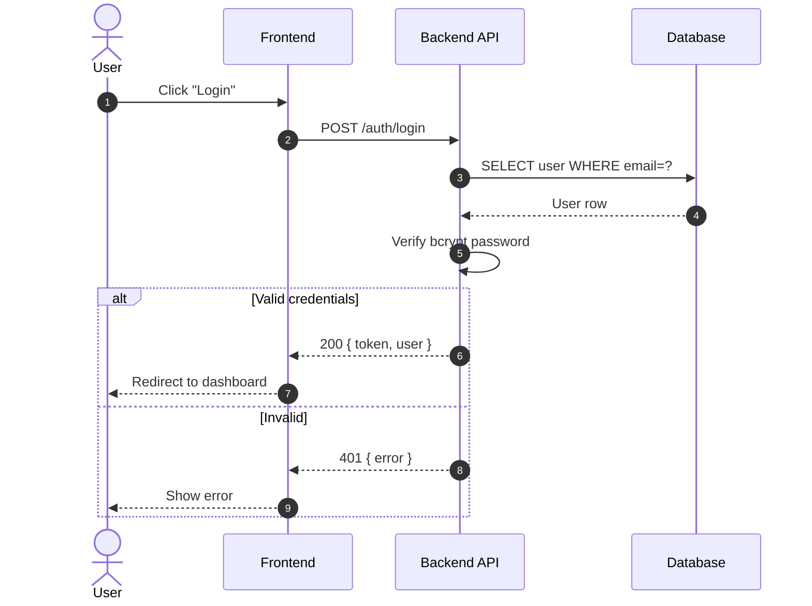
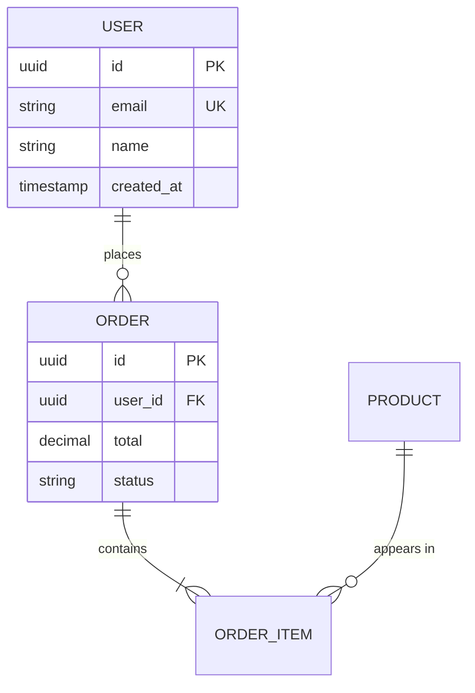
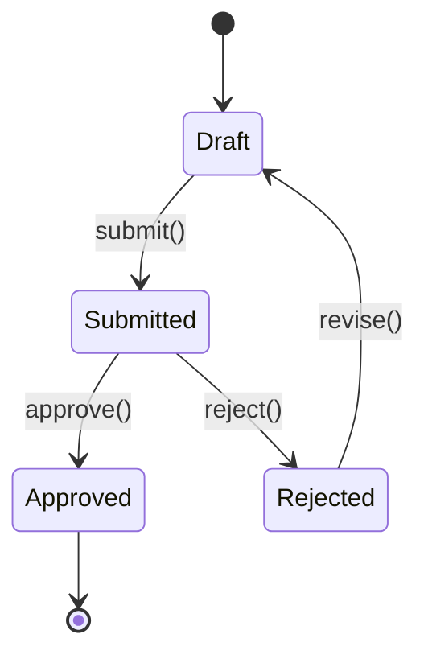
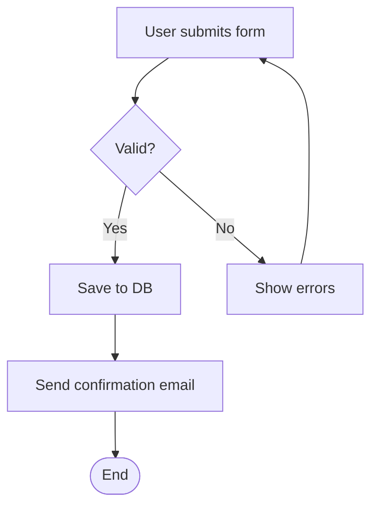

# skill: fsd-writing

Use when writing or reviewing a Functional Specification Document (FSD) that screens are built from.

# เขียน Functional Specification Document (FSD)

> **ภาษา:** ถ้อยคำทุกบรรทัดเขียนตาม [`human-writing`](../human-writing/SKILL.md) — skill นี้บอกรูปแบบและโครง ส่วน human-writing บอกวิธีเขียนให้คนอ่านรู้เรื่อง

> **กฎข้อเดียว:** FSD เสร็จเมื่อ developer เปิดอ่านแล้ว**เขียนโค้ดได้โดยไม่ต้องเดาและไม่ต้องถาม**
> ทุกจุดที่ต้องเดา คือจุดที่จะกลายเป็นงานแก้หลังส่งมอบ

## เมื่อไหร่ใช้ skill นี้

- เขียน FSD หรือ Functional Spec ของฟีเจอร์ โมดูล หรือทั้งระบบ
- แปลง Software Requirements Specification (SRS) หรือ Business Requirements Document (BRD) ให้ละเอียดพอลงมือทำ
- รีวิว FSD ของคนอื่น แล้วต้องบอกให้ได้ว่าขาดอะไร
- developer ถามคำถามเดิมซ้ำ ๆ ระหว่างทำ — แปลว่า FSD ยังไม่ครบ

## เมื่อไหร่ **ไม่** ใช้

| งาน | ใช้ตัวนี้แทน |
|---|---|
| ข้อกำหนดระดับที่ลูกค้าเซ็นรับ | `srs-writing` |
| user story สำหรับ sprint | `user-story-writer` |
| ออกแบบ endpoint ของฟีเจอร์หนึ่ง | command `/api-design` |
| ข้อตกลงกลางของ API ทั้งระบบ | `api-conventions` |
| ตาราง คอลัมน์ ความสัมพันธ์ | `database-design` |
| หน้าตาหน้าจอ ระยะห่าง สถานะ | `ui-craft` + skill แพลตฟอร์ม |
| รูปแบบ markdown และธีมเอกสาร | `polished-document-style` |
| หน้าตาไฟล์ .docx ที่ส่งออก | `branded-document-design` |

## อ่านเพิ่มเมื่อ

| ไฟล์ | เปิดเมื่อ |
|---|---|
| [references/worked-examples.md](references/worked-examples.md) | ถ้าจะเขียน use case หน้าจอ ตารางสถานะ หรือกฎทางธุรกิจตัวแรกของเอกสาร ให้เปิดดูตัวอย่างเต็มแล้วลอกรูปแบบไปใช้ |
| [references/edge-cases.md](references/edge-cases.md) | ตอนเขียนหัวข้อข้อผิดพลาดและกรณีขอบ และตอนรีวิวก่อนส่ง เพื่อไล่ให้ครบทุกกรณี |
| [references/fsd-vs-srs.md](references/fsd-vs-srs.md) | ถ้ายังไม่แน่ใจว่าเนื้อหาชิ้นหนึ่งควรอยู่ใน SRS หรือใน FSD ให้เปิดตารางเทียบนี้ |
| [references/stakeholder-doc-templates.md](references/stakeholder-doc-templates.md) | ถ้าเขียน FSD แบบอ่านง่ายสำหรับผู้มีส่วนได้เสีย (Mode B) หรือต้องการแม่แบบ use case, API endpoint, data model และตัวอย่าง Mermaid |
| [references/figures.md](references/figures.md) | ตอนวางแผนว่าหัวข้อไหนต้องมีรูปชนิดไหน |
| [references/outline-sections.md](references/outline-sections.md) | ถ้าต้องตัดสินว่าหัวข้อไหนข้ามได้ ให้เปิดตารางนี้ ส่วนโครงเต็มที่ลอกไปกรอกได้อยู่ใน [assets/fsd-outline.md](assets/fsd-outline.md) |
| [references/related-skills.md](references/related-skills.md) | ถ้างานต้องใช้ skill อื่นคู่กัน เช่น รูป ข้อตกลง API หรือ test case ให้เปิดดูว่าใช้ตัวไหน |

## 1 · FSD ต่างจาก SRS ยังไง — เส้นแบ่งที่ต้องชัด

เอกสารสองฉบับนี้ปนกันบ่อยที่สุด ผลคือ SRS ยาวจนลูกค้าไม่อ่าน และ FSD ตื้นจน developer ต้องถาม
SRS บอกว่าระบบ**ต้องทำอะไรได้** ส่วน FSD บอกว่าระบบ**ทำสิ่งนั้นอย่างไร** ตารางเทียบทีละมิติอยู่ใน [references/fsd-vs-srs.md](references/fsd-vs-srs.md)

> 🚨 **ห้าม FSD สร้างข้อกำหนดใหม่เอง** — เจออะไรที่ SRS ไม่ได้ครอบคลุม ให้**ลงรายการคำถามค้าง** ใส่ `(รอยืนยัน)` แล้วทำส่วนอื่นต่อ
> ข้อนั้นต้องเพิ่มใน SRS ก่อน ไม่ใช่เขียนลง FSD เงียบ ๆ
> ข้อที่โผล่มาใน FSD โดยไม่มีที่มา คือข้อที่ลูกค้าจะปฏิเสธจ่ายตอนตรวจรับ

## 2 · ลำดับการทำงาน

1. อ่าน SRS หรือ BRD ให้จบก่อน แล้ว**ทำรายการข้อที่ยังคลุมเครือ** ถามรวมครั้งเดียวตอนเริ่มแบบเลือกคำตอบ ทุกตัวเลือกมีหลักฐาน (skill `superuser` หัวข้อ 6) เฉพาะข้อที่ตีความต่างแล้วงานออกมาต่างกันทั้งชุด (ตัวเลือก = การตีความที่เป็นไปได้ อ้างข้อใน SRS/BRD) ที่เหลือใส่ `(รอยืนยัน)` แล้วทำต่อ
2. ยืนยันว่าเอกสารนี้เขียนให้ใครอ่าน — developer อย่างเดียว หรือมีลูกค้าอ่านด้วย
3. ไล่ทีละ use case ไม่ใช่ทีละหน้าจอ — หน้าจอเกิดจาก use case ไม่ใช่ทางกลับกัน
4. เขียนกฎทางธุรกิจแยกออกมาก่อน แล้วค่อยอ้างถึงจากขั้นตอน (ข้อ 7)
5. ทำตารางสอบย้อนกลับไปพร้อมกัน ไม่ใช่ทำตอนจบ
6. รีวิวตามข้อ 11 ก่อนส่ง

## 3 · โครงเอกสาร

มี 11 หัวข้อ เรียงตามนี้: บทนำ · ผู้ใช้และสิทธิ์ · ภาพรวมกระบวนการ · use case · ข้อกำหนดหน้าจอ · ผังสถานะ · กฎทางธุรกิจ · ข้อมูลและการเชื่อมต่อ · ข้อผิดพลาดและกรณีขอบ · ตารางสอบย้อนกลับ · ประวัติการแก้ไข
ข้ามได้แค่ข้อกำหนดหน้าจอถ้าไม่มีหน้าจอ และผังสถานะถ้าไม่มีสถานะ โครงเต็มอยู่ใน **[`assets/fsd-outline.md`](assets/fsd-outline.md)** ส่วนตารางที่บอกว่าแต่ละหัวข้อตอบคำถามอะไรอยู่ใน [references/outline-sections.md](references/outline-sections.md)

## 4 · use case — รูปแบบเดียวทั้งเอกสาร

ทุก use case มีหัวตาราง (มาจาก · ผู้ทำ · เงื่อนไขก่อนเริ่ม · ผลเมื่อสำเร็จ · ความถี่) ตามด้วยตารางขั้นตอนหลัก ทางเลือกอื่น และกรณีผิดพลาด ตัวอย่างเต็ม UC-ORD-010 อยู่ใน [references/worked-examples.md](references/worked-examples.md)

**กฎของ use case:**

- **หนึ่ง use case = หนึ่งเป้าหมายของผู้ใช้** ไม่ใช่หนึ่งหน้าจอ
- ทุก use case ต้องมี **ทางเลือกอื่น** และ **กรณีผิดพลาด** อย่างน้อยอย่างละหนึ่ง —
  use case ที่มีแต่ทางที่ทุกอย่างราบรื่น คือ use case ที่ยังเขียนไม่เสร็จ
- คอลัมน์ "ระบบทำอะไรต่อ" ห้ามว่าง — ถ้าว่างแปลว่ายังไม่ได้คิดว่าระบบตอบสนองยังไง
- **เงื่อนไขก่อนเริ่มต้องตรวจซ้ำที่ฝั่งเซิร์ฟเวอร์เสมอ** การซ่อนปุ่มไม่ใช่การควบคุมสิทธิ์
- เขียนเป็น "ผู้ใช้ทำ → ระบบตอบ" สลับกัน ไม่ใช่เล่าเป็นย่อหน้า

## 5 · ข้อกำหนดหน้าจอ

ตัวอย่างเต็ม SC-ORD-020 พร้อมตารางฟิลด์อยู่ใน [references/worked-examples.md](references/worked-examples.md)

**ทุกหน้าจอต้องระบุครบ 6 อย่าง:**

| ต้องมี | รายละเอียด |
|---|---|
| ตารางฟิลด์ | ชนิด · บังคับไหม · กฎตรวจ · **ข้อความ error ตามจริง** · ค่าเริ่มต้น |
| สิทธิ์ต่อบทบาท | บทบาทไหนเห็น · แก้ได้ · แค่อ่าน · ไม่เห็นเลย |
| ห้าสถานะของหน้าจอ | ว่าง · กำลังโหลด · ผิดพลาด · มีบางส่วน · สำเร็จ (ดู `ui-craft`) |
| การกระทำและผลลัพธ์ | ปุ่มไหนพาไปไหน · ปุ่มไหนเปิดกล่องยืนยัน |
| กฎการแสดงผล | รูปแบบวันที่ · ทศนิยมของเงิน · การปัดเศษ · เขตเวลา |
| ที่มาของข้อมูล | ฟิลด์นี้มาจาก endpoint ไหนหรือตารางไหน |

> **"ข้อความ error ตามจริง" คือคำที่ผู้ใช้จะเห็นจริง ๆ** ไม่ใช่ "แสดงข้อความแจ้งเตือน"
> ถ้าไม่เขียน developer จะแต่งเอง แล้วทั้งระบบจะมีสำนวนคนละแบบสิบแบบ
>
> **กฎการแสดงผลต้องเขียนไว้** — "ยอดรวม" ที่ไม่บอกว่าปัดเศษยังไง
> คือบั๊กที่จะเจอตอนกระทบยอดสิ้นเดือน

## 6 · ผังสถานะ — จุดที่ FSD ลืมบ่อยที่สุด

ของที่มี "สถานะ" (คำสั่งซื้อ ใบลา ตั๋วงาน เอกสาร) ต้องมีตารางที่มีคอลัมน์ จาก · ไป · ใครทำได้ · เงื่อนไข · ผลข้างเคียง และ**ห้ามมีแค่รูป** ตัวอย่างตารางอยู่ใน [references/worked-examples.md](references/worked-examples.md)

**กฎ:**

- **การเปลี่ยนที่ไม่อยู่ในตาราง คือการเปลี่ยนที่ต้องถูกปฏิเสธ** เขียนบรรทัด "ทำไม่ได้" ไว้ให้ชัด
  เพราะสิ่งที่ห้ามทำคือสิ่งที่ทดสอบได้ยากที่สุดถ้าไม่มีใครเขียนไว้
- ทุกสถานะต้องมีทางออก ยกเว้นสถานะปลายทางที่ตั้งใจให้จบ
- ผลข้างเคียงที่เกิดกับระบบอื่น (อีเมล สต็อก บัญชี) ต้องอยู่ในตารางนี้ ไม่ใช่ซ่อนอยู่ในขั้นตอน

## 7 · กฎทางธุรกิจแยกออกมาจากขั้นตอน

กฎแต่ละข้อมีรหัส ชื่อ เนื้อกฎ และที่มา ตัวอย่าง BR-030 อยู่ใน [references/worked-examples.md](references/worked-examples.md)

- **กฎหนึ่งข้อเขียนที่เดียว** แล้วอ้างด้วยรหัสจากทุกที่ที่ใช้ — ถ้าลอกไปวางสามที่ สักวันจะแก้ไม่ครบ
- ทุกกฎต้องมี**ที่มา** กฎที่ไม่มีที่มาคือกฎที่ทีมคิดเอง
- กฎที่เปลี่ยนตามเวลา (อัตราภาษี ค่าธรรมเนียม) ต้องระบุว่า**เก็บไว้ที่ไหน** —
  ในโค้ด ในตารางตั้งค่า หรือให้ผู้ดูแลระบบแก้ได้เอง

## 8 · ข้อผิดพลาดและกรณีขอบที่ต้องตอบให้ครบ

ตารางกรณีขอบคือสิ่งที่ทีมทดสอบจะใช้ และคือสิ่งที่ FSD ส่วนใหญ่ขาด ตั้งแต่ไม่มีข้อมูล กดปุ่มรัว ๆ สองคนแก้พร้อมกัน ไปจนถึงสิทธิ์ไม่พอ ให้ไล่ทุกแถวใน [references/edge-cases.md](references/edge-cases.md) แล้วตอบทุกแถวที่เกี่ยวกับฟีเจอร์

## 9 · รหัสและการสอบย้อนกลับ

```
UC-<โมดูล>-<เลข 3 หลัก>      use case              UC-ORD-010
SC-<โมดูล>-<เลข 3 หลัก>      ข้อกำหนดหน้าจอ         SC-ORD-020
BR-<เลข 3 หลัก>              กฎทางธุรกิจ            BR-030
```

ใช้ระบบเดียวกับ `srs-writing` — **เว้นเลขทีละ 10** และ **รหัสที่ออกไปแล้วห้ามใช้ซ้ำ**

| SRS | FSD | หน้าจอ | test case | สถานะ |
|---|---|---|---|---|
| FR-ORD-040 | UC-ORD-010 | SC-ORD-020 | TC-ORD-010..014 | ทำแล้ว |
| FR-ORD-040 | UC-ORD-010 · 010-E1 | SC-ORD-020 | TC-ORD-015 | ทำแล้ว |

- **ทุก use case ต้องชี้กลับไปที่ข้อกำหนดใน SRS ได้** — ถ้าชี้ไม่ได้ แปลว่ามีของแถมที่ไม่มีใครสั่ง
- **ทุกข้อกำหนดใน SRS ต้องมี use case อย่างน้อยหนึ่งตัว** — ถ้าไม่มี แปลว่าลืมทำ
- ทางเลือกอื่นและกรณีผิดพลาดต้องมี test case ของตัวเอง ห้ามนับรวมกับทางหลัก

## 10 · รูปในเอกสาร

ตารางว่าหัวข้อไหนควรมีรูปชนิดไหนอยู่ใน [references/figures.md](references/figures.md) ข้อที่ต้องจำคือ state diagram ใช้**คู่กับตาราง ไม่ใช่แทนตาราง**

เลือกเครื่องมือตามปลายทางของเอกสาร: ถ้าเป็น markdown ใช้ `software-diagrams` (Mermaid)
ไฟล์ที่ลูกค้าเซ็นรับใช้ `diagram-figures` ส่วนภาพร่างหน้าจอใช้ `markdown-visuals`
**ทุกรูปในฉบับเดียวใช้ธีมสีชุดเดียวกัน** ตาม `doc-theme` (ดู `polished-document-style`)

## 11 · รีวิวความครบถ้วนก่อนส่ง

**ความครบ**

- [ ] ทุกข้อกำหนดใน SRS มี use case อย่างน้อยหนึ่งตัว
- [ ] ทุก use case มีทางเลือกอื่นและกรณีผิดพลาดอย่างน้อยอย่างละหนึ่ง
- [ ] ทุกหน้าจอมีตารางฟิลด์ครบ 5 คอลัมน์ และห้าสถานะ
- [ ] ทุกของที่มีสถานะ มีตารางการเปลี่ยนสถานะ รวมบรรทัดที่ "ทำไม่ได้"
- [ ] ตอบตารางกรณีขอบในข้อ 8 ครบทุกแถวที่เกี่ยวข้อง

**ความชัด**

- [ ] ไม่มีคำว่า "ตามความเหมาะสม" "โดยอัตโนมัติ" "ที่จำเป็น" โดยไม่บอกว่าคืออะไร
- [ ] ข้อความ error ทุกอันเขียนเป็นคำจริง ไม่ใช่ "แสดงข้อความแจ้งเตือน"
- [ ] ตัวเลขทุกตัวมีหน่วย และมีที่มา
- [ ] ชื่อฟิลด์ ชื่อสถานะ ชื่อ endpoint ใช้ภาษาอังกฤษตรงกับที่จะใช้ในโค้ดจริง

**ความสอดคล้อง**

- [ ] คำเดียวกันหมายถึงของเดียวกันทั้งเล่ม (มีอภิธานศัพท์)
- [ ] ชื่อสถานะในผัง ในตาราง และใน use case ตรงกันหมด
- [ ] ไม่มีข้อกำหนดใหม่ที่ไม่มีใน SRS

> **ทดสอบขั้นสุดท้าย:** ให้ developer ที่ไม่ได้อยู่ในที่ประชุมอ่านหนึ่งคน
> ทุกคำถามที่เขาถาม คือหนึ่งช่องว่างที่ต้องเติมก่อนส่ง

## 12 · Anti-patterns

- ❌ **คัดลอก SRS มาแล้วเติมคำว่า "ระบบจะ"** — ได้เอกสารสองฉบับที่พูดเรื่องเดียวกัน
- ❌ **use case ที่มีแต่ทางที่ราบรื่น** — ทางที่พังคือสิ่งที่ FSD มีไว้เพื่อบอก
- ❌ **"แสดงข้อความแจ้งเตือน"** โดยไม่บอกว่าข้อความว่าอะไร
- ❌ **"ระบบจะคำนวณโดยอัตโนมัติ"** โดยไม่บอกสูตรและการปัดเศษ
- ❌ **ผังสถานะเป็นรูปอย่างเดียว** — รูปบอกไม่ได้ว่าใครมีสิทธิ์และมีผลข้างเคียงอะไร
- ❌ **คุมสิทธิ์ด้วยการซ่อนปุ่ม** โดยไม่ระบุการตรวจฝั่งเซิร์ฟเวอร์
- ❌ **กฎทางธุรกิจกระจายอยู่ในขั้นตอน** — พอแก้ทีหลังก็ตกหล่น
- ❌ **หน้าจอที่ไม่บอกว่าข้อมูลมาจากไหน** — developer จะเดา endpoint เอง
- ❌ **เอา wireframe มาแทนข้อกำหนด** — รูปบอกไม่ได้ว่าอะไรบังคับ กฎตรวจคืออะไร
- ❌ **ไม่มีตารางสอบย้อนกลับ** — แล้วไม่มีใครรู้ว่าทำครบหรือยัง

## 13 · ตัวย่อ

- **FSD** — Functional Specification Document (เอกสารข้อกำหนดเชิงหน้าที่ ระดับที่ลงมือทำได้)
- **SRS** — Software Requirements Specification (เอกสารข้อกำหนดซอฟต์แวร์ ระดับที่ลูกค้าเซ็นรับ)
- **BRD** — Business Requirements Document (เอกสารความต้องการทางธุรกิจ)
- **use case** — กรณีการใช้งาน หนึ่งเป้าหมายของผู้ใช้ตั้งแต่เริ่มจนจบ
- **state machine** — ผังสถานะ บอกว่าของชิ้นหนึ่งเปลี่ยนจากสถานะไหนไปสถานะไหนได้บ้าง
- **ETag** — Entity Tag (รหัสระบุรุ่นของข้อมูล ใช้ตรวจว่ามีคนแก้ไปก่อนไหม)


## reference: edge-cases.md

# ข้อผิดพลาดและกรณีขอบที่ต้องตอบให้ครบ

ทีมทดสอบจะใช้ตารางนี้ และเป็นส่วนที่ FSD ส่วนใหญ่ขาด ให้ไล่ทุกแถวที่เกี่ยวกับฟีเจอร์ แล้วเขียนคำตอบลงหัวข้อ 9 ของเอกสาร

| กรณี | คำถามที่ต้องตอบ |
|---|---|
| ไม่มีข้อมูล | หน้าจอว่างเปล่าแสดงอะไร มีปุ่มพาไปทำอะไรต่อไหม |
| ข้อมูลเยอะมาก | กี่รายการต่อหน้า · เรียงยังไง · ค้นหาได้ไหม |
| กดปุ่มรัว ๆ | กันงานซ้ำยังไง (ดู idempotency key ใน `api-conventions`) |
| สองคนแก้พร้อมกัน | ใครชนะ · อีกคนเห็นอะไร (ดู ETag ใน `api-conventions`) |
| เน็ตหลุดกลางทาง | ข้อมูลที่กรอกหายไหม · ลองใหม่แล้วซ้ำไหม |
| หมดเวลา session | เด้งออกทันที หรือเก็บสิ่งที่กรอกไว้ |
| ค่าที่ขอบเขต | 0 · ค่าติดลบ · วันนี้ · วันสุดท้ายของเดือน · ปีอธิกสุรทิน |
| ข้อความยาวผิดปกติ | ชื่อ 200 ตัวอักษรทำให้เลย์เอาต์พังไหม |
| ภาษาไทยและอักขระพิเศษ | เรียงลำดับถูกไหม · ค้นหาเจอไหม · อีโมจิพังไหม |
| ระบบภายนอกไม่ตอบ | รอกี่วินาที · ลองใหม่กี่ครั้ง · ผู้ใช้เห็นอะไรระหว่างนั้น |
| สิทธิ์ไม่พอ | เห็นแต่กดไม่ได้ หรือไม่เห็นเลย — **ต้องเลือกให้ชัด** |


## reference: figures.md

# รูปในเอกสาร FSD

ตารางนี้บอกว่าหัวข้อไหนของ FSD ควรมีรูปชนิดไหน ส่วนเครื่องมือที่ใช้วาดและเรื่องธีมสีอยู่ใน `SKILL.md` ข้อ 10

| หัวข้อ | รูปที่ควรมี |
|---|---|
| 3 ภาพรวมกระบวนการ | ผังขั้นตอนงานตั้งแต่ต้นจนจบ |
| 4 use case ที่มีหลายฝ่าย | sequence diagram |
| 5 หน้าจอ | ภาพร่างหน้าจอ พร้อมหมายเลขชี้ไปที่ตารางฟิลด์ |
| 6 สถานะ | state diagram — **คู่กับตาราง ไม่ใช่แทนตาราง** |
| 8 ข้อมูล | ER diagram เฉพาะตารางที่เกี่ยวกับโมดูลนี้ |


## reference: fsd-vs-srs.md

# FSD ต่างจาก SRS ยังไง

ตารางเทียบเอกสารสองฉบับทีละมิติ ใช้ตอนต้องตัดสินว่าเนื้อหาชิ้นหนึ่งควรอยู่ใน SRS หรือใน FSD

| | SRS | FSD |
|---|---|---|
| ตอบคำถาม | ระบบ**ต้องทำอะไรได้** | ระบบ**ทำสิ่งนั้นอย่างไร** |
| คนอ่านหลัก | ลูกค้า · ผู้บริหาร · คนเซ็นรับ | developer · tester · ux |
| ระดับรายละเอียด | "ระบบต้องให้ผู้ใช้ยกเลิกคำสั่งซื้อได้" | ปุ่มอยู่ตรงไหน · ยกเลิกได้ในสถานะไหนบ้าง · ใครมีสิทธิ์ · ยืนยันด้วยอะไร · ข้อความตอนทำไม่ได้ว่าอะไร · ระบบทำอะไรต่อ |
| เปลี่ยนแปลง | ต้องผ่านการอนุมัติ มีผลต่อสัญญา | เปลี่ยนได้ในทีม ตราบใดที่ยังตอบ SRS ข้อเดิม |
| หน่วยเนื้อหา | ข้อกำหนด (`FR-…`) | use case (`UC-…`) + ข้อกำหนดหน้าจอ (`SC-…`) |
| ตัวเลข | มาจากลูกค้า | มาจาก SRS ห้ามคิดใหม่ |


## reference: outline-sections.md

# หัวข้อของ FSD และข้ามได้เมื่อไหร่

ตารางนี้สรุปว่าแต่ละหัวข้อของ FSD ตอบคำถามอะไร ส่วนโครงเต็มที่มีคำใบ้ให้กรอกอยู่ใน [`../assets/fsd-outline.md`](../assets/fsd-outline.md)

| # | หัวข้อ | ตอบคำถามว่า | ข้ามได้ไหม |
|---|---|---|---|
| 1 | บทนำ · ขอบเขต · เอกสารอ้างอิง | ฉบับนี้ครอบคลุมส่วนไหน อ้างอิง SRS ข้อไหน | ไม่ได้ |
| 2 | ผู้ใช้และสิทธิ์ | ใครทำอะไรได้บ้าง | ไม่ได้ |
| 3 | ภาพรวมกระบวนการ | งานไหลจากต้นจนจบยังไง | ไม่ได้ |
| 4 | use case รายตัว | แต่ละงานทำทีละขั้นยังไง | ไม่ได้ |
| 5 | ข้อกำหนดหน้าจอ | หน้าจอมีอะไร ฟิลด์ตรวจอะไร | ข้ามได้ถ้าไม่มีหน้าจอ |
| 6 | ผังสถานะ | ของชิ้นนี้เปลี่ยนสถานะไปไหนได้บ้าง | ข้ามได้ถ้าไม่มีสถานะ |
| 7 | กฎทางธุรกิจ | กฎอะไรบังคับอยู่ | ไม่ได้ |
| 8 | ข้อมูลและการเชื่อมต่อ | ใช้ข้อมูลอะไร ต่อกับระบบไหน | ไม่ได้ |
| 9 | ข้อผิดพลาดและกรณีขอบ | พังแบบไหนได้บ้าง แล้วผู้ใช้เห็นอะไร | ไม่ได้ |
| 10 | ตารางสอบย้อนกลับ | ข้อนี้มาจาก SRS ข้อไหน ทดสอบด้วยอะไร | ไม่ได้ |
| 11 | ประวัติการแก้ไข | ใครแก้อะไรเมื่อไหร่ | ไม่ได้ |


## reference: related-skills.md

# เชื่อมกับ skill อื่น

ถ้างานที่ทำอยู่ต้องใช้ความรู้นอกเหนือจาก FSD ให้เปิด skill ในคอลัมน์ขวาคู่กัน

| ต้องการ | ใช้คู่กับ |
|---|---|
| ระดับข้อกำหนดที่ลูกค้าเซ็นรับ | `srs-writing` |
| รูปแบบ markdown และธีมสีของเอกสาร | `polished-document-style` |
| หน้าตาไฟล์ .docx ที่ส่งออก | `branded-document-design` |
| รูปในเอกสาร | `software-diagrams` · `diagram-figures` · `markdown-visuals` |
| ข้อตกลงของ API ที่ FSD อ้างถึง | `api-conventions` |
| แบบจำลองข้อมูลที่ FSD อ้างถึง | `database-design` |
| ห้าสถานะของหน้าจอ และกฎงานออกแบบ | `ui-craft` + skill แพลตฟอร์ม |
| แปลง use case เป็น test case | `test-case-template` |
| แตกเป็น user story ตอนเริ่ม sprint | `user-story-writer` |
| ตัดสิ่งที่ไม่จำเป็นออกจากเอกสาร | `simplicity-first` |

**โครงเอกสารที่คัดลอกไปกรอกต่อได้ทันที** → [`../assets/fsd-outline.md`](../assets/fsd-outline.md)


## reference: stakeholder-doc-templates.md

# Stakeholder document (Mode B) — style, diagrams, templates

Moved from the system-analyst agent. Read when writing a Mode B document or a use case, API endpoint or data model section.

This is the "beautiful design" mode. Use Rich Markdown + Mermaid.

## Document Structure

Every stakeholder doc MUST follow this structure:

```markdown
# 📋 <Document Title>

> **Version:** 1.0 · **Date:** YYYY-MM-DD · **Status:** Draft | Review | Approved
> **Authors:** ... · **Reviewers:** ...

---

## 📑 Table of Contents

1. [Executive Summary](#executive-summary)
2. [Scope](#scope)
3. [Actors & Personas](#actors--personas)
4. [Use Cases](#use-cases)
5. [System Flows](#system-flows)
6. [API Specifications](#api-specifications)
7. [Data Model](#data-model)
8. [Business Rules](#business-rules)
9. [Non-Functional Requirements](#non-functional-requirements)
10. [Glossary](#glossary)

---

## 1. Executive Summary

> 💡 **For non-technical readers** — 1 paragraph explaining what this feature does and why.

<content>

---

## 2. Scope

### ✅ In Scope
- ...

### ❌ Out of Scope
- ...

[... continue all sections ...]
```

## Formatting Rules

### Hierarchy & Numbering
- H1 = document title (only ONE)
- H2 = numbered sections (1., 2., 3.)
- H3 = sub-sections (1.1, 1.2)
- Always add TOC for docs with 5+ sections
- Use anchor links in TOC

### Visual Markers (Emoji)

Use emoji **purposefully**, not decoratively:

| Marker | Meaning |
|--------|---------|
| 📋 | Document/list |
| 📑 | TOC/index |
| 💡 | Tip/insight |
| ⚠️ | Warning/caution |
| 🚨 | Critical |
| ✅ | Yes/approved/in scope |
| ❌ | No/rejected/out of scope |
| 🟢 🟡 🔴 | Status indicators |
| 🔒 | Security |
| ⚡ | Performance |
| 🎯 | Goal/objective |
| 👤 | Actor/user |
| 🔄 | Flow/process |
| 📊 | Data |
| 🌐 | API/integration |

### Callout Boxes (Blockquotes)

```markdown
> 💡 **Tip:** Brief insight here.

> ⚠️ **Warning:** Important caveat.

> 🚨 **Critical:** Must read before proceeding.

> 📝 **Note:** Additional context.
```

### Tables

Prefer tables over bullet lists when data has 2+ attributes:

```markdown
| Field | Type | Required | Description |
|-------|------|----------|-------------|
| email | string | ✅ | User's email |
| age | number | ❌ | Optional |
```

Align headers to data when helpful:
```markdown
| Field | Type | Required |
|:------|:-----|:--------:|
```

### Status Badges (in tables/inline)

```markdown
**Status:** 🟢 Approved
**Priority:** 🔴 High
**Risk:** 🟡 Medium
```

---

# 🔷 Mermaid Diagrams

Use Mermaid for ALL diagrams. They render in GitHub/Notion/VSCode.

## When to use which diagram

| Diagram | Use for |
|---------|---------|
| `flowchart` | Business processes, decision trees |
| `sequenceDiagram` | Interactions between systems/actors over time |
| `erDiagram` | Database/data models |
| `stateDiagram-v2` | Object lifecycle, status transitions |
| `classDiagram` | Object-oriented design |
| `gantt` | Timeline/schedule |
| `journey` | User experience journey |
| `mindmap` | Concept relationships |

## Example: Sequence Diagram

````markdown

````

## Example: ER Diagram

````markdown

````

## Example: State Diagram

````markdown

````

## Example: Flowchart

````markdown

````

---

# 📋 Templates

## Use Case Template (Mode B)

```markdown
### UC-001: <Use Case Name>

| Field | Value |
|-------|-------|
| **ID** | UC-001 |
| **Actor** | 👤 Customer |
| **Priority** | 🔴 High |
| **Status** | 🟢 Approved |
| **Trigger** | User clicks "Place Order" |

#### Preconditions
- ✅ User is authenticated
- ✅ Cart contains at least 1 item

#### Postconditions
- ✅ Order created with status `pending`
- ✅ Inventory reserved
- ✅ Confirmation email sent

#### Main Flow

| Step | Actor | Action | System Response |
|:----:|:------|:-------|:----------------|
| 1 | User | Reviews cart and clicks "Place Order" | Shows order summary |
| 2 | User | Confirms payment method | Validates payment info |
| 3 | System | Submits payment to gateway | Receives auth code |
| 4 | System | Creates order record | Returns order #ORD-XXXX |
| 5 | System | Sends confirmation email | — |
| 6 | User | Sees confirmation page | — |

#### Alternative Flows

> **A1: Payment declined at step 3**
> 3a. Gateway returns decline
> 3b. System shows error, suggests alternate payment
> 3c. Returns to step 2

#### Exception Flows

> **E1: Gateway timeout at step 3**
> 3a. System waits 30s
> 3b. Logs incident, marks order as `payment_pending`
> 3c. Sends "We'll retry" email to user

#### Sequence Diagram

\`\`\`mermaid
sequenceDiagram
    actor U as Customer
    participant UI
    participant API
    participant Pay as Payment Gateway
    participant DB

    U->>UI: Click "Place Order"
    UI->>API: POST /orders
    API->>Pay: Charge
    Pay-->>API: Auth code
    API->>DB: INSERT order
    DB-->>API: Order ID
    API-->>UI: 201 Created
    UI-->>U: Confirmation page
\`\`\`
```

## API Endpoint Template (Mode B)

```markdown
### 🌐 POST `/api/v1/orders`

> Create a new order from cart contents.

| Attribute | Value |
|-----------|-------|
| **Auth Required** | ✅ Yes (Bearer token) |
| **Rate Limit** | 10 req/min per user |
| **Idempotent** | ✅ Yes (use `Idempotency-Key` header) |

#### Request Headers

| Header | Required | Example |
|--------|:--------:|---------|
| `Authorization` | ✅ | `Bearer eyJ...` |
| `Idempotency-Key` | ⚠️ Recommended | `unique-request-id` |
| `Content-Type` | ✅ | `application/json` |

#### Request Body

\`\`\`json
{
  "items": [
    { "product_id": "uuid", "quantity": 2 }
  ],
  "shipping_address_id": "uuid",
  "payment_method_id": "uuid"
}
\`\`\`

#### Response: 201 Created

\`\`\`json
{
  "data": {
    "id": "ORD-12345",
    "status": "pending",
    "total": 1250.00,
    "created_at": "2025-01-15T10:30:00Z"
  }
}
\`\`\`

#### Error Responses

Every error body is `application/problem+json` (RFC 9457): `type` · `title` · `status` · `detail` · `requestId`, plus `errors[]` for validation. Shape and status rules: `web-service-essentials` §2.

| Code | When | `type` (suffix) |
|:----:|:-----|:-----|
| 🔴 401 | Missing/invalid token | `unauthorized` |
| 🟡 402 | Payment declined | `payment-declined` |
| 🟡 409 | Inventory unavailable | `out-of-stock` |
| 🔴 422 | Validation failed | `validation` + `errors[]` (`field` · `code` · `message`) |
| 🔴 429 | Rate limit exceeded | `rate-limited` + `Retry-After` header |
```

## Data Model Template (Mode B)

```markdown
## 📊 Data Model

### Entity Relationship Diagram

\`\`\`mermaid
erDiagram
    USER ||--o{ ORDER : places
    ORDER ||--|{ ORDER_ITEM : contains
\`\`\`

### Tables

#### `users`

| Column | Type | Constraints | Description |
|--------|------|-------------|-------------|
| `id` | UUID | PK | Unique identifier |
| `email` | VARCHAR(255) | UNIQUE, NOT NULL | Login email |
| `created_at` | TIMESTAMP | NOT NULL, DEFAULT NOW() | Account creation |

> 🔒 **Security:** `email` is encrypted at rest using AES-256.
```

---


## reference: worked-examples.md

# ตัวอย่างเต็มของ use case หน้าจอ ผังสถานะ และกฎทางธุรกิจ

ตัวอย่างทั้งไฟล์ใช้เรื่องเดียวกัน คือการยกเลิกคำสั่งซื้อ ลอกรูปแบบไปใช้ได้ทันที ส่วนกฎของแต่ละแบบอยู่ใน `SKILL.md`

## use case (ข้อ 4)

```markdown
### UC-ORD-010 · ยกเลิกคำสั่งซื้อ

| | |
|---|---|
| **มาจาก** | FR-ORD-040 |
| **ผู้ทำ** | ลูกค้า · เจ้าหน้าที่ฝ่ายขาย |
| **เงื่อนไขก่อนเริ่ม** | เข้าสู่ระบบแล้ว · คำสั่งซื้ออยู่ในสถานะ `confirmed` |
| **ผลเมื่อสำเร็จ** | คำสั่งซื้อเป็น `cancelled` · คืนจำนวนสินค้าเข้าคลัง · ส่งอีเมลแจ้ง |
| **ความถี่** | ประมาณ 30 ครั้งต่อวัน |

**ขั้นตอนหลัก**

| # | ผู้ทำ | การกระทำ | ระบบทำอะไรต่อ |
|:--:|---|---|---|
| 1 | ลูกค้า | เปิดหน้ารายละเอียดคำสั่งซื้อ | แสดงปุ่ม "ยกเลิก" เฉพาะเมื่อ BR-030 ผ่าน |
| 2 | ลูกค้า | กด "ยกเลิก" | เปิดกล่องยืนยัน พร้อมช่องเหตุผล (บังคับ) |
| 3 | ลูกค้า | เลือกเหตุผล แล้วกดยืนยัน | ตรวจ BR-030 อีกครั้งที่ฝั่งเซิร์ฟเวอร์ |
| 4 | ระบบ | — | เปลี่ยนสถานะ · คืนสต็อก · บันทึกผู้ทำและเวลา · ส่งอีเมล |
| 5 | ระบบ | — | แสดงข้อความสำเร็จ และปุ่มยกเลิกหายไป |

**ทางเลือกอื่น**

| รหัส | แยกที่ขั้น | เงื่อนไข | ผลลัพธ์ |
|---|:--:|---|---|
| 010-A1 | 3 | ผู้ทำเป็นเจ้าหน้าที่ | ข้ามช่องเหตุผล แต่บังคับกรอกหมายเหตุภายใน |

**กรณีผิดพลาด**

| รหัส | เกิดที่ขั้น | สาเหตุ | ผู้ใช้เห็นอะไร | ระบบทำอะไร |
|---|:--:|---|---|---|
| 010-E1 | 3 | มีคนเปลี่ยนสถานะไปก่อนแล้ว | "คำสั่งซื้อนี้ถูกจัดส่งแล้ว ยกเลิกไม่ได้" | ไม่เปลี่ยนอะไร · โหลดหน้าใหม่ |
| 010-E2 | 4 | คืนสต็อกไม่สำเร็จ | "ระบบขัดข้อง กรุณาลองใหม่" + รหัสอ้างอิง | ย้อนกลับทั้งรายการ · บันทึก log ระดับ error |
```

## ข้อกำหนดหน้าจอ (ข้อ 5)

```markdown
### SC-ORD-020 · หน้ารายละเอียดคำสั่งซื้อ

**เส้นทาง:** `/orders/{id}` · **ใช้ใน:** UC-ORD-010, UC-ORD-020

| ฟิลด์ | ชนิด | บังคับ | กฎตรวจ | ข้อความเมื่อไม่ผ่าน | ค่าเริ่มต้น |
|---|---|:--:|---|---|---|
| เหตุผลที่ยกเลิก | เลือกจากรายการ | ✅ | ต้องเป็นค่าในรายการ BR-031 | "กรุณาเลือกเหตุผล" | — |
| หมายเหตุ | ข้อความยาว | ❌ | ไม่เกิน 500 ตัวอักษร | "หมายเหตุยาวเกิน 500 ตัวอักษร" | ว่าง |
| วันที่ต้องการรับ | วันที่ | ✅ | ไม่ก่อนวันนี้ · ไม่เกิน 90 วัน | "เลือกวันที่ตั้งแต่วันนี้ถึง <วันที่>" | วันนี้ + 3 |
```

## ตารางการเปลี่ยนสถานะ (ข้อ 6)

| จาก | ไป | ใครทำได้ | เงื่อนไข | ผลข้างเคียง |
|---|---|---|---|---|
| `draft` | `confirmed` | ลูกค้า | มีสินค้าอย่างน้อย 1 รายการ · ที่อยู่ครบ | ตัดสต็อก · ส่งอีเมล |
| `confirmed` | `cancelled` | ลูกค้า · เจ้าหน้าที่ | BR-030 | คืนสต็อก · ส่งอีเมล |
| `confirmed` | `shipped` | เจ้าหน้าที่คลัง | มีเลขพัสดุ | ส่ง SMS |
| `shipped` | `cancelled` | — | **ทำไม่ได้** | — |

## กฎทางธุรกิจ (ข้อ 7)

```markdown
**BR-030 · ยกเลิกคำสั่งซื้อได้เมื่อไหร่**
ยกเลิกได้เมื่อสถานะเป็น `confirmed` และยังไม่เกิน 24 ชั่วโมงนับจากเวลายืนยัน
เจ้าหน้าที่ระดับหัวหน้าขึ้นไปยกเลิกได้โดยไม่จำกัดเวลา แต่ต้องกรอกหมายเหตุ
**ที่มา:** นโยบายคืนเงิน ฉบับ 2026-03 ข้อ 4.2
```


---

# skill: simplicity-first

Use when producing a document, design, architecture or plan (BRD, FSD, ADR, roadmap). Simplest that works.

# Simplicity First

> The best architecture has the fewest moving parts. The best plan is the one a
> teammate can follow with no context.

This skill covers **non-code outputs** — documents, plans, architecture, and
designs. For code, use `lazy-coding`.

## Check before submitting — 5 items

1. **A tired teammate gets it** in 6 months with no prior context.
2. **Simplest thing that works** — fewest moving parts, boring proven patterns; add complexity only when something breaks.
3. **Every new component, option or layer has evidence it is needed now**, and leaving it out would cost something real.
4. **Nothing can be deleted without losing meaning** — deleting beats adding.
5. **Reads in one pass** — no jargon the audience lacks, an example for every abstract claim, the whole thing fits in two sentences.

Any "no" or "not sure" → simplify before delivering.

## By output type

### Documents (BRD, FSD, ADR)

Do: short sentences (≤ 20 words), plain English, one idea per paragraph, an
example for every abstract point, tables for structured data.

Avoid: marketing-speak ("revolutionary", "best-in-class", "synergy"), undefined
jargon, walls of text, hedging ("might possibly potentially"), acronym soup.

### Architecture

Do: monolith first (split only when a bottleneck is proven), familiar stack,
standard patterns (REST, queues, caches), single source of truth per data type.

Avoid: microservices for small teams, distributed-everything, multi-master
databases before you must, event-driven by default (sync is simpler).

### Plans

Do: 3-5 priorities (not 20), a named owner per item, measurable success
criteria, realistic timelines with buffer, cut scope to fit time.

Avoid: vague goals ("improve quality"), 50-item lists (= no priority),
aspirational dates with no buffer, plans without success metrics.

### Designs (UX, API)

Do: fewest steps to the user's goal, reuse existing patterns, stay consistent
across screens, defaults that work for 80%, progressive disclosure.

Avoid: novel interactions where a standard one works, 10-step flows when 3
work, required fields with no smart default, hidden features needing tutorials.

## Examples

**API description**

❌ "This sophisticated, enterprise-grade endpoint leverages state-of-the-art
authentication to facilitate the seamless retrieval of user profile data."

✅ "`GET /users/{id}` returns a user profile. Requires a Bearer token. Use
`?fields=name,email` to limit the response."

**Sprint goal**

❌ "Improve overall product quality and customer satisfaction through various
initiatives."

✅ "Reduce login errors by 50% (8% → 4%): fix timeout bug (2d), retry on
transient errors (1d), clearer error messages (1d)."

**Architecture for a new feature**

❌ "Event-sourced microservice with CQRS, Kafka ingestion, Redis cache, and a
dedicated auth service."

✅ "Add an endpoint to the existing API. One Postgres table for state. Standard
auth middleware. Log to the existing system."

## Anti-patterns to reject

- **Future-proofing** — abstractions for needs that never arrive.
- **"It might scale"** — infra for 1M users while you have 1k.
- **Layer cake** — 6 layers where 90% just pass through.
- **Resume-driven design** — fancy tech to look sophisticated.
- **Buzzword stacking** — "cloud-native event-driven AI-powered".


---

# skill: stack-dotnet

Use when writing, reviewing or fixing C# and .NET (ASP.NET Core, MVC 5, EF Core).

# stack-dotnet — เขียน C# ให้ build สะอาด test ผ่าน ไม่มีกับดักเดิม

ใช้เมื่องานแตะโค้ด C# ทุกแบบ: ASP.NET Core (Web API · MVC · minimal API) · Entity Framework (EF) Core · ASP.NET MVC 5 บน .NET Framework 4.x ที่ยังดูแลอยู่

ไฟล์นี้มีแค่เรื่องเฉพาะ .NET ส่วนหลักทั่วไปอยู่ที่ `lazy-coding` · `readable-code` · `testing-standards` · `logging-standards` · `error-handling-patterns` · `database-design` · `principle-secure-by-default`

---

## 1 · เริ่มงาน: อ่านเวอร์ชันก่อน แล้วรันคำสั่งชุดเดียวกันทุกครั้ง

- เวอร์ชัน SDK ดูที่ `global.json` ส่วนเวอร์ชันที่ target ดูที่ `<TargetFramework>` ใน `*.csproj` หรือ `Directory.Build.props`
- เวอร์ชัน (ตรวจล่าสุด 2026-10-14 · แหล่ง: https://dotnet.microsoft.com/platform/support/policy/dotnet-core): `net10.0` คือ Long Term Support (LTS) ล่าสุด รองรับถึง 2028-11-14 · `net8.0` (LTS) และ `net9.0` (Standard Term Support, STS) อยู่ช่วงท้าย รองรับถึง 2026-11-10 · ถ้าเจอ 2 ตัวนี้ให้แจ้งเจ้าของ ไม่อัปเกรดเองกลางงาน · ก่อนใช้ให้ตรวจหน้านี้ซ้ำ
- ถ้าเจอ `net48` หรือ `v4.x` ใน `<TargetFrameworkVersion>` แปลว่าเป็น .NET Framework ให้ใช้ชุดคำสั่ง legacy ด้านล่าง

| ขั้น | .NET (Core) 8+ | .NET Framework 4.x (Windows) |
|---|---|---|
| ดึงแพ็กเกจ | `dotnet restore` | `msbuild App.sln -t:restore` หรือ `nuget restore App.sln` |
| build | `dotnet build -warnaserror` (หรือตามนโยบาย repo) | `msbuild App.sln -p:Configuration=Release` |
| test ทั้งหมด | `dotnet test` | `vstest.console.exe Tests\bin\Release\App.Tests.dll` |
| จัดรูปแบบ | `dotnet format --verify-no-changes` | ตาม `.editorconfig` ใน Visual Studio |

รัน test ตัวเดียว:

```bash
dotnet test --filter "FullyQualifiedName~OrderServiceTests.Cancel"   # VSTest (ค่าเริ่ม)
dotnet test --filter-method "*Cancel_*"                               # xUnit v3 บน Microsoft Testing Platform (MTP)
vstest.console.exe App.Tests.dll /TestCaseFilter:"FullyQualifiedName~Cancel"   # .NET Framework
```

- ถ้า repo ตั้ง MTP ไว้ใน `global.json` (`"test": { "runner": "Microsoft.Testing.Platform" }`) ให้ใช้ `--filter-*` แบบบรรทัดที่ 2
- `msbuild` และ `vstest.console.exe` อยู่ใน Visual Studio หรือ Build Tools ให้เปิดผ่าน Developer PowerShell ส่วนเครื่อง Linux build .NET Framework web project ไม่ได้ จึงต้องบอกตรง ๆ ว่ายังไม่ได้ build

## 2 · โครงและแบบแผน

ตั้งค่าครั้งเดียวที่ `Directory.Build.props` ให้ทุกโปรเจกต์ใน solution:

```xml
<PropertyGroup>
  <Nullable>enable</Nullable>
  <ImplicitUsings>enable</ImplicitUsings>
  <TreatWarningsAsErrors>true</TreatWarningsAsErrors>
  <AnalysisLevel>latest-recommended</AnalysisLevel>
  <EnforceCodeStyleInBuild>true</EnforceCodeStyleInBuild>
</PropertyGroup>
```

- ถ้า repo เก่ามี warning เป็นร้อย อย่าเปิด `TreatWarningsAsErrors` ทั้ง solution ในงานเดียว ให้เปิดเฉพาะโปรเจกต์ใหม่ และไม่เพิ่ม warning ใหม่
- จัดโฟลเดอร์ตาม feature (`Features/Orders/...`) ตาม `readable-code` แต่ถ้า repo ใช้ `Controllers/ Services/` อยู่แล้ว ให้ตามของเดิม
- ใช้ file-scoped namespace (`namespace App.Orders;`) ให้ Data Transfer Object (DTO) เป็น `record` และห้ามคืน entity ของ EF ออก API ตรง ๆ
- async ตลอดสาย: method ที่รอ I/O รับ `CancellationToken ct` แล้วส่งต่อทุกชั้นจนถึง EF และ `HttpClient`
- จะใช้ minimal API หรือ controller ให้ตามแบบที่ repo ใช้อยู่ ไม่ผสมใน feature เดียวกัน

อายุของ service ใน Dependency Injection (DI):

| lifetime | ใช้กับ | ห้าม |
|---|---|---|
| Singleton | ของไม่มี state · cache · `TimeProvider` | รับ Scoped ใน constructor (`DbContext` จะค้างข้าม request) |
| Scoped | `DbContext` · service ที่ใช้ข้อมูลของ request | เรียกจาก `BackgroundService` ตรง ๆ (ให้ใช้ `IServiceScopeFactory.CreateScope()` แทน) |
| Transient | ของเบา ไม่มี state | ถือ resource ที่ต้อง dispose แล้วฝากไว้ใน singleton |

ค่า config ใช้ options pattern และตรวจตอนเริ่มแอป:

```csharp
builder.Services.AddOptions<SmtpOptions>()
    .BindConfiguration("Smtp")
    .ValidateDataAnnotations()
    .ValidateOnStart();
```

## 3 · EF Core

| เรื่อง | ทำแบบนี้ |
|---|---|
| อ่านอย่างเดียว | `AsNoTracking()` · ดึงเฉพาะคอลัมน์ที่ใช้ด้วย `Select(o => new OrderDto(...))` |
| N+1 | ห้ามวนลูปแล้ว query ในลูป ให้ใช้ `Include` หรือ projection ถ้า `Include` หลาย collection ให้เติม `AsSplitQuery()` |
| แก้หรือลบหลายแถว | ใช้ `ExecuteUpdateAsync` / `ExecuteDeleteAsync` ไม่โหลดมาแก้ทีละตัว แต่คำสั่งนี้ข้าม change tracker |
| migration | อ่าน SQL ทุกครั้ง: `dotnet ef migrations script --idempotent -o migrate.sql` |
| production | ห้าม `EnsureCreated()` และห้าม `Database.Migrate()` ตอนแอปเริ่มหลาย instance พร้อมกัน ให้รันสคริปต์ตอน deploy แทน |
| แก้พร้อมกัน | ใช้ `[Timestamp] byte[] RowVersion` (SQL Server) หรือ `IsConcurrencyToken()` แล้วจับ `DbUpdateConcurrencyException` เพื่อบอกผู้ใช้ |
| เวลา | เก็บ UTC เสมอ และ PostgreSQL (Npgsql) บังคับ `DateTimeKind.Utc` สำหรับ `timestamptz` |

ดู SQL ที่ EF สร้างจริงก่อนส่งงาน:

```csharp
var sql = db.Orders.Where(o => o.Status == Status.Open).ToQueryString();
// หรือใน Development
options.LogTo(Console.WriteLine, LogLevel.Information).EnableSensitiveDataLogging();
```

`EnableSensitiveDataLogging` ใช้ในเครื่อง dev เท่านั้น ส่วน schema และ index ให้ทำตาม `database-design`

## 4 · กับดักที่เจอบ่อย

| กับดัก | ผลที่เกิด | ทำแบบนี้แทน |
|---|---|---|
| `async void` | exception ทำ process ล่ม จับไม่ได้ | ใช้ `async Task` ยกเว้น event handler ของ UI |
| `.Result` · `.Wait()` · `GetAwaiter().GetResult()` | MVC 5 ค้างตาย (deadlock) · Core กิน thread จนแอปช้า | ใช้ `async Task<ActionResult>` ตลอดสาย ส่วน library ใช้ `ConfigureAwait(false)` |
| `new HttpClient()` ทุกครั้ง | socket หมด และ DNS ไม่อัปเดต | ใช้ `IHttpClientFactory` หรือ typed client ส่วน .NET Framework ใช้ `static readonly HttpClient` |
| ลืม dispose | connection และไฟล์ค้าง | `using var` · `await using` สำหรับ `IAsyncDisposable` |
| ต่อ string เป็น SQL | SQL injection | LINQ · `FromSql($"...{id}")` (ใส่พารามิเตอร์ให้) · Dapper ส่ง `new { id }` · ห้าม `FromSqlRaw` กับข้อความที่ต่อเอง |
| parse หรือ format ด้วย culture ของเครื่อง | เครื่อง `th-TH` ใช้ปฏิทินพุทธ ปีจึงออกมาเป็น 2569 และ parse "2026-01-05" แล้วได้ปีผิด 543 ปี | เก็บและ parse ด้วย `CultureInfo.InvariantCulture` · แสดงผลพุทธศักราชเฉพาะตอนแสดงผล ตาม `i18n-and-locale` |
| เงินเป็น `double` | 0.1 + 0.2 ≠ 0.3 | ใช้ `decimal` และระบุคอลัมน์เป็น `decimal(18,2)` ให้ชัด |
| `DateTime.Now` | test ไม่ได้ และเวลาเพี้ยนตาม server | ใช้ `TimeProvider` ผ่าน DI และ `FakeTimeProvider` ใน test |
| เวลาไทย | server อยู่ UTC | `TimeZoneInfo.FindSystemTimeZoneById("Asia/Bangkok")` ส่วน .NET Framework บน Windows ใช้ `"SE Asia Standard Time"` |
| array หรือ string ใหญ่ ≥ 85,000 bytes | ลง Large Object Heap (LOH) ทำให้ GC หนัก | stream ข้อมูล · `ArrayPool<T>` · `IAsyncEnumerable<T>` สำหรับรายการยาว |
| `$"..."` ใน log | ค้นตาม field ไม่ได้ และสร้าง string แม้ระดับ log ปิด | message template: `log.LogInformation("Order {OrderId} paid", id)` ส่วน format อื่นดู `logging-standards` |

จะจับ exception ที่ไหนและ retry อย่างไร ดู `error-handling-patterns` ส่วน ASP.NET Core ใช้ `IExceptionHandler` + `AddProblemDetails()` ที่จุดเดียว

## 5 · test

- ใช้ framework ที่ repo มีอยู่ ถ้าเป็นโปรเจกต์ใหม่ให้ใช้ xUnit (v3 สำหรับ .NET 8+) ตาม `testing-standards`
- FluentAssertions ตั้งแต่ v8 ต้องซื้อ license ถ้าใช้เชิงพาณิชย์ ส่วน v7 ยังฟรี (Apache 2.0) โปรเจกต์ใหม่ให้ใช้ assert ของ xUnit หรือ AwesomeAssertions (fork ฟรี) ถ้า repo ใช้ v8 อยู่แล้วให้ถามเจ้าของเรื่อง license
- ชื่อ test: `Method_Condition_Result` เช่น `Cancel_WhenAlreadyShipped_Throws`
- ถ้าเป็น logic ใหม่หรือ bug ให้เขียน test ที่แดงก่อน แล้วค่อยแก้ให้เขียว และ bug ต้องมี test ที่จำลองอาการจริง
- test API ทั้งเส้นใช้ `WebApplicationFactory<Program>` ถ้า test มองไม่เห็น `Program` ให้เพิ่ม `public partial class Program;`
- ฐานข้อมูลจริงใช้ Testcontainers (`Testcontainers.MsSql` · `Testcontainers.PostgreSql`) ห้ามใช้ EF InMemory แทนฐานจริง เพราะไม่ตรวจ constraint และแปล SQL ต่างกัน

ตั้งค่า xUnit และตัวอย่าง `WebApplicationFactory` เต็ม ดู [`testing-standards/references/per-stack.md`](../testing-standards/references/per-stack.md#net--xunit)

## 6 · ความปลอดภัยเฉพาะ .NET

| เรื่อง | ASP.NET Core | MVC 5 (.NET Framework) |
|---|---|---|
| Cross-Site Request Forgery (CSRF) | MVC ใส่ `AutoValidateAntiforgeryToken` เป็น global filter ส่วน Razor Pages ตรวจให้เอง | `@Html.AntiForgeryToken()` + `[ValidateAntiForgeryToken]` ทุก POST |
| ต้อง login เป็นค่าเริ่ม | ตั้ง `FallbackPolicy` เป็น `RequireAuthenticatedUser()` แล้วใส่ `[AllowAnonymous]` ทีละจุดในหน้าที่เปิดให้ทุกคน | `GlobalFilters.Filters.Add(new AuthorizeAttribute())` |
| ส่งฟิลด์เกิน (over-posting) | bind เข้า DTO ที่มีเฉพาะฟิลด์ที่แก้ได้ | ใช้ view model แยก ไม่ bind entity ตรง ๆ |
| แสดงผล | Razor encode ให้ แต่ห้ามใช้ `Html.Raw` กับข้อมูลผู้ใช้ | เหมือนกัน และระวัง `MvcHtmlString` |
| Data Protection keys | ถ้ามีหลาย instance หรือ container ให้เก็บ key ไว้ที่เดียวกัน (`PersistKeysToDbContext` หรือ file share) ไม่งั้น cookie หลุดทุกครั้งที่ restart | `machineKey` ใน `web.config` เหมือนกันทุกเครื่อง |
| secret | dev: `dotnet user-secrets set "Db:Password" "..."` · prod: environment variable หรือ secret store | แยก transform ของ `web.config` และไม่ commit ค่าจริง |

- `appsettings.json` และ `web.config` ที่ commit ห้ามมีรหัสผ่าน connection string จริง หรือ API key ส่วนเรื่องการเก็บ secret ดู `config-and-secrets`
- เรื่องตรวจ input · upload · การเข้ารหัส ดู `principle-secure-by-default`

## 7 · ตรวจก่อนส่ง

- [ ] `dotnet build -warnaserror` ได้ 0 warning (หรือไม่เพิ่ม warning จากเดิมใน repo เก่า)
- [ ] `dotnet test` ผ่านหมด และรายงานว่าผ่านกี่ตัวจากกี่ตัว
- [ ] `dotnet format --verify-no-changes` ไม่มีอะไรต้องแก้
- [ ] พฤติกรรมใหม่มี test ที่เคยแดงก่อนแก้
- [ ] ไม่มี `.Result` · `.Wait()` · `async void` ใหม่: `grep -rnE "\.Result\b|\.Wait\(\)|async void" --include=*.cs`
- [ ] query ที่แก้ ดู SQL จริงแล้ว ไม่มี N+1
- [ ] migration มีสคริปต์ `--idempotent` และอ่านแล้ว ไม่มี `DROP` ที่ไม่ได้ตั้งใจ
- [ ] ถ้า build .NET Framework บนเครื่องไม่ได้ ให้เขียนในรายงานว่ายังไม่ได้ build ไม่บอกว่าผ่าน

## 8 · เชื่อมกับ skill อื่น

| ต้องการ | ใช้ |
|---|---|
| ทำให้น้อยที่สุดที่ยังใช้ได้ | `lazy-coding` |
| ชื่อ · โครงไฟล์ · comment | `readable-code` |
| ระดับ test · coverage · test ที่แดงสลับเขียว | `testing-standards` |
| รูปแบบ log · Serilog | `logging-standards` |
| จับ exception · retry · timeout | `error-handling-patterns` |
| ตาราง · index · migration แบบ expand-and-contract | `database-design` |
| ค่าเริ่มที่ปลอดภัย | `principle-secure-by-default` |
| connection string · secret store | `config-and-secrets` |
| วันที่ไทย · พุทธศักราช · เรียงภาษาไทย | `i18n-and-locale` |
| URL · error format ของ API | `api-conventions` |
| พิสูจน์ว่าใช้ได้จริงก่อนบอกว่าเสร็จ | `principle-prove-it-works` |


---

# skill: stack-typescript

Use when writing or reviewing TypeScript in Node (Express, Fastify, NestJS), Angular, React or Vite.

# stack-typescript — TypeScript ที่ทีมอ่านง่าย และพังยาก

> **กฎข้อเดียว:** ให้ compiler จับ bug แทนคน `tsc` ผ่าน 0 error ไม่ได้แปลว่าเสร็จ แต่ไม่ผ่านแปลว่ายังไม่เริ่ม

ไฟล์นี้มีแค่เรื่องเฉพาะ TypeScript · Node · Angular ส่วนหลักทั่วไปอยู่ใน `lazy-coding` · `readable-code` · `principle-data-shape-first` · `principle-secure-by-default`

## 1 · เริ่มงาน — ดู repo ก่อนพิมพ์คำสั่งแรก

| ดูไฟล์ | บอกอะไร | ทำ |
|---|---|---|
| `package-lock.json` · `pnpm-lock.yaml` · `yarn.lock` | package manager | ใช้ตัวนั้นตัวเดียว ห้ามมี lockfile 2 ตัว |
| `.nvmrc` · `engines` ใน `package.json` | Node version | ใช้ตามนั้น ถ้าไม่มีให้ใช้ Long Term Support (LTS) ล่าสุด — ตรวจล่าสุด 2026-10-14 · แหล่ง: https://nodejs.org/en/about/previous-releases : LTS คือ 24 และ 22 · 26 ยังเป็น Current ไม่ใช้ใน production จนกว่าหน้านี้จะขึ้นว่า LTS · ตัวถัดไปที่หมดอายุคือ 22 (2027-04-30 (รอยืนยัน)) · ก่อนใช้ให้ตรวจหน้านี้ซ้ำ |
| `"type"` ใน `package.json` · `tsconfig` `module` | ECMAScript Modules (ESM) หรือ CommonJS (CJS) | ตามของเดิม ห้ามผสม |
| `scripts` ใน `package.json` | คำสั่งจริงของ repo | ใช้ script ที่มีอยู่ก่อนจะเดาคำสั่งเอง |

```bash
npm ci                      # pnpm install --frozen-lockfile · yarn install --immutable
npx tsc --noEmit            # ตรวจ type ทั้งโปรเจกต์
npm run lint && npm test && npm run build
npx vitest run src/order/order.service.test.ts -t "คืนเงินเกินยอด"   # รัน test เดียว
```

- Angular ใช้ `ng test --include=src/app/order/**` และดูขนาด bundle ท้าย output ของ `ng build`
- `npm install <pkg>` จะเปลี่ยน lockfile จึงต้อง commit lockfile ในรอบเดียวกัน

## 2 · TypeScript แบบเข้ม

| ห้าม | ใช้แทน | เหตุผล |
|---|---|---|
| `any` | `unknown` แล้ว narrow ด้วย `typeof` · `in` · type guard | `any` ปิด compiler ทั้งสาย |
| `value!` เพื่อให้ error เงียบ | เช็ก `if (!value) throw …` หรือแก้ type ต้นทาง | `!` คือการโกหก compiler |
| `as Order` กับข้อมูลจากข้างนอก | parse ด้วย zod (หรือ library ที่ repo ใช้) | cast ไม่ได้ตรวจอะไรเลย |
| boolean หลายตัวบอกสถานะ | discriminated union | สถานะที่เป็นไปไม่ได้จะเขียนไม่ได้ |
| `const x: Config = {...}` จนเสีย literal | `satisfies Config` | ได้ทั้งตรวจ shape และ type แคบ |

- `tsconfig`: `"strict": true` · `noUncheckedIndexedAccess` · `noImplicitOverride` ถ้า repo เก่าปิด strict อยู่ ให้เปิดทีละ folder ไม่เปิดทั้ง repo ในงานเดียว
- จะใช้ `enum` หรือ union ของ string ให้ตามที่ repo ใช้ ส่วน repo ใหม่ใช้ `as const` + union (ไม่สร้าง code ตอน runtime)
- type ของ API ที่ frontend กับ backend ใช้ร่วมกันให้เก็บไว้ที่เดียว (shared package หรือ generate จาก OpenAPI)

```ts
const Order = z.object({ id: z.string().uuid(), totalSatang: z.number().int().nonnegative() });
type Order = z.infer<typeof Order>;

type PayResult =
  | { status: 'paid'; receiptId: string }
  | { status: 'failed'; reason: 'declined' | 'timeout' };
// switch (r.status) ครบทุกกรณี · default: const _never: never = r;
```

## 3 · Node backend (Express · Fastify · NestJS)

- **promise ห้ามลอย** ให้เปิด `@typescript-eslint/no-floating-promises` และ `no-misused-promises` แล้วทุก `async` ต้องถูก `await` หรือ `.catch` ที่ทำอะไรได้จริง
- Express 4 ไม่ส่ง error จาก `async` handler ต่อเอง จึงต้องใช้ Express 5 หรือห่อ handler ส่วน Fastify และ NestJS จัดการให้แล้ว
- **config ตรวจตอนเริ่ม** ให้ parse `process.env` ด้วย schema ครั้งเดียว ถ้าขาดหรือผิดก็ไม่ยอม start (รายละเอียดใน `config-and-secrets`)
- **ปิด server ให้เรียบร้อย**: รับ `SIGTERM` → หยุดรับ request ใหม่ → รอ request ที่ค้าง → ปิด DB pool และตั้งเวลาบังคับปิดไว้
- ไฟล์ใหญ่ให้ใช้ `stream.pipeline` จาก `node:stream/promises` ห้าม `readFile` ทั้งไฟล์เข้า memory
- ห้าม `fs.*Sync` · `crypto.*Sync` ที่หนัก · loop ใหญ่ ใน path ของ request เพราะ event loop จะค้างทั้ง server
- DB ต้อง query แบบ parameter (`$1` · `?`) หรือผ่าน ORM เสมอ ห้ามต่อ string เข้า SQL
- log แบบมีโครง (pino ใน Fastify · logger ที่ repo มี) ตาม `logging-standards` ไม่ใช้ `console.log` ใน server

```ts
const server = app.listen(port);
process.on('SIGTERM', () => {
  server.close(async () => { await db.end(); process.exit(0); });
  setTimeout(() => process.exit(1), 10_000).unref();
});
```

## 4 · Angular

ตัวล่าสุดคือ v22 (มิ.ย. 2026): app ใหม่เป็น zoneless และ `OnPush` เป็นค่าเริ่มต้น ส่วน Signal Forms ใช้ใน production ได้แล้ว

| เรื่อง | ทำแบบนี้ | ไม่ทำ |
|---|---|---|
| component | standalone · `inject()` | สร้าง NgModule ใหม่ |
| state | `signal` · `computed` · `input()` · `output()` | `BehaviorSubject` สำหรับ state ใน component |
| change detection | `OnPush` (v22 เป็นค่าเริ่มต้น) | `Default`/`Eager` โดยไม่มีเหตุผล |
| template | `@if` · `@for (x of xs; track x.id)` · `@switch` | `*ngIf` · `*ngFor` (deprecated ตั้งแต่ v20) |
| form | Signal Forms (v22) ส่วน repo เดิมใช้ typed reactive forms | `UntypedFormGroup` |
| HTTP | `HttpClient` + functional interceptor (`withInterceptors`) | ใส่ header token ทีละที่ |
| subscription | `async` pipe · `toSignal` · `takeUntilDestroyed()` | `subscribe` แล้วไม่ยกเลิก |
| route | `loadComponent` · `loadChildren` แบบ lazy | import ทุกหน้าใน route หลัก |

- logic ใน template ให้ย้ายไป `computed` ให้ template มีแค่การแสดงผล และห้ามเรียก function หนักใน binding
- `DomSanitizer.bypassSecurityTrust*` ห้ามใช้กับข้อมูลที่ผู้ใช้ส่งมา ถ้าต้องใช้จริงให้คอมเมนต์ว่าทำไมปลอดภัย
- **repo เก่า (v14–19)** ให้เขียนตามแบบที่ repo ใช้อยู่ ใช้ของใหม่ได้เฉพาะที่ version นั้นรองรับ และไม่ migrate ทั้ง repo ในงาน feature ถ้าอยาก migrate ให้เสนอแยกงาน แล้วใช้ `ng generate @angular/core:control-flow` และ schematic อื่นของ Angular
- React หรือ Vite: เก็บ state ใน component ก่อน `useEffect` ต้องมี cleanup key ใน list เป็น id ไม่ใช่ index และ env ฝั่ง client ใช้ได้เฉพาะ `VITE_*` และถือว่าทุกคนเห็น

```ts
export class OrderList {
  private orders = toSignal(inject(OrderApi).list(), { initialValue: [] });
  readonly unpaid = computed(() => this.orders().filter(o => o.status === 'unpaid'));
}
// <ul>@for (o of unpaid(); track o.id) { <li>{{ o.id }}</li> } @empty { <li>ไม่มีรายการค้างจ่าย</li> }</ul>
```

## 5 · กับดักที่เจอบ่อย

| กับดัก | อาการ | ทำแบบนี้ |
|---|---|---|
| เวลาและ time zone | วันที่ถอยไป 1 วัน ช่วง 00:00–06:59 เวลาไทย | เก็บและส่ง ISO 8601 แบบ UTC แล้วแสดงด้วย `Intl.DateTimeFormat('th-TH', { timeZone: 'Asia/Bangkok' })` ส่วนปี พ.ศ. ดู `i18n-and-locale` |
| เงิน | `0.1 + 0.2 !== 0.3` | เก็บเป็นสตางค์ (integer) ถ้าคิดภาษีหรือแปลงสกุลให้ใช้ decimal library ที่ repo ใช้ |
| `==` | `'0' == false` เป็นจริง | ใช้ `===` เสมอ และเปิด eslint `eqeqeq` |
| แก้ object ที่แชร์กัน | ค่าเปลี่ยนเองข้ามหน้า | สร้างใหม่ด้วย spread · `structuredClone` · `readonly` ใน type |
| memory leak | RAM โตเรื่อย ๆ | ยกเลิก subscription · `removeEventListener` · `clearInterval` และ cache ต้องมีเพดาน |
| import ก้อนใหญ่ | bundle บวมหลายร้อย KB | `import { debounce } from 'lodash-es'` ไม่ใช่ทั้ง lodash แล้วดู bundle หลัง build |
| เรียงชื่อไทย | สระหน้าเรียงผิด | ใช้ `new Intl.Collator('th').compare` ไม่ใช้ `localeCompare` เปล่า ๆ |
| `JSON.parse` ไม่มีตรวจ | crash ลึกในโค้ด | parse ด้วย schema ที่ขอบระบบ (ข้อ 2) |

## 6 · test

ใช้ framework ที่ repo มี · ตั้งค่า Vitest และ Angular พร้อมตัวอย่าง ดู [`testing-standards/references/per-stack.md`](../testing-standards/references/per-stack.md#node--typescript--vitest) ส่วนเบราว์เซอร์ดู `e2e-testing-patterns`

- HTTP API: `supertest` (Express · NestJS) · `fastify.inject()` (Fastify) ไม่ต้องเปิดพอร์ตจริง
- Angular ตั้งแต่ v21 CLI ใช้ Vitest เป็นค่าเริ่มต้น ไม่ใช่ Karma

- logic ใหม่หรือแก้ bug ให้เขียน test ที่แดงก่อน แล้วค่อยแก้ให้เขียว
- snapshot อย่างเดียวไม่นับเป็น test ต้องมี assert ค่าที่สำคัญ
- signal ใน test ให้อ่านค่าตรง ๆ `component.unpaid()` ไม่ต้องรอ `fakeAsync` ถ้าไม่มี async จริง

## 7 · ความปลอดภัยเฉพาะ stack

- **แพ็กเกจใหม่** ต้องตรวจก่อนลง: ชื่อสะกดถูก (typosquat) · ยอดดาวน์โหลด · ผู้ดูแล · วันที่ออกล่าสุด ส่วนชื่อ scope ภายในองค์กรต้องตั้ง registry ใน `.npmrc` กัน dependency confusion
- รัน `npm audit --omit=dev` ก่อนส่ง lockfile ต้อง commit และ CI ใช้ `npm ci`
- Cross-Site Scripting (XSS): ห้ามใช้ `innerHTML` · `[innerHTML]` · `dangerouslySetInnerHTML` กับข้อมูลผู้ใช้ ส่วน Angular escape ให้เองถ้าไม่ bypass
- login ด้วย cookie ต้องตั้ง cookie `HttpOnly` · `Secure` · `SameSite` + กัน Cross-Site Request Forgery (CSRF) (token หรือ `withXsrfConfiguration` ของ Angular)
- Cross-Origin Resource Sharing (CORS): ระบุ origin ทีละตัว ห้ามใช้ `*` คู่กับ `credentials`
- secret ห้ามอยู่ใน frontend เพราะทุกอย่างใน `environment.ts` และ `VITE_*` ถูก build เข้า bundle ให้ทุกคนอ่าน
- header ความปลอดภัยใช้ `helmet` (Express) · `@fastify/helmet` · NestJS ใช้ `helmet` ใน `main.ts`

## 8 · รายการตรวจก่อนส่ง

- [ ] `tsc --noEmit` 0 error
- [ ] lint 0 warning ในไฟล์ที่แก้
- [ ] test ทั้งชุดผ่าน และพฤติกรรมใหม่มี test ที่เคยแดงก่อนแก้
- [ ] ไม่มี `any` · `as` กับข้อมูลภายนอก · `!` ใหม่ใน diff
- [ ] ไม่มี promise ลอย และไม่มี subscription ที่ไม่ยกเลิก
- [ ] งาน frontend เทียบขนาด bundle ก่อนและหลังแล้ว ถ้าโตเกิน 20 KB (gzip) ให้บอกเหตุผลในรายงาน
- [ ] ถ้า lockfile เปลี่ยน ได้ตรวจแพ็กเกจใหม่ตามข้อ 7 แล้ว

## 9 · เชื่อมกับ skill อื่น

| ต้องการ | ใช้คู่กับ |
|---|---|
| โค้ดน้อยที่สุดที่ใช้ได้ | `lazy-coding` |
| ชื่อ · โครงไฟล์ · คอมเมนต์ | `readable-code` |
| ออกแบบ type และรูปข้อมูลก่อนเขียน | `principle-data-shape-first` |
| จับ error ที่ไหน · retry · timeout | `error-handling-patterns` |
| รูปแบบ log และ correlation id | `logging-standards` |
| สัดส่วนและการตั้งชื่อ test | `testing-standards` |
| test ผ่านเบราว์เซอร์ | `e2e-testing-patterns` |
| หน้าจอ · token สี · layout | `web-app-design` |
| ข้อบังคับความปลอดภัยทุก diff | `principle-secure-by-default` |
| env และ secret | `config-and-secrets` |
| วันที่ไทย · พ.ศ. · เรียงคำไทย | `i18n-and-locale` |
