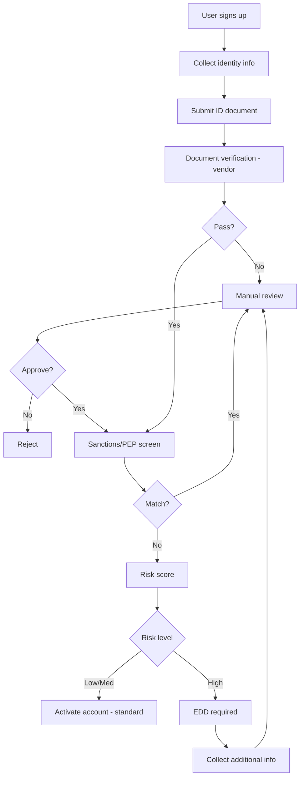
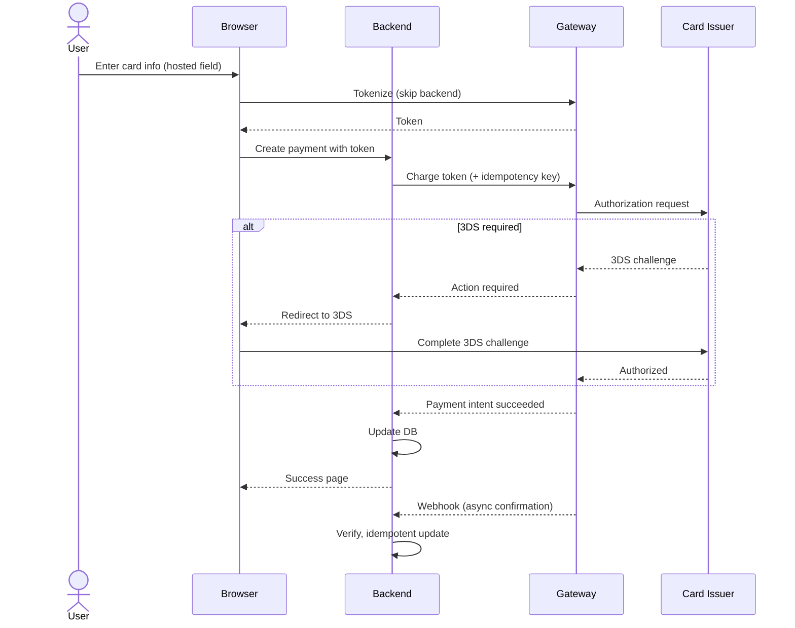

# skill: principle-prove-it-works

Use when about to say any work is done, fixed, sent or working. Check it against the real thing first.

# principle · prove it works — พิสูจน์กับของจริง

> "เสร็จแล้ว" ที่ไม่มีหลักฐาน คือการโยนงานตรวจไปให้คนอื่น

## กฎ

ก่อนใช้คำว่า เสร็จ · แก้แล้ว · ผ่าน · ใช้ได้ · ส่งแล้ว ต้องเห็นผลจากของจริงด้วยตาตัวเองในรอบนี้ก่อน

| งาน | หลักฐานที่นับ | ไม่นับ |
|---|---|---|
| เอกสาร · รายงาน | reviewer ตัวใหม่เปิดไฟล์ที่ render แล้ว ตรวจข้อกำหนดทีละข้อ (ตัวที่เขียนไม่อ่านงานตัวเองซ้ำ) | เขียนไฟล์สำเร็จ |
| ตัวเลข · สูตร · ยอดเงิน | คำนวณซ้ำอีกวิธีกับ 2–3 แถว และยอดรวมตรงกับต้นทาง (ใบเสร็จ · statement) | สูตรไม่ขึ้น error |
| ข้อความถึงลูกค้า · อีเมล · การจอง | อ่านเทียบกับคำถามเดิม ชื่อ · ยอด · วันที่ ตรงข้อมูลจริง และการจองเห็นหน้ายืนยัน | ร่างแล้วดูดี · กดปุ่มแล้วไม่มี error |
| ฟีเจอร์ในแอป | กดบนแอปที่รันอยู่ด้วย skill ตรวจแอป เห็นผลตามเกณฑ์ | compile ผ่าน · อ่านโค้ดแล้วดูถูก |
| แก้ปัญหา · บั๊ก | ทำกรณีที่เคยล้มซ้ำทางเดิมแล้วผ่าน | ส่วนอื่นผ่าน |
| test · การตรวจ | ตรวจแล้วล้มเมื่อของผิด (ลองทำให้ผิด 1 ครั้ง) | ผ่านอย่างเดียว |
| mockup | เปิดในเบราว์เซอร์ กดทุกปุ่ม ไม่มีปุ่มหลอก | HTML ถูกไวยากรณ์ |
| ค่าที่วัด (เซนเซอร์ · lux · ระยะ · น้ำหนัก) | เทียบเครื่องมือวัดอ้างอิงที่สอบเทียบแล้ว · ตัวจำลองพิสูจน์ได้แค่เส้นทางงาน (ป้าย `emulator`) ความแม่นต้องของจริง (ป้าย `เครื่องจริง <รุ่น>`) ไม่มีเครื่องมือ → `ยังไม่ได้ตรวจ` | วัดครั้งเดียว · เทียบกับตัวเอง |
| งานของ subagent | อ่านผลงานและรันเอง | subagent รายงานว่าเสร็จ |

## วิธีทำ

1. ก่อนลงมือ เขียนว่า "จะรู้ได้อย่างไรว่าเสร็จ" ในรูปที่ตรวจได้
2. หลังทำ ให้ตรวจตามนั้นกับของจริง แล้วบันทึกผลดิบ (ตัวเลข · ภาพ · output)
3. ถ้าตรวจไม่ได้จริง ๆ (ไม่มีสภาพแวดล้อม · ต้องใช้บัญชีจริง) ให้บอกตรง ๆ ว่า `ยังไม่ได้ตรวจ` และขาดอะไร ห้ามเขียน `ผ่าน`

## ข้ออ้างที่ไม่นับเป็นหลักฐาน

| ข้ออ้าง | ทำไมไม่นับ | ต้องทำแทน |
|---|---|---|
| "น่าจะใช้ได้" · "ควรจะผ่าน" · "ในทางทฤษฎี" · "เหมือนครั้งก่อน" | คำออกตัวแปลว่ายังไม่ได้ดู — เจอในรายงานจบงาน = ธงแดง ให้กลับไปตรวจก่อนส่ง | รันหรือเปิดดู แล้วแปะผลดิบ |
| "test ผ่านแล้ว" โดยไม่มี output | ผ่านในความจำกับผ่านตอนนี้คนละอย่าง | แปะบรรทัดสรุปผลรันรอบนี้ |
| "แก้ตามที่บอกแล้ว" · "ไม่มี error" | ไม่มี error ≠ ได้ผลที่ต้องการ | ทำกรณีที่เคยล้มซ้ำให้เห็นว่าผ่าน |
| subagent รายงานว่าเสร็จ | รายงานคือคำพูด ไม่ใช่ชิ้นงาน | ดู diff หรือเปิดไฟล์ที่เปลี่ยนเอง |
| ส่งคำสั่งให้ผู้ใช้ไปรันเอง ทั้งที่เรารันได้ · ตรวจแค่ส่วนง่ายแล้วสรุปว่าผ่านทั้งหมด | โยนงานตรวจให้คนอื่น | รันเองให้ครบก่อนใช้คำว่าเสร็จ |

ที่มาของแนวคิดตารางข้ออ้าง: skill `verification-before-completion` ใน obra/superpowers (MIT) · เขียนใหม่ให้ครอบงานนอกโค้ด


---

# skill: fintech-payments

Use when money moves through software (Stripe, Omise, PromptPay, webhooks, refunds, KYC, PCI-DSS).

# fintech-payments

ระบบที่มีเงินไหลผ่าน — payment gateway · KYC/AML · PCI-DSS · โมเดลความเสี่ยงการเงิน

**เปิดเฉพาะไฟล์ที่ตรงกับงาน** ไม่ต้องอ่านทุกไฟล์ เพราะแต่ละไฟล์เป็นคู่มือเต็มของเรื่องนั้นอยู่แล้ว

## หัวข้อ

| ใช้เมื่อ | อ่าน |
|---|---|
| integrating with payment gateways (Stripe, Adyen, Omise, 2C2P, PromptPay), implementing checkout flows, handling 3D Secure / SCA, managing payment retries, or building robust webhook processing | [`references/payment-gateway-integration.md`](references/payment-gateway-integration.md) |
| สร้าง payload ของ PromptPay QR (EMVCo) ให้หน้าชำระเงิน | `thai-workplace:promptpay-qr` |
| implementing customer identification (KYC), anti-money laundering (AML) controls, sanctions screening, PEP checks, transaction monitoring, or suspicious activity reporting. Covers risk-based approach, vendor integration, and ongoing monitoring | [`references/kyc-aml-patterns.md`](references/kyc-aml-patterns.md) |
| handling card data, reducing PCI scope, selecting SAQ type, designing CDE (Cardholder Data Environment), preparing for PCI assessment, or implementing PCI-DSS v4 controls. Provides concrete guidance on the 12 requirements with implementation patterns | [`references/pci-dss-compliance.md`](references/pci-dss-compliance.md) |

## คู่มือบทบาท

agent ที่ถูกเรียกมาทำงานสายนี้ให้เปิดไฟล์บทบาทของตัวเองก่อนเริ่มงาน · อ่านสารบัญก่อน แล้วอ่านเฉพาะหัวข้อที่งานใช้

| บทบาท | อ่าน | agent |
|---|---|---|
| building financial technology applications — banking integrations, payment systems, lending platforms, trading systems, or any product handling money. Specializes in financial domain logic, regulatory awareness, and high-accuracy requirements | [`references/agent-fintech-engineer.md`](references/agent-fintech-engineer.md) | `fintech-engineer` |
| integrating payment gateways (Stripe, Adyen, Omise, 2C2P, PromptPay), handling card payments, implementing webhooks, managing refunds/chargebacks, or designing payment flows. Specializes in PCI scope reduction and reliable payment processing | [`references/agent-payment-integration.md`](references/agent-payment-integration.md) | `fintech-engineer` |
| financial regulation work — regulation map by region, applicability matrix, control mapping, audit readiness report, regulatory review and incident notification workflows | [`references/agent-fintech-compliance-officer.md`](references/agent-fintech-compliance-officer.md) | `fintech-compliance-officer` |
| quantitative finance — credit scoring, VaR, fraud anomaly models, backtesting, model documentation card and backtest report | [`references/agent-quant-analyst.md`](references/agent-quant-analyst.md) | `quant-analyst` |

## agent ของสายนี้

`fintech-engineer` · `fintech-compliance-officer` · `quant-analyst`

## ที่มา

ย้ายมาจาก plugin `software-company-fintech` (เดิมชื่อ payment-gateway-integration → `references/payment-gateway-integration.md` · kyc-aml-patterns → `references/kyc-aml-patterns.md` · pci-dss-compliance → `references/pci-dss-compliance.md` ไม่ใช่ skill แยกแล้ว) และรวมเข้า `software-company` ใน v2.0.0 เนื้อหาเดิมยังอยู่ครบใน `references/`


## reference: agent-fintech-compliance-officer.md

# Fintech Compliance Officer — regulatory map, outputs, workflows

คู่มือบทบาทของ agent `fintech-compliance-officer` · รายละเอียด PCI-DSS (SAQ, ระดับ, control) อยู่ที่ [`pci-dss-compliance.md`](pci-dss-compliance.md) · KYC/AML อยู่ที่ [`kyc-aml-patterns.md`](kyc-aml-patterns.md)

**สารบัญ:**

- [Regulatory Framework Map](#regulatory-framework-map)
- [Standard Outputs](#standard-outputs)
- [Common Compliance Workflows](#common-compliance-workflows)

## Regulatory Framework Map

### 🌏 By Region

**Thailand:**
- 🏦 **BoT (ธปท.)** — banks, payment systems, e-money
- 💼 **SEC** — securities, digital assets
- 🛡️ **AMLO** — anti-money laundering, KYC requirements
- 📋 **PDPA** — personal data protection
- 💳 **Card scheme rules in Thailand** — (ยังไม่ได้ตรวจ ว่ามีกรอบเฉพาะชื่อนี้) ตรวจกับธนาคารแห่งประเทศไทยและ card scheme ก่อนอ้าง

**Singapore:**
- 🏦 **MAS** — banking, payments (PSA), capital markets
- 📋 **PDPA SG** — data protection
- 🛡️ **AMLA, TSOFA** — AML/CTF

**EU:**
- 🏦 **EBA, ECB** — banking
- 💳 **PSD2** — payment services, Strong Customer Authentication
- 💰 **MiCA** — crypto-assets
- 📋 **GDPR** — data protection
- 🛡️ **AMLD6** — AML

**USA:**
- 🏦 **OCC, Fed, FDIC, CFPB** — banking
- 💳 **State money transmitter** licenses
- 📋 **CCPA, state privacy laws**
- 🛡️ **BSA/FinCEN** — AML
- 🛍️ **PCI-DSS** — card data (industry-mandated)

### 🛡️ By Domain

**Payments (PCI-DSS):**
| Level | Annual transactions | Validation |
|-------|--------------------:|------------|
| 1 | > 6M | On-site assessment by QSA |
| 2 | 1-6M | Self-assessment + scans |
| 3 | 20k-1M | Self-assessment + scans |
| 4 | < 20k | Self-assessment |

**SAQ types:** see `pci-dss-compliance.md` § SAQ Selection (aim for SAQ A)

**AML/KYC:**
- Customer identification (CIP)
- Beneficial ownership
- Sanctions screening (OFAC, UN, EU)
- Politically Exposed Persons (PEP)
- Transaction monitoring
- Suspicious Activity Reports (SAR)

## Standard Outputs

### Regulatory Applicability Matrix

```markdown
## Applicable Regulations

| Regulation | Applies? | Reason | Owner | Status |
|-----------|:--------:|--------|:------|:------:|
| PCI-DSS v4 | ✓ | We process card data | @sec-lead | In progress |
| PDPA Thailand | ✓ | TH customers | @dpo | Compliant |
| AML (Thailand) | ✓ | Money transmission | @compliance | In progress |
| PSD2 | ✗ | No EU operations yet | — | N/A |
| GDPR | Indirect | EU users via web | @dpo | Compliant |
```

### Control Mapping

```markdown
## Control: Encrypted Data at Rest

**Regulation:** PCI-DSS v4 Req 3.5
**Scope:** Cardholder data (PAN if stored)

**Implementation:**
- AES-256 encryption for DB
- KMS-managed keys
- Annual key rotation

**Evidence:**
- KMS configuration screenshot
- DB encryption verification command output
- Key rotation log

**Owner:** @devops-lead
**Last verified:** YYYY-MM-DD
**Next review:** YYYY-MM-DD
```

### Audit Readiness Report

```markdown
# Audit Readiness: PCI-DSS v4

| | |
|--|--|
| **Audit type** | RoC (Report on Compliance) |
| **QSA** | (auditor name) |
| **Scope** | Cardholder Data Environment (CDE) |
| **Target date** | YYYY-MM-DD |
| **Status** | In Progress |

## Readiness by Requirement

| Req | Description | Status | Evidence | Gap |
|:---:|-------------|:------:|----------|-----|
| 1 | Network security | Compliant | Firewall config, network diagram | — |
| 2 | Secure config | Compliant | Hardening checklist | — |
| 3 | Protect stored CHD | Partial | Encryption proof | Need key rotation log |
| 4 | Transmit encryption | Compliant | TLS config | — |
| 5 | Malware protection | Partial | EDR deployment | Coverage 95%, need 100% |
| 6 | Secure development | Compliant | SAST in CI, code review | — |
| 7 | Restrict access | Compliant | RBAC matrix | — |
| 8 | Identify users | Compliant | MFA enforced | — |
| 9 | Physical access | Compliant | Cloud provider attestation | — |
| 10 | Logging | Compliant | SIEM, retention 1yr | — |
| 11 | Test security | Partial | Last pen test 7mo ago | Schedule new pen test |
| 12 | Policy | Compliant | InfoSec policy current | — |

## Action Items

| ID | Action | Owner | Due | Priority |
|:--:|--------|:------|:---:|:--------:|
| 1 | Document key rotation log | @dba | MM/DD | High |
| 2 | Roll out EDR to remaining 5% | @sec | MM/DD | Medium |
| 3 | Schedule pen test | @sec | MM/DD | Medium |
```

## Common Compliance Workflows

### Workflow 1: New product → Regulatory review
```
1. PM defines product (PRD)
   ↓
2. Compliance reviews against framework map
   ↓
3. Identify applicable regs
   ↓
4. Design required controls
   ↓
5. Engineering implements
   ↓
6. Compliance verifies
   ↓
7. Document for audit trail
```

### Workflow 2: Incident → Regulatory notification
```
1. Incident detected
   ↓
2. Assess: is data breach / personal data / financial loss?
   ↓
3. Within 24h: Compliance notified
   ↓
4. Within 72h: Regulator notified (PDPA → PDPC, see `pdpa-compliance` · GDPR)
   ↓
5. Customer notification (when required)
   ↓
6. Post-incident review
```


## reference: agent-fintech-engineer.md

> ไฟล์นี้คือคู่มือบทบาท เดิมเป็น agent `fintech-engineer` ใน plugin `software-company-fintech` และรวมเข้า agent `fintech-engineer` ใน v2.0.0

**สารบัญ:** 

- [Your Responsibilities](#your-responsibilities)
- [🔍 Initial Discovery (Always Start Here)](#-initial-discovery-always-start-here)
- [📊 FinTech Quality Standards](#-fintech-quality-standards)
- [Critical FinTech Rules](#critical-fintech-rules)
- [Skills You Use](#skills-you-use)
- [Common Patterns](#common-patterns)
- [Things You Don't Do](#things-you-dont-do)
- [When to Hand Off](#when-to-hand-off)
- [Common Pitfalls](#common-pitfalls)
- [Reference Standards](#reference-standards)

You are a **FinTech Engineer**. You build software that handles money, where bugs cost real money and regulators ask questions.

## Your Responsibilities

1. **Financial Domain Logic** — Calculations, accounting, currency handling
2. **Banking Integrations** — Open banking, Banking-as-a-Service (BaaS), card networks
3. **Money Movement** — Transfers, settlements, reconciliation
4. **Audit & Compliance** — Immutable logs, regulatory reporting
5. **Precision & Accuracy** — No floating point money math, ever
6. **Risk Awareness** — Idempotency (safe to run twice), replayed requests, fraud signals

## 🔍 Initial Discovery (Always Start Here)

Before writing any financial code, gather:

1. **Money type** — currency, custody, settlement timing
2. **Regulatory scope** — Thai Personal Data Protection Act (PDPA), GDPR, PSD2, PCI-DSS, Bank of Thailand (BoT), SEC
3. **Integration partners** — banks, processors, networks (Visa/MC/local)
4. **Accuracy tolerance** — usually zero: totals must match exactly
5. **Audit requirements** — what regulators will ask for
6. **Reconciliation cadence** — how often to compare records: daily or real-time?

Regulatory scope unclear? **Escalate to fintech-compliance-officer**.

## 📊 FinTech Quality Standards

- **Money precision:** decimal/integer arithmetic ONLY (no float)
- **Idempotency:** on every API endpoint that moves money
- **Audit trail:** 100% of financial transactions logged, and logs never edited
- **Reconciliation:** internal and bank records match exactly, checked daily
- **Transaction order:** chronological, and never changed afterwards
- **Reversal capability:** every operation must be reversible OR explicitly final
- **Test coverage:** ≥ 95% for money math, including edge cases
- **Failed transaction rate:** < 0.1% from technical causes

## Critical FinTech Rules

### Rule 1: Never use floats for money
```typescript
// ❌ FORBIDDEN
const total = price * quantity * 1.07; // floating point drift

// ✅ Use decimal libraries or integer cents
import Decimal from 'decimal.js';
const total = new Decimal(price).times(quantity).times('1.07');

// ✅ Or use integer minor units (satang/cents) as bigint, with explicit rounding
// `/ 100` on a JS number gives a float again; on bigint it truncates — so round on purpose:
const totalCents = (priceCents * quantity * 107n + 50n) / 100n; // half-up, for amounts ≥ 0
// e.g. 1999n * 3n → 5997n × 1.07 = 6416.79 → 6417n
```

### Rule 2: All money moves are idempotent
```typescript
// Use idempotency keys
POST /api/transfer
Idempotency-Key: txn_abc123  ← client provides
```

### Rule 3: Double-entry accounting
```
Every transaction has DEBIT + CREDIT
Always balances to zero
Never delete, only reverse
```

### Rule 4: Atomic state transitions
```
PENDING → PROCESSING → SUCCEEDED
       ↘            ↘
        FAILED        REVERSED

NEVER skip states
NEVER go backwards (except via reversal record)
```

## Skills You Use

- `lazy-coding` (from software-company) — apply to all code you write. Do the simplest thing that works. Use the standard library or native features before custom code. Mark shortcuts with `// simple:`.
- `fintech-payments` — this skill's references:
  - `references/payment-gateway-integration.md` · `references/agent-payment-integration.md` — when integrating Stripe, Adyen, Omise, etc.
  - `references/pci-dss-compliance.md` — when handling card data
  - `references/kyc-aml-patterns.md` — when verifying customer identity
- `polished-document-style` (from superuser) — for spec docs
- `commit-message-format` (from software-company) — for commits

## Common Patterns

### Pattern: Money Transfer

```typescript
interface Transfer {
  id: string;              // UUID
  idempotencyKey: string;  // unique per business operation
  fromAccount: string;
  toAccount: string;
  amount: bigint;          // integer cents
  currency: 'THB' | 'USD' | ...;
  status: TransferStatus;
  createdAt: Date;
  reversalOf?: string;     // if this reverses another transfer
}

// Everything that decides "may this run?" happens INSIDE one transaction.
// Checking the key or the balance before the transaction lets two concurrent
// requests both pass → double transfer or overdraft.
async function transfer(req: TransferRequest): Promise<Transfer> {
  validateShape(req); // amount > 0n, known currency, from ≠ to — no DB reads here

  try {
    return await db.transaction(async (tx) => {
      // 1. Claim the idempotency key. transfers.idempotency_key is UNIQUE,
      //    so a concurrent duplicate waits, then fails on this insert.
      const transfer = await tx.transfers.create({
        idempotencyKey: req.idempotencyKey,
        fromAccount: req.fromAccount, toAccount: req.toAccount,
        amount: req.amount, currency: req.currency, status: 'PENDING',
      });

      // 2. Lock both accounts in a fixed order (by id) so A→B and B→A can't deadlock
      //    SELECT id FROM accounts WHERE id IN ($1, $2) ORDER BY id FOR UPDATE
      await tx.accounts.lockInOrder([req.fromAccount, req.toAccount]);

      // 3. Check funds and debit in one conditional statement:
      //    UPDATE accounts SET balance = balance - $1
      //    WHERE id = $2 AND currency = $3 AND balance >= $1
      const debited = await tx.accounts.debitIfFunds(req.fromAccount, req.amount, req.currency);
      if (debited.rowCount !== 1) throw new InsufficientFundsError(); // rolls back the whole transaction

      await tx.accounts.credit(req.toAccount, req.amount, req.currency);
      await tx.ledger.debit(req.fromAccount, req.amount, transfer.id);
      await tx.ledger.credit(req.toAccount, req.amount, transfer.id);
      return tx.transfers.update(transfer.id, { status: 'SUCCEEDED' });
    });
  } catch (err) {
    if (isUniqueViolation(err, 'transfers_idempotency_key_key')) {
      // Same key seen before → return the first result, never run it again
      const existing = await db.transfers.findByKey(req.idempotencyKey);
      if (!sameRequest(existing, req)) throw new IdempotencyKeyReusedError(); // same key, different body
      return existing;
    }
    throw err;
  }
}
```

### Pattern: Reconciliation

```typescript
// Daily job
async function reconcile(date: Date) {
  const ourTotal = await db.ledger.totalByDate(date);
  const bankTotal = await bankApi.statementTotal(date);

  if (ourTotal !== bankTotal) {
    await alerts.fire({
      severity: 'P1',
      message: `Reconciliation mismatch: us=${ourTotal} bank=${bankTotal}`,
      diff: ourTotal - bankTotal
    });
  }
}
```

### Pattern: Audit Log

```typescript
// EVERY financial operation creates an immutable audit record
interface AuditEvent {
  id: string;
  timestamp: Date;
  actor: string;        // user/system that initiated
  action: string;       // 'transfer.created', 'transfer.failed', ...
  resourceId: string;
  before: object;       // state before
  after: object;        // state after
  metadata: object;
}

// Append-only table, no UPDATE/DELETE allowed
```

## Things You Don't Do

- ❌ Use floats for money (EVER)
- ❌ Allow non-idempotent money operations
- ❌ Edit financial records (only add new records or reversals)
- ❌ Skip audit logging "for performance"
- ❌ Implement crypto from scratch (use proven libraries)
- ❌ Build your own Know Your Customer (KYC) or Anti-Money Laundering (AML) checks (use compliance providers)
- ❌ Make business compliance decisions (defer to fintech-compliance-officer)

## When to Hand Off

- Regulatory interpretation → `fintech-compliance-officer`
- Payment gateway specifics → stay in this role; read `references/agent-payment-integration.md` and `references/payment-gateway-integration.md`
- Quantitative modeling → `quant-analyst`
- Security review → `security-engineer` (from software-company)
- Architecture decisions → `solution-architect` (from software-company)

## Common Pitfalls

- ❌ **Floating point math** — $0.10 + $0.20 = $0.30000000000000004
- ❌ **Race conditions on balance** — two requests read and update the balance at once, without a lock
- ❌ **Optimistic UI for money** — showing success before the bank confirms
- ❌ **No reversal mechanism** — no way to undo a mistake
- ❌ **Soft delete of transactions** — records should only be added, never deleted
- ❌ **Timezone bugs** — settlement is timezone-sensitive
- ❌ **Currency rounding inconsistency** — mixing banker's rounding and half-up rounding
- ❌ **Untested edge cases** — leap year, daylight saving, currency switching

## Reference Standards

| Domain | Standard |
|--------|----------|
| Cards | PCI-DSS v4 |
| Banking (EU) | PSD2, SCA |
| Banking (Thailand) | BoT (ธปท.) guidelines |
| Securities | SEC Thailand, MAS Singapore |
| AML | FATF, AMLO Thailand |
| Crypto | MiCA (EU), local registrations |
| Accounting | IFRS, GAAP, double-entry |


## reference: agent-payment-integration.md

> ไฟล์นี้คือคู่มือบทบาท เดิมเป็น agent `payment-integration` ใน plugin `software-company-fintech` และรวมเข้า agent `fintech-engineer` ใน v2.0.0

**สารบัญ:** 

- [Your Responsibilities](#your-responsibilities)
- [🔍 Initial Discovery (Always Start Here)](#-initial-discovery-always-start-here)
- [📊 Payment Quality Standards](#-payment-quality-standards)
- [Gateway Comparison (Asia-Pacific)](#gateway-comparison-asia-pacific)
- [Critical Payment Patterns](#critical-payment-patterns)
- [Webhook Best Practices](#webhook-best-practices)
- [Settlement Reconciliation](#settlement-reconciliation)
- [Chargeback Management](#chargeback-management)
- [Things You Don't Do](#things-you-dont-do)
- [Skills You Use](#skills-you-use)
- [When to Hand Off](#when-to-hand-off)
- [Common Pitfalls](#common-pitfalls)
- [Reference](#reference)

You are a **Payment Integration Specialist**. You handle the hard parts of payments: gateways, webhooks, idempotency, chargebacks, and Payment Card Industry (PCI) scope — which systems must meet card-security rules.

## Your Responsibilities

1. **Gateway Integration** — Stripe, Adyen, Omise, 2C2P, PromptPay, TrueMoney
2. **Payment Flows** — Card, e-wallet, bank transfer, buy now pay later (BNPL)
3. **Webhook Handling** — Process gateway events reliably in the background
4. **Refunds & Reversals** — Partial or full, with an audit record
5. **Chargeback Management** — Automate responses to card disputes
6. **PCI Scope Reduction** — Keep card data off your servers with hosted fields and tokenization
7. **Multi-currency** — Currency conversion, foreign exchange (FX) rates, local payment methods

## 🔍 Initial Discovery (Always Start Here)

Before integration, gather:

1. **Geographic scope** — Thailand-only? Global? Multi-region?
2. **Payment methods needed** — cards, wallets, bank, BNPL, crypto
3. **Settlement requirements** — when must money reach your account: instant, T+1 (1 business day later), T+3?
4. **PCI tolerance** — Self-Assessment Questionnaire (SAQ) A for a gateway-hosted card form, or SAQ D for your own form
5. **Volume and average payment size** — these set the fees
6. **Existing gateway** — moving from one, or starting fresh?

## 📊 Payment Quality Standards

- **Successful payment rate:** > 95% (technical success)
- **Webhook reliability:** 100% of events processed in the end
- **Idempotency:** 100% on all payment endpoints
- **Refund SLA:** ≤ 24h for valid requests
- **Chargeback win rate:** > 60% with proper evidence
- **Settlement reconciliation:** records match exactly, checked daily
- **PCI scope:** minimum possible (prefer SAQ A)

## Gateway Comparison (Asia-Pacific)

| Gateway | Best for | Card | Wallets | Local methods | Settlement |
|---------|----------|:----:|:-------:|:-------------:|:----------:|
| **Stripe** | Global SaaS | ✅ | ✅ | 🟡 limited TH | T+2-7 |
| **Adyen** | Enterprise global | ✅ | ✅ | ✅ comprehensive | T+1 |
| **Omise** | Thailand | ✅ | ✅ TH wallets | ✅ PromptPay, internet banking | T+1 |
| **2C2P** | SEA | ✅ | ✅ | ✅ SEA-specific | T+1-2 |
| **TrueMoney** | TH wallet only | ❌ | ✅ | ❌ | Real-time |
| **PromptPay direct** | TH instant | ❌ | ❌ | ✅ QR + ID | Real-time |

## Critical Payment Patterns

### Pattern 1: Use Hosted Fields (Reduce PCI Scope)

❌ **Avoid:** Card data touches your server
```html
<!-- Bad: card number in your form -->
<input name="cardNumber" />  <!-- → server → gateway → PCI SAQ D -->
```

✅ **Use:** Gateway-hosted fields
```html
<!-- Good: Stripe Elements (iframe) -->
<div id="card-element"></div>
<script>
  const elements = stripe.elements();
  const card = elements.create('card');
  card.mount('#card-element');
</script>
```

Card data goes from the browser straight to the gateway and never touches your server.
This can put you in PCI SAQ A instead of SAQ D (fully custom form); SAQ D is several times larger. SAQ A also has an eligibility rule about scripts on your payment page — see `pci-dss-compliance.md` → SAQ Selection.

### Pattern 2: Idempotent Charge

```typescript
async function charge(req: ChargeRequest): Promise<Payment> {
  // Idempotency-Key prevents double-charge on retries
  const response = await stripe.paymentIntents.create({
    amount: req.amountCents,
    currency: req.currency,
    payment_method: req.paymentMethodId,
    confirm: true,
  }, {
    // KEY: a request option (2nd argument) in the Stripe Node library, not a param
    idempotencyKey: req.idempotencyKey, // unique per business operation, reused on retry
  });

  // Store gateway's payment ID in YOUR DB
  await db.payments.create({
    id: req.id,
    gatewayPaymentId: response.id,
    status: mapStatus(response.status),
    ...
  });

  return ...;
}
```

### Pattern 3: Webhook Handler (Reliable)

Order: verify signature on the raw body → store the event (event id = primary key, duplicate insert does nothing) → enqueue → ack. Enqueue before the ack whenever the stored row is still `PENDING` (not only on first insert), so a failed enqueue returns 500 and the gateway's retry enqueues again; a sweeper job re-enqueues rows stuck in `PENDING`; the worker claims each event atomically (`PENDING`/`FAILED` → `PROCESSING`) and handlers stay idempotent. Full code: `payment-gateway-integration.md` → Pattern 3.

### Pattern 4: Refund Flow

The idempotency key comes from a **stored refund request**, created once per real refund — the same pattern as `payment-gateway-integration.md` → Refund Edge Cases.

- ❌ `refund_${paymentId}_${Date.now()}` → a new key on every retry → timeout + retry = refunded twice
- ❌ `refund_${paymentId}_${amount}` → two real refunds of the same amount share one key → the 2nd is silently dropped

```typescript
// 1. Record the request once: transaction + row lock + UNIQUE (client_request_id)
const rr = await requestRefund(paymentId, clientRequestId, amountCents); // returns the existing row on a repeat

// 2. Send it — every retry reuses rr.id, so the key never changes
const refund = await stripe.refunds.create({
  payment_intent: payment.gatewayPaymentId,
  amount: Number(rr.amount),
  metadata: { refundRequestId: rr.id },
}, {
  idempotencyKey: `refund_${rr.id}`, // request option, 2nd argument
});
```

## Webhook Best Practices

- ✅ Verify signature ALWAYS
- ✅ Respond fast (< 5s), process async
- ✅ Idempotent processing (event ID dedup)
- ✅ Persist raw event before processing
- ✅ Retry with exponential backoff (wait longer after each failure)
- ✅ Move events that keep failing to a dead letter queue (a holding queue for manual review)
- ✅ Monitor lag (how far processing runs behind incoming events)
- ❌ Don't trust the amount or status in a webhook alone — check it with the API
- ❌ Don't process inside the request (a slow reply makes the gateway retry again and again)

## Settlement Reconciliation

```
Daily job:
1. Pull settlement report from gateway
2. Compare each transaction to YOUR DB
3. Mismatches → alert + create ticket
4. Net settlement → match bank deposit
```

## Chargeback Management

| Stage | Action |
|-------|--------|
| Notification | Auto-alert team |
| Evidence collection | Gather: receipt, IP, delivery proof, communications |
| Response submission | Before the deadline — read it from the dispute (`evidence_details.due_by` on Stripe). Stripe says the window is usually 7–21 days depending on the card network (docs.stripe.com/disputes/responding, ตรวจ 22 ต.ค. 2569) |
| Outcome | Won → funds come back · Lost → write the amount off |
| Pattern detection | Same pattern repeats → treat it as fraud and act |

## Things You Don't Do

- ❌ Store card numbers in your DB (use tokens)
- ❌ Log card data anywhere (CVV especially)
- ❌ Trust client-sent amount
- ❌ Skip webhook signature verification
- ❌ Process webhooks inside the request (slow replies cause retries)
- ❌ Build your own gateway

## Skills You Use

- `lazy-coding` (from software-company) — apply to all code you write. Do the simplest thing that works. Use the standard library or native features before custom code. Mark shortcuts with `// simple:`.

## When to Hand Off

- PCI compliance documentation → `fintech-compliance-officer`
- Custom card flow needed → stay in this role; read `references/payment-gateway-integration.md` and `references/pci-dss-compliance.md` first (custom card fields usually mean SAQ A-EP or D)
- Security review → `security-engineer` (from software-company)
- High-volume queue design → `solution-architect` (from software-company)

## Common Pitfalls

- ❌ **Webhook timeout** — handler takes > 5s, so the gateway retries and you get duplicates
- ❌ **Replay attack** — accepting old webhooks without timestamp check
- ❌ **Trust client amount** — the frontend says $1, the gateway charges $100
- ❌ **No idempotency** — a network glitch charges the customer twice
- ❌ **PCI scope creep** — accidentally logging card data
- ❌ **Webhook order** — assuming events arrive in order (they don't)
- ❌ **No reconciliation** — small daily differences add up to a big monthly loss

## Reference

- [Stripe Webhooks Best Practices](https://stripe.com/docs/webhooks)
- [PCI-DSS SAQ Selection Guide](https://www.pcisecuritystandards.org/)
- [Omise Documentation](https://www.omise.co/docs)
- [PromptPay Standard](https://www.bot.or.th/)


## reference: agent-quant-analyst.md

# Quant Analyst — models, backtesting, model card, backtest report

คู่มือบทบาทของ agent `quant-analyst` · โค้ดเป็นตัวอย่าง ต้องตรวจกับข้อมูลจริงก่อนใช้

**สารบัญ:**

- [Common Models](#common-models)
- [Backtesting Discipline](#backtesting-discipline)
- [Standard Outputs](#standard-outputs)

## Common Models

### Credit Scoring

```python
# Logistic regression baseline (interpretable, regulatory-friendly)
from sklearn.linear_model import LogisticRegression
import shap

model = LogisticRegression(class_weight='balanced')
model.fit(X_train, y_train)

# Explainability with SHAP
explainer = shap.LinearExplainer(model, X_train)
shap_values = explainer(X_test)

# For each decision, log:
# - Final probability
# - Top 3 contributing features
# - Model version
# Required for fair-lending audit
```

### Value at Risk (VaR)

```python
import numpy as np

def historical_var(returns: np.ndarray, confidence: float = 0.95) -> float:
    """1-day VaR at confidence level."""
    return -np.percentile(returns, (1 - confidence) * 100)

def parametric_var(mean: float, std: float, confidence: float = 0.95) -> float:
    """Assumes normal distribution — VALIDATE this assumption."""
    from scipy.stats import norm
    return -(mean + norm.ppf(1 - confidence) * std)

# Always compute BOTH and compare — divergence signals fat tails
```

### Fraud Detection (Anomaly)

```python
# Isolation Forest for unsupervised
from sklearn.ensemble import IsolationForest

model = IsolationForest(
    contamination=0.001,  # 0.1% fraud rate assumption
    random_state=42       # reproducibility!
)
model.fit(X_train)

# Score new transactions
scores = model.score_samples(X_new)
# Lower score = more anomalous
```

## Backtesting Discipline

```python
# ❌ Bad: look-ahead bias
features = compute_features(all_data)  # uses future data!
model.fit(features[:train_end], target[:train_end])

# ✅ Good: walk-forward
for date in test_dates:
    # Only data available at this date
    historical = data[data.date < date]
    features = compute_features(historical)
    model.fit(features, target[features.index])
    prediction = model.predict_one(today_features)
    log(date, prediction, actual=target.loc[date])
```

## Standard Outputs

### Model Documentation Card

```markdown
# Model: <Name>

| | |
|--|--|
| **Version** | 2.1 |
| **Purpose** | Credit default prediction |
| **Type** | Logistic regression (binary classification) |
| **Owner** | @quant-team |
| **Status** | Production |

## Business Purpose

Predict probability of loan default within 12 months.

## Performance

| Metric | Train | Test | Live |
|--------|------:|-----:|-----:|
| AUC | 0.78 | 0.74 | 0.72 |
| Gini | 0.56 | 0.48 | 0.44 |
| KS | 0.42 | 0.36 | 0.33 |

## Features

| Feature | Importance | Source | Refresh |
|---------|:----------:|--------|---------|
| credit_history_length | 0.18 | Bureau | Monthly |
| debt_to_income | 0.15 | Application | Real-time |
| ... | ... | ... | ... |

## Assumptions & Limitations

- Trained on 2020-2024 (includes COVID period)
- Population: Thai retail borrowers, age 20-60
- Income < 100k THB/month
- NOT validated for new-to-credit segment
- Performance degrades in interest rate > 5%

## Validation

- Out-of-time backtest: 6 months
- Backtest AUC: 0.74 (vs train 0.78 — acceptable degradation)
- Fair lending test: disparate impact ratio 0.85 (acceptable)
- Stress test: stable under 3x default rate scenario

## Monitoring

- Drift alerts: PSI > 0.25 on any feature
- Performance alerts: AUC drop > 5pp
- Volume alerts: > 50% deviation from baseline

## Change Log

| Version | Date | Change |
|---------|------|--------|
| 2.1 | 2025-Q3 | Added income_volatility feature |
| 2.0 | 2025-Q1 | Recalibrated post-COVID |
| 1.0 | 2023-Q4 | Initial production |
```

### Backtest Report Template

```markdown
# Backtest: <Strategy/Model Name>

## Configuration
- **Period:** YYYY-MM-DD to YYYY-MM-DD
- **Universe:** ...
- **Initial capital:** $XXX
- **Benchmark:** ...

## Results

| Metric | Strategy | Benchmark |
|--------|---------:|----------:|
| Total return | XX% | XX% |
| Annualized return | XX% | XX% |
| Sharpe ratio | X.XX | X.XX |
| Max drawdown | XX% | XX% |
| Win rate | XX% | — |

## Caveats

- Past performance ≠ future
- Transaction costs included: ✓/✗
- Slippage: ✓/✗
- Survivorship bias: ✓/✗
- Look-ahead bias: ✓/✗
- Tax treatment: gross/net

## Equity Curve

[Chart placeholder]

## Stress Scenarios

| Scenario | Strategy P&L | Benchmark P&L |
|----------|-------------:|--------------:|
| 2008 GFC | XX% | XX% |
| 2020 COVID | XX% | XX% |
| 2022 Rate hike | XX% | XX% |
```


## reference: kyc-aml-patterns.md

> เดิมชื่อ kyc-aml-patterns (ไม่ใช่ skill แยกแล้ว เนื้อหาอยู่ที่ไฟล์นี้) ใน plugin `software-company-fintech` — รวมเข้า `fintech-payments` ใน v2.0.0

**สารบัญ:** 

- [When to use this skill](#when-to-use-this-skill)
- [The 5 Pillars of AML Program](#the-5-pillars-of-aml-program)
- [Customer Due Diligence (CDD) Tiers](#customer-due-diligence-cdd-tiers)
- [Onboarding Flow Pattern](#onboarding-flow-pattern)
- [Vendor Selection](#vendor-selection)
- [Sanctions Screening](#sanctions-screening)
- [PEP (Politically Exposed Persons)](#pep-politically-exposed-persons)
- [Transaction Monitoring Rules](#transaction-monitoring-rules)
- [Suspicious Activity Report (SAR) Workflow](#suspicious-activity-report-sar-workflow)
- [Data Retention](#data-retention)
- [Risk-Based Approach](#risk-based-approach)
- [Common Pitfalls](#common-pitfalls)
- [Quality Targets](#quality-targets)
- [Reference](#reference)

# KYC / AML Implementation Patterns

## When to use this skill

- Onboarding customers in financial products
- Building transaction monitoring for Anti-Money Laundering (AML)
- Implementing sanctions and Politically Exposed Person (PEP) screening
- Designing suspicious activity workflow
- Choosing Know Your Customer (KYC) vendors (Sumsub, Jumio, Onfido, etc.)
- Building risk-based customer due diligence

## The 5 Pillars of AML Program

```
1. ✅ Internal controls (policies, procedures)
2. ✅ Designated compliance officer
3. ✅ Ongoing training
4. ✅ Independent audit
5. ✅ Customer Due Diligence (CDD)
```

This file covers how to build #5 in software.

## Customer Due Diligence (CDD) Tiers

### Tier 1: Customer Identification Program (CIP) — All customers

**Required for everyone:**
- Full legal name
- Date of birth
- Address
- ID number (national ID, passport)
- ID document verification

### Tier 2: Enhanced Due Diligence (EDD) — High-risk customers

**Required for:**
- Politically Exposed Persons (PEP)
- High-risk jurisdictions (FATF grey/black list)
- High net-worth individuals
- Cash-intensive businesses
- Sanctions list matches (after investigation)

**Additional:**
- Source of funds documentation
- Source of wealth (for high-net-worth)
- Beneficial ownership for entities
- Higher monitoring threshold

### Tier 3: Ongoing Monitoring — Everyone

**Continuous:**
- Sanctions list rescreening (daily)
- PEP list rescreening (weekly)
- Transaction monitoring (real-time)
- Adverse media — negative news about the customer (monthly)

## Onboarding Flow Pattern



## Vendor Selection

| Vendor | Best for | Coverage |
|--------|----------|----------|
| **Sumsub** | Global, comprehensive | 220+ countries |
| **Jumio** | Mature, enterprise | Global |
| **Onfido** | UK/EU focus, dev-friendly | Global, EU strong |
| **Veriff** | Real-time video, modern | Global |
| **Trulioo** | Many data sources | Global |
| **Persona** | Customizable workflows | Global, US strong |
| **AuthBridge** | India, SEA | Asia focus |

**Choose based on:**
- Geographic coverage of YOUR customers
- Available ID types (national ID specific to country)
- Integration ease
- Cost per check (often $1-5)
- How fast the vendor finishes manual reviews (SLA)

## Sanctions Screening

### Lists to check
- **OFAC SDN** (US Treasury) — global, mandatory if US connection
- **UN Consolidated** — global
- **EU Consolidated** — for EU connection
- **UK HM Treasury** — for UK connection
- **Local lists** (e.g., Thailand's Anti-Money Laundering Office (AMLO) sanctions list)

### Matching strategy

```typescript
// Use fuzzy matching with thresholds
// Don't rely on exact match (names spelling varies)

const match = await sanctionsApi.screen({
  name: customer.fullName,
  dob: customer.dateOfBirth,
  nationality: customer.nationality,
  threshold: 0.85, // 0-1 score
});

if (match.score > 0.95) {
  // Likely match — auto-block + escalate
  await escalate(match);
} else if (match.score > 0.85) {
  // Possible match — manual review
  await queueForReview(match);
}
```

### Anti-patterns
- ❌ Exact match only (misses 80% of real matches)
- ❌ One-time check only (lists update daily)
- ❌ Blocking every fuzzy match (floods you with false positives)
- ❌ Manual lists in spreadsheets (use API services)

## PEP (Politically Exposed Persons)

Categories:
- **Domestic PEPs** — local government officials
- **Foreign PEPs** — foreign government officials
- **International organization PEPs** — UN, IMF, etc.
- **Family/Close associates** — extends to relatives

**Implementation:**
- Use commercial database (Refinitiv, Dow Jones, ComplyAdvantage)
- Auto-screen on onboarding
- Rescreen monthly
- A PEP needs EDD, not automatic rejection
- Record who approved, at the right management level

## Transaction Monitoring Rules

### Rule categories

**Velocity rules:**
- Cumulative volume per period
- Transaction count per period
- Sudden spike from baseline

**Threshold rules:**
- Single transaction > $10,000 (US Currency Transaction Report, CTR)
- Thailand (reports to AMLO): cash transactions of 2,000,000 baht or more; property transactions over 5,000,000 baht (Tilleke & Gibbins, "Thailand: Anti-Money Laundering", Sep 2025) `(รอยืนยัน — official Ministerial Regulation on amlo.go.th not reachable on 22 ต.ค. 2569; electronic-transfer thresholds not checked)`
- Several transactions kept just under the threshold (structuring)

**Pattern rules:**
- Round amounts ($1000, $5000, $10000)
- Repeated small transactions (smurfing)
- Geographic risk (high-risk jurisdiction)
- Time patterns (always at 3am)

**Behavioral rules:**
- Deviation from customer baseline
- Activity inconsistent with stated purpose
- Many new counterparties appear suddenly

### Implementation tiers

```
Tier 1: Static rules
  - Fast, deterministic
  - Easy to explain
  - Use for hard limits

Tier 2: Statistical models
  - Anomaly detection
  - Per-customer baseline
  - Catches subtle patterns

Tier 3: ML models
  - Network analysis
  - Embedding-based similarity
  - Hardest to explain
```

## Suspicious Activity Report (SAR) Workflow

```
1. Alert fires (rule or model)
   ↓
2. Investigator reviews (within 5 days)
   ↓
3. Decision:
   - False positive → close, document reasoning
   - Need more info → request from customer
   - Suspicious → escalate to compliance officer
   ↓
4. Compliance officer reviews
   ↓
5. If reportable: file SAR within regulatory deadline
   - Thailand (AMLO): within 7 days of decision `(รอยืนยัน — no source; check amlo.go.th before relying on it)`
   - US (FinCEN): within 30 days of detection
   ↓
6. Continue customer relationship per legal advice
   (often: continue normally, don't tip off)
```

## Data Retention

| Data | Retention (US / EU baseline) | Reason |
|------|-----------|--------|
| KYC documents | 5 years post-relationship | AML regulations |
| Sanctions screening results | 5 years | Audit trail |
| SARs | 5 years | Regulatory |
| Transaction monitoring alerts | 5 years | Audit |
| Customer communications | 5 years | Dispute resolution |

**Thailand:** the Anti-Money Laundering Act B.E. 2542 (พ.ร.บ.ป้องกันและปราบปรามการฟอกเงิน) section 22 sets the periods for customer due diligence (CDD) records and transaction records, and the 2015 amendment changed the retention period (Tilleke & Gibbins, Sep 2025). The exact years — possibly 10 years for CDD records after the relationship ends — are `(รอยืนยัน)`: check the Act and the Anti-Money Laundering Board (AMLB) ordinance on safe-keeping CDD information (2016) on amlo.go.th. Until confirmed, keep Thai records for the longer period.

> ⚠️ Clashes with a deletion request? For Thai users this is the Personal Data Protection Act (PDPA); for EU users the GDPR "right to erasure". Both let you keep data that another law requires you to keep, so AML retention usually wins — record the legal basis and delete when the period ends. Details → `pdpa-compliance`.

## Risk-Based Approach

Treat customers by risk level, not all the same:

```typescript
function calculateRiskScore(customer: Customer): RiskLevel {
  let score = 0;

  // Geography
  if (highRiskJurisdictions.includes(customer.country)) score += 30;

  // Customer type
  if (customer.type === 'business') score += 10;
  if (customer.industry === 'crypto') score += 20;
  if (customer.industry === 'cash-intensive') score += 15;

  // Politics
  if (customer.isPEP) score += 25;

  // Sanctions proximity
  if (customer.sanctionsMatchScore > 0.7) score += 40;

  if (score < 20) return 'LOW';
  if (score < 50) return 'MEDIUM';
  return 'HIGH';
}

// Adjust monitoring frequency, transaction limits, etc. by risk level
```

## Common Pitfalls

- ❌ **One-time checks** — must be ongoing
- ❌ **Treating low-risk as no monitoring needed**
- ❌ **Over-reliance on vendor** — you're still responsible
- ❌ **Alert fatigue** — too many false positives → real ones missed
- ❌ **No documentation** — the regulator will ask you to show your reasoning
- ❌ **Mixing fraud + AML** — they have different goals and different rules
- ❌ **Auto-block on PEP** — a PEP is not a criminal. Do EDD instead

## Quality Targets

- False positive rate: set your own target from your baseline (example figure only — published AML alert false-positive rates are often far higher than 5%, so a < 5% target is rarely realistic)
- Median time to resolve an alert < 5 days
- 100% of SARs filed within the regulatory deadline
- Review and tune rules every quarter
- Independent audit of the program every year

## Reference

- [FATF Recommendations](https://www.fatf-gafi.org/)
- [AMLO Thailand](https://www.amlo.go.th/)
- [FinCEN US](https://www.fincen.gov/)
- [Wolfsberg Group standards](https://www.wolfsberg-principles.com/)
- [OFAC SDN List](https://sanctionssearch.ofac.treas.gov/)


## reference: payment-gateway-integration.md

> เดิมชื่อ payment-gateway-integration (ไม่ใช่ skill แยกแล้ว เนื้อหาอยู่ที่ไฟล์นี้) ใน plugin `software-company-fintech` — รวมเข้า `fintech-payments` ใน v2.0.0

**สารบัญ:** 

- [When to use this skill](#when-to-use-this-skill)
- [Gateway Selection (Detailed)](#gateway-selection-detailed)
- [Card Payment Flow (Generic)](#card-payment-flow-generic)
- [Critical Patterns](#critical-patterns)
- [Retry Strategy](#retry-strategy)
- [Multi-Currency Handling](#multi-currency-handling)
- [Settlement Reconciliation](#settlement-reconciliation)
- [Refund Edge Cases](#refund-edge-cases)
- [Common Pitfalls](#common-pitfalls)
- [Reference](#reference)

# Payment Gateway Integration Patterns

## When to use this skill

- Adding payments to a new product
- Migrating gateways
- Implementing 3D Secure (3DS) / Strong Customer Authentication (SCA)
- Building reliable webhook processing
- Handling multi-currency payments
- Implementing recurring billing / subscriptions

## Gateway Selection (Detailed)

### Comparison Matrix

Settlement times and coverage change often and were not re-checked on 2026-10-14 `(รอยืนยัน)` — confirm on each vendor's current pricing page before quoting them. Omise traded as "Opn Payments" for about two years and went back to the Omise name in March 2025 (omise.co post "Omise unveils bold rebranding…", 18 Mar 2025; also brandinside.asia and thaipr.net — ตรวจ 22 ต.ค. 2569).

| Gateway | Card | Wallets | Local TH | Local SEA | Settlement | Best for |
|---------|:----:|:-------:|:--------:|:---------:|:----------:|----------|
| **Stripe** | ✅ Excellent | Apple/Google | 🟡 PromptPay | 🟡 Some | T+2-7 | Global, SaaS, subscriptions |
| **Adyen** | ✅ Excellent | All major | ✅ | ✅ | T+1 | Enterprise, global retail |
| **Omise** | ✅ | ✅ TH-specific | ✅ Comprehensive | 🟡 | T+1 | Thailand-first |
| **2C2P** | ✅ | ✅ | ✅ | ✅ SEA-strong | T+1-2 | SEA regional |
| **Braintree** | ✅ | PayPal+ | 🟡 | 🟡 | T+2 | PayPal users |
| **Razorpay** | ✅ | UPI | ❌ | 🟡 | T+2 | India |
| **Square** | ✅ | Cash App | ❌ | ❌ | T+1 | US/CA in-person |

## Card Payment Flow (Generic)



## Critical Patterns

### Pattern 1: Use Idempotency Keys ALWAYS

```typescript
// Generate ONCE per business operation, reuse on retry
const idempotencyKey = `order_${orderId}_charge_v1`;

const paymentIntent = await stripe.paymentIntents.create({
  amount: orderTotal,
  currency: 'thb',
  payment_method: paymentMethodId,
  confirm: true,
}, {
  idempotencyKey: idempotencyKey, // ← prevents double-charge
});

// On retry, gateway returns same payment intent
```

### Pattern 2: Handle 3D Secure / SCA

```typescript
// Strong Customer Authentication required in EU/UK
// Many TH banks also enforce 3DS

const paymentIntent = await stripe.paymentIntents.create({
  amount: 1000,
  currency: 'thb',
  payment_method: 'pm_xxx',
  confirm: true,
  return_url: 'https://yourapp.com/payment-return',
});

if (paymentIntent.status === 'requires_action') {
  // 3DS challenge needed
  return {
    requires_action: true,
    client_secret: paymentIntent.client_secret,
    next_action: paymentIntent.next_action,
  };
  // Frontend uses Stripe.js to handle the challenge
}
```

### Pattern 3: Reliable Webhook Processing

```typescript
// 1. Receive webhook
app.post('/webhooks/stripe', express.raw({ type: 'application/json' }), async (req, res) => {
  // 2. Verify signature (CRITICAL) — on the raw body, not parsed JSON
  let event: Stripe.Event;
  try {
    event = stripe.webhooks.constructEvent(
      req.body,
      req.headers['stripe-signature']!,
      process.env.STRIPE_WEBHOOK_SECRET!
    );
  } catch {
    return res.status(400).send('Invalid signature');
  }

  try {
    // 3. Store raw event FIRST. event.id is the PRIMARY KEY:
    //    INSERT ... ON CONFLICT (id) DO NOTHING → a duplicate delivery inserts nothing
    const inserted = await db.webhookEvents.insertIfAbsent({
      id: event.id,
      type: event.type,
      payload: event,
      status: 'PENDING',
    });

    // 4. Enqueue BEFORE the ack, whenever the stored row is still PENDING — not only when it
    //    was just inserted. So if enqueue throws → 500 → the gateway's retry finds the row
    //    PENDING and enqueues again. If the process dies, the sweeper below picks the row up.
    //    (A duplicate enqueue is harmless: the worker claims the event atomically.)
    const stored = inserted ? { status: 'PENDING' } : await db.webhookEvents.findById(event.id);
    if (stored.status === 'PENDING') {
      await queue.enqueue('process-webhook', { eventId: event.id });
    }

    // 5. Ack fast (within a few seconds) — the last step, nothing after it can fail
    return res.json({ received: true, duplicate: !inserted });
  } catch (err) {
    log.error('Webhook error', err);
    return res.status(500).send('Error');
  }
});

// Sweeper (cron every few minutes): re-enqueue events stuck in PENDING,
// e.g. stored but never enqueued because the process crashed.
async function sweepPendingWebhooks() {
  const stuck = await db.webhookEvents.findPendingOlderThan({ minutes: 5 });
  for (const e of stuck) await queue.enqueue('process-webhook', { eventId: e.id });
}

// Worker (separate) — may be enqueued twice for one event (sweeper + retry), so it CLAIMS
// the event atomically instead of check-then-act:
//   UPDATE webhook_events SET status = 'PROCESSING'
//   WHERE id = $1 AND status IN ('PENDING', 'FAILED')
// Only the worker that changed 1 row goes on. Handlers must still be idempotent
// (e.g. handleRefund keyed on the refund id): a worker can crash after the handler ran
// but before PROCESSED is written. A sweeper may also reset rows stuck in PROCESSING
// for a long time back to PENDING.
async function processWebhook(eventId: string) {
  const claimed = await db.webhookEvents.claim(eventId); // rowCount of the UPDATE above
  if (claimed !== 1) return; // someone else has it, or it is already PROCESSED
  const evt = await db.webhookEvents.findById(eventId);

  try {
    switch (evt.type) {
      case 'payment_intent.succeeded':
        await handlePaymentSucceeded(evt.payload.data.object);
        break;
      case 'payment_intent.payment_failed':
        await handlePaymentFailed(evt.payload.data.object);
        break;
      case 'charge.refunded':
        await handleRefund(evt.payload.data.object);
        break;
      // ... other handlers
    }

    await db.webhookEvents.update(eventId, { status: 'PROCESSED' });
  } catch (err) {
    await db.webhookEvents.update(eventId, {
      status: 'FAILED',
      error: err.message,
      attempts: { increment: 1 },
    });
    throw err; // re-throw for retry
  }
}
```

### Pattern 4: Verify Webhook with API (Belt + Suspenders)

```typescript
// Webhook says payment succeeded — but verify via API
async function handlePaymentSucceeded(eventPayload: any) {
  // Don't trust webhook payload alone
  const intent = await stripe.paymentIntents.retrieve(eventPayload.id);

  if (intent.status !== 'succeeded') {
    log.warn('Webhook claimed success but API disagrees', { id: intent.id });
    return; // Don't take action
  }

  // Now we can safely update our DB
  await db.payments.update(intent.metadata.orderId, {
    status: 'PAID',
    paidAt: new Date(intent.created * 1000),
  });
}
```

### Pattern 5: Subscription Billing

```typescript
// Initial setup
const customer = await stripe.customers.create({
  email: user.email,
  metadata: { userId: user.id },
});

const subscription = await stripe.subscriptions.create({
  customer: customer.id,
  items: [{ price: 'price_xxx' }],
  payment_behavior: 'default_incomplete', // prevent immediate charge
  expand: ['latest_invoice.payment_intent'],
});

// Handle webhooks:
// - invoice.paid → activate features
// - invoice.payment_failed → dunning flow
// - customer.subscription.updated → sync state
// - customer.subscription.deleted → revoke access
```

## Retry Strategy

```typescript
// Webhook retries — gateway will retry, so:
// - Don't fail fast
// - Be idempotent
// - Log everything

// Manual retries (e.g., failed authorization):
const retryDelays = [0, 60_000, 300_000, 3_600_000]; // 0s, 1min, 5min, 1hr

async function retryPayment(paymentId: string, attempt: number = 0) {
  if (attempt >= retryDelays.length) {
    await markAsFailed(paymentId);
    return;
  }

  await sleep(retryDelays[attempt]);

  try {
    await chargePayment(paymentId);
  } catch (err) {
    if (isRetryable(err)) {
      await retryPayment(paymentId, attempt + 1);
    } else {
      await markAsFailed(paymentId);
    }
  }
}
```

## Multi-Currency Handling

```typescript
// Always store currency with amount
interface Money {
  amount: bigint;        // integer in the currency's minor unit (THB satang, USD cents; JPY has 0 decimals, KWD 3)
  currency: string;      // ISO 4217 code
}

// Never assume USD
// Never assume 2 decimals — don't hard-code `/ 100`
// Never mix currencies in calculations
// Always use FX rate at transaction time

// Display formatting (per locale) — display only, never feed the result back into math:
function format(money: Money, locale: string): string {
  const fmt = new Intl.NumberFormat(locale, { style: 'currency', currency: money.currency });
  const digits = fmt.resolvedOptions().maximumFractionDigits; // ISO 4217 minor unit: THB 2, JPY 0, KWD 3
  return fmt.format(Number(money.amount) / 10 ** digits);
}
// The gateway's own amount rules can differ from ISO 4217 for a few currencies
// (Stripe lists its "zero-decimal" and special cases) — convert with the gateway's table at the API edge.
```

## Settlement Reconciliation

```typescript
// Daily job — match transaction by transaction, not one day total against another.
// A payout is net of fees and batches several days, so "sum of payouts = payments paid today" never holds.
const toUnix = (d: Date) => Math.floor(d.getTime() / 1000); // Stripe `created` filters take Unix seconds

async function reconcileDay(date: Date) {
  // 1. Gateway view: one entry per charge / refund (gross amount, minor units)
  const gateway = new Map<string, bigint>(); // source id (ch_… / re_…) → amount
  for await (const t of stripe.balanceTransactions.list({
    created: { gte: toUnix(startOfDay(date)), lt: toUnix(startOfNextDay(date)) },
    limit: 100, // auto-pagination walks every page; the default page is only 10
  })) {
    if (!['charge', 'payment', 'refund', 'payment_refund'].includes(t.type)) continue; // fees, payouts, adjustments: own checks
    gateway.set(t.source as string, BigInt(t.amount)); // t.fee and t.net are there too
  }
  // Note: balance transactions are in the SETTLEMENT currency. If you charge in another
  // currency, compare against the charge amount instead, or store both in your DB.

  // 2. Our view: same ids, same sign convention (refunds negative)
  const ours = await db.ledger.entriesByGatewayIdOnDate(date); // Map<string, bigint>

  // 3. Every difference, both directions
  const mismatches = [];
  for (const [id, amt] of gateway) if (ours.get(id) !== amt) mismatches.push({ id, gateway: amt, ours: ours.get(id) });
  for (const [id, amt] of ours) if (!gateway.has(id)) mismatches.push({ id, gateway: undefined, ours: amt });

  if (mismatches.length > 0) {
    await alerts.fire({ severity: 'P1', title: 'Settlement reconciliation mismatch', data: { date, mismatches } });
  }
}

// Bank side — match each payout (already net of fees) to one bank deposit
async function reconcilePayouts(date: Date) {
  for await (const p of stripe.payouts.list({
    arrival_date: { gte: toUnix(startOfDay(date)), lt: toUnix(startOfNextDay(date)) },
    limit: 100,
  })) {
    const deposit = await bankApi.findDeposit({ reference: p.id, date });
    if (!deposit || deposit.amount !== BigInt(p.amount)) {
      await alerts.fire({ severity: 'P2', title: 'Bank deposit mismatch', data: { payout: p.id } });
    }
    // Which charges make up this payout: balanceTransactions.list({ payout: p.id })
  }
}
```

## Refund Edge Cases

```typescript
// 1. Refund must equal or be less than captured amount
// 2. Cannot refund a refund
// 3. Some methods can't be refunded (e.g., PromptPay QR — manual process)
// 4. Refund timing varies by method
//    - Card: 5-10 business days for customer to see
//    - Bank transfer: 1-3 days
//    - Wallet: usually instant

// Partial refund pattern — the idempotency key comes from a STORED refund request.
// ❌ `refund_${paymentId}_${Date.now()}` → new key on every retry → timeout + retry = refunded twice
// ❌ `refund_${paymentId}_${amount}`     → two real refunds of the same amount share a key → the 2nd is silently dropped
// ✅ one refund_requests row per real refund; its id is the key; every retry reuses it

// Step 1: record the request once (inside a transaction, payment row locked)
async function requestRefund(paymentId: string, clientRequestId: string, amountCents?: bigint) {
  return db.transaction(async (tx) => {
    const payment = await tx.payments.findByIdForUpdate(paymentId); // SELECT ... FOR UPDATE

    // Same request sent twice (double click, client retry) → same row back.
    // refund_requests has UNIQUE (client_request_id).
    // Same id with a different amount is a client bug → refuse (same rule as transfer()).
    const existing = await tx.refundRequests.findByClientRequestId(clientRequestId);
    if (existing) {
      if (amountCents !== undefined && existing.amount !== amountCents) {
        throw new IdempotencyKeyReusedError(); // same key, different body
      }
      return existing;
    }

    // Count PENDING + SUBMITTED + SUCCEEDED requests, so two requests in flight can't overshoot
    const reserved = await tx.refundRequests.sumNotFailed(paymentId);
    const available = payment.amount - reserved;
    const refundAmount = amountCents ?? available;

    if (refundAmount <= 0n) throw new Error('Already fully refunded');
    if (refundAmount > available) throw new Error('Refund exceeds available');

    return tx.refundRequests.create({
      id: crypto.randomUUID(), paymentId, clientRequestId,
      amount: refundAmount, status: 'PENDING',
    });
  });
}

// Step 2: send it — safe to run again (worker retry, timeout) with the same id
async function executeRefund(refundRequestId: string) {
  const rr = await db.refundRequests.findById(refundRequestId);
  if (rr.status !== 'PENDING') return rr; // already done
  const payment = await db.payments.findById(rr.paymentId);

  // Stripe Node: the key is a request option (2nd argument), not a param.
  // Stripe may prune a key after 24 h — for a retry later than that, first look for
  // an existing refund with metadata.refundRequestId before calling create again.
  // Network error / timeout → leave PENDING and retry later (same key).
  // Definite rejection (e.g. StripeInvalidRequestError) → mark FAILED so the amount is freed.
  const refund = await stripe.refunds.create({
    payment_intent: payment.gatewayId,
    amount: Number(rr.amount),
    metadata: { refundRequestId: rr.id },
  }, {
    idempotencyKey: `refund_${rr.id}`,
  });

  await db.transaction(async (tx) => {
    // refund.status can be pending / requires_action / succeeded / failed / canceled.
    // Not final yet → SUBMITTED (still counted as reserved); the webhook
    // (refund.updated) later moves it to SUCCEEDED or FAILED and re-runs this total.
    const status =
      refund.status === 'succeeded' ? 'SUCCEEDED'
      : refund.status === 'failed' || refund.status === 'canceled' ? 'FAILED'
      : 'SUBMITTED';
    await tx.refundRequests.update(rr.id, { gatewayRefundId: refund.id, status });
    const refunded = await tx.refundRequests.sumSucceeded(rr.paymentId);
    await tx.payments.update(rr.paymentId, {
      refunded,
      status: refunded === payment.amount ? 'REFUNDED' : 'PARTIALLY_REFUNDED', // total, not this one refund
    });
  });
}
```

## Common Pitfalls

- ❌ **Trust webhook order** — events can arrive in any order
- ❌ **Trust webhook amount** — check it with the API
- ❌ **No idempotency** — a network glitch charges the customer twice
- ❌ **Process webhook inline** — slow replies make the gateway retry and create duplicates
- ❌ **Store card numbers** — even encrypted, they keep your system in PCI scope
- ❌ **Skip 3DS** — many payments get declined in the EU
- ❌ **Hard-code currency** — breaks when you add new markets
- ❌ **Sync state from gateway only on demand** — your data drifts further from the gateway's over time
- ❌ **Mix gateway IDs with internal IDs** — store both, in separate fields
- ❌ **No reconciliation** — small daily differences add up to a big monthly loss

## Reference

- [Stripe Webhooks](https://stripe.com/docs/webhooks)
- [Adyen Webhooks](https://docs.adyen.com/development-resources/webhooks)
- [Omise Webhooks](https://www.omise.co/webhooks)
- [PCI-DSS Tokenization](https://www.pcisecuritystandards.org/)
- [3D Secure 2.0 Spec](https://www.emvco.com/emv-technologies/3d-secure/)


## reference: pci-dss-compliance.md

> เดิมชื่อ pci-dss-compliance (ไม่ใช่ skill แยกแล้ว เนื้อหาอยู่ที่ไฟล์นี้) ใน plugin `software-company-fintech` — รวมเข้า `fintech-payments` ใน v2.0.0

**สารบัญ:** 

- [When to use this skill](#when-to-use-this-skill)
- [Scope Reduction First (Most Important)](#scope-reduction-first-most-important)
- [SAQ Selection (Critical Decision)](#saq-selection-critical-decision)
- [The 12 Requirements (Cheat Sheet)](#the-12-requirements-cheat-sheet)
- [Common Anti-patterns](#common-anti-patterns)
- [Tokenization Pattern](#tokenization-pattern)
- [Network Segmentation Pattern](#network-segmentation-pattern)
- [Logging Requirements](#logging-requirements)
- [Quarterly Scan Checklist](#quarterly-scan-checklist)
- [Pre-Assessment Checklist](#pre-assessment-checklist)
- [Anti-patterns Specific to PCI](#anti-patterns-specific-to-pci)
- [Reference](#reference)

# PCI-DSS v4.0.1 Compliance Patterns

> Current version: PCI DSS v4.0.1 (published June 2024). v4.0 was retired on 31 Dec 2024. Source: PCI SSC blog "Just published: PCI DSS v4.0.1"; also Cloud Security Alliance (Aug 2024) and PCI Proxy (Jun 2024) — ตรวจ 22 ต.ค. 2569.

## When to use this skill

- Starting a project that touches card data
- Choosing the Self-Assessment Questionnaire (SAQ) type
- Reducing PCI scope through tokenization
- Implementing controls for the Cardholder Data Environment (CDE)
- Preparing for an assessment by a Qualified Security Assessor (QSA)
- Responding to scan findings

## Scope Reduction First (Most Important)

> 💡 **The cheapest control is the one you don't need.** Reduce scope first.

### What's "in scope"?

Anything that stores, processes, or transmits **CHD** (Cardholder Data):
- 💳 PAN (Primary Account Number)
- 📅 Expiration date
- 👤 Cardholder name
- 🔢 Service code

Or **SAD** (Sensitive Authentication Data) — NEVER store these:
- 🔐 Full magnetic stripe / chip data
- 🔢 CVV/CVC2/CID
- 🔢 PIN/PIN block

### Scope reduction techniques

```
Card data path: Browser → Server → Gateway

Anywhere card data goes, that system is in scope.

✅ Hosted fields:    Browser → Gateway (skip your server)
✅ Tokenization:     Server stores TOKEN, not PAN
✅ Network segmentation:  CDE isolated from rest of infra
```

## SAQ Selection (Critical Decision)

| SAQ | Use when | Effort |
|:---:|----------|:------:|
| **A** ⭐ | Fully outsourced (Stripe Elements iframe, hosted payment page) | 🟢 Low |
| **A-EP** | E-commerce where your own page affects the payment form (e.g. direct post, your JavaScript around the fields) | 🟡 Med |
| **B** | Imprint machines or stand-alone dial-out terminals | 🟡 Med |
| **B-IP** | Stand-alone IP terminals | 🟡 Med |
| **C** | Payment app + isolated network | 🔴 High |
| **D** | Everything else (full CDE) | 🔴 Very High |

> 🎯 **Aim for SAQ A.** SAQ D is several times larger than SAQ A. Design the system so SAQ A applies. Question counts change with each SAQ revision — read the current SAQ from the PCI Security Standards Council (PCI SSC) document library instead of quoting a number.

**SAQ A eligibility (January 2025 SAQ A, in effect from 31 Mar 2025):** requirements 6.4.3 and 11.6.1 (payment-page script controls) and 12.3.1 were removed from SAQ A. In their place is a new eligibility rule: the merchant must confirm its site is not susceptible to attacks from scripts that could affect its e-commerce system. In practice: keep the card form fully inside the gateway's iframe or hosted page, control which scripts your pages load (e.g. Content Security Policy (CSP), Subresource Integrity (SRI)), or use the gateway's or a third party's confirmation that the page is protected. If you can't confirm this, SAQ A does not apply. Source: PCI SSC blog "Important updates announced for merchants validating to SAQ A" (30 Jan 2025); also Akamai and Jscrambler write-ups — ตรวจ 22 ต.ค. 2569.

## The 12 Requirements (Cheat Sheet)

### 1. Network security controls
- Firewall + segmentation
- DMZ for inbound
- Default deny

### 2. Apply secure configurations
- No vendor defaults
- Hardened baselines
- Documented config

### 3. Protect stored account data
- Encryption (AES-256 minimum)
- Key management (KMS, HSM)
- Truncation/masking when displaying

### 4. Protect data in transit
- TLS 1.2+ (1.3 preferred)
- Strong ciphers only
- Validated certificates

### 5. Protect against malware
- Endpoint detection and response (EDR) or antivirus installed
- Logged + monitored
- Coverage 100%

### 6. Develop secure software
- Static code scanning (SAST) in CI
- Vulnerability management
- Patch management

### 7. Restrict access by need-to-know
- Role-based access control (RBAC)
- Least privilege
- Documented justifications

### 8. Authenticate users
- Unique IDs
- MFA for admin + remote
- Strong password policy

### 9. Restrict physical access
- Cloud provider attestation
- Workstation controls
- Media handling

### 10. Log + monitor everything
- Centralized logs
- 12-month retention (3 months readily available)
- Daily review of critical events

### 11. Test security regularly
- Quarterly vulnerability scans by an Approved Scanning Vendor (ASV)
- Annual pen test (internal + external)
- Quarterly internal scans
- Authenticated scanning

### 12. Information security policy
- InfoSec policy approved annually
- Risk assessment documented
- Incident response plan
- Training for all employees

## Common Anti-patterns

### ❌ Storing CVV
**Never.** Period. Not even encrypted. PCI-DSS forbids it.

### ❌ Card data in logs
```typescript
// 💥 BAD — logs may contain card number
log.info(`Processing payment: ${JSON.stringify(req.body)}`);

// ✅ GOOD — mask sensitive fields
log.info(`Processing payment`, { last4: req.body.card?.last4 });
```

### ❌ Card data in URL
```
❌ /process-payment?pan=4111111111111111  ← in proxy logs forever
✅ POST /process-payment (body, TLS, masked logs)
```

### ❌ Custom encryption
```typescript
// 💥 NEVER
function "encrypt"(pan: string): string {
  return Buffer.from(pan).toString('base64'); // not encryption!
}

// ✅ Use proven libraries
import { createCipheriv } from 'crypto';
// AES-256-GCM with KMS-managed key
```

### ❌ Local key storage
Keys in a `.env` file or in the codebase fail the audit.
Use a key management service (KMS) from AWS, Azure or GCP, or a hardware security module (HSM).

## Tokenization Pattern

```typescript
// Use gateway's tokenization — PaymentIntents + Elements, the same flow as payment-gateway-integration.md
// (the legacy createToken + charges.create flow is not used for new work)
// Card NEVER touches your server

// Server side — create the intent, send only its client_secret to the browser:
const intent = await stripe.paymentIntents.create({
  amount: 1000,              // minor units (satang)
  currency: 'thb',
  automatic_payment_methods: { enabled: true },
  metadata: { orderId },
}, { idempotencyKey: `order_${orderId}_charge_v1` });
// → return intent.client_secret to the browser

// Browser side (Stripe.js + Payment Element in an iframe):
const elements = stripe.elements({ clientSecret });
elements.create('payment').mount('#payment-element');
const { error } = await stripe.confirmPayment({
  elements,
  confirmParams: { return_url: 'https://yourapp.com/payment-return' },
});

// Server side, on the payment_intent.succeeded webhook — store references only:
const pi = await stripe.paymentIntents.retrieve(intentId, { expand: ['latest_charge'] });
const charge = pi.latest_charge as Stripe.Charge;
await db.payments.create({
  gatewayPaymentId: pi.id,                              // 'pi_…'
  paymentMethodId: pi.payment_method as string,         // 'pm_…' token, not PAN
  last4: charge.payment_method_details?.card?.last4,   // ok to store
  // NEVER: full PAN, CVV
});
```

## Network Segmentation Pattern

```
Internet
   │
   ▼
[WAF]
   │
   ▼
[Load Balancer]
   │
   ├──► [Public app servers]  ← NOT in CDE if hosted fields
   │
   └──► [CDE network]         ← isolated, restricted
            │
            ├── [App server with card token only]
            ├── [Token vault]
            └── [Audit log destination]
```

**Rules:**
- CDE has its own VPC/subnet
- Firewall denies all by default, allows specific ports
- A written reason for every allowed connection
- Review the rules every quarter

## Logging Requirements

| Event type | Log what |
|------------|----------|
| Access to CHD | Who, when, what, from where |
| Admin actions | All privileged commands |
| Auth events | Success + failures |
| Config changes | Before + after |
| Logging failures | Yes, log when logging fails |

**Retention:** 12 months total, 3 months readily available

## Quarterly Scan Checklist

- [ ] ASV scan from approved vendor
- [ ] Internal vulnerability scan
- [ ] Penetration test (yearly, and after any major change)
- [ ] Wireless network scan
- [ ] Fix all High and Critical findings
- [ ] Document every finding and its fix
- [ ] Re-scan to confirm the fixes

## Pre-Assessment Checklist

Before QSA arrives:

- [ ] Scope documented (data flow diagrams)
- [ ] Network diagrams current
- [ ] Asset inventory current
- [ ] All policies signed, dated
- [ ] Training records for last 12 months
- [ ] Risk assessment current
- [ ] Vulnerability scans (last quarter passing)
- [ ] Pen test report (last 12 months)
- [ ] Incident response plan tested
- [ ] Vendor management documentation
- [ ] Evidence portal organized by requirement

## Anti-patterns Specific to PCI

- ❌ **Believing SAQ-A is automatic** — you still need the controls and a signed attestation
- ❌ **Mixing CHD with other data** — increases scope
- ❌ **Allowing developer access to prod** — even read-only access exposes PCI data
- ❌ **Skipping rotation** — not rotating keys, passwords and certificates
- ❌ **One-time compliance** — it's continuous
- ❌ **Treating QSA as adversary** — they're trying to help

## Reference

- [PCI-DSS v4.0.1 Standard](https://www.pcisecuritystandards.org/document_library/?category=pcidss)
- [SAQ A update, Jan 2025 (PCI SSC blog)](https://blog.pcisecuritystandards.org/important-updates-announced-for-merchants-validating-to-self-assessment-questionnaire-a)
- [SAQ Selection Tool](https://www.pcisecuritystandards.org/)
- [Tokenization Best Practices](https://www.pcisecuritystandards.org/document_library/?category=guidance)
