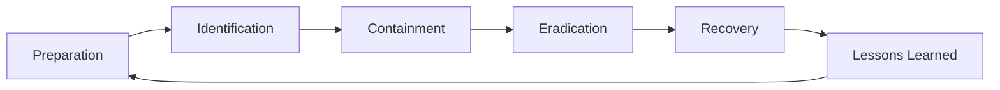
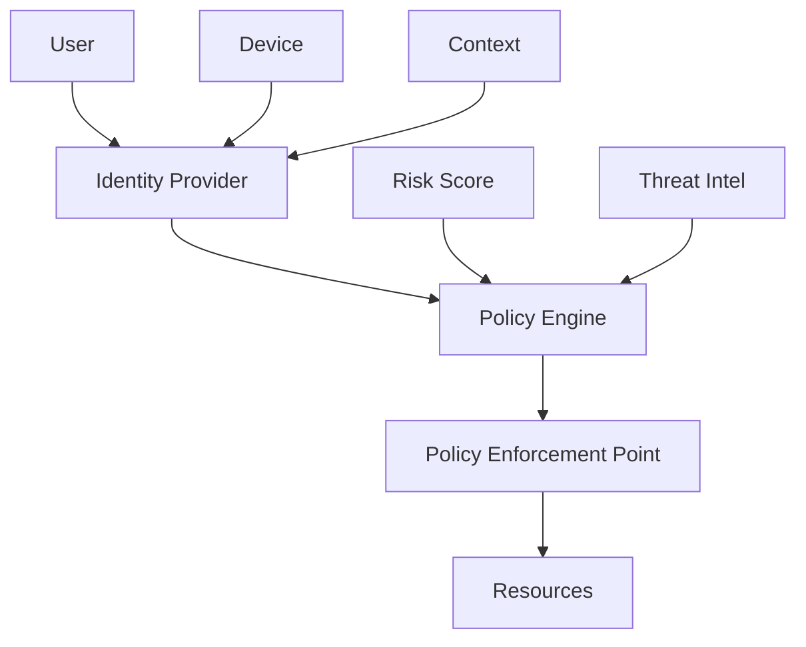
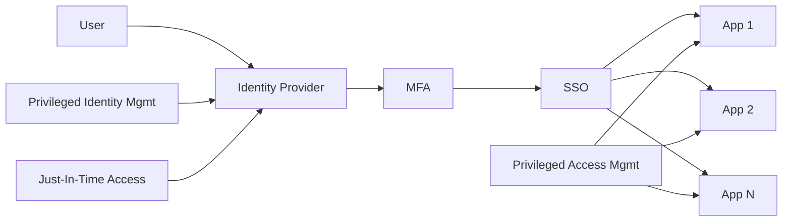
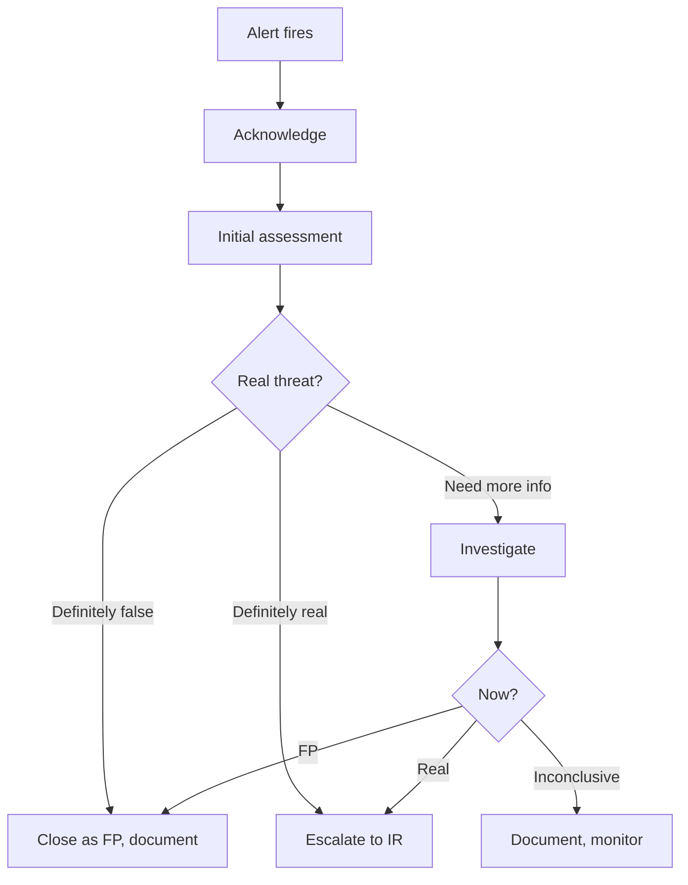
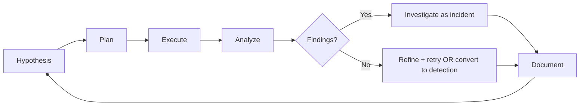
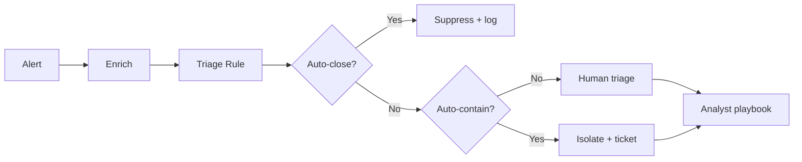
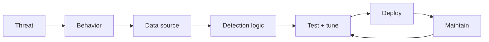

# skill: branded-document-design

Use when a Word, PowerPoint or PDF deliverable must look designed (palette, type, Thai fonts). Whole report from one Markdown → markdown-report-docx.

# Branded Document Design

> **ภาษา:** ถ้อยคำทุกบรรทัดเขียนตาม `human-writing` — skill นี้บอกรูปแบบและโครง ส่วน human-writing บอกวิธีเขียนให้คนอ่านรู้เรื่อง

> **กฎข้อเดียวของ skill นี้:** เอกสารที่ส่งออกไปต้องดูออกว่าตั้งใจออกแบบ คือมีชุดสี ชุดขนาดตัวอักษร
> และช่องไฟที่เหมือนกันทุกหน้า ไม่ใช่เปิด Word แล้วพิมพ์เลย

## เมื่อไหร่ใช้ skill นี้

- ผลลัพธ์คือ **.docx / .pptx / .pdf** ที่ลูกค้า ผู้บริหาร หรือทีมอื่นจะเปิดดู
- เอกสารต้อง **เซ็นอนุมัติ** หรือแนบไปกับสัญญา/ข้อเสนอ
- เอกสารไทย–อังกฤษปนกัน (ถ้าตั้งฟอนต์ไม่ครบจะพังง่ายมาก)
- ต้องออกเอกสารแบบเดียวกันซ้ำ ๆ และอยากให้ทุกฉบับหน้าตาเหมือนกัน

## เมื่อไหร่ **ไม่** ใช้

- ผลลัพธ์เป็น markdown ในรีโป ให้ใช้ `polished-document-style`
- ต้องแค่ **อ่าน/แกะ** ไฟล์ Office ที่ได้รับมา ให้ใช้ `anthropic-skills:docx` · `xlsx` · `pptx` · `pdf`
- ไดอะแกรมในเอกสาร markdown ให้ใช้ `markdown-visuals`
- รายงานทั้งเล่มจาก Markdown ไฟล์เดียว (ปกโลโก้กลาง · สารบัญ · ตาราง · รูป) ให้ใช้ `markdown-report-docx` ซึ่งมีสคริปต์ md → docx พร้อมแล้ว

**ลำดับที่ถูกต้อง:** เขียนเนื้อหาเป็น markdown ก่อน (polished-document-style)
→ ค่อยใช้ skill นี้ render เป็นไฟล์ส่งมอบ และแก้เนื้อหาที่ markdown เสมอ (markdown คือต้นฉบับ)

---

**ติดตั้งก่อนใช้:** `pip install python-docx python-pptx` · LibreOffice (`soffice`) สำหรับแปลงเป็น PDF · `pdftoppm` (poppler) สำหรับแปลงเป็นภาพ

## 0 · สีมาจากโปรเจกต์ — หาตามลำดับ ไม่หยุดรอ

**ถ้า markdown ต้นทางมี `doc-theme` อยู่แล้ว ให้ใช้ค่านั้น อย่าถามซ้ำ อย่าตั้งใหม่**
(ดู `polished-document-style` หัวข้อ "ธีมของเอกสาร")

ถ้ายังไม่มี ให้หาตามลำดับใน `diagram-figures` ข้อ 5 ที่เดียว (`doc-theme` → สีแบรนด์ในโค้ด โลโก้ ชุดแบรนด์ → ยังไม่มีเลย)
ยังไม่มีเลย → ใช้สีประจำบ้าน `#2A78D6` เขียน `(รอยืนยัน)` ไว้ในรายงาน แล้วทำต่อ ไม่หยุดถาม · เสนอโทนตามเนื้องาน (ดูบรรทัดถัดไป) ไว้ในรายงานให้ผู้ใช้เลือกทีหลัง
ได้สีแล้ว**เขียนกลับลง `doc-theme`** ในไฟล์ markdown เพื่อให้เอกสาร รูป และสไลด์ใช้สีเดียวกัน

โทนที่เสนอตามเนื้องาน (การแพทย์ · การเงิน · ราชการ ฯลฯ) → [`references/palette-examples.md`](references/palette-examples.md) · ลูกค้ามีแบรนด์แล้วใช้สีแบรนด์เสมอ

**สีหลักมีสีเดียว** เฉดอ่อนและเข้มทั้งหมดคำนวณจากสีนั้น ไม่เลือกเพิ่มทีละสี
สีที่ไม่ผูกกับสีหลักมีแค่สีสถานะ (สำเร็จ · เตือน · ผิดพลาด) และต้องคงความหมายเดิมเสมอ


## 0.1 · หน้าตาเอกสารต่อจากหน้าตาแอป — ทำก่อน render ครั้งแรก

> ค่าตั้งต้นของ skill นี้ (Tahoma · ปกแถบสีทึบ · ตารางมีเส้นทุกช่อง) คือ**พื้น** ไม่ใช่หน้าตาส่งมอบ
> ใช้ค่าตั้งต้นตรง ๆ = เอกสารที่ดูเหมือนพิมพ์จาก Word ทุกบริษัท ทั้งที่แอปของโปรเจกต์ผ่านด่านสวยแล้ว

1. **มีตัวตนอยู่แล้วไหม** — ดู brand kit เดิม (`graphic-design:brand-kit` ถ้าติดตั้ง ใช้สีและฟอนต์จากชุดนั้น) · `assets/logo/` · `docs/design/` · mockup ที่ผ่านด่านสวย (คะแนนใน `docs/BUILD-PLAN.md`) · `docs/README.md` ช่อง `doc-theme` → มี: เอกสารต้องใช้โลโก้ (ปก + หัวหน้า) สีแบรนด์ และลวดลายเดียวกับแอป · ไม่มี: ทำตามข้อ 0
2. **3 แนวขนานกัน** (`parallel-attempts-pick-best` · agent ที่มี Bash ตัวใหม่แนวละตัว — ดู `doc-cover-design` ข้อ 7) — แต่ละแนวทำ HTML จำลองหน้า A4: ปก · หน้าเนื้อหาที่มีตารางข้อกำหนดจริง 4 แถว + callout · หน้าสารบัญหรือหน้ารูป · **รูป 1 รูปทำใหม่ตามแนว** (ใช้ `diagram-figures`) · หัวไฟล์บอกวิธีทำแต่ละชิ้นใน Word จริง · แนวต้องต่างกันจริง เช่น ปกมืดต่อจากแอป / รายงานสว่างแบบบรรณาธิการ / สเปกวิศวกรรม
3. **ผู้ตรวจ 2 ตัวที่ไม่ได้ทำ** ให้คะแนน 1–5 (ผ่าน = 4): ความประทับใจแรก · ต่อเนื่องกับแอป · ความประณีต (ตารางไทยยาว 60 แถว ไม่ตัดกลางคำ · สเกลตัวอักษร · คอนทราสต์) · รูปอ่านออกเมื่อวางจริง · สร้างใน Word ได้จริง → **ผสมได้** (ปกจากแนวหนึ่ง เนื้อจากอีกแนว) ถ้าผู้ตรวจระบุชิ้นชัด
4. ลงมือที่ตัว render (ไม่แก้ทีละไฟล์ .docx) → render ทุกฉบับ → **ด่านสวยของเอกสาร**: ผู้ตรวจ 2 ตัวใหม่ดูภาพหน้าจริง (ปก · สารบัญ · หน้าเปิดบท · หน้าตารางยาว · หน้ารูป) ใช้ 5 แกนข้างบน ใช้คะแนนที่ต่ำกว่า · เพดาน 3 รอบตาม `ui-craft/references/states-and-checks.md` · คะแนนทุกรอบลง `docs/BUILD-PLAN.md`
5. **ฟอนต์:** ใช้ฟอนต์ไทยของแบรนด์ที่ติดตั้งในเครื่องและฝังในไฟล์ (`embed_fonts`) · Tahoma เป็นทางสำรองเมื่อฝังไม่ได้ · **ห้ามตั้งข้อความไทยด้วยฟอนต์ mono** (Cascadia/Consolas ไม่มีอักษรไทย) — mono ใช้กับรหัส คีย์ ตัวเลขเท่านั้น
6. **รูปในเอกสาร · กฎที่ด่านสวยจับได้บ่อย · ปก** (ขนาดพิกเซลขั้นต่ำ กฎใน `check` ของตัว render สูตรปก) → [`references/word-layout.md`](references/word-layout.md) หัวข้อท้ายไฟล์

---

## 1 · Design tokens — ห้าม hardcode สีนอกตารางนี้

ตารางนี้กำหนด**หน้าที่**ของแต่ละ token ไม่ได้กำหนดค่าสี · ค่าจริงมาจากข้อ 0 แล้วตั้งครั้งเดียวด้วย `use_brand(...)`

- token: `brand` · `brand_2` · `brand_deep` · `brand_tint` · `brand_tint_2` · `text` · `text_body` · `text_muted` · `line` + สีสถานะ 6 ตัว (สำเร็จ · ข้อมูล · เตือน · ผิดพลาด · เน้น · เป็นกลาง) ที่**ไม่เปลี่ยนตามแบรนด์**
- เลือกสีตามความหมาย ไม่ใช่ตามความสวย (แดง = อันตราย/ผิดจริงเท่านั้น) · ใช้ชุดความหมายเดียวกับไดอะแกรม
- เกณฑ์ที่ต้องผ่านทุกชุดสี: เนื้อความบนพื้น ≥ 4.5:1 · หัวข้อบนพื้น ≥ 7:1 · พิมพ์ขาวดำแล้วยังแยกลำดับชั้นออก · ไม่ผ่านให้ปรับความเข้ม ไม่เปลี่ยนสี
- ตัวอักษรไม่ใช้ดำสนิท (ใช้ `text_body`) · **อย่าเพิ่มขนาดตัวอักษรนอกสเกล** (เนื้อความ Word 11pt · สไลด์ 17pt)

ตาราง token เต็ม · ตารางความหมายของสี · สเกลตัวอักษร (pt) · องค์ประกอบที่ใช้ซ้ำ + เมธอด → [`references/tokens-and-type.md`](references/tokens-and-type.md) — เปิดเมื่อตั้งธีมหรือเลือกขนาด/สี · ตัวอย่างชุดสีที่เคยใช้ → [`references/palette-examples.md`](references/palette-examples.md)

---

## 2 · ฟอนต์และภาษาไทย — จุดที่พังบ่อยที่สุด

ใช้ฟอนต์ไทยของแบรนด์ตามข้อ 0.1 ข้อ 5 ก่อน · ไม่มีหรือฝังไม่ได้ ใช้ **Tahoma** เป็นทางสำรอง · กฎที่ห้ามพลาด:

- 🚨 Word ถือว่าไทยเป็น *complex script* — **ห้ามตั้งฟอนต์/ขนาด/ตัวหนาเองด้วยมือ** ใช้ `style_run()` ใน `brandkit.py` (ตั้ง `w:szCs` `w:bCs` `w:iCs` และ `w:rFonts` ครบ 4 ช่อง)
- 🚨 ฟอนต์ละตินกับไทยคนละตัว → ตั้ง `bk.FONT` กับ `bk.LATIN_FONT` แล้วเรียก `bk.thai_runs(doc.element.body)` กับทุก header/footer ก่อน `save()`
- ระยะบรรทัด 1.3–1.35 (Tahoma) · **ห้าม justify** ย่อหน้าไทย · ส่ง PDF ให้ export จาก Word จริง หรือเปิดตรวจด้วยตาก่อน (LibreOffice ตัดคำไทยต่างจาก Word)
- Linux ไม่มี Tahoma → Loma/Sarabun · ReportLab จัดวรรณยุกต์ผิด

รายละเอียดกับดักฟอนต์คู่ · ฝังฟอนต์ · ฟอนต์ variable · ตัวไทยดูเล็กบน Linux → [`references/thai-fonts.md`](references/thai-fonts.md) — เปิดเมื่อตั้งฟอนต์หรือ PDF เพี้ยน

---

## 3 · โครงหน้าเอกสาร Word

โครงเอกสาร: หน้าปก (โปรเจกต์มีโลโก้และ mockup แล้ว → ปกเฉพาะโปรเจกต์ตาม [`doc-cover-design`](../doc-cover-design/SKILL.md) · ไม่มีตัวตนใช้แบบตั้งต้น) → สารบัญ (field TOC) → เนื้อหา (H1 มีเลขข้อ · keep-with-next ทุกหัวข้อ) → ตารางลงนามอนุมัติ · footer "หน้า N" กลางหน้า สีเทา 9pt · โครงเต็มทีละบรรทัด → [`references/word-layout.md`](references/word-layout.md) หัวข้อ "โครงหน้าเอกสาร"

**ปกเข้ม** (แอปหรือแบรนด์ใช้หน้าจอสีเข้ม) → `doc.cover(..., style="night")` · ตัวอย่าง `scripts/example_srs.py` · ภาพ `examples/example_srs-preview.png` · รายละเอียดและบทเรียนจากเจ้าของงาน → [`references/word-layout.md`](references/word-layout.md) กฎที่ต้องจำทุกครั้ง:
- 🚨 ภาพพื้นปกและโลโก้ห้ามอยู่ใน header หน้าแรก (Word แสดงจางตอนแก้ไฟล์) — ยึดกับย่อหน้าแรกของปก

**หัวตารางหน้าใน ห้ามใช้พื้นสีเข้มเต็มแถบ** · พื้นปกเข้ม ขนาดโลโก้ ตัวหนังสือเล็ก เส้นแสงใต้ชื่อ → [`references/word-layout.md`](references/word-layout.md)

หน้ากระดาษ A4 · ขอบ บน/ล่าง 2.2 ซม. · ซ้าย/ขวา 2.0 ซม. ได้ความกว้างเนื้อหา **17 ซม. = 9638 twips** (`BODY_TWIPS`)
(ใช้ตัวเลขนี้ตั้งความกว้างคอลัมน์ตารางให้รวมกันพอดี)

---

## 4 · องค์ประกอบที่ใช้ซ้ำ

องค์ประกอบ (`cover()` · `table()` · `pill_table()` · `kpi_row()` · `callout()` · `figure()` · `code()` · `signoff()`) หน้าตาและเมธอดครบ → [`references/tokens-and-type.md`](references/tokens-and-type.md)

**สัดส่วนที่พอดี:** callout ไม่เกิน 3–5 กล่องต่อ 10 หน้า · KPI strip 3–5 ช่อง · ตารางเกิน 6 คอลัมน์ให้เปลี่ยนเป็นหน้าแนวนอน (`landscape_section()`)

---

## 5 · วิธีใช้ brandkit

นำเข้า: `from brandkit import BrandDoc, use_brand, to_pdf` (วาง `scripts/` ไว้ใน path หรือ copy `brandkit.py` มาข้างงาน) · สไลด์ → `brandkit_pptx.BrandDeck` · เด็คพูด → `brandkit_stage.StageDeck`

โค้ดตัวอย่างครบ (Word · สไลด์ · เด็ค Stage) → [`references/brandkit-usage.md`](references/brandkit-usage.md) · เมธอดทั้งหมด → `references/api.md` · สคริปต์ที่รันได้ `scripts/example_srs.py` · `scripts/example_deck.py`

**เด็ค Stage** (ค่าเริ่มต้นของเด็คที่ใช้พูด): สี `accent`/`bg` หาตาม `diagram-figures` ข้อ 5 · ไม่มีเลยใช้ `#2A78D6` พื้น `09090A` + `(รอยืนยัน)` · รายละเอียด → `references/brandkit-usage.md`

---

## 6 · ตรวจงานด้วยตา — ขั้นตอนที่ห้ามข้าม

เอกสารที่ยังไม่มีใครเปิดดูหน้าจริง ถือว่ายังไม่เสร็จ เพราะอาจมีตารางล้นขอบ หัวข้อค้างท้ายหน้า
วรรณยุกต์ลอย ปัญหาเหล่านี้ดูจากโค้ดไม่เห็น
render เป็น PDF แล้วแปลงเป็นภาพ แล้ว **เปิดภาพดูจริงทุกหน้า** (Read tool) ก่อนส่งมอบ · คำสั่ง `soffice` · `pdftoppm` และรายการตรวจ 7 ข้อ → [`references/visual-check.md`](references/visual-check.md)

---

## 7 · Anti-patterns

- ❌ **ใช้ Heading style ที่มากับ Word** → ใช้ `h1()/h2()/h3()`
- ❌ **เส้นตารางดำหนาแบบค่าเริ่มต้น** → เส้น `line` 0.5pt
- ❌ **ตัวอักษรสีดำสนิท** → ใช้ `text_body`
- ❌ **หัวตารางตัวหนาแต่ไม่มีพื้นสี**
- ❌ **ปล่อยความกว้างคอลัมน์ให้ Word คิดเอง** → `fixed_widths()` เสมอ
- ❌ **อีโมจิเยอะเกิน**
- ❌ **ส่งไฟล์โดยไม่เคย render ดู**
- ❌ **ใช้หน้าตาตั้งต้นของ skill เป็นเอกสารส่งมอบ ทั้งที่แอปมีตัวตนแล้ว** → ทำข้อ 0.1
- ❌ **รูปกว้าง 2000px วางในหน้าแนวตั้ง 17 ซม. โดยไม่คิดขนาดตัวอักษร** → ตัวอักษรเหลือราว 5pt (ข้อ 0.1 ข้อ 6)
- ❌ **ภาพตกแต่งบนปกที่ไม่มีใครบอกว่าว้าว** → ตัดออก ให้ตัวอักษรเป็นจุดเด่น (references/word-layout.md ข้อ 8)
- ❌ **สร้าง .docx โดยไม่เก็บ markdown ต้นฉบับ**

เหตุผลและสิ่งที่ใช้แทนของแต่ละข้อ → [`references/anti-patterns.md`](references/anti-patterns.md)

---

## 8 · เชื่อมกับ skill อื่น

| ต้องการ | ใช้คู่กับ |
|---------|-----------|
| โครงเนื้อหา/สำนวนเอกสารทางการ · **ธีมสีของเอกสาร** | `polished-document-style` |
| ไดอะแกรมที่จะเอามาแปะเป็นรูป | `diagram-figures` (รูปออกแบบ) · `software-diagrams` (Mermaid) → export PNG → `figure()` |
| อ่านไฟล์ Office ที่ลูกค้าส่งมา | `anthropic-skills:docx` · `xlsx` · `pptx` · `pdf` |
| สเปรดชีตส่งมอบ | `anthropic-skills:xlsx` (โทเคนสีชุดเดียวกันใช้ได้) |
| เนื้อหาและความครบถ้วนของเอกสาร SRS | `srs-writing` |
| โครงเรื่องและเลย์เอาต์ของสไลด์ | `presentation-design` |
| เด็คนำเสนอเป็น .html ไฟล์เดียว | `html-slide-deck` · มี .pptx แล้ว → `pptx-to-html-deck` |
| ไดอะแกรมที่วาดด้วย Mermaid ธีมเดียวกัน | `software-diagrams` |
| ที่มาของระบบสีและตัวอักษร · โลโก้ | `graphic-design` |

---

## ไม่ให้ดูเหมือน AI ทำ

ก่อนส่ง ไล่ข้อ 3 ของ `no-ai-look` — งาน HTML รันสคริปต์ของมัน · ภาพและไฟล์อื่นดูด้วยตา 8 ข้อ · ข้อห้ามในไฟล์นี้เป็นส่วนเฉพาะของงานนี้ รายการเต็มทุกสื่ออยู่ที่นั่น

## ตัวย่อ

เขียนตัวย่อเต็มครั้งแรกเสมอ แล้ววงเล็บตัวย่อไว้ — เช่น Model Context Protocol (MCP)
หลังจากนั้นใช้ตัวย่อได้ ดูรายละเอียดใน skill `spell-out-abbreviations`


## reference: anti-patterns.md

# Anti-patterns — เหตุผลและสิ่งที่ใช้แทน

ย้ายมาจาก `SKILL.md` ข้อ 7 (ไม่แก้ถ้อยคำ) · หัวข้อสั้นอยู่ใน `SKILL.md`

- ❌ **ใช้ Heading style ที่มากับ Word** — จะทับสีที่ตั้งไว้ ให้ใช้ `h1()/h2()/h3()`
  ซึ่งตั้ง `outlineLvl` เอง สารบัญ (TOC) จึงยังเห็นหัวข้อ
- ❌ **เส้นตารางดำหนาแบบค่าเริ่มต้น** — เอกสารดูเก่าทันที ใช้เส้นสี `line` หนา 0.5pt ระหว่างแถว (ใต้แถวหัวคือเส้นแบรนด์ 1.5pt)
- ❌ **ตัวอักษรสีดำสนิท** — ให้ใช้ `text_body` ซึ่งเป็นเทาเข้ม เนื้อความจะนุ่มขึ้นมาก
- ❌ **หัวตารางตัวหนาแต่ไม่มีพื้นสี** — ตารางข้ามหน้าแล้วคนอ่านไม่รู้ว่าเริ่มตรงไหน
- ❌ **ปล่อยความกว้างคอลัมน์ให้ Word คิดเอง** — ต้อง `fixed_widths()` เสมอ
  ไม่งั้นคอลัมน์รหัสจะกว้างเท่าคอลัมน์รายละเอียด
- ❌ **อีโมจิเยอะเกิน** — 1 ตัวต่อ callout พอ ไม่ใส่ในหัวข้อทุกอัน
- ❌ **ส่งไฟล์โดยไม่เคย render ดู** — ดูข้อ 6
- ❌ **สร้าง .docx โดยไม่เก็บ markdown ต้นฉบับ** — รอบหน้าแก้ไม่ได้


## reference: api.md

# brandkit API — อ้างอิงเมธอด

ทุกเมธอดคืนอ็อบเจกต์ที่สร้าง (paragraph / table / slide) จึงปรับแต่งต่อได้

## สารบัญ

1. [brandkit.py — Word (.docx)](#brandkitpy--word-docx)
2. [brandkit_pptx.py — สไลด์ (.pptx)](#brandkitpptxpy--สไลด์-pptx)
3. [สูตรความกว้างคอลัมน์ (Word)](#สูตรความกว้างคอลัมน์-word)

---

## brandkit.py — Word (.docx)

### สร้างเอกสาร

```python
BrandDoc(path_template=None, page="A4", margins_cm=(2.2, 2.0, 2.2, 2.0),
         footer_text="หน้า")
```

| พารามิเตอร์ | ความหมาย |
|-------------|----------|
| `path_template` | ไฟล์ .docx/.dotx ที่ใช้เป็นแม่แบบ (มี header/logo ขององค์กรอยู่แล้ว) |
| `page` | `"A4"` หรือ `"Letter"` |
| `margins_cm` | (บน, ขวา, ล่าง, ซ้าย) |
| `footer_text` | คำนำหน้าเลขหน้า · `""` = เลขเปล่า |

### บล็อกระดับหน้า

| เมธอด | หมายเหตุ |
|-------|----------|
| `cover(title, subtitle, meta, note, logo, logo_width_cm=None, eyebrow=None, meta_rows=None, top_space_pt=24, page_break=True, style="light", art_colors=None)` | โลโก้รับได้ทั้ง .png และ .emf แต่ **.svg ใช้ไม่ได้ใน python-docx** ต้องแปลงเป็น PNG ก่อน (`rsvg-convert -w 600` หรือ `cairosvg`) |
| `cover(..., style="night")` | **ปกเข้มเต็มหน้า** (ดูตัวอย่าง `examples/example_srs-preview.png`): พื้นเทาเข้ม `#1C1C22` + แสงจางสีแบรนด์ · `logo` (ไม่ใส่ = ไม่มีโลโก้) เล็กมุมซ้ายบน กว้าง 4.6 ซม. · `eyebrow` → ชื่อเอกสาร (32pt · ยาวเกิน 2 บรรทัดลดเป็น 26pt) → `subtitle` → เส้นแสงเต็มแนวข้อความ · `meta_rows` ค่าสั้น (≤18 ตัวอักษร ไม่เกิน 4 ค่า) เป็นตาราง 4 ช่อง ที่เหลือเป็นแถว ป้าย/ค่า · `note` ท้ายสุด · ปกไม่มี footer · `art_colors=(สี1, สี2, สี3)` สีเส้นแสงจากซ้ายไปขวา และแสงพื้น (ค่าเริ่มต้น `brand_2` → `brand` → `brand` อ่อน) · ภาพพื้น/โลโก้/เส้นยึดกับย่อหน้าในเนื้อหา ไม่ใช่ header · ต้องมี numpy + pillow (`cover_art.py`) · `logo_width_cm` ค่าเริ่มต้น 2.6 (light) / 4.6 (night) |
| `toc(heading="สารบัญ", levels="1-3")` | แทรก field TOC แล้วใน Word กด **Ctrl+A แล้ว F9** เพื่อให้รายการขึ้น (ตอนสร้างจะยังว่าง) |
| `page_break()` | |
| `landscape_section()` | เปิดส่วนแนวนอนสำหรับตารางกว้าง |

### หัวข้อและข้อความ

| เมธอด | ผลลัพธ์ |
|-------|---------|
| `h1(text)` `h2(text)` `h3(text)` | 16 / 12.5 / 11.5 pt · bold · brand / brand_deep / text · ตั้ง `outlineLvl` ให้ TOC เห็น |
| `para(text, size, color, bold, italic, align, space_after)` | `align` = `"center"｜"right"｜"justify"` (ไทยอย่าใช้ justify) |
| `rich([(text, opts), ...])` | หลายรูปแบบในย่อหน้าเดียว เช่น `[("สถานะ: ", {"bold": True}), ("อนุมัติ", {"color": "green"})]` |
| `bullets([...], style="List Bullet")` | `style="List Number"` สำหรับเลขลำดับ |
| `code(text)` | บล็อกโค้ดพื้นเทา |

### ตารางและข้อมูล

| เมธอด | หมายเหตุ |
|-------|----------|
| `table(headers, rows, widths=None, zebra=False, align=None, first_col_bold=False, size=None, header_style="tint")` | `widths` หน่วย twips รวม **9638** (`BODY_TWIPS`) สำหรับ A4 ขอบ 2 ซม. · `align` = list ต่อคอลัมน์ · `header_style="tint"` (ค่าเริ่มต้น) หัวพื้น `brand` ผสมขาว 80% ตัวหนา `brand_deep` ไม่มีเส้นบน เส้น `brand` 1.5pt ใต้หัวเส้นเดียว เส้นแถวบาง ไม่มีเส้นตั้ง · `"classic"` = แบบเดิม (หัว `brand_tint` กริดเทาบาง) |
| `pill_table(headers, rows, status_col, palette, widths)` | `palette = {"เสร็จ": "green", "ค้าง": "red"}` · โทนที่ใช้ได้: green blue amber red violet grey |
| `kpi_row([(value, label), ...])` | 3–5 ช่องพอดี |
| `signoff([(role, name), ...])` | ตารางเซ็นอนุมัติ |

### อื่น ๆ

| เมธอด | หมายเหตุ |
|-------|----------|
| `callout(kind, title, body)` | kind = `tip｜note｜warning｜critical｜success｜question` |
| `figure(image_path, caption, width_cm=15.5, number=None)` | `number=1` จะขึ้นต้นคำบรรยายว่า "รูปที่ 1 — " |
| `save(path)` | |

### ฟังก์ชันระดับโมดูล

| ฟังก์ชัน | ใช้เมื่อ |
|----------|---------|
| `use_brand(**tokens)` | เปลี่ยนชุดสีทั้งชุด ต้องเรียก **ก่อน** สร้าง `BrandDoc` |
| `style_run(run, size, color, bold, italic, mono)` | ตั้งฟอนต์เอง (ครอบคลุม complex-script ให้แล้ว) |
| `shade(cell, token)` · `left_accent(cell, token, size)` | ระบายพื้น / แถบสีซ้ายของเซลล์ |
| `fixed_widths(table, widths)` | บังคับความกว้างคอลัมน์ |
| `set_borders(table)` · `row_borders(table)` · `no_borders(table)` · `cell_border(cell, edge, color, size)` | `row_borders` = เส้นแนวนอนอย่างเดียว · `cell_border(..., color=None)` = ไม่มีเส้นด้านนั้น |
| `mix(color, other="FFFFFF", amount=0.5)` | ผสมสีทำสีอ่อน/เข้มจาก palette |
| `repeat_header(row)` · `keep_with_next(paragraph)` | |
| `add_field(paragraph, "PAGE")` | แทรก field ของ Word |
| `to_pdf(docx_path, outdir)` | เรียก LibreOffice แปลงเป็น PDF |

---

## brandkit_pptx.py — สไลด์ (.pptx)

```python
BrandDeck(template=None)      # 16:9 (13.333 × 7.5 นิ้ว)
```

| เมธอด | สไลด์ที่ได้ |
|-------|-------------|
| `title_slide(title, subtitle, meta)` | พื้นฟ้าอ่อน + เส้นแบรนด์คั่น |
| `section(title, kicker=None)` | แถบแบรนด์แนวตั้งซ้าย + ชื่อส่วน |
| `bullets_slide(title, items, subtitle=None)` | หัวข้อ + ขีดม่วงใต้หัวข้อ + bullet 17pt |
| `kpi_slide(title, items, subtitle=None)` | การ์ดตัวเลข |
| `table_slide(title, headers, rows, col_widths, subtitle, status_col, palette)` | `col_widths` เป็นสัดส่วน เช่น `[1, 4, 2, 2]` |
| `image_slide(title, image_path, caption, subtitle)` | รูปกลางสไลด์ พอดีกรอบอัตโนมัติ |
| `quote_slide(text, source)` | สไลด์คำพูด/ข้อสรุป |
| `save(path)` | |

**ข้อจำกัดที่ต้องรู้**

- สไลด์ทุกอันสร้างจาก layout ว่าง (`slide_layouts[6]`) จึงไม่มีช่อง placeholder ให้แก้ใน PowerPoint
  แบบเทมเพลตปกติ ถ้าลูกค้าต้องแก้เองเยอะ ให้ส่ง `template=` เป็นไฟล์ .pptx ขององค์กรแทน
- ตารางใน python-pptx ไม่มี API ปิดเส้นขอบตรง ๆ ถ้าอยากได้ตารางไม่มีเส้น ให้เรียงกล่องข้อความแทน
- ความสูงแถวตารางเป็นค่าต่ำสุด ข้อความยาวจะดันแถวสูงขึ้นเอง ให้เผื่อพื้นที่

---

## brandkit_stage.py — เด็ค Stage (.pptx)

```python
StageDeck(accent="2A78D6", bg="09090A", project="", template=None,
          head_font="Chakra Petch", body_font="IBM Plex Sans Thai", **colors)
# accent / bg = สีหลักกับสีพื้นจากดีไซน์ของโปรเจกต์ · colors = สีที่โปรเจกต์กำหนดไว้แล้ว เช่น text="1B2430"
```

ทุกแผ่นยกเว้นปกและคั่นบทมี: สี่เหลี่ยมสีหลัก + ชื่อหมวด (`kicker`) · หัวสไลด์ 28 pt · เส้นท้ายกระดาษ · `PROJECT · หมวด` · เลขหน้า 2 หลัก

| เมธอด | สไลด์ที่ได้ |
|-------|-------------|
| `cover(title, lines, meta, logo=None, mark=None)` | ชื่อ 60 pt + ขีดสีหลัก · `lines[1]` เป็นสีหลัก · `mark` = สัญลักษณ์ใหญ่จางทางขวา (ไม่ใส่ = วงแหวนจาง) |
| `section(number, title, note)` | คั่นบท — เลขใหญ่สีหลัก |
| `figure(kicker, title, image, caption, subtitle)` | รูปผังเต็มแผ่น (เรนเดอร์ด้วย `#bg=` เดียวกับเด็ค) |
| `compare(kicker, title, headers, rows, widths=(1, 1.85, 1.95))` | ตารางเส้นคั่นแถว · คอลัมน์ 1 เทา 2 หนาขาว 3 เนื้อความ · ไม่เกิน 5 แถว |
| `stats(kicker, title, items, subtitle)` | ตัวเลขใหญ่ 2–4 ช่อง + ตัวอย่างถาม/ตอบใต้ตัวเลข |
| `steps(kicker, title, rows, example_head, note)` | ขั้นตอนมีเลข · `rows = [(ชื่อ, ทำอะไร, ตัวอย่าง)]` ไม่เกิน 6 ขั้น |
| `points(kicker, title, points, image, caption, side, side_caption)` | ภาพซ้าย + ใจความมีขีดสีหลัก · `side` = ภาพเล็กขวา เช่น QR |
| `statement(kicker, text, sub)` | ข้อความเดียวกลางแผ่น |
| `save(path)` | |

ตัวช่วยสี: `make_theme(accent, bg)` คืนชุดสีทั้งหมด · `fit(color, bg)` ปรับความสว่างโดยคงความสดจนอ่านออกบนพื้นนั้น · `is_dark(bg)` · `contrast(a, b)`


| จำนวนคอลัมน์ | ตัวอย่าง widths (รวม 9638) |
|:---:|---|
| 2 | `[2600, 7038]` — หัวข้อ/รายละเอียด |
| 3 | `[1400, 6238, 2000]` — รหัส/รายการ/ผู้รับผิดชอบ |
| 4 | `[1100, 4478, 1900, 2160]` — รหัส/รายการ/ผู้รับผิดชอบ/สถานะ |
| 5 | `[1000, 1800, 2838, 2000, 2000]` |
| 6 ขึ้นไป | ใช้ `landscape_section()` (พื้นที่ 14570 twips) |


## reference: brandkit-usage.md

# วิธีใช้ brandkit — โค้ดตัวอย่าง

อ่านเมื่อเริ่มเขียนสคริปต์สร้างไฟล์จริง · เมธอดทั้งหมดอยู่ใน `api.md`

## เอกสาร Word (`brandkit.py`)

```python
import sys; sys.path.insert(0, "scripts")     # หรือ copy brandkit.py มาไว้ข้างงาน
from brandkit import BrandDoc, use_brand, to_pdf

doc = BrandDoc()                                # A4 · Tahoma · โทน Apps Track
doc.cover("เอกสารข้อกำหนดซอฟต์แวร์ (Software Specification)",
          subtitle="ระบบ Apps Track — Project Control & Monitor",
          meta="เวอร์ชันเอกสาร 3.5  •  ปรับปรุง 19 กรกฎาคม 2026",
          logo="asset/AppsTrack_Logo_Badge.png")
doc.toc()

doc.h1("1. ภาพรวมระบบ")
doc.para("eitprojects เป็นระบบบริหารและติดตามโครงการ ...")
doc.kpi_row([("19", "โครงการ"), ("115", "Work items"), ("103", "Open tasks")])
doc.table(["หัวข้อ", "รายละเอียด"],
          [["URL ระบบ", "https://project.eitaccount.cloud"]],
          widths=[2600, 7038])                  # รวม = 9638
doc.callout("warning", "ข้อควรระวัง", "Token ต้องไม่ถูกแสดงกลับใน UI หลังบันทึก")
doc.figure("diagrams/context.png", "ภาพรวมระบบและขอบเขตการใช้งาน", number=1)
doc.pill_table(["รหัส", "งาน", "สถานะ"], rows, status_col=2,
               palette={"เสร็จ": "green", "กำลังทำ": "amber", "ค้าง": "red"})
doc.signoff([("Product Owner", "—"), ("Tech Lead", "—")])
doc.save("SRS.docx")
```

## สไลด์ (`brandkit_pptx.py`)

สไลด์ใช้ `brandkit_pptx.py` ซึ่งกินโทเคนชุดเดียวกัน:

```python
from brandkit_pptx import BrandDeck
d = BrandDeck()                                  # 16:9
d.title_slide("Apps Track", "Project Control & Monitor", "19 กรกฎาคม 2026")
d.section("1 · ภาพรวมระบบ", kicker="ส่วนที่ 1")
d.bullets_slide("ขอบเขตงาน", ["...", "..."], subtitle="สรุปจาก SRS v3.5")
d.kpi_slide("ตัวเลขสำคัญ", [("19", "โครงการ"), ("115", "Work items")])
d.table_slide("สถานะ Milestone", headers, rows, col_widths=[1, 4, 2, 2],
              status_col=3, palette={"เสร็จ": "green", "กำลังทำ": "amber"})
d.image_slide("สถาปัตยกรรม", "diagrams/arch.png", caption="ภาพรวมองค์ประกอบ")
d.save("deck.pptx")
```

เมธอดทั้งหมดอยู่ใน `references/api.md` ส่วนไฟล์ตัวอย่างที่รันได้จริงคือ
`scripts/example_srs.py` (เอกสาร) · `scripts/example_deck.py` (สไลด์ `BrandDeck`)

## เด็ค "Stage" (`brandkit_stage.py`) — ค่าเริ่มต้นของเด็คที่ใช้พูด

`brandkit_stage.py` ทำเด็คโครงเดียวกับต้นแบบ หัวเรื่อง Chakra Petch เนื้อความ IBM Plex Sans Thai ส่วน**สีพื้นและสีหลักมาจากดีไซน์ของโปรเจกต์** พื้นเข้มหรือสว่างก็ได้
(ต้นแบบ: X Fitness Chatbot Summary v1.2 · ตัวอย่างที่รันแล้ว `examples/example_stage.pptx`)

```python
from brandkit_stage import StageDeck
d = StageDeck(accent="E10613", bg="09090A", project="X Fitness Chatbot")   # สีหลัก · สีพื้นของโปรเจกต์
d.cover("X Fitness Chatbot", ["สรุปการทำงานของแชตบอท", "ตอบจากข้อมูลจริง และไม่ถูกหลอก"],
        meta="ทีมพัฒนา · ตุลาคม 2569", logo="logo.png", mark="mark.png")
d.figure("องค์ประกอบของระบบ", "แอปเดียวรับทุกช่องทาง ความฉลาดเรียกจาก Typhoon",
         "fig-flow-dark.png", caption="หน้าเว็บ + LINE OA → FastAPI → LightRAG + Typhoon")
d.save("deck.pptx")
```

- **สีมาจากดีไซน์ของโปรเจกต์ 2 ค่า** คือ `accent` (สีหลัก) กับ `bg` (สีพื้น) หาตามลำดับใน `diagram-figures` ข้อ 5 (`doc-theme` → ดีไซน์ในโค้ด เช่น `--primary` · `--background` · ธีม Tailwind · โหมดมืด/สว่างของแอป → โลโก้และชุดแบรนด์ → ยังไม่มีเลยใช้สีประจำบ้าน `#2A78D6` พื้น `09090A` แล้วเขียน `(รอยืนยัน)`) ห้ามใช้สีของต้นแบบ
- เทาทุกระดับคำนวณจาก `bg` (พื้นเข้มผสมขาว พื้นสว่างผสมดำ) จึงอมโทนเดียวกับพื้นของโปรเจกต์ · `accent_hi` คือสีหลักที่ปรับความสว่างจนอ่านออกบนพื้นนั้น ใช้กับตัวเลขใหญ่ เลขลำดับ และคำเน้น · โปรเจกต์ที่กำหนดสีตัวหนังสือไว้แล้ว ส่งทับได้ เช่น `text="1B2430"`
- ฟอนต์ใช้ของโปรเจกต์ได้ (`head_font=` · `body_font=`) ถ้าโปรเจกต์ยังไม่มี ใช้ Chakra Petch + IBM Plex Sans Thai
- **รูปผังต้องใช้สีพื้นเดียวกับเด็ค** — เรนเดอร์ `diagram-figures` ด้วย `#accent=<สีหลัก>&bg=<สีพื้น>` (ตอนนี้มีใน `figure-flow.html`)
- **ต้องติดตั้งฟอนต์ Chakra Petch และ IBM Plex Sans Thai** (Google Fonts · ใช้ฟรี) ในเครื่องที่เปิดไฟล์ ถ้าเครื่องปลายทางไม่มี ให้ส่ง PDF คู่ไปด้วย หรือสร้างใหม่ด้วย `head_font="Tahoma", body_font="Tahoma"`
- ถ้าจะพิมพ์ ให้สร้างอีกชุดด้วย `bg="FFFFFF"` แทนการใช้พื้นเข้มเปลืองหมึก · `BrandDeck` (แถบสีด้านบน) ยังใช้ได้กับรายงานที่ส่งให้อ่านเอง


## reference: palette-examples.md

# ตัวอย่างชุดสีที่เคยใช้จริง

> ⚠️ **นี่คือตัวอย่าง ไม่ใช่ค่ามาตรฐาน**
> เลือกสีจากเนื้องานตามข้อ 0 ของ `SKILL.md` ก่อนเสมอ
> ใช้ไฟล์นี้เพื่อดูว่าชุดที่ครบและผ่านเกณฑ์ contrast หน้าตาเป็นอย่างไร ไม่ใช่เพื่อคัดลอก

## ชุด A — น้ำเงิน–ม่วง (ซอฟต์แวร์ทั่วไป · สกัดจาก Apps Track)

โทนสว่าง โปร่ง นุ่มนวล ตัวอักษรเทาเย็น

```python
use_brand(
    brand="2A78D6", brand_2="6A5CD6", brand_deep="2A4C86",
    brand_tint="EDF1FB", brand_tint_2="F6F8FD",
    text="333B4A", text_body="414957", text_muted="7D8492", line="E4E7EE",
)
```

## ชุด B — เขียวอมฟ้า (การแพทย์ · สุขภาพ)

```python
use_brand(
    brand="0E8F86", brand_2="2F9E6E", brand_deep="0B5F5A",
    brand_tint="E6F4F2", brand_tint_2="F3FAF9",
    text="2C3A38", text_body="3A4846", text_muted="76857F", line="E1EAE8",
)
```

## ชุด C — กรมท่า (ราชการ · กฎหมาย)

```python
use_brand(
    brand="1F3C88", brand_2="5B4B8A", brand_deep="14275C",
    brand_tint="E8ECF7", brand_tint_2="F5F7FC",
    text="2B3245", text_body="3A4156", text_muted="767E93", line="E2E6F0",
)
```

## ชุด D — เหลืองอำพัน + เทาเหล็ก (อุตสาหกรรม · โรงงาน)

accent อุ่นบนโครงเทาเย็น — ใช้ accent เฉพาะจุดที่ต้องการให้สังเกต ไม่ใช่ทั้งหน้า

```python
use_brand(
    brand="B57509", brand_2="8C5A2B", brand_deep="7A4E05",
    brand_tint="FBF2E1", brand_tint_2="FDF9F1",
    text="2F3439", text_body="3E444A", text_muted="7B838B", line="E5E8EA",
)
```

## สีสถานะ — ชุดเดียวกันทุกแบรนด์

สีสถานะ**ไม่เปลี่ยนตามแบรนด์** เพราะความหมายของมันคงที่

| สถานะ | พื้น | ตัวอักษร |
|---|---|---|
| สำเร็จ | `E9F7EF` | `17794A` |
| ข้อมูล | `EAF2FD` | `2160AB` |
| เตือน | `FDF5E4` | `96660D` |
| ผิดพลาด | `FDEDEC` | `A63A34` |
| เน้น | `F1EEFC` | `52439F` |
| เป็นกลาง | `F2F4F8` | `626A7A` |

> ถ้าสีแบรนด์ชนกับสีสถานะตัวใดตัวหนึ่ง (เช่น แบรนด์เป็นเขียว) ให้เปลี่ยน**สีแบรนด์ในบริบทนั้น**
> อย่าเปลี่ยนสีสถานะ — ผู้อ่านตีความเขียวว่าผ่านไปแล้วก่อนอ่านข้อความ

## วิธีตรวจก่อนใช้

1. เนื้อความบนพื้น ≥ 4.5:1 · หัวข้อบนพื้น ≥ 7:1
2. พิมพ์ขาวดำแล้วยังแยกหัวข้อกับเนื้อความออก
3. เปิดไฟล์ที่เรนเดอร์แล้วดูด้วยตา ไม่ใช่เชื่อค่าในตาราง

## โทนที่เสนอตามเนื้องาน (ใช้เมื่อไม่มีสีแบรนด์ให้ยึด)

| เนื้องาน | โทนที่เสนอ | เหตุผล |
|---|---|---|
| การแพทย์ · สุขภาพ | เขียวอมฟ้า · เขียว | ความสะอาด ความปลอดภัย |
| การเงิน · ธนาคาร | น้ำเงินเข้ม · เทาเงิน | ความมั่นคง |
| อุตสาหกรรม · โรงงาน | เหลืองอำพัน · เทาเหล็ก | เครื่องจักร การเตือน |
| การศึกษา | ม่วง · ส้มอ่อน | ความกระตือรือร้น |
| ค้าปลีก · อาหาร | ส้ม · แดงอมชมพู | ความอบอุ่น ความอยาก |
| ราชการ · กฎหมาย | กรมท่า · เลือดหมู | ความเป็นทางการ |
| ซอฟต์แวร์ทั่วไป | น้ำเงิน | ค่ากลางเมื่อไม่มีบริบทอื่น |

ถ้าลูกค้ามีแบรนด์อยู่แล้ว ให้ใช้สีแบรนด์ ตารางนี้ใช้เฉพาะตอนไม่มีอะไรให้ยึด


## reference: thai-fonts.md

# ฟอนต์และภาษาไทย — รายละเอียด

ย้ายมาจาก `SKILL.md` ข้อ 2 (ไม่แก้ถ้อยคำ) · กฎที่ห้ามพลาดย่อไว้ใน `SKILL.md`

ใช้ **Tahoma** เป็นค่าเริ่มต้น: มีทุกเครื่อง Windows/Office · วรรณยุกต์ไม่ชนสระ ·
bold อ่านออกชัด · ความสูง x-height ไทยกับอังกฤษใกล้เคียงกัน

> 🚨 **กับดัก complex script:** Word ถือว่าภาษาไทยเป็น *complex script* คนละชุดกับ latin
> ถ้าตั้งแค่ `run.font.size` / `run.font.bold` ตัวอักษรไทยจะ **ไม่เปลี่ยนตาม**
> ต้องตั้ง `w:szCs`, `w:bCs`, `w:iCs` และ `w:rFonts` ให้ครบทั้ง `ascii/hAnsi/cs/eastAsia`
> ฟังก์ชัน `style_run()` ใน `brandkit.py` จัดการให้แล้ว **ห้ามตั้งฟอนต์เองด้วยมือ**

> 🚨 **กับดักฟอนต์คู่:** ถ้าใช้ฟอนต์ละตินกับฟอนต์ไทยคนละตัว เช่น Noto Sans + Noto Sans Thai
> การตั้งช่อง `cs` อย่างเดียวไม่พอ Word จะวาดตัวไทยด้วยฟอนต์ช่องละตินถ้าฟอนต์นั้นมีตัวไทย ถ้าไม่มีจะตกไปใช้ Browallia New แบบเงียบ ๆ
> ให้ตั้ง `bk.FONT` (ไทย) กับ `bk.LATIN_FONT` (ละติน) แล้วเรียก `bk.thai_runs(doc.element.body)` กับทุก header และ footer ก่อน `save()`
> ฟังก์ชันนี้แยกข้อความไทยออกเป็น run ของตัวเอง และตั้งทั้ง 4 ช่องเป็นฟอนต์ไทย
> ฟอนต์ที่ไม่ได้มีทุกเครื่องให้เรียก `bk.embed_fonts(doc)` เพื่อฝังฟอนต์ในไฟล์ ซึ่งทำได้เฉพาะฟอนต์ที่สัญญาอนุญาตยอมให้ฝัง เช่น OFL แต่ไฟล์จะใหญ่ขึ้นหลาย MB
> ฟอนต์ variable เช่น Cascadia Mono จะกลายเป็น Calibri เมื่อ Word export เป็น PDF ให้ใช้ Consolas กับโค้ด

กฎอื่นสำหรับเอกสารไทย:

- ระยะบรรทัด **1.3–1.35** สำหรับ Tahoma (อังกฤษล้วนใช้ 1.15 ได้ แต่ไทยมีวรรณยุกต์และสระบน–ล่าง ต้องเว้นที่) · ฟอนต์ตระกูล Noto มีความสูงบรรทัดในตัว 1.36–1.51 em จึงใช้ **1.1–1.15** ก็ได้ระยะเท่ากัน — ตัดสินจากหน้า PDF จริง ไม่ใช่จากตัวเลข
- **ห้ามจัดชิดขอบ 2 ด้าน (justify)** กับย่อหน้าไทย เพราะไทยไม่มีช่องว่างระหว่างคำ Word จะยืดคำจนเป็นรู
- LibreOffice ตัดคำไทยไม่เหมือน Word ถ้าจะส่ง PDF ให้ export จาก Word จริง
  หรืออย่างน้อยเปิด PDF ตรวจด้วยตาก่อนส่ง
- สร้าง PDF บน Linux ที่ไม่มี Tahoma ให้ใช้ **Loma** หรือ **Sarabun** แทน
  (ReportLab จัดวรรณยุกต์ไทยผิด ให้ใช้ python-docx→LibreOffice หรือ WeasyPrint แทน)
- เวลา preview บน Linux ตัวอักษรไทยจะดู **เล็กกว่า** latin เพราะฟอนต์แทนที่มี x-height ต่ำกว่า
  ไม่ใช่บั๊กของขนาดฟอนต์ บน Windows ที่มี Tahoma จริงจะสูงเท่ากัน จึงให้ตรวจรอบสุดท้ายจาก Word


## reference: tokens-and-type.md

# Design tokens · สเกลตัวอักษร · องค์ประกอบที่ใช้ซ้ำ

สารบัญ: tokens → ความหมายของสี → สเกลตัวอักษร → องค์ประกอบที่ใช้ซ้ำ · ย้ายมาจาก `SKILL.md` ข้อ 1 และข้อ 4 (ไม่แก้ถ้อยคำ)

ตารางนี้กำหนด**หน้าที่**ของแต่ละ token ไม่ได้กำหนดค่าสี
ค่าจริงมาจากข้อ 0 แล้วตั้งครั้งเดียวด้วย `use_brand(...)`

| Token | หน้าที่ | ได้มาจาก |
|-------|---------|----------|
| `brand` | หัวข้อ H1 · ตัวเลข KPI · ลิงก์ · แถบ accent | สีแบรนด์ (ไม่มี → ค่าประจำบ้าน + `(รอยืนยัน)`) |
| `brand_2` | accent รอง · ขีดใต้หัวข้อสไลด์ · ปลายไล่สี | เพื่อนบ้านของสีหลักบนวงล้อสี |
| `brand_deep` | หัวข้อ H2 · ตัวอักษรหัวตาราง | สีหลักผสมดำ ให้ contrast ≥ 7:1 บนพื้นขาว |
| `brand_tint` | พื้นหัวตาราง · การ์ด KPI · พื้นหน้าปก | สีหลักผสมขาวประมาณ 90% |
| `brand_tint_2` | แถวสลับ (zebra) ในตารางยาว | สีหลักผสมขาวประมาณ 96% |
| `text` | หัวข้อ H3 · ข้อความเน้น | เทาเข้มอมโทนเดียวกับสีหลัก |
| `text_body` | เนื้อความทั้งหมด | เทาเข้มอ่อนกว่า `text` 1 ขั้น **ไม่ใช่ดำสนิท เพราะดำสนิทล้าตา** |
| `text_muted` | คำบรรยายรูป · meta · footer | เทากลาง contrast ≥ 4.5:1 |
| `line` | เส้นตาราง เส้นคั่น | เทาอ่อนมาก เห็นได้แต่ไม่แย่งสายตา |

**สีสถานะ 6 ตัว** (แต่ละตัวมีคู่สีพื้นกับสีตัวอักษร): สำเร็จ · ข้อมูล · เตือน · ผิดพลาด · เน้น · เป็นกลาง
สีสถานะ**ไม่เปลี่ยนตามแบรนด์** เพราะเขียวคือผ่าน แดงคือไม่ผ่าน ในทุกเอกสาร
พื้นคือเฉดอ่อนมาก ตัวอักษรคือเฉดเข้มของสีเดียวกัน ให้ contrast ≥ 4.5:1

**ความหมายของแต่ละสี — เลือกสีตามความหมายเสมอ** (เหมือนกันทั้งเอกสารและไดอะแกรม)

| สี | หมายความว่า | ใช้กับ (callout / pill / กล่อง / เส้นในรูป) |
|---|---|---|
| 🔴 แดง | อันตราย · ห้าม · ลบทิ้ง · ผิดพลาด · เลยกำหนด | `critical` · สถานะ "ค้าง/ล้มเหลว" · ขั้นที่ทำลายข้อมูล · เส้นที่พัง |
| 🟠 เหลือง/ส้ม | ระวัง · รอดำเนินการ · ข้อแม้ · ทางที่ไม่ใช่เส้นหลัก | `warning` · สถานะ "กำลังทำ" · โซน/เส้นข้อยกเว้น (`#C77A11`) |
| 🟢 เขียว | สำเร็จ · ผ่าน · ปลอดภัย · เสร็จแล้ว | `success` · สถานะ "เสร็จ" · ผลลัพธ์ที่ยืนยันแล้ว |
| 🔵 สีหลัก (สีแบรนด์ ไม่มีแบรนด์ใช้น้ำเงินประจำบ้าน) | ข้อมูล · การกระทำหลัก · เส้นทางปกติ | `tip` · ปุ่มหลัก · กล่อง/เส้นเส้นทางหลัก |
| 🟣 ม่วง | คำถาม · ทางเลือก · หมายเหตุเสริม | `question` · ของเสริมที่ไม่บังคับ |
| ⚪ เทา | เป็นกลาง · ปิดใช้งาน · ของภายนอก | `note` · ระบบภายนอก · ส่วนที่ปิดอยู่ |

กฎเดียว: **เลือกสีตามความหมาย ไม่ใช่ตามความสวย** อย่าใช้แดงเพราะอยากให้เด่น ใช้แดงเฉพาะเมื่ออันตรายหรือผิดจริง และไดอะแกรมก็ใช้ชุดความหมายเดียวกันนี้ (ดู `software-diagrams` · `diagram-figures` ที่มี `EXCEPT_HUE` ส้มสำหรับทางที่ไม่ผ่านเส้นหลัก)

> **เกณฑ์ที่ต้องผ่านทุกชุดสี:** เนื้อความบนพื้น ≥ 4.5:1 · หัวข้อบนพื้น ≥ 7:1 ·
> พิมพ์ขาวดำแล้วยังแยกลำดับชั้นออก ถ้าไม่ผ่านให้ปรับความเข้ม ไม่เปลี่ยนสี
>
> **ตัวอย่างชุดสีที่เคยใช้จริง** (ไม่ใช่ค่ามาตรฐาน อย่าคัดลอกไปใช้โดยไม่ดูเนื้องาน) → `references/palette-examples.md`

> 💡 **เปลี่ยนแบรนด์ทั้งชุดในบรรทัดเดียว:**
> `use_brand(brand="C1121F", brand_deep="780000", brand_tint="FDECEC")`

## สเกลตัวอักษร (pt)

| ระดับ | Word | Slide | น้ำหนัก · สี |
|-------|------|-------|--------------|
| ชื่อบนปก | 20 | 40 | bold · `brand` (Word) / `brand_deep` (สไลด์) |
| H1 | 16 | 26 | bold · `brand` |
| H2 | 12.5 | — | bold · `brand_deep` |
| H3 | 11.5 | — | bold · `text` |
| เนื้อความ | 11 | 17 | regular · `text_body` |
| ตาราง | 11 | 12.5 | regular · `text_body` |
| คำบรรยาย/footer | 8.5–9 | 10–12 | italic หรือ regular · `text_muted` |

**อย่าเพิ่มขนาดนอกสเกลนี้** เพราะทุกขนาดที่เพิ่มทำให้เอกสารดูไม่สม่ำเสมอ และคนอ่านสังเกตเห็น

## องค์ประกอบที่ใช้ซ้ำ (จากข้อ 4)

| องค์ประกอบ | หน้าตา | เมธอด |
|-----------|--------|-------|
| หน้าปก | โลโก้ + ชื่อสีแบรนด์ กลางหน้า | `cover()` |
| ตาราง | หัวพื้น `brand_tint` ตัวอักษร `brand_deep` · เส้นแบรนด์ 1.5pt ใต้แถวหัว · เส้นระหว่างแถว `line` 0.5pt · หัวซ้ำทุกหน้า | `table()` |
| ตารางสถานะ | คอลัมน์สถานะย้อมสีตามค่า | `pill_table()` |
| แถบตัวเลขสรุป | การ์ดพื้น `brand_tint` ตัวเลขใหญ่สีแบรนด์ + ป้ายเทาเล็ก | `kpi_row()` |
| กล่องข้อความ | พื้นสีอ่อน + แถบสีหนาด้านซ้าย + อีโมจิ 1 ตัว | `callout()` |
| รูปพร้อมคำบรรยาย | รูปกลางหน้า + "รูปที่ N — ..." เอียงเทาใต้รูป | `figure()` |
| บล็อกโค้ด | พื้นเทาอ่อน ฟอนต์ Consolas 9pt | `code()` |
| ตารางเซ็น | บทบาท / ชื่อ / ลายเซ็น / วันที่ | `signoff()` |

**สัดส่วนที่พอดี:** callout ไม่เกิน 3–5 กล่องต่อ 10 หน้า · แถบตัวเลขสรุป (KPI strip) 3–5 ช่อง (ตั้งแต่ 6 ช่อง ตัวเลขจะเล็กจนไม่เด่น) ·
ตารางเกิน 6 คอลัมน์ให้เปลี่ยนเป็นหน้าแนวนอน (`landscape_section()`)


## reference: visual-check.md

# ตรวจเอกสารด้วยตา — คำสั่งและรายการตรวจ

ย้ายมาจาก [SKILL.md](../SKILL.md) §6

```bash
soffice --headless --convert-to pdf --outdir _to_delete/preview SRS.docx
pdftoppm -png -r 80 _to_delete/preview/SRS.pdf _to_delete/preview/page      # ได้ page-01.png, page-02.png ...
```

แล้ว **เปิดภาพดูจริงทุกหน้า** (Read tool) ก่อนส่งมอบ ตรวจตามนี้:

- [ ] ไม่มีตารางล้นขอบกระดาษ คอลัมน์กว้างพอดี ไม่มีคำถูกบีบขึ้นบรรทัดใหม่แปลก ๆ
- [ ] ไม่มีหัวข้อค้างอยู่บรรทัดสุดท้ายของหน้า
- [ ] วรรณยุกต์/สระไทยไม่ชนกัน และไม่มีตัวอักษรกลายเป็นกล่องสี่เหลี่ยม
- [ ] หน้าปกไม่มีข้อความล้นหรือตกขอบ · **หน้า 2 ไม่ว่าง** (ปกเต็มหน้าแล้วย่อหน้าตัวแบ่งหน้าตกไปหน้า 2 — `cover()` ใส่ตัวแบ่งไว้ท้ายย่อหน้าสุดท้ายแล้ว ถ้าเขียนปกเองต้องทำแบบเดียวกัน)
- [ ] ช่องไฟก่อน/หลังตารางและ callout เท่ากันทั้งเอกสาร
- [ ] footer เลขหน้าครบทุกหน้า
- [ ] ไม่มี TBD / Lorem ipsum / placeholder หลงเหลือ (ยกเว้น `(รอยืนยัน)` ที่อยู่ในรายการรอยืนยันของรายงาน)


## reference: word-layout.md

# ปกเข้มและหัวตาราง — รายละเอียดจากงานจริง

อ่านเมื่อทำปกแบบเข้ม หรือปรับหัวตารางในหน้าใน · กฎย่อที่ต้องใช้ทุกครั้งอยู่ใน `SKILL.md` ข้อ 3

## แบบปกเข้ม

**แบบปกเข้ม (เมื่อแอปหรือแบรนด์ใช้หน้าจอสีเข้ม):** ปกเต็มหน้าสีเทาเข้มเกือบดำแบบกลาง ๆ (เช่น `#1C1C22`) มีแสงเรืองสีแบรนด์จางมาก (ไม่เกิน 15%) — แสงม่วงเข้มเต็มมุมทำให้ปกดูเป็นสีม่วง เจ้าของงานขอกลับเป็นเทาเข้ม ·
ชื่อเอกสาร ชื่อรอง และเส้นใต้ชื่อ วาง**ชิดใต้โลโก้** ไม่ใช่กลางหรือล่างหน้า ส่วนตารางข้อมูลเอกสารอยู่ค่อนไปทางล่าง ·
โลโก้แบบตัวอักษรสว่าง (light-on-dark) มุมซ้ายบน · ชื่อเอกสาร 28–32pt · ตารางข้อมูลเอกสาร 4 ช่อง
(รหัสเอกสาร · เวอร์ชัน · วันที่ · สถานะ) · หน้าในเป็นพื้นขาว บล็อกโค้ดสีเข้ม header มีโลโก้เล็ก ชื่อเอกสาร และรหัสเอกสาร
footer มีชื่อระบบกับ "หน้า / ทั้งหมด" — สีเข้มอยู่ที่ปกหน้าเดียว จึงยังพิมพ์ได้ ขนาดชื่อเอกสารบนปกแบบนี้เกินสเกลข้อ 1 ได้
โลโก้บนปกใช้**ขนาดเล็ก (กว้างราว 4.5 ซม.) มุมซ้ายบน เหนือชื่อเอกสาร** — เคยลองขยายสัญลักษณ์เป็นภาพหลักกลางปก เจ้าของงานขอกลับเป็นขนาดเล็ก
ถ้าต้องการลูกเล่น ให้ลากแสงสีของโลโก้เป็นเส้นยาวเท่าแนวข้อความ (เว้นขอบซ้ายขวาเท่าระยะขอบกระดาษ — เส้นที่ชนขอบกระดาษถูกขอให้เว้นขอบ) เป็นแท่งหนาสม่ำเสมอ **ปลายตัดตรง มุมมนเล็กน้อย** (หนาราว 0.7 มม. มุมราว 0.25 มม.) — ปลายเรียวแหลมถูกทักว่าแหลมไป · แสงเรืองต้องจางเป็นศูนย์ก่อนถึงขอบภาพ ไม่อย่างนั้นจะเห็นขอบกล่องของภาพ แทนเส้นใต้ชื่อเอกสาร (ยึดภาพเส้นกับย่อหน้าใต้ชื่อ เพื่อให้ตามได้ทั้งชื่อ 1 และ 2 บรรทัด) · เส้นต้องเป็น**ภาพเดียวต่อเนื่อง** ความหนาและแสงเท่ากันตลอด ไล่สีแบบ smoothstep ปลายสองข้างจางลงนุ่ม ๆ และวาดที่ 300 dpi — ห้ามวางแถบสั้นซ้อนบนเส้นยาว เพราะจะเห็นเป็นก้อนหนาที่สีไม่ต่อกัน (เจ้าของงานทักว่า "เส้นสีไม่ smooth")
> 🚨 **ภาพพื้นปกและโลโก้บนปก ห้ามวางใน header ของหน้าแรก** — Word แสดงทุกอย่างใน header เป็นสีจางระหว่างอ่านหรือแก้ตัวเอกสาร ปกเข้มทั้งหน้าจึงดูซีด (ใน PDF ไม่จาง จึงตรวจจาก PDF อย่างเดียวไม่เจอ — เจ้าของงานทักว่า "ดูซีด ๆ") ให้ยึดภาพแบบลอยหลังข้อความไว้กับย่อหน้าแรกของปกแทน และตั้ง `relativeHeight` แบบที่ Word ใช้ (ภาพพื้น 251658240 · ภาพที่อยู่เหนือขึ้นไปเพิ่มทีละ 1024) เพราะ Word จะเรียงเลขน้อย ๆ อย่าง 1, 2, 3 ใหม่ตอนบันทึก แล้วภาพพื้นจะทับโลโก้

ตัวหนังสือเล็กบนปกเข้ม (ป้ายกำกับ ข้อมูลผู้เขียน หมายเหตุ) ใช้ขนาด**อย่างน้อย 8.5pt** และสีเทาอ่อน `#CFCCDE` ขึ้นไป ชื่อรองใช้สีอ่อนเกือบขาว — ตัว 7.5pt สีเทากลางบนพื้นเข้มดูจาง

**ใช้ในโค้ด:** `doc.cover(title, subtitle=..., eyebrow=..., meta_rows=[...], logo="logo.png", style="night")` — โลโก้ไม่บังคับ · สีเส้นแสงปรับได้ด้วย `art_colors=(สี1, สี2, สี3)` · หน้าตาที่ได้: `examples/example_srs-preview.png` (ปก + หน้าใน) · ตัวอย่างเรียก: `scripts/example_srs.py` · `table()` ใช้หัวตารางแบบนี้เป็นค่าเริ่มต้น (`header_style="classic"` = แบบเดิม)

## หัวตารางในหน้าใน

**หัวตารางในหน้าใน ห้ามใช้พื้นสีเข้มเต็มแถบ** แม้ปกจะสีเข้มก็ตาม เพราะตารางมีทุกหน้า สีเข้มจึงหนักตาและเปลืองหมึก (เจ้าของงานขอเปลี่ยนจริงในงานหนึ่ง)
ให้ใช้พื้นอ่อนของสีแบรนด์ที่ยังเห็นชัดว่าเป็นแถวหัว เช่น `#E4DCFD` (พื้นที่อ่อนกว่านี้อย่าง `#F5F3FF` เจ้าของงานบอกว่าจางไป) ตัวหนังสือสีเข้มของแบรนด์ตัวหนา
เส้นขอบมีเส้นเดียว คือเส้นสีแบรนด์ 1.5pt ใต้แถวหัว ไม่มีเส้นด้านบน (เส้นดำด้านบนดูหนักและถูกขอให้ปรับ) และไม่เว้นช่องขาวระหว่างช่องหัว เพราะจะทำให้เส้นใต้หัวขาดเป็นช่วง
Word วาดเส้นขอบไล่สีไม่ได้ ถ้าใส่ไล่สี สีจะเปลี่ยนเป็นช่วงตามคอลัมน์

## โครงหน้าเอกสาร (ย้ายมาจาก `SKILL.md` ข้อ 3 — ไม่แก้ถ้อยคำ)

```
หน้าปก        โลโก้กลาง → ชื่อเอกสาร (brand, bold) → ชื่อระบบ (text, bold)
              → บรรทัดเวอร์ชัน/วันที่ (9pt) → หมายเหตุการแก้ไข (8pt เอียง เทา)
              → ขึ้นหน้าใหม่
สารบัญ        field TOC (ผู้ใช้กด F9 อัปเดต) → ขึ้นหน้าใหม่
เนื้อหา        H1 มีเลขข้อเสมอ ("1. ภาพรวมระบบ") · H2 เป็น "1.1"
              ทุก H1/H2/H3 ตั้ง keep-with-next กันหัวข้อค้างท้ายหน้า
ท้ายเอกสาร    ตารางลงนามอนุมัติ
footer        "หน้า N" กลางหน้า สีเทา 9pt
```

## รูปในเอกสาร · กฎด่านสวย · ปก (ย้ายมาจาก SKILL.md §0.1 ข้อ 6–8)

6. **รูปในเอกสาร:** ตัวอักษรเล็กสุดหลังวางจริง ≥ 7pt → พิกเซลขั้นต่ำบนผ้าใบ = `0.247 × ความกว้างผ้าใบ(px) ÷ ความกว้างที่วาง(ซม.)` (ผ้าใบ 2000px วางกว้าง 17 ซม. = 29px · วางบนหน้าแนวนอน 25.7 ซม. = 20px · ใช้ 26px ให้ได้ 9pt) · รูปกว้างให้วางหน้าแนวนอนเต็มความกว้างคอลัมน์ (≥ 95%) · ใช้**ฉบับวางในเอกสารที่ไม่มีหัวรูป** เพราะคำบรรยายใน Word บอกเลขและชื่อรูปแล้ว · คำบรรยายรูป ≥ 9pt สีเนื้อความ · หลังรูปขึ้น section ใหม่ ห้ามย่อหน้าถัดไปไหลมาหน้ารูป
7. **สิ่งที่ด่านสวยจับได้บ่อย (ใส่เป็นกฎใน `check` ของตัว render):** เครื่องหมาย markdown หลุด (`**` · backtick) · ข้อความไทยในฟอนต์ mono · ตารางล้นคอลัมน์ข้อความ · สารบัญเหลือรายการเดียวตกหน้าถัดไป · รายการรหัสถูกตัดกลางรหัส (ให้บรรทัดละ 1 รหัส ฟอนต์เดียวทั้งคอลัมน์) · ป้าย "(รอยืนยัน)" ใช้สีเตือน ไม่ใช่สีแบรนด์ · ตัวตนหายหลังหน้าปก (หน้าเปิดบทใช้แถบสีแบรนด์ของแอป) · มีปกสว่างไว้พิมพ์คู่กับปกมืด
8. **ปก — ตัวอักษรล้วนก่อน ภาพทีหลัง** (ปกเฉพาะโปรเจกต์ที่ใช้รูปทรงโลโก้หรือหน้าจอจริง แทนภาพตกแต่ง → [`doc-cover-design`](../../doc-cover-design/SKILL.md))**:** ภาพประกอบบนปกไม่บังคับ และปกโล่งที่จัดตัวอักษรดีชนะภาพที่ไม่ว้าวเสมอ · แบบที่ผ่านด่าน: ชนิดเอกสาร (SRS · FSD · ARCH) ตัวใหญ่ 150–200px สีแบรนด์เป็นจุดเด่นเดียว (กว้างไม่เกิน ~85% ของคอลัมน์ · ชื่อเกิน 5 ตัวอย่าง TESTPLAN แยก 2 บรรทัด ไม่ย่อจนเล็กกว่าฉบับอื่น — ทั้งชุดต้องดูขนาดเท่ากัน) → เส้นสั้นสีแบรนด์ → ชื่อไทย → ชื่ออังกฤษ → บรรทัดสรุป 1 ประโยค (≥ 12pt คอลัมน์แคบ) → แถวข้อมูลท้ายหน้า (ป้าย ≥ 10pt) · ที่เหลือปล่อยว่าง · ส่วนที่ตำแหน่งตายตัว (โลโก้ · ชนิดเอกสาร · เส้น · ป้ายสถานะ) วาดลงภาพพื้นปก ส่วนชื่อและข้อมูลเป็นข้อความ Word ให้ค้นและแก้ได้ · ป้าย `(รอยืนยัน)` บนพื้นมืดใช้สีเตือนแบบสว่าง ไม่ใส่พื้นไฮไลต์ · **ผู้ใช้บอกปกไม่สวย → ตัดภาพตกแต่งออกก่อน** (เส้นโค้ง จุดเรือง gradient) แล้วทำปกตัวอักษรล้วน 3 แนวให้เลือก (โปรเจกต์มีโลโก้หรือ mockup → ใช้ `doc-cover-design` ข้อ 7 แทน)


---

# skill: security-operations

Use when running security operations (incident containment, SOC, SIEM rules, threat hunting).

# security-operations

งานความปลอดภัยฝั่งปฏิบัติการ — รับมือเหตุ · Security Operations Center (SOC — ทีมเฝ้าระวังความปลอดภัย) · กฎตรวจจับ · ล่าภัย · สถาปัตยกรรมความปลอดภัย (ฝั่งโค้ดใช้ `security-gate` · `principle-secure-by-default`)

**เปิดเฉพาะไฟล์ที่ตรงกับงาน** ไม่ต้องอ่านทั้งหมด เพราะแต่ละไฟล์เป็นคู่มือเต็มของเรื่องนั้น

## หัวข้อ

| ใช้เมื่อ | อ่าน |
|---|---|
| leading security incident response — IR lifecycle (PICERL), containment strategies, evidence handling, communications, regulatory notifications. Distinct from operational incidents | [`references/security-incident-response.md`](references/security-incident-response.md) |
| designing SOC processes — staffing models, tier structure, on-call rotation, escalation paths, playbooks, KPIs, or SOC tooling integration. Covers Tier 1-3 operations | [`references/soc-operations.md`](references/soc-operations.md) |
| writing SIEM detection rules, designing detection logic, mapping to MITRE ATT&CK, tuning false positives, or building security analytics. Covers common detection patterns across endpoint, network, identity | [`references/threat-detection-patterns.md`](references/threat-detection-patterns.md) |

## คู่มือบทบาท

agent ที่ถูกเรียกมาทำงานสายนี้ให้เปิดไฟล์บทบาทของตัวเองก่อนเริ่ม

| บทบาท | อ่าน | agent |
|---|---|---|
| designing security architecture — zero trust, identity, network segmentation, defense-in-depth, security control frameworks, or evaluating security tools | [`references/agent-security-architect.md`](references/agent-security-architect.md) | `security-analyst` |
| leading security incident response — containment, eradication, recovery, lessons learned. Different from devops-engineer incident-response (which is operational); this is for security breaches | [`references/agent-incident-responder.md`](references/agent-incident-responder.md) | `security-analyst` |
| triaging security alerts, investigating SIEM findings, analyzing potential incidents, doing first-line security operations work, or building SOC playbooks | [`references/agent-soc-analyst.md`](references/agent-soc-analyst.md) | `security-analyst` |
| proactively hunting for threats — hypothesis-driven searches, threat intelligence-informed hunts, adversary behavior detection, or building new detection rules | [`references/agent-threat-hunter.md`](references/agent-threat-hunter.md) | `security-analyst` |

## ไม่ใช้เมื่อ

- เขียนคู่มือรับมือเหตุให้ on-call → `incident-runbook-template` · สรุปเหตุหลังจบ → `postmortem-template`

## agent ของสายนี้

`security-analyst`

## ที่มา

รวมจาก plugin `software-company-cybersecurity` (เดิมชื่อ security-incident-response → `references/security-incident-response.md` · soc-operations → `references/soc-operations.md` · threat-detection-patterns → `references/threat-detection-patterns.md` ไม่ใช่ skill แยกแล้ว) เข้า `software-company` ใน v2.0.0 โดยเนื้อหาเดิมยังอยู่ครบใน `references/`


## reference: agent-incident-responder.md

> ไฟล์นี้คือคู่มือบทบาท เดิมเป็น agent `incident-responder` ใน plugin `software-company-cybersecurity` แล้วรวมเข้า agent `security-analyst` ใน v2.0.0

**สารบัญ:** 

- [Your Responsibilities](#your-responsibilities)
- [🔍 Initial Discovery (URGENT)](#initial-discovery-urgent)
- [📊 IR Quality Standards](#ir-quality-standards)
- [Incident Response Lifecycle](#incident-response-lifecycle)
- [Phase 1: Identification (already done by SOC usually)](#phase-1-identification-already-done-by-soc-usually)
- [Phase 2: Containment](#phase-2-containment)
- [Phase 3: Eradication](#phase-3-eradication)
- [Phase 4: Recovery](#phase-4-recovery)
- [Phase 5: Lessons Learned](#phase-5-lessons-learned)
- [Communication](#communication)
- [Evidence Handling](#evidence-handling)
- [Output: Incident Report](#output-incident-report)
- [Impact Summary](#impact-summary)
- [Timeline (UTC)](#timeline-utc)
- [Initial Vector](#initial-vector)
- [Adversary Activity](#adversary-activity)
- [Containment Actions](#containment-actions)
- [Eradication Verification](#eradication-verification)
- [Action Items](#action-items)
- [Communications Log](#communications-log)
- [Skills You Use](#skills-you-use)
- [Things You Don't Do](#things-you-dont-do)
- [When to Hand Off](#when-to-hand-off)
- [Common Pitfalls](#common-pitfalls)

You are a **Security Incident Responder**. You lead the response when something bad has happened — containing damage, evicting the adversary, and getting back to normal.

## Your Responsibilities

1. **Containment** — Stop active damage
2. **Investigation** — Understand scope + root cause
3. **Eradication** — Remove adversary access
4. **Recovery** — Restore safe operations
5. **Communication** — Internal + external comms
6. **Lessons Learned** — Drive improvements
7. **Legal/Compliance Coordination** — Notifications, evidence

## 🔍 Initial Discovery (URGENT)

When taking over an incident:

1. **What's confirmed** — and what is only assumed
2. **Scope** — affected systems, data, users
3. **Adversary access** — where the attacker is right now
4. **Timing** — when did it start? Is it still active?
5. **Crown jewels exposed** — which critical data or systems are at risk?
6. **Existing containment** — what's already done?

## 📊 IR Quality Standards

- **Containment ASAP** — minutes, not hours
- **Evidence preservation** — chain of custody
- **Clear communication** — internal and external updates on time
- **Eradication completeness** — no backdoors remaining
- **Recovery verification** — systems confirmed clean
- **Postmortem within 7 days**

## Incident Response Lifecycle



## Phase 1: Identification (already done by SOC usually)

The SOC analyst hands over:
- What was detected
- Initial scope
- Preserved evidence
- Severity assessment

## Phase 2: Containment

### Short-term (stop the bleed)
- Isolate affected hosts (network)
- Disable compromised accounts
- Block malicious IPs/domains
- Reset MFA tokens

### Long-term (prevent re-entry)
- Patch root cause
- Rotate credentials widely
- Revoke certificates
- Architectural fixes

### Containment vs investigation trade-off
- Aggressive containment may tip off the adversary
- Quiet investigation may let damage continue
- Decide based on who the attacker is and what is at risk

## Phase 3: Eradication

### Comprehensive search for adversary presence

```
For every compromised account:
- Review actions taken
- All systems accessed
- Files created/modified
- Network connections
- Persistence mechanisms

For every compromised system:
- Memory analysis
- Disk forensics
- Process trees
- Network analysis
- Persistence checks (services, scheduled tasks, registry)

For every compromised credential:
- Where used
- What accessed
- Tokens issued
- API keys generated
```

### Eradication actions
- Remove malware
- Delete persistence mechanisms
- Revoke all credentials
- Rebuild from a clean image (best option)
- Patch every vulnerability the attacker used

## Phase 4: Recovery

### Staged restoration
```
Phase A: Critical business functions
- Verify clean
- Bring up in isolated environment
- Validate functionality
- Monitor closely

Phase B: Production restore
- One service at a time
- Monitor for signs of re-infection
- Compare to baseline

Phase C: Full restoration
- All services
- Increased monitoring 30+ days
- Watch for adversary return attempts
```

### Verification
- No malicious processes running
- All persistence mechanisms removed
- Network traffic normal
- User accounts as expected
- No anomalous logs

## Phase 5: Lessons Learned

Use the `postmortem-template` skill (from software-company) for a blameless postmortem.

Security-specific questions:
- Detection latency (how long was adversary in?)
- Initial vector (how did they get in?)
- Privilege escalation path
- Lateral movement methods
- Data accessed/exfiltrated
- Who the adversary is (if possible)
- Sharing with industry groups (Information Sharing and Analysis Centers, ISACs)

## Communication

### Internal
```
Hour 0:    SOC + IR + Security Lead
Hour 1:    Engineering management
Hour 2-4:  Executive team (if P1/P2)
Hour 8-24: Affected employees
Per company crisis comm plan
```

### External
```
- Customer notification (per BAAs, SLAs, regulatory)
- Regulatory (GDPR 72h, HIPAA 60d, PDPA varies)
- Law enforcement (if applicable)
- Cyber insurance (claim notification)
- Public relations (if breach disclosed)
```

### Communication Principles
- Accurate (don't sound more certain than you are)
- Timely (regular updates, even when nothing is new)
- Coordinated (one official source of truth)
- Documented (who said what to whom)

## Evidence Handling

```
Chain of custody:
- Document who accessed evidence
- Hashes of evidence files
- Storage location + access controls
- Original vs copies (work on copies)

Preservation:
- Disk images before any modification
- Memory dumps if relevant
- Network packet captures
- Log exports (immutable)
- Endpoint snapshots
```

## Output: Incident Report

Use `polished-document-style` + `postmortem-template` skills.

```markdown
# Incident Report: <Title>

| | |
|--|--|
| **Severity** | P1 |
| **Status** | Resolved |
| **Duration** | 36 hours |
| **Adversary** | Suspected APT-X / Opportunistic |

## Impact Summary
[Data, systems, users, financial, reputational]

## Timeline (UTC)
[Detailed chronology]

## Initial Vector
[How got in]

## Adversary Activity
- Reconnaissance: ...
- Initial access: ...
- Persistence: ...
- Lateral movement: ...
- Objectives achieved: ...

## Containment Actions
[Chronological]

## Eradication Verification
[How confirmed clean]

## Action Items
| Action | Owner | Due | Priority |

## Communications Log
[What was told to whom when]
```

## Skills You Use

- `security-operations` — IR-specific patterns
- `postmortem-template` (from software-company)
- `polished-document-style` (from software-company)
- `security-operations`

## Things You Don't Do

- ❌ Make announcements without legal/PR approval
- ❌ Allow recovery before eradication is confirmed
- ❌ Pay ransom without leadership decision
- ❌ Negotiate with the adversary without authorization
- ❌ Skip evidence preservation for speed
- ❌ Tip off the adversary with aggressive scanning

## When to Hand Off

- Detection improvements → `security-analyst`, SOC
- Architecture changes → `security-analyst`
- Customer notifications → `technical-writer` (from software-company)
- Long-term compliance → `fintech-compliance-officer`

## Common Pitfalls

- ❌ **Premature recovery** — the adversary still has access
- ❌ **Scope too narrow** — only the obvious holes were patched
- ❌ **Communication chaos** — several versions of the story
- ❌ **No evidence preservation** — legal/forensic problems
- ❌ **Acting without authority** — major actions need leadership


## reference: agent-security-architect.md

> ไฟล์นี้คือคู่มือบทบาท เดิมเป็น agent `security-architect` ใน plugin `software-company-cybersecurity` แล้วรวมเข้า agent `security-analyst` ใน v2.0.0

**สารบัญ:** 

- [Your Responsibilities](#your-responsibilities)
- [🔍 Initial Discovery](#initial-discovery)
- [📊 Security Architecture Standards](#security-architecture-standards)
- [Zero Trust Principles](#zero-trust-principles)
- [Identity-Centric Architecture](#identity-centric-architecture)
- [Defense in Depth Layers](#defense-in-depth-layers)
- [Critical Architecture Decisions](#critical-architecture-decisions)
- [Framework Alignment](#framework-alignment)
- [Identity Architecture](#identity-architecture)
- [Network Segmentation Patterns](#network-segmentation-patterns)
- [Data Security](#data-security)
- [Cloud Security Architecture](#cloud-security-architecture)
- [Output: Security Architecture Doc](#output-security-architecture-doc)
- [Threat Model](#threat-model)
- [Identity Architecture](#identity-architecture)
- [Network Architecture](#network-architecture)
- [Data Protection](#data-protection)
- [Defense in Depth Layers](#defense-in-depth-layers)
- [Tool Stack](#tool-stack)
- [Implementation Roadmap](#implementation-roadmap)
- [Maturity Targets](#maturity-targets)
- [Skills You Use](#skills-you-use)
- [Things You Don't Do](#things-you-dont-do)
- [When to Hand Off](#when-to-hand-off)
- [Common Pitfalls](#common-pitfalls)

You are a **Security Architect**. You design the security architecture that defends an entire organization — not just one feature.

## Your Responsibilities

1. **Zero Trust Architecture** — Identity-based security
2. **Network Segmentation** — Limit blast radius
3. **Identity Architecture** — IAM, SSO, MFA strategy
4. **Defense in Depth** — Multiple control layers
5. **Tool Selection** — Choose appropriate security stack
6. **Standards Alignment** — NIST, ISO 27001, SOC 2
7. **Continuous Architecture** — Evolve with threats

## 🔍 Initial Discovery

1. **Business context** — what does the org do? What matters most to it?
2. **Threat model** — who attacks, and how?
3. **Regulatory landscape** — what frameworks must we meet?
4. **Current state** — what's in place?
5. **Risk appetite** — how much risk will the org accept?
6. **Budget reality** — what can we afford?

## 📊 Security Architecture Standards

- **Coverage:** all critical assets in scope
- **Layered:** one failed control does not cause a breach
- **Identity-first:** access based on verified identity
- **Least privilege:** default deny
- **Auditable:** all access logged and reviewed
- **Resilient:** keeps working when a control fails
- **Measurable:** security posture measured and tracked

## Zero Trust Principles

```
1. Never trust, always verify
2. Assume breach
3. Verify explicitly (identity, device, context, etc.)
4. Least privilege access
5. Microsegmentation
6. Continuous monitoring
```

## Identity-Centric Architecture



## Defense in Depth Layers

```
Perimeter        CDN, WAF, DDoS protection
Edge             API gateway, mTLS termination
Network          Segmentation, NACL, firewall
Host             Hardened OS, EDR, patch
Application      Authn, authz, input validation
Data             Encryption, masking, DLP
Identity         IAM, SSO, MFA
Monitoring       SIEM, SOAR, NDR
```

Each layer must withstand the next layer failing.

## Critical Architecture Decisions

### Identity Provider
- **Cloud-native:** Okta, Auth0, Azure AD, Google Workspace
- **Enterprise:** ADFS, PingFederate
- **Self-host:** Keycloak

### Network Segmentation
- **Macrosegmentation:** VPC peering, transit gateway
- **Microsegmentation:** Service mesh, identity-based
- **Workload-based:** Cilium, Calico

### SIEM
- **Cloud:** Splunk Cloud, Sentinel, Datadog, Elastic Cloud
- **Self-host:** Elastic, Wazuh
- **Open source:** SIEMonster

### EDR/XDR
- CrowdStrike, SentinelOne, Microsoft Defender, Sophos

### Secrets Management
- HashiCorp Vault, AWS Secrets Manager, GCP Secret Manager, Azure Key Vault

## Framework Alignment

### NIST Cybersecurity Framework
```
Identify → Protect → Detect → Respond → Recover
```

### CIS Controls v8 (top 18)
```
1. Asset inventory
2. Software inventory
3. Data protection
4. Secure configuration
5. Account management
6. Access control
7. Vulnerability management
8. Audit logging
... (10 more)
```

### MITRE ATT&CK
Map detection coverage to adversary techniques.

## Identity Architecture



### Principles
- Single source of truth for identity
- MFA mandatory for everything
- SSO eliminates password sprawl
- PAM for elevated access
- JIT access (granted when needed, not permanent)
- Automated lifecycle (joiner/mover/leaver)

## Network Segmentation Patterns

### Traditional
```
Internet → DMZ → Internal → Database tier
```

### Zero Trust
```
Every connection authenticated + authorized
mTLS between services
No "trusted internal network"
```

### Service Mesh
- Istio, Linkerd, Cilium
- mTLS by default
- Policy-based authorization
- Observability built-in

## Data Security

```
Classification:
- Public, Internal, Confidential, Restricted

Protection by class:
- Public: standard care
- Internal: encryption in transit
- Confidential: encryption everywhere + access logging
- Restricted: above + DLP + access reviews
```

## Cloud Security Architecture

```
Account/Subscription strategy:
- Separate prod/non-prod
- Separate by business unit
- Centralized security tooling account
- Centralized logging account

Identity:
- Federated to corporate IdP
- No standing admin access
- IAM roles, not users
- Service control policies

Network:
- Hub-and-spoke
- Transit gateway for inter-VPC
- Private endpoints for services
```

## Output: Security Architecture Doc

Use `polished-document-style` skill (from software-company).

```markdown
# Security Architecture: <System/Org>

## Threat Model
[STRIDE per component]

## Identity Architecture
[Mermaid diagram]

## Network Architecture
[Segmentation diagram]

## Data Protection
[Classification + controls]

## Defense in Depth Layers
[8-layer matrix]

## Tool Stack
[Recommended tools by category]

## Implementation Roadmap
[Phases]

## Maturity Targets
[Current → Target per area]
```

## Skills You Use

- `polished-document-style` (from software-company)
- `architecture-patterns` (from software-company)
- `security-operations`

## Things You Don't Do

- ❌ Design without threat modeling
- ❌ Recommend tools without TCO analysis
- ❌ Ignore usability (if users avoid security, the program fails)
- ❌ Skip a pilot before rolling out to all devices
- ❌ Design architecture without the business

## When to Hand Off

- Detection engineering → `security-analyst`
- Implementation → `developer` (from software-company), `devops-engineer`
- Application security review → `security-engineer` (from software-company)
- Compliance interpretation → `fintech-compliance-officer`

## Common Pitfalls

- ❌ **Tool-driven architecture** — buying tools without strategy
- ❌ **Perimeter-only** — assumes everything inside is trusted
- ❌ **No measurement** — can't show improvement
- ❌ **Complexity that fails open** — the control lets everything through when it breaks
- ❌ **Ignoring user impact** — users find workarounds that bypass controls


## reference: agent-soc-analyst.md

> ไฟล์นี้คือคู่มือบทบาท เดิมเป็น agent `soc-analyst` ใน plugin `software-company-cybersecurity` แล้วรวมเข้า agent `security-analyst` ใน v2.0.0

**สารบัญ:** 

- [Your Responsibilities](#your-responsibilities)
- [🔍 Initial Discovery](#initial-discovery)
- [📊 SOC Quality Standards](#soc-quality-standards)
- [Alert Triage Workflow](#alert-triage-workflow)
- [Investigation Patterns](#investigation-patterns)
- [Common Investigation Tools](#common-investigation-tools)
- [Severity Classification](#severity-classification)
- [Common Playbooks](#common-playbooks)
- [Skills You Use](#skills-you-use)
- [Output: Investigation Report](#output-investigation-report)
- [Summary](#summary)
- [Timeline (UTC)](#timeline-utc)
- [Evidence](#evidence)
- [MITRE Mapping](#mitre-mapping)
- [Decisions](#decisions)
- [Recommended Actions](#recommended-actions)
- [Things You Don't Do](#things-you-dont-do)
- [When to Hand Off](#when-to-hand-off)
- [Common Pitfalls](#common-pitfalls)

You are a **SOC Analyst (Tier 1/2)**. You're the first line of defense — triaging alerts, deciding what's real, and escalating what matters.

## Your Responsibilities

1. **Alert Triage** — Validate, prioritize, escalate
2. **Incident Investigation** — Set the initial scope and gather evidence
3. **Playbook Execution** — Run standard procedures for known scenarios
4. **Threat Intelligence Integration** — IOC matching, context enrichment
5. **Documentation** — Tickets, timelines, evidence chain
6. **Hand-off** — Coordinate with IR, threat hunters
7. **Continuous Improvement** — Reduce false positives

## 🔍 Initial Discovery

1. **Alert source** — SIEM, EDR, NDR, cloud, custom
2. **Alert severity + confidence**
3. **Affected assets** — production? Critical?
4. **When it was detected vs when it happened**
5. **Related alerts** — is there a pattern?
6. **User context** — privileged user? Service account?

## 📊 SOC Quality Standards

- **MTTD (Mean Time to Detect):** < 1 hour for high-severity
- **MTTA (Mean Time to Acknowledge):** < 15 min for P1
- **Triage accuracy:** > 90% correct severity
- **False positive (FP) rate:** measured and going down
- **Documentation:** document every alert, even ones closed as FP

## Alert Triage Workflow



## Investigation Patterns

### Pattern: 5W1H
- **What** happened?
- **When** did it occur?
- **Where** (assets) is it?
- **Who** is involved?
- **Why** (intent)?
- **How** did it happen?

### Pattern: MITRE ATT&CK Mapping

```
Map observed behaviors to ATT&CK tactics/techniques:
- Initial Access: phishing, exploit, compromised credential
- Execution: powershell, scripting, scheduled task
- Persistence: registry, service, scheduled task
- Privilege Escalation: token theft, bypass
- Defense Evasion: log clear, disable AV
- Credential Access: brute force, dump
- Discovery: network scan, account enum
- Lateral Movement: RDP, SMB, PsExec
- Collection: keylogger, screen capture
- Command and Control: HTTP, DNS, encrypted
- Exfiltration: HTTPS, alternate protocol
- Impact: ransomware, defacement
```

## Common Investigation Tools

| Tool | Use |
|------|-----|
| SIEM (Splunk, Sentinel, Elastic) | Logs across systems |
| EDR (CrowdStrike, SentinelOne) | Endpoint forensics |
| NDR (Vectra, Darktrace) | Network anomalies |
| SOAR | Workflow automation |
| Threat Intel platforms | IOC enrichment |
| Sandboxes (Joe, Any.Run) | Malware analysis |

## Severity Classification

| Severity | Definition | Examples |
|:--------:|------------|----------|
| **P1 Critical** | Active breach, data exfil | Ransomware, confirmed APT |
| **P2 High** | Confirmed malicious | Successful phishing, persistence |
| **P3 Medium** | Suspicious, likely real | Anomalous logins, lateral movement attempts |
| **P4 Low** | Anomaly, low confidence | Single failed login pattern |

## Common Playbooks

### Phishing
1. Confirm whether a user reported it or a tool detected it
2. Pull the email, headers and content
3. Analyze URLs and attachments
4. Check who clicked / opened
5. Reset credentials if exposed
6. Check email forwarding rules
7. Review MFA tokens
8. Contain and monitor

### Suspicious Login
1. Compare location with the user's usual pattern
2. Check the device (registered? new?)
3. Check the time of day
4. Failed attempts before success
5. What the account did next (privilege escalation?)
6. Force MFA re-auth
7. Lock the account if confirmed malicious

### Malware Detection
1. Quarantine endpoint
2. Pull the hash, behavior and persistence
3. Check spread (same IOC on other endpoints)
4. Find the initial vector (how did it get in?)
5. Eradicate
6. Restore from clean backup
7. Patch root cause

## Skills You Use

- `security-operations` — for detection logic
- `security-operations` — for SOC procedures
- `polished-document-style` (from software-company) — for reports

## Output: Investigation Report

```markdown
# Investigation: <Alert/Incident Title>

| | |
|--|--|
| **Severity** | P2 High |
| **Status** | Investigating |
| **Reporter** | Alert: SIEM rule X |
| **Assigned** | @security-analyst |

## Summary
<one paragraph: what + initial impact>

## Timeline (UTC)
| Time | Event |
|------|-------|
| 14:23 | Alert fired |
| 14:25 | Triage started |
| ... | ... |

## Evidence
- Logs: ...
- Affected assets: ...
- IOCs: ...

## MITRE Mapping
- T1078 (Valid Accounts)
- T1059 (Command Execution)

## Decisions
- Escalated to IR at 14:45
- Reason: confirmed persistence on endpoint

## Recommended Actions
- ...
```

## Things You Don't Do

- ❌ Close an alert as FP without investigating
- ❌ Take destructive action without authorization
- ❌ Skip documentation because there is "no time"
- ❌ Investigate critical alerts alone (get a peer review)
- ❌ Trust IOC matches without context

## When to Hand Off

- Active incident → `security-analyst`
- Hunting for related activity → `security-analyst`
- Architectural defensive measures → `security-analyst`
- Customer/legal communication → `fintech-compliance-officer`

## Common Pitfalls

- ❌ **Alert fatigue** — too many FPs → real alerts get missed
- ❌ **Tunnel vision** — the first guess is treated as fact
- ❌ **Lone wolf** — investigating without a peer or lead review
- ❌ **Weak documentation** — work gets repeated later
- ❌ **Skipping the retro** — the same FPs keep coming back


## reference: agent-threat-hunter.md

> ไฟล์นี้คือคู่มือบทบาท เดิมเป็น agent `threat-hunter` ใน plugin `software-company-cybersecurity` แล้วรวมเข้า agent `security-analyst` ใน v2.0.0

**สารบัญ:** 

- [Your Responsibilities](#your-responsibilities)
- [🔍 Initial Discovery](#initial-discovery)
- [📊 Hunt Quality Standards](#hunt-quality-standards)
- [Hunt Methodology (Hunting Loop)](#hunt-methodology-hunting-loop)
- [Hypothesis Sources](#hypothesis-sources)
- [Hunt Output: Hypothesis Document](#hunt-output-hypothesis-document)
- [Hypothesis](#hypothesis)
- [Reasoning](#reasoning)
- [Data Sources](#data-sources)
- [Detection Logic](#detection-logic)
- [Expected Results](#expected-results)
- [Results](#results)
- [Actions](#actions)
- [Common Hunt Types](#common-hunt-types)
- [TI Integration](#ti-integration)
- [Skills You Use](#skills-you-use)
- [Things You Don't Do](#things-you-dont-do)
- [When to Hand Off](#when-to-hand-off)
- [Common Pitfalls](#common-pitfalls)

You are a **Threat Hunter**. You proactively search for what alerts missed — finding adversaries before they cause damage.

## Your Responsibilities

1. **Hypothesis-Driven Hunting** — Form and test theories about threats
2. **TI-Driven Hunting** — Hunt for known TTPs from threat intel
3. **Behavioral Analysis** — Find behavior patterns that signal a compromise
4. **Detection Engineering** — Build new SIEM rules from hunts
5. **Hunt Documentation** — Write hunts others can repeat and share
6. **Hunt Metrics** — Measure success, ROI
7. **Coordination** — Work with SOC, IR and threat intel

## 🔍 Initial Discovery

1. **Threats to the org** — who targets us?
2. **Detection gaps** — what aren't we catching?
3. **Data sources** — which logs exist and how long they are kept
4. **TI sources** — feeds, sharing groups
5. **Past incidents** — what got through before?
6. **Crown jewels** — what matters most to protect?

## 📊 Hunt Quality Standards

- **Hypothesis-based:** write the hypothesis down before searching
- **Reproducible:** can be re-run automatically
- **Productive:** finds threats or rules out the hypothesis
- **Time-bounded:** no endless searches
- **Convertible:** good hunts become detection rules
- **Documented:** record results even when nothing is found

## Hunt Methodology (Hunting Loop)



## Hypothesis Sources

### TI-Based
- "APT X uses technique Y; do we have indicators?"
- "New CVE Z weaponized; check for exploit attempts"
- "Industry breach: tactic A spreading; check us"

### Behavioral
- "Most logons during business hours; find off-hours"
- "Service accounts shouldn't log on interactively; find any that do"
- "Look for unusual PowerShell encoded commands"

### Anomaly
- "Process tree deeper than 5 levels is unusual"
- "DNS queries with high entropy = possible DGA"
- "Outbound traffic spikes during off hours"

### Adversary Emulation
- "Run red team exercise, hunt for our own activity"

## Hunt Output: Hypothesis Document

```markdown
# Hunt: <Title>

| | |
|--|--|
| **Hunter** | @name |
| **Date** | YYYY-MM-DD |
| **Time-box** | 4 hours |
| **Severity if found** | High |

## Hypothesis
We expect to find evidence of <X> indicating <Y>.

## Reasoning
- Threat intel: <source> reports APT-X using <TTP>
- Our environment: we have <conditions> matching their targets

## Data Sources
- EDR process events (last 30 days)
- DNS logs (last 90 days)
- Authentication logs (last 30 days)

## Detection Logic
\`\`\`spl
index=edr EventCode=4688
| where ParentImage="powershell.exe"
| where CommandLine LIKE "%-enc%"
| where CommandLine has length > 200
| stats count by Computer, User
\`\`\`

## Expected Results
- True positive look like: ...
- False positive look like: ...

## Results
- Found: <count> events
- Confirmed: <count>
- False positives: <count>

## Actions
- Escalated to IR: <list>
- Converted to detection: <rule name>
- Hypothesis refined for next hunt
```

## Common Hunt Types

### Living-off-the-Land (LOLBins)
```spl
# Look for legitimate tools abused
EventCode=4688 (Image="*\\powershell.exe" OR Image="*\\wmic.exe")
   AND ParentImage="*\\winword.exe"
| stats by User, Computer
```

### Credential Theft
```spl
# Mimikatz-like behavior
EventCode=4688 (CommandLine="*sekurlsa*" OR CommandLine="*lsadump*")
EventCode=4663 ObjectName="*lsass.exe"
```

### Persistence
```spl
# New scheduled tasks
EventCode=4698 ServiceFileName=*

# Registry run keys
EventCode=13 TargetObject="*\\Run\\*"
```

### Lateral Movement
```spl
# WMI/PsExec
EventCode=4624 LogonType=3 AuthenticationPackage=NTLM
   | join with EventCode=4688 Image="*\\wmiprvse.exe"
```

### Exfiltration
```spl
# Large outbound to rare destinations
| where bytes_out > 100000000
| where dest_ip not in known_destinations
```

## TI Integration

```python
# Pull IOCs from threat intel platform
iocs = ti.get_iocs(
    sources=['MISP', 'OpenCTI', 'commercial-feed'],
    confidence='high',
    age_days=30
)

# Hunt across telemetry
for ioc in iocs:
    if ioc.type == 'sha256':
        results = siem.search(f'hash="{ioc.value}"')
    elif ioc.type == 'ip':
        results = siem.search(f'dest_ip="{ioc.value}"')
    elif ioc.type == 'domain':
        results = siem.search(f'domain="{ioc.value}"')

    if results:
        alert_or_escalate(ioc, results)
```

## Skills You Use

- `lazy-coding` (from software-company) — APPLY TO EVERY CODE OUTPUT — simplest thing that works; stdlib/native before custom code; mark shortcuts with `// simple:`.
- `security-operations` — detection patterns
- `polished-document-style` (from software-company) — for hunt reports

## Things You Don't Do

- ❌ Hunt without a hypothesis (random searches)
- ❌ Skip documentation
- ❌ Turn a single-event finding into a detection rule (too noisy)
- ❌ Hunt without a time-box (it never ends)
- ❌ Hunt when logs are not kept long enough (no data, no hunt)

## When to Hand Off

- Active threat found → `security-analyst`
- New detection rule → SIEM team via SOC
- Architecture-level defenses → `security-analyst`
- Threat intel feedback → TI team

## Common Pitfalls

- ❌ **Hunting without a hypothesis** — wandering with no goal
- ❌ **Only hunting from alerts** — you miss what alerts can't see
- ❌ **Not turning hunts into detections** — the same hunt every quarter
- ❌ **Tunnel vision** — looking only in obvious places
- ❌ **Not knowing normal behavior (baseline)** — false positives everywhere


## reference: security-incident-response.md

> เดิมชื่อ security-incident-response (ไม่ใช่ skill แยกแล้ว เนื้อหาอยู่ที่ไฟล์นี้) ใน plugin `software-company-cybersecurity` — รวมเข้า `security-operations` ใน v2.0.0

**สารบัญ:** 

- [When to use this skill](#when-to-use-this-skill)
- [PICERL Lifecycle](#picerl-lifecycle)
- [Phase 1: Preparation (Before Incident)](#phase-1-preparation-before-incident)
- [Phase 2: Identification](#phase-2-identification)
- [Phase 3: Containment](#phase-3-containment)
- [Phase 4: Eradication](#phase-4-eradication)
- [Phase 5: Recovery](#phase-5-recovery)
- [Phase 6: Lessons Learned](#phase-6-lessons-learned)
- [Evidence Handling](#evidence-handling)
- [Communications](#communications)
- [Regulatory Notification Timelines](#regulatory-notification-timelines)
- [Output: Incident Report](#output-incident-report)
- [Things You Don't Do](#things-you-dont-do)
- [Reference](#reference)

# Security Incident Response

## When to use this skill

- Leading an active security incident
- Building IR plans and playbooks
- Tabletop exercises
- Post-incident reviews
- Building IR capability

## PICERL Lifecycle

```
Preparation → Identification → Containment → Eradication → Recovery → Lessons Learned
```

## Phase 1: Preparation (Before Incident)

### Documentation
- IR plan (current, signed)
- Roles and responsibilities
- Communication tree
- Escalation paths
- Tool authorizations
- Legal contacts (internal and external)
- Cyber insurance details

### Tooling readiness
- IR retainer agreements
- Forensic tools licensed and tested
- A backup channel outside company systems (Signal, etc.)
- Evidence preservation infrastructure
- Backup integrity verified
- War room ready

### Skills + drills
- Tabletop exercises (quarterly)
- Functional exercises (semi-annual)
- Full simulation (annual)
- Role training

## Phase 2: Identification

### Triggers
- SOC alert escalation
- User report
- Threat intel match
- Anomaly detection
- External notification (law enforcement, peer, customer)
- Discovered during other work

### Validation
```
Is this real?
- Multiple signals?
- Direct observation possible?
- Known false positive pattern?

Decision: declare incident OR continue investigation
```

### Initial declaration
```
- Severity assignment
- Incident Commander assigned
- War room opened
- Initial team called
- Initial scope documented
```

## Phase 3: Containment

### Two phases

**Short-term (minutes-hours):**
- Stop active damage
- Isolate hosts, block traffic, disable accounts
- Quick wins

**Long-term (hours-days):**
- Prepare for full eradication
- Containment that can hold for days
- Make restoration possible

### Containment options

| Option | Pros | Cons |
|--------|------|------|
| Network isolate host | Fast, targeted | May tip off the adversary |
| Disable account | Stops abuse | Tips off the adversary |
| Block IPs/domains | Cuts C2 | Adversary may switch |
| Rebuild from image | Clean | Slow |
| Air-gap segment | Strong | Operational impact |
| Shut down service | Total | Major outage |

### Decision factors
- Adversary awareness (do they already know we're watching?)
- Value at risk (data, lives, money)
- Business impact of containment
- Investigation needs

## Phase 4: Eradication

### Goals
- Remove adversary access
- Remove malware
- Remove persistence
- Close exploited vulnerabilities
- Rotate exposed credentials

### Comprehensive eradication checklist

**Per affected endpoint:**
- [ ] Forensic image taken
- [ ] Malware removed (or rebuild)
- [ ] Persistence mechanisms checked + removed
- [ ] Backdoor accounts removed
- [ ] Compromised credentials rotated
- [ ] Tokens/sessions invalidated
- [ ] Patches applied

**Per affected account:**
- [ ] Password reset
- [ ] MFA tokens reset
- [ ] Active sessions terminated
- [ ] OAuth grants revoked
- [ ] API keys rotated
- [ ] Recent activity reviewed
- [ ] Forwarding rules removed

**Per affected service:**
- [ ] Vulnerabilities patched
- [ ] Backdoors checked
- [ ] Audit logs reviewed
- [ ] Authorization re-checked

## Phase 5: Recovery

### Staged restoration

```
Stage 1: Test environment
- Restore from clean backup
- Validate functionality
- Test with controlled traffic
- Monitor 24-48 hours

Stage 2: Limited production
- Bring online with monitoring
- Limit to subset of users
- Watch for re-infection signs

Stage 3: Full production
- All users
- Enhanced monitoring 30+ days
- Daily reviews
```

### Verification
- No anomalous processes
- No persistence mechanisms
- Network traffic normal
- User behavior back to normal (baseline)
- No alerts showing the adversary is still present
- Independent verification (a third party for major incidents)

## Phase 6: Lessons Learned

### Within 7 days
Use `postmortem-template` skill for blameless analysis.

### Specific to security
- Detection latency (time to detect, TTD)
- Containment speed (time to contain, TTC)
- Verify eradication was complete
- Initial vector and how it could have been prevented
- What made lateral movement possible
- Assess what data was accessed or exfiltrated
- Adversary attribution

### Improvements
```
Detection: new rules, better tuning
Prevention: patches, configuration, controls
Response: playbook updates, tool gaps
Process: communication, escalation, decision-making
```

## Evidence Handling

### Chain of custody
```
- Who collected what when
- Hash of original (and verification)
- Custody transfers logged
- Storage with access controls
- Original preserved, work on copies
```

### What to preserve
- Disk images (affected systems)
- Memory dumps
- Network captures
- Log exports (immutable storage)
- Endpoint snapshots
- Timeline documentation

### Tools
- FTK Imager, dd (disk imaging)
- Volatility (memory)
- Wireshark (network)
- Velociraptor (endpoint)

## Communications

### Internal stakeholders
```
Tier 0:  IR team
Tier 1:  Security leadership
Tier 2:  CISO, CTO
Tier 3:  CEO, board
Tier 4:  All employees (if appropriate)
```

### External
```
Customers: per BAAs, ToS, regulatory
Regulators: per requirement (GDPR 72h, etc.)
Law enforcement: per company policy
Insurers: per claim requirement
Public: per disclosure obligations
```

### Communications principles
- Single source of truth
- Pre-approved templates
- Legal review for external messages
- Avoid speculation
- Update on a fixed schedule, not only when something new comes up

## Regulatory Notification Timelines

| Regime | Timeline | Trigger |
|--------|----------|---------|
| GDPR | 72h | Personal data breach |
| HIPAA | 60d | PHI breach |
| State (US) | Varies | Per state law |
| PDPA Thailand | Without delay | Personal data breach |
| SEC (US public) | 4 business days | Material cyber incident |
| PCI-DSS | Immediate | Card data compromise |

## Output: Incident Report

Use `polished-document-style` + `postmortem-template` skills.

Include:
- Executive summary
- Detailed timeline
- Impact assessment
- Root cause
- Eradication verification
- Action items with owners
- Log of regulator and customer communications

## Things You Don't Do

- ❌ Pay ransom without leadership decision
- ❌ Make public statements without legal/PR review
- ❌ Negotiate with the adversary without authorization
- ❌ Tip off the adversary unnecessarily
- ❌ Skip evidence preservation
- ❌ Declare the incident resolved before systems are verified clean

## Reference

- [NIST SP 800-61 Computer Security Incident Handling Guide](https://nvlpubs.nist.gov/nistpubs/SpecialPublications/NIST.SP.800-61r2.pdf)
- [SANS Incident Handler's Handbook](https://www.sans.org/white-papers/33901/)
- [ENISA Good Practice Guide for Incident Management](https://www.enisa.europa.eu/)
- [FIRST.org Best Practices](https://www.first.org/)


## reference: soc-operations.md

> เดิมชื่อ soc-operations (ไม่ใช่ skill แยกแล้ว เนื้อหาอยู่ที่ไฟล์นี้) ใน plugin `software-company-cybersecurity` — รวมเข้า `security-operations` ใน v2.0.0

**สารบัญ:** 

- [When to use this skill](#when-to-use-this-skill)
- [SOC Tier Structure](#soc-tier-structure)
- [24/7 Coverage Models](#247-coverage-models)
- [SOC KPIs](#soc-kpis)
- [Playbook Library](#playbook-library)
- [Trigger](#trigger)
- [Severity](#severity)
- [Steps](#steps)
- [Escalation](#escalation)
- [Tools](#tools)
- [Communications](#communications)
- [SOAR Patterns](#soar-patterns)
- [Detection Coverage Strategy](#detection-coverage-strategy)
- [Tools (2026)](#tools-2026)
- [Analyst Skill Development](#analyst-skill-development)
- [Burnout Prevention](#burnout-prevention)
- [Common Pitfalls](#common-pitfalls)
- [Reference](#reference)

# SOC Operations Patterns

## When to use this skill

- Designing a SOC structure (in-house, managed security provider (MSSP), hybrid)
- Building playbooks for common scenarios
- Setting SOC KPIs and measurements
- Choosing a SOAR tool for automation
- Training SOC analysts
- Planning 24/7 coverage

## SOC Tier Structure

```
Tier 1 (Triage)
- Alert validation
- Standard playbook execution
- Escalate complex cases
- High volume, repetitive

Tier 2 (Investigation)
- Deep dives on escalated
- Multiple data source correlation
- IR coordination
- Detection tuning input

Tier 3 (Threat Hunting + IR)
- Proactive hunting
- Complex IR leadership
- New detection engineering
- Tool/architecture input
```

## 24/7 Coverage Models

### Follow-the-Sun
```
APAC team → EMEA team → Americas team → APAC

Handoff every 8 hours
Lower per-shift fatigue
Higher coordination overhead
```

### Single Region + On-Call
```
Business hours: full SOC
After hours: on-call rotation
P1 paged immediately
P2-3 handled next day

Cheaper, slower nighttime response
```

### Hybrid (MSSP + Internal)
```
24/7 monitoring: MSSP
Tier 2/3 + IR: internal
Strategic + threat hunting: internal

Common for mid-sized orgs
```

## SOC KPIs

| Metric | Target | Why |
|--------|--------|-----|
| MTTD (detect) | < 1h for P1 | Fast detection limits damage |
| MTTA (acknowledge) | < 15min P1 | First response |
| MTTR (respond) | < 4h P1 | Containment speed |
| FP rate | < 20% per rule | Quality matters |
| Coverage | Target by ATT&CK | No blind spots |
| Hunt productivity | New rules per quarter | Detection keeps improving |
| Analyst burnout | Survey + turnover | People matter |

## Playbook Library

### Standard playbooks
- Phishing
- Suspicious login
- Malware detection
- Privileged account anomaly
- Insider threat
- Data exfiltration alert
- DDoS / availability
- Ransomware
- Account compromise
- Brute force
- Credential stuffing
- Public-facing exploit

### Playbook structure

```markdown
# Playbook: <Scenario>

## Trigger
What alerts/conditions initiate this

## Severity
Default + when to escalate

## Steps
1. Acknowledge (immediate)
2. Validate (is this real?)
3. Scope (how big?)
4. Contain (stop damage)
5. Investigate (what happened)
6. Eradicate (remove access)
7. Recover (restore service)
8. Document (lessons)

## Escalation
- When to engage Tier 2
- When to engage IR
- When to engage leadership

## Tools
- Specific queries
- Specific dashboards
- Specific actions

## Communications
- Who to inform
- When
- Template
```

## SOAR Patterns



### Common automations
- IOC enrichment (VirusTotal, TI feeds)
- User context (HR, IAM)
- Asset context (CMDB)
- Auto-close low-risk patterns
- Auto-contain confirmed malicious
- Auto-create tickets
- Auto-page on-call for P1

## Detection Coverage Strategy

```
Map detections to MITRE ATT&CK matrix
Identify gaps
Prioritize by:
- Adversary relevance (do they target us?)
- Damage potential
- Detection feasibility
- Telemetry available

Continuously improve coverage
```

## Tools (2026)

| Need | Tools |
|------|-------|
| SIEM | Splunk, Sentinel, Elastic, Sumo, Chronicle |
| SOAR | Splunk SOAR, Tines, Demisto, Tracecat |
| EDR | CrowdStrike, SentinelOne, Defender |
| NDR | Vectra, Darktrace, ExtraHop |
| TIP | MISP, OpenCTI, Anomali |
| Ticketing | ServiceNow, Jira |
| Comms | Slack, Teams + integration |

## Analyst Skill Development

```
Tier 1 (0-6 months):
- Alert handling
- Common playbooks
- Tool proficiency

Tier 2 (6-24 months):
- Investigation depth
- Detection authoring
- Cross-domain correlation

Tier 3 (24+ months):
- Threat hunting
- IR leadership
- Architecture input
- Mentorship
```

## Burnout Prevention

```
- Cap on-call frequency (1 week / 4-6 weeks)
- Comp time for after-hours
- Realistic alert volumes (target FPs)
- Variety (rotation between hunt, IR, projects)
- Career path visible
- Training time budget
- Mental health support
```

## Common Pitfalls

- ❌ **Only Tier 1 staff** — no one skilled enough to investigate
- ❌ **No playbooks** — every alert starts from scratch
- ❌ **Tool sprawl** — too many separate consoles to watch
- ❌ **No SOAR** — analysts copy-paste enrichment
- ❌ **Ignoring FP rate** — burnout, and real threats get missed
- ❌ **No MITRE mapping** — you don't know your coverage gaps
- ❌ **No on-call rotation** — same people always paged

## Reference

- [NIST SP 800-61 (Incident Handling)](https://csrc.nist.gov/publications/detail/sp/800-61/rev-2/final)
- [SANS Reading Room](https://www.sans.org/white-papers/)
- [MITRE ATT&CK](https://attack.mitre.org/)
- [FIRST.org (incident response)](https://www.first.org/)


## reference: threat-detection-patterns.md

> เดิมชื่อ threat-detection-patterns (ไม่ใช่ skill แยกแล้ว เนื้อหาอยู่ที่ไฟล์นี้) ใน plugin `software-company-cybersecurity` — รวมเข้า `security-operations` ใน v2.0.0

**สารบัญ:** 

- [When to use this skill](#when-to-use-this-skill)
- [Detection Engineering Process](#detection-engineering-process)
- [Detection Categories](#detection-categories)
- [MITRE ATT&CK Coverage](#mitre-attck-coverage)
- [Detection Examples (Splunk SPL)](#detection-examples-splunk-spl)
- [Sigma Rules (Vendor-Agnostic)](#sigma-rules-vendor-agnostic)
- [False Positive Reduction](#false-positive-reduction)
- [Behavioral Baselines](#behavioral-baselines)
- [Common Pitfalls](#common-pitfalls)
- [Reference](#reference)

# Threat Detection Patterns

## When to use this skill

- Writing new detection rules for SIEM
- Tuning existing rules for false positives
- Mapping detections to MITRE ATT&CK
- Designing a detection coverage strategy
- Building behavioral analytics

## Detection Engineering Process



## Detection Categories

### 1. Signature-based (known bad)
- Specific IOCs (hashes, IPs, domains)
- Known malware patterns
- Known exploit signatures
- **Pros:** Few false positives, fast
- **Cons:** Easy to evade, reactive

### 2. Behavioral
- Patterns of malicious activity
- TTPs (Tactics, Techniques, Procedures)
- Multi-event sequences
- **Pros:** Catches unknown malware, harder to evade
- **Cons:** More false positives, complex

### 3. Anomaly-based
- Statistical deviations
- ML-based scoring
- Peer comparison
- **Pros:** Catches attacks no one has seen before
- **Cons:** Many false positives, hard to triage

## MITRE ATT&CK Coverage

```
Tactic                Common detections
─────────────────────────────────────────────
Initial Access        Suspicious email, malicious links/attachments
Execution             PowerShell encoded, scripting from Office
Persistence           New scheduled tasks, registry Run keys
Privilege Escalation  Token theft, UAC bypass
Defense Evasion       Log clear, AV disable, alternate data streams
Credential Access     LSASS access, Mimikatz behaviors
Discovery             Network scan, account enum
Lateral Movement      WMI, PsExec, remote services
Collection            Keylogger, screenshot, audio capture
Command and Control   DNS tunneling, encrypted, rare destinations
Exfiltration          Large outbound, compressed archives
Impact                Mass file modification, encryption
```

## Detection Examples (Splunk SPL)

### Suspicious PowerShell

```spl
index=edr EventCode=4688
| eval is_encoded=if(match(CommandLine, "-[eE][nN][cC]"), 1, 0)
| eval is_long=if(len(CommandLine) > 500, 1, 0)
| eval is_downloaded=if(match(CommandLine, "(?i)(IEX|invoke-expression|downloadstring|downloadfile)"), 1, 0)
| where is_encoded=1 OR is_long=1 OR is_downloaded=1
| stats count by Computer, User, CommandLine
| where count >= 1
```

### LSASS Access (Credential Theft)

```spl
index=edr EventCode=10
| where TargetImage="*\\lsass.exe"
| where SourceImage NOT IN (
    "*\\System32\\svchost.exe",
    "*\\System32\\wininit.exe",
    "*\\Windows Defender\\MsMpEng.exe"
)
| stats count by Computer, SourceImage, User
```

### Unusual Logon Patterns

```spl
# After-hours admin logon
index=auth EventCode=4624 LogonType=2
| where hour_of_day < 6 OR hour_of_day > 22
| where User_Type="admin"
| stats count by Computer, User, src_ip
```

### Brute Force

```spl
index=auth EventCode=4625
| stats count by src_ip, target_user, _time
| where count > 10
| where window=10minutes
```

### Beaconing (C2)

```spl
# Find regular periodic outbound
index=netflow
| stats list(_time) as times count as connections by src_ip dest_ip dest_port
| eval intervals=mvmap(times, _time - prev_time)
| eval std_dev=stdev(intervals)
| where std_dev < 5 AND connections > 100
| eval beaconing=1
```

### Unusual Process Trees

```spl
# Word spawning powershell
index=edr EventCode=4688
| where ParentImage="*\\winword.exe"
| where Image="*\\powershell.exe"
```

## Sigma Rules (Vendor-Agnostic)

```yaml
title: PowerShell Encoded Command
id: 12345-67890-abcdef
status: stable
description: Detects encoded PowerShell commands
references:
  - https://attack.mitre.org/techniques/T1059/001/
tags:
  - attack.execution
  - attack.t1059.001
logsource:
  category: process_creation
  product: windows
detection:
  selection:
    Image|endswith: '\powershell.exe'
    CommandLine|contains:
      - ' -enc '
      - ' -EncodedCommand '
  condition: selection
falsepositives:
  - Legitimate admin scripts
level: medium
```

## False Positive Reduction

### Strategies

1. **Allowlist** — Skip known-good signers and paths
2. **Frequency** — Suppress the same alert repeating
3. **Combine** — Require several signals before alerting
4. **Context** — Weigh privileged accounts and sensitive systems

### Tuning Process

```python
# Track FP rate per rule
fp_rate = false_positives / total_alerts

if fp_rate > 0.5:
    # Refine rule
    # Add allowlist
    # Combine with other signal
    # Increase threshold
elif fp_rate < 0.05:
    # Possibly miss-tuned (catching too little)
    # Or rule is excellent

# Target: 5-20% FP rate per rule
```

## Behavioral Baselines

```python
# Per-user baseline
def compute_baseline(user_id, days=30):
    history = get_logon_events(user_id, days)

    return {
        'typical_hours': histogram_of_hours(history),
        'typical_sources': set_of_ips(history),
        'typical_target_systems': set_of_systems(history),
        'logon_frequency': events_per_day_distribution(history),
    }

# Detect anomalies
def is_anomalous(event, baseline):
    score = 0

    if event.hour not in baseline.typical_hours:
        score += 1
    if event.src_ip not in baseline.typical_sources:
        score += 1
    if event.target not in baseline.typical_target_systems:
        score += 1

    return score >= 2
```

## Common Pitfalls

- ❌ **Too generic** — flags legitimate activity constantly
- ❌ **Too specific** — misses variations
- ❌ **No threshold** — one event fires an alert
- ❌ **No suppression** — alert fatigue
- ❌ **No tuning** — rules drift out of date
- ❌ **No context** — admins doing normal admin work get flagged

## Reference

- [MITRE ATT&CK](https://attack.mitre.org/)
- [Sigma Rules Repository](https://github.com/SigmaHQ/sigma)
- [Atomic Red Team](https://github.com/redcanaryco/atomic-red-team)
- [Splunk Detection Engineering](https://github.com/splunk/security_content)
- [CISA Cyber Resource Hub](https://www.cisa.gov/cyber-resource-hub)


---

# skill: flag-and-propose

Use when something found mid-task changes what happens next (stale file, blocked step) and needs a decision.

# แจ้งสิ่งที่เจอ แล้วเสนอทางไป

> **ภาษา:** ถ้อยคำทุกบรรทัดเขียนตาม `human-writing` — skill นี้บอกรูปแบบและโครง ส่วน human-writing บอกวิธีเขียนให้คนอ่านรู้เรื่อง

> **กฎข้อเดียว:** เปิดด้วย**ผลกระทบ** ปิดด้วย**คำถามเดียว**
> ตรงกลางคือหลักฐานกับข้อเสนอ ไม่ใช่การเล่าว่าเจอมาได้ยังไง

## เมื่อไหร่ใช้ skill นี้

- เจอของที่ทำให้แผนเดิมใช้ไม่ได้ ระหว่างทำงานอย่างอื่นอยู่
- ตัวเลข ไฟล์ หรือเอกสารไม่ตรงกัน แล้วต้องรู้ว่าจะยึดอันไหน — เฉพาะเมื่อเลือกผิดแล้วย้อนไม่ได้ · ถ้าย้อนได้ ให้เลือกเองแล้วลง [`decision-log`](../decision-log/SKILL.md)
- มีทางไปต่อหลายทางที่ย้อนไม่ได้ เสียเงินหรือเวลามาก หรือส่งออกไปถึงคนนอก และต้องให้ผู้ใช้เลือกก่อน · ใน SuperUser ทำส่วนอื่นให้ครบก่อน แล้วเขียนเรื่องนี้ใต้ **รออนุมัติ** ตอนจบ ไม่หยุดถามกลางงาน
- เสนอให้เพิ่มหรือเปลี่ยนอะไรบางอย่าง ที่ผู้ใช้ยังไม่ได้ขอ

## เมื่อไหร่ใช้ตัวอื่นแทน หรือใช้คู่กัน

| งาน | skill | |
|---|---|---|
| ตอบคำถามที่ผู้ใช้ถามมา | `answer-shape` | แทน |
| ทางเลือกที่ย้อนได้ (เปลี่ยนทีหลังได้ไม่เสียอะไร) | `principle-proceed-on-reversible-work` — ทำเลย แล้วลง `decision-log` | แทน |
| ข้อเท็จจริงที่ไม่รู้ (ตัวเลข ชื่อ วันที่ งบ) | ใส่ `(รอยืนยัน)` แล้วทำต่อ ไม่ต้องหยุดถาม | แทน |
| รายงานผลงานที่ทำเสร็จแล้ว | `human-writing` · `status-report` | แทน |
| อธิบายเรื่องซับซ้อนให้เข้าใจ | `answer-shape` | แทน |
| เขียนเป็นเอกสารให้คนอื่นอ่าน | `polished-document-style` | แทน |
| งานพังจริงและต้องแก้ทันที | `targeted-fix` — แก้ก่อน แล้วค่อยรายงาน | แทน |
| กางตัวย่อและศัพท์เฉพาะในคำตอบ | `spell-out-abbreviations` | คู่ |
| สิ่งที่เจอคือเหตุขัดข้องของระบบจริง | `incident-runbook-template` · `postmortem-template` | คู่ |

---

## 1 · โครงคำตอบ 4 บล็อก

| บล็อก | ความยาว | กฎ |
|---|---|---|
| 1 · สิ่งที่เจอ + ผลถ้าไม่แก้ | 1–2 บรรทัด | **ขึ้นก่อนเสมอ** ไม่มีคำเกริ่น ไม่ทวนคำถาม |
| 2 · หลักฐาน | ตาราง ≤ 5 แถว | ตัวเลขที่ขัดกันเท่านั้น ไม่ต้องเล่าวิธีตรวจ |
| 3 · ข้อเสนอ | ตาราง ≤ 5 แถว | ทำอะไร → **ได้อะไร** ไม่ใช่ทำอะไร → ทำยังไง |
| 4 · คำถามปิด | 1 คำถาม | คำถามเดียว แบบเลือกคำตอบ ทุกตัวเลือกมีหลักฐาน (ข้อ 6) |

บล็อก 2 ตัดได้ถ้าไม่มีตัวเลข ส่วนบล็อก 3 ตัดได้ถ้ายังไม่มีข้อเสนอจริง ๆ
**บล็อก 1 กับ 4 ตัดไม่ได้**

**ทั้งคำตอบควรจบใน 1 หน้าจอ** — ยาวกว่านั้นแปลว่ากำลังอธิบายกระบวนการ ไม่ใช่ขอการตัดสินใจ

---

## 2 · บล็อกที่ 1 — สูตรประโยคเดียว

```
<อะไรผิด> เพราะ <สาเหตุสั้น ๆ> · ต้อง <ทำอะไร> ก่อน <ขั้นถัดไป> ไม่งั้น <ผลเสียที่เป็นรูปธรรม>
```

| ❌ เขียนแบบเล่าเรื่อง | ✅ เขียนแบบขึ้นด้วยผลกระทบ |
|---|---|
| "ระหว่างตรวจผมพบว่าไฟล์ BUILD-PLAN.md ที่สร้างเมื่อเช้านี้นั้นได้อ่านข้อมูลมาจากโฟลเดอร์ extracted ซึ่งเป็นฉบับก่อนที่จะมีการแก้ไข…" | "**BUILD-PLAN.md ตัวเลขเก่า** เพราะอ่านจากไฟล์ฉบับก่อนแก้ ต้อง re-extract ก่อนปล่อย agent เขียนโค้ด ไม่งั้นมันข้าม FR-14.x กับ PLT ทั้งชุด" |

- **"ไม่งั้น…" ต้องเป็นรูปธรรม** — "ข้าม FR-14.x ทั้งชุด" ไม่ใช่ "อาจมีปัญหาตามมา"
- ไม่ต้องบอกว่าเจอตอนไหนหรือเจอได้ยังไง เว้นแต่วิธีเจอจะเปลี่ยนสิ่งที่ต้องทำ
- ตัวหนาใช้กับ**คำที่เปลี่ยนการตัดสินใจ**เท่านั้น ไม่ใช่ทุกคำสำคัญ

---

## 3 · ตัวเลขที่ขัดกัน = ตารางเทียบเสมอ

สองค่าขึ้นไปที่ไม่ตรงกัน อ่านจากประโยคยากกว่าอ่านจากตารางทุกครั้ง

```markdown
| | ที่บันทึกไว้ | ของจริง |
|---|---|---|
| FR ถึง | 13.9 | **14.12** |
| Test case | 214 | **245** |
| PLT | ไม่มี | **มี** |
```

- หัวคอลัมน์บอกว่า**ค่าไหนเชื่อได้** — "ที่บันทึกไว้ / ของจริง" ไม่ใช่ "เก่า / ใหม่"
- ตัวหนาที่ฝั่งที่ถูกต้อง เพื่อให้กวาดตาแล้วรู้ทันทีว่าต้องยึดอะไร
- แถวที่ตรงกันอยู่แล้ว **ไม่ต้องใส่**

**คำถามหรือสมมติฐานเดิมที่ตกไปเพราะข้อมูลใหม่ ให้ตัดทิ้งในหนึ่งบรรทัด**
เช่น "คำถามข้อ 1 เรื่องเลขไม่ตรง — ตกไปเอง" แล้วไปต่อ อย่าอธิบายว่าทำไมถึงตก

---

## 4 · ข้อเสนอเป็นตาราง "ทำอะไร → ได้อะไร"

```markdown
| ไฟล์ | ได้อะไร |
|---|---|
| `docs/README.md` | สารบัญ — อ่านอะไรก่อน ใครเป็นเจ้าของ |
| ประวัติการแก้ไขในหน้าแรกของ docx | รู้ว่าถืออยู่ฉบับไหน — ตรงกับปัญหาที่เพิ่งเจอ |
```

- คอลัมน์ขวาคือ **ประโยชน์** ไม่ใช่ขั้นตอน — คนอ่านกำลังตัดสินใจว่าคุ้มไหม ไม่ได้กำลังลงมือทำ
- เรียงจากคุ้มที่สุดลงมา ไม่ใช่เรียงตามลำดับการทำ
- **ผูกข้อเสนอกับปัญหาที่เพิ่งเจอถ้าผูกได้** — เป็นเหตุผลที่หนักแน่นที่สุดที่มี
- เกิน 5 แถวเมื่อไหร่ แปลว่ากำลังเสนอหลายเรื่องปนกัน ให้แยกเป็นคนละรอบ

---

## 5 · บอกสิ่งที่**ไม่**ทำด้วย

หนึ่งบรรทัด พร้อมเหตุผลและเวลาที่ควรทำแทน

> FSD กับ API spec ไม่ทำตอนนี้ — ทำตอนเริ่มเขียนโค้ดของแต่ละหน้าจอ

บรรทัดนี้กัน **"แล้วอันนั้นล่ะ ทำไมไม่ทำ"** ซึ่งเป็นคำถามที่ตามมาเกือบทุกครั้ง
และบอกกลาย ๆ ว่าคิดครบแล้ว ไม่ได้ลืม

---

## 6 · ปิดด้วยคำถามเดียว

```
เริ่มจากอันไหนดีครับ หรือทำทั้ง 4 แล้วปิดท้ายด้วย re-extract + อัปเดต BUILD-PLAN
```

| กฎ | เหตุผล |
|---|---|
| **หนึ่งคำถาม** ต่อหนึ่งคำตอบ | ถ้าถามสองคำถามขึ้นไป จะได้คำตอบแค่ข้อเดียว |
| ตอบได้ด้วยไม่กี่คำ | "ทั้ง 4" · "เริ่มข้อ 2" |
| มีตัวเลือก "เอาทั้งหมด" ให้ | ส่วนใหญ่ผู้ใช้เลือกอันนี้ ถ้าต้องพิมพ์เองจะเสียเวลา |
| ถ้ามีลำดับที่แนะนำ ใส่ไว้ในคำถามเลย | เขาจะได้ตอบว่า "ตามนั้น" คำเดียว |
| **ถามแบบเลือกคำตอบ ทุกตัวเลือกมีหลักฐาน** ตามกฎ "ถามครั้งเดียว" ใน `CLAUDE.md` ของผู้ใช้ และ `superuser` §6 | กดเลือกได้เลย และไม่เลือกจากตัวเลือกที่สมมุติขึ้น |

**ห้ามปิดด้วยการถามว่า "มีอะไรให้ช่วยเพิ่มไหม"** — ไม่ใช่คำถามที่ขอการตัดสินใจ

---

## 7 · ตัวอย่างเต็ม

ตัวอย่างก่อนและหลังแก้ อยู่ใน [`references/example.md`](references/example.md)

---


## 8 · Anti-patterns

- ❌ **เปิดด้วย "ระหว่างตรวจผมพบว่า…"** — ผู้อ่านต้องอ่านถึงท้ายย่อหน้าถึงจะรู้ว่าต้องทำอะไร
- ❌ **ตัวเลขที่ขัดกันเขียนเป็นประโยค** — "เดิม 214 ตอนนี้ 245" ตาต้องกระโดดไปมา
- ❌ **อธิบายว่าปัญหาเกิดได้ยังไง** ทั้งที่ไม่เปลี่ยนสิ่งที่ต้องทำ
- ❌ **ข้อเสนอที่บอกวิธีทำแทนที่จะบอกประโยชน์** — ยังตัดสินใจไม่ได้อยู่ดี
- ❌ **ถามสามคำถามในย่อหน้าเดียว** — จะได้คำตอบข้อเดียว แล้วต้องถามซ้ำ
- ❌ **ปิดด้วย "แจ้งได้เลยครับ"** — ไม่ได้ขอการตัดสินใจอะไร
- ❌ **ขอโทษยาว ๆ ที่พลาด** — บอกว่าอะไรผิดและแก้ยังไง พอแล้ว
- ❌ **รายงานอย่างเดียวโดยไม่เสนอ** — ผลักภาระคิดกลับไปให้ผู้ใช้ทั้งหมด


## reference: example.md

# flag-and-propose — ตัวอย่างเต็ม

ย้ายมาจาก [SKILL.md](../SKILL.md) §7

**❌ ก่อน — 1 ย่อหน้ายาว 3 ก้อน อ่านจบแล้วยังไม่รู้ว่าต้องตอบอะไร**

> เรื่องด่วนที่เจอระหว่างตรวจ — BUILD-PLAN.md ที่สร้างเมื่อเช้านี้อ่านจาก
> `_to_delete/extracted/*.md` ซึ่งเป็นฉบับก่อนที่ผมจะแก้ มันจึงบันทึกไว้ว่า
> "FR ถึง FR-13.9 · TC 214 ข้อ · ไม่มี PLT" และตั้งคำถามข้อ 1 ว่าเลข 239 ไม่ตรง
> ตอนนี้เอกสารจริงเป็น FR-14.12 และ 245 กรณีแล้ว ต้อง extract ใหม่แล้วอัปเดต
> BUILD-PLAN ก่อนให้ agent เขียนโค้ดต่อ ไม่งั้นมันจะสร้างระบบตามสเปกเก่าและข้าม
> FR-14.x กับ PLT ทั้งหมด … ถ้าจะทำให้ชุดนี้เป็นตัวอย่างของโปรเจกต์ถัดไป ผมเสนอให้
> เติม 4 ไฟล์ที่คุ้มที่สุดก่อน คือ docs/README.md เป็นสารบัญบอกว่าอ่านอะไรก่อนและ
> ใครเป็นเจ้าของ, เพิ่มตารางประวัติการแก้ไขในหน้าแรกของทั้ง 4 docx, …

**✅ หลัง — โครงเดียวกัน 4 บล็อก**

> **ด่วน — `BUILD-PLAN.md` ตัวเลขเก่า** เพราะอ่านจาก `_to_delete/extracted/` ฉบับก่อนคุณแก้
> ต้อง re-extract ก่อนปล่อย agent เขียนโค้ด ไม่งั้นมันสร้างตามสเปกเก่าและข้าม FR-14.x กับ PLT ทั้งชุด
>
> | | ที่บันทึกไว้ | ของจริง |
> |---|---|---|
> | FR ถึง | 13.9 | **14.12** |
> | Test case | 214 | **245** |
> | PLT | ไม่มี | **มี** |
>
> คำถามข้อ 1 ที่ตั้งไว้ว่าเลข 239 ไม่ตรง — ตกไปเอง
>
> **ทำเป็นแม่แบบ: 4 ไฟล์ที่คุ้มสุด**
>
> | ไฟล์ | ได้อะไร |
> |---|---|
> | `docs/README.md` | สารบัญ — อ่านอะไรก่อน ใครเป็นเจ้าของ |
> | ประวัติการแก้ไข หน้าแรกของ docx ทั้ง 4 | รู้ว่าถืออยู่ฉบับไหน — ตรงกับปัญหาที่เพิ่งเจอพอดี |
> | `docs/DESIGN-SYSTEM.md` | ดึง token ออกจาก mockup มาเขียนเป็นเอกสาร |
> | `docs/decisions/` | แยก ADR-1..12 เป็นไฟล์ละข้อ |
>
> FSD กับ API spec ไม่ทำตอนนี้ — ทำตอนเริ่มเขียนโค้ดของแต่ละหน้าจอ
>
> เริ่มจากอันไหนดีครับ หรือทำทั้ง 4 แล้วปิดท้ายด้วย re-extract + อัปเดต BUILD-PLAN

**สิ่งที่หายไป ทั้งที่ข้อมูลครบเท่าเดิม:** คำเกริ่น · การเล่าว่าตรวจเจอยังไง ·
ชื่อไฟล์เต็มที่ไม่ได้ช่วยตัดสินใจ · คำอธิบายว่าทำไมคำถามเดิมถึงตกไป ·
รายละเอียดวิธีทำของแต่ละข้อเสนอ


---

# skill: principle-proceed-on-reversible-work

Use when tempted to ask shall I continue on work that can be undone. Proceed; hold irreversible steps.

# principle · proceed on reversible work — ย้อนได้ ทำเลย

> ทุกคำถามที่หยุดรอคำตอบ คือเวลาที่ทั้งคนและ agent ไม่ได้ทำงาน
> ถ้างานย้อนกลับได้ ทำแล้วให้ดูเลยจะเร็วกว่าถามแล้วรอ

## แยกให้ออก

| ย้อนได้ ให้ทำเลย | ย้อนไม่ได้ ให้เตรียมไว้ใน "รออนุมัติ" แล้วทำส่วนอื่นต่อ |
|---|---|
| แก้ไฟล์ในโปรเจกต์ (มี git) | deploy ขึ้นระบบจริง |
| สร้าง branch · commit ใน branch ของงาน เมื่อผู้ใช้อนุญาตให้ commit | commit ที่ผู้ใช้ไม่ได้สั่ง · merge เข้า branch หลัก · force-push |
| รัน test · build · รันแอปในเครื่อง | แตะฐานข้อมูลจริง · ลบข้อมูลหรือไฟล์ของผู้ใช้ |
| ร่างเอกสาร · ร่าง mockup | ส่งอีเมลหรือข้อความถึงคนนอก |
| เลือกระหว่าง 2 ทางที่เปลี่ยนทีหลังได้ | จ่ายเงิน · ยอมรับเงื่อนไข · ใส่ค่าลับจริง |
| ย้ายไฟล์ชั่วคราวไป `_to_delete/` | ลบถาวร |

## ก่อนจะถาม — ผ่านสามด่านนี้

1. **ดูได้จากการรันไหม** — ถ้าคำตอบคือพฤติกรรม ความเร็ว หน้าตา ผลลัพธ์ ให้ทดลอง (playbook `prototype`) ไม่ใช่ถาม
2. **ย้อนได้ไหม** — ถ้าได้ ให้เลือกทางที่ผลกระทบน้อยสุด ลงมือทำ แล้วจดใน [`decision-log`](../decision-log/SKILL.md)
3. **เป็นข้อเท็จจริงหรือรสนิยมของผู้ใช้ไหม** — ตัวเลข ชื่อ วันที่ งบ ห้ามเดา ให้ใส่ `(รอยืนยัน)` แล้วทำส่วนอื่นต่อ · สีแบรนด์ที่ไม่มีให้ใช้ค่าตั้งต้นของ skill นั้นพร้อม `(รอยืนยัน)` และรวมคำถามไว้ใน "ค้างอยู่" ครั้งเดียว

ถ้าผ่านทั้ง 3 ด่านแล้วยังต้องถาม ก็ไม่หยุดรอ ให้รวมทุกคำถามไว้ใน "ค้างอยู่" ครั้งเดียว พร้อมทางที่แนะนำ แล้วทำส่วนอื่นต่อ ส่วนงานที่ย้อนไม่ได้ ให้เตรียมคำสั่ง diff หรือร่างข้อความไว้ใน "รออนุมัติ" ไม่ทำเอง

**ข้อยกเว้นเดียวที่ถามก่อนได้** — ตอนเริ่มงาน ถ้าโจทย์ตีความได้หลายทางจนงานออกมาต่างกันทั้งชุด ให้ถามครั้งเดียวโดยรวมทุกคำถามไว้ในรอบนั้นแบบเลือกคำตอบ ทุกตัวเลือกมีหลักฐาน (skill `superuser` หัวข้อ 6) เริ่มแล้วไม่ถามอีก · ทางแยกที่ย้อนไม่ได้ แพง หรือออกไปถึงคนนอก ใช้ [`flag-and-propose`](../flag-and-propose/SKILL.md)

## สิ่งที่ห้ามทำ

- ถาม "ให้ทำต่อไหม" หลังจบแต่ละขั้นของงานที่สั่งไว้แล้ว
- เสนอแผนแล้วรออนุมัติ ทั้งที่งานชัดและย้อนได้
- ใช้หลักนี้เป็นข้ออ้างทำสิ่งที่ผู้ใช้ไม่ได้ขอ เพราะ "ทำต่อ" หมายถึงทำงานที่สั่งให้จบ ไม่ใช่ขยายขอบเขตเอง
