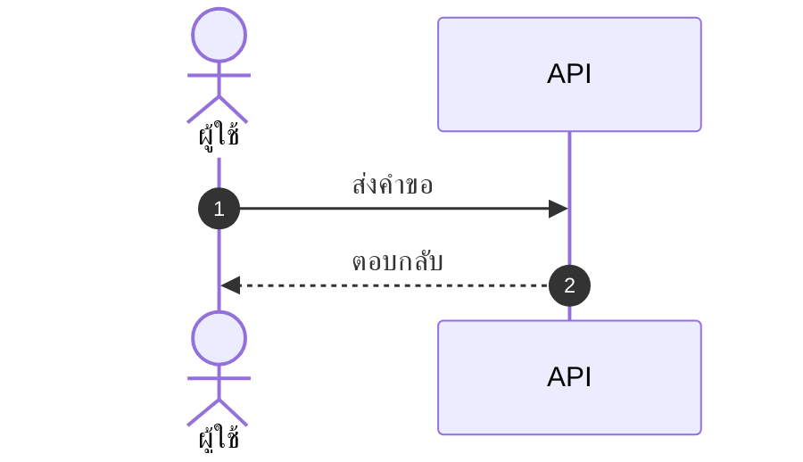

# skill: repeated-mistakes-to-checks

Use when the user corrects the same mistake twice or reviews keep flagging one issue. Make it a check.

# repeated-mistakes-to-checks — ความผิดที่ทำซ้ำ ต้องเกิดไม่ได้อีก

> agent ไม่ต้องจำกฎร้อยข้อ ถ้าทางเดินมีราวกั้นในจุดที่ถูก มันจะชนแล้วถูกหยุดในจังหวะที่ใช่เอง
> ข้อความเตือนใน SKILL.md คือราวกั้นที่อ่อนที่สุด ใช้เป็นทางสุดท้าย

มาจาก `correct` และ `rules-as-checks` ของ pstack

## ไม่ใช้เมื่อ

| งาน | ใช้ตัวนี้แทน |
|---|---|
| บทเรียนจากงานใหญ่ที่ต้องแก้ skill หรือ agent | `session-lessons-to-skills` |
| ความชอบส่วนตัวของผู้ใช้ ไม่ใช่ความผิด | `owner-style-capture` |

## ขั้นตอน

1. **เก็บหลักฐาน** — ผู้ใช้แก้อะไรบ้าง (ข้อความในบทสนทนานี้ · บรรทัด `correction: true` ใน `.claude/superuser/log/` · เรื่องที่ซ้ำใน `.claude/superuser/learn/` · `docs/BUILD-PLAN.md` · ความเห็นในการรีวิว · commit ที่ revert หรือ fix ซ้ำ ๆ) ต้องมีอย่างน้อย 2 ครั้งที่เป็นเรื่องเดียวกัน ถ้าเกิดครั้งเดียวยังไม่นับ
2. **จัดเป็นประเภท** — ตั้งชื่อความผิดแต่ละประเภทให้สั้นและชัด เช่น "ใส่ปุ่มหลอกใน mockup" · "เรียกฐานข้อมูลจาก controller ตรง" · "ใช้ปี พ.ศ. ในฐานข้อมูล"
3. **เลือกชั้นที่แก้ — สูงสุดที่ทำได้**

   | ชั้น | ตัวอย่าง | เหตุที่ดีกว่าชั้นล่าง |
   |---|---|---|
   | สถาปัตยกรรม | 1 โฟลเดอร์ต่อ 1 ฟีเจอร์ · เหลือวิธีทำวิธีเดียว · ลบ API เก่าทิ้ง | ทางผิดหายไปเลย |
   | type | type แยกสำหรับ `ThaiYear` กับ `Year` · enum แทน string | compiler หยุดให้ |
   | lint หรือสคริปต์ตรวจ | กฎ ESLint · Roslyn analyzer · สคริปต์ grep ใน CI · **ข้อความ error บอกวิธีแก้** | ชนแล้วรู้ทันทีว่าต้องทำอะไร |
   | test | test ที่ล้มเมื่อพฤติกรรมผิด | จับได้ก่อน merge |
   | ข้อความ | แก้ย่อหน้าใน SKILL.md หรือ agent | ใช้เมื่อชั้นบนทำไม่ได้จริงเท่านั้น |

4. **สร้างการตรวจ** — เขียนแบบเล็กที่สุดที่จับประเภทนั้นได้ ([`principle-build-a-tool-not-handwork`](../principle-build-a-tool-not-handwork/SKILL.md))
5. **พิสูจน์ว่ามันจับได้จริง** — ย้อนเอาโค้ดหรือเอกสารจากความผิดครั้งจริง (หรือสร้างซ้ำให้เหมือน) แล้วรันการตรวจ ซึ่ง**ต้องล้ม** จากนั้นรันกับของปัจจุบัน ซึ่งต้องผ่าน เพราะตัวตรวจที่ไม่เคยล้มเลยคือตัวตรวจที่พัง
6. **ลงตาราง** — `docs/AGENT-RULES.md` ของโปรเจกต์ (หรือ `README` ของ repo skill) `| ความผิด | ชั้นที่แก้ | ตัวตรวจ (ไฟล์) | พิสูจน์ด้วย |` ถ้ายังไม่มีไฟล์ให้สร้างใหม่
7. ทำซ้ำทุกครั้งที่ผู้ใช้แก้เรื่องใหม่เป็นครั้งที่ 2

## ไม่ต้องรอให้ผิดซ้ำ — สัญญาณที่ควรทำเป็นการตรวจเลย

- ถ้ากฎเดียวกันอยู่ในหลายไฟล์ (เช่น เขียนซ้ำในทุก prompt) ให้ย้ายไปไว้ที่เดียว แล้วให้ที่อื่นอ้างถึง
- ถ้ากำลังจะเขียน "ห้าม..." เพิ่มอีกบรรทัด ทั้งที่ตรวจด้วย grep ได้ ให้ทำเป็นสคริปต์ใน CI แทน
- ข้อความ error ของตัวตรวจต้องบอกวิธีแก้ ไม่ใช่แค่บอกว่าผิด

ตัวอย่างในชุดนี้:

| กฎ | เคยเป็นข้อความ | ตอนนี้เป็น |
|---|---|---|
| description ของ skill ห้ามมี `": "` โดยไม่ครอบเครื่องหมายคำพูด | คำเตือนในเอกสาร | `scripts/check/validate-marketplace.mjs` + `--self-test` |
| ตัวเลขใน README ต้องตรงกับของจริง | แก้มือ | `scripts/sync/sync-docs.mjs --check` |
| ของกลาง SuperUser ต้องเหมือนกันทุก plugin | ข้อความ "แก้ให้ครบทุกตัว" | `scripts/sync/sync-superuser.mjs --check` |

## สิ่งที่ห้ามทำ

- เพิ่มข้อความ "ห้าม..." ใน SKILL.md ทั้งที่ทำเป็น lint ได้
- สร้างกฎที่ไม่ได้พิสูจน์ด้วยความผิดจริง เพราะกฎที่ยิงไม่โดนเป้าทำให้ทุกคนเชื่อผิด ๆ ว่าปลอดภัย
- ตรวจกว้างเกินจนจับของถูกด้วย เพราะสุดท้ายทุกคนจะเรียนรู้ที่จะข้ามมัน


---

# skill: reverse-engineering

Use when there is a compiled app or unknown file format or protocol but no source, or a build may differ.

# Reverse Engineering

**Decompile → Understand → Recreate**, with evidence at every step. Never claim the original source was recovered; report what the evidence shows and mark what is unknown.

Source code is available but there are no documents → use `legacy-spec-recovery` instead. Once this skill has recovered readable code, `legacy-spec-recovery` turns it into a spec.

## ไม่ใช้เมื่อ

| งาน | ใช้ตัวนี้แทน |
|---|---|
| มีซอร์สโค้ดแต่ไม่มีเอกสาร ต้องการ spec ของระบบเดิม | `legacy-spec-recovery` |
| มีซอร์สโค้ด แค่ยังไม่ได้อ่านส่วนที่จะแก้ | `code-orientation` |

## What works in practice

Effort depends almost entirely on what the target was built with. Classify first, then set expectations with the user.

| Target | Result to expect | Effort | Route |
|---|---|---|---|
| .NET (C#, VB.NET, Xamarin) | Near-original source: same logic, same SQL strings; comments and local names lost | Minutes | `ilspycmd` |
| Java, Kotlin, Android | Near-original source | Minutes | jadx, CFR, Vineflower |
| JavaScript, Electron | The code itself, often minified; source maps may give the original | Minutes | unpack, beautify |
| Python `.pyc`, PyInstaller | Usually recoverable for Python ≤ 3.8, partial after | Hours | pyinstxtractor, decompyle3 / pycdc |
| Native C, C++, Go, Rust | Pseudo-C only; names gone unless symbols exist | Days per feature | strings → imports → Ghidra |
| Obfuscated or packed | Depends on the protector; can stop the job | Unknown | identify the tool first, then ask |

Field test (2026-10, ASP.NET MVC app of about 55,000 lines): `ilspycmd` produced a C# project of 51,700 lines in 9 seconds. Compared against the real source, a cancel method matched statement for statement, and all 1,431 methods matched by name.

## Safety and legality

- Analyse only software the user owns or is authorised to analyse: their own or their client's systems, licensed software where the licence allows it, CTF targets, malware samples in a sandbox.
- Do not help bypass licensing, DRM, activation or access controls in third-party software.
- **Secrets come out with the code.** Connection strings, passwords and API keys sit in decompiled code and `.config` files. Name them, never paste their values — `triage.py` masks them in its output.
- Malware: static analysis only, unless the user explicitly asks for dynamic analysis in an isolated environment.
- Work on copies in a scratch folder. Never write decompiled output into the user's source tree; it is not the source of record.

## Workflow

### Step 1 — Triage

```bash
python -I scripts/triage.py <file>                          # format, architecture, next step
python -I scripts/triage.py <file> --pattern 'oauth|WHT'    # hunt a clue in strings (secrets masked)
```

It recognises PE, .NET, ELF, Mach-O, APK, IPA, JAR, ASAR, Power BI, Office, OLE (Crystal Reports, MSI), SSIS and config XML. For a .NET assembly it also reports a `.pdb` or `.config` lying beside it and known obfuscator markers.

Installers (7-Zip SFX, NSIS, MSI): extract first — strings inside are compressed noise. Packaging layouts and report and ETL formats: [references/packaging-patterns.md](references/packaging-patterns.md).

Confirm what the user wants before deep work: explain one feature, recover a format or algorithm, recover lost source, or check a deployed build against the repository.

### Step 2 — Decompile, cheapest first

1. **Strings and metadata.** Often enough on their own. In the field test, SQL statements embedded in a .NET dll — including commented-out ones — came out of the strings alone.
2. **Managed code (.NET, Java)** — go straight to the decompiler; it is cheap.
   ```bash
   dotnet tool install ilspycmd --tool-path <scratch>/tools --version <x>
   <scratch>/tools/ilspycmd -p -o <scratch>/out <file.dll>
   ```
   The newest `ilspycmd` needs the newest .NET SDK. If installation fails with *"DotnetToolSettings.xml was not found"*, pin an older version that matches an installed SDK (`dotnet --list-sdks`); for example, 9.1.0.7988 works with SDK 9. Install into the scratch folder, not globally.
3. **JavaScript/Electron** — `npx @electron/asar extract app.asar <out>`, beautify, look for `.map` files.
4. **Native** — imports and exports first (they reveal crypto, network and storage use), then Ghidra headless for the functions that matter. On Windows, prefer Python and Node scripts over assuming Unix tools exist.

Record each finding as evidence: file, offset, type or method, and what it suggests.

### Step 3 — Understand

Trace from clue to implementation: who references the string, which function contains it, what flows in and out. Write a short narrative: "feature X works by A calling B, storing in C, gated by D". Keep static reading separate from runtime observation, and mark unresolved links instead of guessing.

### Step 4 — Use the result

| Goal | Do this |
|---|---|
| Explain a feature | Narrative + evidence list (Step 5) |
| Lost source | Decompiled project goes to the user as a recovery, clearly labelled; then `legacy-spec-recovery` for the spec |
| **Deployed build vs repository (drift check)** | Decompile the production binary, then `python -I scripts/compare_members.py <decompiled> <source>` — lists methods only in the binary (hot-fixes never committed) or only in the source (not deployed). Then diff the bodies of the methods it flags. |
| Recreate in the user's stack | Only after the user confirms the understanding. Reimplement, do not copy proprietary code; standard algorithms and formats (JSON, zlib, AES) are fine to reuse |

`compare_members.py` was field-tested both ways: on a matching build it reported 1,431 shared methods and no differences, and a method renamed in a copy of the source was caught.

### Step 5 — Report

- **How it works**: the narrative, with evidence locations.
- **Evidence**: each claim tied to a file, offset or method, using the full record in `superuser` `references/evidence.md` for claims the user will act on. Subject = file name + SHA-256 (`certutil -hashfile <f> SHA256` on Windows, `sha256sum` elsewhere) · decompiled or strings reading = `จากแหล่ง` · observed while running in a sandbox = `ตรวจจริง` · name links = `อนุมาน` pointing to the claims they rest on.
- **Unknowns**: what could not be determined and what would resolve it.
- **Secrets seen**: key names and locations only — and tell the user they should be rotated if the binary or config has left their control.
- **Output**: where the decompiled files are, and how to verify any recreated feature.

## Rules of thumb

- Cheapest sufficient evidence wins: strings > managed decompiler > native decompiler > debugger.
- Prefer static analysis; do not run unknown binaries.
- Decompiled code is evidence, not the source. Label it that way wherever it is handed over.
- If triage reports an obfuscator, stop and tell the user what that means for effort before going on.


## reference: packaging-patterns.md

# Common application packaging patterns

Recognizing the packaging leads straight to the readable layer. Check these before touching a decompiler.

## Mozilla apps (Firefox, Thunderbird)

- Full Windows installer is a **7-Zip SFX stub** (small PE32, sections=3) with the app in an appended archive. `7z x setup.exe` extracts `core/` plus `setup.exe`.
- `core/application.ini` — version, BuildID, source repository and SourceStamp (build provenance evidence).
- `core/omni.ja` — ZIP archive (97MB+ for Thunderbird) holding nearly all app JavaScript (`modules/`, `chrome/`) and default prefs (`defaults/pref/*.js`). Extract with 7z; Grep it to trace features. `omni.ja` is usually the cheapest route to full answers.
- The big DLLs are the native layer: `xul.dll` (Gecko engine), `nss3.dll`/`freebl3.dll` (crypto), `rnp.dll` (OpenPGP), `libotr.dll` (chat encryption).
- `thunderbird.exe` itself is only a launcher stub.

## Electron / Node apps

- `app.asar` — ASAR archive; `npx @electron/asar extract app.asar outdir` (the old `asar` package name is deprecated). Renderer JS is often minified but readable; `.map` source maps may contain original source.
- `resources/app/package.json` names the app, entry point, and dependency list.
- Native modules: `*.node` files (PE DLLs) — treat as native binaries.

## .NET applications

- PE with a CLI header (triage reports `.NET / managed PE`). `ilspycmd -p -o <out> <dll>` gives a near-original C# project — field-tested: identical logic, SQL strings intact, only comments and local names lost.
- A `.pdb` beside the dll restores original file names and line numbers; a `.dll.config` holds settings (and often secrets).
- ASP.NET MVC with precompiled views: `.cshtml` come back as classes under `<Assembly>.Views.<Controller>`.
- Xamarin APK: the C# lives in `assemblies/*.dll` inside the APK (sometimes LZ4-compressed `XALZ`) — decompile those, not `classes.dex`.
- Check for bundled/single-file deployment (self-extracting extractors) — extract first.
- P/Invoke declarations map managed code to native DLL entry points.

## Android APK

- ZIP; contains `classes.dex` (Dalvik bytecode — use `jadx` or `apktool` for near-Java output), `AndroidManifest.xml` (binary XML — use `apktool` or `aapt`), `resources.arsc`, native libs under `lib/`.

## Windows installers generally

- 7-Zip SFX: extract with `7z x`.
- NSIS: extract with `7z x` (triage detects `NullsoftInstall` marker).
- MSI: `msiexec /a file.msi /qb TARGETDIR=<out>` or 7z.
- MSI transforms and stub downloaders may contain no payload — identify early to avoid wasted work.

## Enterprise report and ETL files

Often the only place a calculation lives. None need a decompiler.

| File | What it is | Readable layer |
|---|---|---|
| `.rpt` Crystal Reports | OLE compound file | `strings` shows SQL, table and field names; formulas need Crystal Designer or an RptToXml export |
| `.pbix` Power BI | ZIP | `Report/Layout` is UTF-16 JSON (pages, visuals, filters); measures in `DataModel` need pbi-tools or Tabular Editor |
| `.dtsx` SSIS | XML | Search `SqlCommand`, `ConnectionManager`, `DTS:ObjectName`; package order in the master package |
| `.rdl` SSRS | XML | `CommandText` per dataset |
| `.mdb` / `.accdb` | Access database | Queries and VBA modules; open with mdbtools or Access |


---

# skill: polished-document-style

Use when a stakeholder Markdown document (BRD, FSD, ADR, status report) needs polished formatting.

# Polished Document Style

> **ภาษา:** ถ้อยคำทุกบรรทัดเขียนตาม [`human-writing`](../human-writing/SKILL.md) — skill นี้บอกรูปแบบและโครง ส่วน human-writing บอกวิธีเขียนให้คนอ่านรู้เรื่อง

## When to use this skill

- Output is meant for **non-developers** to read (PMs, executives, clients)
- Document needs **sign-off** or formal review
- Output will be **shared widely** or converted to PDF/Word later
- Any doc with 3+ sections or 500+ words

## When NOT to use

- Internal developer-only specs (keep them concise)
- Quick scratch notes
- Code comments / inline docs
- A whole Markdown report that must come out as one .docx → `markdown-report-docx`

> ℹ️ **Note:** This skill governs the *markdown source*. When the deliverable is a
> rendered **.docx / .pptx / .pdf** that a stakeholder will open, use
> `branded-document-design` on top of it — that skill carries the design tokens,
> the typography scale, Thai typography rules, and the `brandkit.py` builder.

## อ่านเพิ่มเมื่อ

| ไฟล์ | เปิดเมื่อ |
|---|---|
| [references/markdown-patterns.md](references/markdown-patterns.md) | ถ้าจะเขียนส่วนหัว สารบัญ กล่องข้อความ ตาราง ป้ายสถานะ cover block ตารางเทียบตัวเลือก ส่วนเซ็นรับ หรืออภิธานศัพท์ ให้เปิดดูตัวอย่าง markdown แล้วลอกไปใช้ |
| [scripts/check_outline.py](scripts/check_outline.py) | ถ้า skill ที่เขียนเอกสารมีไฟล์แบบใน `assets/` ให้รัน `python scripts/check_outline.py <แบบ.md> <เอกสาร.md>` ก่อนส่ง — ตรวจหัวข้อครบและเรียงตามแบบ ช่องตัวหนาครบ หัวตารางตรง และไม่มีช่องที่ยังไม่เติม · ในแบบ ใส่ `<!-- optional -->` ท้ายหัวข้อหรือช่องที่ไม่บังคับ · แก้ตัวตรวจแล้วรัน `--self-test` ก่อน |
| [references/theme-colors.md](references/theme-colors.md) | ถ้าต้องใส่สีจริงลงรูป ไฟล์ .docx หรือสไลด์ ให้เปิดดูว่าใครคุมสีส่วนไหน และค่าสีตั้งต้นประจำบ้านคืออะไร |

## Document Header (Always)

Every polished doc MUST start with ส่วนหัวชุดเดียวกัน คือ H1 ที่มีอิโมจิกำกับ ตามด้วยกล่อง quote ที่บอกเวอร์ชัน วันที่ สถานะ ผู้เขียน ผู้รีวิว และแท็ก แล้วปิดด้วย `---` ตัวอย่างเต็มอยู่ใน [references/markdown-patterns.md](references/markdown-patterns.md)

Status values:
- 🟡 **Draft** — work in progress
- 🔵 **Review** — under stakeholder review
- 🟢 **Approved** — signed off
- ⚪ **Archived** — historical reference

## Section Hierarchy

- **H1** — Document title (exactly one)
- **H2** — Numbered sections (`## 1. Section`)
- **H3** — Sub-sections (`### 1.1 Sub-topic`)
- **H4** — Rare, use only if needed

**Always add Table of Contents** for docs with 5+ sections และต้องกดลิงก์ในสารบัญแล้วไปถึงหัวข้อจริง ตัวอย่างอยู่ใน [references/markdown-patterns.md](references/markdown-patterns.md)

## ธีมของเอกสาร — ตัดสินใจครั้งเดียว ใช้ทุกที่ในเอกสารนั้น

เอกสาร 1 ฉบับผ่านหลาย skill: markdown (skill นี้) · รูปจาก `software-diagrams` ·
ไฟล์ .docx จาก `branded-document-design` · สไลด์จาก `presentation-design`
ถ้าแต่ละตัวเลือกสีเอง ผู้อ่านจะได้เอกสารที่รูปสีหนึ่ง หัวข้อสีหนึ่ง และสไลด์อีกสีหนึ่ง

**markdown เป็นต้นฉบับหลัก (source of truth) จึงประกาศธีมไว้ที่นี่** — ใส่ไว้ท้ายส่วนหัวของเอกสารหรือในไฟล์ข้างกัน:

```markdown
<!-- doc-theme: accent=<สีหลัก> · ที่มา=<แบรนด์ลูกค้า / เสนอจากเนื้องาน> · ยืนยันเมื่อ=YYYY-MM-DD -->
```

**สีหลักมาจากเนื้องาน ไม่ใช่จากค่าเริ่มต้นของเครื่องมือ**
ถ้ามีสีแบรนด์อยู่แล้วให้ใช้สีนั้น ถ้ายังไม่มีให้ใช้ค่าตั้งต้นประจำบ้าน เขียน `(รอยืนยัน)` แล้วทำต่อ ไม่หยุดถาม และเสนอโทนที่เข้ากับเนื้องานไว้ในรายงาน
(ตารางจับคู่เนื้องานกับโทนสีอยู่ใน [`colour-by-domain`](../diagram-figures/references/colour-by-domain.md))

markdown เองไม่มีสี จึงใช้อิโมจิและน้ำหนักตัวอักษรแทน ส่วนไดอะแกรม รูป ไฟล์ .docx และสไลด์อ่านค่าจาก `doc-theme` ถ้า `doc-theme` ยังไม่ประกาศ accent เฉพาะงาน ให้ใช้ค่าตั้งต้นประจำบ้าน ตารางทั้งสองอยู่ใน [references/theme-colors.md](references/theme-colors.md)

**สีสถานะไม่ขึ้นกับธีม** — 🔴 วิกฤต · 🟢 ผ่าน ต้องคงความหมายเดิมไม่ว่าธีมจะเป็นสีอะไร

## Emoji Vocabulary

ใช้ให้**คงที่ทั้งเอกสาร** และใช้เพื่อ**หาของเจอเร็วขึ้น** ไม่ใช่เพื่อความน่ารัก

| ใช้ทำอะไร | ชุดที่ใช้ |
|---|---|
| ระดับความสำคัญ | 🔴 วิกฤต · 🟠 สูง · 🟡 กลาง · 🟢 ต่ำ |
| สถานะ | ✅ เสร็จ · 🚧 กำลังทำ · ⏳ รอ · ❌ ไม่ผ่าน · ⚠️ ต้องระวัง |
| ชนิดกล่องข้อความ | 💡 ข้อแนะนำ · 📌 ข้อควรจำ · 🚨 อันตราย · 📋 รายการตรวจ |
| หมวดเนื้อหา | 🎯 เป้าหมาย · 🏗️ สถาปัตยกรรม · 🔐 ความปลอดภัย · 📊 ตัวเลข · 🧪 การทดสอบ |

**1 อิโมจิต่อหัวข้อ ไม่ใช่ต่อบรรทัด** — เอกสารที่ทุกบรรทัดมีอิโมจิอ่านยากกว่าเอกสารที่ไม่มีเลย

## Callout Boxes

Use blockquotes with emoji prefix มี 5 ชนิด คือ 💡 **Tip** · ⚠️ **Warning** · 🚨 **Critical** · ℹ️ **Note** · ❓ **Open Question** ตัวอย่างอยู่ใน [references/markdown-patterns.md](references/markdown-patterns.md)

**Rules:**
- Keep callouts to 1-3 sentences
- One callout per topic — don't stack
- Don't overuse — max 3-5 per page

## Tables — When and How

Use tables when items have **2+ attributes** ถ้าเขียนเป็น bullet แล้วแต่ละบรรทัดมีหลายค่าคั่นด้วยจุลภาค ให้เปลี่ยนเป็นตาราง ตัวอย่างเทียบกันอยู่ใน [references/markdown-patterns.md](references/markdown-patterns.md)

- Left-align text, center checkmarks/numbers, right-align money
- Use `—` (em dash) for "not applicable", not `-` or blank
- Keep cells short — long content goes in body paragraphs
- Bold key columns: `**email**`

ถ้าเอกสารต้องเทียบตัวเลือกหรือชั่งข้อดีข้อเสีย (architect, PM, SEO recommendations) ให้ใช้ตารางเทียบที่มีคอลัมน์ Recommendation ส่วนเอกสารที่ต้องอนุมัติให้ปิดท้ายด้วยตาราง Sign-off และเอกสารที่มีศัพท์เทคนิค 5 คำขึ้นไปให้มีอภิธานศัพท์ ตัวอย่างทั้งสามแบบอยู่ใน [references/markdown-patterns.md](references/markdown-patterns.md)

## Mermaid Diagrams

**ตัวเลือกชนิดไดอะแกรม กติกาความอ่านง่าย ธีม และการจัดการป้ายภาษาไทย อยู่ใน `software-diagrams`**
skill นี้คุมเฉพาะเรื่องการวางไดอะแกรมลงในเอกสาร markdown

- วางไว้**หลังย่อหน้าที่อธิบายว่ารูปนี้ตอบคำถามอะไร** ไม่ใช่ลอยขึ้นมาเฉย ๆ
- ทุกรูปมีคำบรรยายใต้รูป 1 บรรทัด ขึ้นต้นด้วย **รูปที่ N —**
- รูปเดียวกันอย่าใส่ซ้ำหลายที่ในเอกสาร ให้อ้างถึงเลขรูปแทน
- รูปที่ต้องส่งให้คนนอกทีมหรือใส่สไลด์ ใช้ `diagram-figures` แล้วฝังเป็นไฟล์ภาพ

## Status Badges and Cover Block

ช่องสำคัญในส่วนหัวหรือในตารางให้ใช้ป้ายสถานะแบบอิโมจิพร้อมคำกำกับ เช่น `**Status:** 🟢 Approved` ส่วนเอกสารทางการ (BRD, FSD, ADR, postmortem) ให้เปิดด้วย cover block ที่บอกชนิดเอกสาร เวอร์ชัน สถานะ วันที่ ผู้เขียน ผู้รีวิว และเอกสารที่เกี่ยวข้อง ตัวอย่างอยู่ใน [references/markdown-patterns.md](references/markdown-patterns.md)

## Lists and Code Blocks

**Rule:** Max 2 levels of nesting. More nesting = use a table.
ตัวอย่างรายการที่ดีและรายการที่ซ้อนเกินอยู่ใน [references/markdown-patterns.md](references/markdown-patterns.md)

Code blocks ต้องระบุภาษาทุกครั้ง (Always specify language) และถ้าโค้ดยาว ให้ใส่ชื่อไฟล์เป็นคอมเมนต์ในบรรทัดแรก ตัวอย่างอยู่ใน [references/markdown-patterns.md](references/markdown-patterns.md)

## Quality Checklist

Before delivering any polished doc:

- [ ] H1 title with emoji marker
- [ ] Cover block with version, date, status, authors
- [ ] TOC if 5+ sections
- [ ] All sections numbered consistently
- [ ] Anchor links in TOC actually work
- [ ] Status badges where applicable
- [ ] Tables used (not bullets) where data has 2+ attributes
- [ ] At least one Mermaid diagram for any flow/relationship
- [ ] Callout boxes for tips/warnings (not just paragraphs)
- [ ] Code blocks have language hints
- [ ] Glossary for docs with 5+ acronyms
- [ ] No placeholder text (TBD, TODO, Lorem ipsum) — `(รอยืนยัน)` markers listed in the pending-confirmation list are not placeholders; keep them
- [ ] Tested rendering in GitHub preview

> ไดอะแกรมในเอกสาร: ชนิดไหนตอบคำถามไหน และธีม Mermaid ชุดเดียวกันทั้งโปรเจกต์
> อยู่ใน `software-diagrams` ส่วนเรื่องเอกสาร SRS โดยเฉพาะอยู่ใน `srs-writing`

## Anti-patterns

- ❌ **Emoji spam** — emoji in every heading just for decoration
- ❌ **All emoji, no labels** — `🔴 High` reads better than `🔴` alone
- ❌ **Deep nesting** — bullets 4+ levels deep, use tables instead
- ❌ **Walls of text** — paragraphs longer than 5 lines
- ❌ **Inconsistent terminology** — "user" in one section, "customer" in next
- ❌ **Diagrams that duplicate text** — diagram should add insight, not repeat
- ❌ **Tables of paragraphs** — if cells are >2 sentences, use headings instead
- ❌ **Skipping the cover block** — readers need version/status/date

## ตัวย่อ

เขียนตัวย่อเต็มครั้งแรกเสมอ แล้ววงเล็บตัวย่อไว้ — เช่น Model Context Protocol (MCP)
หลังจากนั้นใช้ตัวย่อได้เลย ดูรายละเอียดใน skill `spell-out-abbreviations`


## reference: markdown-patterns.md

# รูปแบบ markdown พร้อมตัวอย่าง

ตัวอย่างโค้ด markdown ของทุกรูปแบบที่ `SKILL.md` อ้างถึง ให้ลอกไปใช้ได้ทันที ส่วนกฎว่าใช้เมื่อไหร่อยู่ใน `SKILL.md`

## Document Header (Always)

Every polished doc MUST start with:

```markdown
# 📋 <Document Title>

> **Version:** 1.0 · **Date:** YYYY-MM-DD · **Status:** 🟡 Draft
> **Authors:** <names> · **Reviewers:** <names>
> **Tags:** `<area>` `<topic>`

---
```

Status values:
- 🟡 **Draft** — work in progress
- 🔵 **Review** — under stakeholder review
- 🟢 **Approved** — signed off
- ⚪ **Archived** — historical reference

## Table of Contents

**Always add Table of Contents** for docs with 5+ sections:

```markdown
## 📑 Table of Contents

1. [Executive Summary](#1-executive-summary)
2. [Scope](#2-scope)
3. [Details](#3-details)
```

## Callout Boxes

Use blockquotes with emoji prefix:

```markdown
> 💡 **Tip:** Brief actionable insight.

> ⚠️ **Warning:** Important caveat or limitation.

> 🚨 **Critical:** Must-read before proceeding.

> ℹ️ **Note:** Additional context or background.

> ❓ **Open Question:** Needs decision/clarification.
```

## Tables — When and How

### When to use tables instead of bullets

Use tables when items have **2+ attributes**:

❌ Don't use bullets:
```markdown
- email: string, required, unique
- age: number, optional
- role: enum, required, default "user"
```

✅ Use a table:
```markdown
| Field | Type   | Required | Default | Description       |
|-------|--------|:--------:|:-------:|-------------------|
| email | string | ✅       | —       | Unique login email|
| age   | number | ❌       | —       | Optional          |
| role  | enum   | ✅       | `user`  | Access level      |
```

## Mermaid Diagrams

````markdown

````

*รูปที่ 3 — ลำดับการเรียกเมื่อผู้ใช้กดบันทึก*

## Status Badges (Inline)

For key fields in headers/tables:

```markdown
**Status:** 🟢 Approved
**Priority:** 🔴 High
**Risk Level:** 🟡 Medium
**SLA:** ⚡ < 200ms
```

Multiple badges in a header:

```markdown
> 🟢 **Approved** · 🔴 **High Priority** · 👤 @alice · 🗓️ Due 2025-03-15
```

## Cover Block Pattern

For formal documents (BRD, FSD, ADR, postmortem):

```markdown
# 📋 <Title>

| | |
|--|--|
| **Document Type** | BRD \| FSD \| ADR \| Postmortem |
| **Version** | 1.2 |
| **Status** | 🟢 Approved |
| **Date** | 2025-01-15 |
| **Author(s)** | @alice, @bob |
| **Reviewer(s)** | @charlie |
| **Related** | [BRD-001](link), [FSD-005](link) |

---
```

## Comparison / Decision Tables

For trade-off analysis (architect, PM, SEO recommendations):

```markdown
| Option | Cost | Effort | Risk | Time-to-Value | Recommendation |
|--------|:----:|:------:|:----:|:-------------:|:--------------:|
| **A**  | 💰💰 | 🟡 Med | 🟢 Low | 🟢 Fast | ✅ Recommended |
| B      | 💰   | 🟢 Low | 🔴 High | 🟡 Med | ❌ Not recommended |
| C      | 💰💰💰| 🔴 High| 🟢 Low | 🔴 Slow | ⚪ Future consideration |
```

## Lists — When to nest, when to flatten

### ✅ Good list
```markdown
- Email is unique across all users
- Passwords must be 8+ characters with mixed case
- Sessions expire after 30 days of inactivity
```

### ❌ Bad list (over-nested)
```markdown
- Users
  - Email
    - Must be unique
    - Required
  - Password
    - 8+ chars
    - Mixed case
```

→ Should be a table instead.

## Code Blocks

Always specify language:

````markdown
```typescript
const user: User = { id: 1, email: 'a@b.com' };
```

```bash
npm install
```

```sql
SELECT * FROM users WHERE id = $1;
```
````

For long blocks, put the file name in a comment on the first line:

```typescript
// src/services/auth.ts
export async function login(email: string, password: string) {
  // ...
}
```

## Approval/Sign-off Section (End of Doc)

For documents needing formal approval:

```markdown
## ✍️ Sign-off

| Role | Name | Status | Date |
|------|------|:------:|------|
| Product Owner | @alice | 🟢 Approved | 2025-01-15 |
| Tech Lead | @bob | 🔵 Reviewing | — |
| QA Lead | @charlie | ⚪ Not started | — |
| Security | @dave | ❌ Rejected | 2025-01-14 |
```

## Glossary Section

For docs with 5+ technical terms:

```markdown
## 📖 Glossary

| Term | Definition |
|------|------------|
| **API** | Application Programming Interface |
| **JWT** | JSON Web Token, used for stateless auth |
| **SLA** | Service Level Agreement |
```

Define acronyms on first use, then add to glossary.


## reference: theme-colors.md

# ตารางสีของธีมเอกสาร

ไฟล์นี้บอกว่าส่วนไหนของเอกสารใครเป็นคนคุมสี และค่าสีตั้งต้นประจำบ้านคืออะไร ใช้ตอนต้องใส่สีจริงลงรูป ไฟล์ .docx หรือสไลด์

## ใครคุมสีส่วนไหน

| ส่วนของเอกสาร | ใครคุมสี | อ่านค่าจาก |
|---|---|---|
| หัวข้อ ตาราง กล่องข้อความใน markdown | markdown ไม่มีสี ใช้อิโมจิและน้ำหนักตัวอักษรแทน | — |
| ไดอะแกรม Mermaid | `software-diagrams` ข้อ 2 | `doc-theme` |
| รูปที่เป็นไฟล์ภาพ | `diagram-figures` | `doc-theme` |
| ไฟล์ .docx / .pdf ที่ส่งออก | `branded-document-design` ข้อ 0–1 | `doc-theme` |
| สไลด์ | `presentation-design` | `doc-theme` |

## ค่าตั้งต้นประจำบ้าน (house default)

ถ้า `doc-theme` ยังไม่ประกาศ accent เฉพาะงาน ทุก skill ใช้ชุดนี้เป็นค่าตั้งต้น เพื่อให้รูป เอกสาร และสไลด์เป็นชุดสีเดียวกันตั้งแต่แรก ชุดนี้คือชุดเดียวกับ `presentation-design` และ `branded-document-design`:

| token | ค่า | ใช้กับ |
|---|---|---|
| brand | `#2A78D6` | สีหลัก · หัวข้อ · เส้น accent |
| brand-deep | `#2A4C86` | หัวตาราง · H2 · ชื่อระบบ |
| brand-2 | `#6A5CD6` | accent รอง (ม่วง) |
| tint | `#EDF1FB` | พื้นหัวตาราง · พื้นกล่องเน้น |
| ink / body | `#333B4A` / `#414957` | หัวข้อ / เนื้อความ |
| muted / faint | `#7D8492` / `#A9AEB9` | คำบรรยาย / หมายเหตุ |
| line | `#E4E7EE` | เส้นขอบ · เส้นเชื่อม |
| exception | `#C77A11` | ทาง/โซนที่ไม่ใช่เส้นทางหลัก (ต่างจาก brand เสมอ) |
| ฟอนต์ | Tahoma (เอกสาร/สไลด์) · Noto Sans Thai → Tahoma (ภาพ) | ทั้งไทยและอังกฤษ |

เมื่อประกาศ accent เฉพาะงานแล้ว ให้ใช้ค่านั้นแทน brand ส่วนสีอื่นคำนวณจาก accent ตัวนั้น


---

# skill: branded-document-design

Use when a Word, PowerPoint or PDF deliverable must look designed (palette, type, Thai fonts).

# Branded Document Design

> **ภาษา:** ถ้อยคำทุกบรรทัดเขียนตาม [`human-writing`](../human-writing/SKILL.md) — skill นี้บอกรูปแบบและโครง ส่วน human-writing บอกวิธีเขียนให้คนอ่านรู้เรื่อง

> **กฎข้อเดียวของ skill นี้:** เอกสารที่ส่งออกไปต้องดูออกว่าตั้งใจออกแบบ คือมีชุดสี ชุดขนาดตัวอักษร
> และช่องไฟที่เหมือนกันทุกหน้า ไม่ใช่เปิด Word แล้วพิมพ์เลย

## เมื่อไหร่ใช้ skill นี้

- ผลลัพธ์คือ **.docx / .pptx / .pdf** ที่ลูกค้า ผู้บริหาร หรือทีมอื่นจะเปิดดู
- เอกสารต้อง **เซ็นอนุมัติ** หรือแนบไปกับสัญญา/ข้อเสนอ
- เอกสารไทย–อังกฤษปนกัน (ถ้าตั้งฟอนต์ไม่ครบจะพังง่ายมาก)
- ต้องออกเอกสารแบบเดียวกันซ้ำ ๆ และอยากให้ทุกฉบับหน้าตาเหมือนกัน

## เมื่อไหร่ **ไม่** ใช้

- ผลลัพธ์เป็น markdown ในรีโป ให้ใช้ `polished-document-style`
- ต้องแค่ **อ่าน/แกะ** ไฟล์ Office ที่ได้รับมา ให้ใช้ `anthropic-skills:docx` · `xlsx` · `pptx` · `pdf`
- ไดอะแกรมในเอกสาร markdown ให้ใช้ `markdown-visuals`
- รายงานทั้งเล่มจาก Markdown ไฟล์เดียว (ปกโลโก้กลาง · สารบัญ · ตาราง · รูป) ให้ใช้ `markdown-report-docx` ซึ่งมีสคริปต์ md → docx พร้อมแล้ว

**ลำดับที่ถูกต้อง:** เขียนเนื้อหาเป็น markdown ก่อน (polished-document-style)
→ ค่อยใช้ skill นี้ render เป็นไฟล์ส่งมอบ และแก้เนื้อหาที่ markdown เสมอ (markdown คือต้นฉบับ)

---

## 0 · สีมาจากโปรเจกต์ — หาตามลำดับ ไม่หยุดรอ

**ถ้า markdown ต้นทางมี `doc-theme` อยู่แล้ว ให้ใช้ค่านั้น อย่าถามซ้ำ อย่าตั้งใหม่**
(ดู `polished-document-style` หัวข้อ "ธีมของเอกสาร")

ถ้ายังไม่มี ให้หาตามลำดับใน `diagram-figures` ข้อ 5 ที่เดียว (`doc-theme` → สีแบรนด์ในโค้ด โลโก้ ชุดแบรนด์ → ยังไม่มีเลย)
ยังไม่มีเลย → ใช้สีประจำบ้าน `#2A78D6` เขียน `(รอยืนยัน)` ไว้ในรายงาน แล้วทำต่อ ไม่หยุดถาม · เสนอโทนตามเนื้องาน (ดูบรรทัดถัดไป) ไว้ในรายงานให้ผู้ใช้เลือกทีหลัง
ได้สีแล้ว**เขียนกลับลง `doc-theme`** ในไฟล์ markdown เพื่อให้เอกสาร รูป และสไลด์ใช้สีเดียวกัน

โทนที่เสนอตามเนื้องาน (การแพทย์ · การเงิน · ราชการ ฯลฯ) → [`references/palette-examples.md`](references/palette-examples.md) · ลูกค้ามีแบรนด์แล้วใช้สีแบรนด์เสมอ

**สีหลักมีสีเดียว** เฉดอ่อนและเข้มทั้งหมดคำนวณจากสีนั้น ไม่เลือกเพิ่มทีละสี
สีที่ไม่ผูกกับสีหลักมีแค่สีสถานะ (สำเร็จ · เตือน · ผิดพลาด) และต้องคงความหมายเดิมเสมอ

---

## 1 · Design tokens — ห้าม hardcode สีนอกตารางนี้

ตารางนี้กำหนด**หน้าที่**ของแต่ละ token ไม่ได้กำหนดค่าสี
ค่าจริงมาจากข้อ 0 แล้วตั้งครั้งเดียวด้วย `use_brand(...)`

| Token | หน้าที่ | ได้มาจาก |
|-------|---------|----------|
| `brand` | หัวข้อ H1 · ตัวเลข KPI · ลิงก์ · แถบ accent | สีแบรนด์ (ไม่มี → ค่าประจำบ้าน + `(รอยืนยัน)`) |
| `brand_2` | accent รอง · ขีดใต้หัวข้อสไลด์ · ปลายไล่สี | เพื่อนบ้านของสีหลักบนวงล้อสี |
| `brand_deep` | หัวข้อ H2 · ตัวอักษรหัวตาราง | สีหลักผสมดำ ให้ contrast ≥ 7:1 บนพื้นขาว |
| `brand_tint` | พื้นหัวตาราง · การ์ด KPI · พื้นหน้าปก | สีหลักผสมขาวประมาณ 90% |
| `brand_tint_2` | แถวสลับ (zebra) ในตารางยาว | สีหลักผสมขาวประมาณ 96% |
| `text` | หัวข้อ H3 · ข้อความเน้น | เทาเข้มอมโทนเดียวกับสีหลัก |
| `text_body` | เนื้อความทั้งหมด | เทาเข้มอ่อนกว่า `text` 1 ขั้น **ไม่ใช่ดำสนิท เพราะดำสนิทล้าตา** |
| `text_muted` | คำบรรยายรูป · meta · footer | เทากลาง contrast ≥ 4.5:1 |
| `line` | เส้นตาราง เส้นคั่น | เทาอ่อนมาก เห็นได้แต่ไม่แย่งสายตา |

**สีสถานะ 6 ตัว** (แต่ละตัวมีคู่สีพื้นกับสีตัวอักษร): สำเร็จ · ข้อมูล · เตือน · ผิดพลาด · เน้น · เป็นกลาง
สีสถานะ**ไม่เปลี่ยนตามแบรนด์** เพราะเขียวคือผ่าน แดงคือไม่ผ่าน ในทุกเอกสาร
พื้นคือเฉดอ่อนมาก ตัวอักษรคือเฉดเข้มของสีเดียวกัน ให้ contrast ≥ 4.5:1

**ความหมายของแต่ละสี — เลือกสีตามความหมายเสมอ** (เหมือนกันทั้งเอกสารและไดอะแกรม)

| สี | หมายความว่า | ใช้กับ (callout / pill / กล่อง / เส้นในรูป) |
|---|---|---|
| 🔴 แดง | อันตราย · ห้าม · ลบทิ้ง · ผิดพลาด · เลยกำหนด | `critical` · สถานะ "ค้าง/ล้มเหลว" · ขั้นที่ทำลายข้อมูล · เส้นที่พัง |
| 🟠 เหลือง/ส้ม | ระวัง · รอดำเนินการ · ข้อแม้ · ทางที่ไม่ใช่เส้นหลัก | `warning` · สถานะ "กำลังทำ" · โซน/เส้นข้อยกเว้น (`#C77A11`) |
| 🟢 เขียว | สำเร็จ · ผ่าน · ปลอดภัย · เสร็จแล้ว | `success` · สถานะ "เสร็จ" · ผลลัพธ์ที่ยืนยันแล้ว |
| 🔵 สีหลัก (สีแบรนด์ ไม่มีแบรนด์ใช้น้ำเงินประจำบ้าน) | ข้อมูล · การกระทำหลัก · เส้นทางปกติ | `tip` · ปุ่มหลัก · กล่อง/เส้นเส้นทางหลัก |
| 🟣 ม่วง | คำถาม · ทางเลือก · หมายเหตุเสริม | `question` · ของเสริมที่ไม่บังคับ |
| ⚪ เทา | เป็นกลาง · ปิดใช้งาน · ของภายนอก | `note` · ระบบภายนอก · ส่วนที่ปิดอยู่ |

กฎเดียว: **เลือกสีตามความหมาย ไม่ใช่ตามความสวย** อย่าใช้แดงเพราะอยากให้เด่น ใช้แดงเฉพาะเมื่ออันตรายหรือผิดจริง และไดอะแกรมก็ใช้ชุดความหมายเดียวกันนี้ (ดู `software-diagrams` · `diagram-figures` ที่มี `EXCEPT_HUE` ส้มสำหรับทางที่ไม่ผ่านเส้นหลัก)

> **เกณฑ์ที่ต้องผ่านทุกชุดสี:** เนื้อความบนพื้น ≥ 4.5:1 · หัวข้อบนพื้น ≥ 7:1 ·
> พิมพ์ขาวดำแล้วยังแยกลำดับชั้นออก ถ้าไม่ผ่านให้ปรับความเข้ม ไม่เปลี่ยนสี
>
> **ตัวอย่างชุดสีที่เคยใช้จริง** (ไม่ใช่ค่ามาตรฐาน อย่าคัดลอกไปใช้โดยไม่ดูเนื้องาน) → `references/palette-examples.md`

> 💡 **เปลี่ยนแบรนด์ทั้งชุดในบรรทัดเดียว:**
> `use_brand(brand="C1121F", brand_deep="780000", brand_tint="FDECEC")`

### สเกลตัวอักษร (pt)

| ระดับ | Word | Slide | น้ำหนัก · สี |
|-------|------|-------|--------------|
| ชื่อบนปก | 20 | 40 | bold · `brand` (Word) / `brand_deep` (สไลด์) |
| H1 | 16 | 26 | bold · `brand` |
| H2 | 12.5 | — | bold · `brand_deep` |
| H3 | 11.5 | — | bold · `text` |
| เนื้อความ | 11 | 17 | regular · `text_body` |
| ตาราง | 11 | 12.5 | regular · `text_body` |
| คำบรรยาย/footer | 8.5–9 | 10–12 | italic หรือ regular · `text_muted` |

**อย่าเพิ่มขนาดนอกสเกลนี้** เพราะทุกขนาดที่เพิ่มทำให้เอกสารดูไม่สม่ำเสมอ และคนอ่านสังเกตเห็น

---

## 2 · ฟอนต์และภาษาไทย — จุดที่พังบ่อยที่สุด

ใช้ **Tahoma** เป็นค่าเริ่มต้น: มีทุกเครื่อง Windows/Office · วรรณยุกต์ไม่ชนสระ ·
bold อ่านออกชัด · ความสูง x-height ไทยกับอังกฤษใกล้เคียงกัน

> 🚨 **กับดัก complex script:** Word ถือว่าภาษาไทยเป็น *complex script* คนละชุดกับ latin
> ถ้าตั้งแค่ `run.font.size` / `run.font.bold` ตัวอักษรไทยจะ **ไม่เปลี่ยนตาม**
> ต้องตั้ง `w:szCs`, `w:bCs`, `w:iCs` และ `w:rFonts` ให้ครบทั้ง `ascii/hAnsi/cs/eastAsia`
> ฟังก์ชัน `style_run()` ใน `brandkit.py` จัดการให้แล้ว **ห้ามตั้งฟอนต์เองด้วยมือ**

> 🚨 **กับดักฟอนต์คู่:** ถ้าใช้ฟอนต์ละตินกับฟอนต์ไทยคนละตัว เช่น Noto Sans + Noto Sans Thai
> การตั้งช่อง `cs` อย่างเดียวไม่พอ Word จะวาดตัวไทยด้วยฟอนต์ช่องละตินถ้าฟอนต์นั้นมีตัวไทย ถ้าไม่มีจะตกไปใช้ Browallia New แบบเงียบ ๆ
> ให้ตั้ง `bk.FONT` (ไทย) กับ `bk.LATIN_FONT` (ละติน) แล้วเรียก `bk.thai_runs(doc.element.body)` กับทุก header และ footer ก่อน `save()`
> ฟังก์ชันนี้แยกข้อความไทยออกเป็น run ของตัวเอง และตั้งทั้ง 4 ช่องเป็นฟอนต์ไทย
> ฟอนต์ที่ไม่ได้มีทุกเครื่องให้เรียก `bk.embed_fonts(doc)` เพื่อฝังฟอนต์ในไฟล์ ซึ่งทำได้เฉพาะฟอนต์ที่สัญญาอนุญาตยอมให้ฝัง เช่น OFL แต่ไฟล์จะใหญ่ขึ้นหลาย MB
> ฟอนต์ variable เช่น Cascadia Mono จะกลายเป็น Calibri เมื่อ Word export เป็น PDF ให้ใช้ Consolas กับโค้ด

กฎอื่นสำหรับเอกสารไทย:

- ระยะบรรทัด **1.3–1.35** สำหรับ Tahoma (อังกฤษล้วนใช้ 1.15 ได้ แต่ไทยมีวรรณยุกต์และสระบน–ล่าง ต้องเว้นที่) · ฟอนต์ตระกูล Noto มีความสูงบรรทัดในตัว 1.36–1.51 em จึงใช้ **1.1–1.15** ก็ได้ระยะเท่ากัน — ตัดสินจากหน้า PDF จริง ไม่ใช่จากตัวเลข
- **ห้ามจัดชิดขอบ 2 ด้าน (justify)** กับย่อหน้าไทย เพราะไทยไม่มีช่องว่างระหว่างคำ Word จะยืดคำจนเป็นรู
- LibreOffice ตัดคำไทยไม่เหมือน Word ถ้าจะส่ง PDF ให้ export จาก Word จริง
  หรืออย่างน้อยเปิด PDF ตรวจด้วยตาก่อนส่ง
- สร้าง PDF บน Linux ที่ไม่มี Tahoma ให้ใช้ **Loma** หรือ **Sarabun** แทน
  (ReportLab จัดวรรณยุกต์ไทยผิด ให้ใช้ python-docx→LibreOffice หรือ WeasyPrint แทน)
- เวลา preview บน Linux ตัวอักษรไทยจะดู **เล็กกว่า** latin เพราะฟอนต์แทนที่มี x-height ต่ำกว่า
  ไม่ใช่บั๊กของขนาดฟอนต์ บน Windows ที่มี Tahoma จริงจะสูงเท่ากัน จึงให้ตรวจรอบสุดท้ายจาก Word

---

## 3 · โครงหน้าเอกสาร Word

```
หน้าปก        โลโก้กลาง → ชื่อเอกสาร (brand, bold) → ชื่อระบบ (text, bold)
              → บรรทัดเวอร์ชัน/วันที่ (9pt) → หมายเหตุการแก้ไข (8pt เอียง เทา)
              → ขึ้นหน้าใหม่
สารบัญ        field TOC (ผู้ใช้กด F9 อัปเดต) → ขึ้นหน้าใหม่
เนื้อหา        H1 มีเลขข้อเสมอ ("1. ภาพรวมระบบ") · H2 เป็น "1.1"
              ทุก H1/H2/H3 ตั้ง keep-with-next กันหัวข้อค้างท้ายหน้า
ท้ายเอกสาร    ตารางลงนามอนุมัติ
footer        "หน้า N" กลางหน้า สีเทา 9pt
```

**ปกเข้ม** (แอปหรือแบรนด์ใช้หน้าจอสีเข้ม) → `doc.cover(..., style="night")` · ตัวอย่าง `scripts/example_srs.py` · ภาพ `examples/example_srs-preview.png` · รายละเอียดและบทเรียนจากเจ้าของงาน → [`references/word-layout.md`](references/word-layout.md) กฎที่ต้องจำทุกครั้ง:
- พื้นเทาเข้มกลาง ๆ (เช่น `#1C1C22`) แสงสีแบรนด์ไม่เกิน 15% · โลโก้เล็กมุมซ้ายบน ชื่อเอกสารชิดใต้โลโก้ · ตัวหนังสือเล็กบนปกอย่างน้อย 8.5pt สี `#CFCCDE` ขึ้นไป
- 🚨 ภาพพื้นปกและโลโก้ห้ามอยู่ใน header หน้าแรก (Word แสดงจางตอนแก้ไฟล์) — ยึดกับย่อหน้าแรกของปก
- เส้นแสงใต้ชื่อเป็นภาพเดียวต่อเนื่อง ปลายตัดตรง แสงจางเป็นศูนย์ก่อนขอบภาพ ไม่ซ้อนแถบสั้น

**หัวตารางหน้าใน ห้ามใช้พื้นสีเข้มเต็มแถบ** — พื้นอ่อนของแบรนด์ที่ยังเห็นชัด (เช่น `#E4DCFD`) ตัวหนาสีเข้มของแบรนด์ · เส้นแบรนด์ 1.5pt ใต้แถวหัว ไม่มีเส้นบน · เส้นระหว่างแถวเป็นเส้น `line` 0.5pt (ข้อ 4) · Word วาดเส้นไล่สีไม่ได้

หน้ากระดาษ A4 · ขอบ บน/ล่าง 2.2 ซม. · ซ้าย/ขวา 2.0 ซม. ได้ความกว้างเนื้อหา **17 ซม. = 9638 twips** (`BODY_TWIPS`)
(ใช้ตัวเลขนี้ตั้งความกว้างคอลัมน์ตารางให้รวมกันพอดี)

---

## 4 · องค์ประกอบที่ใช้ซ้ำ

| องค์ประกอบ | หน้าตา | เมธอด |
|-----------|--------|-------|
| หน้าปก | โลโก้ + ชื่อสีแบรนด์ กลางหน้า | `cover()` |
| ตาราง | หัวพื้น `brand_tint` ตัวอักษร `brand_deep` · เส้นแบรนด์ 1.5pt ใต้แถวหัว · เส้นระหว่างแถว `line` 0.5pt · หัวซ้ำทุกหน้า | `table()` |
| ตารางสถานะ | คอลัมน์สถานะย้อมสีตามค่า | `pill_table()` |
| แถบตัวเลขสรุป | การ์ดพื้น `brand_tint` ตัวเลขใหญ่สีแบรนด์ + ป้ายเทาเล็ก | `kpi_row()` |
| กล่องข้อความ | พื้นสีอ่อน + แถบสีหนาด้านซ้าย + อีโมจิ 1 ตัว | `callout()` |
| รูปพร้อมคำบรรยาย | รูปกลางหน้า + "รูปที่ N — ..." เอียงเทาใต้รูป | `figure()` |
| บล็อกโค้ด | พื้นเทาอ่อน ฟอนต์ Consolas 9pt | `code()` |
| ตารางเซ็น | บทบาท / ชื่อ / ลายเซ็น / วันที่ | `signoff()` |

**สัดส่วนที่พอดี:** callout ไม่เกิน 3–5 กล่องต่อ 10 หน้า · แถบตัวเลขสรุป (KPI strip) 3–5 ช่อง (ตั้งแต่ 6 ช่อง ตัวเลขจะเล็กจนไม่เด่น) ·
ตารางเกิน 6 คอลัมน์ให้เปลี่ยนเป็นหน้าแนวนอน (`landscape_section()`)

---

## 5 · วิธีใช้ brandkit

```python
import sys; sys.path.insert(0, "scripts")     # หรือ copy brandkit.py มาไว้ข้างงาน
from brandkit import BrandDoc, use_brand, to_pdf      # สไลด์ → brandkit_pptx.BrandDeck · เด็คพูด → brandkit_stage.StageDeck
```

โค้ดตัวอย่างครบ (Word · สไลด์ · เด็ค Stage) → [`references/brandkit-usage.md`](references/brandkit-usage.md) · เมธอดทั้งหมด → `references/api.md` · สคริปต์ที่รันได้ `scripts/example_srs.py` · `scripts/example_deck.py`

**เด็ค Stage** (ค่าเริ่มต้นของเด็คที่ใช้พูด): `accent` กับ `bg` มาจากดีไซน์ของโปรเจกต์ตามลำดับใน `diagram-figures` ข้อ 5 ห้ามใช้สีของต้นแบบ · ไม่มีเลยใช้ `#2A78D6` พื้น `09090A` แล้วเขียน `(รอยืนยัน)` · รูปผังเรนเดอร์ด้วยสีพื้นเดียวกับเด็ค · เครื่องปลายทางไม่มีฟอนต์ Chakra Petch / IBM Plex Sans Thai ให้ส่ง PDF คู่ · จะพิมพ์ให้สร้างอีกชุดด้วย `bg="FFFFFF"`

---

## 6 · ตรวจงานด้วยตา — ขั้นตอนที่ห้ามข้าม

เอกสารที่ยังไม่มีใครเปิดดูหน้าจริง ถือว่ายังไม่เสร็จ เพราะอาจมีตารางล้นขอบ หัวข้อค้างท้ายหน้า
วรรณยุกต์ลอย ปัญหาเหล่านี้ดูจากโค้ดไม่เห็น

```bash
soffice --headless --convert-to pdf --outdir _to_delete/preview SRS.docx
pdftoppm -png -r 80 _to_delete/preview/SRS.pdf _to_delete/preview/page      # ได้ page-01.png, page-02.png ...
```

แล้ว **เปิดภาพดูจริงทุกหน้า** (Read tool) ก่อนส่งมอบ ตรวจตามนี้:

- [ ] ไม่มีตารางล้นขอบกระดาษ คอลัมน์กว้างพอดี ไม่มีคำถูกบีบขึ้นบรรทัดใหม่แปลก ๆ
- [ ] ไม่มีหัวข้อค้างอยู่บรรทัดสุดท้ายของหน้า
- [ ] วรรณยุกต์/สระไทยไม่ชนกัน และไม่มีตัวอักษรกลายเป็นกล่องสี่เหลี่ยม
- [ ] หน้าปกไม่มีข้อความล้นหรือตกขอบ · **หน้า 2 ไม่ว่าง** (ปกเต็มหน้าแล้วย่อหน้าตัวแบ่งหน้าตกไปหน้า 2 — `cover()` ใส่ตัวแบ่งไว้ท้ายย่อหน้าสุดท้ายแล้ว ถ้าเขียนปกเองต้องทำแบบเดียวกัน)
- [ ] ช่องไฟก่อน/หลังตารางและ callout เท่ากันทั้งเอกสาร
- [ ] footer เลขหน้าครบทุกหน้า
- [ ] ไม่มี TBD / Lorem ipsum / placeholder หลงเหลือ (ยกเว้น `(รอยืนยัน)` ที่อยู่ในรายการรอยืนยันของรายงาน)

---

## 7 · Anti-patterns

- ❌ **ใช้ Heading style ที่มากับ Word** — จะทับสีที่ตั้งไว้ ให้ใช้ `h1()/h2()/h3()`
  ซึ่งตั้ง `outlineLvl` เอง สารบัญ (TOC) จึงยังเห็นหัวข้อ
- ❌ **เส้นตารางดำหนาแบบค่าเริ่มต้น** — เอกสารดูเก่าทันที ใช้เส้นสี `line` หนา 0.5pt ระหว่างแถว (ใต้แถวหัวคือเส้นแบรนด์ 1.5pt)
- ❌ **ตัวอักษรสีดำสนิท** — ให้ใช้ `text_body` ซึ่งเป็นเทาเข้ม เนื้อความจะนุ่มขึ้นมาก
- ❌ **หัวตารางตัวหนาแต่ไม่มีพื้นสี** — ตารางข้ามหน้าแล้วคนอ่านไม่รู้ว่าเริ่มตรงไหน
- ❌ **ปล่อยความกว้างคอลัมน์ให้ Word คิดเอง** — ต้อง `fixed_widths()` เสมอ
  ไม่งั้นคอลัมน์รหัสจะกว้างเท่าคอลัมน์รายละเอียด
- ❌ **อีโมจิเยอะเกิน** — 1 ตัวต่อ callout พอ ไม่ใส่ในหัวข้อทุกอัน
- ❌ **ส่งไฟล์โดยไม่เคย render ดู** — ดูข้อ 6
- ❌ **สร้าง .docx โดยไม่เก็บ markdown ต้นฉบับ** — รอบหน้าแก้ไม่ได้

---

## 8 · เชื่อมกับ skill อื่น

| ต้องการ | ใช้คู่กับ |
|---------|-----------|
| โครงเนื้อหา/สำนวนเอกสารทางการ · **ธีมสีของเอกสาร** | `polished-document-style` |
| ไดอะแกรมที่จะเอามาแปะเป็นรูป | `markdown-visuals` → export PNG → `figure()` |
| อ่านไฟล์ Office ที่ลูกค้าส่งมา | `anthropic-skills:docx` · `xlsx` · `pptx` · `pdf` |
| สเปรดชีตส่งมอบ | `anthropic-skills:xlsx` (โทเคนสีชุดเดียวกันใช้ได้) |
| เนื้อหาและความครบถ้วนของเอกสาร SRS | `srs-writing` |
| โครงเรื่องและเลย์เอาต์ของสไลด์ | `presentation-design` |
| เด็คนำเสนอเป็น .html ไฟล์เดียว | `html-slide-deck` |
| ไดอะแกรมที่วาดด้วย Mermaid ธีมเดียวกัน | `software-diagrams` |
| ที่มาของระบบสีและตัวอักษร · โลโก้ | `graphic-design` |

---

## ตัวย่อ

เขียนตัวย่อเต็มครั้งแรกเสมอ แล้ววงเล็บตัวย่อไว้ — เช่น Model Context Protocol (MCP)
หลังจากนั้นใช้ตัวย่อได้ ดูรายละเอียดใน skill `spell-out-abbreviations`


## reference: api.md

# brandkit API — อ้างอิงเมธอด

ทุกเมธอดคืนอ็อบเจกต์ที่สร้าง (paragraph / table / slide) จึงปรับแต่งต่อได้

## สารบัญ

1. [brandkit.py — Word (.docx)](#brandkitpy--word-docx)
2. [brandkit_pptx.py — สไลด์ (.pptx)](#brandkitpptxpy--สไลด์-pptx)
3. [สูตรความกว้างคอลัมน์ (Word)](#สูตรความกว้างคอลัมน์-word)

---

## brandkit.py — Word (.docx)

### สร้างเอกสาร

```python
BrandDoc(path_template=None, page="A4", margins_cm=(2.2, 2.0, 2.2, 2.0),
         footer_text="หน้า")
```

| พารามิเตอร์ | ความหมาย |
|-------------|----------|
| `path_template` | ไฟล์ .docx/.dotx ที่ใช้เป็นแม่แบบ (มี header/logo ขององค์กรอยู่แล้ว) |
| `page` | `"A4"` หรือ `"Letter"` |
| `margins_cm` | (บน, ขวา, ล่าง, ซ้าย) |
| `footer_text` | คำนำหน้าเลขหน้า · `""` = เลขเปล่า |

### บล็อกระดับหน้า

| เมธอด | หมายเหตุ |
|-------|----------|
| `cover(title, subtitle, meta, note, logo, logo_width_cm=None, eyebrow=None, meta_rows=None, top_space_pt=24, page_break=True, style="light", art_colors=None)` | โลโก้รับได้ทั้ง .png และ .emf แต่ **.svg ใช้ไม่ได้ใน python-docx** ต้องแปลงเป็น PNG ก่อน (`rsvg-convert -w 600` หรือ `cairosvg`) |
| `cover(..., style="night")` | **ปกเข้มเต็มหน้า** (ดูตัวอย่าง `examples/example_srs-preview.png`): พื้นเทาเข้ม `#1C1C22` + แสงจางสีแบรนด์ · `logo` (ไม่ใส่ = ไม่มีโลโก้) เล็กมุมซ้ายบน กว้าง 4.6 ซม. · `eyebrow` → ชื่อเอกสาร (32pt · ยาวเกิน 2 บรรทัดลดเป็น 26pt) → `subtitle` → เส้นแสงเต็มแนวข้อความ · `meta_rows` ค่าสั้น (≤18 ตัวอักษร ไม่เกิน 4 ค่า) เป็นตาราง 4 ช่อง ที่เหลือเป็นแถว ป้าย/ค่า · `note` ท้ายสุด · ปกไม่มี footer · `art_colors=(สี1, สี2, สี3)` สีเส้นแสงจากซ้ายไปขวา และแสงพื้น (ค่าเริ่มต้น `brand_2` → `brand` → `brand` อ่อน) · ภาพพื้น/โลโก้/เส้นยึดกับย่อหน้าในเนื้อหา ไม่ใช่ header · ต้องมี numpy + pillow (`cover_art.py`) · `logo_width_cm` ค่าเริ่มต้น 2.6 (light) / 4.6 (night) |
| `toc(heading="สารบัญ", levels="1-3")` | แทรก field TOC แล้วใน Word กด **Ctrl+A แล้ว F9** เพื่อให้รายการขึ้น (ตอนสร้างจะยังว่าง) |
| `page_break()` | |
| `landscape_section()` | เปิดส่วนแนวนอนสำหรับตารางกว้าง |

### หัวข้อและข้อความ

| เมธอด | ผลลัพธ์ |
|-------|---------|
| `h1(text)` `h2(text)` `h3(text)` | 16 / 12.5 / 11.5 pt · bold · brand / brand_deep / text · ตั้ง `outlineLvl` ให้ TOC เห็น |
| `para(text, size, color, bold, italic, align, space_after)` | `align` = `"center"｜"right"｜"justify"` (ไทยอย่าใช้ justify) |
| `rich([(text, opts), ...])` | หลายรูปแบบในย่อหน้าเดียว เช่น `[("สถานะ: ", {"bold": True}), ("อนุมัติ", {"color": "green"})]` |
| `bullets([...], style="List Bullet")` | `style="List Number"` สำหรับเลขลำดับ |
| `code(text)` | บล็อกโค้ดพื้นเทา |

### ตารางและข้อมูล

| เมธอด | หมายเหตุ |
|-------|----------|
| `table(headers, rows, widths=None, zebra=False, align=None, first_col_bold=False, size=None, header_style="tint")` | `widths` หน่วย twips รวม **9638** (`BODY_TWIPS`) สำหรับ A4 ขอบ 2 ซม. · `align` = list ต่อคอลัมน์ · `header_style="tint"` (ค่าเริ่มต้น) หัวพื้น `brand` ผสมขาว 80% ตัวหนา `brand_deep` ไม่มีเส้นบน เส้น `brand` 1.5pt ใต้หัวเส้นเดียว เส้นแถวบาง ไม่มีเส้นตั้ง · `"classic"` = แบบเดิม (หัว `brand_tint` กริดเทาบาง) |
| `pill_table(headers, rows, status_col, palette, widths)` | `palette = {"เสร็จ": "green", "ค้าง": "red"}` · โทนที่ใช้ได้: green blue amber red violet grey |
| `kpi_row([(value, label), ...])` | 3–5 ช่องพอดี |
| `signoff([(role, name), ...])` | ตารางเซ็นอนุมัติ |

### อื่น ๆ

| เมธอด | หมายเหตุ |
|-------|----------|
| `callout(kind, title, body)` | kind = `tip｜note｜warning｜critical｜success｜question` |
| `figure(image_path, caption, width_cm=15.5, number=None)` | `number=1` จะขึ้นต้นคำบรรยายว่า "รูปที่ 1 — " |
| `save(path)` | |

### ฟังก์ชันระดับโมดูล

| ฟังก์ชัน | ใช้เมื่อ |
|----------|---------|
| `use_brand(**tokens)` | เปลี่ยนชุดสีทั้งชุด ต้องเรียก **ก่อน** สร้าง `BrandDoc` |
| `style_run(run, size, color, bold, italic, mono)` | ตั้งฟอนต์เอง (ครอบคลุม complex-script ให้แล้ว) |
| `shade(cell, token)` · `left_accent(cell, token, size)` | ระบายพื้น / แถบสีซ้ายของเซลล์ |
| `fixed_widths(table, widths)` | บังคับความกว้างคอลัมน์ |
| `set_borders(table)` · `row_borders(table)` · `no_borders(table)` · `cell_border(cell, edge, color, size)` | `row_borders` = เส้นแนวนอนอย่างเดียว · `cell_border(..., color=None)` = ไม่มีเส้นด้านนั้น |
| `mix(color, other="FFFFFF", amount=0.5)` | ผสมสีทำสีอ่อน/เข้มจาก palette |
| `repeat_header(row)` · `keep_with_next(paragraph)` | |
| `add_field(paragraph, "PAGE")` | แทรก field ของ Word |
| `to_pdf(docx_path, outdir)` | เรียก LibreOffice แปลงเป็น PDF |

---

## brandkit_pptx.py — สไลด์ (.pptx)

```python
BrandDeck(template=None)      # 16:9 (13.333 × 7.5 นิ้ว)
```

| เมธอด | สไลด์ที่ได้ |
|-------|-------------|
| `title_slide(title, subtitle, meta)` | พื้นฟ้าอ่อน + เส้นแบรนด์คั่น |
| `section(title, kicker=None)` | แถบแบรนด์แนวตั้งซ้าย + ชื่อส่วน |
| `bullets_slide(title, items, subtitle=None)` | หัวข้อ + ขีดม่วงใต้หัวข้อ + bullet 17pt |
| `kpi_slide(title, items, subtitle=None)` | การ์ดตัวเลข |
| `table_slide(title, headers, rows, col_widths, subtitle, status_col, palette)` | `col_widths` เป็นสัดส่วน เช่น `[1, 4, 2, 2]` |
| `image_slide(title, image_path, caption, subtitle)` | รูปกลางสไลด์ พอดีกรอบอัตโนมัติ |
| `quote_slide(text, source)` | สไลด์คำพูด/ข้อสรุป |
| `save(path)` | |

**ข้อจำกัดที่ต้องรู้**

- สไลด์ทุกอันสร้างจาก layout ว่าง (`slide_layouts[6]`) จึงไม่มีช่อง placeholder ให้แก้ใน PowerPoint
  แบบเทมเพลตปกติ ถ้าลูกค้าต้องแก้เองเยอะ ให้ส่ง `template=` เป็นไฟล์ .pptx ขององค์กรแทน
- ตารางใน python-pptx ไม่มี API ปิดเส้นขอบตรง ๆ ถ้าอยากได้ตารางไม่มีเส้น ให้เรียงกล่องข้อความแทน
- ความสูงแถวตารางเป็นค่าต่ำสุด ข้อความยาวจะดันแถวสูงขึ้นเอง ให้เผื่อพื้นที่

---

## brandkit_stage.py — เด็ค Stage (.pptx)

```python
StageDeck(accent="2A78D6", bg="09090A", project="", template=None,
          head_font="Chakra Petch", body_font="IBM Plex Sans Thai", **colors)
# accent / bg = สีหลักกับสีพื้นจากดีไซน์ของโปรเจกต์ · colors = สีที่โปรเจกต์กำหนดไว้แล้ว เช่น text="1B2430"
```

ทุกแผ่นยกเว้นปกและคั่นบทมี: สี่เหลี่ยมสีหลัก + ชื่อหมวด (`kicker`) · หัวสไลด์ 28 pt · เส้นท้ายกระดาษ · `PROJECT · หมวด` · เลขหน้า 2 หลัก

| เมธอด | สไลด์ที่ได้ |
|-------|-------------|
| `cover(title, lines, meta, logo=None, mark=None)` | ชื่อ 60 pt + ขีดสีหลัก · `lines[1]` เป็นสีหลัก · `mark` = สัญลักษณ์ใหญ่จางทางขวา (ไม่ใส่ = วงแหวนจาง) |
| `section(number, title, note)` | คั่นบท — เลขใหญ่สีหลัก |
| `figure(kicker, title, image, caption, subtitle)` | รูปผังเต็มแผ่น (เรนเดอร์ด้วย `#bg=` เดียวกับเด็ค) |
| `compare(kicker, title, headers, rows, widths=(1, 1.85, 1.95))` | ตารางเส้นคั่นแถว · คอลัมน์ 1 เทา 2 หนาขาว 3 เนื้อความ · ไม่เกิน 5 แถว |
| `stats(kicker, title, items, subtitle)` | ตัวเลขใหญ่ 2–4 ช่อง + ตัวอย่างถาม/ตอบใต้ตัวเลข |
| `steps(kicker, title, rows, example_head, note)` | ขั้นตอนมีเลข · `rows = [(ชื่อ, ทำอะไร, ตัวอย่าง)]` ไม่เกิน 6 ขั้น |
| `points(kicker, title, points, image, caption, side, side_caption)` | ภาพซ้าย + ใจความมีขีดสีหลัก · `side` = ภาพเล็กขวา เช่น QR |
| `statement(kicker, text, sub)` | ข้อความเดียวกลางแผ่น |
| `save(path)` | |

ตัวช่วยสี: `make_theme(accent, bg)` คืนชุดสีทั้งหมด · `fit(color, bg)` ปรับความสว่างโดยคงความสดจนอ่านออกบนพื้นนั้น · `is_dark(bg)` · `contrast(a, b)`


| จำนวนคอลัมน์ | ตัวอย่าง widths (รวม 9638) |
|:---:|---|
| 2 | `[2600, 7038]` — หัวข้อ/รายละเอียด |
| 3 | `[1400, 6238, 2000]` — รหัส/รายการ/ผู้รับผิดชอบ |
| 4 | `[1100, 4478, 1900, 2160]` — รหัส/รายการ/ผู้รับผิดชอบ/สถานะ |
| 5 | `[1000, 1800, 2838, 2000, 2000]` |
| 6 ขึ้นไป | ใช้ `landscape_section()` (พื้นที่ 14570 twips) |


## reference: brandkit-usage.md

# วิธีใช้ brandkit — โค้ดตัวอย่าง

อ่านเมื่อเริ่มเขียนสคริปต์สร้างไฟล์จริง · เมธอดทั้งหมดอยู่ใน `api.md`

## เอกสาร Word (`brandkit.py`)

```python
import sys; sys.path.insert(0, "scripts")     # หรือ copy brandkit.py มาไว้ข้างงาน
from brandkit import BrandDoc, use_brand, to_pdf

doc = BrandDoc()                                # A4 · Tahoma · โทน Apps Track
doc.cover("เอกสารข้อกำหนดซอฟต์แวร์ (Software Specification)",
          subtitle="ระบบ Apps Track — Project Control & Monitor",
          meta="เวอร์ชันเอกสาร 3.5  •  ปรับปรุง 19 กรกฎาคม 2026",
          logo="asset/AppsTrack_Logo_Badge.png")
doc.toc()

doc.h1("1. ภาพรวมระบบ")
doc.para("eitprojects เป็นระบบบริหารและติดตามโครงการ ...")
doc.kpi_row([("19", "โครงการ"), ("115", "Work items"), ("103", "Open tasks")])
doc.table(["หัวข้อ", "รายละเอียด"],
          [["URL ระบบ", "https://project.eitaccount.cloud"]],
          widths=[2600, 7038])                  # รวม = 9638
doc.callout("warning", "ข้อควรระวัง", "Token ต้องไม่ถูกแสดงกลับใน UI หลังบันทึก")
doc.figure("diagrams/context.png", "ภาพรวมระบบและขอบเขตการใช้งาน", number=1)
doc.pill_table(["รหัส", "งาน", "สถานะ"], rows, status_col=2,
               palette={"เสร็จ": "green", "กำลังทำ": "amber", "ค้าง": "red"})
doc.signoff([("Product Owner", "—"), ("Tech Lead", "—")])
doc.save("SRS.docx")
```

## สไลด์ (`brandkit_pptx.py`)

สไลด์ใช้ `brandkit_pptx.py` ซึ่งกินโทเคนชุดเดียวกัน:

```python
from brandkit_pptx import BrandDeck
d = BrandDeck()                                  # 16:9
d.title_slide("Apps Track", "Project Control & Monitor", "19 กรกฎาคม 2026")
d.section("1 · ภาพรวมระบบ", kicker="ส่วนที่ 1")
d.bullets_slide("ขอบเขตงาน", ["...", "..."], subtitle="สรุปจาก SRS v3.5")
d.kpi_slide("ตัวเลขสำคัญ", [("19", "โครงการ"), ("115", "Work items")])
d.table_slide("สถานะ Milestone", headers, rows, col_widths=[1, 4, 2, 2],
              status_col=3, palette={"เสร็จ": "green", "กำลังทำ": "amber"})
d.image_slide("สถาปัตยกรรม", "diagrams/arch.png", caption="ภาพรวมองค์ประกอบ")
d.save("deck.pptx")
```

เมธอดทั้งหมดอยู่ใน `references/api.md` ส่วนไฟล์ตัวอย่างที่รันได้จริงคือ
`scripts/example_srs.py` (เอกสาร) · `scripts/example_deck.py` (สไลด์ `BrandDeck`)

## เด็ค "Stage" (`brandkit_stage.py`) — ค่าเริ่มต้นของเด็คที่ใช้พูด

`brandkit_stage.py` ทำเด็คโครงเดียวกับต้นแบบ หัวเรื่อง Chakra Petch เนื้อความ IBM Plex Sans Thai ส่วน**สีพื้นและสีหลักมาจากดีไซน์ของโปรเจกต์** พื้นเข้มหรือสว่างก็ได้
(ต้นแบบ: X Fitness Chatbot Summary v1.2 · ตัวอย่างที่รันแล้ว `examples/example_stage.pptx`)

```python
from brandkit_stage import StageDeck
d = StageDeck(accent="E10613", bg="09090A", project="X Fitness Chatbot")   # สีหลัก · สีพื้นของโปรเจกต์
d.cover("X Fitness Chatbot", ["สรุปการทำงานของแชตบอท", "ตอบจากข้อมูลจริง และไม่ถูกหลอก"],
        meta="ทีมพัฒนา · ตุลาคม 2569", logo="logo.png", mark="mark.png")
d.figure("องค์ประกอบของระบบ", "แอปเดียวรับทุกช่องทาง ความฉลาดเรียกจาก Typhoon",
         "fig-flow-dark.png", caption="หน้าเว็บ + LINE OA → FastAPI → LightRAG + Typhoon")
d.save("deck.pptx")
```

- **สีมาจากดีไซน์ของโปรเจกต์ 2 ค่า** คือ `accent` (สีหลัก) กับ `bg` (สีพื้น) หาตามลำดับใน `diagram-figures` ข้อ 5 (`doc-theme` → ดีไซน์ในโค้ด เช่น `--primary` · `--background` · ธีม Tailwind · โหมดมืด/สว่างของแอป → โลโก้และชุดแบรนด์ → ยังไม่มีเลยใช้สีประจำบ้าน `#2A78D6` พื้น `09090A` แล้วเขียน `(รอยืนยัน)`) ห้ามใช้สีของต้นแบบ
- เทาทุกระดับคำนวณจาก `bg` (พื้นเข้มผสมขาว พื้นสว่างผสมดำ) จึงอมโทนเดียวกับพื้นของโปรเจกต์ · `accent_hi` คือสีหลักที่ปรับความสว่างจนอ่านออกบนพื้นนั้น ใช้กับตัวเลขใหญ่ เลขลำดับ และคำเน้น · โปรเจกต์ที่กำหนดสีตัวหนังสือไว้แล้ว ส่งทับได้ เช่น `text="1B2430"`
- ฟอนต์ใช้ของโปรเจกต์ได้ (`head_font=` · `body_font=`) ถ้าโปรเจกต์ยังไม่มี ใช้ Chakra Petch + IBM Plex Sans Thai
- **รูปผังต้องใช้สีพื้นเดียวกับเด็ค** — เรนเดอร์ `diagram-figures` ด้วย `#accent=<สีหลัก>&bg=<สีพื้น>` (ตอนนี้มีใน `figure-flow.html`)
- **ต้องติดตั้งฟอนต์ Chakra Petch และ IBM Plex Sans Thai** (Google Fonts · ใช้ฟรี) ในเครื่องที่เปิดไฟล์ ถ้าเครื่องปลายทางไม่มี ให้ส่ง PDF คู่ไปด้วย หรือสร้างใหม่ด้วย `head_font="Tahoma", body_font="Tahoma"`
- ถ้าจะพิมพ์ ให้สร้างอีกชุดด้วย `bg="FFFFFF"` แทนการใช้พื้นเข้มเปลืองหมึก · `BrandDeck` (แถบสีด้านบน) ยังใช้ได้กับรายงานที่ส่งให้อ่านเอง


## reference: palette-examples.md

# ตัวอย่างชุดสีที่เคยใช้จริง

> ⚠️ **นี่คือตัวอย่าง ไม่ใช่ค่ามาตรฐาน**
> เลือกสีจากเนื้องานตามข้อ 0 ของ `SKILL.md` ก่อนเสมอ
> ใช้ไฟล์นี้เพื่อดูว่าชุดที่ครบและผ่านเกณฑ์ contrast หน้าตาเป็นอย่างไร ไม่ใช่เพื่อคัดลอก

## ชุด A — น้ำเงิน–ม่วง (ซอฟต์แวร์ทั่วไป · สกัดจาก Apps Track)

โทนสว่าง โปร่ง นุ่มนวล ตัวอักษรเทาเย็น

```python
use_brand(
    brand="2A78D6", brand_2="6A5CD6", brand_deep="2A4C86",
    brand_tint="EDF1FB", brand_tint_2="F6F8FD",
    text="333B4A", text_body="414957", text_muted="7D8492", line="E4E7EE",
)
```

## ชุด B — เขียวอมฟ้า (การแพทย์ · สุขภาพ)

```python
use_brand(
    brand="0E8F86", brand_2="2F9E6E", brand_deep="0B5F5A",
    brand_tint="E6F4F2", brand_tint_2="F3FAF9",
    text="2C3A38", text_body="3A4846", text_muted="76857F", line="E1EAE8",
)
```

## ชุด C — กรมท่า (ราชการ · กฎหมาย)

```python
use_brand(
    brand="1F3C88", brand_2="5B4B8A", brand_deep="14275C",
    brand_tint="E8ECF7", brand_tint_2="F5F7FC",
    text="2B3245", text_body="3A4156", text_muted="767E93", line="E2E6F0",
)
```

## ชุด D — เหลืองอำพัน + เทาเหล็ก (อุตสาหกรรม · โรงงาน)

accent อุ่นบนโครงเทาเย็น — ใช้ accent เฉพาะจุดที่ต้องการให้สังเกต ไม่ใช่ทั้งหน้า

```python
use_brand(
    brand="B57509", brand_2="8C5A2B", brand_deep="7A4E05",
    brand_tint="FBF2E1", brand_tint_2="FDF9F1",
    text="2F3439", text_body="3E444A", text_muted="7B838B", line="E5E8EA",
)
```

## สีสถานะ — ชุดเดียวกันทุกแบรนด์

สีสถานะ**ไม่เปลี่ยนตามแบรนด์** เพราะความหมายของมันคงที่

| สถานะ | พื้น | ตัวอักษร |
|---|---|---|
| สำเร็จ | `E9F7EF` | `17794A` |
| ข้อมูล | `EAF2FD` | `2160AB` |
| เตือน | `FDF5E4` | `96660D` |
| ผิดพลาด | `FDEDEC` | `A63A34` |
| เน้น | `F1EEFC` | `52439F` |
| เป็นกลาง | `F2F4F8` | `626A7A` |

> ถ้าสีแบรนด์ชนกับสีสถานะตัวใดตัวหนึ่ง (เช่น แบรนด์เป็นเขียว) ให้เปลี่ยน**สีแบรนด์ในบริบทนั้น**
> อย่าเปลี่ยนสีสถานะ — ผู้อ่านตีความเขียวว่าผ่านไปแล้วก่อนอ่านข้อความ

## วิธีตรวจก่อนใช้

1. เนื้อความบนพื้น ≥ 4.5:1 · หัวข้อบนพื้น ≥ 7:1
2. พิมพ์ขาวดำแล้วยังแยกหัวข้อกับเนื้อความออก
3. เปิดไฟล์ที่เรนเดอร์แล้วดูด้วยตา ไม่ใช่เชื่อค่าในตาราง

## โทนที่เสนอตามเนื้องาน (ใช้เมื่อไม่มีสีแบรนด์ให้ยึด)

| เนื้องาน | โทนที่เสนอ | เหตุผล |
|---|---|---|
| การแพทย์ · สุขภาพ | เขียวอมฟ้า · เขียว | ความสะอาด ความปลอดภัย |
| การเงิน · ธนาคาร | น้ำเงินเข้ม · เทาเงิน | ความมั่นคง |
| อุตสาหกรรม · โรงงาน | เหลืองอำพัน · เทาเหล็ก | เครื่องจักร การเตือน |
| การศึกษา | ม่วง · ส้มอ่อน | ความกระตือรือร้น |
| ค้าปลีก · อาหาร | ส้ม · แดงอมชมพู | ความอบอุ่น ความอยาก |
| ราชการ · กฎหมาย | กรมท่า · เลือดหมู | ความเป็นทางการ |
| ซอฟต์แวร์ทั่วไป | น้ำเงิน | ค่ากลางเมื่อไม่มีบริบทอื่น |

ถ้าลูกค้ามีแบรนด์อยู่แล้ว ให้ใช้สีแบรนด์ ตารางนี้ใช้เฉพาะตอนไม่มีอะไรให้ยึด


## reference: word-layout.md

# ปกเข้มและหัวตาราง — รายละเอียดจากงานจริง

อ่านเมื่อทำปกแบบเข้ม หรือปรับหัวตารางในหน้าใน · กฎย่อที่ต้องใช้ทุกครั้งอยู่ใน `SKILL.md` ข้อ 3

## แบบปกเข้ม

**แบบปกเข้ม (เมื่อแอปหรือแบรนด์ใช้หน้าจอสีเข้ม):** ปกเต็มหน้าสีเทาเข้มเกือบดำแบบกลาง ๆ (เช่น `#1C1C22`) มีแสงเรืองสีแบรนด์จางมาก (ไม่เกิน 15%) — แสงม่วงเข้มเต็มมุมทำให้ปกดูเป็นสีม่วง เจ้าของงานขอกลับเป็นเทาเข้ม ·
ชื่อเอกสาร ชื่อรอง และเส้นใต้ชื่อ วาง**ชิดใต้โลโก้** ไม่ใช่กลางหรือล่างหน้า ส่วนตารางข้อมูลเอกสารอยู่ค่อนไปทางล่าง ·
โลโก้แบบตัวอักษรสว่าง (light-on-dark) มุมซ้ายบน · ชื่อเอกสาร 28–32pt · ตารางข้อมูลเอกสาร 4 ช่อง
(รหัสเอกสาร · เวอร์ชัน · วันที่ · สถานะ) · หน้าในเป็นพื้นขาว บล็อกโค้ดสีเข้ม header มีโลโก้เล็ก ชื่อเอกสาร และรหัสเอกสาร
footer มีชื่อระบบกับ "หน้า / ทั้งหมด" — สีเข้มอยู่ที่ปกหน้าเดียว จึงยังพิมพ์ได้ ขนาดชื่อเอกสารบนปกแบบนี้เกินสเกลข้อ 1 ได้
โลโก้บนปกใช้**ขนาดเล็ก (กว้างราว 4.5 ซม.) มุมซ้ายบน เหนือชื่อเอกสาร** — เคยลองขยายสัญลักษณ์เป็นภาพหลักกลางปก เจ้าของงานขอกลับเป็นขนาดเล็ก
ถ้าต้องการลูกเล่น ให้ลากแสงสีของโลโก้เป็นเส้นยาวเท่าแนวข้อความ (เว้นขอบซ้ายขวาเท่าระยะขอบกระดาษ — เส้นที่ชนขอบกระดาษถูกขอให้เว้นขอบ) เป็นแท่งหนาสม่ำเสมอ **ปลายตัดตรง มุมมนเล็กน้อย** (หนาราว 0.7 มม. มุมราว 0.25 มม.) — ปลายเรียวแหลมถูกทักว่าแหลมไป · แสงเรืองต้องจางเป็นศูนย์ก่อนถึงขอบภาพ ไม่อย่างนั้นจะเห็นขอบกล่องของภาพ แทนเส้นใต้ชื่อเอกสาร (ยึดภาพเส้นกับย่อหน้าใต้ชื่อ เพื่อให้ตามได้ทั้งชื่อ 1 และ 2 บรรทัด) · เส้นต้องเป็น**ภาพเดียวต่อเนื่อง** ความหนาและแสงเท่ากันตลอด ไล่สีแบบ smoothstep ปลายสองข้างจางลงนุ่ม ๆ และวาดที่ 300 dpi — ห้ามวางแถบสั้นซ้อนบนเส้นยาว เพราะจะเห็นเป็นก้อนหนาที่สีไม่ต่อกัน (เจ้าของงานทักว่า "เส้นสีไม่ smooth")
> 🚨 **ภาพพื้นปกและโลโก้บนปก ห้ามวางใน header ของหน้าแรก** — Word แสดงทุกอย่างใน header เป็นสีจางระหว่างอ่านหรือแก้ตัวเอกสาร ปกเข้มทั้งหน้าจึงดูซีด (ใน PDF ไม่จาง จึงตรวจจาก PDF อย่างเดียวไม่เจอ — เจ้าของงานทักว่า "ดูซีด ๆ") ให้ยึดภาพแบบลอยหลังข้อความไว้กับย่อหน้าแรกของปกแทน และตั้ง `relativeHeight` แบบที่ Word ใช้ (ภาพพื้น 251658240 · ภาพที่อยู่เหนือขึ้นไปเพิ่มทีละ 1024) เพราะ Word จะเรียงเลขน้อย ๆ อย่าง 1, 2, 3 ใหม่ตอนบันทึก แล้วภาพพื้นจะทับโลโก้

ตัวหนังสือเล็กบนปกเข้ม (ป้ายกำกับ ข้อมูลผู้เขียน หมายเหตุ) ใช้ขนาด**อย่างน้อย 8.5pt** และสีเทาอ่อน `#CFCCDE` ขึ้นไป ชื่อรองใช้สีอ่อนเกือบขาว — ตัว 7.5pt สีเทากลางบนพื้นเข้มดูจาง

**ใช้ในโค้ด:** `doc.cover(title, subtitle=..., eyebrow=..., meta_rows=[...], logo="logo.png", style="night")` — โลโก้ไม่บังคับ · สีเส้นแสงปรับได้ด้วย `art_colors=(สี1, สี2, สี3)` · หน้าตาที่ได้: `examples/example_srs-preview.png` (ปก + หน้าใน) · ตัวอย่างเรียก: `scripts/example_srs.py` · `table()` ใช้หัวตารางแบบนี้เป็นค่าเริ่มต้น (`header_style="classic"` = แบบเดิม)

## หัวตารางในหน้าใน

**หัวตารางในหน้าใน ห้ามใช้พื้นสีเข้มเต็มแถบ** แม้ปกจะสีเข้มก็ตาม เพราะตารางมีทุกหน้า สีเข้มจึงหนักตาและเปลืองหมึก (เจ้าของงานขอเปลี่ยนจริงในงานหนึ่ง)
ให้ใช้พื้นอ่อนของสีแบรนด์ที่ยังเห็นชัดว่าเป็นแถวหัว เช่น `#E4DCFD` (พื้นที่อ่อนกว่านี้อย่าง `#F5F3FF` เจ้าของงานบอกว่าจางไป) ตัวหนังสือสีเข้มของแบรนด์ตัวหนา
เส้นขอบมีเส้นเดียว คือเส้นสีแบรนด์ 1.5pt ใต้แถวหัว ไม่มีเส้นด้านบน (เส้นดำด้านบนดูหนักและถูกขอให้ปรับ) และไม่เว้นช่องขาวระหว่างช่องหัว เพราะจะทำให้เส้นใต้หัวขาดเป็นช่วง
Word วาดเส้นขอบไล่สีไม่ได้ ถ้าใส่ไล่สี สีจะเปลี่ยนเป็นช่วงตามคอลัมน์
