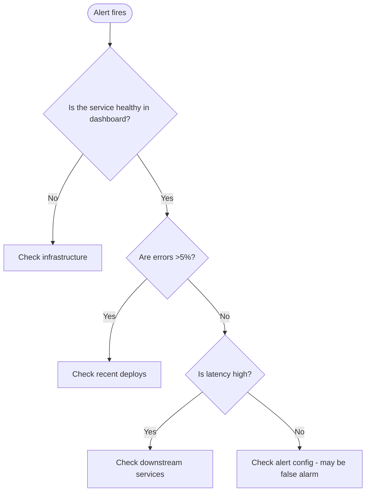

# skill: data-import-export

Use when a system imports or exports Excel or CSV

# Importing and exporting data

> **The one rule:** validate everything first, then write.
> If you write halfway and then find a bad row, the data is left half-done and nobody knows what to fix.

## When to use this skill

- A screen lets users upload Excel or CSV to bring data into the system
- A button exports to Excel or CSV
- Moving data from an old system into a new one
- A user uploads and gets the message "ไฟล์ไม่ถูกต้อง" (file is invalid) without knowing what is wrong

## When to use another skill instead, or together

| Job | skill | |
|---|---|---|
| Receiving general file uploads (images, documents) | `web-service-essentials` | Instead |
| Building a nicely formatted Excel file | `anthropic-skills:xlsx` | Instead |
| Queue mechanics and progress | `async-messaging` | Instead |
| Buddhist Era (B.E.) years and Thai sorting order | `i18n-and-locale` | Instead |
| Sending documents into Thai accounting software (PEAK · FlowAccount) through an API instead of a file | [`references/thai-accounting-apis.md`](references/thai-accounting-apis.md) | Instead |
| Recording who imported or exported what | `web-service-essentials` | Together |
| Masking personal data in export files | `pdpa-compliance` | Together |
| Telling the user when an import finishes | `async-messaging` | Together |
| Limits and constraints of the target table | `database-design` | Together |

---

## 1 · Give a template, do not make people guess

**Every import screen needs a button to download a template.** The template contains

- Column headers that match exactly what the system needs
- **1–2 correct sample rows**
- A row explaining which columns are required, what format, and which values are accepted
- A separate sheet for lists of selectable values (status, type, unit)

| How the file differs from the template | Do this |
|---|---|
| Column order swapped | ✓ Read by header name, not by position |
| Header has extra spaces or different letter case | ✓ Trim spaces and compare case-insensitively |
| Extra unknown columns | ✓ Skip them, but **tell the user what was skipped** |
| A required column is missing | ✗ Stop at once and say which column is missing |

---

## 2 · Three layers of validation before writing anything

| Layer | Checks | Example message |
|:--:|---|---|
| 1 · File | Opens · has the needed sheet · all required columns present · within the maximum row count | "ไม่พบคอลัมน์ 'รหัสสินค้า'" (column 'product code' not found) |
| 2 · Per row | Data type · required values · in the allowed list · number range | "แถว 42 คอลัมน์ 'จำนวน' ต้องเป็นตัวเลขมากกว่า 0 (พบ '-5')" (row 42, column 'quantity' must be a number above 0, found '-5') |
| 3 · Relationships | The code exists in the system · no duplicates within the file · business rules | "แถว 88 ไม่พบลูกค้ารหัส C-1042" (row 88, customer code C-1042 not found) |

**An error report must state: row · column · value found · value expected**

```
Wrong: "ไฟล์ไม่ถูกต้อง"
Wrong: "พบข้อผิดพลาด 37 รายการ"
Right: a table of check results, with a button to download the original file with an "ข้อผิดพลาด" (error) column appended
```

> **Report all errors in one pass. Do not stop at the first bad row.**
> The user then fixes everything in one round, instead of uploading 37 times.

---

## 3 · Writing into the system

| Mode | Use when |
|---|---|
| **All or nothing** | The default. The file must be fully correct to be imported |
| Do what passes, skip the bad rows | The file is very large and the rows are unrelated, and **the user must choose this, the system does not decide for them** |

- **Always show a summary page before confirming**, such as "จะเพิ่ม 120 · แก้ 45 · ข้าม 3 · ผิด 0" (will add 120 · update 45 · skip 3 · error 0), then have the user click confirm
- If the file has duplicate rows, stop and say so. Do not silently use the last row
- If the data already exists in the system, let the user choose: skip · overwrite · stop
- **Every import must be recorded in the audit log**: who imported, which file, how many rows affected (see `web-service-essentials`)
- **Keep the original file**, so when there is a problem you can look back at what the submitted file really looked like
- Make it reversible: store a batch id (the id of the import run) on every imported row

**Large files run as background jobs.** Above roughly 1,000 rows, put them in a queue,
split into batches of 500 rows, show progress, and allow cancel (see `async-messaging`).

---

## 4 · Excel and CSV traps

| Trap | What happens | Fix |
|---|---|---|
| **Thai in CSV garbled** | Opened in Excel, the characters are unreadable | Save as UTF-8 **with a BOM**, or recommend .xlsx |
| **Codes starting with 0 lose it** | `0812345678` becomes `812345678` | Always read as text, and on export set the cell format to text |
| **Long numbers turn into scientific notation** | A 13-digit ID card number → `1.23457E+12` | Same as above |
| **Dates interpreted automatically** | Is `03/04/2026` March or April | Force `YYYY-MM-DD` in the template |
| **B.E. and C.E. years mixed** | Silently off by 543 years | **Ask on the import screen which year style the file uses** |
| Trailing spaces in a value | Code matching fails | Trim leading and trailing spaces on every value |
| Cells that are formulas | You get the formula instead of the value | Read the calculated value |
| **Values starting with `=` `+` `-` `@` in an export file** | Excel runs a command when the user opens it | Prefix with `'` any value that starts with these characters |

> **A vulnerability people rarely know about:** a customer name of `=cmd|'/c calc'!A1`, if exported raw
> and someone opens it in Excel, will try to run the command for real. So always escape on export.

---

## 5 · Export

| Topic | Rule |
|---|---|
| Size | Above roughly 50,000 rows, run it as a background job and send a download link |
| Permission | **Export only data that this user already has permission to see**, because this is the most common leak |
| audit | Record every time who exported what data, which period, how many rows |
| Personal data | Mask columns that are not needed (see `pdpa-compliance`) |
| File name | `<เรื่อง>-<ช่วงวันที่>-<เวลาที่ส่งออก>.xlsx` |
| File header | Put in the filter conditions used and the export time. Otherwise in 3 months nobody knows what data this file is |
| Download link | Must expire (see `web-service-essentials`) |
| Format | `.xlsx` for people to read · CSV for machines to read |


## reference: thai-accounting-apis.md

# Connecting to Thai SME accounting software through API

Use when our system must push sales or purchase documents into the customer's accounting software, instead of exporting Excel for them to re-key. The rules of `SKILL.md` still apply: validate everything before writing · summary page before confirming · batch id · audit.
Every fact comes from the vendors' documents, opened 2026-10-23. Prices and API fees were rechecked 2026-10-26 (table "Sources"). Prices and terms change often: confirm with the vendor before quoting a customer.
Abbreviations: small and medium enterprises (SME) · Application Programming Interface (API) · User Acceptance Testing (UAT) is the test system · Hash-based Message Authentication Code (HMAC) is a signature made from a secret key · Software Development Kit (SDK).

## 1 · Choose a route

| Route | Use when |
|---|---|
| Send a file using the accounting software's import template (file format of each vendor not yet checked) | Few documents · the customer's package has no API |
| Connect to the API directly (sections 2–3) | Hundreds of documents per month · need status back, such as paid |
| Through a partner app the accounting software certifies (PEAK: menu ตั้งค่า > การเชื่อมต่อแอปพลิเคชันภายนอก, i.e. Settings > External application connections) | Online shop that already uses a back-office system → `domain-systems` `references/thai-marketplace-apis.md` |

## 2 · PEAK

| Topic | Information |
|---|---|
| Docs | developers.peakaccount.com (API Integration Guide · file `llms.txt` links every page) · has a Postman collection |
| Package | PEAK PRO Plus (12,000 baht/year) or higher · PEAK PRO Plus price per the developers page on 2026-10-26 · API fee is paid before go-live under the agreed package terms; the docs state no amount (`รอยืนยัน`, pending confirmation · per the go-live document, confirm the API fee, the number of items, and the trial terms with the PEAK team before putting them in a quotation) |
| Get access | Fill in the form, the team replies within 3 working days · you get Connect ID + Application Code · UAT and production credentials are separate |
| Authentication | Client Token valid 24 hours (`POST /api/v1/ClientToken`) · User Token per business, the customer creates it in the menu เชื่อมต่อแอปพลิเคชันภายนอก (External application connections) with the Application Code · header `Time-Stamp` (yyyyMMddHHmmss, UTC) · `Time-Signature` = HMAC-SHA1 of the Time-Stamp, with connectId as the key |
| What it can do | contacts · products (has adjust) · services · quotations · invoices · billing notes · receipts · credit notes · purchase orders · expenses · daily journals · receive payment · void · approve · attach files |
| e-Tax | Has an endpoint to send e-Tax Invoice for invoice and receipt · sends e-Receipt |
| UAT | `http://peakengineapidev.azurewebsites.net/api/v1` (http, not https) · free for 3 months · open Mon–Fri 08:00–22:00 |
| Production | `https://api.peakaccount.com/api/v1` · before go-live must pass the Final UAT Review (test case · error case · duplicate case · accounting result) |
| rate limit | ClientToken request 10 times/minute/IP · trial balance report (`GET /api/v1/FinancialReports/trialbalance`) 10 times/minute and 1 concurrent · per User Token: GET 20 concurrent · POST 10 concurrent · file attach 10 concurrent · over the limit → HTTP 429 `RATE_LIMITED` with `retryAfterSeconds` |
| Billed by | Only successful POST Create (invoice · receipt · quotation · billing note · purchase order · expense · daily journal) |
| webhook | Events Create · Edit · Void · PaidPayment · VoidPayment of the main documents (contact · product only Create · Edit) · can set a custom header per endpoint, such as `x-api-key` · the docs say nothing about signatures or redelivery |

## 3 · FlowAccount

| Topic | Information |
|---|---|
| Docs | developers.flowaccount.com · the spec actually in use `https://developers.flowaccount.com/swagger.yml` (OpenAPI 3.0.2 · 130 paths) · SDKs in several languages at github.com/flowaccount |
| Package | Only Pro Business has Open API (price page 2026-10-26: ฿457/month · ฿5,490/year) · Free · Standard (฿1,990/year) · Pro (฿2,990/year) have no API · the price page lists no separate API fee · import up to 5,000 items/month, beyond that special pricing · the API page says "Pay when you go live" and gives no amount (`รอยืนยัน`, pending confirmation) |
| Get access | Form request-openapi · team replies within 1–2 working days · sandbox usable for 30 days · real credentials are emailed to the business owner within 3 working days after the package is confirmed |
| Authentication | OAuth 2.0 · Client Credentials = 1 client per business · OpenID = partner with 1 client for many businesses (scope `flowaccount-api offline_access` · refresh token about 30 days from the last use) · token at `https://openapi.flowaccount.com/{test or v1}/token` valid 86,400 seconds · sent in header `Authorization: Bearer` |
| base URL | sandbox `https://openapi.flowaccount.com/test` · production `https://openapi.flowaccount.com/v1` |
| What it can do | contacts · products · quotations · billing-notes · tax-invoices · receipts · cash-invoices · purchases · purchases-orders · expenses · withholding-taxes · journal-entries · chart-of-accounts · change status · receive payment · attach files · export PDF · send email |
| Cross-system reference | Field `externalDocumentId` "รหัสเอกสารอ้างอิงจากระบบภายนอก" (document id referenced from an external system) |
| e-Tax · rate limit · webhook | Not found in swagger.yml (searching webhook · etax · rate limit · 429 gave 0 hits) nor on the pages developers.flowaccount.com · flowaccount.com/en/developers on 2026-10-26 (not yet checked with the vendor · contact developer_support@flowaccount.com) |

## 4 · Other vendors

| Software | What was found |
|---|---|
| TRCLOUD | The vendor's API page says it has a RESTful API · create an API Key from the settings menu · has Custom API & Webhook · no public developer docs found, ask the sales team for the manual |
| AccRevo | No public API found · the website has a launch article about AccRevoX × MCP (works with Claude) |
| Express | Searched twice, found no vendor website and no public API |

## 5 · e-Tax Invoice

- Pick one system to issue the tax invoice number · our system and the accounting software must not both issue numbers
- Send into the accounting software as the source document, then let the accounting software issue the e-Tax · PEAK has an endpoint to send e-Tax · FlowAccount not found in the spec, ask the vendor
- Tax invoice rules (section 86/4 · e-Tax Invoice & e-Receipt vs by Email) → `e-commerce:thai-tax` (if installed)

## 6 · Prevent duplicates and reconcile

- Keep a mapping table: our id ↔ the accounting software's id · PEAK recommends keeping External Reference and a mapping to prevent duplicate documents · FlowAccount uses `externalDocumentId` to hold our id
- Neither vendor's docs have an idempotency key → look up the mapping before every POST create (`code-craft`)
- A timeout does not mean failure · pull the list by date range and compare before resending
- On 429 → wait per `retryAfterSeconds` or back off exponentially (1 · 2 · 4 · 8 seconds, as PEAK recommends)
- Reconcile every day: the document count and total of the 2 systems must match → `domain-systems` (`references/agent-payment-integration.md`, section Settlement Reconciliation)
- Log every send to audit: who sent · which document · destination id · result → `web-service-essentials`
- Client Token · client secret · connectId stay outside the code → `web-service-essentials` · PEAK UAT is http, so use test data only

## Sources

| Topic | URL (opened 2026-10-23) |
|---|---|
| PEAK packages · UAT free 3 months · guide | https://www.peakaccount.com/developers · https://developers.peakaccount.com/reference/api-integration-guide |
| PEAK list of all API pages | https://developers.peakaccount.com/llms.txt |
| PEAK token · signature | https://developers.peakaccount.com/reference/peak-api-client-token-guide.md |
| PEAK rate limit · billing count · go-live | https://developers.peakaccount.com/reference/copy-of-api-rate-limiting-concurrency-control.md · .../peak-api-transaction-counting.md · .../peak-api-implementation-go-live-guide.md |
| PEAK webhook · API access rights | https://developers.peakaccount.com/reference/webhook.md · .../api-access-rights.md |
| PEAK help center (packages · User Token) | https://intercom.help/peak/en/articles/13176287 · https://intercom.help/peak/en/articles/10078711 |
| FlowAccount API page · price (rechecked 2026-10-26) | https://flowaccount.com/en/developers · https://flowaccount.com/en/pricing |
| FlowAccount connection · token | https://developers.flowaccount.com/tutorial/connect-open-api · .../tutorial/connect/client-credentials-flow · .../tutorial/connect/open-id-flow |
| FlowAccount spec · SDK | https://developers.flowaccount.com/swagger.yml · https://github.com/flowaccount/open-api (README says swagger.yml is the spec in actual use) |
| TRCLOUD · AccRevo | https://www.trcloud.co/api.php · https://www.accrevo.com/ |


---

# skill: incidents-and-monitoring

Use when a live system is down, or for metrics, alerts or runbooks

# incidents-and-monitoring — watch a live system, run an incident, write it up

> **One rule:** a person must approve any change to production during an incident. The agent proposes the command and its expected effect, and the on-call person runs it or approves it.

## Pick the part

| Job (what the user says) | Open |
|---|---|
| "Is the system healthy?", "What should we alert on?", "The system is slow, where is it?" | [`references/observability-basics.md`](references/observability-basics.md) (PromQL and Grafana details: [`references/prometheus-grafana.md`](references/prometheus-grafana.md)) |
| "The site is down", "users cannot log in", "we may have leaked data" | [`references/incident-response.md`](references/incident-response.md) |
| "Write a runbook", "on-call guide", "what do we do when this alert fires" | [`references/incident-runbook-template.md`](references/incident-runbook-template.md) (full template: [`references/runbook-template.md`](references/runbook-template.md)) |
| "Write a postmortem", "blameless review", "what went wrong last week" | [`references/postmortem-template.md`](references/postmortem-template.md) (full template: [`references/template.md`](references/template.md)) |

Drills for a runbook: [`references/game-days.md`](references/game-days.md). Alert-to-runbook links: [`references/index-and-alert-links.md`](references/index-and-alert-links.md).

## Steps every part shares

1. Name the one thing that is wrong, and write down the time of each event as it happens.
2. Keep the live log to one timestamped line per event. Polish it after the incident, not during.
3. Measure with symptoms users feel (errors, latency at the 95th percentile), not with averages or with CPU alone.
4. Give the on-call person one step at a time, each with the value to expect. If the value is not there, the step did not work.
5. After the incident is stable, write the postmortem within 48 hours.

## Check before done

- Every production change (rollback, failover, scaling, feature flags, WAF or firewall rules) has a named human who approved it.
- A security breach or leaked personal data goes to `security-analyst` at once. The 72-hour clock to notify the PDPC (Personal Data Protection Committee) starts when the breach is known (`pdpa-compliance` section 8).
- Every runbook command is checked against staging before use, and every alert links to its runbook.
- Metric labels never hold user ids, order ids or phone numbers; those go to logs.
- The postmortem is blameless and states facts without softening them.

A full multi-step response can follow the `bug-fix` playbook in `superuser/references/playbook-bug-fix.md`, with the steps in `incident-response` as the work format.


## reference: game-days.md

# Game Days

A checklist for incident-response drills that test a runbook; use it when planning the quarterly drill

Test runbooks by faking failures on purpose:

```markdown
## Game Day Checklist

Quarterly:
- [ ] Pick a runbook to test
- [ ] Simulate the failure in staging (chaos engineering)
- [ ] On-call engineer follows runbook
- [ ] Identify gaps
- [ ] Update runbook based on learnings
- [ ] Repeat with different runbook next quarter
```


## reference: incident-response.md

<!-- merged from skill `incident-response` on 2026-11-27 · description was: Guide a live incident with devops-engineer (breaches with security-analyst) — triage, mitigate with human approval, resolve, postmortem. -->

## Contents

- [Phase 1: Detection & Triage (first 5 min)](#phase-1-detection--triage-first-5-min)
- [Phase 2: Investigation (next 15-30 min)](#phase-2-investigation-next-15-30-min)
- [Phase 3: Mitigation (stop the bleeding)](#phase-3-mitigation-stop-the-bleeding)
- [Phase 4: Resolution](#phase-4-resolution)
- [Phase 5: Post-Incident (within 48h)](#phase-5-post-incident-within-48h)
- [Output Required](#output-required)
- [Hand-off Suggestions](#hand-off-suggestions)
> **Shortcut into SuperUser:** open the skill `superuser` with the `bug-fix` playbook and pick the playbook steps into the todo first · the steps below are the work format and output of this command, to be used alongside the playbook, not in place of it

Use the `devops-engineer` agent to coordinate incident response for: **the user's request**

> **Critical:** Speed matters. During the incident keep only a plain timestamped log (one line per event). Polish it after the incident. Focus on stopping the bleed.
>
> **Security breach or leaked personal data?** Hand the lead to the `security-analyst` agent and start `pdpa-compliance` section 8 now: the 72-hour clock to notify the PDPC (Personal Data Protection Committee) office starts when the breach is known.

The DevOps engineer should follow this structured response:

## Phase 1: Detection & Triage (first 5 min)

1. **Confirm the incident:**
   - Is it real? (multiple signals or just one)
   - What's the user-facing symptom?
   - When did it start (exact UTC time)?
   - How widespread (all users, region, segment)?

2. **Assess severity** with the one severity table in `postmortem-template.md` (Severity Levels). SEV1 pages everyone; SEV4 is tracked, not paged.

3. **Assemble response team:**
   - Incident Commander (IC)
   - Subject Matter Experts (SMEs)
   - Communications lead (for SEV1/2)
   - Scribe (timestamps everything)

4. **Open incident channel** (e.g., `#inc-YYYYMMDD-shortname`)

5. **Update status page** (for user-facing SEV1/2)

## Phase 2: Investigation (next 15-30 min)

1. **Gather evidence:**
   - Logs (application, infra)
   - Metrics dashboards (errors, latency, traffic)
   - Recent changes (deploys in last 24h)
   - External factors (AWS status, vendor incidents)

2. **Form hypotheses** — avoid tunnel vision:
   - What recently changed?
   - What pattern do logs show?
   - Could it be capacity? Network? Bug? Config?

   **Label every hypothesis with a confidence tag** that follows the evidence, not how tidy the report looks. No percentages. Keep at most 3 suspects in the report.

   | Tag | Means |
   |---|---|
   | `[ยืนยันแล้ว]` | Seen happening: a query result, log line or graph anyone can open |
   | `[น่าจะ]` | Evidence points to it but the failure itself was not seen (found in the code but never seen firing is at most this) |
   | `[เป็นไปได้]` | Fits the symptoms, no direct evidence yet |
   | `[ไม่น่า]` | Evidence against, not conclusive |
   | `[ตัดออกแล้ว]` | Killed by one stated fact (write the fact) |

   Every claim carries the query or link so a person can re-check it. These tags pair with `จากแหล่ง` and `อนุมาน` in `superuser` evidence labels.

3. **Communicate updates** every 15-30 min even if "still investigating" — one message per audience, the Communications lead sends them:

   | Audience | When | Says (and nothing more) |
   |---|---|---|
   | Internal (incident channel · support) | every 15-30 min | what is broken · who is affected · what we are trying now · next update at HH:MM |
   | Exec (SEV1/2) | at declare · at mitigate · at all-clear | impact in business terms (users · orders · baht) · ETA or "unknown" · what we need from them (a decision, a vendor call) |
   | Customers (status page · in-app) | at declare · on change · at all-clear | symptom in their words · workaround if any · next update time — no root cause, no blame, no promises of a fix time |
   | Regulator / PDPC (personal-data breach only) | within 72 h of knowing, via `pdpa-compliance` section 8 | what data · how many people · what was done · contact person — drafted by `legal-compliance-officer`, not improvised in the channel |

## Phase 3: Mitigation (stop the bleeding)

> **Tip:** Mitigation ≠ fix. The goal is to cut user impact NOW.

Common mitigations, lowest risk first (same order as `incident-runbook-template.md`):
- **Disable** broken feature (feature flag) · **Rate limit** abusive traffic
- **Scale up** capacity
- **Rollback** recent deploy
- **Block** at WAF (web application firewall) or firewall
- **Failover** to backup region/instance (last resort)

> **Production changes need a human.** The agent proposes the action, the command and the expected effect. A human on-call runs it or approves it before rollback, failover, WAF or firewall blocks, scaling or flag changes touch production (`ground-rules/principle-proceed-on-reversible-work`).

Document what worked AND what didn't.

## Phase 4: Resolution

1. **Implement permanent fix:**
   - Identify root cause (5 Whys)
   - Code fix or config change
   - Test in staging first if possible

2. **Verify stability:**
   - Monitor for at least 30 min
   - Watch key metrics (errors, latency, throughput)
   - Confirm no related issues

3. **All-clear announcement:**
   - Update status page
   - Notify customer support
   - Post in incident channel

## Phase 5: Post-Incident (within 48h)

1. **Schedule postmortem** within 48 hours
2. **Use `postmortem-template.md` skill** for blameless analysis
3. **Track action items** in real tickets
4. **Share learnings** beyond the affected team

## Output Required

Throughout the incident, keep a running **incident log** as plain timestamped lines. After the all-clear, format it with `design-gate/polished-document-style`. It covers:
- Severity + timeline table
- Affected services + user count
- Investigation steps + findings (the first paragraph answers "what broke and why" before any evidence; hypotheses carry the tags from Phase 2)
- Mitigations attempted (worked + didn't)
- Resolution actions
- Action items for postmortem

## Hand-off Suggestions

- Permanent code fix → `developer`
- Architecture issue → `solution-architect`
- Security breach (live) → `security-analyst` + `pdpa-compliance` section 8 · code vulnerability found → `security-engineer`
- Customer communication → `technical-writer` + `product-manager`
- Process improvement → `project-manager`


## reference: incident-runbook-template.md

<!-- merged from skill `incident-runbook-template` on 2026-11-27 · description was: Use when writing a runbook or on-call guide -->
# Incident Runbook Template

## Contents

- [When to use this skill](#when-to-use-this-skill)
- [When not to use](#when-not-to-use)
- [Read more when](#read-more-when)
- [0 · Look for an existing format first (every time)](#0--look-for-an-existing-format-first-every-time)
- [What's a Runbook?](#whats-a-runbook)
- [Runbook Quality Standards](#runbook-quality-standards)
- [Runbook Template](#runbook-template)
- [Runbook Index and Alert Links](#runbook-index-and-alert-links)
- [What Makes Runbooks Fail](#what-makes-runbooks-fail)
- [Game Days](#game-days)
- [Anti-patterns](#anti-patterns)
- [Document Look](#document-look)

## When to use this skill

- Writing a runbook for a known failure mode
- Documenting on-call procedures
- Creating playbooks for common alerts
- After a postmortem finds "we need a runbook for X"
- Onboarding new on-call engineers

## When not to use

| Task | Use this instead |
|---|---|
| The incident is over and you must summarise what happened and how to prevent it | `postmortem-template.md` |
| Setting up a metric alert or dashboard | `observability-basics.md` |

## Read more when

| File | Open when |
|---|---|
| [references/runbook-template.md](runbook-template.md) | Every time you start a new runbook. Copy the full template from this file and fill it in |
| [references/index-and-alert-links.md](index-and-alert-links.md) | If the team has no runbook index page, or alerts do not yet link to a runbook, open this file for examples |
| [references/game-days.md](game-days.md) | When planning an incident drill to test that a runbook works in practice |

## 0 · Look for an existing format first (every time)

Before using the structure or template in this file, check whether the user, customer or project already has its own format:

- **Where to look:** existing runbooks: `docs/runbooks/` · the on-call team's wiki · the alerting tool in use (PagerDuty · Opsgenie · Grafana) and the real alert names · the organisation's severity levels
- **Result:** found → use that format (headings, order, field names, numbering) and say in the reply which file's format you used · not found → use the template in this file as a fallback and say that no existing format was found
- **Still required either way:** alert names, commands and dashboards come from the real system. Do not invent examples.

## What's a Runbook?

A **runbook** answers: "Alert X fired. What do I do?" It is not architecture documentation (the bigger picture) or training material (too much detail).
## Runbook Quality Standards

A good runbook is:

| Property | Test |
|----------|------|
| **Actionable** | Can a tired engineer at 3am follow it? |
| **Concrete** | Are commands copy-pasteable? |
| **Tested** | Has someone followed it during a real incident? |
| **Updated** | Was it last reviewed less than 6 months ago? |
| **Discoverable** | Can on-call find it from the alert link? |
| **Concise** | Under 1 page for common cases |

## Runbook Template

The full template is in [references/runbook-template.md](runbook-template.md). Every runbook has these sections in this order, and each section must contain the following.

| Section | Must contain |
|---|---|
| Header | Severity · Service · Owner Team · Last Reviewed · Linked Alert |
| TL;DR (30 seconds) | One paragraph: what broke, what to do first, and whom to call |
| How to Detect | Symptoms users see and symptoms seen internally · the alert that fires · the dashboard to open |
| Diagnosis (60 seconds) | A decision flowchart and quick checks written as commands to copy and run, in order |
| Mitigation Steps | Steps ordered from low risk to high (the same order as `incident-response.md` Phase 3). Every step states Expected effect · **VERIFY** (the command or graph to look at, and the value to expect. If you do not see that value, the step has not worked yet. Do not move to the next step without knowing what the previous step did) and Caveats or If doesn't work · the agent only proposes commands and expected results, and the on-call person runs them or approves them before anything touches production |
| Escalation Path | Who is called when, in clear minutes |
| Verification | A checklist to confirm it is really fixed |
| After Resolution | Log it in the incident channel → update the status page → open a postmortem ticket → update this runbook |
| Related Runbooks · Background | Links to related runbooks, and a short background of the problem (optional) |

**Mitigation order in the template:** Reduce load (low risk) → Scale up (medium risk) → Rollback recent deploy (higher risk) → Failover to backup region (last resort)

**Escalation order in the template:** If it cannot be fixed in 15 minutes, call the secondary on-call. If two people cannot fix it in 30 minutes, call the service's owning team. If it is still SEV1 after 45 minutes, call the incident commander (IC). If SEV1 runs past 1 hour, call the head of engineering.

**Count it as fixed when** the error rate is back to normal · latency p95 is below the threshold · the status page says "Operational" · there are no new alerts · customers have stopped reporting problems, and you have watched for another 30 minutes.

> Use `postmortem-template.md` skill for the full analysis

## Runbook Index and Alert Links

Keep one index page of runbooks in one place, searchable by service, by alert name, and by the most frequent incidents in the last 90 days.

Every alert **must** link to a runbook through the alert's `runbook_url:` annotation, and should carry a matching `dashboard:` too. Examples of the index page and a Prometheus alerting rule are in [references/index-and-alert-links.md](index-and-alert-links.md).

## What Makes Runbooks Fail

| Problem | Fix |
|---------|-----|
| Out of date | Review every 6 months, update after every incident |
| Too long | Split into 1 runbook per failure mode |
| Too generic | Be specific to YOUR service |
| No commands | Include actual copy-paste commands |
| Not discoverable | Link it from the alert and the index page |
| No ownership | Each runbook has a team owner |
| Not tested | Run game days, and follow it during real incidents |
| Commands rot silently | CI job on every change to `runbooks/`: pull every fenced `bash` block → `bash -n` (parses) · every `./scripts/*.sh` it names exists in the repo · every `kubectl` resource name exists in staging (`kubectl get ... -n staging`) · fail the build on any miss. A command that cannot run at 3am is worse than no runbook (idea from wshobson/agents incident-runbook-templates) |

## Game Days

Test a runbook by deliberately simulating a failure. Each quarter, pick one runbook, simulate the incident in staging, and have on-call follow it. Then update the runbook for the gaps found. The full checklist is in [references/game-days.md](game-days.md).

## Anti-patterns

- **Theoretical runbooks** written by someone who never saw the failure
- **"Contact the team"** without saying who or how
- **Treating mitigation as the root-cause fix** (mitigation should be FAST; the fix comes later)

## Document Look

This skill decides **what goes in** the document. It does not decide **how it looks** —
load the matching skill before writing, not after:

| What is being handed over | Load |
|---|---|
| Markdown someone reads (repo, wiki, issue tracker) | `design-gate/polished-document-style` |
| A rendered `.docx` / `.pptx` / PDF a stakeholder signs off on | `document-design` |
| The point needs a picture to land | `diagrams`, then `diagrams` |


## reference: index-and-alert-links.md

# Runbook Index และการผูก runbook กับ alert

An example runbook index page and an example of linking a runbook from an alert; use it when setting up the team's runbook system for the first time

## Runbook Index Pattern

Maintain a central index (`docs/runbook-index.md`). Each runbook is one file `docs/runbook-<service>-<เรื่อง>.md` per `workspace-rules/document-naming`:

```markdown
# Runbook Index

## By Service
- API Service
  - [High error rate](runbook-api-high-error-rate.md)
  - [Memory leak](runbook-api-memory-leak.md)
- Database
  - [Connection pool exhausted](runbook-db-conn-pool.md)
  - [Replication lag](runbook-db-repl-lag.md)

## By Alert Name
| Alert | Runbook |
|-------|---------|
| `api_5xx_rate_high` | [API: High error rate](link) |
| `db_connections_high` | [DB: Connection pool](link) |
| `disk_full_warn` | [Generic: Disk full](link) |

## Most Common Incidents (last 90 days)
1. High error rate on payment service — [runbook](link) (12 times)
2. DB replication lag — [runbook](link) (8 times)
3. Cache invalidation storm — [runbook](link) (5 times)
```

## Linking Runbook to Alert

Every alert MUST link to a runbook:

```yaml
# Prometheus alerting rule (rule file loaded by Prometheus; Alertmanager only routes the alert)
- alert: APIHighErrorRate
  # share of requests that are 5xx — needs the denominator, otherwise it is requests per second
  expr: |
    sum(rate(http_requests_total{status=~"5.."}[5m]))
      / sum(rate(http_requests_total[5m])) > 0.05
  for: 5m
  annotations:
    summary: "API error rate > 5%"
    runbook_url: "https://runbooks.example.com/api/high-error-rate"
    dashboard: "https://grafana.example.com/d/api-overview"
```


## reference: observability-basics.md

<!-- merged from skill `observability-basics` on 2026-11-27 · description was: Use when a live system needs metrics, logs or alerts -->
# Measuring and monitoring a system

## Contents

- [When to use this skill](#when-to-use-this-skill)
- [When **not** to use it](#when-not-to-use-it)
- [1 · These three answer different questions](#1--these-three-answer-different-questions)
- [2 · The four signals to measure](#2--the-four-signals-to-measure)
- [3 · Naming metrics](#3--naming-metrics)
- [4 · Alerts](#4--alerts)
- [5 · Dashboards](#5--dashboards)
- [6 · Business metrics](#6--business-metrics)
- [References](#references)

> **The one rule:** if a customer is the one who tells us the system is down, monitoring has failed.
> It does not mean the customer is kind.

## When to use this skill

- The system has real users
- Someone asks "is the system healthy right now?" and you must open the logs to answer
- You get woken in the middle of the night by an alert that needs no action
- The system is slow and you do not know where

## When **not** to use it

| Job | Use this instead |
|---|---|
| Log line format and masking | `errors-and-logs` |
| A trail of who did what | `web-service-essentials` |
| Health check endpoint | `web-service-essentials` |
| Steps during an incident | `incident-runbook-template.md` |
| Post-incident summary | `postmortem-template.md` |

---

## 1 · These three answer different questions

| | Answers the question | Example | Cost |
|---|---|---|---|
| **metric** | "Is it bad now? Getting better or worse?" | error 2.3% · p95 = 840 ms | Cheapest, keeps a long time |
| **log** | "What happened in that request?" | message + stack trace + id | Medium cost |
| **trace** | "Which step is slow?" | one request across 5 services | Most expensive, sample it |

**Order of use during an incident:** the metric says there **is a problem** → the trace says **where** → the log says **why**.
All 3 must be linked by the same correlation id (see `errors-and-logs`).

---

## 2 · The four signals to measure

| Signal | Measures | Numbers to watch |
|---|---|---|
| **Request rate** | How much work is coming in | Per second, split by endpoint |
| **Error rate** | What percentage fails | Split 4xx (user's fault) from 5xx (our fault) |
| **Response time** | How slow | **p50 · p95 · p99** |
| **Resources** | Is anything near full | CPU · memory · disk space · connection pool |

> **Never look at the average response time.** An average of 200 ms sounds good
> while 5% of users wait 9 seconds. The average always hides the people who hit the problem. **Look at p95 and p99.**

**For queues and background jobs**, add 3 more: jobs waiting in the queue · wait time in the queue · jobs that failed for good
(see `async-messaging`).

---

## 3 · Naming metrics

```
<domain>_<what is measured>_<unit>

http_requests_total              cumulative count
http_request_duration_seconds    duration
orders_created_total             business event
queue_depth_jobs                 value at this moment
```

| Rule | Reason |
|---|---|
| Always end with the unit | `_seconds`, not `_time`, which nobody can tell is seconds or milliseconds |
| End cumulative values with `_total` | It says the value keeps rising and is not the current value |
| Use labels instead of making new names | `http_requests_total{route,status}`, not a separate name per endpoint |
| **A label must not take unbounded values** | If you put a user id or order id in a label, the metrics system cannot cope |

### 3.1 · If you use Prometheus and Grafana

- **Metric types:** a counter counts events (read it with `rate()`) · a gauge holds the value right now · a histogram holds durations when you need p95 · a summary is for when you do not need to aggregate across instances
- **Units:** seconds · bytes · ratio 0 to 1 (`_seconds`, not `_milliseconds`)
- p95: `histogram_quantile(0.95, sum by (le) (rate(<name>_bucket[5m])))`
- Every alert rule has `for:` · `severity` · a runbook link · alert on symptoms (latency · error), not on CPU or GPU
- Keep dashboards as JSON in git and provision them from files · RED per service · USE per resource
- Details on PromQL · alert rule examples · provisioning · a voice agent example (STT · LLM · TTS latency · Kafka lag · GPU): `prometheus-grafana.md`

---

## 4 · Alerts

> **Every alert must give the receiver something to do.** If the person reads it and has nothing to do,
> in 3 weeks they will mute alerts, and the day a real one fires nobody will see it.

**Alert on what users feel, not on machine numbers**

| ✗ Alert like this | ✓ Alert like this |
|---|---|
| CPU over 80% | Error rate over 2% for 5 minutes |
| Memory over 70% | p95 of the payment page over 3 seconds for 10 minutes |
| pod restart | Successful orders drop by more than 50% against last week |
| disk 60% | **disk will be full in 4 hours at the current rate** |

| Level | Example | Send to |
|---|---|---|
| **Wake a person** | Users cannot use the system · data is being damaged | Phone call · push |
| **Check in work hours** | disk will be full in 3 days · errors rising but still low | Team chat |
| **Just record it** | Everything else | Dashboard |

**Every alert must have:** what broke · who is affected · **a link to the runbook** · a link to the dashboard.
**Always set a duration (for N minutes)**, not an alert the moment a value spikes once.

### 4.1 · Error budget and burn rate

A system with an SLO uses this instead of a fixed error % threshold, because it says "if this goes on, when will the whole month's budget run out?"

- **Budget** = the time you may fail in 30 days → SLO 99.9% = 43 minutes · 99.5% = 3.6 hours · 99% = 7.2 hours
- **Burn rate** = current error rate ÷ (1 − SLO) → burn 1 = the budget runs out exactly on day 30 · burn 10 = gone in 3 days
- Set 3 alert levels as in the table, and every level must hold true over both the long window and the short window (short window = 1/12 of the long one), so the alert stops as soon as the system recovers

| Level | burn rate | Long window · short window | Budget already used | SLO 99.9% means errors above | Send to |
|---|---|---|---|---|---|
| Fast burn | 14.4 | 1 hour · 5 minutes | 2% of the month in 1 hour | 1.44% | Wake a person |
| Slow burn | 6 | 6 hours · 30 minutes | 5% of the month in 6 hours | 0.6% | Wake a person |
| Slow leak | 1 | 3 days · 6 hours | 10% of the month in 3 days | 0.1% | Team chat |

Show the remaining budget on the overview dashboard. When the budget is nearly gone, stop shipping features and fix stability first. Agree this rule with the product owner in advance, not in the middle of an argument.

---

## 5 · Dashboards

Two pages are enough.

| Page | Answers the question | Contains |
|---|---|---|
| **Overview** | "Is it normal now?" | The 4 signals for the whole system · dependency status · latest releases |
| **Deep dive per service** | "Where did it break?" | The 4 signals split by endpoint · queues · database |

- **A vertical line marks the deploy time.** Most problems start after this line, and you see it in one second
- The overview page must be readable in 10 seconds, so keep it to 6 graphs at most
- Draw the alert threshold lines on the graphs, so you can see how far the value is from the line

---

## 6 · Business metrics

Technical metrics all green while the business has stalled really happens, and you will not catch it unless you measure it.

| Example | What it catches |
|---|---|
| Successful orders per hour | The pay button is broken even though every endpoint returns 200 |
| Successful login rate | A problem with an external identity provider |
| Background jobs waiting more than N minutes | The queue is stuck but the API still answers normally |
| Emails that failed to send | Customers do not get receipts, with no error anywhere |

**Pick 3–5 that are the heart of the business**, and alert when they drop abnormally against the same period last week.

---

## References

- [`prometheus-grafana.md`](prometheus-grafana.md) — open for PromQL · alert rules · Grafana provisioning · voice agent example
- `ai-engineering` → `references/mcp-server.md` item 1.1 — when an agent must read Prometheus or Grafana through MCP
- [`sources.md`](sources.md) — open to re-check dated figures, prices and rules, and their sources


## reference: postmortem-template.md

<!-- merged from skill `postmortem-template` on 2026-11-27 · description was: Use when writing a blameless post-incident review -->
# Blameless Postmortem Template

## Contents

- [When to use this skill](#when-to-use-this-skill)
- [ไม่ใช้เมื่อ](#ไม่ใช้เมื่อ)
- [0 · Look for an existing format first (every time)](#0--look-for-an-existing-format-first-every-time)
- [Core Principles](#core-principles)
- [Severity Levels](#severity-levels)
- [Output Template](#output-template)
- [Blameless Language Guide](#blameless-language-guide)
- [Quality Checklist](#quality-checklist)
- [Common Mistakes](#common-mistakes)
- [Document Look](#document-look)
- [References](#references)

## When to use this skill

- After any production incident: a full postmortem for SEV1 / SEV2, repeated SEV3, security, customer-facing or data-integrity incidents; a short writeup for any other SEV3 and for SEV4
- After a near-miss that could have been a major incident
- After significant bugs that reached production
- After a security incident

## ไม่ใช้เมื่อ

| งาน | ใช้ตัวนี้แทน |
|---|---|
| The incident is still happening and you need to know what to do now | `incident-runbook-template.md` |
| An ordinary bug that did not take the real system down | `qa-docs` |
| Action item "add a load test" (the system went down because of heavy traffic or a full connection pool) | `test-automation` — set p95 and error-rate thresholds · permission gate before firing · smoke test in CI |

## 0 · Look for an existing format first (every time)

Before using the structure or template in this file, check whether the user, customer or project already has its own format:

- **Where to look:** the organisation's incident report format · the severity levels the organisation defines (SEV/P1–P4) · earlier postmortems in `docs/postmortems/` or where the user points
- **Result:** found → use that format (headings, order, field names, numbering) and say in the reply which file's format you used · not found → use the template in this file as a fallback and say that no existing format was found
- **Still required either way:** use the organisation's severity names · the blameless principle, a timeline, and action items with owners are required in every format

## Core Principles

1. **Blameless** — focus on systems and processes, not individuals
2. **Honest** — don't soften facts to protect feelings
3. **Actionable** — every postmortem produces concrete action items
4. **Educational** — others should learn from this

## Severity Levels

| Level | Definition | Response Time |
|-------|-----------|---------------|
| **SEV1** | Total outage, data loss, security breach | Immediate, 24/7 |
| **SEV2** | Major feature down, significant user impact | Within 1 hour |
| **SEV3** | Degraded service, partial impact | Within business hours |
| **SEV4** | Minor issue, no user impact | Next business day |

## Output Template

Open [`template.md`](template.md) and fill every section of the full template (summary · impact · timeline · detail with TTD/TTM/TTR · 5 Whys · went well/wrong/lucky · action items with type · lessons · supporting info). For a SEV3 not repeated, SEV4 or near-miss use the quick postmortem below instead.

## Blameless Language Guide

| ✗ Blameful | ✓ Blameless |
|------------|--------------|
| "Alice deployed the bug" | "A bug was deployed in PR #123" |
| "Bob should have caught this in review" | "The review process didn't catch this; we should add automated checks" |
| "QA missed this case" | "Our test coverage didn't include this scenario" |
| "Someone forgot to..." | "The process doesn't ensure that..." |
| "Human error" | "The system allowed the mistake to happen" |

## Quality Checklist

- [ ] Timeline includes specific times (not vague "morning of")
- [ ] Root cause goes deep enough (not just "bug in code")
- [ ] Action items have owners AND due dates
- [ ] Action items are tracked in actual ticket system
- [ ] Blameless language throughout
- [ ] Reviewed by someone NOT involved in incident
- [ ] Shared with broader team for learning

## Common Mistakes

- "Lessons learned: be more careful" — not actionable
- Single root cause when there are usually multiple factors
- Skipping postmortem because "minor" — near-misses teach us most

### Quick postmortem (SEV3 not repeated · SEV4 · near-miss)

One block in the incident channel or ticket, same day — no meeting. Trigger · Detection · action-item Type are the same words as the full template:

```markdown
**Quick postmortem:** <title> · SEV3 · YYYY-MM-DD · <XX min>
- Trigger → impact: <what set it off> → <who felt what>
- Detection: <alert | customer | chance> after <XX min>
- Mitigation: <what stopped it> after <XX min> from first impact · recovered after <XX min>
- Root cause: <one sentence>
- Action: <one item> · @owner · Type <Prevent | Detect | Mitigate | Process> · due YYYY-MM-DD
```

---

## Document Look

This skill decides **what goes in** the document. It does not decide **how it looks** —
load the matching skill before writing, not after:

| What is being handed over | Load |
|---|---|
| Markdown someone reads (repo, wiki, issue tracker) | `design-gate/polished-document-style` |
| A rendered `.docx` / `.pptx` / PDF a stakeholder signs off on | `document-design` |
| The point needs a picture to land | `diagrams`, then `diagrams` |

Default formatting is not neutral — it reads as unfinished work.

## References

- [`template.md`](template.md) — open to write a full postmortem (the full template)


## reference: prometheus-grafana.md

# Prometheus and Grafana — using them correctly

Part of `incidents-and-monitoring` · the thinking about what to measure and what to alert on is in `SKILL.md` sections 2 · 4 · 5 · this file says how to do it in Prometheus and Grafana · metric names and numbers labelled `ตัวอย่าง` (example) are hypothetical data and must be adjusted to the real system

## Contents

- [1 · The 4 metric types](#1--the-4-metric-types)
- [2 · Names and units](#2--names-and-units)
- [3 · Labels and cardinality](#3--labels-and-cardinality)
- [4 · Common PromQL](#4--common-promql)
- [5 · Alert rules](#5--alert-rules)
- [6 · Grafana](#6--grafana)
- [7 · Voice agent system example](#7--voice-agent-system-example)
- [8 · Check before sending](#8--check-before-sending)
- [9 · Sources](#9--sources)

## 1 · The 4 metric types

| Type | What it is | Use when | Example |
|---|---|---|---|
| counter | A cumulative value that only goes up and returns to 0 when the process restarts | Counting events that have happened (requests · errors · finished jobs) · read with `rate()`, never the raw value | `http_requests_total` |
| gauge | The value at that moment, can go up and down | Things that are pending or measurable right now (calls in progress · queue length · memory) | `voice_calls_active` |
| histogram | Counts measured values into ranges (buckets), with a sum and a count | Durations or sizes where you need p95 · p99 and want to aggregate across many instances | `http_request_duration_seconds` |
| summary | Computes quantiles on the app side, over a sliding time window | Use only when you do not need to aggregate across instances · the quantiles and window are chosen when writing the code and cannot be changed later | Rare; normally choose histogram |

- Never average quantiles from a summary across several instances; the result has no statistical meaning (the Prometheus docs use this wording)
- **How to choose** (prometheus.io/docs/practices/histograms/ checked 2026-10-27): if the library and Prometheus you use support it, use a native histogram first, because you can change the percentile and time window later in PromQL · if not supported but you need to aggregate across instances, use a classic histogram · use a summary only when you do not need to aggregate across instances
- The Prometheus docs recommend native histograms first, but the libraries that support them are still limited; if your library does not support them, use a classic histogram and place buckets so that an edge sits at the SLO value, otherwise the estimated p95 will be off (example in the docs: true p95 about 320 ms is estimated as 443 ms because the bucket is wide from 300 to 450 ms)

## 2 · Names and units

| Rule | Right | Wrong |
|---|---|---|
| Start with one word that names the system | `voice_stage_duration_seconds` | `stage_duration` |
| Use base units: seconds · bytes · ratio 0 to 1 | `_seconds` · `_bytes` · `_ratio` | `_milliseconds` · `_megabytes` · `_percent` |
| The unit goes at the end, in plural form | `node_memory_usage_bytes` | `node_memory_usage_byte` |
| A counter ends in `_total` (if it has a unit, the unit comes first) | `process_cpu_seconds_total` · `http_requests_total` | `http_requests_count` |
| 1 name, 1 unit, 1 meaning | All in seconds | Half in seconds, half in milliseconds |
| Do not put a label name again in the metric name | `http_requests_total{route=…}` | `http_requests_by_route_total` |

## 3 · Labels and cardinality

Every unique set of label values is 1 new time series. The Prometheus docs warn you to avoid labels whose values are unbounded, such as user id or email.

| Must not be a label | Use instead |
|---|---|
| `user_id` · `customer_id` · phone number · email | Leave it out · keep it in logs or traces · if you must count per person, use a database, not a metric |
| `call_id` · `session_id` · `request_id` · `trace_id` | Logs and traces tied to the same id (`errors-and-logs`) |
| A full URL that has an id or query string | A route template such as `/orders/{id}` |
| An error message with variable values | A limited set of error codes such as `reason="timeout"` |

- A label you may use must have all its possible values countable in advance (stage = 3 values · status = 5 groups) · the number of series of one metric is close to the product of the number of values in each label · a histogram multiplies by the number of buckets on top
- To find which metric makes series explode: open the TSDB status page in the Prometheus UI · the `tsdb_stats` tool of `prometheus-mcp` gives similar information (see `ai-engineering` → `references/mcp-server.md` step 1.1)

## 4 · Common PromQL

| Need | Query | Note |
|---|---|---|
| Requests per second | `sum by (route) (rate(http_requests_total[5m]))` | The `[5m]` range should be several times the scrape interval (number not yet checked against the docs) |
| Error rate | `sum(rate(http_requests_total{status=~"5.."}[5m])) / sum(rate(http_requests_total[5m]))` | Count 5xx (our fault) apart from 4xx · with no traffic the quotient is NaN and the alert rule will not fire, which can hide a system receiving no requests at all; add a separate rule that alerts on no requests |
| p95 of latency (classic histogram) | `histogram_quantile(0.95, sum by (le) (rate(http_request_duration_seconds_bucket[5m])))` | Keep `le` in `sum by` · to split by route, add `route` to `by` |
| p95 (native histogram) | `histogram_quantile(0.95, sum(rate(http_request_duration_seconds[5m])))` | Use when the library and Prometheus support it |
| Average latency (for context only, never for deciding) | `rate(http_request_duration_seconds_sum[5m]) / rate(http_request_duration_seconds_count[5m])` | See `SKILL.md` section 2 |
| Disk will be full in 4 hours | `predict_linear(node_filesystem_avail_bytes[1h], 4*3600) < 0` | An example of saturation that warns ahead of time (not yet checked against the PromQL docs) |

## 5 · Alert rules

Principle from the Prometheus docs: alert on symptoms users feel (latency · errors) at the highest point in the stack you can · wake someone for latency at a single point of the stack · put causes (CPU · GPU · consumer lag) on the dashboard for tracing, and do not wake anyone for them · except for things a person must act on before the system goes down, such as capacity

Exception: a number users feel directly counts as a symptom even if it comes from an underlying system, such as Kafka consumer lag that makes callers wait for an answer (section 7); it may wake someone · lag that affects nobody right away, such as a report job after the call ends, is a cause; put it on the dashboard or the team chat

Every rule must have 4 things

| Item | Where | Reason |
|---|---|---|
| `for:` | In the rule | Do not alert the moment the value spikes once · if omitted, the rule fires from the first evaluation round |
| Severity level | Label `severity` (the name and values are a convention the team sets, not required by Prometheus) | Lets Alertmanager route it to the right place · use 3 levels per `SKILL.md` section 4: wake someone · look during work hours · log it |
| Runbook link | Annotation `runbook_url` (the key name is a convention; the docs say only that an annotation can hold a runbook link) | The responder starts from a procedure, not from zero at 3 a.m. |
| `summary` stating the symptom and who is affected | Annotation | Reading it on a phone tells you what to do |

Example (hypothetical thresholds; set them from the real SLO):

```yaml
groups:
  - name: voice-agent-symptoms
    rules:
      - alert: VoiceTurnLatencyHigh
        expr: |
          histogram_quantile(0.95,
            sum by (le) (rate(voice_turn_duration_seconds_bucket[5m]))) > 1.5
        for: 10m
        labels:
          severity: page
        annotations:
          summary: "ผู้โทรรอคำตอบเกิน 1.5 วินาที (p95) นาน 10 นาที"
          runbook_url: https://runbooks.example.com/voice/turn-latency
```

`keep_firing_for` stops alerts from flapping when the value hovers around the threshold · for burn rate alerts see `SKILL.md` section 4.1

## 6 · Grafana

| Topic | How |
|---|---|
| 1 dashboard per 1 service | A service that takes requests uses RED: Rate · Errors · Duration · resources (CPU · GPU · disk · connection pool) use USE: Utilization · Saturation · Errors · the Grafana docs say RED stands for the user experience, so set alerts from RED and use USE to trace causes |
| Keep it as code | Dashboard JSON lives in git · the Grafana docs treat not keeping JSON in version control as a sign the system is not yet in order · when many dashboards look alike, generate them with grafonnet (Jsonnet) or grafanalib (Python) |
| Load automatically | A provider YAML file in `provisioning/dashboards/` points `options.path` to the JSON folder |
| Stop edits in the browser from being lost | Set `allowUiUpdates: false` · whoever wants a change edits the JSON in git and opens a PR · loading from files always overwrites the version in the database |
| Do not copy a dashboard | Use template variables (choose service · environment) on a parent dashboard · the Grafana docs warn that copying means you do not get fixes from the original |
| Temporary dashboards | Name them starting with `TEST:` and delete when done |
| uid | Set a fixed `uid` in the JSON so links from alerts do not break · `uid` and `title` must be unique within the same folder |

Example provider (checked against the Grafana docs 2026-10-27):

```yaml
apiVersion: 1
providers:
  - name: services
    type: file
    allowUiUpdates: false
    updateIntervalSeconds: 30
    options:
      path: /var/lib/grafana/dashboards
      foldersFromFilesStructure: true
```

## 7 · Voice agent system example

All metric names in this section are set by the team (examples), except `DCGM_FI_DEV_GPU_UTIL` and `kafka_consumergroup_lag*`, which come from exporters

**Latency of each stage of a call** · 1 histogram split by stage with a `stage` label that has limited values

```
voice_stage_duration_seconds_bucket{stage="stt|llm|tts", le="…"}
voice_turn_duration_seconds_bucket{le="…"}   # จากผู้โทรพูดจบถึงเสียงตอบแรกออก
```

- Place buckets densely in the range 0.1 to 3 seconds, for example `0.1, 0.2, 0.3, 0.5, 0.8, 1.2, 1.5, 2, 3, 5`, with an edge at the threshold you set (1.5 seconds in the example of section 5)
- p95 per stage: `histogram_quantile(0.95, sum by (le, stage) (rate(voice_stage_duration_seconds_bucket[5m])))` · put it in one chart with 3 lines and you see at once which stage eats the time
- Alert on `voice_turn_duration_seconds` (the symptom callers feel); do not alert on every stage · stages are for tracing causes
- Never put `call_id` or the caller's phone number as a label · the call id goes to logs and traces

**Kafka consumer lag** · when the pipeline sends call events through Kafka

- The lag value comes from a Kafka exporter · `kafka_exporter` (danielqsj · Apache-2.0 · not an official Apache project · checked 2026-10-27) gives `kafka_consumergroup_lag{consumergroup,topic,partition}` and `kafka_consumergroup_lag_sum{consumergroup,topic}` · if you use another exporter, the names may differ
- Wake someone when the lag of a consumer that makes callers wait (such as the real-time call summarizer) is high and does not fall for a long time · example `sum by (consumergroup, topic) (kafka_consumergroup_lag_sum) > 1000` with `for: 10m` (hypothetical threshold) · lag of a report job after the call ends is fine to send to the team chat
- The `partition` label is only for drill-down charts; do not put it in alert rules

**GPU utilization** · the exporter is NVIDIA `dcgm-exporter`

- `DCGM_FI_DEV_GPU_UTIL` is a gauge in % (checked from `etc/default-counters.csv` of the repo 2026-10-27) · this name was set by the exporter and does not follow the rules of section 2; use it as it is
- GPU is a cause (USE), not a symptom · put it on the dashboard next to the latency of the stages that use the GPU (STT · TTS) · high utilization together with a high p95 of that stage means the machine is saturated and you must add machines or reduce load
- GPU that stays high for many hours alerts at the look-during-work-hours level; it does not wake anyone

## 8 · Check before sending

- [ ] Every metric has a unit and `_total` per the rules · no label with unbounded values (user · phone · call id)
- [ ] Latency is a histogram with a bucket edge at the SLO threshold · no decisions from averages
- [ ] Every alert has `for:` · `severity` · `runbook_url` · `summary` · alerts on symptoms, not on CPU or GPU
- [ ] Dashboards are JSON in git · provisioned from files · `allowUiUpdates: false`
- [ ] There is a RED dashboard per service and USE per resource

## 9 · Sources

Checked 2026-10-27

| Topic | Source |
|---|---|
| Metric types | prometheus.io/docs/concepts/metric_types/ |
| Names, units, label cardinality | prometheus.io/docs/practices/naming/ |
| histogram · summary · `histogram_quantile` · native histogram | prometheus.io/docs/practices/histograms/ |
| Principle of alerting on symptoms | prometheus.io/docs/practices/alerting/ |
| Rule syntax `for` · `keep_firing_for` · annotations | prometheus.io/docs/prometheus/latest/configuration/alerting_rules/ |
| RED · USE · dashboard as code · sprawl | grafana.com/docs/grafana/latest/dashboards/build-dashboards/best-practices/ |
| Dashboard provisioning | grafana.com/docs/grafana/latest/administration/provisioning/ |
| `DCGM_FI_DEV_GPU_UTIL` | github.com/NVIDIA/dcgm-exporter → etc/default-counters.csv |
| `kafka_consumergroup_lag` | github.com/danielqsj/kafka_exporter (not official to Kafka) |
| `predict_linear` · `[5m]` range vs scrape interval · NaN behavior when dividing by 0 | General team knowledge (not yet checked against the official PromQL pages) |


## reference: runbook-template.md

# Runbook Template

**สารบัญ:** แม่แบบเต็ม 1 บล็อก: TL;DR · How to Detect · Diagnosis · Mitigation Steps (ขั้น 1–5) · Escalation Path · Verification · After Resolution · Related Runbooks · Background

- [The whole template](#runbook-template) is in a single block; copy the whole block into a new runbook file

The full template for one runbook, ready to copy and fill in. The rules for what each section must contain are in `SKILL.md`

````markdown
# Runbook: <Alert Name or Failure Mode>

| | |
|--|--|
| **Severity** | SEV1 \| SEV2 \| SEV3 \| SEV4 (table in `postmortem-template.md`) |
| **Service** | service-name |
| **Owner Team** | @team-name |
| **Last Reviewed** | YYYY-MM-DD |
| **Linked Alert** | [Grafana/PagerDuty link] |

---

## TL;DR (30 seconds)

> One paragraph: what's broken, what to do first, who to call.

## How to Detect

**Symptoms:**
- User-facing: ...
- Internal: ...

**Alerts that fire:**
- [Alert Name](link) — fires when ...
- [Another Alert](link) — fires when ...

**Dashboards to check:**
- [Main Dashboard](link)
- [Service Health](link)

## Diagnosis (60 seconds)



### Quick checks (run in order)

**1. Is service responding?**
```bash
curl -fsS https://api.example.com/health || echo "DOWN"
```

**2. Are recent deploys suspicious?**
```bash
gh release list --repo our-org/service --limit 5
```

**3. Check error rate in logs:**
```bash
# Last 10 min of 5xx errors
kubectl logs -n prod deployment/api --since=10m | grep -c '"status":5'
```

**4. Check downstream dependencies:**
- Database: [Dashboard link]
- Redis: [Dashboard link]
- External API: [Status page link]

## Mitigation Steps

> **Human approval:** an agent only proposes the command and its expected effect. A human on-call runs it or approves it before it touches production (`ground-rules/principle-proceed-on-reversible-work`, `incident-response.md` Phase 3).

Try mitigations in order of risk (lowest first) — the same order as `incident-response.md` Phase 3:

### Step 1: Disable the broken feature or reduce load (low risk)
```bash
# Turn off the feature flag of the suspect feature
./scripts/flag.sh set new-checkout off --env prod

# Or enable rate limiting
kubectl set env deployment/api -n prod RATE_LIMIT_AGGRESSIVE=true
```

**Expected effect:** Error rate drops within 2 min
**VERIFY:** `./scripts/flag.sh get new-checkout --env prod` → `off` · dashboard 5xx panel < 1% for 2 min
**If doesn't work:** Go to Step 2

### Step 2: Scale up (medium risk)
```bash
kubectl scale deployment/api -n prod --replicas=10
```

**Expected effect:** Latency improves within 3 min
**VERIFY:** `kubectl get deployment/api -n prod` → READY `10/10` · p95 panel back under threshold
**Caveats:** Will increase cost, monitor budget alerts

### Step 3: Rollback recent deploy (higher risk)
```bash
kubectl rollout undo deployment/api -n prod
```

**Expected effect:** Reverts to previous version
**VERIFY:** `kubectl rollout status deployment/api -n prod` → `successfully rolled out` · running image tag = previous release
**Caveats:** Check for schema migrations before rolling back. A rollout undo does not delete data, but old code may break on a schema the new release already migrated — roll back only if the migration is backward-compatible

### Step 4: Block bad traffic at the WAF or firewall (high risk)
```bash
# Block the abusive IP range / path at the web application firewall (WAF)
./scripts/waf-block.sh --cidr 203.0.113.0/24 --ttl 1h
```

**Expected effect:** Abusive traffic stops reaching the service
**VERIFY:** `./scripts/waf-block.sh list` shows the CIDR with TTL · requests from that range in access log → 0 · request rate from real users unchanged
**Caveats:** Can block real users; set a TTL (time to live) and check the allow list

### Step 5: Failover to backup region (last resort)
```bash
# Update DNS to point to backup region
./scripts/failover-to-us-west.sh
```

**Expected effect:** All traffic shifts to backup
**VERIFY:** `dig +short api.example.com` → backup region IP · backup region request rate ≈ previous primary rate · primary → 0
**Caveats:** Some user data may need migration, full rollback complex

## Escalation Path

```
You can't resolve in 15 min
  ↓
1. Page secondary on-call (PagerDuty group: team-secondary)
  ↓
You both can't in 30 min
  ↓
2. Page service owner team (team-owner)
  ↓
Still SEV1 after 45 min
  ↓
3. Page incident commander on-call (IC)
  ↓
SEV1 still active after 1h
  ↓
4. Page engineering leadership
```

## Verification (after mitigation)

Confirm the issue is resolved:

- [ ] Error rate back to baseline
- [ ] Latency p95 < threshold
- [ ] Status page updated to "Operational"
- [ ] No new alerts firing
- [ ] Customer reports stopped
- [ ] Monitor for 30 min before considering resolved

## After Resolution

1. **Document in incident channel**: what happened, what you did
2. **Update status page**: clear incident, post resolution message
3. **Create postmortem ticket**: if SEV1/SEV2, schedule postmortem
4. **Update this runbook**: if you learned something new

> Use `postmortem-template.md` skill for the full analysis

## Related Runbooks

- [Database connection issues](link)
- [Cache failure](link)
- [Authentication service down](link)

## Background / Why this happens

Optional section: brief context on why this failure mode exists.
Useful for new on-call engineers.
````


## reference: sources.md

# Sources · observability-basics

Source of item 3.1: prometheus.io (metric types · naming · histograms · alerting) and grafana.com (dashboard best practices · provisioning), checked 2026-10-27 · full links are at the end of `references/prometheus-grafana.md`


## reference: template.md

# Full postmortem template · postmortem-template

## Contents

- [1. Summary](#1-summary) · [2. Impact](#2-impact) · [3. Timeline](#3-timeline) · [4. What Happened](#4-what-happened-detailed) (Trigger · Detection · Investigation · Mitigation · Resolution) · [5. Root Cause](#5-root-cause-analysis)
- [6. What Went Well](#6-what-went-well) · [7. What Went Wrong](#7-what-went-wrong) · [8. Where We Got Lucky](#8-where-we-got-lucky) · [9. Action Items](#9-action-items) · [10. Lessons Learned](#10-lessons-learned) · [11. Supporting Information](#11-supporting-information)

## 1. Summary

<3-5 sentences for executives: what happened, impact, what we did, what we learned>

## 2. Impact

- **User-facing:** Yes | No
- **Users affected:** ~XX,XXX (X%)
- **Duration:** XX min
- **Revenue impact:** $XXX (if known)
- **Data loss:** None | Minor | Significant
- **SLA breached:** Yes | No
- **Regulatory implications:** None | <describe> — ข้อมูลส่วนบุคคลรั่ว → `pdpa-compliance` ข้อ 8 (แจ้งสำนักงานคณะกรรมการคุ้มครองข้อมูลส่วนบุคคลภายใน 72 ชั่วโมง เมื่อเข้าเงื่อนไข)

## 3. Timeline

All times in UTC.

| Time | Event |
|------|-------|
| HH:MM | First customer complaint |
| HH:MM | On-call paged by alert |
| HH:MM | Investigation started |
| HH:MM | Root cause identified |
| HH:MM | Mitigation deployed |
| HH:MM | Service restored |
| HH:MM | All clear confirmed |

## 4. What Happened (Detailed)

### Trigger
What set it off? (deploy · config change · traffic spike · dependency outage · scheduled job) — keep separate from the root cause and from how we noticed

### Detection
How was the incident detected? Was it automated alerting or customer report?
- Time to detect (TTD): XX minutes
- Could we have detected faster? How?
- If a person noticed before any alert, name the gap type: **coverage** = no rule watched it · **late** = a rule exists but fired too slowly · **noise** = it fired and was ignored. The action item fixes that type (new rule · tighter threshold or window · remove or merge noisy alerts) → alert rules in `observability-basics.md`.

| Measure from first user impact | Minutes |
|---|---|
| Time to detect (TTD) | XX |
| Time to mitigate (impact stops growing) | XX |
| Time to recover (fully back to normal) | XX |

### Investigation
What did we look at? What did we rule out?
- Tools used: ...
- Wrong turns / red herrings: ...

### Mitigation
What stopped the bleeding? (Not necessarily the fix)
- Time to mitigate (TTM): XX minutes

### Resolution
What was the permanent fix?
- Time to resolve (TTR): XX minutes

## 5. Root Cause Analysis

Use **5 Whys** technique:

- Why did the service go down? → Database queries timed out
- Why did queries time out? → Connection pool exhausted
- Why was the pool exhausted? → A new endpoint didn't release connections
- Why didn't it release connections? → Missing `finally` block
- Why wasn't this caught? → No load tests for that endpoint

**Root cause:** <one-sentence statement>

**Contributing factors:**
- ...
- ...

## 6. What Went Well

- Monitoring alerted within X minutes
- Rollback completed quickly thanks to ...
- Team collaboration on Slack was effective
- ...

## 7. What Went Wrong

- Took X minutes longer than needed because ...
- Runbook was outdated
- Required engineer was offline; no backup
- ...

## 8. Where We Got Lucky

- Issue happened during business hours; would have been worse at night
- Customer X didn't notice because they were also having maintenance
- ...

## 9. Action Items

| # | Action | Owner | Type | Priority | Due Date |
|---|--------|-------|------|----------|----------|
| 1 | Add monitoring for X | @alice | Prevent | P1 | YYYY-MM-DD |
| 2 | Update runbook | @bob | Mitigate | P2 | YYYY-MM-DD |
| 3 | Add load test for endpoint (see `test-automation`) | @charlie | Prevent | P1 | YYYY-MM-DD |

**Action types:**
- **Prevent:** stops this from happening again
- **Detect:** catches it sooner if it happens
- **Mitigate:** reduces impact when it happens
- **Process:** improves how we respond

## 10. Lessons Learned

What can other teams learn from this?
- Lesson 1: ...
- Lesson 2: ...

## 11. Supporting Information

- Incident channel: #inc-XXX
- Status page updates: <link>
- Customer communications: <link>
- Graphs / dashboards: <link>
- Related PRs: <links>
```


---

# skill: i18n-and-locale

Use when a system shows text, dates or money in Thai and English

# Language and Locale Formats

> **The one rule:** Store a neutral value, convert at display time.
> Store time in UTC, store years in C.E. (Common Era), and store money as a number paired with a currency code.
> Anything "converted first and stored after" becomes data you cannot convert back.

## When to use this skill

- The system has Thai and English users, or may have them in the future
- You must show dates in B.E. (Buddhist Era) while storing C.E.
- Thai names sort in the wrong order, or search does not find them
- Thai text breaks a line in the middle of a word, or overflows a button

## When **not** to use it

| Task | Use this instead |
|---|---|
| Date and time data types in the database | `database-design` |
| Date and time format in JSON | `api-design` |
| Thai fonts and document layout | `document-design` |
| Thai fonts on screen | the platform skill + `ui-craft` |

---

## 1 · Translated text

**No user-visible text may be embedded in code**, even if the project has only one language today.

```
locales/
  th.json        ← main language, the source of truth
  en.json
```

| Stack | Translation files | Key format |
|---|---|---|
| Web / libraries that use JSON | `locales/th.json` · `en.json` | Dot-separated by location, `order.cancel.confirmTitle` |
| Flutter (`gen-l10n`) | `lib/l10n/app_th.arb` · `app_en.arb` + `l10n.yaml` at the root of the code folder | **camelCase, no dots**, `orderCancelConfirmTitle`. An ARB key becomes a Dart getter name, so dots do not work. |

**Name a key by where it lives, not by its content:**

```jsonc
// Right: you can change the wording without changing the key
"order.cancel.confirmTitle": "ยืนยันการยกเลิกคำสั่งซื้อ"
// Wrong: once the wording changes, the key and the content no longer match
"ยืนยันการยกเลิก": "ยืนยันการยกเลิกคำสั่งซื้อ"
```

| Rule | Reason |
|---|---|
| Variables use names, not positions — `"เหลือ {count} รายการ"` | Word order differs in each language |
| **Never build a sentence from fragments** | Other languages order words differently, so the resulting sentence is ungrammatical |
| For a missing key, show the key, not an empty value | An empty value leaves a button with no text, and nobody sees that it broke |
| Check in Continuous Integration (CI) that every language has every key | Otherwise you find out when a customer sees it |

```
Wrong: t("มีทั้งหมด") + count + t("รายการ")
Right: t("list.total", { count })
```

**Wording in the Thai file**

- Write the Thai text directly from what the screen must say. Do not translate word by word from the key or from English text.
- 1 action, 1 word across the whole app (บันทึก, not a mix of เซฟ and บันทึก). Keep the word pairs in `locales/glossary.md` and check against that file every time you add a key.
- For wording on buttons, labels, and error messages, see `human-writing` `references/thai-grammar.md` section 4, screen register.

---

## 2 · Time — store UTC, show in the viewer's time zone

```
Store:  2026-09-25T02:42:13.482Z          (always UTC)
Show:   25 ก.ย. 2569 09:42                (viewer's Asia/Bangkok)
```

| Topic | Rule |
|---|---|
| Time an event happened | `timestamptz`, stored as UTC and converted at display time |
| Birth date, due date | Plain `date`. **No time and no time zone.** |
| "Today" in a report | Say whose time zone "today" means. Daily sales reports go wrong because of this very often. |
| Business hours | Store as `time` + the branch's time zone |

> **Thailand has no daylight saving (seasonal clock change), so it never hits this problem, until the day you sell to a customer abroad.**
> Code that adds 7 hours by hand breaks the moment a user is outside the country, so always use a time zone library.

---

## 3 · Buddhist Era

**Always store C.E., and convert to B.E. only at display time.** (`B.E. = C.E. + 543`)

| Point to watch | What to do |
|---|---|
| The user enters "2569" | Accept it, then convert to 2026 as soon as it enters the input layer |
| A 2-digit year "69" | **Never guess.** Force 4 digits, or ask clearly. If the spec says it is definitely a 2-digit B.E. year (official documents), convert in 2 steps and write a test: `68 → 2568 → 2025` |
| Importing an Excel file | First check whether the year column is B.E. or C.E. If you get it wrong, years are off by 543 with no error |
| Exporting to another system | Always send C.E., unless the destination says it needs B.E. |
| Thai digits ๒๕๖๙ | You may display them, but **never store them**. Convert ๐–๙ → 0–9 at the input layer before parsing (forms where users paste text from official documents hit this often) |

**If the system has both kinds of users, let the user pick the calendar**, but the stored value stays the same.

**Checker** — write a short script that sweeps the code for Thai text embedded in code outside the translation files · hard-coded year numbers 25xx · `new Date("…")` that takes a string with no time zone. Run it in CI before merge. A converter needs its own tests.

---

## 4 · Sorting and searching Thai

Standard sorting (by character code) **is wrong for Thai**, because leading vowels such as เ แ โ ใ ไ
sit before the consonant they are pronounced after.

| Need | What to do |
|---|---|
| Sort Thai names | Use a Thai collation, such as PostgreSQL `th-TH-x-icu` and SQL Server `Thai_100_CI_AS` |
| Sort Thai names in a Flutter app | Dart has no built-in Thai collation (`compareTo` sorts by character code), so use the platform `Collator` through a plugin or platform channel. If that is not worth it, sort by creation time instead and tell the user. (`ยังไม่ได้ตรวจ` any package that does this) |
| Search ignoring case and tone marks | Normalize the text first, then store it in a separate search column |
| Search for a word mid-sentence | Thai has no spaces, so full-text search that splits words on spaces does not work |

> **Thai is written without spaces between words**, which affects 3 things:
> search (you need a word segmenter) · line breaking (browsers break mid-word) · truncating text with `...`
>
> On line breaking: major browsers already break Thai with a dictionary. **Never add `word-break: break-all`**, because it breaks mid-word.
> (`line-break: strict` only changes the punctuation rules for Chinese, Japanese, and Korean, and does not help Thai.)
> Then test with real Thai text. Do not test with Lorem ipsum, because it has a space after every word.
>
> Flutter `Text` breaks Thai lines with the engine's own word segmenter and has no CSS to set.
> So check with real long Thai text on a real device at both screen sizes, and allow for `maxLines` + `overflow: TextOverflow.ellipsis`.

---

## 5 · Numbers, money, and units

| Data | Store | Show |
|---|---|---|
| Money | Exact decimal, not float (in the database use `decimal(19,4)` per `stack-sql`) + currency code | `1,250.00 บาท` or `฿1,250.00` |
| Thousands separator and decimal point | Not stored | Per locale. Some countries swap them relative to Thailand. |
| Percent | Store as a decimal fraction (`0.075`) or basis points (`750` = 7.5%). **Pick one form for the whole system.** Never store as a whole-number percent, because 7.5% would become 7 or 8 | `7.5%` |
| Address | Separate fields following the Thai structure (แขวง/เขต or ตำบล/อำเภอ — sub-district/district) | |
| Phone number | Store in international format `+66812345678` | Show `081-234-5678` |

**Plurals and gender** — Thai has no plural form, but English does.
So let a library handle it. Do not write `if (count > 1)` yourself, because some languages have more than 2 forms.

---

## 6 · Screens

| Topic | Rule |
|---|---|
| Text length | English can be up to 1.5 times longer than Thai, so **leave room and do not fix a button's width** |
| Line height | Thai needs more, because upper vowels and tone marks stack 2 levels high |
| Fonts | Must have every weight for both Thai and English, or the system draws a fake bold |
| Testing | Test with real text in both languages, **not Lorem ipsum** |
| Switching language | Save the choice in the user profile, not only in the session. For an app with no user accounts (an offline mobile app), store the value on the device, with the default "follow the device language". |
| Exporting CSV for Thai users to open in Excel | Use UTF-8 **with a BOM** (otherwise Thai text is garbled). Use `.` for decimals and ISO 8601 UTC for time, such as `2026-10-05T03:15:00Z`. See also `data-import-export`. |

---

## Links to other skills

`errors-and-logs` (error messages that must be translated) · `slide-deck` (Thai fonts in slides) · `data-import-export` (B.E. years in imports · CSV that opens in Excel) · `async-messaging` (multi-language message templates) · `human-writing/translate-th-en` (plugin `superuser`: translating whole documents, a glossary per project)

## References

- [`references/thai-text-tools.md`](references/thai-text-tools.md) — open for word segmentation · transliteration to Roman letters · validating national ID numbers in code
- [`references/abbreviations.md`](references/abbreviations.md) — open when a term (i18n · collation · ICU · BCP 47 · ARB · BOM) must be explained


## reference: abbreviations.md

## 8 · Abbreviations

- **i18n** — internationalization (making software support many languages and locales; abbreviated this way because 18 letters sit between i and n)
- **locale** — the set of local conventions: language, date format, numbers, and currency
- **collation** — a database's rules for ordering and comparing text
- **UTC** — Coordinated Universal Time (the world standard time; Thailand is UTC+7)
- **ICU** — International Components for Unicode (the standard library for language rules and sorting)
- **BCP 47** — Best Current Practice (BCP) 47, the standard for language codes such as `th-TH`, `en-US`
- **ARB** — Application Resource Bundle (the JSON-style translation file that Flutter `gen-l10n` uses)
- **BOM** — Byte Order Mark (the 3 bytes at the start of a file that tell Excel it is UTF-8)


## reference: thai-text-tools.md

# Thai text processing tools — only what was checked against official docs (2026-10-23)

Use together with `i18n-and-locale` (store a neutral value, convert at display time) and `human-writing/translate-th-en` (plugin `superuser`) · every item is `จากแหล่ง` (from a source) except those with a label

## Word segmentation, transliteration, dates, numbers — PyThaiNLP (Python · Apache-2.0)

| Task | Function | Note |
|---|---|---|
| Word segmentation | `pythainlp.tokenize.word_tokenize(text, engine="newmm")` | default `newmm` (dictionary + maximal matching) · other engines `attacut` `deepcut` `icu` `longest` `nlpo3` · pass `custom_dict` as a Trie for project-specific terms |
| Romanization by the Royal Institute (RTGS) | `pythainlp.transliterate.romanize(text, engine="royin")` | default `royin` = RTGS · use for slugs and names whose owner has no English spelling yet (for personal names always use the owner's own spelling first) |
| Thai dates | `pythainlp.util.thai_strftime(dt, "%-d %b %y")` · `thai_strptime(text, fmt, year="be")` · `convert_years(year, src="be", target="ad")` | Thai month names and Buddhist Era years at display time · always store as Common Era in the system |
| Numbers as words | `pythainlp.util.bahttext(1500.50)` · `num_to_thaiword(n)` · `thaiword_to_num(s)` · `thai_digit_to_arabic_digit(s)` | `bahttext` gives "หนึ่งพันห้าร้อยบาทห้าสิบสตางค์", used in quotations and receipts |
| Clean text | `pythainlp.util.normalize(text)` | removes zero-width characters · repeated spaces · repeated vowels · stray marks — run before comparing or storing, and store as Unicode NFC |

Source: [pythainlp.org/docs/5.1](https://pythainlp.org/docs/5.1/) (api/tokenize · api/transliterate · api/util) · viewed 2026-10-23 · license Apache-2.0 per the foot of the docs page (the LICENSE file in the repo was not opened)

## 13-digit Thai national ID number — check the checksum

- Formula: digits 1–12 multiplied by weights 13 down to 2 and summed · `r = sum mod 11` · check digit = `(11 − r) mod 10` must equal digit 13
- PyThaiNLP **does not have** this function (the util index was checked) · use `python-stdnum` module `stdnum.th.pin` (`validate` · `is_valid` · `calc_check_digit` · version 2.2 · LGPL-2.1+) — [arthurdejong.org/python-stdnum/doc/stdnum.th.pin](https://arthurdejong.org/python-stdnum/doc/stdnum.th.pin) · or the `thai-id-validate` script (validate.py · validate.ts · MIT) in [Boom-Vitt/claude-thai-skills](https://github.com/Boom-Vitt/claude-thai-skills)
- JavaScript: the npm package `thai-id-validator` (no dependencies · license not checked) · the 4-line formula can be written yourself, no need to install
- A passing checksum = the format is right, not that this number really exists · an ID number is personal data; store and log it per `pdpa-compliance`

## Thai addresses — split into fields

- No general library has been verified to split Thai addresses completely (other libraries not checked) · one with code and tests: `thai-address` (parse.py · parse.ts · MIT · 11 fields · a table of 77 provinces and postal code → province) in Boom-Vitt/claude-thai-skills — the author states it is not for routing deliveries
- A safer way in a form: let the user pick province → district → subdistrict from a list, and fill the postal code automatically · store in separate fields from the start, not as one line to split later

## Sorting, counting length, truncating text

- Do not sort Thai by codepoint · use ICU: JavaScript `new Intl.Collator("th")` · PostgreSQL collation `th-TH-x-icu` · MySQL `utf8mb4_thai_520_w2`
- Count length and truncate at grapheme cluster boundaries (vowels and tone marks are not separated from the consonant): JavaScript `Intl.Segmenter("th", { granularity: "grapheme" })` · Python regex `\X` · to cut at a word boundary, run `word_tokenize` first
- Old files encoded in TIS-620 / cp874 must be decoded first (`pandas.read_csv(..., encoding="cp874")`) · `chardet` often guesses wrong on short Thai text

Source for the last 3 sections: `thai-text-processing` and `thai-id-validate` `thai-address` in Boom-Vitt/claude-thai-skills (MIT · viewed 2026-10-23) · reworded, not copied
