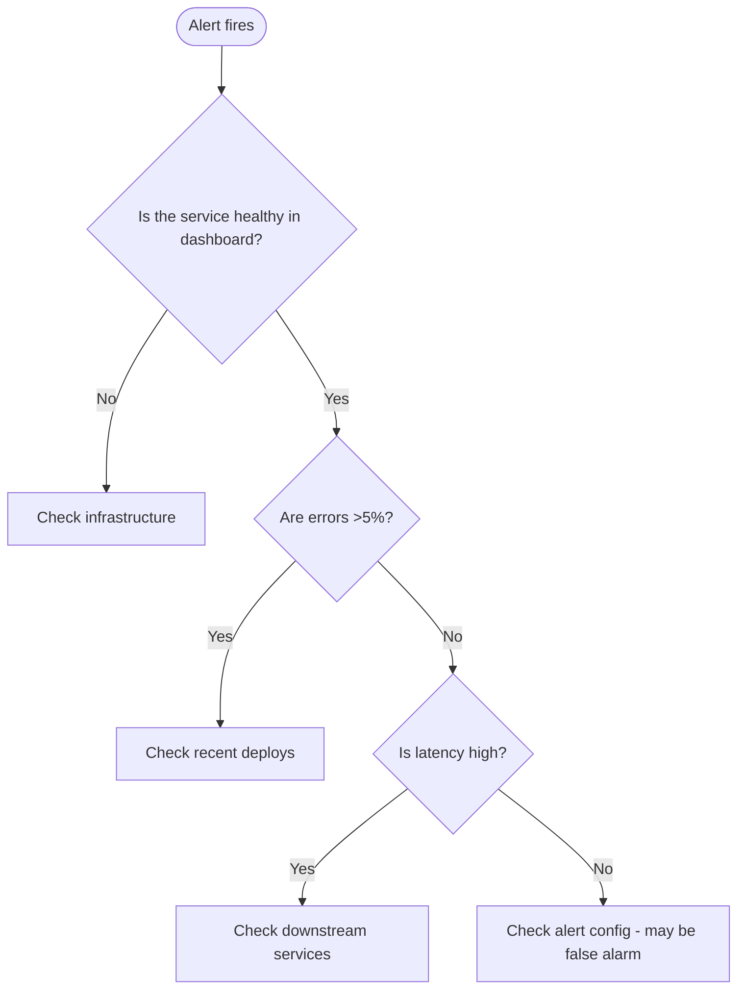

# skill: software-diagrams

Use when a README or PR needs a quick Mermaid diagram

# Software Diagrams

> **The one rule of this skill:** a diagram answers **one question**.
> If it answers 2 questions, draw 2 pictures.

> **The destination decides the tool:** this skill draws quick diagrams with Mermaid in the house theme, only for a README · Pull Request · note in code.
> For figures in project documents (BRD · SRS · FSD · ADR · ER · process maps), client proposals, slides and print work, go to `diagram-figures`. The full table for choosing is at the top of that skill.
>
> **Colour in a figure must carry meaning, not decorate.** If the source document already declares a `doc-theme`, use that value and do not pick new colours per figure (the default is the house set in `design-gate/polished-document-style` · for the meaning of colours see `branded-document-design/references/tokens-and-type.md`):
> A quick diagram uses **one main colour** = "the thing we are talking about" · grey = external/closed systems · white with a grey line (`store`) = data stores · other boxes use the defaults (3 classes `focus` · `ext` · `store` in `assets/mermaid-theme.md`). If you need several colours to separate failure points, exceptions and successes, the figure answers several questions. Split it into new figures or use `diagram-figures`.

## When to use this skill

In a README · Pull Request · note in code:

- Explain the system architecture
- Explain the order of work across several parts
- Explain the states of data
- Design a database
- Say what runs on which machine
- Review a diagram someone else drew


Not for: choosing SVG / ASCII / Mermaid → `markdown-visuals` · screenshots and wireframes → `ui-craft` + the platform skill · data charts → `web-app-design` `references/tokens.md` heading "สีข้อมูล (กราฟ)" · choosing an architecture → `architecture-patterns`

## 1 · Which question, which diagram

**Start from the question, not from the diagram type.**

| The question in the reader's head | Diagram |
|---|---|
| "Who outside does this system talk to?" | C4 level 1 — System Context |
| "What is inside the system? Do the parts run separately?" | C4 level 2 — Container |
| "How is this service divided inside?" | C4 level 3 — Component |
| "When I press this button, what happens, in order?" | Sequence |
| "How can this document change state?" | State |
| "Which table links to which table?" | Entity Relationship (ER) |
| "What machines does the real thing run on, and how many?" | Deployment |
| "Who approves after whom?" | Flowchart (work steps) |
| "A cloud diagram in the repo with real AWS / Azure logos" | Infrastructure — section 3 |
| "I want a nice picture for the client proposal" | Not the job of this skill — `diagram-figures` |

**Always draw C4 levels 1 and 2 in full first.** Draw level 3 only for the parts that are truly complex.

## 2 · Theme — one set for the whole project

Put the `%%{init: ...}%%` line on the **very first line** of every diagram, and use the one main colour with the 3 classes `focus` · `ext` · `store`. The main colour is reserved for "the thing we are talking about" only.
The theme line, colour stand-ins, classes and rendered examples are in [`assets/mermaid-theme.md`](assets/mermaid-theme.md). The table that matches kinds of work to colour tones is in `diagram-figures/references/colour-by-domain.md`.

> Warning: **`fontFamily` must sit outside `themeVariables`.** If you put it inside, it is silently ignored and Mermaid falls back to its default font.

**Check with a tool before every send.** This rule is forgotten most often:

The scripts are in the `scripts/` folder of this skill. Run them with the script's full path and the `docs` folder of the project being checked (`<path ของ skill>` = the folder where this skill is installed):

```bash
node <path ของ skill>/scripts/check-mermaid-theme.mjs docs          # exit 1 with file:line of each block that lacks %%{init
node <path ของ skill>/scripts/check-mermaid-theme.mjs --self-test   # proves the checker still catches it
```

An agent with no shell cannot run it → the main agent runs it after taking the work back.

## 3 · Diagrams that need real logos (infrastructure)

If an infrastructure diagram that lives in the repo needs real Amazon Web Services (AWS) · Azure · Kubernetes icons, which Mermaid cannot draw, use the **`diagrams`** library (Python + Graphviz), starting from [`assets/infra-diagram.py`](assets/infra-diagram.py).
Install steps, the commonly used node rules and the traps are in [`assets/diagrams-python.md`](assets/diagrams-python.md). For cloud diagrams that a client or a slide will show, use `diagram-figures`.

## 4 · Rules that make it readable

**No more than 7 boxes.** Past that, readers stop reading (count real boxes, not subgraphs).

**Count boxes before drawing, not after.** If there are more than 7, **split the figure by the order of the story before drawing**. Note the split in `decision-desk/decision-log` and say so in the reply.
Never draw everything and then say so afterwards.

The sample reply to the Thai user (kept in Thai because it is the text the agent says):

```
เนื้อหาที่ให้มามี 20 กล่อง เกินเพดานสามเท่า ขอแยกเป็น 3 รูป:
  รูปที่ 1 — ตอนทดลอง: อะไรเข้า อะไรออก
  รูปที่ 2 — ตอนรันชุดการทดลอง
  รูปที่ 3 — ตอนออกรายงาน
อยากแบ่งแบบอื่น บอกได้ — แยกใหม่ได้
```

> **"Separate files are fine" means you must split.** If the request leaves room to split and the content passes the cap,
> treat it as an order to split, not an option.

**These 3 things do not belong in a diagram.** They are manual content, not a picture, and they swell the boxes until the diagram warps.

| Do not put in | Where it goes |
|---|---|
| Command-line options `--all` `--resume` `--limit N` | `README` or `docs/cli.md` |
| Lists of inputs/outputs for several parts | **A table beside the figure** — columns: component · takes what · gives what · stored where |
| Every file name or path | The same table. Put in the figure only the ones that carry the point |

**A request like "show the input/output too" does not mean draw everything as boxes.**
A box is something that *does work*. What *flows through* is a label on the line. *Detail* goes in the table.

**One level of detail across the whole figure.** If `PostgreSQL` and `OrderRepository.cs` sit in the same figure,
that signals a mix of 2 levels.

**Every line needs a label,** and the label must say **what flows through**, not that they are connected.

```
Wrong: api --> db
Wrong: api -->|ใช้| db
Right: api -->|SQL · อ่าน-เขียนคำสั่งซื้อ| db
```

**One direction.** Top to bottom (`TB`) or left to right (`LR`). Choose one and let no line run backwards.
A backward line means the boxes are in the wrong order. It does not mean you need a double-headed arrow.

**Box name = what it does, not the technology.** Put the technology on a second line in small type.

```
Wrong: [Redis]
Right: ["ที่พักข้อมูลชั่วคราว<br><small>Redis</small>"]
```

**Add a legend when colour or shape carries meaning.**
If you cannot explain why this box has a different colour, that colour should not be there.

## 5 · Thai in diagrams

- **A Thai line label longer than 3 words overlaps the line.** Shorten it, or add `<br>` yourself.
- **Do not use `()` `[]` `{}` in text.** They clash with Mermaid syntax. Always wrap the text in `"..."`.
- **Tone marks float above the box** when `fontSize` is below 12px. Do not go lower.
- Table and field names in an ER diagram use English (matching the real database).
  Descriptions can use Thai.

## 6 · Render and look — never skip

A diagram that was never rendered is still only text, not a picture. Some syntax mistakes give no error in Mermaid,
and the result often does not match what you thought.

```bash
# not installed on the machine · pin the version the theme was tested on (11.17.0 · the latest 12.0.0 as of 2026-10-14 has not been tested with the theme)
npx -y @mermaid-js/mermaid-cli@11.17.0 -i diagram.mmd -o diagram.png -b white -s 2
```

Then **open the image file and look at it with your eyes**. Go through this list:

- [ ] Are there at most 7 boxes?
- [ ] Does every line have a label, and does the label say what flows through?
- [ ] Does any line run in the opposite direction?
- [ ] Does a label overlap a line or a box?
- [ ] Is the Thai text complete, with no missing vowels?
- [ ] Is the level of detail the same across the figure?
- [ ] Does the diagram carry a date and an owner? (without them nobody dares to edit it after a year)
- [ ] Can someone who has never seen this system read it and answer the original question?

**Mermaid limits to know before you waste time:**

| Symptom | Cause |
|---|---|
| `direction LR` inside a subgraph does not work | It is ignored when the subgraph has a line linking out — order the boxes yourself |
| A box is abnormally wide | One long line of text — add `<br>` yourself, Mermaid does not wrap lines |
| Lines overlap in a mess | Too many boxes — Mermaid has no smart line routing, so cut boxes |
| The font does not change | `fontFamily` is in the wrong place (see section 2) |

If you truly cannot get the layout you want and the figure stays in a markdown document, draw an inline SVG per `markdown-visuals`. If the figure must look designed, go to `diagram-figures`.

To record why a design was chosen, use `adr-writer`. A figure that must look designed or needs sign-off → `diagram-figures`.

## Do not look AI-made

Before sending, walk through item 3 of `design-gate/no-ai-look`. For HTML work, run its script. Every job must also pass eye check 3.2 (web pages also answer items 10–14), because a script result of 0 items is not yet a pass.


---

# skill: incident-runbook-template

Use when writing a runbook or on-call guide

# Incident Runbook Template

## When to use this skill

- Writing a runbook for a known failure mode
- Documenting on-call procedures
- Creating playbooks for common alerts
- After a postmortem finds "we need a runbook for X"
- Onboarding new on-call engineers

## When not to use

| Task | Use this instead |
|---|---|
| The incident is over and you must summarise what happened and how to prevent it | `postmortem-template` |
| Setting up a metric alert or dashboard | `observability-basics` |

## Read more when

| File | Open when |
|---|---|
| [references/runbook-template.md](references/runbook-template.md) | Every time you start a new runbook. Copy the full template from this file and fill it in |
| [references/index-and-alert-links.md](references/index-and-alert-links.md) | If the team has no runbook index page, or alerts do not yet link to a runbook, open this file for examples |
| [references/game-days.md](references/game-days.md) | When planning an incident drill to test that a runbook works in practice |

## 0 · Look for an existing format first (every time)

Before using the structure or template in this file, check whether the user, customer or project already has its own format:

- **Where to look:** existing runbooks: `docs/runbooks/` · the on-call team's wiki · the alerting tool in use (PagerDuty · Opsgenie · Grafana) and the real alert names · the organisation's severity levels
- **Result:** found → use that format (headings, order, field names, numbering) and say in the reply which file's format you used · not found → use the template in this file as a fallback and say that no existing format was found
- **Still required either way:** alert names, commands and dashboards come from the real system. Do not invent examples.

## What's a Runbook?

A **runbook** answers: "Alert X fired. What do I do?" It is not architecture documentation (the bigger picture) or training material (too much detail).
## Runbook Quality Standards

A good runbook is:

| Property | Test |
|----------|------|
| **Actionable** | Can a tired engineer at 3am follow it? |
| **Concrete** | Are commands copy-pasteable? |
| **Tested** | Has someone followed it during a real incident? |
| **Updated** | Was it last reviewed less than 6 months ago? |
| **Discoverable** | Can on-call find it from the alert link? |
| **Concise** | Under 1 page for common cases |

## Runbook Template

The full template is in [references/runbook-template.md](references/runbook-template.md). Every runbook has these sections in this order, and each section must contain the following.

| Section | Must contain |
|---|---|
| Header | Severity · Service · Owner Team · Last Reviewed · Linked Alert |
| TL;DR (30 seconds) | One paragraph: what broke, what to do first, and whom to call |
| How to Detect | Symptoms users see and symptoms seen internally · the alert that fires · the dashboard to open |
| Diagnosis (60 seconds) | A decision flowchart and quick checks written as commands to copy and run, in order |
| Mitigation Steps | Steps ordered from low risk to high (the same order as `incident-response` Phase 3). Every step states Expected effect · **VERIFY** (the command or graph to look at, and the value to expect. If you do not see that value, the step has not worked yet. Do not move to the next step without knowing what the previous step did) and Caveats or If doesn't work · the agent only proposes commands and expected results, and the on-call person runs them or approves them before anything touches production |
| Escalation Path | Who is called when, in clear minutes |
| Verification | A checklist to confirm it is really fixed |
| After Resolution | Log it in the incident channel → update the status page → open a postmortem ticket → update this runbook |
| Related Runbooks · Background | Links to related runbooks, and a short background of the problem (optional) |

**Mitigation order in the template:** Reduce load (low risk) → Scale up (medium risk) → Rollback recent deploy (higher risk) → Failover to backup region (last resort)

**Escalation order in the template:** If it cannot be fixed in 15 minutes, call the secondary on-call. If two people cannot fix it in 30 minutes, call the service's owning team. If it is still SEV1 after 45 minutes, call the incident commander (IC). If SEV1 runs past 1 hour, call the head of engineering.

**Count it as fixed when** the error rate is back to normal · latency p95 is below the threshold · the status page says "Operational" · there are no new alerts · customers have stopped reporting problems, and you have watched for another 30 minutes.

> Use `postmortem-template` skill for the full analysis

## Runbook Index and Alert Links

Keep one index page of runbooks in one place, searchable by service, by alert name, and by the most frequent incidents in the last 90 days.

Every alert **must** link to a runbook through the alert's `runbook_url:` annotation, and should carry a matching `dashboard:` too. Examples of the index page and a Prometheus alerting rule are in [references/index-and-alert-links.md](references/index-and-alert-links.md).

## What Makes Runbooks Fail

| Problem | Fix |
|---------|-----|
| Out of date | Review every 6 months, update after every incident |
| Too long | Split into 1 runbook per failure mode |
| Too generic | Be specific to YOUR service |
| No commands | Include actual copy-paste commands |
| Not discoverable | Link it from the alert and the index page |
| No ownership | Each runbook has a team owner |
| Not tested | Run game days, and follow it during real incidents |
| Commands rot silently | CI job on every change to `runbooks/`: pull every fenced `bash` block → `bash -n` (parses) · every `./scripts/*.sh` it names exists in the repo · every `kubectl` resource name exists in staging (`kubectl get ... -n staging`) · fail the build on any miss. A command that cannot run at 3am is worse than no runbook (idea from wshobson/agents incident-runbook-templates) |

## Game Days

Test a runbook by deliberately simulating a failure. Each quarter, pick one runbook, simulate the incident in staging, and have on-call follow it. Then update the runbook for the gaps found. The full checklist is in [references/game-days.md](references/game-days.md).

## Anti-patterns

- **Theoretical runbooks** written by someone who never saw the failure
- **"Contact the team"** without saying who or how
- **Treating mitigation as the root-cause fix** (mitigation should be FAST; the fix comes later)

## Document Look

This skill decides **what goes in** the document. It does not decide **how it looks** —
load the matching skill before writing, not after:

| What is being handed over | Load |
|---|---|
| Markdown someone reads (repo, wiki, issue tracker) | `design-gate/polished-document-style` |
| A rendered `.docx` / `.pptx` / PDF a stakeholder signs off on | `branded-document-design` |
| The point needs a picture to land | `markdown-visuals`, then `software-diagrams` |


## reference: game-days.md

# Game Days

A checklist for incident-response drills that test a runbook; use it when planning the quarterly drill

Test runbooks by faking failures on purpose:

```markdown
## Game Day Checklist

Quarterly:
- [ ] Pick a runbook to test
- [ ] Simulate the failure in staging (chaos engineering)
- [ ] On-call engineer follows runbook
- [ ] Identify gaps
- [ ] Update runbook based on learnings
- [ ] Repeat with different runbook next quarter
```


## reference: index-and-alert-links.md

# Runbook Index และการผูก runbook กับ alert

An example runbook index page and an example of linking a runbook from an alert; use it when setting up the team's runbook system for the first time

## Runbook Index Pattern

Maintain a central index (`docs/runbook-index.md`). Each runbook is one file `docs/runbook-<service>-<เรื่อง>.md` per `workspace-rules/document-naming`:

```markdown
# Runbook Index

## By Service
- API Service
  - [High error rate](runbook-api-high-error-rate.md)
  - [Memory leak](runbook-api-memory-leak.md)
- Database
  - [Connection pool exhausted](runbook-db-conn-pool.md)
  - [Replication lag](runbook-db-repl-lag.md)

## By Alert Name
| Alert | Runbook |
|-------|---------|
| `api_5xx_rate_high` | [API: High error rate](link) |
| `db_connections_high` | [DB: Connection pool](link) |
| `disk_full_warn` | [Generic: Disk full](link) |

## Most Common Incidents (last 90 days)
1. High error rate on payment service — [runbook](link) (12 times)
2. DB replication lag — [runbook](link) (8 times)
3. Cache invalidation storm — [runbook](link) (5 times)
```

## Linking Runbook to Alert

Every alert MUST link to a runbook:

```yaml
# Prometheus alerting rule (rule file loaded by Prometheus; Alertmanager only routes the alert)
- alert: APIHighErrorRate
  # share of requests that are 5xx — needs the denominator, otherwise it is requests per second
  expr: |
    sum(rate(http_requests_total{status=~"5.."}[5m]))
      / sum(rate(http_requests_total[5m])) > 0.05
  for: 5m
  annotations:
    summary: "API error rate > 5%"
    runbook_url: "https://runbooks.example.com/api/high-error-rate"
    dashboard: "https://grafana.example.com/d/api-overview"
```


## reference: runbook-template.md

# Runbook Template

**สารบัญ:** แม่แบบเต็ม 1 บล็อก: TL;DR · How to Detect · Diagnosis · Mitigation Steps (ขั้น 1–5) · Escalation Path · Verification · After Resolution · Related Runbooks · Background

- [The whole template](#runbook-template) is in a single block; copy the whole block into a new runbook file

The full template for one runbook, ready to copy and fill in. The rules for what each section must contain are in `SKILL.md`

````markdown
# Runbook: <Alert Name or Failure Mode>

| | |
|--|--|
| **Severity** | SEV1 \| SEV2 \| SEV3 \| SEV4 (table in `postmortem-template`) |
| **Service** | service-name |
| **Owner Team** | @team-name |
| **Last Reviewed** | YYYY-MM-DD |
| **Linked Alert** | [Grafana/PagerDuty link] |

---

## TL;DR (30 seconds)

> One paragraph: what's broken, what to do first, who to call.

## How to Detect

**Symptoms:**
- User-facing: ...
- Internal: ...

**Alerts that fire:**
- [Alert Name](link) — fires when ...
- [Another Alert](link) — fires when ...

**Dashboards to check:**
- [Main Dashboard](link)
- [Service Health](link)

## Diagnosis (60 seconds)



### Quick checks (run in order)

**1. Is service responding?**
```bash
curl -fsS https://api.example.com/health || echo "DOWN"
```

**2. Are recent deploys suspicious?**
```bash
gh release list --repo our-org/service --limit 5
```

**3. Check error rate in logs:**
```bash
# Last 10 min of 5xx errors
kubectl logs -n prod deployment/api --since=10m | grep -c '"status":5'
```

**4. Check downstream dependencies:**
- Database: [Dashboard link]
- Redis: [Dashboard link]
- External API: [Status page link]

## Mitigation Steps

> **Human approval:** an agent only proposes the command and its expected effect. A human on-call runs it or approves it before it touches production (`ground-rules/principle-proceed-on-reversible-work`, `incident-response` Phase 3).

Try mitigations in order of risk (lowest first) — the same order as `incident-response` Phase 3:

### Step 1: Disable the broken feature or reduce load (low risk)
```bash
# Turn off the feature flag of the suspect feature
./scripts/flag.sh set new-checkout off --env prod

# Or enable rate limiting
kubectl set env deployment/api -n prod RATE_LIMIT_AGGRESSIVE=true
```

**Expected effect:** Error rate drops within 2 min
**VERIFY:** `./scripts/flag.sh get new-checkout --env prod` → `off` · dashboard 5xx panel < 1% for 2 min
**If doesn't work:** Go to Step 2

### Step 2: Scale up (medium risk)
```bash
kubectl scale deployment/api -n prod --replicas=10
```

**Expected effect:** Latency improves within 3 min
**VERIFY:** `kubectl get deployment/api -n prod` → READY `10/10` · p95 panel back under threshold
**Caveats:** Will increase cost, monitor budget alerts

### Step 3: Rollback recent deploy (higher risk)
```bash
kubectl rollout undo deployment/api -n prod
```

**Expected effect:** Reverts to previous version
**VERIFY:** `kubectl rollout status deployment/api -n prod` → `successfully rolled out` · running image tag = previous release
**Caveats:** Check for schema migrations before rolling back. A rollout undo does not delete data, but old code may break on a schema the new release already migrated — roll back only if the migration is backward-compatible

### Step 4: Block bad traffic at the WAF or firewall (high risk)
```bash
# Block the abusive IP range / path at the web application firewall (WAF)
./scripts/waf-block.sh --cidr 203.0.113.0/24 --ttl 1h
```

**Expected effect:** Abusive traffic stops reaching the service
**VERIFY:** `./scripts/waf-block.sh list` shows the CIDR with TTL · requests from that range in access log → 0 · request rate from real users unchanged
**Caveats:** Can block real users; set a TTL (time to live) and check the allow list

### Step 5: Failover to backup region (last resort)
```bash
# Update DNS to point to backup region
./scripts/failover-to-us-west.sh
```

**Expected effect:** All traffic shifts to backup
**VERIFY:** `dig +short api.example.com` → backup region IP · backup region request rate ≈ previous primary rate · primary → 0
**Caveats:** Some user data may need migration, full rollback complex

## Escalation Path

```
You can't resolve in 15 min
  ↓
1. Page secondary on-call (PagerDuty group: team-secondary)
  ↓
You both can't in 30 min
  ↓
2. Page service owner team (team-owner)
  ↓
Still SEV1 after 45 min
  ↓
3. Page incident commander on-call (IC)
  ↓
SEV1 still active after 1h
  ↓
4. Page engineering leadership
```

## Verification (after mitigation)

Confirm the issue is resolved:

- [ ] Error rate back to baseline
- [ ] Latency p95 < threshold
- [ ] Status page updated to "Operational"
- [ ] No new alerts firing
- [ ] Customer reports stopped
- [ ] Monitor for 30 min before considering resolved

## After Resolution

1. **Document in incident channel**: what happened, what you did
2. **Update status page**: clear incident, post resolution message
3. **Create postmortem ticket**: if SEV1/SEV2, schedule postmortem
4. **Update this runbook**: if you learned something new

> Use `postmortem-template` skill for the full analysis

## Related Runbooks

- [Database connection issues](link)
- [Cache failure](link)
- [Authentication service down](link)

## Background / Why this happens

Optional section: brief context on why this failure mode exists.
Useful for new on-call engineers.
````


---

# skill: logging-standards

Use when writing or reviewing code that logs

# Logging Standards

> **The one rule:** Logs exist for a person to read at 3 a.m. when the system is down, not while writing the code.
> If a line does not help answer "what happened, to whom, and when", do not write it.

## When to use this skill

- Starting any new project (service, API, worker, batch, desktop, frontend)
- Someone asks for "a log file", or asks about log format and levels
- You are chasing a production problem and find that the existing logs are unusable

## When **not** to use it

- You need metrics or tracing (Prometheus, OpenTelemetry). That is a different topic from logs, so use `observability-basics`.
- You are building a service health endpoint. Use `web-service-essentials`.

---

## 1 · Line format — the same in every language

```
2026-08-31 09:42:13.482 +07:00  INFO   [a3f9c1b2] orders  สร้างคำสั่งซื้อสำเร็จ  orderId=1042 userId=57 ms=134
└───────── time + timezone ─────────┘ └level┘  └ cid ┘ └source┘ └─ message ─┘  └──── context k=v ────┘
```

| Part | Rule |
|---|---|
| time | `YYYY-MM-DD HH:mm:ss.SSS ±HH:MM` — **the timezone is required**, or you cannot compare logs across machines |
| level | Left-aligned, 5 characters wide (`INFO ` `WARN ` `ERROR` `DEBUG` `FATAL`), so the columns line up |
| cid | An 8-character correlation id in square brackets. If there is none, use `[--------]` (also 8 characters, so the columns line up) |
| source | The module or class that writes the log, not the file name |
| message | One sentence, with no variables embedded in the string |
| context | `key=value` separated by spaces. If a value contains a space, wrap it in `"` |

**Why not JSON:** This file is mainly for people to open and `grep`. This format still works with `grep "\[a3f9c1b2\]"` or `awk`, but the eye reads it at once without any tool.
When you must ship logs to a central system such as Grafana Loki or Elasticsearch, Logstash, Kibana (ELK), add one more JSON sink (the destination logs are sent to). But **do not drop the text file**.

**1 event = 1 line**, except a stack trace, which follows indented by 4 spaces.

---

## 2 · Log levels — write them to match their meaning

| Level | Use when | Example |
|---|---|---|
| `FATAL` | The app is about to die and cannot continue | Cannot connect to the DB at start |
| `ERROR` | This job failed **and someone must look** | Saving an order failed |
| `WARN` | Abnormal, but the system can continue | Retry number 2, disk down to 10% |
| `INFO` | An important business event | Order created, user logged in, job started/finished |
| `DEBUG` | Details for chasing problems — **off in production** | Values computed along the way |
| `TRACE` | Step-by-step detail — turn on only when really chasing | Raw payload |

> Warning: **an `ERROR` that nobody needs to act on is a `WARN`.** If ERROR fires every minute until people stop looking,
> you have just destroyed your own alarm system.

The default is `DEBUG` in dev and `INFO` in production, adjustable with the env var `LOG_LEVEL`. **No new build is needed; just restart (or reload the config).** .NET reads it from `appsettings.json` instead (see `references/per-stack.md`).

---

## 3 · Correlation id — what makes logs usable

One request uses one id from start to finish, so every line that comes from that request has the same id.

```
Client ──X-Request-Id?── API Gateway ──┬── Service A ──┐
                        (create if none)└── Service B ──┴─→ every line has the same cid
```

- Take it from the header **`X-Request-Id`** only when it matches `^[A-Za-z0-9-]{1,64}$`. If it is missing or does not match, create a new one (`uuid v4`, first 8 characters). For the reason, see `web-service-essentials` item 3.
- **Always return it in the response header**, so the customer can send the id when reporting a problem and we can trace it at once.
- Pass it to the downstream service on every cross-system call.
- Store it with a mechanism that is separate per request: `AsyncLocalStorage` (Node) · `ContextVar` (Python)
  · `IHttpContextAccessor`/`LogContext` (.NET). **Never use a global variable**, because ids mix as soon as several requests run at once.

---

## 4 · Log files

```
logs/
  app-20260831.log        all levels · rotate at midnight · keep 30 days · max 100MB per file
  error-20260831.log      ERROR/FATAL only · keep 90 days
  fatal.log               uncaught exceptions (app died)
```

- Set the folder with the env var `LOG_DIR`. **Never hardcode the path.**
- Compress old files (`.gz`) and **retention is required**. Otherwise the disk fills and the system goes down from its own logs.
- In a container, also log to stdout (besides the file) so `docker logs` works.
- `logs/` must be in `.gitignore`.

---

## 5 · What must never go into a log

Passwords · tokens/API keys · cookies/Authorization headers · OTP/PIN · credit card numbers/CVV ·
**national ID numbers** · health data · full payloads that contain personal data

Helper already provided: the redaction function (which hides secret values) checks **whether the key name contains a forbidden word** (`userPassword`, `pwd`,
`accessToken` are all caught) and replaces the value with `***`. It checks up to 4 levels deep inside an object.

> **Log injection** — A value from a user may contain `\n`. If you let it through, the user can "forge" a fake log line,
> which misleads readers and breaks parsers. So the provided code strips `\r\n\t` from every value and from the main message.

---

## 6 · Ready-to-use code

| File | Stack | Status |
|---|---|---|
| `assets/logger.node.js` | Node/TS — winston + winston-daily-rotate-file | ✓ Run and tested 2026-10-25 (Node 22.23.2 · winston 3.19.0 · winston-daily-rotate-file 5.0.0 · password redaction · correlation id · strips line breaks in the main message and values) |
| `assets/logger_py.py` | Python — stdlib only, nothing to install | ✓ Run and tested 2026-10-25 (Python 3.13.5 · same test set) |
| `references/per-stack.md` | .NET (Serilog) + Angular | Caution: not yet compiled or tested |

```js
// Node
const { withCorrelation } = require('./logger.node');
const log = withCorrelation(req.id).child({ source: 'orders' });
log.info('สร้างคำสั่งซื้อสำเร็จ', { orderId: 1042, ms: 134 });
log.error('บันทึกไม่สำเร็จ', err);          // pass an Error directly; the stack is added for you
```

```python
# Python
from logger_py import setup_logging, get_logger, set_correlation_id
setup_logging(app_name="myapi")             # once, when the app starts
log = get_logger("orders")
log.info("สร้างคำสั่งซื้อสำเร็จ", extra={"ctx": {"order_id": 1042, "ms": 134}})
log.exception("บันทึกไม่สำเร็จ")             # inside except — the stack is added for you
```

---

## 7 · Checking the work

```bash
# no leftover print/console.log in production code
grep -rnE "console\.(log|error)|Console\.WriteLine|^\s*print\(" src/ --include="*.ts" \
  --include="*.js" --include="*.cs" --include="*.py" | grep -v test | head -30

# the output logs are readable and greppable
tail -n 50 logs/app-*.log
grep "a3f9c1b2" logs/app-*.log          # does one request show every line?
```

- [ ] Every line has all of: time+timezone · level · cid · source
- [ ] `grep` with one cid shows the story of that request from start to finish
- [ ] No secrets leak: log an object with `password` and `token`, and you must see `***`
- [ ] Feeding in a value that contains `\n` produces no fake line
- [ ] With `LOG_LEVEL=INFO`, DEBUG really disappears
- [ ] Files rotate daily and have retention (left for 1 month, the disk must not fill)
- [ ] `logs/` is in `.gitignore`
- [ ] The response sends `X-Request-Id` back to the customer

---

## 8 · Anti-patterns not covered above

- **A silent `try { } catch (e) { }`** — log at least 1 line
- **Log, then rethrow** — one problem shows up 3 times in the file. Log at the top layer that really handles the error instead.
- **Logging inside a loop that runs thousands of times** — log one summary when the loop ends
- **Logging everything** — the file grows so large you cannot find anything, and it is expensive and slow

---

## 9 · Links to other skills

`testing-standards` (tests with full coverage) · `incident-runbook-template` · `postmortem-template`


## reference: per-stack.md

# Set up the logger to produce the same format — .NET and Angular

> Warning: the code in this file is **not yet compiled or tested** (unlike `assets/logger.node.js` and
> `assets/logger_py.py`, which have really been run). It uses the standard setup of each library.
> At the first build, compare the output lines with the format in SKILL.md item 1.

---

## Contents

1. [.NET / C# — Serilog](#net--c--serilog)
2. [Angular / frontend](#angular--frontend)
3. [Comparison table](#comparison-table)

---

## .NET / C# — Serilog

```bash
dotnet add package Serilog.AspNetCore
dotnet add package Serilog.Sinks.File
```

`appsettings.json` — keeps the settings outside the code, so you can change the log level without a new build:

```json
{
  "Serilog": {
    "MinimumLevel": {
      "Default": "Information",
      "Override": {
        "Microsoft.AspNetCore": "Warning",
        "Microsoft.EntityFrameworkCore.Database.Command": "Warning"
      }
    }
  }
}
```

`Program.cs`:

```csharp
using Serilog;
using Serilog.Events;

const string LineTemplate =
    "{Timestamp:yyyy-MM-dd HH:mm:ss.fff zzz}  {Level:u5}  " +
    "[{CorrelationId}] {SourceContext}  {Message:lj}  {Context:l}{NewLine}{Exception}";

Log.Logger = new LoggerConfiguration()
    .ReadFrom.Configuration(builder.Configuration)
    .Enrich.FromLogContext()
    .Enrich.WithProperty("CorrelationId", "--------") // default when there is no request (8 characters)
    .Enrich.WithProperty("Context", "")              // empty when there is no context k=v
    .WriteTo.Console(outputTemplate: LineTemplate)
    .WriteTo.File(
        path: Path.Combine(Environment.GetEnvironmentVariable("LOG_DIR") ?? "logs", "app-.log"),
        rollingInterval: RollingInterval.Day,
        retainedFileCountLimit: 30,
        fileSizeLimitBytes: 100 * 1024 * 1024,
        rollOnFileSizeLimit: true,
        outputTemplate: LineTemplate)
    .WriteTo.File(
        path: Path.Combine(Environment.GetEnvironmentVariable("LOG_DIR") ?? "logs", "error-.log"),
        restrictedToMinimumLevel: LogEventLevel.Error,
        rollingInterval: RollingInterval.Day,
        retainedFileCountLimit: 90,
        outputTemplate: LineTemplate)
    .CreateLogger();

builder.Host.UseSerilog();
```

> `{Level:u5}` means upper case, 5 characters wide, which gives `INFO ` `WARN ` `ERROR` to match the other stacks.
> `{Message:lj}` and `{Context:l}` mean the string is not wrapped in an extra layer of `"`.

### Middleware correlation id

```csharp
using System.Text.RegularExpressions;

public sealed class CorrelationIdMiddleware(RequestDelegate next)
{
    public const string Header = "X-Request-Id";
    // accept from the customer only letters, digits, and - up to 36 characters — blocks people stuffing long text or \n into the log
 into the log
    private static readonly Regex Valid = new("^[A-Za-z0-9-]{1,36}$", RegexOptions.Compiled);

    public async Task Invoke(HttpContext ctx)
    {
        var cid = ctx.Request.Headers[Header].FirstOrDefault();
        if (cid is null || !Valid.IsMatch(cid))
            cid = Guid.NewGuid().ToString("N")[..8];   // missing or invalid → create a new one

        var logCid = cid.Length > 8 ? cid[..8] : cid;   // the log uses the first 8 characters to fit the cid column (same as Node/Python) — the header returns the full value

        ctx.Response.Headers[Header] = cid;          // return it so the customer can quote it

        // LogContext is tied only to this request's async flow — it does not mix with other requests
        using (Serilog.Context.LogContext.PushProperty("CorrelationId", logCid))
            await next(ctx);
    }
}
```

### Writing logs

```csharp
// Right: fixed message + values go in {Context} as k=v, per the format in SKILL.md item 1
//    Output: ... INFO   [a3f9c1b2] Orders  สร้างคำสั่งซื้อสำเร็จ  orderId=1042 ms=134
using (Serilog.Context.LogContext.PushProperty("Context", $"orderId={orderId} ms={sw.ElapsedMilliseconds}"))
    _logger.LogInformation("สร้างคำสั่งซื้อสำเร็จ");

// Wrong: a variable embedded in the string — every line becomes a different message and cannot be grouped
_logger.LogInformation($"สร้างคำสั่งซื้อ {orderId} สำเร็จ");
```

### Redacting secrets

Serilog does not redact secrets automatically. The surest way is to **never pass a whole object into the log**.
Pick only the fields you need. If you must pass the whole object, write an `IDestructuringPolicy`
or add `[NotLogged]` through `Destructure.ByTransforming<T>()`.

---

## Angular / frontend

The principle differs from the backend: **a browser cannot write files**, so important logs must be sent up to the backend.

```ts
// core/logger.service.ts
import { Injectable, inject, isDevMode } from '@angular/core';
import { HttpClient } from '@angular/common/http';

type Level = 'DEBUG' | 'INFO' | 'WARN' | 'ERROR';

@Injectable({ providedIn: 'root' })
export class LoggerService {
  private http = inject(HttpClient);
  private buffer: unknown[] = [];

  private write(level: Level, message: string, ctx: Record<string, unknown> = {}) {
    // dev: print to the console for chasing problems — prod: silent, except WARN and above, which go to the server
    if (isDevMode()) console[level === 'ERROR' ? 'error' : 'log'](level, message, ctx);
    if (level === 'DEBUG' || (!isDevMode() && level === 'INFO')) return;   // prod sends only WARN and above

    this.buffer.push({ ts: new Date().toISOString(), level, message, ctx });
    if (this.buffer.length >= 10 || level === 'ERROR') this.flush();
  }

  /** Send in batches, not line by line — otherwise the network tab fills with the log's own requests */
  flush() {
    if (!this.buffer.length) return;
    const batch = this.buffer.splice(0);
    this.http.post('/api/client-logs', { entries: batch }).subscribe({ error: () => {} });
  }

  debug = (m: string, c?: Record<string, unknown>) => this.write('DEBUG', m, c);
  info  = (m: string, c?: Record<string, unknown>) => this.write('INFO', m, c);
  warn  = (m: string, c?: Record<string, unknown>) => this.write('WARN', m, c);
  error = (m: string, c?: Record<string, unknown>) => this.write('ERROR', m, c);
}
```

Catch every uncaught error:

```ts
// core/global-error.handler.ts
import { ErrorHandler, Injectable, inject, isDevMode } from '@angular/core';
import { LoggerService } from './logger.service';

@Injectable()
export class GlobalErrorHandler implements ErrorHandler {
  private log = inject(LoggerService);
  handleError(err: unknown) {
    const e = err as Error;
    this.log.error(e?.message ?? 'unknown error', { stack: e?.stack?.slice(0, 2000) });
    if (isDevMode()) console.error(err);
  }
}
// app.config.ts → providers: [{ provide: ErrorHandler, useClass: GlobalErrorHandler }]
```

Send a correlation id with every request so client-side and server-side logs connect:

```ts
// core/correlation.interceptor.ts
import { HttpInterceptorFn } from '@angular/common/http';

export const correlationInterceptor: HttpInterceptorFn = (req, next) =>
  next(req.clone({ setHeaders: { 'X-Request-Id': crypto.randomUUID().slice(0, 8) } }));
```

**On the backend** you need an endpoint `POST /api/client-logs` that:
- Limits the body size and applies a rate limit. Otherwise it becomes a hole for people to flood you with logs.
- Writes to a separate file `logs/client-YYYYMMDD.log`
- **Treats the content as untrusted data**, so strip `\r\n` from every value just like a normal log

---

## Comparison table

| Topic | .NET | Node | Python | Angular |
|---|---|---|---|---|
| Library | Serilog | winston | stdlib `logging` | Hand-written (thin) |
| File rotation | `rollingInterval: Day` | `winston-daily-rotate-file` | `TimedRotatingFileHandler` | — (sent to the backend) |
| correlation | `LogContext.PushProperty` | `AsyncLocalStorage` + `child()` | `ContextVar` | header `X-Request-Id` |
| Level | `LogEventLevel` | `level` | `setLevel` | Its own enum |
| External configuration | `appsettings.json` | env `LOG_LEVEL` | env `LOG_LEVEL` | `isDevMode()` |


---

# skill: web-service-essentials

Use when building or reviewing an HTTP backend

# Web Service Essentials

> **The one rule:** before writing the first business endpoint, the service must be able to answer
> "Are you still alive? · Are you ready for work? · Which version are you running now?" If it cannot, on the day the system goes down you will be guessing blind.

## When to use this skill

- Starting a new service / REST API / microservice
- Someone asks for a health check, ping, readiness, liveness, or version endpoint
- Deploying to production for the first time, or moving into Docker/Kubernetes
- You must set one API error format for the whole system

## When **not** to use it

- To design business endpoints, use the command `/api-design`
- For URL style · paging · dates · API ids, use `api-conventions`
- For log format, use `logging-standards`
- To choose an architecture, use `architecture-patterns`
- To check responses against OpenAPI in CI or catch breaking changes, see `api-conventions` [`references/contract-testing.md`](../api-conventions/references/contract-testing.md)

---

## 1 · The 4 basic endpoints

| Endpoint | What it answers | auth | Checks dependencies | Who calls it |
|---|---|:---:|:---:|---|
| `GET /ping` | `pong` (text) | no | no | load balancer, every second |
| `GET /health/live` | the process is still alive | no | **no** | orchestrator (restarts if dead) |
| `GET /health/ready` | ready to take traffic | no | yes | orchestrator (removes from the pool) |
| `GET /version` | what is running | no* | no | a person, when tracing a problem |

> **live must not check dependencies.** This is the most common mistake.
> If `/health/live` checks the database (DB) and the DB goes down briefly, Kubernetes will **kill every pod**
> even though the app itself is fine. When the DB comes back, no pod is left to take traffic.
> The dependency check belongs in `/health/ready`, which only removes a pod from the pool for a while.

\* If you do not want the public to see the commit hash in `/version`, restrict it so only the internal network can call it.

**Wire it to Kubernetes like this** — live and ready must point to different paths, or the point above means nothing.

```yaml
livenessProbe:            # dead → restart the container
  httpGet: { path: /health/live, port: 3000 }
  initialDelaySeconds: 15 # let the app start first, or it gets killed before it can listen
  periodSeconds: 10
  failureThreshold: 3     # restart only after 3 failures in a row (30 seconds)
readinessProbe:           # not ready → remove from the Service for a while, no restart
  httpGet: { path: /health/ready, port: 3000 }
  initialDelaySeconds: 5
  periodSeconds: 10
```

For an app with a long warm-up (loading a model · a big cache), add a `startupProbe` pointing to `/health/live` with a high `failureThreshold`, instead of stretching the liveness `initialDelaySeconds`.

### Response shape (the same in every language)

```jsonc
// GET /health/ready → 200 normally · 503 when a critical dependency is down
{
  "status": "up",                       // up | degraded | down
  "timestamp": "2026-08-31T09:42:13.482Z",
  "checks": {
    "db":    { "status": "up",   "durationMs": 12 },
    "redis": { "status": "up",   "durationMs": 3 },
    "mail":  { "status": "down", "durationMs": 3001, "error": "smtp timeout" }
  }
}
```

```jsonc
// GET /version → 200
{
  "name": "orders-api", "version": "1.4.0", "commit": "abc1234",
  "buildTime": "2026-08-31T09:00:00Z", "env": "production", "host": "pod-7f9c"
}
```

**3 states, not 2:**
- `up` — everything is normal → 200
- `degraded` — a **non-critical** dependency is down (such as email) but the service can still take traffic → 200
- `down` — a critical dependency is down (such as the DB) → **503**

**Every check must have a timeout** (default 3 seconds). Otherwise a hung dependency
makes the health endpoint hang too, and the orchestrator makes the wrong decision for the whole system.

**Never send a stack trace or connection string out through these endpoints**, because anyone can call them.

---

## 2 · One error format for the whole system

Follow **RFC 9457 (`application/problem+json`)**, which is a real standard, so you do not invent your own.

```jsonc
// 422 — the format is right, but the data fails a rule (see the table below)
{
  "type": "https://api.example.com/errors/validation",
  "title": "ข้อมูลที่ส่งมาไม่ถูกต้อง",
  "status": 422,
  "detail": "จำนวนสินค้าต้องมากกว่า 0",
  "instance": "/api/v1/orders",
  "requestId": "a3f9c1b2",              // matches the cid in the log — trace the case at once
  "errors": [                           // validation only · every field in one response
    { "field": "items[0].qty", "code": "min_value", "message": "ต้องมากกว่า 0" }
  ]
}
```

- `field` is the full path including array indexes · `code` is for programs · `message` is for people

| Status | Use when |
|---|---|
| 400 | Malformed data |
| 401 | Not yet authenticated |
| 403 | Authenticated but not allowed |
| 404 | The thing does not exist |
| 409 | Conflicts with current state (duplicate, overwrite) |
| 422 | Format is right but breaks a business rule |
| 429 | Called too often — must have `Retry-After` |
| 500 | Our side broke — **never send internal details out**, send `requestId` instead |

> **A 500 must say only "an error occurred, please report this requestId".** The real details stay in the log.
> Sending a stack trace out is like handing the system's blueprint to someone looking for a way in.

---

## 3 · Request id

- Accept it from the **`X-Request-Id`** header only when it matches `^[A-Za-z0-9-]{1,64}$` · if it is missing or does not match → create a new one (a uuid cut to 8 characters).
  This value goes into every log line. If you accept it as is, the sender can insert new lines or fake text into the log (log injection).
- **Return it in a response header every time**, including on errors.
- Put it in every log line (see `logging-standards`) and in the error body.
- Pass it on to the downstream service every time you call across systems.

When a customer calls to say "it broke", ask for the requestId and `grep` once to find the whole story.

---

## 4 · Graceful shutdown

On a new deploy the orchestrator sends `SIGTERM`. If the app dies at once, requests in progress are cut off midway.

```
SIGTERM → 1. Stop accepting new requests (make /health/ready answer down at once)
          2. Wait for in-flight requests to finish (timeout 15–30 seconds)
          3. Close the DB pool / queues / files
          4. exit(0)
```

> Step 1 matters more than it looks. `/health/ready` must answer `down` about 5 seconds **before** the real shutdown,
> so the load balancer removes us from the pool in time. Otherwise traffic keeps arriving while we are closing.

---

## 5 · What must exist before deploy (not optional)

- **Timeouts everywhere**: incoming requests, outgoing calls, and DB queries. Without a timeout, the moment a downstream is slow, the whole system hangs with it.
- **Limit body size** (for example 1MB) to stop memory blowing up from a large payload.
- **Cross-Origin Resource Sharing (CORS) names the origin explicitly** — `*` is allowed only for a public API with no cookies.
- **Rate limit** at least on the login endpoint and on anything that sends a one-time password (OTP)/email.
- **Security headers**: `X-Content-Type-Options: nosniff` · `Content-Security-Policy: frame-ancestors 'none'` (replaces the old `X-Frame-Options` header · also add `X-Frame-Options: DENY` for old browsers) ·
  `Strict-Transport-Security` (HTTP Strict Transport Security · HSTS)
  Node: `helmet` sets them all in one line · .NET: `UseHsts()` sets only HSTS, and the rest needs a short middleware or the package `NetEscapades.AspNetCore.SecurityHeaders` (example in `references/per-stack.md`)
- **Turn off the full error page in production** (`app.UseDeveloperExceptionPage()` in dev only)
- **Put the version in the path**: `/api/v1/...` from day one, because moving later costs much more.
- **OpenAPI** generated from the real code, not written by hand and then forgotten.

---

## 6 · Ready-made code

| File | Stack | Status |
|---|---|---|
| `assets/health.node.js` | Node / Express | ✓ all 4 endpoints run and tested, plus the degraded/down/timeout cases |
| `assets/health_py.py` | Python / FastAPI | ✓ run and tested the same way, results match on every field |
| `references/per-stack.md` | .NET (ASP.NET Core health checks) + Angular | Caution: not yet compiled or tested |

Usage snippets for the Node and Python routers: [`references/per-stack.md`](references/per-stack.md).

---

## 7 · Check the work

```bash
curl -i localhost:8080/ping                    # 200 pong
curl -s localhost:8080/health/live  | jq
curl -s localhost:8080/health/ready | jq
curl -s localhost:8080/version      | jq

# stop the DB and call again — ready must be 503 but live must still be 200
docker stop mydb && curl -i localhost:8080/health/ready && curl -i localhost:8080/health/live
```

- [ ] `/health/live` does **not** touch the DB — it still answers 200 with the DB stopped
- [ ] `/health/ready` answers 503 when a critical dependency is down
- [ ] When a non-critical dependency is down, the result is `degraded` + 200 (still takes traffic)
- [ ] Every check has a timeout — make a dependency hang, and the endpoint must answer within ~3 seconds
- [ ] `/version` matches the commit actually deployed
- [ ] Every response has `X-Request-Id`, including a 500
- [ ] Trigger a 500 and confirm no stack trace / connection string leaks out
- [ ] After `SIGTERM`, in-flight requests finish before the app closes
- [ ] `/ping` is not written to the log (or the file fills up with pings)


## reference: per-stack.md

# .NET และ Angular

> Caution: the code in this file is **not yet compiled or tested** (unlike `assets/health.node.js` and
> `assets/health_py.py`, which have been run against every endpoint). It is the standard setup of
> ASP.NET Core. On the first run, compare the response with the shape in SKILL.md section 1.

---

## สารบัญ

1. [ASP.NET Core — health checks](#aspnet-core--health-checks)
2. [Angular — ฝั่งที่เรียกใช้](#angular--ฝั่งที่เรียกใช้)
3. [ตารางเทียบ](#ตารางเทียบ)

---

## ASP.NET Core — health checks

```bash
dotnet add package AspNetCore.HealthChecks.NpgSql
dotnet add package AspNetCore.HealthChecks.Redis
dotnet add package AspNetCore.HealthChecks.Network   # AddSmtpHealthCheck อยู่ในแพ็กเกจนี้
```

```csharp
builder.Services.AddHealthChecks()
    // tag "ready" = ตัวที่ /health/ready จะเรียก · ไม่ติด tag = ไม่ถูกเรียกที่ไหนเลย
    .AddNpgSql(cs, name: "db", timeout: TimeSpan.FromSeconds(3), tags: ["ready", "critical"])
    .AddRedis(redisCs, name: "redis", timeout: TimeSpan.FromSeconds(3), tags: ["ready", "critical"])
    .AddSmtpHealthCheck(o => { }, name: "mail",
        failureStatus: HealthStatus.Degraded,          // ไม่ critical → degraded ไม่ใช่ down
        tags: ["ready"])
    // ตอนกำลังปิด → Unhealthy → /health/ready ตอบ 503 (ดู "Graceful shutdown" ข้างล่าง)
    .AddCheck<ShutdownHealthCheck>("shutdown", tags: ["ready", "critical"]);
```

```csharp
// ---- ping: เบาที่สุด ไม่ผ่าน middleware ที่ไม่จำเป็น ----
app.MapGet("/ping", () => Results.Text("pong")).ExcludeFromDescription();

// ---- liveness: ไม่เรียก check ตัวไหนเลย (predicate = _ => false) ----
// ถ้าเผลอให้เช็ค DB ตรงนี้ DB สะดุด = Kubernetes ฆ่า pod ยกแถว
app.MapHealthChecks("/health/live", new HealthCheckOptions
{
    Predicate = _ => false,
    ResponseWriter = WriteLive,
});

// ---- readiness: เฉพาะ check ที่ติด tag "ready" ----
app.MapHealthChecks("/health/ready", new HealthCheckOptions
{
    Predicate = c => c.Tags.Contains("ready"),
    ResponseWriter = WriteReady,
    ResultStatusCodes =
    {
        [HealthStatus.Healthy]   = StatusCodes.Status200OK,
        [HealthStatus.Degraded]  = StatusCodes.Status200OK,     // ยังรับ traffic ได้
        [HealthStatus.Unhealthy] = StatusCodes.Status503ServiceUnavailable,
    },
});

app.MapGet("/version", () => Results.Ok(new
{
    name = "orders-api",
    version = typeof(Program).Assembly.GetName().Version?.ToString() ?? "0.0.0",
    commit = Environment.GetEnvironmentVariable("GIT_SHA") ?? "unknown",
    buildTime = Environment.GetEnvironmentVariable("BUILD_TIME") ?? "unknown",
    env = app.Environment.EnvironmentName,
    host = Environment.MachineName,
}));
```

Make the response match the same format as the other stacks:

```csharp
static Task WriteReady(HttpContext ctx, HealthReport report)
{
    ctx.Response.ContentType = "application/json; charset=utf-8";
    return ctx.Response.WriteAsJsonAsync(new
    {
        status = report.Status switch
        {
            HealthStatus.Healthy  => "up",
            HealthStatus.Degraded => "degraded",
            _                     => "down",
        },
        timestamp = DateTimeOffset.UtcNow,
        checks = report.Entries.ToDictionary(
            e => e.Key,
            e => new
            {
                status = e.Value.Status == HealthStatus.Healthy ? "up" : "down",
                durationMs = (int)e.Value.Duration.TotalMilliseconds,
                // ข้อความเท่านั้น ห้ามส่ง exception เต็ม ๆ — endpoint นี้เปิดสาธารณะ
                error = e.Value.Exception?.Message,
            }),
    });
}

static Task WriteLive(HttpContext ctx, HealthReport _)
{
    ctx.Response.ContentType = "application/json; charset=utf-8";
    return ctx.Response.WriteAsJsonAsync(new { status = "up", timestamp = DateTimeOffset.UtcNow });
}
```

### Error envelope (RFC 9457)

ASP.NET Core already ships `ProblemDetails`. Use it, and do not invent your own format.

```csharp
builder.Services.AddProblemDetails(o => o.CustomizeProblemDetails = ctx =>
{
    ctx.ProblemDetails.Instance = ctx.HttpContext.Request.Path;
    ctx.ProblemDetails.Extensions["requestId"] =
        ctx.HttpContext.Response.Headers["X-Request-Id"].ToString();
});

app.UseExceptionHandler();      // แปลง exception ที่หลุดเป็น problem+json ให้อัตโนมัติ
app.UseStatusCodePages();
```

### Graceful shutdown

Make `/health/ready` answer down for a short while before the real shutdown, so the load balancer removes the instance from its pool in time.
Use `IHostedLifecycleService.StoppingAsync` (.NET 8 and later), because the host calls it **before** it stops Kestrel (after `ApplicationStopping`).
So you can wait with `await Task.Delay` without blocking a thread, and the server still answers 503 for the load balancer to see.

```csharp
// สถานะร่วม: ตัวรอปิดเขียน · health check อ่าน
public sealed class ReadinessState { public volatile bool IsShuttingDown; }

public sealed class ShutdownHealthCheck(ReadinessState state) : IHealthCheck
{
    public Task<HealthCheckResult> CheckHealthAsync(HealthCheckContext context, CancellationToken ct = default) =>
        Task.FromResult(state.IsShuttingDown
            ? HealthCheckResult.Unhealthy("shutting down")
            : HealthCheckResult.Healthy());
}

public sealed class DrainOnShutdown(ReadinessState state) : IHostedLifecycleService
{
    public async Task StoppingAsync(CancellationToken ct)
    {
        state.IsShuttingDown = true;                       // /health/ready → 503 ทันที
        await Task.Delay(TimeSpan.FromSeconds(5), ct);     // รอ load balancer ตัดออก
    }
    public Task StartingAsync(CancellationToken ct) => Task.CompletedTask;
    public Task StartAsync(CancellationToken ct)    => Task.CompletedTask;
    public Task StartedAsync(CancellationToken ct)  => Task.CompletedTask;
    public Task StopAsync(CancellationToken ct)     => Task.CompletedTask;
    public Task StoppedAsync(CancellationToken ct)  => Task.CompletedTask;
}

// ก่อน builder.Build()
builder.Services.AddSingleton<ReadinessState>();
builder.Services.AddHostedService<DrainOnShutdown>();
builder.Services.Configure<HostOptions>(o =>
    o.ShutdownTimeout = TimeSpan.FromSeconds(30));   // รวมเวลารอ 5 วินาทีข้างบน + request ที่ค้าง
```

Host shutdown order (.NET 8+): `ApplicationStopping` → `StoppingAsync` → `StopAsync` of the hosted services (including Kestrel) → `StoppedAsync` → `ApplicationStopped` — per the .NET Generic Host page at learn.microsoft.com (checked 22 Oct 2026)

### สิ่งที่ต้องเปิดก่อน deploy

Register services only **before** `builder.Build()`. After Build the service list is read-only, and calling `builder.Services.Add…` then throws `InvalidOperationException` at app start.

```csharp
// ---- ก่อน Build: ลงทะเบียน service ----
builder.Services.Configure<KestrelServerOptions>(o => o.Limits.MaxRequestBodySize = 1_048_576);
builder.Services.AddRateLimiter(o =>
{
    o.RejectionStatusCode = StatusCodes.Status429TooManyRequests;
    // อย่างน้อยที่ /login และที่ส่งรหัสผ่านใช้ครั้งเดียว (One-Time Password · OTP)
    o.AddFixedWindowLimiter("login", w => { w.PermitLimit = 5; w.Window = TimeSpan.FromMinutes(1); });
});
builder.Services.AddCors(o => o.AddDefaultPolicy(p =>
    p.WithOrigins("https://app.example.com")   // ระบุ origin ห้าม AllowAnyOrigin คู่กับ cookie
     .AllowAnyHeader().AllowAnyMethod().AllowCredentials()));

var app = builder.Build();

// ---- หลัง Build: ลำดับ middleware ----
if (!app.Environment.IsDevelopment())
    app.UseHsts();                             // ตั้งแค่ Strict-Transport-Security · ไม่ใช้ตอน dev เพราะเบราว์เซอร์จำค่าไว้
app.UseHttpsRedirection();
app.Use(async (ctx, next) =>                   // header ที่ UseHsts ไม่ได้ตั้งให้
{
    ctx.Response.Headers["X-Content-Type-Options"] = "nosniff";
    ctx.Response.Headers["Content-Security-Policy"] = "frame-ancestors 'none'";
    ctx.Response.Headers["X-Frame-Options"] = "DENY";   // สำหรับเบราว์เซอร์เก่า
    await next();
});
app.UseCors();
app.UseRateLimiter();

app.MapPost("/api/v1/login", Login).RequireRateLimiting("login");
```

To avoid writing your own middleware, use the package `NetEscapades.AspNetCore.SecurityHeaders` (`app.UseSecurityHeaders()`) which sets the full basic header set

---

## Angular — ฝั่งที่เรียกใช้

**Interceptor ใส่ request id ทุก request** (คู่กับ `logging-standards`):

```ts
export const requestIdInterceptor: HttpInterceptorFn = (req, next) => {
  const id = crypto.randomUUID().slice(0, 8);
  return next(req.clone({ setHeaders: { 'X-Request-Id': id } }));
};
```

**Turn problem+json into a message the user can understand**:

```ts
export const errorInterceptor: HttpInterceptorFn = (req, next) => {
  const toast = inject(ToastService);
  return next(req).pipe(
    catchError((e: HttpErrorResponse) => {
      const p = e.error;                       // ProblemDetails
      // 500 ไม่มีรายละเอียดให้แสดง — โชว์ requestId เพื่อให้ผู้ใช้แจ้งทีมได้
      const msg = p?.detail || p?.title || 'เกิดข้อผิดพลาด';
      toast.error(p?.requestId ? `${msg} (รหัสอ้างอิง ${p.requestId})` : msg);
      return throwError(() => e);
    }),
  );
};
```

**System status page**, so the support team can check it without calling a developer:

```ts
this.http.get<ReadyResponse>('/health/ready').subscribe(r => this.status.set(r));
// r.status = 'up' | 'degraded' | 'down' → แสดงเป็น pill สีเขียว/เหลือง/แดง
// (ใช้คลาส .pill-green / .pill-amber / .pill-red จาก web-app-design)
```

---

## ตารางเทียบ

| เรื่อง | .NET | Node/Express | Python/FastAPI |
|---|---|---|---|
| health | `AddHealthChecks()` + tag | `createHealthRouter()` | `make_health_router()` |
| error envelope | `ProblemDetails` (มีในตัว) | `express-problem-json` หรือเขียน middleware | `HTTPException` + custom handler |
| request id | middleware + `LogContext` | `AsyncLocalStorage` | `ContextVar` + middleware |
| graceful shutdown | `IHostedLifecycleService.StoppingAsync` | `server.close()` ใน `SIGTERM` | `lifespan` context ของ FastAPI |
| security headers | `UseHsts()` (HTTP Strict Transport Security (HSTS) เท่านั้น) + middleware สั้น ๆ หรือ `NetEscapades.AspNetCore.SecurityHeaders` | `helmet` | `secure` middleware |
| OpenAPI | `Microsoft.AspNetCore.OpenApi` (`AddOpenApi()` + `MapOpenApi()` · มากับ template ตั้งแต่ .NET 9) · ทางเลือก: Swashbuckle / NSwag | `swagger-jsdoc` | มีในตัว `/docs` |
| rate limit | `AddRateLimiter` | `express-rate-limit` | `slowapi` |

## Wiring the ready-made health router

```js
// Node
app.use(createHealthRouter({
  version: { name: 'orders-api', version: '1.4.0', commit: process.env.GIT_SHA },
  checks: {
    db:   async () => { await pool.query('SELECT 1'); },          // critical
    mail: { critical: false, run: async () => { await smtp.verify(); } },
  },
}));
```

```python
# Python
app.include_router(make_health_router(
    version={"name": "orders-api", "version": "1.4.0", "commit": os.getenv("GIT_SHA")},
    checks={"db": lambda: db.execute("SELECT 1"),
            "mail": {"critical": False, "run": smtp.verify}},
))
```
