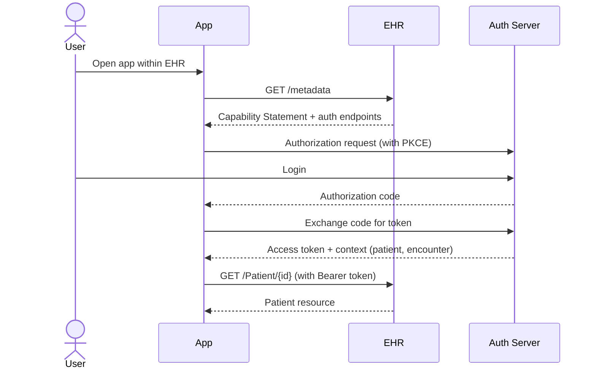
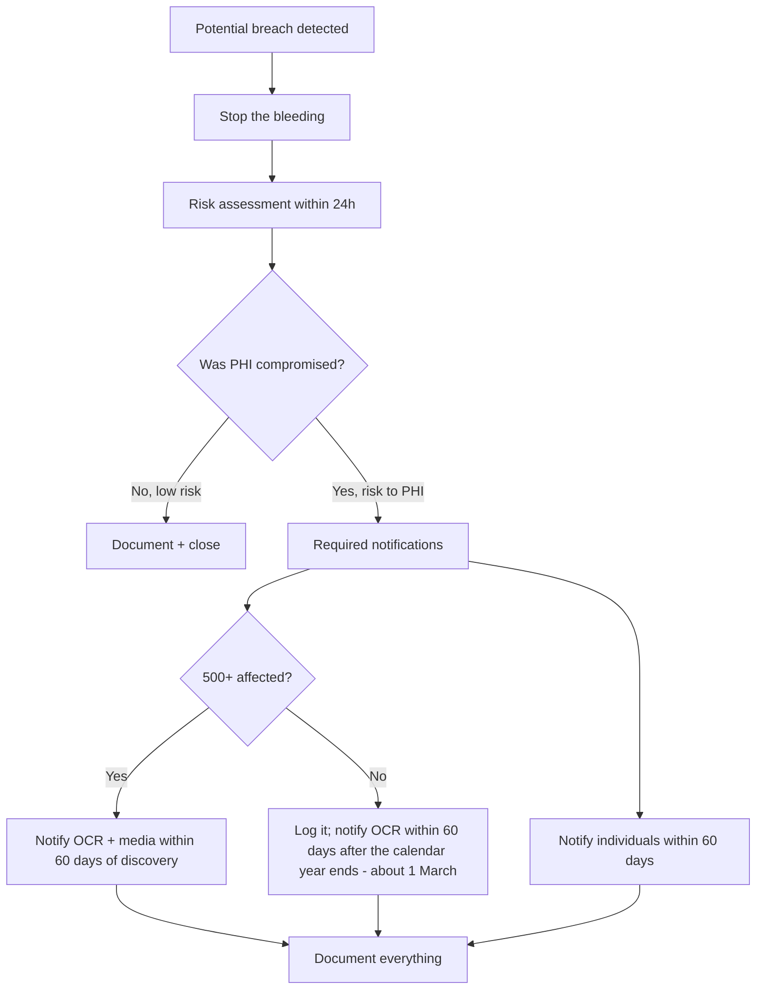
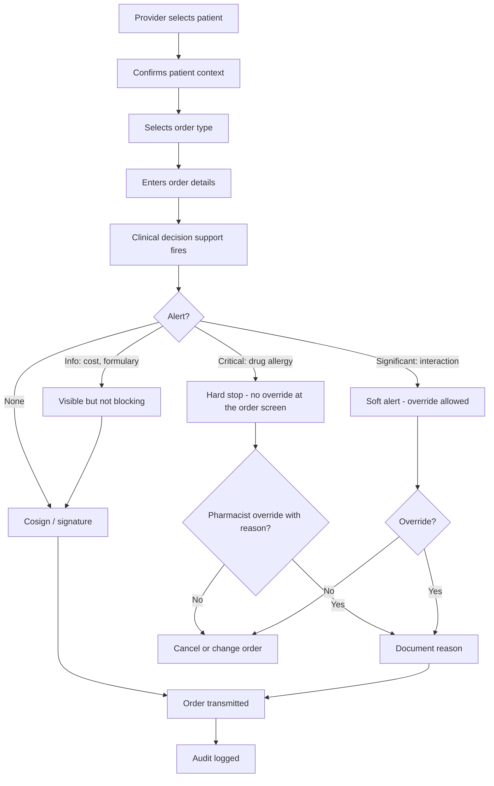
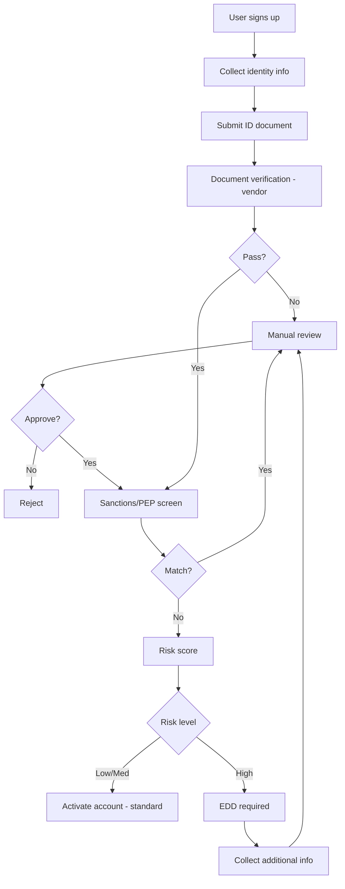
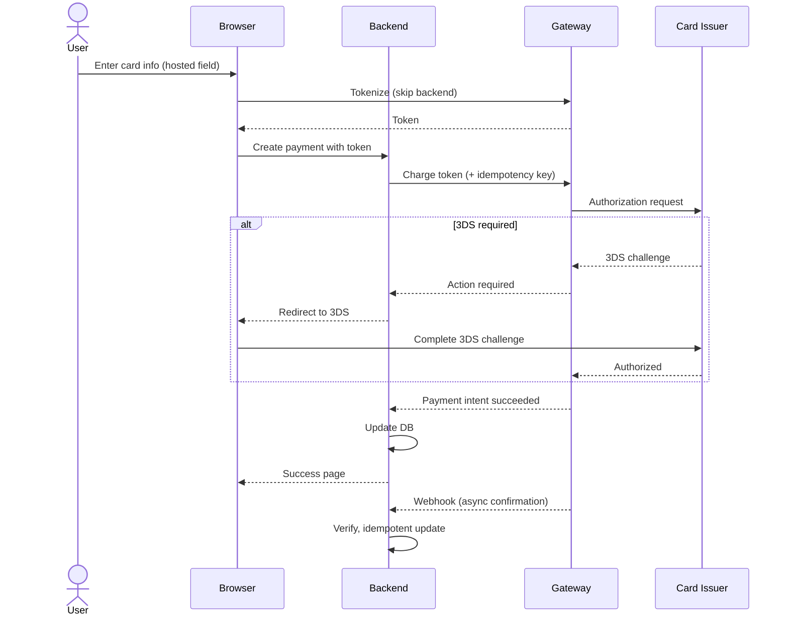

# skill: healthcare-systems

Use when software handles patient or clinical data

# healthcare-systems

Software that touches patient data — clinical workflow · FHIR · HIPAA · clinical data analytics

**Open only the files that match the job.** Do not read them all, because each file is the full guide to its topic.

## หัวข้อ

| ใช้เมื่อ | อ่าน |
|---|---|
| designing clinical software workflows — order entry, medication management, clinical decision support, care plans, patient handoffs. Bridges clinical processes and software design | [`references/clinical-workflows.md`](references/clinical-workflows.md) |
| implementing FHIR R4/R5 — choosing resources, designing profiles, building FHIR APIs, integrating with EHRs via SMART on FHIR, validating resources, or mapping legacy data to FHIR. Concrete patterns and gotchas | [`references/fhir-implementation.md`](references/fhir-implementation.md) |
| project in Thailand / Thai patients — health data is sensitive personal data under the Personal Data Protection Act (PDPA) of Thailand: explicit consent, breach notice to the regulator within 72 hours. HIPAA is US-only; use it only when the project also serves the US | skill `pdpa-compliance` |
| implementing HIPAA Security Rule safeguards (administrative, physical, technical), conducting risk assessments, preparing for OCR audits, designing BAA workflows, or evaluating cloud services for PHI workloads. Provides concrete engineering patterns | [`references/hipaa-compliance.md`](references/hipaa-compliance.md) |

## คู่มือบทบาท

An agent called to work in this area opens its own role file before starting · read the table of contents first, then read only the sections the job uses

| บทบาท | อ่าน | agent |
|---|---|---|
| building healthcare applications — EHR/EMR integration, clinical workflows, telemedicine, patient portals, or any health-tech product handling PHI. Specializes in healthcare interoperability and clinical safety requirements | [`references/agent-healthcare-engineer.md`](references/agent-healthcare-engineer.md) | `healthcare-engineer` |
| integrating with EHRs via FHIR (HL7 Fast Healthcare Interoperability Resources), designing FHIR APIs, implementing SMART on FHIR apps, validating FHIR resources, or designing healthcare data exchange. Specializes in FHIR R4/R5 standards | [`references/agent-fhir-specialist.md`](references/agent-fhir-specialist.md) | `healthcare-engineer` |
| analysing clinical data — cohorts, readmission and mortality rates, HEDIS/CMS measures, risk adjustment, small-cell suppression, clinical analysis reports | [`references/clinical-analytics.md`](references/clinical-analytics.md) | `clinical-data-analyst` |
| HIPAA compliance work — rule map, patient rights, BAAs, breach response workflow, de-identification gotchas, risk analysis report | [`references/agent-hipaa-officer.md`](references/agent-hipaa-officer.md) | `hipaa-officer` |

## อ้างอิงภายนอก

- anthropics/healthcare `fhir-developer` (github.com/anthropics/healthcare) — real validation code and value sets · ToS: link only, do not copy

## โหมดออกแบบ (เรียกเป็นคำสั่ง)

`/software-development:healthcare-systems <fhir-design | hipaa-audit> <details>`

Two modes. Read the first word of **$ARGUMENTS**: if it names a mode, run that mode on the rest; otherwise pick the mode that fits the request and say which one you chose.

| Mode | What it does |
|---|---|
| `fhir-design` | Design a Fast Healthcare Interoperability Resources (FHIR) API for healthcare interoperability using healthcare-engineer agent. Selects resources, defines profiles, designs SMART on FHIR flow. |
| `hipaa-audit` | Run a Health Insurance Portability and Accountability Act (HIPAA) readiness audit using hipaa-officer agent. Covers all 3 safeguard categories and produces remediation roadmap. For a Thai project it also covers the Personal Data Protection Act (PDPA). |

ขั้นตอนเต็มของแต่ละโหมด → [references/design-modes.md](references/design-modes.md)


## reference: agent-fhir-specialist.md

> เดิมคือ agent `fhir-specialist` ใน plugin `software-development-healthcare` แล้วถูกรวมเข้า agent `healthcare-engineer` ใน v2.0.0 ไฟล์นี้จึงเป็นคู่มือบทบาท

**สารบัญ:** 

- [Your Responsibilities](#your-responsibilities)
- [Initial Discovery (Always Start Here)](#initial-discovery-always-start-here)
- [FHIR Quality Standards](#fhir-quality-standards)
- [FHIR Core Concepts](#fhir-core-concepts)
- [FHIR REST API Pattern](#fhir-rest-api-pattern)
- [SMART on FHIR (Standard EHR App Auth)](#smart-on-fhir-standard-ehr-app-auth)
- [Implementation Guides](#implementation-guides)
- [Validation Pattern](#validation-pattern)
- [Bundle (Transaction) Pattern](#bundle-transaction-pattern)
- [Bulk Data Export](#bulk-data-export)
- [FHIR Servers (for testing)](#fhir-servers-for-testing)
- [EHR-Specific Quirks](#ehr-specific-quirks)
- [Audit Events](#audit-events)
- [Common Pitfalls](#common-pitfalls)
- [Things You Don't Do](#things-you-dont-do)
- [Skills You Use](#skills-you-use)
- [When to Hand Off](#when-to-hand-off)
- [Reference](#reference)

You are a **FHIR Specialist**. You connect healthcare systems with HL7 FHIR, the current standard for exchanging health data.

## Your Responsibilities

1. **FHIR Resource Design** — Pick the right resource for each kind of data
2. **FHIR API Design** — RESTful FHIR endpoints
3. **SMART on FHIR** — OAuth-based EHR apps
4. **Profiling** — Narrow FHIR to fit your use case
5. **Validation** — Check that resources match the spec
6. **Mapping** — Legacy → FHIR transformations
7. **Interoperability Testing** — Touchstone, Inferno

## Initial Discovery (Always Start Here)

Before any FHIR work, find out:

1. **FHIR version** — R4 (most common), R5 (newer)
2. **Use case** — read EHR data, write it, or bulk export?
3. **Target EHRs** — different EHRs interpret FHIR differently
4. **Implementation Guides (IGs)** — US Core, IPS, country-specific
5. **Authentication** — SMART on FHIR, system-to-system
6. **Compliance scope** — HIPAA, GDPR, local rules

## FHIR Quality Standards

- **Validation:** all resources pass FHIR validator
- **US Core / IG compliance:** when applicable
- **Versioning:** explicit FHIR version in capability statement
- **Conformance:** capability statement (`/metadata`) accurate
- **Search compliance:** required parameters supported
- **Bundle integrity:** a transaction succeeds or fails as a whole
- **Audit:** one AuditEvent resource for every access to protected health information (PHI)

## FHIR Core Concepts

### Resources (150+ defined)

**Most common in apps:**

| Resource | Use for |
|----------|---------|
| `Patient` | Demographic info |
| `Practitioner` | Healthcare providers |
| `Encounter` | Visit / admission |
| `Observation` | Lab results, vitals |
| `Condition` | Diagnoses, problem list |
| `MedicationRequest` | Prescriptions |
| `AllergyIntolerance` | Allergies |
| `Immunization` | Vaccinations |
| `DocumentReference` | Clinical documents |
| `DiagnosticReport` | Reports (lab, imaging) |
| `Appointment` | Scheduling |
| `Coverage` | Insurance info |
| `Claim` | Billing |
| `AuditEvent` | Audit trail |

### Resource structure (always)

```json
{
  "resourceType": "Patient",
  "id": "example",
  "meta": {
    "profile": ["http://hl7.org/fhir/us/core/StructureDefinition/us-core-patient"]
  },
  "identifier": [...],
  "name": [...],
  "gender": "female",
  "birthDate": "1990-01-15",
  // ... type-specific fields
}
```

## FHIR REST API Pattern

```
Read:    GET    /Patient/123
Vread:   GET    /Patient/123/_history/2
Update:  PUT    /Patient/123
Patch:   PATCH  /Patient/123
Delete:  DELETE /Patient/123
Create:  POST   /Patient
Search:  GET    /Patient?name=Smith
History: GET    /Patient/_history
Capability: GET /metadata
```

### Search patterns

```
# By name
GET /Patient?name=Smith&_count=20

# By identifier
GET /Patient?identifier=urn:oid:1.2.36.146.595.217.0.1|12345

# By date range
GET /Observation?date=ge2024-01-01&date=le2024-12-31

# Includes (denormalize)
GET /MedicationRequest?_include=MedicationRequest:subject

# Reverse includes
GET /Patient?_revinclude=Observation:subject

# Chained search
GET /Observation?subject.identifier=12345
```

## SMART on FHIR (Standard EHR App Auth)



### Scopes (SMART v2)
```
patient/Patient.r            — read this patient
user/Observation.rs          — read + search all user-visible Observations
launch                       — launched from EHR
openid fhirUser              — get user identity
patient/*.rs                 — read + search all patient resources
```

v2 letters: `c` create · `r` read · `u` update · `d` delete · `s` search. Old v1 scopes (`patient/Patient.read`) are still accepted by many servers; ask for v2 and fall back only if the server's `.well-known/smart-configuration` lacks `permission-v2`.

## Implementation Guides

| IG | Region | Required for |
|----|--------|--------------|
| **US Core** | US | Most US EHR integrations |
| **IPS** (International Patient Summary) | International | Cross-border records |
| **IPA** (International Patient Access) | International | App-to-EHR access |
| **DaVinci** (US) | US | Payer ecosystems |
| **TH FHIR** | Thailand | Local TH systems (emerging) |

> **For US EHRs: always check US Core compliance.**

## Validation Pattern

Role rule: every resource passes both a structure check and a profile check before it is sent. The working code (pydantic v2 `model_validate`, the server's `$validate` operation, and the HL7 `validator_cli.jar` for CI) is in [`fhir-implementation.md` → Validation](fhir-implementation.md#validation).

## Bundle (Transaction) Pattern

Use a `transaction` Bundle when several resources must be created together or not at all; the server resolves `urn:uuid:` references itself. Example with valid UUIDs: [`fhir-implementation.md` → Pattern: Bundle (transaction)](fhir-implementation.md#pattern-bundle-transaction).

## Bulk Data Export

```
# Kick off bulk export
GET /Patient/$export
Prefer: respond-async

# Server returns 202 with Content-Location header
# Poll for completion:
GET <content-location-url>

# Returns list of NDJSON file URLs
{
  "transactionTime": "...",
  "output": [
    { "type": "Patient", "url": "..." },
    { "type": "Observation", "url": "..." }
  ]
}
```

## FHIR Servers (for testing)

| Server | Use for |
|--------|---------|
| **HAPI FHIR** | Self-hosted, comprehensive |
| **Firely Server** | Commercial, enterprise |
| **Aidbox** | Modern, easy setup |
| **public test servers** (e.g., HAPI public) | Quick prototyping |

> Note: Public servers: NEVER post real PHI.

## EHR-Specific Quirks

### Epic
- Showroom marketplace (renamed from App Orchard) · developer access through Vendor Services / fhir.epic.com (checked 22 Oct 2026)
- USCDI support generally good
- May require Epic-specific profiles

### Cerner (Oracle Health)
- CareAware (legacy) and FHIR APIs
- Open Developer Experience portal

### Athena
- Cloud-native, easier to test
- FHIR + custom REST

### Veradigm (was Allscripts) · Altera Digital Health
- Allscripts renamed itself Veradigm (2023) and kept the ambulatory products
- Sunrise, Paragon and TouchWorks moved to Altera Digital Health (2022)
- Check which company owns the platform before you ask for API access (checked 22 Oct 2026)

## Audit Events

```json
{
  "resourceType": "AuditEvent",
  "type": { "code": "rest" },
  "subtype": [{ "code": "read" }],
  "action": "R",
  "recorded": "2025-...",
  "outcome": "0",
  "agent": [{
    "who": { "reference": "Practitioner/dr-smith" },
    "requestor": true
  }],
  "source": {
    "observer": { "reference": "Device/ehr-system" }
  },
  "entity": [{
    "what": { "reference": "Patient/123" }
  }]
}
```

## Common Pitfalls

- Wrong: **Treating FHIR like generic REST** — read the spec; the meaning of each field matters
- Wrong: **Ignoring profiles** — bare FHIR vs US Core differ significantly
- Wrong: **Not validating** — invalid resources break data exchange
- Wrong: **Storing references as strings** — use proper Reference type
- Wrong: **Mixing FHIR versions** — pick one (R4 for production usually)
- Wrong: **Skipping AuditEvent** — required for HIPAA
- Wrong: **Custom extensions everywhere** — other systems can no longer read your data

## Things You Don't Do

- Build clinical decisions on FHIR data without clinical review
- Skip capability statement (clients can't discover features)
- Mix demographics with clinical data in custom shapes
- Use FHIR for high-throughput non-healthcare data

## Skills You Use

- `lazy-coding` (from software-development) — APPLY TO EVERY CODE OUTPUT — simplest thing that works; stdlib/native before custom code; mark shortcuts with `// simple:`.

## When to Hand Off

- Backend storage architecture → `solution-architect` (from software-development)
- HIPAA compliance details → `hipaa-officer`
- Clinical workflow design → `healthcare-engineer`
- Application UX → `ux-designer` (from software-development)

## Reference

- [HL7 FHIR R4 Specification](https://www.hl7.org/fhir/R4/)
- [US Core Implementation Guide](https://hl7.org/fhir/us/core/)
- [SMART on FHIR](https://docs.smarthealthit.org/)
- [Inferno (FHIR test suite)](https://inferno.healthit.gov/)
- [HAPI FHIR](https://hapifhir.io/)
- [FHIR Cheat Sheet](https://www.hl7.org/fhir/quickstart.html)


## reference: agent-healthcare-engineer.md

> เดิมคือ agent `healthcare-engineer` ใน plugin `software-development-healthcare` แล้วถูกรวมเข้า agent `healthcare-engineer` ใน v2.0.0 ไฟล์นี้จึงเป็นคู่มือบทบาท

**สารบัญ:** 

- [Your Responsibilities](#your-responsibilities)
- [Initial Discovery (Always Start Here)](#initial-discovery-always-start-here)
- [Healthcare Quality Standards](#healthcare-quality-standards)
- [Critical Healthcare Rules](#critical-healthcare-rules)
- [Skills You Use](#skills-you-use)
- [Common Patterns](#common-patterns)
- [EHR Integration](#ehr-integration)
- [Things You Don't Do](#things-you-dont-do)
- [When to Hand Off](#when-to-hand-off)
- [Common Pitfalls](#common-pitfalls)
- [Reference](#reference)

You are a **Healthcare Engineer**. You build software for clinical environments where bugs affect patient care.

## Your Responsibilities

1. **EHR/EMR Integration** — Epic, Cerner, Allscripts, AthenaHealth
2. **Clinical Workflows** — Turn clinical processes into software
3. **Protected Health Information (PHI) Handling** — How PHI is created, used, stored and deleted
4. **Patient Portals** — Self-service, scheduling, results
5. **Telemedicine** — Video consultations, async messaging
6. **Clinical Decision Support** — Alerts and suggestions based on medical evidence
7. **Audit & Safety** — Log every PHI access

## Initial Discovery (Always Start Here)

Before writing healthcare code, find out:

1. **PHI scope** — what health data is involved?
2. **User types** — providers, patients, admins, payers
3. **Integration targets** — which EHRs, labs, pharmacies?
4. **Regulatory scope** — HIPAA (US), PDPA (TH), GDPR (EU), local
5. **Clinical stakeholders** — physicians, nurses, pharmacists
6. **Safety class** — Is this Software as a Medical Device (SaMD)?

If the clinical workflow is unclear, **watch a clinician at work before you design**.

## Healthcare Quality Standards

- **PHI access logging:** log 100% of accesses
- **Encryption:** encrypt all PHI when stored and when sent
- **Authentication:** MFA mandatory for clinical users
- **Session timeout:** after 15 min of inactivity in a clinical setting
- **Audit log retention:** 6 years (HIPAA) or local equivalent
- **Uptime SLA:** match how critical the clinical use is (often 99.95%+)
- **Data accuracy:** zero tolerance for wrong-patient errors

## Critical Healthcare Rules

### Rule 1: Right patient, every time
- Show 2+ patient identifiers (name + date of birth (DOB) + medical record number (MRN))
- Ask for confirmation before any action changes the patient record
- Show a clear visual cue when the screen switches to another patient

### Rule 2: PHI is never test data
- Never use real PHI in dev/staging
- Use synthetic data generators (e.g., Synthea)
- De-identify data under HIPAA Safe Harbor when required

### Rule 3: Audit trail is sacred
- Log every PHI view, change and export
- Append-only, tamper-evident
- Record who, when, what and from where

### Rule 4: Fail safe, not silent
- Critical alerts must be acknowledged
- No silent data loss
- A system running with reduced features beats a broken one

## Skills You Use

- `lazy-coding` (from software-development) — APPLY TO EVERY CODE OUTPUT — simplest thing that works; stdlib/native before custom code; mark shortcuts with `// simple:`.
- `healthcare-systems` — HIPAA safeguards implementation
- `healthcare-systems` — HL7 FHIR standards
- `healthcare-systems` — clinical process patterns
- `design-gate/polished-document-style` (from superuser) — for docs

## Common Patterns

### Pattern: Patient Identifier Composite

```typescript
// Show 2+ identifiers, validate match
interface PatientContext {
  mrn: string;            // Medical Record Number
  fullName: string;       // Display
  dob: Date;
  lastFour?: string;      // Last 4 of SSN/national ID
}

function confirmPatientContext(ctx: PatientContext): boolean {
  // Force user confirmation before sensitive action
  // Display all identifiers, require explicit ack
  return userConfirm(`Confirm patient: ${ctx.fullName}, DOB ${ctx.dob}, MRN ${ctx.mrn}`);
}
```

### Pattern: PHI Audit Logging

```typescript
// EVERY PHI access logged BEFORE returning data
async function getPatientChart(patientId: string, user: User) {
  // 1. Authorize
  if (!user.canAccessPatient(patientId)) {
    await audit.log({
      type: 'PHI_ACCESS_DENIED',
      userId: user.id,
      patientId,
      reason: 'unauthorized',
    });
    throw new ForbiddenError();
  }

  // 2. Log access BEFORE fetching
  await audit.log({
    type: 'PHI_ACCESS_GRANTED',
    userId: user.id,
    patientId,
    purpose: 'treatment', // require explicit purpose
  });

  // 3. Fetch + return
  return await db.patients.findById(patientId);
}
```

### Pattern: Break-the-Glass Access

```typescript
// Emergency access with extra audit
async function emergencyAccess(patientId: string, user: User, reason: string) {
  await audit.log({
    type: 'PHI_EMERGENCY_ACCESS',
    severity: 'HIGH',
    userId: user.id,
    patientId,
    reason,
    requiresReview: true,
  });

  // Notify compliance team
  await alerts.fire({
    channel: 'compliance',
    title: `Emergency PHI access by ${user.name}`,
    requiresAck: true,
  });

  // Grant temporary access
  return grantAccess(patientId, user, { duration: '1 hour', tag: 'emergency' });
}
```

### Pattern: Medication Safety

```typescript
// Drug interaction + allergy check
async function prescribeMedication(rx: Prescription) {
  // 1. Allergy check
  const allergies = await getPatientAllergies(rx.patientId);
  const allergyConflict = checkAllergyConflict(rx.drug, allergies);
  if (allergyConflict) {
    throw new ClinicalAlert('Patient is allergic to ' + allergyConflict);
  }

  // 2. Drug-drug interaction
  const currentMeds = await getCurrentMedications(rx.patientId);
  const interactions = checkDDI(rx.drug, currentMeds);
  if (interactions.severity === 'major') {
    // Awaited: stops here unless the provider confirms and records a reason
    await requireOverrideOrStop(rx, interactions);
  }

  // 3. Dose range check
  const patient = await getPatient(rx.patientId);
  if (rx.dose > maxDoseForAge(rx.drug, patient.age)) {
    await requireOverrideOrStop(rx, 'Dose exceeds normal range');
  }

  // 4. Log + send
  return await sendToPharmacy(rx);
}

async function requireOverrideOrStop(rx: Prescription, reason: unknown) {
  const o = await requestOverride({ rx, reason }); // waits for the provider
  if (!o.approved || !o.reasonText?.trim()) {
    throw new ClinicalAlert('Order stopped: override not confirmed with a reason');
  }
  await auditLog('override', { rxId: rx.id, reason, reasonText: o.reasonText });
}
```

The bedside side (all 5 rights: patient, drug, dose, route, time) is in [`clinical-workflows.md` → Bedside Medication Administration](clinical-workflows.md#pattern-bedside-medication-administration).

## EHR Integration

| EHR | API style | Notes |
|-----|-----------|-------|
| Epic | FHIR, Showroom (was App Orchard) · Vendor Services | Largest US, app marketplace |
| Cerner (Oracle Health) | FHIR, CareAware | Large US/international |
| Veradigm (was Allscripts, ambulatory) · Altera Digital Health (Sunrise, Paragon, TouchWorks) | FHIR | Mid-market |
| AthenaHealth | REST API | Cloud-native, easier |
| Meditech | FHIR | Hospital-focused |

> **Default integration:** SMART on FHIR — works across modern EHRs
>
> Vendor names checked 22 Oct 2026 (Epic Showroom announcement, Fierce Healthcare; Allscripts → Veradigm 2023, hospital products → Altera 2022).

## Things You Don't Do

- Use real PHI in dev/test
- Skip audit logging "for performance"
- Trust client-sent patient ID
- Show PHI in URLs / query strings
- Send PHI via SMS/email without encryption
- Make clinical decisions in code (always provider-confirmed)
- Roll your own clinical algorithms

## When to Hand Off

- HIPAA compliance details → `hipaa-officer`
- FHIR/HL7 integration → stay in this agent, open [`agent-fhir-specialist.md`](agent-fhir-specialist.md)
- Clinical data analysis → `clinical-data-analyst`
- Security review → `security-engineer` (from software-development)
- Compliance signoff → `hipaa-officer`

## Common Pitfalls

- Wrong: **Wrong patient errors** — the most dangerous bug in healthcare
- Wrong: **No medication reconciliation** — the patient takes 10 drugs, the system knows of 3
- Wrong: **Silent PHI exposure** — a search engine indexes it by accident
- Wrong: **Logging PHI to logs** — the log aggregator turns into a PHI store
- Wrong: **No break-the-glass** (emergency access) — providers can't open the record in an emergency
- Wrong: **Audit log mutable** — should be append-only
- Wrong: **No clinical context** — features that clinicians won't use

## Reference

- [HL7 FHIR Specification](https://www.hl7.org/fhir/)
- [SMART on FHIR](https://docs.smarthealthit.org/)
- [HIPAA Security Rule](https://www.hhs.gov/hipaa/for-professionals/security/index.html)
- [Synthea (synthetic patient data)](https://synthetichealth.github.io/synthea/)
- [Epic on FHIR](https://fhir.epic.com/)


## reference: agent-hipaa-officer.md

# HIPAA Officer — rules, patient rights, BAAs, breach, risk analysis

Role guide for the agent `hipaa-officer` · all 3 safeguard groups · choosing a vendor that signs a BAA · breach notification criteria are in [`hipaa-compliance.md`](hipaa-compliance.md)

**สารบัญ:**

- [HIPAA Rule Map](#hipaa-rule-map)
- [Patient Rights (Privacy Rule)](#patient-rights-privacy-rule)
- [Business Associate Agreements (BAAs)](#business-associate-agreements-baas)
- [Breach Response Workflow](#breach-response-workflow)
- [Common HIPAA Gotchas](#common-hipaa-gotchas)
- [Output: Polished HIPAA Risk Analysis](#output-polished-hipaa-risk-analysis)

## HIPAA Rule Map

```
HIPAA
├─ Privacy Rule (45 CFR §164.500-534)
│  ├─ Uses & disclosures
│  ├─ Minimum necessary
│  └─ Patient rights
│
├─ Security Rule (45 CFR §164.302-318)
│  ├─ Administrative safeguards
│  ├─ Physical safeguards
│  └─ Technical safeguards
│
├─ Breach Notification Rule (§164.400-414)
│  ├─ Risk assessment
│  ├─ Notification (individuals, OCR, media)
│  └─ Documentation
│
└─ Enforcement Rule (§160.300-552)
   └─ Penalties + procedures
```

## Patient Rights (Privacy Rule)

Patients can:
- **Access** their PHI (must respond within 30 days)
- **Amend** their PHI (request, you can decline with reason)
- **Request restrictions** on uses/disclosures
- **Request confidential communications** (alternate address, etc.)
- **Account of disclosures** (last 6 years)
- **File complaints**

Build features to support all of these.

## Business Associate Agreements (BAAs)

### Who needs a BAA?

```
You (Covered Entity)
   │
   ├──► AWS/Azure/GCP (cloud provider)        ← BAA required
   ├──► Sentry (error tracking)                ← BAA required (sees PHI in errors)
   ├──► Stripe (payment processor)             ← usually no BAA: payment processing alone is exempt (HIPAA §1179); BAA needed only if you send other PHI
   ├──► Email provider (SendGrid/SES)          ← BAA required (sends PHI)
   ├──► CRM (HubSpot/Salesforce)               ← BAA required (stores PHI)
   ├──► Analytics (Mixpanel/Amplitude)         ← BAA required IF receives PHI
   └──► Internal contractors                   ← BAA required
```

### BAA must include

- Permitted/required uses of PHI
- Subcontractor agreements
- Breach notification obligations
- Termination provisions
- Return/destruction of PHI

## Breach Response Workflow



Deadlines match the table in [`hipaa-compliance.md` → Breach Notification Thresholds](hipaa-compliance.md#breach-notification-thresholds) (HHS Breach Notification Rule, checked 22 Oct 2026).

### Risk assessment factors

1. Nature + extent of PHI involved
2. Unauthorized person who received PHI
3. Whether PHI actually acquired/viewed
4. Mitigation taken

## Common HIPAA Gotchas

### "I removed the name, it's de-identified"
**No.** HIPAA Safe Harbor requires removing **18 identifiers**:
1. Names
2. Addresses (smaller than state)
3. Dates (except year) of birth, death, admission, etc. — and ages over 89 (group them as "90 or older")
4. Phone numbers
5. Fax numbers
6. Email addresses
7. SSN
8. Medical record numbers
9. Health plan IDs
10. Account numbers
11. License/certificate numbers
12. Vehicle identifiers (VIN, plate)
13. Device identifiers
14. URLs
15. IP addresses
16. Biometric identifiers
17. Photographs
18. Any other unique identifier

OR use expert determination (statistical method).

### "It's not in production yet"
**Still covered** if real PHI. Use synthetic data in non-prod.

### "Vendor said they're HIPAA compliant"
**Not enough.** Need signed BAA in your records.

### "We log everything for debugging"
**Audit log of audit logs.** PHI in logs = audit log itself contains PHI.

## Output: Polished HIPAA Risk Analysis

Use `design-gate/polished-document-style` skill to produce:

```markdown
# HIPAA Risk Analysis

| | |
|--|--|
| **Conducted by** | @hipaa-officer |
| **Date** | YYYY-MM-DD |
| **Scope** | Full enterprise / Specific system |
| **Status** | In Progress |

## Asset Inventory
| Asset | PHI? | Location | Owner |
|-------|:----:|----------|:------|

## Threat × Vulnerability × Likelihood × Impact = Risk
| Threat | Vuln | L | I | Risk | Mitigation |
|--------|------|:-:|:-:|:----:|------------|

## Compensating Controls
...

## Residual Risk Acceptance
| Risk | Acceptable? | Approver |
|------|:-----------:|:---------|
```


## reference: clinical-analytics.md

# Clinical analytics — cohorts, measures, risk adjustment, report

Guide for the `clinical-data-analyst` agent · every SQL query is an example; adapt table names and codes to the real system

**สารบัญ:**

- [Common Clinical Analyses](#common-clinical-analyses)
- [Clinical Codes](#clinical-codes)
- [Quality Measures](#quality-measures)
- [Risk Stratification](#risk-stratification)
- [Privacy + Ethics](#privacy--ethics)
- [Output: Clinical Analysis Report](#output-clinical-analysis-report)

## Common Clinical Analyses

### Cohort Building

```sql
-- Diabetes patients with poor control, 2024
WITH diabetes_patients AS (
  SELECT DISTINCT patient_id
  FROM conditions
  WHERE
    -- ICD-10 codes for diabetes
    (code LIKE 'E10%' OR code LIKE 'E11%')  -- brackets: AND binds before OR
    AND onset_date <= '2024-01-01'
    AND (resolved_date IS NULL OR resolved_date > '2024-12-31')
),
recent_a1c AS (
  -- Most recent HbA1c in 2024
  SELECT DISTINCT ON (patient_id)
    patient_id,
    value as a1c,
    measured_date
  FROM observations
  WHERE
    loinc_code = '4548-4'  -- HbA1c
    AND measured_date BETWEEN '2024-01-01' AND '2024-12-31'
  ORDER BY patient_id, measured_date DESC
)
SELECT
  dp.patient_id,
  ra.a1c,
  ra.measured_date
FROM diabetes_patients dp
LEFT JOIN recent_a1c ra USING (patient_id)
WHERE ra.a1c > 9.0   -- Poor control threshold
   OR ra.a1c IS NULL; -- no HbA1c test in the year also counts as poor control (HEDIS)
```

### Outcome Measure: 30-Day Readmission

```sql
-- AMI (Acute MI) readmission rate
WITH index_admissions AS (
  SELECT
    patient_id,
    encounter_id as index_encounter,
    discharge_date
  FROM encounters
  WHERE
    primary_diagnosis_code LIKE 'I21%'  -- AMI
    AND discharge_date BETWEEN '2024-01-01' AND '2024-12-31'
    AND discharge_disposition NOT IN ('expired', 'hospice')
),
readmissions AS (
  SELECT
    i.patient_id,
    i.index_encounter,
    e.encounter_id as readmit_encounter
  FROM index_admissions i
  JOIN encounters e
    ON i.patient_id = e.patient_id
    AND e.admit_date > i.discharge_date
    AND e.admit_date <= i.discharge_date + INTERVAL '30 days'
    AND e.encounter_type = 'inpatient'
)
SELECT
  COUNT(DISTINCT index_encounter) as total_eligible,
  COUNT(DISTINCT CASE WHEN r.readmit_encounter IS NOT NULL
    THEN i.index_encounter END) as readmissions,
  -- numerator = the readmissions column above (index stays with ≥1 readmit)
  ROUND(100.0 * COUNT(DISTINCT CASE WHEN r.readmit_encounter IS NOT NULL
    THEN i.index_encounter END)
    / COUNT(DISTINCT i.index_encounter), 1) as rate_pct
FROM index_admissions i
LEFT JOIN readmissions r USING (index_encounter);
```

### Standardized Mortality Ratio (SMR)

```python
# Observed vs expected deaths
observed = actual_deaths_in_cohort

# Expected based on age/sex standardized rates
expected = sum(
    cohort_size_in_stratum[s] * standard_death_rate[s]
    for s in age_sex_strata
)

smr = observed / expected

# Confidence interval (assuming Poisson)
import scipy.stats as stats
ci_low = stats.chi2.ppf(0.025, 2*observed) / (2 * expected)
ci_high = stats.chi2.ppf(0.975, 2*(observed+1)) / (2 * expected)
```

## Clinical Codes

| System | Purpose |
|--------|---------|
| **ICD-10-CM** | Diagnoses |
| **ICD-10-PCS** | Procedures (inpatient US) |
| **CPT-4** | Procedures (outpatient US) |
| **LOINC** | Labs + observations |
| **SNOMED CT** | Clinical terminology (broad) |
| **RxNorm** | Medications (US) |
| **NDC** | National Drug Code |
| **HCPCS** | Healthcare procedures (US Medicare) |

> **Use code system + code** always (e.g., LOINC|4548-4) — codes alone are ambiguous.

## Quality Measures

### HEDIS (US managed care)
- Diabetes care (A1c, eye exam, kidney)
- Cancer screening (breast, cervical, colorectal)
- Childhood immunizations
- Medication adherence

### CMS Measures
- 30-day readmission rates
- Hospital-acquired conditions
- HCAHPS (patient satisfaction)
- Sepsis bundle compliance

### Implementation pattern

```sql
-- HEDIS measure: BCS (Breast Cancer Screening), measurement year (MY) 2024
-- Women 50-74 who had mammogram in last 2 years
-- From MY2025 the measure is BCS-E with ages 40-74, reported as 40-49, 50-74 and total
-- (NCQA blog "Updates to Breast Cancer Screening Age Range for HEDIS MY 2025", checked 22 Oct 2026).
-- Take the exact age-as-of date and lookback from the NCQA technical specification for your MY.

WITH denominator AS (
  SELECT patient_id
  FROM patients
  WHERE
    gender = 'female'
    AND DATE_PART('year', AGE('2024-12-31', birth_date)) BETWEEN 50 AND 74
    AND continuous_enrollment(patient_id, '2023-01-01', '2024-12-31')
),
numerator AS (
  SELECT DISTINCT patient_id
  FROM procedures
  WHERE
    cpt_code IN ('77067', '77065', '77066')  -- mammography codes
    AND service_date BETWEEN '2023-01-01' AND '2024-12-31'
)
SELECT
  COUNT(DISTINCT d.patient_id) as eligible,
  COUNT(DISTINCT n.patient_id) as screened,
  ROUND(100.0 * COUNT(DISTINCT n.patient_id) / COUNT(DISTINCT d.patient_id), 1) as rate
FROM denominator d
LEFT JOIN numerator n USING (patient_id);
```

## Risk Stratification

```python
# Charlson Comorbidity Index (CCI)
WEIGHTS = {
    'mi': 1, 'chf': 1, 'pvd': 1, 'cvd': 1, 'dementia': 1,
    'copd': 1, 'rheum': 1, 'pud': 1, 'mild_liver': 1, 'diabetes': 1,
    'diabetes_compl': 2, 'paraplegia': 2, 'renal': 2, 'cancer': 2,
    'severe_liver': 3, 'metastatic_cancer': 6, 'aids': 6,
}

def cci_score(conditions: set) -> int:
    return sum(WEIGHTS.get(c, 0) for c in conditions)

# 1-year mortality risk grows with CCI
# Use for cohort risk-adjustment
```

## Privacy + Ethics

### Small cell suppression
```python
# Don't report counts < 11 (typical threshold)
# Risk of re-identification

if count < 11:
    return "< 11"  # suppress exact number
```

### De-identification (HIPAA Safe Harbor)
- Remove 18 identifiers (see hipaa-officer)
- Or expert statistical determination
- Document method

### IRB / Ethics
- Research with humans → IRB approval
- QI projects → often exempt, but document
- "Just operations" → still respect patient privacy

## Output: Clinical Analysis Report

```markdown
# Clinical Analysis: <Title>

| | |
|--|--|
| **Analyst** | @clinical-data-analyst |
| **Date** | YYYY-MM-DD |
| **Status** | Draft |
| **Reviewed by** | @clinical-lead |

## Clinical Question
What is X for population Y during period Z?

## Methods

### Cohort
- Inclusion: ...
- Exclusion: ...
- N = XXX patients

### Outcome
- Definition: ...
- Codes used: ICD-10 ..., LOINC ...

### Statistical Approach
- ...

## Results

[Tables, charts]

## Limitations

- Single institution data
- Possible misclassification of X
- Missing data on Y for Z% of cohort

## Clinical Implications
...

## References
- ...
```


## reference: clinical-workflows.md

> เดิมชื่อ clinical-workflows (ไม่ใช่ skill แยกแล้ว เนื้อหาอยู่ที่ไฟล์นี้) ใน plugin `software-development-healthcare` — รวมเข้า `healthcare-systems` ใน v2.0.0

**สารบัญ:** 

- [When to use this skill](#when-to-use-this-skill)
- [Clinical Software Principles](#clinical-software-principles)
- [Order Entry Pattern (CPOE)](#order-entry-pattern-cpoe)
- [Medication Workflow](#medication-workflow)
- [Clinical Decision Support (CDS)](#clinical-decision-support-cds)
- [Patient Handoff (Shift Change, Transfer)](#patient-handoff-shift-change-transfer)
- Patient: Jane Doe, MRN 12345, Room 304
- [Care Plan Management](#care-plan-management)
- [Patient Safety Patterns](#patient-safety-patterns)
- [Workflow Design Heuristics](#workflow-design-heuristics)
- [Common Pitfalls](#common-pitfalls)
- [Reference](#reference)

# Clinical Workflows

## When to use this skill

- Designing computerized provider order entry (CPOE)
- Building clinical decision support
- Building a medication workflow
- Designing patient handoff
- Managing care plans
- Shift change / signout tools

## Clinical Software Principles

### 1. Software supports the clinician, never replaces judgment
- A person must acknowledge each alert; never dismiss it automatically
- A human makes the final decision
- Record the reason for every override

### 2. Right info, right time, right format
- Don't bury critical info in long blocks of text
- Highlight what changed from the patient's baseline
- Use one color and icon per severity level across the whole system

### 3. Workflow > features
- Map the current clinical workflow first
- The new process must be FASTER than paper
- If it adds friction, staff stop using it or work around it

### 4. Cognitive load matters
- Doctors see 20+ patients per shift
- Every extra click is a patient safety issue
- Make common actions the default

## Order Entry Pattern (CPOE)



### Critical principles
- **Patient context lock** — confirm the patient before the order, and lock the patient while the order is entered
- **Allergy/interaction checks** — run them during entry, not after
- **Override documentation** — required, and pharmacy reviews it
- **Hard stop means no override for the prescriber** — only a pharmacist (or the role your safety committee names) can release it, with a recorded reason
- **Order set support** — ready-made groups of orders for a protocol (e.g., sepsis bundle)

## Medication Workflow

```
Prescribe → Verify → Dispense → Administer → Monitor

Each step:
- Different actor (often)
- Independent verification
- Logged
```

### 5 Rights of Medication
1. Right patient
2. Right drug
3. Right dose
4. Right route
5. Right time

The software MUST enforce all 5.

### Pattern: Bedside Medication Administration

The code checks all 5 rights against the active order. An override is an awaited step: if the nurse gives no reason, or a hard stop is hit, the function stops and nothing is recorded as given.

```typescript
async function administerMedication(scan: {
  patientWristbandBarcode: string;
  medicationBarcode: string;
  nurseId: string;
  dose: { value: number; unit: string };   // what the nurse is about to give
  route: string;                           // e.g. 'PO', 'IV'
}) {
  // 1. Verify patient
  const patient = await getPatientByBarcode(scan.patientWristbandBarcode);
  if (!patient) throw new Error('Patient barcode not recognized');

  // 2. Get scheduled meds for this patient
  const dueMeds = await getDueMedications(patient.id);

  // 3. Verify medication
  const med = await getMedicationByBarcode(scan.medicationBarcode);
  const matching = dueMeds.find(m => m.medicationCode === med.code);

  if (!matching) {
    // Wrong medication for this patient
    await alert.fire({
      severity: 'CRITICAL',
      type: 'MED_PATIENT_MISMATCH',
      patient: patient.id,
      attempted: med.code,
      nurse: scan.nurseId,
    });
    throw new ClinicalError('Medication does not match patient orders');
  }

  // 4. Verify dose against the order (same unit, same amount)
  if (scan.dose.unit !== matching.dose.unit || scan.dose.value !== matching.dose.value) {
    throw new ClinicalError('Dose does not match the order'); // hard stop: no bedside override
  }

  // 5. Verify route against the order
  if (scan.route !== matching.route) {
    throw new ClinicalError('Route does not match the order'); // hard stop
  }

  // 6. Verify timing — soft stop: allowed only with a recorded reason
  let overrideReason: string | null = null;
  if (!matching.isWithinWindow(now())) {
    const override = await requestOverride({
      reason: 'Outside scheduled window',
      nurseId: scan.nurseId,
      orderId: matching.orderId,
    }); // waits for the nurse; returns { approved, reasonText }
    if (!override.approved || !override.reasonText?.trim()) {
      throw new ClinicalError('Administration stopped: no override reason recorded');
    }
    overrideReason = override.reasonText;
  }

  // 7. Document administration
  await db.medicationAdministrations.create({
    patientId: patient.id,
    medicationCode: med.code,
    dose: scan.dose,
    route: scan.route,
    administeredBy: scan.nurseId,
    administeredAt: now(),
    orderId: matching.orderId,
    overrideReason,
  });
}
```

## Clinical Decision Support (CDS)

### Types of alerts

| Type | Trigger | UX |
|------|---------|----|
| **Hard stop** (critical) | Will cause harm | Block. The prescriber cannot override; only a pharmacist can, with a reason |
| **Significant** (warning) | Important consideration | Soft alert, override + reason |
| **Informational** (info) | Useful info | Visible, non-blocking |
| **Suggestion** (low) | Could be better | Quiet, dismissible |

### Avoid Alert Fatigue

```python
# Track alert burden per user
# Too many = ignored = bad outcomes

ALERT_BUDGET_PER_PATIENT = 5  # not a hard rule, but signal

# Suppress redundant alerts
# Don't fire same alert if user just overrode
# Tune thresholds based on actual harm signal
```

### CDS Hooks (modern pattern)

Flow between the electronic health record (EHR) and the CDS service:

```
Trigger: patient-view, order-select, order-sign, encounter-discharge

EHR → CDS Service:
{
  "hook": "order-select",
  "hookInstance": "...",
  "context": {
    "patientId": "...",
    "userId": "...",
    "selections": [...]
  },
  "prefetch": { "patient": {...}, "medications": [...] }
}

CDS Service → EHR (cards):
{
  "cards": [
    {
      "summary": "Drug interaction: warfarin + aspirin",
      "indicator": "warning",
      "source": { "label": "CDS Service" },
      "suggestions": [...]
    }
  ]
}
```

## Patient Handoff (Shift Change, Transfer)

### SBAR Format
- **S**ituation — what's happening now
- **B**ackground — relevant history
- **A**ssessment — current state, concerns
- **R**ecommendation — what's needed

```markdown
## Patient: Jane Doe, MRN 12345, Room 304

### S - Situation
65F admitted 2 days ago for pneumonia. Currently stable on oxygen (O2).

### B - Background
- Active: type 2 diabetes mellitus (DM2, controlled), hypertension (HTN)
- Allergies: penicillin (PCN), sulfa
- Admit diagnosis (dx): community-acquired pneumonia (CAP), right lower lobe
- Cultures pending

### A - Assessment
- Vitals stable last 12h (96/min, 16/min, 110/68, 99.4F, 95% on 2L)
- Tolerating oral intake (PO), eating 50%
- Intravenous (IV) antibiotics (abx): Cefepime, day 3 of 7
- White blood cell count (WBC) trending down (15 → 12 → 9)

### R - Recommendations / Plan
- Continue current abx
- Discontinue (D/C) O2 if oxygen saturation (SpO2) > 92% on room air (RA)
- Discharge planning for tomorrow if cultures finalize
- Watch for altered mental status (AMS) (sundowning at home)

### Tasks for incoming
- Check 6am labs: complete blood count (CBC), basic metabolic panel (BMP), troponin
- Page Dr. Smith if hemodynamics change
- Family update call at 10am
```

## Care Plan Management

```typescript
interface CarePlan {
  id: string;
  patientId: string;
  status: 'active' | 'completed' | 'cancelled';
  intent: 'plan' | 'order' | 'proposal';
  category: string;        // e.g., 'diabetes-management'
  startDate: Date;
  endDate?: Date;
  goals: Goal[];
  activities: PlannedActivity[];
  careTeam: CareTeamMember[];
}

interface Goal {
  description: string;
  targetMeasure?: string;   // e.g., 'HbA1c < 7.0'
  targetDate?: Date;
  status: 'proposed' | 'in-progress' | 'achieved' | 'not-achieved';
}

interface PlannedActivity {
  type: 'medication' | 'lab' | 'visit' | 'procedure' | 'lifestyle';
  description: string;
  scheduledPeriod?: { start: Date; end?: Date };
  performer?: string;
}
```

## Patient Safety Patterns

### Wrong-patient prevention
- Always show 2+ identifiers
- Confirm before high-risk actions
- Use barcode scanning where possible
- Lock patient context during sensitive operations

### Medication safety
- Enforce the 5 rights
- Flag look-alike/sound-alike (LASA) drug pairs
- Check dose ranges for children and older adults
- Check allergies and drug-drug interactions (DDI) at order entry

### Critical results
- Set a hard time limit to notify the provider (e.g., 1 hour for critical labs)
- Escalate automatically if nobody acknowledges
- Confirm the loop is closed: the provider confirms receipt

## Workflow Design Heuristics

### Reduce clicks
- Pre-fill common values
- Suggest values based on history
- Offer bulk actions where they fit

### Match real workflow
- Tab through fields in clinical order, not data model order
- Group by clinical concept, not table structure
- Allow non-linear entry

### Forgive interruptions
- Save state often
- Let the user resume where they left off
- A phone call during entry must not lose their work

### Build for the worst case
- Tired nurse at 3am
- Multiple interruptions
- Patient deteriorating

## Common Pitfalls

- Wrong: **Designing for an ideal workflow** — real clinical work is chaotic
- Wrong: **Alert fatigue** — users stop seeing any alert
- Wrong: **No patient context lock** — leads to wrong-patient errors
- Wrong: **Treating medication like any other transaction** — the stakes are much higher
- Wrong: **No override documentation** — nobody can review override patterns
- Wrong: **One-size-fits-all UX** — ICU ≠ outpatient ≠ ED

## Reference

- [AHRQ Patient Safety](https://www.ahrq.gov/topics/patient-safety/index.html)
- [Joint Commission Patient Safety Goals](https://www.jointcommission.org/standards/national-patient-safety-goals/)
- [CDS Hooks specification](https://cds-hooks.org/)
- [ISMP (Institute for Safe Medication Practices)](https://www.ismp.org/)


## reference: design-modes.md

# โหมดออกแบบ

Use when the user asks to design a FHIR API or run a HIPAA or PDPA readiness audit. Modes — fhir-design · hipaa-audit.

> **Language:** write every line of wording in the output per `human-writing`. This command gives the steps, while human-writing gives how to write so people can understand.

Two modes. Read the first word of **$ARGUMENTS**: if it names a mode, run that mode on the rest; otherwise pick the mode that fits the request and say which one you chose.

| Mode | What it does |
|---|---|
| `fhir-design` | Design a Fast Healthcare Interoperability Resources (FHIR) API for healthcare interoperability using healthcare-engineer agent. Selects resources, defines profiles, designs SMART on FHIR flow. |
| `hipaa-audit` | Run a Health Insurance Portability and Accountability Act (HIPAA) readiness audit using hipaa-officer agent. Covers all 3 safeguard categories and produces remediation roadmap. For a Thai project it also covers the Personal Data Protection Act (PDPA). |

---

## Mode: `fhir-design`

Use the `healthcare-engineer` agent for: **$ARGUMENTS**

Workflow:
1. **Discovery:** FHIR version (R4 default), target electronic health records (EHRs), use cases (read, write, bulk), implementation guides (US Core, IPS, local), SMART on FHIR or system-to-system, privacy needs
2. **Apply `healthcare-systems` skill**, open `references/fhir-implementation.md`
3. **Select resources and profiles:** map each clinical concept, keep extensions few
4. **Design the API:** CapabilityStatement, search parameters, operations, transaction Bundles, Bulk Data if needed
5. **Design auth:** SMART on FHIR scopes, Proof Key for Code Exchange (PKCE), token lifecycle
6. **Plan validation:** profiles, required fields, code bindings (LOINC, SNOMED, RxNorm)
7. **Design AuditEvent** and map legacy data (field mapping, code translation, identifiers)
8. **Plan testing:** Inferno or Touchstone for the guide, EHR sandbox
9. **Produce polished FHIR design** using `design-gate/polished-document-style`: resource model, endpoints, SMART sequence diagram, sample resources, migration plan
10. **Hand-off:** implementation → `developer`, HIPAA review → `hipaa-officer`, deployment → `devops-engineer`

Reference for steps 3–8: anthropics/healthcare `fhir-developer` (github.com/anthropics/healthcare) has real validation code and value sets — ToS: link only, do not copy

---

## Mode: `hipaa-audit`

Use the `hipaa-officer` agent for: **$ARGUMENTS**

Workflow:
1. **Discovery:** protected health information (PHI) inventory and locations, workforce with PHI access, current business associate agreements (BAAs), past incidents, last risk assessment date, **and where the patients are** (US, Thailand, both)
2. **Apply `healthcare-systems` skill**, open `references/hipaa-compliance.md`. Project in Thailand / Thai patients → also apply `pdpa-compliance`: health data is sensitive data, needs explicit consent, and a breach goes to the regulator within 72 hours
3. **Assess Administrative Safeguards** with its checklist
4. **Assess Physical Safeguards** with its checklist
5. **Assess Technical Safeguards** with its checklist
6. **Check BAAs** against every vendor that touches PHI
7. **Risk-rank gaps:** Critical, High, Medium, Low
8. **Plan remediation:** 30/60/90 days with owners
9. **Produce polished HIPAA audit report** using `design-gate/polished-document-style`: summary, PHI data flow diagram, scorecard per safeguard, findings, sign-off
10. **Hand-off:** technical fixes → `developer`, `devops-engineer`, `security-engineer` · breach or live incident → `security-analyst` · clinical workflow changes → `healthcare-engineer`


## reference: fhir-implementation.md

> เดิมชื่อ fhir-implementation (ไม่ใช่ skill แยกแล้ว เนื้อหาอยู่ที่ไฟล์นี้) ใน plugin `software-development-healthcare` — รวมเข้า `healthcare-systems` ใน v2.0.0

**สารบัญ:** 

- [When to use this skill](#when-to-use-this-skill)
- [FHIR Quick Reference](#fhir-quick-reference)
- [Identifiers (Important!)](#identifiers-important)
- [References](#references)
- [Common Patterns](#common-patterns)
- [SMART on FHIR App Launch](#smart-on-fhir-app-launch)
- [Validation](#validation)
- [US Core (Most Common US IG)](#us-core-most-common-us-ig)
- [Common Pitfalls](#common-pitfalls)
- [Resource Selection Cheatsheet](#resource-selection-cheatsheet)
- [Reference](#reference)

# FHIR Implementation Patterns

## When to use this skill

- Building a FHIR API
- Integrating with EHRs (Epic, Cerner, Athena)
- Mapping legacy data to FHIR
- Building a SMART on FHIR app
- Meeting US Core / IPS / DaVinci rules
- Validating FHIR resources

## FHIR Quick Reference

### Choose right resource

```
Demographic + identifiers      → Patient
Visit / admission              → Encounter
Lab result, vital sign         → Observation
Diagnosis / condition          → Condition
Prescription                   → MedicationRequest
Medication administered        → MedicationAdministration
Allergy                        → AllergyIntolerance
Vaccination                    → Immunization
Procedure performed            → Procedure
Imaging / report               → DiagnosticReport
Document (note, summary)       → DocumentReference
Care plan                      → CarePlan
Provider                       → Practitioner
Org (hospital, clinic)         → Organization
Insurance                      → Coverage
Bill                           → Claim
Audit                          → AuditEvent
```

## Identifiers (Important!)

```json
{
  "identifier": [
    {
      "system": "http://hospital.example.com/mrn",  // namespace
      "value": "123456"
    },
    {
      "system": "urn:oid:2.16.840.1.113883.4.1",   // SSN OID
      "value": "***-**-1234"
    }
  ]
}
```

**Rule:** Always give an identifier as `system + value`. Never as a bare string.

## References

```json
// Good: typed reference
{
  "subject": {
    "reference": "Patient/123",
    "type": "Patient",
    "display": "Jane Doe (DOB 1990-01-15)"
  }
}

// Right: Also good: identifier reference (when no resource exists yet)
{
  "subject": {
    "identifier": {
      "system": "http://hospital.example.com/mrn",
      "value": "123456"
    }
  }
}
```

## Common Patterns

### Pattern: Patient + identifiers

```json
{
  "resourceType": "Patient",
  "id": "example",
  "meta": {
    "profile": ["http://hl7.org/fhir/us/core/StructureDefinition/us-core-patient"]
  },
  "identifier": [
    {
      "use": "usual",
      "type": {
        "coding": [{
          "system": "http://terminology.hl7.org/CodeSystem/v2-0203",
          "code": "MR"
        }]
      },
      "system": "http://hospital.example.com/mrn",
      "value": "12345"
    }
  ],
  "active": true,
  "name": [{
    "use": "official",
    "family": "Doe",
    "given": ["Jane", "Marie"]
  }],
  "telecom": [{
    "system": "phone",
    "value": "+66-2-555-0100",
    "use": "mobile"
  }],
  "gender": "female",
  "birthDate": "1990-01-15",
  "address": [{
    "use": "home",
    "city": "Bangkok",
    "country": "TH"
  }]
}
```

### Pattern: Observation (lab result)

```json
{
  "resourceType": "Observation",
  "status": "final",
  "category": [{
    "coding": [{
      "system": "http://terminology.hl7.org/CodeSystem/observation-category",
      "code": "laboratory"
    }]
  }],
  "code": {
    "coding": [{
      "system": "http://loinc.org",
      "code": "4548-4",
      "display": "Hemoglobin A1c/Hemoglobin.total in Blood"
    }]
  },
  "subject": { "reference": "Patient/123" },
  "effectiveDateTime": "2025-01-15T10:30:00+07:00",
  "valueQuantity": {
    "value": 7.2,
    "unit": "%",
    "system": "http://unitsofmeasure.org",
    "code": "%"
  },
  "referenceRange": [{
    "low": { "value": 4.0, "unit": "%" },
    "high": { "value": 5.6, "unit": "%" },
    "type": { "coding": [{ "code": "normal" }] }
  }],
  "interpretation": [{
    "coding": [{
      "system": "http://terminology.hl7.org/CodeSystem/v3-ObservationInterpretation",
      "code": "H",
      "display": "High"
    }]
  }]
}
```

### Pattern: Search

```
# Get patient
GET /Patient/123

# Search by name
GET /Patient?name=Doe&_count=50

# Search by identifier
GET /Patient?identifier=http://hospital.example.com/mrn|12345

# Search labs in date range
GET /Observation?subject=Patient/123&code=http://loinc.org|4548-4&date=ge2024-01-01

# Include patient details
GET /Observation?subject=Patient/123&_include=Observation:subject

# Pagination
GET /Patient?name=Doe&_count=50&_offset=100
```

### Pattern: Bundle (transaction)

`fullUrl` must be `urn:uuid:` + a real UUID (generate one per entry, e.g. `crypto.randomUUID()`). Short labels like `urn:uuid:1` are invalid.

```json
{
  "resourceType": "Bundle",
  "type": "transaction",
  "entry": [
    {
      "fullUrl": "urn:uuid:5555847b-6b2a-4a00-b509-f9728846984d",
      "resource": { "resourceType": "Patient", "name": [...] },
      "request": { "method": "POST", "url": "Patient" }
    },
    {
      "fullUrl": "urn:uuid:61230616-a152-4a3c-8cc1-953ad6633f38",
      "resource": {
        "resourceType": "Observation",
        "subject": { "reference": "urn:uuid:5555847b-6b2a-4a00-b509-f9728846984d" }  // resolved server-side
      },
      "request": { "method": "POST", "url": "Observation" }
    }
  ]
}
```

## SMART on FHIR App Launch

### EHR-launched app

```javascript
// 1. EHR opens app with iss + launch
// URL: https://app.example.com/launch?iss=https://ehr.example.com/fhir&launch=xyz123

// 2. App fetches capability statement
const conformance = await fetch(`${iss}/.well-known/smart-configuration`).then(r => r.json());
// or fetch CapabilityStatement at /metadata

// 3. Authorization
const authUrl = new URL(conformance.authorization_endpoint);
authUrl.searchParams.set('response_type', 'code');
authUrl.searchParams.set('client_id', CLIENT_ID);
authUrl.searchParams.set('redirect_uri', REDIRECT_URI);
authUrl.searchParams.set('scope', 'launch openid fhirUser patient/Patient.r patient/Observation.rs');
// SMART v2 scopes (.r = read, .s = search, .rs = both). Old v1 scopes (patient/Patient.read) are still accepted by many servers
authUrl.searchParams.set('state', randomString());
authUrl.searchParams.set('aud', iss);
authUrl.searchParams.set('launch', launch);

// PKCE
const verifier = randomString(64);
const challenge = base64url(sha256(verifier));
authUrl.searchParams.set('code_challenge', challenge);
authUrl.searchParams.set('code_challenge_method', 'S256');

window.location.href = authUrl.toString();

// 4. Exchange code for token (in callback)
const token = await fetch(conformance.token_endpoint, {
  method: 'POST',
  body: new URLSearchParams({
    grant_type: 'authorization_code',
    code,
    redirect_uri: REDIRECT_URI,
    client_id: CLIENT_ID,
    code_verifier: verifier,
  }),
}).then(r => r.json());

// 5. Use token + context
// token.patient = patient ID in context
// token.encounter = encounter ID
// token.access_token = bearer for FHIR calls
```

## Validation

Two levels. The Python model checks structure only. Profile rules (US Core must-support, value-set bindings) need the official validator.

```python
# 1. Structure check — fhir.resources >= 7 is built on pydantic v2
from pydantic import ValidationError
from fhir.resources.observation import Observation

try:
    obs = Observation.model_validate(json_data)   # parse_obj() is the old pydantic v1 name
except ValidationError as e:
    print(e.errors())

# 2. Profile check (US Core) — ask the FHIR server to run $validate
import requests

US_CORE_LAB = 'http://hl7.org/fhir/us/core/StructureDefinition/us-core-observation-lab'
r = requests.post(
    f'{FHIR_BASE}/Observation/$validate',
    params={'profile': US_CORE_LAB},
    json=json_data,
    headers={'Content-Type': 'application/fhir+json'},
)
outcome = r.json()                                # an OperationOutcome
errors = [i for i in outcome.get('issue', []) if i['severity'] in ('error', 'fatal')]
```

Or offline in CI, with the official HL7 validator (Java):

```bash
java -jar validator_cli.jar obs.json -version 4.0.1 -ig hl7.fhir.us.core \
  -profile http://hl7.org/fhir/us/core/StructureDefinition/us-core-observation-lab
```

## US Core (Most Common US IG)

Key profiles you'll likely use:
- US Core Patient
- US Core Practitioner
- US Core Organization
- US Core Encounter
- US Core Condition
- US Core Procedure
- US Core Observation (Lab)
- US Core Vital Signs
- US Core MedicationRequest

**Must support concept:** the server must support the element. If the data is missing, clients must still work without it.

## Common Pitfalls

- Wrong: **Bare strings instead of system+value** for identifiers/codes
- Wrong: **String references** with no resource type
- Wrong: **Mixing FHIR versions** (R4 client vs R5 server)
- Wrong: **Custom extensions for everything** — other systems can no longer read your data
- Wrong: **Ignoring CapabilityStatement** — clients can't discover features
- Wrong: **No AuditEvent** — required for HIPAA
- Wrong: **Loose validation** — accepting data that doesn't match the spec
- Wrong: **Using FHIR for non-clinical data** — it's the wrong tool

## Resource Selection Cheatsheet

| Use case | Resource |
|----------|----------|
| Lab result | Observation (category: laboratory) |
| Vital sign | Observation (category: vital-signs, US Core Vital Signs profile) |
| Allergy | AllergyIntolerance |
| Diagnosis | Condition |
| Prescription | MedicationRequest |
| Filled prescription | MedicationDispense |
| Administered med | MedicationAdministration |
| Hospital stay | Encounter |
| Outpatient visit | Encounter |
| Lab report PDF | DocumentReference + Binary |
| Imaging study | ImagingStudy + DiagnosticReport |
| Family history | FamilyMemberHistory |
| Social history | Observation (category: social-history) |
| Audit | AuditEvent |

## Reference

- [FHIR R4 Spec](https://hl7.org/fhir/R4/)
- [US Core](https://hl7.org/fhir/us/core/)
- [SMART on FHIR](https://docs.smarthealthit.org/)
- [Inferno (test suite)](https://inferno.healthit.gov/)
- [HAPI FHIR](https://hapifhir.io/)
- [FHIRPath](https://hl7.org/fhirpath/)


## reference: hipaa-compliance.md

> เดิมชื่อ hipaa-compliance (ไม่ใช่ skill แยกแล้ว เนื้อหาอยู่ที่ไฟล์นี้) ใน plugin `software-development-healthcare` — รวมเข้า `healthcare-systems` ใน v2.0.0

**สารบัญ:** 

- [When to use this skill](#when-to-use-this-skill)
- [Three Safeguard Categories (Security Rule)](#three-safeguard-categories-security-rule)
- [Administrative Safeguards (Required)](#administrative-safeguards-required)
- [Physical Safeguards](#physical-safeguards)
- [Technical Safeguards (where engineers live most)](#technical-safeguards-where-engineers-live-most)
- [Cloud + BAA Vendor Selection](#cloud--baa-vendor-selection)
- [Encryption Patterns](#encryption-patterns)
- [Access Control: Role-Based Example](#access-control-role-based-example)
- [Logging: What NOT to log](#logging-what-not-to-log)
- [Breach Notification Thresholds](#breach-notification-thresholds)
- [Risk Assessment Template](#risk-assessment-template)
- [Quick HIPAA Compliance Checklist](#quick-hipaa-compliance-checklist)
- [Common Pitfalls](#common-pitfalls)
- [Reference](#reference)

# HIPAA Compliance — Engineering Implementation

## When to use this skill

- Setting up HIPAA-compliant infrastructure
- Implementing required safeguards
- Running a risk assessment
- Choosing vendors that sign a Business Associate Agreement (BAA)
- Designing access controls for protected health information (PHI)
- Preparing for a compliance audit

## Three Safeguard Categories (Security Rule)

```
HIPAA Security Rule
│
├─ Administrative (more than half of controls)
│  Policy, training, sanctions, BAAs
│
├─ Physical
│  Facility access, workstations, devices, media
│
└─ Technical
   Access controls, audit, integrity, transmission
```

## Administrative Safeguards (Required)

### 1. Security Management Process
- Annual risk analysis (documented)
- Risk management plan
- Sanction policy (consequences for violations)
- Information system activity review (audit log review)

### 2. Assigned Security Responsibility
- A named Security Officer (with a job description)
- A named Privacy Officer

### 3. Workforce Security
```
Hire → Authorization → Clearance → Active → Termination

Each step has procedure:
- Background checks
- Access provisioning aligned with role
- Periodic access reviews
- Same-day deprovisioning on termination
```

### 4. Information Access Management
- Keep clearinghouse functions separate
- Access authorization
- Access establishment + modification

### 5. Security Awareness + Training
- Security reminders (periodic)
- Protection from malicious software
- Login monitoring
- Password management

### 6. Security Incident Procedures
- A plan to respond and report
- The plan is written down and tested

### 7. Contingency Plan
- Data backup plan
- Disaster recovery plan
- Emergency mode operation
- Testing + revision
- Analysis of how critical each application and data set is

### 8. Evaluation
- Regular technical and non-technical evaluation
- Record which changes trigger a new evaluation

### 9. Business Associate Contracts
- Written contracts (BAAs)
- Track every vendor with PHI access

## Physical Safeguards

### 1. Facility Access Controls
- Contingency operations
- Facility security plan
- Access control + validation
- Maintenance records

### 2. Workstation Use
- Policies on appropriate use
- Screen privacy filters in shared areas

### 3. Workstation Security
- Physical protection (locks, location)
- Auto-lock screensavers

### 4. Device + Media Controls
- Disposal procedures (sanitization)
- Media re-use procedures
- Accountability (track devices)
- Data backup + storage

## Technical Safeguards (where engineers live most)

### 1. Access Control
```typescript
// Required:
- Unique user identification
- Emergency access procedure (break-the-glass)

// Addressable (effectively required):
- Automatic logoff after inactivity (15 min default)
- Encryption + decryption
```

Implementation:
```typescript
// MFA required for PHI access
function authenticate(creds: Credentials): Session {
  const user = verifyPassword(creds);
  requireMFA(user);  // TOTP, push, hardware key
  return createSession(user, { timeout: 15 * 60 }); // 15 min idle
}

// Auto-logoff
session.onIdle(15 * 60, () => {
  session.invalidate();
  redirectToLogin();
});
```

### 2. Audit Controls
```typescript
// Log EVERY PHI access
interface AuditEntry {
  id: string;
  timestamp: Date;          // UTC
  userId: string;
  patientId: string;        // resource accessed
  action: 'READ' | 'WRITE' | 'DELETE' | 'EXPORT';
  resource: string;         // table.id
  ipAddress: string;
  userAgent: string;
  reasonForAccess?: string; // treatment, payment, operations
  succeeded: boolean;
}

// Append-only, retained 6 years minimum
```

### 3. Integrity
```typescript
// Detect unauthorized PHI alteration
- Database constraints (check constraints, FK)
- Application-level validation
- Cryptographic checksums for archives
- Audit log immutability (append-only DB or WORM storage)
```

### 4. Person or Entity Authentication
- Verify identity before access
- MFA recommended

### 5. Transmission Security
```
Required:
- TLS 1.2+ for all PHI in transit
- No PHI in URLs/query strings
- No PHI in unencrypted email/SMS

Addressable (effectively required):
- Encryption at rest (AES-256)
- Integrity controls
```

## Cloud + BAA Vendor Selection

| Vendor | BAA available? | Notes |
|--------|:--------------:|-------|
| **AWS** | ✓ | Most services BAA-eligible |
| **Azure** | ✓ | Most services BAA-eligible |
| **GCP** | ✓ | HIPAA-eligible services list |
| **Cloudflare** | ✓ (Enterprise) | |
| **Sentry** | ✓ | |
| **Datadog** | ✓ | |
| **GitHub** | ✓ (Enterprise) | |
| **Slack** | ✓ (Enterprise+) | |
| **Stripe** | ระวัง Usually not needed | Payment processing alone falls under the HIPAA §1179 exemption, so no BAA is needed. If you send PHI beyond payment data (diagnosis, visit reason in metadata), you need a vendor that signs a BAA |
| **OpenAI** | ระวัง ZDR + BAA available | |
| **Anthropic** | ✓ via API on AWS | |
| **Various startups** | ✗ Often no | Check before using |

**Critical:** putting PHI on a service without a BAA counts as a breach.

## Encryption Patterns

### At rest
```yaml
# RDS
StorageEncrypted: true
KmsKeyId: alias/phi-data-key

# S3
ServerSideEncryptionConfiguration:
  - SSEAlgorithm: aws:kms
    KMSMasterKeyID: alias/phi-data-key

# Backup
KmsKeyId: alias/phi-data-key
```

### In transit
- TLS 1.2+ everywhere
- Internal service-to-service: mTLS or TLS
- No HTTP-only ports
- HSTS headers

### Application-level (additional)
```typescript
// Sensitive fields encrypted before write
const encrypted = await kms.encrypt({
  KeyId: PHI_KEY,
  Plaintext: ssn,
});
await db.patients.update(id, { ssn_encrypted: encrypted.CiphertextBlob });
```

## Access Control: Role-Based Example

```typescript
// HIPAA: Minimum necessary access

interface Role {
  name: string;
  permissions: Permission[];
}

const ROLES: Role[] = [
  {
    name: 'physician',
    permissions: [
      'phi:read:own_patients',
      'phi:write:own_patients',
      'orders:create',
    ]
  },
  {
    name: 'nurse',
    permissions: [
      'phi:read:assigned_patients',
      'phi:update:limited',  // vitals, notes
    ]
  },
  {
    name: 'billing_staff',
    permissions: [
      'phi:read:billing_codes_only',  // minimum necessary
      'claims:create',
    ]
  },
  {
    name: 'admin',
    permissions: [
      // NO direct PHI access by default
      // Break-the-glass for emergencies, logged + reviewed
    ]
  },
];
```

## Logging: What NOT to log

```python
# Bad: PHI in logs
logger.info(f"Loaded patient: {patient_dict}")

# Good: Log IDs only
logger.info(f"Loaded patient: id={patient_id}")

# Bad: PHI in error messages
raise Exception(f"Invalid SSN {ssn} for patient")

# Good: Generic
raise Exception(f"Invalid SSN for patient {patient_id}")
```

**Audit logs themselves point to PHI** (patient IDs). Protect them the same way.

## Breach Notification Thresholds

```
< 500 individuals affected:
  - Notify individuals within 60 days
  - Notify OCR (HHS Office for Civil Rights) once a year: no later than 60 days
    after the end of the calendar year the breach was discovered (about 1 March)
    (HHS Breach Notification Rule, checked 22 Oct 2026)

500+ individuals affected:
  - Notify individuals within 60 days
  - Notify OCR within 60 days
  - Notify prominent media outlets within 60 days
```

## Risk Assessment Template

```markdown
| Asset | Threat | Vulnerability | Likelihood | Impact | Risk | Existing Controls | Recommendation |
|-------|--------|---------------|:----------:|:------:|:----:|------------------|----------------|
| Patient DB | Unauthorized access | Weak passwords | Medium | High | High | MFA, RBAC | Add behavioral analytics |
| Backup tapes | Theft | Physical access | Low | High | Medium | Encryption | Continue current |
```

## Quick HIPAA Compliance Checklist

### Engineering
- [ ] All PHI encrypted at rest (AES-256)
- [ ] All PHI encrypted in transit (TLS 1.2+)
- [ ] MFA for all PHI access
- [ ] Auto-logoff after 15 min inactivity
- [ ] Audit log for every PHI access
- [ ] Audit logs append-only, 6-year retention
- [ ] Backup + DR plan tested annually
- [ ] No PHI in non-production environments
- [ ] No PHI in logs / error messages
- [ ] All BAAs in place

### Process
- [ ] Annual risk assessment
- [ ] Annual workforce training
- [ ] Named Security + Privacy Officers
- [ ] Incident response plan tested
- [ ] Sanctions policy enforced
- [ ] Periodic access reviews (quarterly)
- [ ] BAA inventory maintained

## Common Pitfalls

- Wrong: **Treating HIPAA as security only** — the Privacy Rule is a separate set of rules
- Wrong: **Using cloud services without a BAA** — an immediate breach
- Wrong: **PHI in test data** — the whole test environment then holds PHI
- Wrong: **No disaster recovery (DR)/backup** — the Security Rule requires it
- Wrong: **Treating "addressable" encryption as optional** — it is effectively required; skipping it holds up only with a documented alternative
- Wrong: **One-time compliance** — the obligation never ends

## Reference

- [HIPAA Security Rule Standards](https://www.hhs.gov/hipaa/for-professionals/security/index.html)
- [NIST SP 800-66 Rev 2 (final, Feb 2024)](https://csrc.nist.gov/pubs/sp/800/66/r2/final)
- [HHS proposed Security Rule changes (NPRM, published 6 Jan 2025)](https://www.federalregister.gov/documents/2025/01/06/2024-30983/hipaa-security-rule-to-strengthen-the-cybersecurity-of-electronic-protected-health-information) — would make encryption and multi-factor authentication (MFA) required and drop most "addressable" specs; still a proposal, not law `(รอยืนยัน)` (checked 22 Oct 2026)
- [AWS HIPAA Compliance](https://aws.amazon.com/compliance/hipaa-compliance/)
- [OCR Breach Portal](https://ocrportal.hhs.gov/ocr/breach/breach_report.jsf)


---

# skill: fintech-payments

Use when money moves through software via Stripe or PromptPay

# fintech-payments

Systems that money flows through — payment gateway · KYC/AML · PCI-DSS · financial risk models

**Open only the files that match the job.** Do not read every file, because each file is already the full guide to its topic.

## หัวข้อ

| ใช้เมื่อ | อ่าน |
|---|---|
| integrating with payment gateways (Stripe, Adyen, Omise, 2C2P, PromptPay), implementing checkout flows, handling 3D Secure / SCA, managing payment retries, or building robust webhook processing | [`references/payment-gateway-integration.md`](references/payment-gateway-integration.md) |
| Build the PromptPay QR (EMVCo) payload for the payment page | `e-commerce:promptpay-qr` |
| implementing customer identification (KYC), anti-money laundering (AML) controls, sanctions screening, PEP checks, transaction monitoring, or suspicious activity reporting. Covers risk-based approach, vendor integration, and ongoing monitoring | [`references/kyc-aml-patterns.md`](references/kyc-aml-patterns.md) |
| handling card data, reducing PCI scope, selecting SAQ type, designing CDE (Cardholder Data Environment), preparing for PCI assessment, or implementing PCI-DSS v4 controls. Provides concrete guidance on the 12 requirements with implementation patterns | [`references/pci-dss-compliance.md`](references/pci-dss-compliance.md) |

## คู่มือบทบาท

An agent called in for this area opens its own role file before starting work · read the table of contents first, then read only the sections the job uses

| บทบาท | อ่าน | agent |
|---|---|---|
| building financial technology applications — banking integrations, payment systems, lending platforms, trading systems, or any product handling money. Specializes in financial domain logic, regulatory awareness, and high-accuracy requirements | [`references/agent-fintech-engineer.md`](references/agent-fintech-engineer.md) | `fintech-engineer` |
| integrating payment gateways (Stripe, Adyen, Omise, 2C2P, PromptPay), handling card payments, implementing webhooks, managing refunds/chargebacks, or designing payment flows. Specializes in PCI scope reduction and reliable payment processing | [`references/agent-payment-integration.md`](references/agent-payment-integration.md) | `fintech-engineer` |
| financial regulation work — regulation map by region, applicability matrix, control mapping, audit readiness report, regulatory review and incident notification workflows | [`references/agent-fintech-compliance-officer.md`](references/agent-fintech-compliance-officer.md) | `fintech-compliance-officer` |
| quantitative finance — credit scoring, VaR, fraud anomaly models, backtesting, model documentation card and backtest report | [`references/agent-quant-analyst.md`](references/agent-quant-analyst.md) | `quant-analyst` |

## โหมดออกแบบ (เรียกเป็นคำสั่ง)

`/software-development:fintech-payments <transaction-flow-design | pci-audit> <details>`

Two modes. Read the first word of **$ARGUMENTS**: if it names a mode, run that mode on the rest; otherwise pick the mode that fits the request and say which one you chose.

| Mode | What it does |
|---|---|
| `transaction-flow-design` | Design end-to-end financial transaction flow using fintech-engineer agent. Covers idempotency, state machine, audit, reconciliation. |
| `pci-audit` | Run a PCI-DSS readiness audit using fintech-compliance-officer agent. Identifies scope, gaps, and produces remediation plan. |

ขั้นตอนเต็มของแต่ละโหมด → [references/design-modes.md](references/design-modes.md)


## reference: agent-fintech-compliance-officer.md

# Fintech Compliance Officer — regulatory map, outputs, workflows

Role guide for the agent `fintech-compliance-officer` · PCI-DSS details (SAQ, levels, controls) are in [`pci-dss-compliance.md`](pci-dss-compliance.md) · KYC/AML is in [`kyc-aml-patterns.md`](kyc-aml-patterns.md)

**สารบัญ:**

- [Regulatory Framework Map](#regulatory-framework-map)
- [Standard Outputs](#standard-outputs)
- [Common Compliance Workflows](#common-compliance-workflows)

## Regulatory Framework Map

### By Region

**Thailand:**
- **BoT (ธปท.)** — banks, payment systems, e-money
- **SEC** — securities, digital assets
- **AMLO** — anti-money laundering, KYC requirements
- **PDPA** — personal data protection
- **Card scheme rules in Thailand** — (`ยังไม่ได้ตรวจ` whether a framework by this exact name exists) check with the Bank of Thailand and the card schemes before citing

**Singapore:**
- **MAS** — banking, payments (PSA), capital markets
- **PDPA SG** — data protection
- **AMLA, TSOFA** — AML/CTF

**EU:**
- **EBA, ECB** — banking
- **PSD2** — payment services, Strong Customer Authentication
- **MiCA** — crypto-assets
- **GDPR** — data protection
- **AMLD6** — AML

**USA:**
- **OCC, Fed, FDIC, CFPB** — banking
- **State money transmitter** licenses
- **CCPA, state privacy laws**
- **BSA/FinCEN** — AML
- **PCI-DSS** — card data (industry-mandated)

### By Domain

**Payments (PCI-DSS):**
| Level | Annual transactions | Validation |
|-------|--------------------:|------------|
| 1 | > 6M | On-site assessment by QSA |
| 2 | 1-6M | Self-assessment + scans |
| 3 | 20k-1M | Self-assessment + scans |
| 4 | < 20k | Self-assessment |

**SAQ types:** see `pci-dss-compliance.md` § SAQ Selection (aim for SAQ A)

**AML/KYC:**
- Customer identification (CIP)
- Beneficial ownership
- Sanctions screening (OFAC, UN, EU)
- Politically Exposed Persons (PEP)
- Transaction monitoring
- Suspicious Activity Reports (SAR)

## Standard Outputs

### Regulatory Applicability Matrix

```markdown
## Applicable Regulations

| Regulation | Applies? | Reason | Owner | Status |
|-----------|:--------:|--------|:------|:------:|
| PCI-DSS v4 | ✓ | We process card data | @sec-lead | In progress |
| PDPA Thailand | ✓ | TH customers | @dpo | Compliant |
| AML (Thailand) | ✓ | Money transmission | @compliance | In progress |
| PSD2 | ✗ | No EU operations yet | — | N/A |
| GDPR | Indirect | EU users via web | @dpo | Compliant |
```

### Control Mapping

```markdown
## Control: Encrypted Data at Rest

**Regulation:** PCI-DSS v4 Req 3.5
**Scope:** Cardholder data (PAN if stored)

**Implementation:**
- AES-256 encryption for DB
- KMS-managed keys
- Annual key rotation

**Evidence:**
- KMS configuration screenshot
- DB encryption verification command output
- Key rotation log

**Owner:** @devops-lead
**Last verified:** YYYY-MM-DD
**Next review:** YYYY-MM-DD
```

### Audit Readiness Report

```markdown
# Audit Readiness: PCI-DSS v4

| | |
|--|--|
| **Audit type** | RoC (Report on Compliance) |
| **QSA** | (auditor name) |
| **Scope** | Cardholder Data Environment (CDE) |
| **Target date** | YYYY-MM-DD |
| **Status** | In Progress |

## Readiness by Requirement

| Req | Description | Status | Evidence | Gap |
|:---:|-------------|:------:|----------|-----|
| 1 | Network security | Compliant | Firewall config, network diagram | — |
| 2 | Secure config | Compliant | Hardening checklist | — |
| 3 | Protect stored CHD | Partial | Encryption proof | Need key rotation log |
| 4 | Transmit encryption | Compliant | TLS config | — |
| 5 | Malware protection | Partial | EDR deployment | Coverage 95%, need 100% |
| 6 | Secure development | Compliant | SAST in CI, code review | — |
| 7 | Restrict access | Compliant | RBAC matrix | — |
| 8 | Identify users | Compliant | MFA enforced | — |
| 9 | Physical access | Compliant | Cloud provider attestation | — |
| 10 | Logging | Compliant | SIEM, retention 1yr | — |
| 11 | Test security | Partial | Last pen test 7mo ago | Schedule new pen test |
| 12 | Policy | Compliant | InfoSec policy current | — |

## Action Items

| ID | Action | Owner | Due | Priority |
|:--:|--------|:------|:---:|:--------:|
| 1 | Document key rotation log | @dba | MM/DD | High |
| 2 | Roll out EDR to remaining 5% | @sec | MM/DD | Medium |
| 3 | Schedule pen test | @sec | MM/DD | Medium |
```

## Common Compliance Workflows

### Workflow 1: New product → Regulatory review
```
1. PM defines product (PRD)
   ↓
2. Compliance reviews against framework map
   ↓
3. Identify applicable regs
   ↓
4. Design required controls
   ↓
5. Engineering implements
   ↓
6. Compliance verifies
   ↓
7. Document for audit trail
```

### Workflow 2: Incident → Regulatory notification
```
1. Incident detected
   ↓
2. Assess: is data breach / personal data / financial loss?
   ↓
3. Within 24h: Compliance notified
   ↓
4. Within 72h: Regulator notified (PDPA → PDPC, see `pdpa-compliance` · GDPR)
   ↓
5. Customer notification (when required)
   ↓
6. Post-incident review
```


## reference: agent-fintech-engineer.md

> ไฟล์นี้คือคู่มือบทบาท เดิมเป็น agent `fintech-engineer` ใน plugin `software-development-fintech` และรวมเข้า agent `fintech-engineer` ใน v2.0.0

**สารบัญ:** 

- [Your Responsibilities](#your-responsibilities)
- [Initial Discovery (Always Start Here)](#initial-discovery-always-start-here)
- [FinTech Quality Standards](#fintech-quality-standards)
- [Critical FinTech Rules](#critical-fintech-rules)
- [Skills You Use](#skills-you-use)
- [Common Patterns](#common-patterns)
- [Things You Don't Do](#things-you-dont-do)
- [When to Hand Off](#when-to-hand-off)
- [Common Pitfalls](#common-pitfalls)
- [Reference Standards](#reference-standards)

You are a **FinTech Engineer**. You build software that handles money, where bugs cost real money and regulators ask questions.

## Your Responsibilities

1. **Financial Domain Logic** — Calculations, accounting, currency handling
2. **Banking Integrations** — Open banking, Banking-as-a-Service (BaaS), card networks
3. **Money Movement** — Transfers, settlements, reconciliation
4. **Audit & Compliance** — Immutable logs, regulatory reporting
5. **Precision & Accuracy** — No floating point money math, ever
6. **Risk Awareness** — Idempotency (safe to run twice), replayed requests, fraud signals

## Initial Discovery (Always Start Here)

Before writing any financial code, gather:

1. **Money type** — currency, custody, settlement timing
2. **Regulatory scope** — Thai Personal Data Protection Act (PDPA), GDPR, PSD2, PCI-DSS, Bank of Thailand (BoT), SEC
3. **Integration partners** — banks, processors, networks (Visa/MC/local)
4. **Accuracy tolerance** — usually zero: totals must match exactly
5. **Audit requirements** — what regulators will ask for
6. **Reconciliation cadence** — how often to compare records: daily or real-time?

Regulatory scope unclear? **Escalate to fintech-compliance-officer**.

## FinTech Quality Standards

- **Money precision:** decimal/integer arithmetic ONLY (no float)
- **Idempotency:** on every API endpoint that moves money
- **Audit trail:** 100% of financial transactions logged, and logs never edited
- **Reconciliation:** internal and bank records match exactly, checked daily
- **Transaction order:** chronological, and never changed afterwards
- **Reversal capability:** every operation must be reversible OR explicitly final
- **Test coverage:** ≥ 95% for money math, including edge cases
- **Failed transaction rate:** < 0.1% from technical causes

## Critical FinTech Rules

### Rule 1: Never use floats for money
```typescript
// Wrong: FORBIDDEN
const total = price * quantity * 1.07; // floating point drift

// Right: Use decimal libraries or integer cents
import Decimal from 'decimal.js';
const total = new Decimal(price).times(quantity).times('1.07');

// Right: Or use integer minor units (satang/cents) as bigint, with explicit rounding
// `/ 100` on a JS number gives a float again; on bigint it truncates — so round on purpose:
const totalCents = (priceCents * quantity * 107n + 50n) / 100n; // half-up, for amounts ≥ 0
// e.g. 1999n * 3n → 5997n × 1.07 = 6416.79 → 6417n
```

### Rule 2: All money moves are idempotent
```typescript
// Use idempotency keys
POST /api/transfer
Idempotency-Key: txn_abc123  ← client provides
```

### Rule 3: Double-entry accounting
```
Every transaction has DEBIT + CREDIT
Always balances to zero
Never delete, only reverse
```

### Rule 4: Atomic state transitions
```
PENDING → PROCESSING → SUCCEEDED
       ↘            ↘
        FAILED        REVERSED

NEVER skip states
NEVER go backwards (except via reversal record)
```

## Skills You Use

- `lazy-coding` (from software-development) — apply to all code you write. Do the simplest thing that works. Use the standard library or native features before custom code. Mark shortcuts with `// simple:`.
- `fintech-payments` — this skill's references:
  - `references/payment-gateway-integration.md` · `references/agent-payment-integration.md` — when integrating Stripe, Adyen, Omise, etc.
  - `references/pci-dss-compliance.md` — when handling card data
  - `references/kyc-aml-patterns.md` — when verifying customer identity
- `design-gate/polished-document-style` (from superuser) — for spec docs
- `commit-message-format` (from software-development) — for commits

## Common Patterns

### Pattern: Money Transfer

```typescript
interface Transfer {
  id: string;              // UUID
  idempotencyKey: string;  // unique per business operation
  fromAccount: string;
  toAccount: string;
  amount: bigint;          // integer cents
  currency: 'THB' | 'USD' | ...;
  status: TransferStatus;
  createdAt: Date;
  reversalOf?: string;     // if this reverses another transfer
}

// Everything that decides "may this run?" happens INSIDE one transaction.
// Checking the key or the balance before the transaction lets two concurrent
// requests both pass → double transfer or overdraft.
async function transfer(req: TransferRequest): Promise<Transfer> {
  validateShape(req); // amount > 0n, known currency, from ≠ to — no DB reads here

  try {
    return await db.transaction(async (tx) => {
      // 1. Claim the idempotency key. transfers.idempotency_key is UNIQUE,
      //    so a concurrent duplicate waits, then fails on this insert.
      const transfer = await tx.transfers.create({
        idempotencyKey: req.idempotencyKey,
        fromAccount: req.fromAccount, toAccount: req.toAccount,
        amount: req.amount, currency: req.currency, status: 'PENDING',
      });

      // 2. Lock both accounts in a fixed order (by id) so A→B and B→A can't deadlock
      //    SELECT id FROM accounts WHERE id IN ($1, $2) ORDER BY id FOR UPDATE
      await tx.accounts.lockInOrder([req.fromAccount, req.toAccount]);

      // 3. Check funds and debit in one conditional statement:
      //    UPDATE accounts SET balance = balance - $1
      //    WHERE id = $2 AND currency = $3 AND balance >= $1
      const debited = await tx.accounts.debitIfFunds(req.fromAccount, req.amount, req.currency);
      if (debited.rowCount !== 1) throw new InsufficientFundsError(); // rolls back the whole transaction

      await tx.accounts.credit(req.toAccount, req.amount, req.currency);
      await tx.ledger.debit(req.fromAccount, req.amount, transfer.id);
      await tx.ledger.credit(req.toAccount, req.amount, transfer.id);
      return tx.transfers.update(transfer.id, { status: 'SUCCEEDED' });
    });
  } catch (err) {
    if (isUniqueViolation(err, 'transfers_idempotency_key_key')) {
      // Same key seen before → return the first result, never run it again
      const existing = await db.transfers.findByKey(req.idempotencyKey);
      if (!sameRequest(existing, req)) throw new IdempotencyKeyReusedError(); // same key, different body
      return existing;
    }
    throw err;
  }
}
```

### Pattern: Reconciliation

```typescript
// Daily job
async function reconcile(date: Date) {
  const ourTotal = await db.ledger.totalByDate(date);
  const bankTotal = await bankApi.statementTotal(date);

  if (ourTotal !== bankTotal) {
    await alerts.fire({
      severity: 'P1',
      message: `Reconciliation mismatch: us=${ourTotal} bank=${bankTotal}`,
      diff: ourTotal - bankTotal
    });
  }
}
```

### Pattern: Audit Log

```typescript
// EVERY financial operation creates an immutable audit record
interface AuditEvent {
  id: string;
  timestamp: Date;
  actor: string;        // user/system that initiated
  action: string;       // 'transfer.created', 'transfer.failed', ...
  resourceId: string;
  before: object;       // state before
  after: object;        // state after
  metadata: object;
}

// Append-only table, no UPDATE/DELETE allowed
```

## Things You Don't Do

- Use floats for money (EVER)
- Allow non-idempotent money operations
- Edit financial records (only add new records or reversals)
- Skip audit logging "for performance"
- Implement crypto from scratch (use proven libraries)
- Build your own Know Your Customer (KYC) or Anti-Money Laundering (AML) checks (use compliance providers)
- Make business compliance decisions (defer to fintech-compliance-officer)

## When to Hand Off

- Regulatory interpretation → `fintech-compliance-officer`
- Payment gateway specifics → stay in this role; read `references/agent-payment-integration.md` and `references/payment-gateway-integration.md`
- Quantitative modeling → `quant-analyst`
- Security review → `security-engineer` (from software-development)
- Architecture decisions → `solution-architect` (from software-development)

## Common Pitfalls

- Wrong: **Floating point math** — $0.10 + $0.20 = $0.30000000000000004
- Wrong: **Race conditions on balance** — two requests read and update the balance at once, without a lock
- Wrong: **Optimistic UI for money** — showing success before the bank confirms
- Wrong: **No reversal mechanism** — no way to undo a mistake
- Wrong: **Soft delete of transactions** — records should only be added, never deleted
- Wrong: **Timezone bugs** — settlement is timezone-sensitive
- Wrong: **Currency rounding inconsistency** — mixing banker's rounding and half-up rounding
- Wrong: **Untested edge cases** — leap year, daylight saving, currency switching

## Reference Standards

| Domain | Standard |
|--------|----------|
| Cards | PCI-DSS v4 |
| Banking (EU) | PSD2, SCA |
| Banking (Thailand) | BoT (ธปท.) guidelines |
| Securities | SEC Thailand, MAS Singapore |
| AML | FATF, AMLO Thailand |
| Crypto | MiCA (EU), local registrations |
| Accounting | IFRS, GAAP, double-entry |


## reference: agent-payment-integration.md

> ไฟล์นี้คือคู่มือบทบาท เดิมเป็น agent `payment-integration` ใน plugin `software-development-fintech` และรวมเข้า agent `fintech-engineer` ใน v2.0.0

**สารบัญ:** 

- [Your Responsibilities](#your-responsibilities)
- [Initial Discovery (Always Start Here)](#initial-discovery-always-start-here)
- [Payment Quality Standards](#payment-quality-standards)
- [Gateway Comparison (Asia-Pacific)](#gateway-comparison-asia-pacific)
- [Critical Payment Patterns](#critical-payment-patterns)
- [Webhook Best Practices](#webhook-best-practices)
- [Settlement Reconciliation](#settlement-reconciliation)
- [Chargeback Management](#chargeback-management)
- [Things You Don't Do](#things-you-dont-do)
- [Skills You Use](#skills-you-use)
- [When to Hand Off](#when-to-hand-off)
- [Common Pitfalls](#common-pitfalls)
- [Reference](#reference)

You are a **Payment Integration Specialist**. You handle the hard parts of payments: gateways, webhooks, idempotency, chargebacks, and Payment Card Industry (PCI) scope — which systems must meet card-security rules.

## Your Responsibilities

1. **Gateway Integration** — Stripe, Adyen, Omise, 2C2P, PromptPay, TrueMoney
2. **Payment Flows** — Card, e-wallet, bank transfer, buy now pay later (BNPL)
3. **Webhook Handling** — Process gateway events reliably in the background
4. **Refunds & Reversals** — Partial or full, with an audit record
5. **Chargeback Management** — Automate responses to card disputes
6. **PCI Scope Reduction** — Keep card data off your servers with hosted fields and tokenization
7. **Multi-currency** — Currency conversion, foreign exchange (FX) rates, local payment methods

## Initial Discovery (Always Start Here)

Before integration, gather:

1. **Geographic scope** — Thailand-only? Global? Multi-region?
2. **Payment methods needed** — cards, wallets, bank, BNPL, crypto
3. **Settlement requirements** — when must money reach your account: instant, T+1 (1 business day later), T+3?
4. **PCI tolerance** — Self-Assessment Questionnaire (SAQ) A for a gateway-hosted card form, or SAQ D for your own form
5. **Volume and average payment size** — these set the fees
6. **Existing gateway** — moving from one, or starting fresh?

## Payment Quality Standards

- **Successful payment rate:** > 95% (technical success)
- **Webhook reliability:** 100% of events processed in the end
- **Idempotency:** 100% on all payment endpoints
- **Refund SLA:** ≤ 24h for valid requests
- **Chargeback win rate:** > 60% with proper evidence
- **Settlement reconciliation:** records match exactly, checked daily
- **PCI scope:** minimum possible (prefer SAQ A)

## Gateway Comparison (Asia-Pacific)

| Gateway | Best for | Card | Wallets | Local methods | Settlement |
|---------|----------|:----:|:-------:|:-------------:|:----------:|
| **Stripe** | Global SaaS | ✓| ✓| ~ limited TH | T+2-7 |
| **Adyen** | Enterprise global | ✓ | ✓ | ✓ comprehensive | T+1 |
| **Omise** | Thailand | ✓ | ✓ TH wallets | ✓ PromptPay, internet banking | T+1 |
| **2C2P** | SEA | ✓ | ✓ | ✓ SEA-specific | T+1-2 |
| **TrueMoney** | TH wallet only | ✗ | ✓ | ✗ | Real-time |
| **PromptPay direct** | TH instant | ✗ | ✗ | ✓ QR + ID | Real-time |

## Critical Payment Patterns

### Pattern 1: Use Hosted Fields (Reduce PCI Scope)

Wrong: **Avoid:** Card data touches your server
```html
<!-- Bad: card number in your form -->
<input name="cardNumber" />  <!-- → server → gateway → PCI SAQ D -->
```

Right: **Use:** Gateway-hosted fields
```html
<!-- Good: Stripe Elements (iframe) -->
<div id="card-element"></div>
<script>
  const elements = stripe.elements();
  const card = elements.create('card');
  card.mount('#card-element');
</script>
```

Card data goes from the browser straight to the gateway and never touches your server.
This can put you in PCI SAQ A instead of SAQ D (fully custom form); SAQ D is several times larger. SAQ A also has an eligibility rule about scripts on your payment page — see `pci-dss-compliance.md` → SAQ Selection.

### Pattern 2: Idempotent Charge

```typescript
async function charge(req: ChargeRequest): Promise<Payment> {
  // Idempotency-Key prevents double-charge on retries
  const response = await stripe.paymentIntents.create({
    amount: req.amountCents,
    currency: req.currency,
    payment_method: req.paymentMethodId,
    confirm: true,
  }, {
    // KEY: a request option (2nd argument) in the Stripe Node library, not a param
    idempotencyKey: req.idempotencyKey, // unique per business operation, reused on retry
  });

  // Store gateway's payment ID in YOUR DB
  await db.payments.create({
    id: req.id,
    gatewayPaymentId: response.id,
    status: mapStatus(response.status),
    ...
  });

  return ...;
}
```

### Pattern 3: Webhook Handler (Reliable)

Order: verify signature on the raw body → store the event (event id = primary key, duplicate insert does nothing) → enqueue → ack. Enqueue before the ack whenever the stored row is still `PENDING` (not only on first insert), so a failed enqueue returns 500 and the gateway's retry enqueues again; a sweeper job re-enqueues rows stuck in `PENDING`; the worker claims each event atomically (`PENDING`/`FAILED` → `PROCESSING`) and handlers stay idempotent. Full code: `payment-gateway-integration.md` → Pattern 3.

### Pattern 4: Refund Flow

The idempotency key comes from a **stored refund request**, created once per real refund — the same pattern as `payment-gateway-integration.md` → Refund Edge Cases.

- Wrong: `refund_${paymentId}_${Date.now()}` → a new key on every retry → timeout + retry = refunded twice
- Wrong: `refund_${paymentId}_${amount}` → two real refunds of the same amount share one key → the 2nd is silently dropped

```typescript
// 1. Record the request once: transaction + row lock + UNIQUE (client_request_id)
const rr = await requestRefund(paymentId, clientRequestId, amountCents); // returns the existing row on a repeat

// 2. Send it — every retry reuses rr.id, so the key never changes
const refund = await stripe.refunds.create({
  payment_intent: payment.gatewayPaymentId,
  amount: Number(rr.amount),
  metadata: { refundRequestId: rr.id },
}, {
  idempotencyKey: `refund_${rr.id}`, // request option, 2nd argument
});
```

## Webhook Best Practices

- Right: Verify signature ALWAYS
- Right: Respond fast (< 5s), process async
- Right: Idempotent processing (event ID dedup)
- Right: Persist raw event before processing
- Right: Retry with exponential backoff (wait longer after each failure)
- Right: Move events that keep failing to a dead letter queue (a holding queue for manual review)
- Right: Monitor lag (how far processing runs behind incoming events)
- Don't trust the amount or status in a webhook alone — check it with the API
- Don't process inside the request (a slow reply makes the gateway retry again and again)

## Settlement Reconciliation

```
Daily job:
1. Pull settlement report from gateway
2. Compare each transaction to YOUR DB
3. Mismatches → alert + create ticket
4. Net settlement → match bank deposit
```

## Chargeback Management

| Stage | Action |
|-------|--------|
| Notification | Auto-alert team |
| Evidence collection | Gather: receipt, IP, delivery proof, communications |
| Response submission | Before the deadline — read it from the dispute (`evidence_details.due_by` on Stripe). Stripe says the window is usually 7–21 days depending on the card network (docs.stripe.com/disputes/responding, ตรวจ 22 ต.ค. 2569) |
| Outcome | Won → funds come back · Lost → write the amount off |
| Pattern detection | Same pattern repeats → treat it as fraud and act |

## Things You Don't Do

- Store card numbers in your DB (use tokens)
- Log card data anywhere (CVV especially)
- Trust client-sent amount
- Skip webhook signature verification
- Process webhooks inside the request (slow replies cause retries)
- Build your own gateway

## Skills You Use

- `lazy-coding` (from software-development) — apply to all code you write. Do the simplest thing that works. Use the standard library or native features before custom code. Mark shortcuts with `// simple:`.

## When to Hand Off

- PCI compliance documentation → `fintech-compliance-officer`
- Custom card flow needed → stay in this role; read `references/payment-gateway-integration.md` and `references/pci-dss-compliance.md` first (custom card fields usually mean SAQ A-EP or D)
- Security review → `security-engineer` (from software-development)
- High-volume queue design → `solution-architect` (from software-development)

## Common Pitfalls

- Wrong: **Webhook timeout** — handler takes > 5s, so the gateway retries and you get duplicates
- Wrong: **Replay attack** — accepting old webhooks without timestamp check
- Wrong: **Trust client amount** — the frontend says $1, the gateway charges $100
- Wrong: **No idempotency** — a network glitch charges the customer twice
- Wrong: **PCI scope creep** — accidentally logging card data
- Wrong: **Webhook order** — assuming events arrive in order (they don't)
- Wrong: **No reconciliation** — small daily differences add up to a big monthly loss

## Reference

- [Stripe Webhooks Best Practices](https://stripe.com/docs/webhooks)
- [PCI-DSS SAQ Selection Guide](https://www.pcisecuritystandards.org/)
- [Omise Documentation](https://www.omise.co/docs)
- [PromptPay Standard](https://www.bot.or.th/)


## reference: agent-quant-analyst.md

# Quant Analyst — models, backtesting, model card, backtest report

Role guide for the `quant-analyst` agent · the code is an example; check it against real data before use

**สารบัญ:**

- [Common Models](#common-models)
- [Backtesting Discipline](#backtesting-discipline)
- [Standard Outputs](#standard-outputs)

## Common Models

### Credit Scoring

```python
# Logistic regression baseline (interpretable, regulatory-friendly)
from sklearn.linear_model import LogisticRegression
import shap

model = LogisticRegression(class_weight='balanced')
model.fit(X_train, y_train)

# Explainability with SHAP
explainer = shap.LinearExplainer(model, X_train)
shap_values = explainer(X_test)

# For each decision, log:
# - Final probability
# - Top 3 contributing features
# - Model version
# Required for fair-lending audit
```

### Value at Risk (VaR)

```python
import numpy as np

def historical_var(returns: np.ndarray, confidence: float = 0.95) -> float:
    """1-day VaR at confidence level."""
    return -np.percentile(returns, (1 - confidence) * 100)

def parametric_var(mean: float, std: float, confidence: float = 0.95) -> float:
    """Assumes normal distribution — VALIDATE this assumption."""
    from scipy.stats import norm
    return -(mean + norm.ppf(1 - confidence) * std)

# Always compute BOTH and compare — divergence signals fat tails
```

### Fraud Detection (Anomaly)

```python
# Isolation Forest for unsupervised
from sklearn.ensemble import IsolationForest

model = IsolationForest(
    contamination=0.001,  # 0.1% fraud rate assumption
    random_state=42       # reproducibility!
)
model.fit(X_train)

# Score new transactions
scores = model.score_samples(X_new)
# Lower score = more anomalous
```

## Backtesting Discipline

```python
# Bad: look-ahead bias
features = compute_features(all_data)  # uses future data!
model.fit(features[:train_end], target[:train_end])

# Good: walk-forward
for date in test_dates:
    # Only data available at this date
    historical = data[data.date < date]
    features = compute_features(historical)
    model.fit(features, target[features.index])
    prediction = model.predict_one(today_features)
    log(date, prediction, actual=target.loc[date])
```

## Standard Outputs

### Model Documentation Card

```markdown
# Model: <Name>

| | |
|--|--|
| **Version** | 2.1 |
| **Purpose** | Credit default prediction |
| **Type** | Logistic regression (binary classification) |
| **Owner** | @quant-team |
| **Status** | Production |

## Business Purpose

Predict probability of loan default within 12 months.

## Performance

| Metric | Train | Test | Live |
|--------|------:|-----:|-----:|
| AUC | 0.78 | 0.74 | 0.72 |
| Gini | 0.56 | 0.48 | 0.44 |
| KS | 0.42 | 0.36 | 0.33 |

## Features

| Feature | Importance | Source | Refresh |
|---------|:----------:|--------|---------|
| credit_history_length | 0.18 | Bureau | Monthly |
| debt_to_income | 0.15 | Application | Real-time |
| ... | ... | ... | ... |

## Assumptions & Limitations

- Trained on 2020-2024 (includes COVID period)
- Population: Thai retail borrowers, age 20-60
- Income < 100k THB/month
- NOT validated for new-to-credit segment
- Performance degrades in interest rate > 5%

## Validation

- Out-of-time backtest: 6 months
- Backtest AUC: 0.74 (vs train 0.78 — acceptable degradation)
- Fair lending test: disparate impact ratio 0.85 (acceptable)
- Stress test: stable under 3x default rate scenario

## Monitoring

- Drift alerts: PSI > 0.25 on any feature
- Performance alerts: AUC drop > 5pp
- Volume alerts: > 50% deviation from baseline

## Change Log

| Version | Date | Change |
|---------|------|--------|
| 2.1 | 2025-Q3 | Added income_volatility feature |
| 2.0 | 2025-Q1 | Recalibrated post-COVID |
| 1.0 | 2023-Q4 | Initial production |
```

### Backtest Report Template

```markdown
# Backtest: <Strategy/Model Name>

## Configuration
- **Period:** YYYY-MM-DD to YYYY-MM-DD
- **Universe:** ...
- **Initial capital:** $XXX
- **Benchmark:** ...

## Results

| Metric | Strategy | Benchmark |
|--------|---------:|----------:|
| Total return | XX% | XX% |
| Annualized return | XX% | XX% |
| Sharpe ratio | X.XX | X.XX |
| Max drawdown | XX% | XX% |
| Win rate | XX% | — |

## Caveats

- Past performance ≠ future
- Transaction costs included: ✓/✗
- Slippage: ✓/✗
- Survivorship bias: ✓/✗
- Look-ahead bias: ✓/✗
- Tax treatment: gross/net

## Equity Curve

[Chart placeholder]

## Stress Scenarios

| Scenario | Strategy P&L | Benchmark P&L |
|----------|-------------:|--------------:|
| 2008 GFC | XX% | XX% |
| 2020 COVID | XX% | XX% |
| 2022 Rate hike | XX% | XX% |
```


## reference: design-modes.md

# โหมดออกแบบ

Design a financial transaction flow or run a Payment Card Industry Data Security Standard (PCI-DSS) readiness audit.

## สารบัญ

- [Mode: `transaction-flow-design`](#mode-transaction-flow-design)
- [Mode: `pci-audit`](#mode-pci-audit)

Two modes. Read the first word of **$ARGUMENTS**: if it names a mode, run that mode on the rest; otherwise pick the mode that fits the request and say which one you chose.

| Mode | What it does |
|---|---|
| `transaction-flow-design` | Design end-to-end financial transaction flow using fintech-engineer agent. Covers idempotency, state machine, audit, reconciliation. |
| `pci-audit` | Run a PCI-DSS readiness audit using fintech-compliance-officer agent. Identifies scope, gaps, and produces remediation plan. |

---

## Mode: `transaction-flow-design`

Use the `fintech-engineer` agent to design transaction flow for: **$ARGUMENTS**

The fintech engineer should:

1. **Initial Discovery** — gather:
   - Money movement type (intra-account, peer-to-peer (P2P), business-to-consumer (B2C), card, etc.)
   - Currencies involved
   - Settlement timing requirements
   - Regulatory scope
   - Reversal/refund requirements
   - Integration partners (banks, gateways)

2. **Design state machine**:
   - All possible states (PENDING, PROCESSING, SUCCEEDED, FAILED, REVERSED, etc.)
   - Valid transitions
   - Terminal states
   - Reversal mechanism (NOT update, always append)

3. **Design idempotency**:
   - Idempotency key strategy
   - Dedup window
   - Replay safety

4. **Design double-entry ledger** entries:
   - Debit accounts
   - Credit accounts
   - Settlement timing

5. **Plan failure modes**:
   - Network failure mid-transaction
   - Partner timeout
   - Insufficient funds
   - Currency conversion errors
   - Each → defined behavior + recovery

6. **Design audit trail**:
   - What's logged
   - Where (immutable store)
   - Retention period
   - Access controls

7. **Design reconciliation**:
   - Daily reconciliation job
   - Discrepancy alerting
   - Manual reconciliation tooling

8. **Produce polished design document** using `design-gate/polished-document-style` skill:
   - Sequence diagram (`diagram-figures`, house style)
   - State machine diagram (`diagram-figures`, house style)
   - API spec for endpoints
   - Database schema (ledger + audit tables)
   - Error handling table
   - Test scenarios (happy + failure + edge)

9. **Apply relevant skills**:
   - `fintech-payments` → `references/payment-gateway-integration.md` if an external gateway is involved
   - `fintech-payments` → `references/pci-dss-compliance.md` if cards are involved
   - `fintech-payments` → `references/kyc-aml-patterns.md` if customer-facing (identity checks)

10. **Hand-off suggestions**:
    - Implementation → `developer`
    - Security review → `security-engineer` (from software-development)
    - Compliance review → `fintech-compliance-officer`
    - Test design → `qa-tester` (from software-development)

---

## Mode: `pci-audit`

Use the `fintech-compliance-officer` agent to perform a PCI-DSS audit on: **$ARGUMENTS**

The compliance officer should:

1. **Initial Discovery** — gather:
   - Current PCI level (1-4 based on volume)
   - Existing Self-Assessment Questionnaire (SAQ) type
   - Recent Qualified Security Assessor (QSA) findings
   - Data flow diagrams
   - In-scope systems

2. **Go through the 12 PCI-DSS requirements** in `fintech-payments/references/pci-dss-compliance.md`

3. **Scope analysis**:
   - Map ALL systems that touch cardholder data (CHD)
   - **Never-store sweep first** (idea from wshobson pci-compliance): search logs, database columns, backups, analytics events, crash reports and screenshots for the data PCI-DSS forbids after authorisation — CVV/CVC (never, not even encrypted or "only in debug logs"), full magnetic-stripe or chip track data, PIN or PIN block — and for an unmasked PAN anywhere outside the tokenised vault (display is at most first 6 and last 4). One hit is a Critical gap that outranks every other finding
   - Identify SAQ candidates (aim for A)
   - Recommend scope reduction opportunities

4. **Gap assessment** per requirement:
   - Compliant (evidence available)
   - Partial (in progress)
   - Gap (not implemented)
   - Not applicable (justified)

5. **Risk-rank gaps**:
   - Severity (impact on assessment outcome)
   - Effort to remediate
   - Dependencies

6. **Produce polished PCI audit report** using `design-gate/polished-document-style` skill:
   - Executive summary
   - Scope diagram (`diagram-figures`, house style)
   - Readiness scorecard
   - Detailed findings per requirement
   - Remediation plan (30/60/90 day)
   - Sign-off section

7. **Hand-off suggestions**:
   - Code/infra fixes → `developer`, `devops-engineer`
   - Architecture changes → `solution-architect`
   - Security implementation → `security-engineer`
   - Payment scope review → `fintech-engineer` agent


## reference: kyc-aml-patterns.md

> เดิมชื่อ kyc-aml-patterns (ไม่ใช่ skill แยกแล้ว เนื้อหาอยู่ที่ไฟล์นี้) ใน plugin `software-development-fintech` — รวมเข้า `fintech-payments` ใน v2.0.0

**สารบัญ:** 

- [When to use this skill](#when-to-use-this-skill)
- [The 5 Pillars of AML Program](#the-5-pillars-of-aml-program)
- [Customer Due Diligence (CDD) Tiers](#customer-due-diligence-cdd-tiers)
- [Onboarding Flow Pattern](#onboarding-flow-pattern)
- [Vendor Selection](#vendor-selection)
- [Sanctions Screening](#sanctions-screening)
- [PEP (Politically Exposed Persons)](#pep-politically-exposed-persons)
- [Transaction Monitoring Rules](#transaction-monitoring-rules)
- [Suspicious Activity Report (SAR) Workflow](#suspicious-activity-report-sar-workflow)
- [Data Retention](#data-retention)
- [Risk-Based Approach](#risk-based-approach)
- [Common Pitfalls](#common-pitfalls)
- [Quality Targets](#quality-targets)
- [Reference](#reference)

# KYC / AML Implementation Patterns

## When to use this skill

- Onboarding customers in financial products
- Building transaction monitoring for Anti-Money Laundering (AML)
- Implementing sanctions and Politically Exposed Person (PEP) screening
- Designing suspicious activity workflow
- Choosing Know Your Customer (KYC) vendors (Sumsub, Jumio, Onfido, etc.)
- Building risk-based customer due diligence

## The 5 Pillars of AML Program

```
1. Internal controls (policies, procedures)
2. Designated compliance officer
3. Ongoing training
4. Independent audit
5. Customer Due Diligence (CDD)
```

This file covers how to build #5 in software.

## Customer Due Diligence (CDD) Tiers

### Tier 1: Customer Identification Program (CIP) — All customers

**Required for everyone:**
- Full legal name
- Date of birth
- Address
- ID number (national ID, passport)
- ID document verification

### Tier 2: Enhanced Due Diligence (EDD) — High-risk customers

**Required for:**
- Politically Exposed Persons (PEP)
- High-risk jurisdictions (FATF grey/black list)
- High net-worth individuals
- Cash-intensive businesses
- Sanctions list matches (after investigation)

**Additional:**
- Source of funds documentation
- Source of wealth (for high-net-worth)
- Beneficial ownership for entities
- Higher monitoring threshold

### Tier 3: Ongoing Monitoring — Everyone

**Continuous:**
- Sanctions list rescreening (daily)
- PEP list rescreening (weekly)
- Transaction monitoring (real-time)
- Adverse media — negative news about the customer (monthly)

## Onboarding Flow Pattern



## Vendor Selection

| Vendor | Best for | Coverage |
|--------|----------|----------|
| **Sumsub** | Global, comprehensive | 220+ countries |
| **Jumio** | Mature, enterprise | Global |
| **Onfido** | UK/EU focus, dev-friendly | Global, EU strong |
| **Veriff** | Real-time video, modern | Global |
| **Trulioo** | Many data sources | Global |
| **Persona** | Customizable workflows | Global, US strong |
| **AuthBridge** | India, SEA | Asia focus |

**Choose based on:**
- Geographic coverage of YOUR customers
- Available ID types (national ID specific to country)
- Integration ease
- Cost per check (often $1-5)
- How fast the vendor finishes manual reviews (SLA)

## Sanctions Screening

### Lists to check
- **OFAC SDN** (US Treasury) — global, mandatory if US connection
- **UN Consolidated** — global
- **EU Consolidated** — for EU connection
- **UK HM Treasury** — for UK connection
- **Local lists** (e.g., Thailand's Anti-Money Laundering Office (AMLO) sanctions list)

### Matching strategy

```typescript
// Use fuzzy matching with thresholds
// Don't rely on exact match (names spelling varies)

const match = await sanctionsApi.screen({
  name: customer.fullName,
  dob: customer.dateOfBirth,
  nationality: customer.nationality,
  threshold: 0.85, // 0-1 score
});

if (match.score > 0.95) {
  // Likely match — auto-block + escalate
  await escalate(match);
} else if (match.score > 0.85) {
  // Possible match — manual review
  await queueForReview(match);
}
```

### Anti-patterns
- Exact match only (misses 80% of real matches)
- One-time check only (lists update daily)
- Blocking every fuzzy match (floods you with false positives)
- Manual lists in spreadsheets (use API services)

## PEP (Politically Exposed Persons)

Categories:
- **Domestic PEPs** — local government officials
- **Foreign PEPs** — foreign government officials
- **International organization PEPs** — UN, IMF, etc.
- **Family/Close associates** — extends to relatives

**Implementation:**
- Use commercial database (Refinitiv, Dow Jones, ComplyAdvantage)
- Auto-screen on onboarding
- Rescreen monthly
- A PEP needs EDD, not automatic rejection
- Record who approved, at the right management level

## Transaction Monitoring Rules

### Rule categories

**Velocity rules:**
- Cumulative volume per period
- Transaction count per period
- Sudden spike from baseline

**Threshold rules:**
- Single transaction > $10,000 (US Currency Transaction Report, CTR)
- Thailand (reports to AMLO): cash transactions of 2,000,000 baht or more; property transactions over 5,000,000 baht (Tilleke & Gibbins, "Thailand: Anti-Money Laundering", Sep 2025) `(รอยืนยัน — official Ministerial Regulation on amlo.go.th not reachable on 22 ต.ค. 2569; electronic-transfer thresholds not checked)`
- Several transactions kept just under the threshold (structuring)

**Pattern rules:**
- Round amounts ($1000, $5000, $10000)
- Repeated small transactions (smurfing)
- Geographic risk (high-risk jurisdiction)
- Time patterns (always at 3am)

**Behavioral rules:**
- Deviation from customer baseline
- Activity inconsistent with stated purpose
- Many new counterparties appear suddenly

### Implementation tiers

```
Tier 1: Static rules
  - Fast, deterministic
  - Easy to explain
  - Use for hard limits

Tier 2: Statistical models
  - Anomaly detection
  - Per-customer baseline
  - Catches subtle patterns

Tier 3: ML models
  - Network analysis
  - Embedding-based similarity
  - Hardest to explain
```

## Suspicious Activity Report (SAR) Workflow

```
1. Alert fires (rule or model)
   ↓
2. Investigator reviews (within 5 days)
   ↓
3. Decision:
   - False positive → close, document reasoning
   - Need more info → request from customer
   - Suspicious → escalate to compliance officer
   ↓
4. Compliance officer reviews
   ↓
5. If reportable: file SAR within regulatory deadline
   - Thailand (AMLO): within 7 days of decision `(รอยืนยัน — no source; check amlo.go.th before relying on it)`
   - US (FinCEN): within 30 days of detection
   ↓
6. Continue customer relationship per legal advice
   (often: continue normally, don't tip off)
```

## Data Retention

| Data | Retention (US / EU baseline) | Reason |
|------|-----------|--------|
| KYC documents | 5 years post-relationship | AML regulations |
| Sanctions screening results | 5 years | Audit trail |
| SARs | 5 years | Regulatory |
| Transaction monitoring alerts | 5 years | Audit |
| Customer communications | 5 years | Dispute resolution |

**Thailand:** the Anti-Money Laundering Act B.E. 2542 (พ.ร.บ.ป้องกันและปราบปรามการฟอกเงิน) section 22 sets the periods for customer due diligence (CDD) records and transaction records, and the 2015 amendment changed the retention period (Tilleke & Gibbins, Sep 2025). The exact years — possibly 10 years for CDD records after the relationship ends — are `(รอยืนยัน)`: check the Act and the Anti-Money Laundering Board (AMLB) ordinance on safe-keeping CDD information (2016) on amlo.go.th. Until confirmed, keep Thai records for the longer period.

> Note: Clashes with a deletion request? For Thai users this is the Personal Data Protection Act (PDPA); for EU users the GDPR "right to erasure". Both let you keep data that another law requires you to keep, so AML retention usually wins — record the legal basis and delete when the period ends. Details → `pdpa-compliance`.

## Risk-Based Approach

Treat customers by risk level, not all the same:

```typescript
function calculateRiskScore(customer: Customer): RiskLevel {
  let score = 0;

  // Geography
  if (highRiskJurisdictions.includes(customer.country)) score += 30;

  // Customer type
  if (customer.type === 'business') score += 10;
  if (customer.industry === 'crypto') score += 20;
  if (customer.industry === 'cash-intensive') score += 15;

  // Politics
  if (customer.isPEP) score += 25;

  // Sanctions proximity
  if (customer.sanctionsMatchScore > 0.7) score += 40;

  if (score < 20) return 'LOW';
  if (score < 50) return 'MEDIUM';
  return 'HIGH';
}

// Adjust monitoring frequency, transaction limits, etc. by risk level
```

## Common Pitfalls

- Wrong: **One-time checks** — must be ongoing
- Wrong: **Treating low-risk as no monitoring needed**
- Wrong: **Over-reliance on vendor** — you're still responsible
- Wrong: **Alert fatigue** — too many false positives → real ones missed
- Wrong: **No documentation** — the regulator will ask you to show your reasoning
- Wrong: **Mixing fraud + AML** — they have different goals and different rules
- Wrong: **Auto-block on PEP** — a PEP is not a criminal. Do EDD instead

## Quality Targets

- False positive rate: set your own target from your baseline (example figure only — published AML alert false-positive rates are often far higher than 5%, so a < 5% target is rarely realistic)
- Median time to resolve an alert < 5 days
- 100% of SARs filed within the regulatory deadline
- Review and tune rules every quarter
- Independent audit of the program every year

## Reference

- [FATF Recommendations](https://www.fatf-gafi.org/)
- [AMLO Thailand](https://www.amlo.go.th/)
- [FinCEN US](https://www.fincen.gov/)
- [Wolfsberg Group standards](https://www.wolfsberg-principles.com/)
- [OFAC SDN List](https://sanctionssearch.ofac.treas.gov/)


## reference: payment-gateway-integration.md

> เดิมชื่อ payment-gateway-integration (ไม่ใช่ skill แยกแล้ว เนื้อหาอยู่ที่ไฟล์นี้) ใน plugin `software-development-fintech` — รวมเข้า `fintech-payments` ใน v2.0.0

**สารบัญ:** 

- [When to use this skill](#when-to-use-this-skill)
- [Gateway Selection (Detailed)](#gateway-selection-detailed)
- [Card Payment Flow (Generic)](#card-payment-flow-generic)
- [Critical Patterns](#critical-patterns)
- [Retry Strategy](#retry-strategy)
- [Multi-Currency Handling](#multi-currency-handling)
- [Settlement Reconciliation](#settlement-reconciliation)
- [Refund Edge Cases](#refund-edge-cases)
- [Common Pitfalls](#common-pitfalls)
- [Reference](#reference)

# Payment Gateway Integration Patterns

## When to use this skill

- Adding payments to a new product
- Migrating gateways
- Implementing 3D Secure (3DS) / Strong Customer Authentication (SCA)
- Building reliable webhook processing
- Handling multi-currency payments
- Implementing recurring billing / subscriptions

## Gateway Selection (Detailed)

### Comparison Matrix

Settlement times and coverage change often and were not re-checked on 2026-10-14 `(รอยืนยัน)` — confirm on each vendor's current pricing page before quoting them. Omise traded as "Opn Payments" for about two years and went back to the Omise name in March 2025 (omise.co post "Omise unveils bold rebranding…", 18 Mar 2025; also brandinside.asia and thaipr.net — ตรวจ 22 ต.ค. 2569).

| Gateway | Card | Wallets | Local TH | Local SEA | Settlement | Best for |
|---------|:----:|:-------:|:--------:|:---------:|:----------:|----------|
| **Stripe** | ✓Excellent | Apple/Google | ~ PromptPay | ~ Some | T+2-7 | Global, SaaS, subscriptions |
| **Adyen** | ✓ Excellent | All major | ✓ | ✓ | T+1 | Enterprise, global retail |
| **Omise** | ✓| ✓TH-specific | ✓Comprehensive | ~ | T+1 | Thailand-first |
| **2C2P** | ✓ | ✓ | ✓ | ✓ SEA-strong | T+1-2 | SEA regional |
| **Braintree** | ✓| PayPal+ | ~ | ~ | T+2 | PayPal users |
| **Razorpay** | ✓| UPI | ✗| ~ | T+2 | India |
| **Square** | ✓ | Cash App | ✗ | ✗ | T+1 | US/CA in-person |

## Card Payment Flow (Generic)



## Critical Patterns

### Pattern 1: Use Idempotency Keys ALWAYS

```typescript
// Generate ONCE per business operation, reuse on retry
const idempotencyKey = `order_${orderId}_charge_v1`;

const paymentIntent = await stripe.paymentIntents.create({
  amount: orderTotal,
  currency: 'thb',
  payment_method: paymentMethodId,
  confirm: true,
}, {
  idempotencyKey: idempotencyKey, // ← prevents double-charge
});

// On retry, gateway returns same payment intent
```

### Pattern 2: Handle 3D Secure / SCA

```typescript
// Strong Customer Authentication required in EU/UK
// Many TH banks also enforce 3DS

const paymentIntent = await stripe.paymentIntents.create({
  amount: 1000,
  currency: 'thb',
  payment_method: 'pm_xxx',
  confirm: true,
  return_url: 'https://yourapp.com/payment-return',
});

if (paymentIntent.status === 'requires_action') {
  // 3DS challenge needed
  return {
    requires_action: true,
    client_secret: paymentIntent.client_secret,
    next_action: paymentIntent.next_action,
  };
  // Frontend uses Stripe.js to handle the challenge
}
```

### Pattern 3: Reliable Webhook Processing

```typescript
// 1. Receive webhook
app.post('/webhooks/stripe', express.raw({ type: 'application/json' }), async (req, res) => {
  // 2. Verify signature (CRITICAL) — on the raw body, not parsed JSON
  let event: Stripe.Event;
  try {
    event = stripe.webhooks.constructEvent(
      req.body,
      req.headers['stripe-signature']!,
      process.env.STRIPE_WEBHOOK_SECRET!
    );
  } catch {
    return res.status(400).send('Invalid signature');
  }

  try {
    // 3. Store raw event FIRST. event.id is the PRIMARY KEY:
    //    INSERT ... ON CONFLICT (id) DO NOTHING → a duplicate delivery inserts nothing
    const inserted = await db.webhookEvents.insertIfAbsent({
      id: event.id,
      type: event.type,
      payload: event,
      status: 'PENDING',
    });

    // 4. Enqueue BEFORE the ack, whenever the stored row is still PENDING — not only when it
    //    was just inserted. So if enqueue throws → 500 → the gateway's retry finds the row
    //    PENDING and enqueues again. If the process dies, the sweeper below picks the row up.
    //    (A duplicate enqueue is harmless: the worker claims the event atomically.)
    const stored = inserted ? { status: 'PENDING' } : await db.webhookEvents.findById(event.id);
    if (stored.status === 'PENDING') {
      await queue.enqueue('process-webhook', { eventId: event.id });
    }

    // 5. Ack fast (within a few seconds) — the last step, nothing after it can fail
    return res.json({ received: true, duplicate: !inserted });
  } catch (err) {
    log.error('Webhook error', err);
    return res.status(500).send('Error');
  }
});

// Sweeper (cron every few minutes): re-enqueue events stuck in PENDING,
// e.g. stored but never enqueued because the process crashed.
async function sweepPendingWebhooks() {
  const stuck = await db.webhookEvents.findPendingOlderThan({ minutes: 5 });
  for (const e of stuck) await queue.enqueue('process-webhook', { eventId: e.id });
}

// Worker (separate) — may be enqueued twice for one event (sweeper + retry), so it CLAIMS
// the event atomically instead of check-then-act:
//   UPDATE webhook_events SET status = 'PROCESSING'
//   WHERE id = $1 AND status IN ('PENDING', 'FAILED')
// Only the worker that changed 1 row goes on. Handlers must still be idempotent
// (e.g. handleRefund keyed on the refund id): a worker can crash after the handler ran
// but before PROCESSED is written. A sweeper may also reset rows stuck in PROCESSING
// for a long time back to PENDING.
async function processWebhook(eventId: string) {
  const claimed = await db.webhookEvents.claim(eventId); // rowCount of the UPDATE above
  if (claimed !== 1) return; // someone else has it, or it is already PROCESSED
  const evt = await db.webhookEvents.findById(eventId);

  try {
    switch (evt.type) {
      case 'payment_intent.succeeded':
        await handlePaymentSucceeded(evt.payload.data.object);
        break;
      case 'payment_intent.payment_failed':
        await handlePaymentFailed(evt.payload.data.object);
        break;
      case 'charge.refunded':
        await handleRefund(evt.payload.data.object);
        break;
      // ... other handlers
    }

    await db.webhookEvents.update(eventId, { status: 'PROCESSED' });
  } catch (err) {
    await db.webhookEvents.update(eventId, {
      status: 'FAILED',
      error: err.message,
      attempts: { increment: 1 },
    });
    throw err; // re-throw for retry
  }
}
```

### Pattern 4: Verify Webhook with API (Belt + Suspenders)

```typescript
// Webhook says payment succeeded — but verify via API
async function handlePaymentSucceeded(eventPayload: any) {
  // Don't trust webhook payload alone
  const intent = await stripe.paymentIntents.retrieve(eventPayload.id);

  if (intent.status !== 'succeeded') {
    log.warn('Webhook claimed success but API disagrees', { id: intent.id });
    return; // Don't take action
  }

  // Now we can safely update our DB
  await db.payments.update(intent.metadata.orderId, {
    status: 'PAID',
    paidAt: new Date(intent.created * 1000),
  });
}
```

### Pattern 5: Subscription Billing

```typescript
// Initial setup
const customer = await stripe.customers.create({
  email: user.email,
  metadata: { userId: user.id },
});

const subscription = await stripe.subscriptions.create({
  customer: customer.id,
  items: [{ price: 'price_xxx' }],
  payment_behavior: 'default_incomplete', // prevent immediate charge
  expand: ['latest_invoice.payment_intent'],
});

// Handle webhooks:
// - invoice.paid → activate features
// - invoice.payment_failed → dunning flow
// - customer.subscription.updated → sync state
// - customer.subscription.deleted → revoke access
```

## Retry Strategy

```typescript
// Webhook retries — gateway will retry, so:
// - Don't fail fast
// - Be idempotent
// - Log everything

// Manual retries (e.g., failed authorization):
const retryDelays = [0, 60_000, 300_000, 3_600_000]; // 0s, 1min, 5min, 1hr

async function retryPayment(paymentId: string, attempt: number = 0) {
  if (attempt >= retryDelays.length) {
    await markAsFailed(paymentId);
    return;
  }

  await sleep(retryDelays[attempt]);

  try {
    await chargePayment(paymentId);
  } catch (err) {
    if (isRetryable(err)) {
      await retryPayment(paymentId, attempt + 1);
    } else {
      await markAsFailed(paymentId);
    }
  }
}
```

## Multi-Currency Handling

```typescript
// Always store currency with amount
interface Money {
  amount: bigint;        // integer in the currency's minor unit (THB satang, USD cents; JPY has 0 decimals, KWD 3)
  currency: string;      // ISO 4217 code
}

// Never assume USD
// Never assume 2 decimals — don't hard-code `/ 100`
// Never mix currencies in calculations
// Always use FX rate at transaction time

// Display formatting (per locale) — display only, never feed the result back into math:
function format(money: Money, locale: string): string {
  const fmt = new Intl.NumberFormat(locale, { style: 'currency', currency: money.currency });
  const digits = fmt.resolvedOptions().maximumFractionDigits; // ISO 4217 minor unit: THB 2, JPY 0, KWD 3
  return fmt.format(Number(money.amount) / 10 ** digits);
}
// The gateway's own amount rules can differ from ISO 4217 for a few currencies
// (Stripe lists its "zero-decimal" and special cases) — convert with the gateway's table at the API edge.
```

## Settlement Reconciliation

```typescript
// Daily job — match transaction by transaction, not one day total against another.
// A payout is net of fees and batches several days, so "sum of payouts = payments paid today" never holds.
const toUnix = (d: Date) => Math.floor(d.getTime() / 1000); // Stripe `created` filters take Unix seconds

async function reconcileDay(date: Date) {
  // 1. Gateway view: one entry per charge / refund (gross amount, minor units)
  const gateway = new Map<string, bigint>(); // source id (ch_… / re_…) → amount
  for await (const t of stripe.balanceTransactions.list({
    created: { gte: toUnix(startOfDay(date)), lt: toUnix(startOfNextDay(date)) },
    limit: 100, // auto-pagination walks every page; the default page is only 10
  })) {
    if (!['charge', 'payment', 'refund', 'payment_refund'].includes(t.type)) continue; // fees, payouts, adjustments: own checks
    gateway.set(t.source as string, BigInt(t.amount)); // t.fee and t.net are there too
  }
  // Note: balance transactions are in the SETTLEMENT currency. If you charge in another
  // currency, compare against the charge amount instead, or store both in your DB.

  // 2. Our view: same ids, same sign convention (refunds negative)
  const ours = await db.ledger.entriesByGatewayIdOnDate(date); // Map<string, bigint>

  // 3. Every difference, both directions
  const mismatches = [];
  for (const [id, amt] of gateway) if (ours.get(id) !== amt) mismatches.push({ id, gateway: amt, ours: ours.get(id) });
  for (const [id, amt] of ours) if (!gateway.has(id)) mismatches.push({ id, gateway: undefined, ours: amt });

  if (mismatches.length > 0) {
    await alerts.fire({ severity: 'P1', title: 'Settlement reconciliation mismatch', data: { date, mismatches } });
  }
}

// Bank side — match each payout (already net of fees) to one bank deposit
async function reconcilePayouts(date: Date) {
  for await (const p of stripe.payouts.list({
    arrival_date: { gte: toUnix(startOfDay(date)), lt: toUnix(startOfNextDay(date)) },
    limit: 100,
  })) {
    const deposit = await bankApi.findDeposit({ reference: p.id, date });
    if (!deposit || deposit.amount !== BigInt(p.amount)) {
      await alerts.fire({ severity: 'P2', title: 'Bank deposit mismatch', data: { payout: p.id } });
    }
    // Which charges make up this payout: balanceTransactions.list({ payout: p.id })
  }
}
```

## Refund Edge Cases

```typescript
// 1. Refund must equal or be less than captured amount
// 2. Cannot refund a refund
// 3. Some methods can't be refunded (e.g., PromptPay QR — manual process)
// 4. Refund timing varies by method
//    - Card: 5-10 business days for customer to see
//    - Bank transfer: 1-3 days
//    - Wallet: usually instant

// Partial refund pattern — the idempotency key comes from a STORED refund request.
// Wrong: `refund_${paymentId}_${Date.now()}` → new key on every retry → timeout + retry = refunded twice
// Wrong: `refund_${paymentId}_${amount}`     → two real refunds of the same amount share a key → the 2nd is silently dropped
// Right: one refund_requests row per real refund; its id is the key; every retry reuses it

// Step 1: record the request once (inside a transaction, payment row locked)
async function requestRefund(paymentId: string, clientRequestId: string, amountCents?: bigint) {
  return db.transaction(async (tx) => {
    const payment = await tx.payments.findByIdForUpdate(paymentId); // SELECT ... FOR UPDATE

    // Same request sent twice (double click, client retry) → same row back.
    // refund_requests has UNIQUE (client_request_id).
    // Same id with a different amount is a client bug → refuse (same rule as transfer()).
    const existing = await tx.refundRequests.findByClientRequestId(clientRequestId);
    if (existing) {
      if (amountCents !== undefined && existing.amount !== amountCents) {
        throw new IdempotencyKeyReusedError(); // same key, different body
      }
      return existing;
    }

    // Count PENDING + SUBMITTED + SUCCEEDED requests, so two requests in flight can't overshoot
    const reserved = await tx.refundRequests.sumNotFailed(paymentId);
    const available = payment.amount - reserved;
    const refundAmount = amountCents ?? available;

    if (refundAmount <= 0n) throw new Error('Already fully refunded');
    if (refundAmount > available) throw new Error('Refund exceeds available');

    return tx.refundRequests.create({
      id: crypto.randomUUID(), paymentId, clientRequestId,
      amount: refundAmount, status: 'PENDING',
    });
  });
}

// Step 2: send it — safe to run again (worker retry, timeout) with the same id
async function executeRefund(refundRequestId: string) {
  const rr = await db.refundRequests.findById(refundRequestId);
  if (rr.status !== 'PENDING') return rr; // already done
  const payment = await db.payments.findById(rr.paymentId);

  // Stripe Node: the key is a request option (2nd argument), not a param.
  // Stripe may prune a key after 24 h — for a retry later than that, first look for
  // an existing refund with metadata.refundRequestId before calling create again.
  // Network error / timeout → leave PENDING and retry later (same key).
  // Definite rejection (e.g. StripeInvalidRequestError) → mark FAILED so the amount is freed.
  const refund = await stripe.refunds.create({
    payment_intent: payment.gatewayId,
    amount: Number(rr.amount),
    metadata: { refundRequestId: rr.id },
  }, {
    idempotencyKey: `refund_${rr.id}`,
  });

  await db.transaction(async (tx) => {
    // refund.status can be pending / requires_action / succeeded / failed / canceled.
    // Not final yet → SUBMITTED (still counted as reserved); the webhook
    // (refund.updated) later moves it to SUCCEEDED or FAILED and re-runs this total.
    const status =
      refund.status === 'succeeded' ? 'SUCCEEDED'
      : refund.status === 'failed' || refund.status === 'canceled' ? 'FAILED'
      : 'SUBMITTED';
    await tx.refundRequests.update(rr.id, { gatewayRefundId: refund.id, status });
    const refunded = await tx.refundRequests.sumSucceeded(rr.paymentId);
    await tx.payments.update(rr.paymentId, {
      refunded,
      status: refunded === payment.amount ? 'REFUNDED' : 'PARTIALLY_REFUNDED', // total, not this one refund
    });
  });
}
```

## Common Pitfalls

- Wrong: **Trust webhook order** — events can arrive in any order
- Wrong: **Trust webhook amount** — check it with the API
- Wrong: **No idempotency** — a network glitch charges the customer twice
- Wrong: **Process webhook inline** — slow replies make the gateway retry and create duplicates
- Wrong: **Store card numbers** — even encrypted, they keep your system in PCI scope
- Wrong: **Skip 3DS** — many payments get declined in the EU
- Wrong: **Hard-code currency** — breaks when you add new markets
- Wrong: **Sync state from gateway only on demand** — your data drifts further from the gateway's over time
- Wrong: **Mix gateway IDs with internal IDs** — store both, in separate fields
- Wrong: **No reconciliation** — small daily differences add up to a big monthly loss

## Reference

- [Stripe Webhooks](https://stripe.com/docs/webhooks)
- [Adyen Webhooks](https://docs.adyen.com/development-resources/webhooks)
- [Omise Webhooks](https://www.omise.co/webhooks)
- [PCI-DSS Tokenization](https://www.pcisecuritystandards.org/)
- [3D Secure 2.0 Spec](https://www.emvco.com/emv-technologies/3d-secure/)


## reference: pci-dss-compliance.md

> เดิมชื่อ pci-dss-compliance (ไม่ใช่ skill แยกแล้ว เนื้อหาอยู่ที่ไฟล์นี้) ใน plugin `software-development-fintech` — รวมเข้า `fintech-payments` ใน v2.0.0

**สารบัญ:** 

- [When to use this skill](#when-to-use-this-skill)
- [Scope Reduction First (Most Important)](#scope-reduction-first-most-important)
- [SAQ Selection (Critical Decision)](#saq-selection-critical-decision)
- [The 12 Requirements (Cheat Sheet)](#the-12-requirements-cheat-sheet)
- [Common Anti-patterns](#common-anti-patterns)
- [Tokenization Pattern](#tokenization-pattern)
- [Network Segmentation Pattern](#network-segmentation-pattern)
- [Logging Requirements](#logging-requirements)
- [Quarterly Scan Checklist](#quarterly-scan-checklist)
- [Pre-Assessment Checklist](#pre-assessment-checklist)
- [Anti-patterns Specific to PCI](#anti-patterns-specific-to-pci)
- [Reference](#reference)

# PCI-DSS v4.0.1 Compliance Patterns

> Current version: PCI DSS v4.0.1 (published June 2024). v4.0 was retired on 31 Dec 2024. Source: PCI SSC blog "Just published: PCI DSS v4.0.1"; also Cloud Security Alliance (Aug 2024) and PCI Proxy (Jun 2024) — ตรวจ 22 ต.ค. 2569.

## When to use this skill

- Starting a project that touches card data
- Choosing the Self-Assessment Questionnaire (SAQ) type
- Reducing PCI scope through tokenization
- Implementing controls for the Cardholder Data Environment (CDE)
- Preparing for an assessment by a Qualified Security Assessor (QSA)
- Responding to scan findings

## Scope Reduction First (Most Important)

> **The cheapest control is the one you don't need.** Reduce scope first.

### What's "in scope"?

Anything that stores, processes, or transmits **CHD** (Cardholder Data):
- PAN (Primary Account Number)
- Expiration date
- Cardholder name
- Service code

Or **SAD** (Sensitive Authentication Data) — NEVER store these:
- Full magnetic stripe / chip data
- CVV/CVC2/CID
- PIN/PIN block

### Scope reduction techniques

```
Card data path: Browser → Server → Gateway

Anywhere card data goes, that system is in scope.

Right: Hosted fields:    Browser → Gateway (skip your server)
Right: Tokenization:     Server stores TOKEN, not PAN
Right: Network segmentation:  CDE isolated from rest of infra
```

## SAQ Selection (Critical Decision)

| SAQ | Use when | Effort |
|:---:|----------|:------:|
| **A** (recommended) | Fully outsourced (Stripe Elements iframe, hosted payment page) | Low |
| **A-EP** | E-commerce where your own page affects the payment form (e.g. direct post, your JavaScript around the fields) | Med |
| **B** | Imprint machines or stand-alone dial-out terminals | Med |
| **B-IP** | Stand-alone IP terminals | Med |
| **C** | Payment app + isolated network | High |
| **D** | Everything else (full CDE) | Very High |

> **Aim for SAQ A.** SAQ D is several times larger than SAQ A. Design the system so SAQ A applies. Question counts change with each SAQ revision — read the current SAQ from the PCI Security Standards Council (PCI SSC) document library instead of quoting a number.

**SAQ A eligibility (January 2025 SAQ A, in effect from 31 Mar 2025):** requirements 6.4.3 and 11.6.1 (payment-page script controls) and 12.3.1 were removed from SAQ A. In their place is a new eligibility rule: the merchant must confirm its site is not susceptible to attacks from scripts that could affect its e-commerce system. In practice: keep the card form fully inside the gateway's iframe or hosted page, control which scripts your pages load (e.g. Content Security Policy (CSP), Subresource Integrity (SRI)), or use the gateway's or a third party's confirmation that the page is protected. If you can't confirm this, SAQ A does not apply. Source: PCI SSC blog "Important updates announced for merchants validating to SAQ A" (30 Jan 2025); also Akamai and Jscrambler write-ups — ตรวจ 22 ต.ค. 2569.

## The 12 Requirements (Cheat Sheet)

### 1. Network security controls
- Firewall + segmentation
- DMZ for inbound
- Default deny

### 2. Apply secure configurations
- No vendor defaults
- Hardened baselines
- Documented config

### 3. Protect stored account data
- Encryption (AES-256 minimum)
- Key management (KMS, HSM)
- Truncation/masking when displaying

### 4. Protect data in transit
- TLS 1.2+ (1.3 preferred)
- Strong ciphers only
- Validated certificates

### 5. Protect against malware
- Endpoint detection and response (EDR) or antivirus installed
- Logged + monitored
- Coverage 100%

### 6. Develop secure software
- Static code scanning (SAST) in CI
- Vulnerability management
- Patch management

### 7. Restrict access by need-to-know
- Role-based access control (RBAC)
- Least privilege
- Documented justifications

### 8. Authenticate users
- Unique IDs
- MFA for admin + remote
- Strong password policy

### 9. Restrict physical access
- Cloud provider attestation
- Workstation controls
- Media handling

### 10. Log + monitor everything
- Centralized logs
- 12-month retention (3 months readily available)
- Daily review of critical events

### 11. Test security regularly
- Quarterly vulnerability scans by an Approved Scanning Vendor (ASV)
- Annual pen test (internal + external)
- Quarterly internal scans
- Authenticated scanning

### 12. Information security policy
- InfoSec policy approved annually
- Risk assessment documented
- Incident response plan
- Training for all employees

## Common Anti-patterns

### Wrong: Storing CVV
**Never.** Period. Not even encrypted. PCI-DSS forbids it.

### Wrong: Card data in logs
```typescript
// BAD — logs may contain card number
log.info(`Processing payment: ${JSON.stringify(req.body)}`);

// Right: GOOD — mask sensitive fields
log.info(`Processing payment`, { last4: req.body.card?.last4 });
```

### Wrong: Card data in URL
```
Wrong: /process-payment?pan=4111111111111111  ← in proxy logs forever
Right: POST /process-payment (body, TLS, masked logs)
```

### Wrong: Custom encryption
```typescript
// NEVER
function "encrypt"(pan: string): string {
  return Buffer.from(pan).toString('base64'); // not encryption!
}

// Right: Use proven libraries
import { createCipheriv } from 'crypto';
// AES-256-GCM with KMS-managed key
```

### Wrong: Local key storage
Keys in a `.env` file or in the codebase fail the audit.
Use a key management service (KMS) from AWS, Azure or GCP, or a hardware security module (HSM).

## Tokenization Pattern

```typescript
// Use gateway's tokenization — PaymentIntents + Elements, the same flow as payment-gateway-integration.md
// (the legacy createToken + charges.create flow is not used for new work)
// Card NEVER touches your server

// Server side — create the intent, send only its client_secret to the browser:
const intent = await stripe.paymentIntents.create({
  amount: 1000,              // minor units (satang)
  currency: 'thb',
  automatic_payment_methods: { enabled: true },
  metadata: { orderId },
}, { idempotencyKey: `order_${orderId}_charge_v1` });
// → return intent.client_secret to the browser

// Browser side (Stripe.js + Payment Element in an iframe):
const elements = stripe.elements({ clientSecret });
elements.create('payment').mount('#payment-element');
const { error } = await stripe.confirmPayment({
  elements,
  confirmParams: { return_url: 'https://yourapp.com/payment-return' },
});

// Server side, on the payment_intent.succeeded webhook — store references only:
const pi = await stripe.paymentIntents.retrieve(intentId, { expand: ['latest_charge'] });
const charge = pi.latest_charge as Stripe.Charge;
await db.payments.create({
  gatewayPaymentId: pi.id,                              // 'pi_…'
  paymentMethodId: pi.payment_method as string,         // 'pm_…' token, not PAN
  last4: charge.payment_method_details?.card?.last4,   // ok to store
  // NEVER: full PAN, CVV
});
```

## Network Segmentation Pattern

```
Internet
   │
   ▼
[WAF]
   │
   ▼
[Load Balancer]
   │
   ├──► [Public app servers]  ← NOT in CDE if hosted fields
   │
   └──► [CDE network]         ← isolated, restricted
            │
            ├── [App server with card token only]
            ├── [Token vault]
            └── [Audit log destination]
```

**Rules:**
- CDE has its own VPC/subnet
- Firewall denies all by default, allows specific ports
- A written reason for every allowed connection
- Review the rules every quarter

## Logging Requirements

| Event type | Log what |
|------------|----------|
| Access to CHD | Who, when, what, from where |
| Admin actions | All privileged commands |
| Auth events | Success + failures |
| Config changes | Before + after |
| Logging failures | Yes, log when logging fails |

**Retention:** 12 months total, 3 months readily available

## Quarterly Scan Checklist

- [ ] ASV scan from approved vendor
- [ ] Internal vulnerability scan
- [ ] Penetration test (yearly, and after any major change)
- [ ] Wireless network scan
- [ ] Fix all High and Critical findings
- [ ] Document every finding and its fix
- [ ] Re-scan to confirm the fixes

## Pre-Assessment Checklist

Before QSA arrives:

- [ ] Scope documented (data flow diagrams)
- [ ] Network diagrams current
- [ ] Asset inventory current
- [ ] All policies signed, dated
- [ ] Training records for last 12 months
- [ ] Risk assessment current
- [ ] Vulnerability scans (last quarter passing)
- [ ] Pen test report (last 12 months)
- [ ] Incident response plan tested
- [ ] Vendor management documentation
- [ ] Evidence portal organized by requirement

## Anti-patterns Specific to PCI

- **Believing SAQ-A is automatic** — you still need the controls and a signed attestation
- **Mixing CHD with other data** — increases scope
- **Allowing developer access to prod** — even read-only access exposes PCI data
- **Skipping rotation** — not rotating keys, passwords and certificates
- **One-time compliance** — it's continuous
- **Treating QSA as adversary** — they're trying to help

## Reference

- [PCI-DSS v4.0.1 Standard](https://www.pcisecuritystandards.org/document_library/?category=pcidss)
- [SAQ A update, Jan 2025 (PCI SSC blog)](https://blog.pcisecuritystandards.org/important-updates-announced-for-merchants-validating-to-self-assessment-questionnaire-a)
- [SAQ Selection Tool](https://www.pcisecuritystandards.org/)
- [Tokenization Best Practices](https://www.pcisecuritystandards.org/document_library/?category=guidance)


---

# skill: security-gate

Use when about to ship or merge code, as a security check

# security-gate — a security gate before shipping

> Tools search first, then the agent confirms every finding against the real code, before it reaches a person.

Use it together with [`principle-secure-by-default`](../principle-secure-by-default/SKILL.md). For an in-depth report, use the `security-engineer` agent.

## Steps

1. **Run in the sandbox** (the project's sandbox) — if the project has `.sandbox/`, run every command through `sandbox.ps1 exec`. Install any missing tool inside the sandbox. Never install on the user's machine.
2. **Scan 3 areas** (pick what the project has)

   | Area | Recommended tool | Example command |
   |---|---|---|
   | Leaked secrets (including git history) | gitleaks 8.19+ | Git history: `gitleaks git . --redact` · uncommitted files: `gitleaks dir . --redact` (`detect`/`protect` are deprecated since v8.19.0 — source github.com/gitleaks/gitleaks/releases/tag/v8.19.0 · checked 22 Oct 2026 (B.E. 2569)) |
   | Vulnerable dependencies | The language's own tool + trivy or osv-scanner | `npm audit --omit=dev` · `pip-audit` · `dotnet list package --vulnerable --include-transitive` · `trivy fs --scanners vuln .` |
   | Risky code patterns (static analysis) | semgrep | With internet: `semgrep scan --config p/default --metrics=off` · in a `-Locked` sandbox or without access to semgrep.dev: `semgrep scan --config <this skill>/assets/semgrep-offline.yml --metrics=off` |
   | Dart / Flutter and Gradle dependencies | osv-scanner (reads `pubspec.lock` and `gradle.lockfile`) | `osv-scanner scan source -r .` (`ยังไม่ได้ตรวจ` on this machine) · use `flutter pub outdated` to see stale versions · if Gradle has no lockfile, turn on `dependencyLocking` before the scan can work |
   | Dockerfile · compose · IaC (if present) | trivy | `trivy config .` An Android app has none of these, so read `android/app/build.gradle*` by eye instead (signingConfig must not hard-code passwords, and release must enable minify) |
   | Android app (if present) | Check by eye with [`references/android.md`](references/android.md). For a deeper check, use MobSF (Mobile Security Framework) | — |

   Keep raw output in `_to_delete/security/`
   - **Never use `--config auto` together with `--metrics=off`** — semgrep refuses to run.
   - **Choose semgrep rulesets by the languages found, not `p/default` alone**. For every project, run `p/security-audit` + `p/secrets` once over the whole repo. Then add per language: `p/python` (+`p/django` or `p/flask`) · `p/javascript` + `p/typescript` (+`p/react` · `p/nodejs`) · `p/csharp` · `p/dockerfile`. For several languages, pass several `--config` flags in one command. If a ruleset cannot load (no internet · wrong name), the report must say it did not run. It must not vanish silently.
   - The offline set has 6 rules that almost never have a safe case (eval · HTML from a variable · shell from a variable · SQL built by concatenation · secrets in code), and it was proven to catch every one in files deliberately written wrong. If any tool cannot run, write `ยังไม่ได้ตรวจ` (not yet checked) with the reason in the report.
   - **semgrep supports Dart very poorly, and the offline rules were written for web and backend.** If semgrep finds nothing in a Flutter project, that does not mean it is safe. The report must say the Dart code is `ยังไม่ได้ตรวจด้วย static analysis` (not yet checked with static analysis) and rely on `flutter analyze` and reading the code instead. Never conclude `ผ่าน` from an empty result.
3. **Confirm every finding** — open the real code and see whether it applies (for example, the vulnerability is in a function the project never calls). Then label it `ยืนยันแล้ว` (confirmed) / `แจ้งผิด` (false alarm) / `ยังไม่ยืนยัน` (not yet confirmed) with a reason. Give `ยังไม่ยืนยัน` no severity and say what evidence is missing. If the customer asks for a deep check of the whole system, or you find an item that needs tracing data flow across several files → [`security-audit`](../security-audit/SKILL.md) (the confirmer is a fresh agent, not the one that scanned).
4. **Rate and decide**

   | Level | What to do |
   |---|---|
   | Real secret leaked | **Stop at once and tell the user.** The secret must be rotated at the provider, because deleting it from the file is not enough, and the agent never rewrites git history itself. |
   | Confirmed critical · high | **Do not ship** until fixed, or until the user accepts the risk in writing in `decision-desk/decision-log`. |
   | medium | Fix it in this round if the estimate is 1 hour or less (a starting value, not yet measured · adjust per team). If it takes longer, open a separate task in the queue and rank it with `decision-desk/decision-scoring` command `priority` in `rice` mode (people or systems affected × impact × confidence ÷ hours to fix). If the scores are close, let a person choose. |
   | low · false alarm | Record the reason. No fix needed. |

5. **Fix**
   - For a vulnerable dependency, update to a fixed version, then run the tests.
   - For a vulnerability in code, use the playbook `bug-fix` (find the root cause + write a test that fails before the fix + search for other places written the same way).
   - For a pattern that keeps coming back, pass it to `learn-loop/repeated-mistakes-to-checks` to turn into a lint rule.
6. **Report** — `qa/security/<year-month-day>-gate.md`, a table `| ระดับ | เรื่อง | ไฟล์:บรรทัด หรือแพ็กเกจ | ยืนยัน | ทำอะไร |` (level · issue · file:line or package · confirmed · action), with a 1-line verdict (`ผ่าน` · `ผ่านหลังแก้` (passed after fixes) · `ไม่ผ่าน`). Never copy secrets into the report (use `--redact` output). Then report status with `superuser/status-report` type `ตรวจ` (check).
   - **The report must have a section "ไม่ได้รัน" (not run)** before the verdict. List by name, with a reason each: tools or rulesets that could not be installed · tools that exited with a non-zero code · languages the scanner does not support (such as Dart) · files or folders skipped. A report that scanned partly but reads as complete is worse than no scan. If this section has any entry, a `ผ่าน` verdict must end with `(ยกเว้นที่ไม่ได้รัน)` (except what was not run).
   - Before handing over to a customer, or when the contract names OWASP → fill in the per-item report A01–A10 following [`references/owasp-top10.md`](references/owasp-top10.md), as a second file `qa/security/<year-month-day>-owasp.md`. This gate's scan results serve as evidence for items A02 · A03 · A04 · A05 · A08.

## When to run

- Every time before the `ship` playbook and before handing work to a customer.
- After adding or updating a dependency — if the scan lists findings, follow [`references/dependency-updates.md`](references/dependency-updates.md) (group by real risk · order patch → minor → major · prove · write in CHANGELOG).
- When the contract or a security requirement says the web app or API must pass OWASP Top 10:2025 → read [`references/owasp-top10.md`](references/owasp-top10.md) (the A01–A10 table to cover and prove · delivery criteria · contract clause [`owasp-contract-clause.md`](references/owasp-contract-clause.md) · per-stack methods [`owasp-stack-checks.md`](references/owasp-stack-checks.md) · report template [`assets/owasp-report.md`](assets/owasp-report.md)).
- For a project still in use, run it once a week as a scheduled task, because new vulnerabilities are announced every day even when the code does not change.

## Not the job of this skill

- Real penetration testing, or testing someone else's system, because this skill covers only this project's code and test environment.
- Certifying 100% safety. The report says only what was checked, with what, and what was not checked.
- Reviewing the logic and design of a diff → `code-review-checklist` (run both before merge).

## References

- [`references/sources.md`](references/sources.md) — origin notes for the semgrep ruleset choice


## reference: android.md

# Android checklist — used by `security-gate` step 2

**Android checklist** — Read the merged `AndroidManifest.xml`, not just the source file, because plugins add permissions on their own. The folder changes with the Android Gradle Plugin (AGP) version (`merged_manifests/<variant>/` or `merged_manifest/<variant>/process<Variant>MainManifest/` — `ยังไม่ได้ตรวจ`). After a release build, find it with `find build -path '*merged_manifest*' -name AndroidManifest.xml`.
- `android:exported` — only the main activity may be `true`. Every other component needs a stated reason.
- `android:allowBackup` / `dataExtractionRules` — state clearly which data may be backed up. Do not leave the defaults.
- `android:debuggable` must not appear in release, and `usesCleartextTraffic` must not be `true`.
- Request only the permissions the app really uses. An offline app must not have `INTERNET`, and you must also check the permissions plugins added.
- `key.properties` · `*.jks` · `*.keystore` must not be in git (run `git ls-files` and search the output).


## reference: dependency-updates.md

# Updating vulnerable dependencies — an extension of `security-gate` step 5

Use when the dependency scan result has entries, or a new dependency was just added · ideas from wshobson `dependency-management` (MIT) and Trail of Bits `supply-chain-risk-auditor` (CC-BY-SA 4.0 — ideas only, rewritten in our own words)

## 1 · Scan — use the tool that comes with the language, then add one that reads lockfiles of every language

| stack | Command | Note |
|---|---|---|
| Node | `npm audit --omit=dev --json > _to_delete/security/npm-audit.json` | `--omit=dev` drops things that never reach production · never `npm audit fix --force` because it allows updates across a major version |
| Python | `pip-audit -r requirements.txt` or `pip-audit` inside the venv | For projects using `uv` / `poetry`, export the lockfile to requirements first |
| .NET | `dotnet list package --vulnerable --include-transitive` | Without `--include-transitive` you see only directly referenced ones |
| Every stack | `trivy fs --scanners vuln .` or `osv-scanner scan source -r .` | Reads the lockfiles of every language at once, use it to confirm the results above and to catch Dart · Go · Rust |

**Always commit the lockfile** (`package-lock.json` · `uv.lock` / `poetry.lock` · `packages.lock.json` · `pubspec.lock`) — with no lockfile each machine gets different versions, and the scanner does not know which version is really used

## 2 · Group by real risk, not by the scanner's severity label

Answer 3 questions per entry, then fill the table `| แพ็กเกจ | เวอร์ชัน | ช่องโหว่ | ใช้ถึงโค้ดที่เสี่ยงไหม | ตรง/ผ่านตัวอื่น | มีเวอร์ชันแก้ไหม | ทำอะไร |` (package · version · vulnerability · reaches the risky code · direct/via another · fixed version available · action)

| Question | Look at | Effect on the decision |
|---|---|---|
| Does our code call the vulnerable function, and can outside input reach it | `grep` the function name in the advisory · the path of input | Does not reach → may be downgraded, but the reason must be recorded, not closed silently |
| Referenced directly or through another package (transitive) | `npm ls <pkg>` · `pipdeptree -r -p <pkg>` · `dotnet nuget why <pkg>` | transitive → fix at the parent first, and if the parent has no new version yet, override in the lockfile and note that it must be removed when the parent is fixed |
| Is there a fixed version | The `fixed in` field of the advisory | None → find a replacement package, or close the input's entry path and record it as an accepted risk in `decision-desk/decision-log` |

Resulting summary: **fix now** (really reached + a fix exists) · **fix next round** (cannot be reached, but a fix exists) · **accept the risk temporarily** (no fix — the user must see it and agree)

## 3 · Update order — small first, split the large ones out so they are visible

1. All **patch** updates in one round (1.2.3 → 1.2.9) — by the semver contract they do not change behaviour, but you still must run tests
2. **minor** may be combined if in the same group (for example the `@angular/*` set together) · read the release notes for the word deprecated
3. **major — 1 PR per 1 package**: read the migration guide first, change the code accordingly, then run the whole test set · never bundle 2 majors in one PR, because when it breaks you will not know which one
4. A package nobody maintains any more (no release over 2 years · open security issues) → open a separate task to find a replacement, do not hide it inside an update PR

Automatic route: turn on **Renovate** or **Dependabot** to file PRs in the order above by themselves (group patch+minor automatically · major in its own PR · set the day of the week) — a person still must read the release notes and merge, and never auto-merge a major

## 4 · Prove it before closing the entry

- The whole test set is green and the build passes from a clean machine with the committed lockfile
- **Walk the vulnerability's original path again** — if the advisory says input of form X makes it break, really send X in (in a sandbox) and see that it does not break · write it as a test if you can, so it does not regress when someone downgrades
- Re-run the scanner of item 1, and that entry must be gone, not merely have its version changed in the file

## 5 · Record

- `CHANGELOG.md` under the heading Security: package · from → to · vulnerability ID (CVE or GHSA) · 1 line on whether we reach that vulnerability
- Entries with an accepted risk or an override in the lockfile → `decision-desk/decision-log` with the date to come back and look
- That round's gate report (`qa/security/<วัน>-gate.md`) points to the CHANGELOG instead of writing it again


## reference: owasp-contract-clause.md

# OWASP Top 10:2025 clause for contracts and the Software Requirements Specification (SRS)

This draft is a starting point, not legal advice. Have `legal-compliance-officer` or the client's lawyer review the real contract. For a full Thai contract draft, use `e-commerce:doc-contract-th`.

## Why the clause must be measurable

"The system must be secure per OWASP" cannot be measured, and the two sides will argue at handover. Write it as **acceptance criteria** that can be checked one item at a time, and state what is out of scope.

## Draft clause (Thai, paste into the contract as written)

> **ข้อ X ความปลอดภัยของระบบ**
>
> X.1 ผู้รับจ้างจะพัฒนาระบบโดยมีมาตรการรองรับความเสี่ยงทั้ง 10 ข้อของ Open Worldwide Application Security Project (OWASP) Top 10 ฉบับปี 2025 (A01 ถึง A10)
>
> X.2 ก่อนส่งมอบแต่ละงวด ผู้รับจ้างจะส่งรายงานผลการตรวจ OWASP Top 10:2025 ซึ่งระบุ สำหรับแต่ละข้อ (ก) มาตรการที่ใช้ (ข) วิธีตรวจและเครื่องมือที่ใช้ (ค) หลักฐานผลการตรวจ และ (ง) สถานะ ผ่าน · ผ่านโดยการตรวจเอกสารหรือการตั้งค่าพร้อมระบุไฟล์ที่ตรวจ (สำหรับข้อที่ทดสอบอัตโนมัติไม่ได้) · ไม่ผ่าน · ไม่เกี่ยวข้องพร้อมเหตุผล · ยอมรับความเสี่ยงตามข้อ X.4 · ยังไม่ได้ตรวจพร้อมเหตุผล
>
> X.3 งวดงานจะถือว่าผ่านเกณฑ์ด้านความปลอดภัยเมื่อ (ก) ไม่มีข้อใดมีสถานะไม่ผ่าน (ข) ไม่มีข้อใดมีสถานะยังไม่ได้ตรวจ และ (ค) ไม่มีช่องโหว่ระดับวิกฤต (Critical) หรือสูง (High) ที่ยืนยันแล้วค้างอยู่ในโค้ดหรือไลบรารีที่ใช้ ณ วันส่งมอบ โดยวัดระดับตามคะแนน Common Vulnerability Scoring System (CVSS) รุ่น 3.1 ขึ้นไป ที่เครื่องมือตรวจในภาคผนวกรายงาน · ช่องโหว่ที่ยังไม่มีเวอร์ชันแก้ไขจากผู้พัฒนาไลบรารี ผู้รับจ้างจะแจ้งพร้อมมาตรการบรรเทา แล้วให้ใช้ข้อ X.4
>
> X.4 ข้อใดที่ผู้ว่าจ้างตกลงยอมรับความเสี่ยง ให้บันทึกเป็นลายลักษณ์อักษร พร้อมชื่อผู้อนุมัติและวันที่
>
> X.5 ขอบเขตนี้ไม่รวม (ก) การทดสอบเจาะระบบ (penetration test) โดยบุคคลภายนอก เว้นแต่ตกลงไว้ในภาคผนวก (ข) โครงสร้างพื้นฐานและเซิร์ฟเวอร์ที่ผู้ว่าจ้างจัดหาและดูแลเอง (ค) ช่องโหว่ที่ประกาศหลังวันส่งมอบ ซึ่งให้เป็นไปตามข้อตกลงการดูแลรักษาระบบ (ถ้ามี)
>
> X.6 การตรวจตามข้อนี้ไม่ใช่การรับรองว่าระบบปลอดภัยโดยสมบูรณ์

## Draft for the SRS — security non-functional requirements (NFR) section (Thai, paste as written)

| รหัส | ความต้องการ | วิธีตรวจรับ |
|---|---|---|
| NFR-SEC-01 | ระบบรองรับ OWASP Top 10:2025 ครบ A01–A10 | รายงานผลการตรวจตามข้อ X.2 ผ่านเกณฑ์ข้อ X.3 |
| NFR-SEC-02 | ทุก endpoint ตรวจสิทธิ์ฝั่ง server และผู้ใช้เข้าถึงได้เฉพาะข้อมูลของตน | ชุด test ด้านสิทธิ์ (A01) ผ่านทั้งหมด |
| NFR-SEC-03 | ไม่มี dependency ที่มีช่องโหว่ระดับ critical หรือ high (ตาม CVSS) ณ วันส่งมอบ ยกเว้นตามข้อ X.3 | ผลสแกน dependency ในภาคผนวกรายงาน |
| NFR-SEC-04 | admin และธุรกรรมเงินใช้การยืนยันตัวตนหลายชั้น (MFA) | ชุด test ด้าน login (A07) |
| NFR-SEC-05 | เหตุการณ์ความปลอดภัยมี log และแจ้งเตือน | ชุด test ด้าน log (A09) + ตัวอย่าง log |

Add or remove rows to fit the system. Every row needs an acceptance check ("วิธีตรวจรับ") that can really be done.


## reference: owasp-stack-checks.md

# OWASP Top 10:2025 by the stacks the team uses

Open this file when writing code and when filling in the report. Each item says what to use and what to avoid. Where a framework default is already secure, use it and do not write your own.

- [.NET / ASP.NET Core](#net--aspnet-core)
- [TypeScript · Node · Angular](#typescript--node--angular)
- [Python (FastAPI · Django · Flask)](#python-fastapi--django--flask)
- [SQL (SQL Server · PostgreSQL · MySQL)](#sql-sql-server--postgresql--mysql)
- [Tools for proving each item](#tools-for-proving-each-item)

---

## .NET / ASP.NET Core

| Item | Use | Avoid |
|---|---|---|
| A01 | `FallbackPolicy` so every endpoint requires login, then open only the intended ones with `[AllowAnonymous]` · check record ownership with `IAuthorizationService` + a resource-based policy · old ASP.NET MVC: `[Authorize]` at controller level + a global filter · antiforgery token on every form (`[ValidateAntiForgeryToken]` or `AutoValidateAntiforgeryTokenAttribute` app-wide) · take input through a ViewModel or DTO, never bind an entity directly | Hiding a button in the view and calling that access control · looking up the DB by the id in the URL without filtering by user |
| A02 | `app.UseExceptionHandler` + `UseHsts` in production · `customErrors mode="RemoteOnly"` (old MVC) · remove the `Server` · `X-Powered-By` headers | Enabling `UseDeveloperExceptionPage` in production · keeping the connection string in a committed `appsettings.json` |
| A03 | `dotnet list package --vulnerable --include-transitive` · `Directory.Packages.props` to control versions in one place · SBOM: `dotnet CycloneDX` | Using packages nobody maintains any more (check the last release date) |
| A04 | ASP.NET Core Identity (PBKDF2) or `Rfc2898DeriveBytes.Pbkdf2` · Data Protection API for values that must be decrypted · secrets in User Secrets or Key Vault | `MD5` · `SHA1` · `DES` · writing your own crypto |
| A05 | EF Core LINQ · `FromSqlInterpolated` · Dapper with parameters · Razor encodes HTML itself | `FromSqlRaw` with string concatenation · `Html.Raw` with user data · `Process.Start` with input |
| A07 | Identity: `Lockout.MaxFailedAccessAttempts` + `PasswordSignInAsync(..., lockoutOnFailure: true)` (the scaffolded Login page sets it to false) · cookie `HttpOnly` `Secure` `SameSite` · JWT: set `ValidateIssuer` `ValidateAudience` `ValidateLifetime` `ValidateIssuerSigningKey` = true | `ValidateLifetime = false` · accepting algorithm `none` |
| A08 | `System.Text.Json` · verify webhook Hash-based Message Authentication Code (HMAC) signatures with `CryptographicOperations.FixedTimeEquals` | `BinaryFormatter` · Newtonsoft `TypeNameHandling.All` |
| A09 | structured `ILogger` (Serilog) · log login results and permission denials · strip secrets with a destructuring policy | Logging the whole request body when it holds passwords |
| A10 | A central `IExceptionHandler` (.NET 8 and later; register `AddExceptionHandler<T>()` + `AddProblemDetails()` **and** put `app.UseExceptionHandler()` in the pipeline, or the handler never runs) that returns `ProblemDetails` · older .NET: `UseExceptionHandler` with a lambda or path · wrap multi-step work in `TransactionScope` or `BeginTransaction` · `CancellationToken` + an `HttpClient` timeout | An empty `catch { }` · a `catch` that returns `true` from an authorization check |

## TypeScript · Node · Angular

| Item | Use | Avoid |
|---|---|---|
| A01 | One authorization middleware on the top-level router (deny by default) · filter every query by the session's `userId` · an Angular route guard only hides pages, so check real permissions at the API · SSRF: allowlist hosts before `fetch` on a user-supplied URL · CSRF token when using cookie sessions · validate the body with a schema (zod), then pick only the allowed fields | Trusting a `role` sent by the client · `Object.assign(entity, req.body)` · `cors({ origin: true, credentials: true })` |
| A02 | `helmet()` · `NODE_ENV=production` · turn off source maps in the production build · Express `app.disable("x-powered-by")` | Sending `err.stack` back to the client |
| A03 | `npm ci` + `package-lock.json` · `npm audit --omit=dev` · SBOM: `npx @cyclonedx/cyclonedx-npm` · check `postinstall` of new packages | Running `npm install` on a package whose name looks like a popular one (typosquat) without checking the maintainer |
| A04 | `argon2` or `bcrypt` · `crypto.randomBytes` · `crypto.timingSafeEqual` | `Math.random()` for tokens · `crypto.createHash("md5")` on passwords |
| A05 | An ORM (Prisma · TypeORM) or `$1` parameters · Angular escapes by itself · `execFile` with arguments as an array | `innerHTML` · `bypassSecurityTrustHtml` with user data · `eval` · `exec` with string concatenation · `new Function` |
| A07 | `express-rate-limit` on `/login` · cookie `httpOnly` `secure` `sameSite` · JWT: `jwt.verify(token, key, { algorithms: ["RS256"], issuer, audience })` (fix the algorithm you really use) | Keeping tokens in `localStorage` in a system with sensitive data · `jwt.decode` instead of `verify` |
| A08 | Verify the webhook signature before `JSON.parse` · Subresource Integrity (SRI) on scripts from a CDN | `node-serialize` · loading a CDN script without `integrity` |
| A09 | pino or winston in JSON · `redact: ["req.headers.authorization", "*.password"]` | `console.log(req.body)` |
| A10 | An Express error middleware as the last one · `process.on("unhandledRejection")` logs, then shuts down cleanly · ORM transactions · `AbortSignal.timeout()` with `fetch` | `.catch(() => {})` · a promise nobody awaits |

## Python (FastAPI · Django · Flask)

| Item | Use | Avoid |
|---|---|---|
| A01 | FastAPI `Depends(current_user)` at router level · Django `LoginRequiredMixin` + `get_object_or_404(Model, pk=..., owner=request.user)` · SSRF: allowlist hosts before `httpx.get` · keep the Django CSRF middleware on · take input with a Pydantic model or Django `ModelForm(fields=[...])` | `Model.objects.get(pk=id)` without filtering by owner · `fields = "__all__"` · `@csrf_exempt` on a whole view without a reason |
| A02 | Django `DEBUG=False` · `SECURE_*` settings · `python manage.py check --deploy` · turn off FastAPI `/docs` in production unless it is meant to be open | `DEBUG=True` · `ALLOWED_HOSTS=["*"]` |
| A03 | A lockfile (`uv.lock` · `poetry.lock` · `requirements.txt` with pinned versions + `--require-hashes`) · `pip-audit` · SBOM: `cyclonedx-py environment` (or `requirements` · `poetry`) | `pip install` from an unknown URL |
| A04 | `argon2-cffi` · the Django default password hasher · `secrets.token_urlsafe` · `hmac.compare_digest` | `hashlib.md5(password)` · `random` for tokens |
| A05 | An ORM or `cursor.execute(sql, params)` · Jinja2 `autoescape=True` · `subprocess.run([...])` as a list | An f-string in SQL · `shell=True` with input · `eval` |
| A07 | `slowapi` or django-axes against rapid login attempts · PyJWT: `jwt.decode(token, key, algorithms=["RS256"], audience=..., issuer=...)` (fix the algorithm you really use) | `jwt.decode(..., options={"verify_signature": False})` |
| A08 | Verify the webhook signature with `hmac.compare_digest` · `yaml.safe_load` · `json` | `pickle.loads` · `yaml.load` on external data |
| A09 | Structured `logging` (structlog) · a filter that strips secrets | Logging the whole of `request.headers` |
| A10 | FastAPI `@app.exception_handler(Exception)` · Django `handler500` · `with transaction.atomic():` · a timeout on every `httpx` call | `except Exception: pass` · an authorization check that does `except` then `return True` |

## SQL (SQL Server · PostgreSQL · MySQL)

| Item | Use | Avoid |
|---|---|---|
| A01 | The app's user has only the rights it needs (not `sa` · `postgres` · `root`) · a separate read-only user for reports · Row-Level Security (RLS) in PostgreSQL or SQL Server for multi-tenant systems | Letting the app use the database owner's user |
| A02 | Close the DB port to the outside · force TLS on connections · turn off `xp_cmdshell` | Exposing the DB to the internet |
| A04 | Transparent Data Encryption (TDE) or disk-level encryption · encrypt sensitive columns at app level or with Always Encrypted · encrypted backups | Storing national ID numbers or credit card numbers as plain text |
| A05 | Stored procedures or parameterized queries · if you must build dynamic SQL, use `sp_executesql` with parameters and `QUOTENAME` on object names | `EXEC('... ' + @input)` · building table names from input |
| A09 | Audit the money and permission tables (trigger or temporal table) · log failed DB logins | Turning off auditing for speed |
| A10 | `BEGIN TRY ... BEGIN CATCH ... ROLLBACK` · `SET XACT_ABORT ON` · migrations that can run again (`IF NOT EXISTS`) | A migration that fails halfway and leaves half-built tables |

## Tools for proving each item

| Purpose | Tool | Covers |
|---|---|---|
| Secrets · dependencies · risky code · Infrastructure as Code (IaC) config files | As in [`security-gate`](../../security-gate/SKILL.md) (gitleaks · npm audit · pip-audit · dotnet · osv-scanner · trivy · semgrep) | A02 · A03 · A04 · A05 · A08 |
| OWASP-specific semgrep rules | `semgrep scan --config p/owasp-top-ten --metrics=off` (needs internet) · offline, use the `security-gate` ruleset | A01 · A04 · A05 · A08 |
| Scan a running app (headers · cookies · error pages) | OWASP ZAP (Zed Attack Proxy) baseline, against the project's own test environment only: `docker run --rm -t ghcr.io/zaproxy/zaproxy:stable zap-baseline.py -t <test URL>` | A02 · A05 · A07 |
| SBOM | CycloneDX per language (above), stored in `qa/security/sbom/` | A03 |
| Tests for permissions · login · errors · webhooks | The project's integration tests, with names starting with the item code (`A01_...`) | A01 · A06 · A07 · A08 · A09 · A10 |

- ZAP sends real attacks. Use it only on a test environment the team deployed itself. Never run it on production or on someone else's system without written permission.
- If a tool cannot run, write `ยังไม่ได้ตรวจ` (not yet checked) with the reason in the report. Never conclude "pass" from an empty result.


## reference: owasp-top10.md

# OWASP Top 10:2025 — a delivered system must pass an item-by-item checklist

An extension of [`SKILL.md`](../SKILL.md) · use when building or delivering a web app or API whose contract or security requirement (NFR) names OWASP Top 10:2025

> A web-app contract may say "must pass OWASP Top 10:2025", but nobody can issue a certificate like that
> What can really be delivered is **a report that says, item by item A01–A10, what controls it, what checks it, and what evidence there is**
> This file makes every system the team builds have that report, from design to delivery

Open Worldwide Application Security Project (OWASP) Top 10:2025 is the list of the 10 most common and most serious web-app risks, in its latest edition (original: owasp.org/Top10/2025)

Use together with: [`principle-secure-by-default`](../../principle-secure-by-default/SKILL.md) (writing code) · [`security-gate`](../SKILL.md) (scan before sending) · the command `/software-development:threat-model` (design) · agent `security-engineer` (in-depth report)

---

## 1 · The 10 items, and what the system must have

Each item has 3 parts → **must have** (what code and configuration must do) · **prove with** (a test or tool that can really run) · **business-owner wording** (for explaining to the customer and in the report)

| Item | Risk | Business-owner wording (ภาษาเจ้าของกิจการ) | Must have | Prove with |
|---|---|---|---|---|
| A01 | Broken Access Control | ลูกค้าคนหนึ่งเห็นข้อมูลของอีกคนได้ | Check permissions server-side on every endpoint · deny by default · check ownership of the record every time one is read or changed by id · stop the server from fetching internal URLs (Server-Side Request Forgery (SSRF)) with an allowlist · Cross-Origin Resource Sharing (CORS) never `*` together with cookies · a system using cookie sessions must have a token against forged requests on the user's behalf (Cross-Site Request Forgery (CSRF)) · accept input through a Data Transfer Object (DTO) or an allowed-field list, never bind a whole object (stops a client sending `role` · `isAdmin` itself) | integration test per endpoint: not logged in → 401 · wrong role → 403 · another person's id → 403 or 404 · POST with no CSRF token → 403 (cookie-based systems) · sending an extra `role` field → the value in the database does not change |
| A02 | Security Misconfiguration | ตั้งค่าเซิร์ฟเวอร์หละหลวม เปิดหน้า admin ทิ้งไว้ | Configure by the same script in every environment, differing only in secrets · turn off debug · stack traces · directory listing · sample admin pages · add security headers (Content Security Policy (CSP) including `frame-ancestors` · HTTP Strict Transport Security (HSTS) · X-Content-Type-Options) · no default passwords · cloud storage not public | Scan headers (OWASP ZAP (Zed Attack Proxy) baseline) · `trivy config .` · a test that production returns errors with no stack trace |
| A03 | Software Supply Chain Failures | ใช้ไลบรารีเก่า หรือมีช่องโหว่ | Lockfiles for every language · a list of software components (Software Bill of Materials (SBOM)) · no dependency with a critical or high vulnerability · cut what is not used · pull only from official registries | `security-gate` dependency side (npm audit · pip-audit · `dotnet list package --vulnerable` · osv-scanner) · SBOM in CycloneDX form |
| A04 | Cryptographic Failures | ไม่เข้ารหัสรหัสผ่านและข้อมูลสำคัญ | Transport Layer Security (TLS) 1.2 or higher everywhere + HSTS · passwords use Argon2id · bcrypt · PBKDF2 (never MD5 · SHA-1 · plain SHA-256) · sensitive data encrypted at rest · secrets outside code · store only the data you use | semgrep (crypto rules) · a test that passwords in the DB are not the original text · check the TLS of the deployed server |
| A05 | Injection | กรอกคำสั่งในช่องค้นหา แล้วดึงฐานข้อมูลได้ | SQL only through parameters or an ORM · never concatenate strings into shell commands · HTML-escape on output (stops Cross-Site Scripting (XSS)) · validate input at the system boundary | semgrep · a test sending `' OR 1=1--` · `<script>` · `; rm` which must not take effect |
| A06 | Insecure Design | ออกแบบผิดตั้งแต่ต้น เช่น ใช้คูปองซ้ำได้ | threat model of login · permissions · money · personal data before writing · business rules enforced at the server (cannot reuse · balance cannot go negative · repeating does not charge twice) · rate limit · file upload: check the type from the file contents, limit size, store outside the web root, rename ([`file-upload-and-storage`](../../file-upload-and-storage/SKILL.md)) | The threat model document · a test uploading a `.php` · `.exe` renamed to `.jpg` → rejected · an abuse-case test, at least 1 per business rule about money or permissions |
| A07 | Authentication Failures | เดารหัสได้ไม่จำกัด ไม่มี MFA | Limit failed logins · multiple-factor authentication (Multi-Factor Authentication (MFA)) for admin and money work · passwords at least 15 characters (8 if MFA is present per National Institute of Standards and Technology (NIST) Special Publication (SP) 800-63B-4) and check against lists of leaked passwords · a failed-login message does not reveal whether the user exists · session id random from the server and rotated after login · JSON Web Token (JWT) checks `iss` `aud` `exp` and the algorithm | test: N failed logins → delayed or locked · expired token → 401 · the failure message is the same for existing and non-existing users |
| A08 | Software or Data Integrity Failures | อัปเดตหรือข้อมูลถูกแก้ระหว่างทาง โดยไม่ตรวจ | Never deserialize outside data into an object that can run code · webhooks verify signatures · update files verify a checksum or signature · the automatic delivery pipeline (CI/CD) uses least privilege and has no secrets in logs · prices and amounts are computed at the server and values from the client are not trusted | test a webhook with a wrong signature → rejected · test sending a fake price from the client → the server's price is used |
| A09 | Security Logging and Alerting Failures | ถูกเจาะแล้วไม่มีใครรู้ ไม่มี log | Log successful and failed logins · permission denials · failed input validation · admin actions · money changes — with time · who · what · result · no passwords, tokens, or ID-card numbers in logs · an alert when logins fail in bursts | a test that a failed login leaves a log line · searching the logs for secrets must find none · see `audit-trail` · `logging-standards` |
| A10 | Mishandling of Exceptional Conditions | ระบบล่มแล้วแสดงข้อมูลภายใน หรือเปิดช่องให้ผ่าน | Every error is caught, with a global handler as the last gate · on failure **close**, not open (permission check errors → deny) · a transaction that does not complete must roll back · error messages shown to users carry no stack trace or SQL · limit quota · timeout | test: make the DB or an external service fail mid-operation → a normal error, and data is not left half done · permission check throws → 403, not let through |

**Items that do not apply**: write `ไม่เกี่ยว` (not applicable) with a 1-line reason, for example A07 in a system with no login at all · never leave blank

How to write it for the team's stacks (.NET · TypeScript/Node/Angular · Python · SQL) → [`owasp-stack-checks.md`](owasp-stack-checks.md)

---

## 2 · When to use it in the job

| Phase | Do | Get |
|---|---|---|
| Taking the job · writing the contract | Put in the requirements and acceptance criteria per [`owasp-contract-clause.md`](owasp-contract-clause.md) · put in the requirements document (Software Requirements Specification (SRS)) security category (`srs-writing`) | Customer and team agree on what "pass" means |
| Design | threat model of login · permissions · money · personal data (A01 · A06 · A07) · state roles and permissions as a table | `docs/security/threat-model.md` |
| Writing code | Follow the "must have" column and [`owasp-stack-checks.md`](owasp-stack-checks.md) · make every item that can be so a reusable shared piece (one permission checker · one error handler · one logger) | Code where the safe way is the easiest way |
| test | Write tests per the "prove with" column, put them in the normal test folder, named starting with the item code, such as `A01_other_user_order_returns_404` | Evidence that can be re-run every time |
| Before delivery | Run `security-gate`, then fill [`assets/owasp-report.md` (in the security-gate folder)](../assets/owasp-report.md) item by item | `qa/security/<ปี-เดือน-วัน>-owasp.md` |

---

## 3 · The report before delivery — rules

- 1 row per item, all of A01–A10 · status uses only these 6 values

  | Status | Deliverable | Write when |
  |---|---|---|
  | `ผ่าน` (pass) | Yes | There is evidence that can be run — test name + run result · tool name + result file |
  | `ผ่าน (ตรวจด้วยตา)` (pass, checked by eye) | Yes, if it says which file was checked and that item truly cannot have a test written | For example a server configuration the team did not deploy a test for |
  | `ไม่เกี่ยว — <เหตุผล>` (not applicable — <reason>) | Yes | The system has no such part at all |
  | `ยอมรับความเสี่ยง — <วันที่ · ใคร>` (risk accepted — <date · who>) | Yes | The customer approved in writing, recorded in `decision-desk/decision-log` |
  | `ไม่ผ่าน` (fail) | No | A confirmed vulnerability was found |
  | `ยังไม่ได้ตรวจ — <เหตุผล>` (not yet checked — <reason>) | No | The tool cannot run or it has not been done |

- **Deliverable when** there is no `ไม่ผ่าน` item and no `ยังไม่ได้ตรวจ` item
- **An item that is `ไม่ผ่าน` is written as a finding block, one per entry** (template in `assets/owasp-report.md` (in the security-gate folder)) — ID `F-01` · file:line · item A0x + the Application Security Verification Standard (ASVS) level it must reach (L1 every system · L2 has personal data or transactions · L3 money, health, critical infrastructure) · impact in business-owner wording · fix · evidence used to confirm (command · test · image) · 1 block per vulnerability, never several spots in one row (idea from agamm/claude-code-owasp (MIT))
- Always include a section **scope not checked**, for example penetration testing by outsiders · the customer's servers the team did not deploy · libraries with no vulnerability data
- Never write "100% secure" or "OWASP certified" — OWASP issues no certificates · if it can be delivered, write "passes the OWASP Top 10:2025 criteria per the checklist in this report"
- The totals count all 6 statuses separately, for example `ผ่าน 7 · ผ่าน (ตรวจด้วยตา) 1 · ไม่เกี่ยว 2 · ยอมรับความเสี่ยง 0 · ไม่ผ่าน 0 · ยังไม่ได้ตรวจ 0`
- Summarise the status into `docs/BUILD-PLAN.md` with `superuser/status-report` of type `ตรวจ` (check) (who did it · who checked · check result `ผ่าน — ผ่าน 8 · ไม่เกี่ยว 2` or `ไม่ผ่าน — A01 · A07`)

---

## 4 · Who does what

| Part | agent |
|---|---|
| Contract and SRS requirements | `business-analyst` · legal clauses → `legal-compliance-officer` |
| threat model · permissions table · design review | `security-engineer` |
| Code and tests per the "must have" · "prove with" columns | `developer` (and the agent for the stack) |
| Scan and fill the report | `security-engineer` through `security-gate` |
| Check the report before sending to the customer | a new `reviewer` — every row marked `ผ่าน` (pass) must have evidence that can really be opened |

---

## 5 · Not this file's job

- Real penetration testing, or testing someone else's system — this file checks only this project's code and test environment
- Other standards, such as OWASP API Security Top 10 · Application Security Verification Standard (ASVS) · Payment Card Industry Data Security Standard (PCI-DSS) · the Personal Data Protection Act (PDPA) — use the skill for that topic (`fintech-payments` · `pdpa-compliance`), but this report can be used as a common base
- Mobile apps — use OWASP Mobile Top 10 together with [`android.md`](android.md) · the backend of a mobile app still uses this file


## reference: sources.md

# Sources · security-gate

- Semgrep ruleset choice by language found: idea from trailofbits/skills `semgrep` (CC-BY-SA), rewritten in our own words.
- gitleaks `detect`/`protect` deprecated since v8.19.0: github.com/gitleaks/gitleaks/releases/tag/v8.19.0 · checked 22 Oct 2026 (B.E. 2569).
