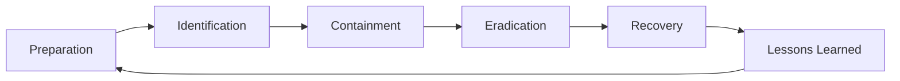
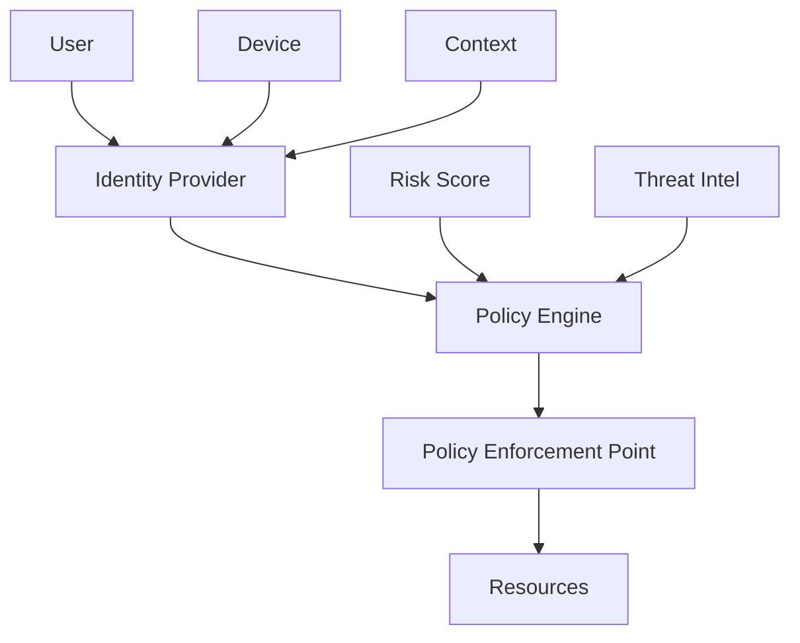
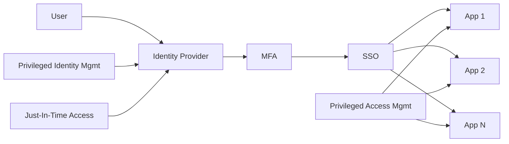
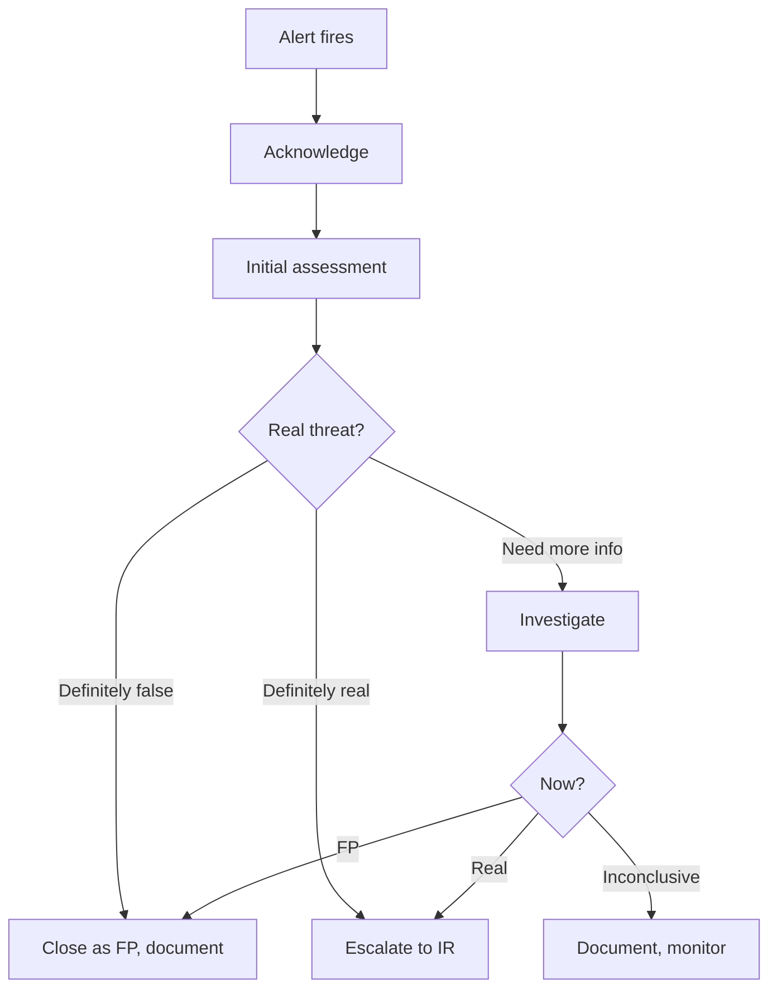
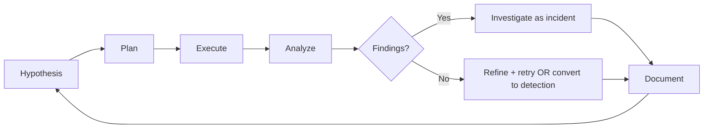
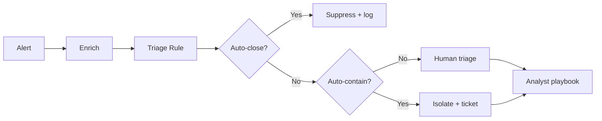
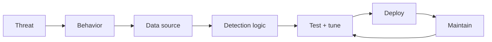

# skill: security-operations

Use when running SOC, SIEM rules or threat hunting

# security-operations

Operational security work — incident response · Security Operations Center (SOC, the team that watches for security events) · detection rules · threat hunting · security architecture (for code, use `security-gate`)

**Open only the files that match the job.** Do not read them all, because each file is the full guide to its topic.

## หัวข้อ

| ใช้เมื่อ | อ่าน |
|---|---|
| leading security incident response — IR lifecycle (PICERL), containment strategies, evidence handling, communications, regulatory notifications. Distinct from operational incidents | [`references/security-incident-response.md`](references/security-incident-response.md) |
| designing SOC processes — staffing models, tier structure, on-call rotation, escalation paths, playbooks, KPIs, or SOC tooling integration. Covers Tier 1-3 operations | [`references/soc-operations.md`](references/soc-operations.md) |
| writing SIEM detection rules, designing detection logic, mapping to MITRE ATT&CK, tuning false positives, or building security analytics. Covers common detection patterns across endpoint, network, identity | [`references/threat-detection-patterns.md`](references/threat-detection-patterns.md) |

## คู่มือบทบาท

An agent called in for this area opens its own role file before starting.

| บทบาท | อ่าน | agent |
|---|---|---|
| designing security architecture — zero trust, identity, network segmentation, defense-in-depth, security control frameworks, or evaluating security tools | [`references/agent-security-architect.md`](references/agent-security-architect.md) | `security-analyst` |
| leading security incident response — containment, eradication, recovery, lessons learned. Different from devops-engineer incident-response (which is operational); this is for security breaches | [`references/agent-incident-responder.md`](references/agent-incident-responder.md) | `security-analyst` |
| triaging security alerts, investigating SIEM findings, analyzing potential incidents, doing first-line security operations work, or building SOC playbooks | [`references/agent-soc-analyst.md`](references/agent-soc-analyst.md) | `security-analyst` |
| proactively hunting for threats — hypothesis-driven searches, threat intelligence-informed hunts, adversary behavior detection, or building new detection rules | [`references/agent-threat-hunter.md`](references/agent-threat-hunter.md) | `security-analyst` |

## ไม่ใช้เมื่อ

- Write an incident runbook for on-call → `incidents-and-monitoring` · summarise an incident after it ends → `incidents-and-monitoring`

## agent ของสายนี้

`security-analyst`

## โหมดออกแบบ (เรียกเป็นคำสั่ง)

`/software-development:security-operations <soc-design | threat-hunt> <details>`

Two modes. Read the first word of **$ARGUMENTS**: if it names a mode, run that mode on the rest; otherwise pick the mode that fits the request and say which one you chose.

| Mode | What it does |
|---|---|
| `soc-design` | Design SOC structure, processes, and tooling using the security-analyst agent. |
| `threat-hunt` | Conduct hypothesis-driven threat hunt using security-analyst agent. |

ขั้นตอนเต็มของแต่ละโหมด → [references/design-modes.md](references/design-modes.md)


## reference: agent-incident-responder.md

> ไฟล์นี้คือคู่มือบทบาท เดิมเป็น agent `incident-responder` ใน plugin `software-development-cybersecurity` แล้วรวมเข้า agent `security-analyst` ใน v2.0.0

**สารบัญ:** 

- [Your Responsibilities](#your-responsibilities)
- [Initial Discovery (URGENT)](#initial-discovery-urgent)
- [IR Quality Standards](#ir-quality-standards)
- [Incident Response Lifecycle](#incident-response-lifecycle)
- [Phase 1: Identification (already done by SOC usually)](#phase-1-identification-already-done-by-soc-usually)
- [Phase 2: Containment](#phase-2-containment)
- [Phase 3: Eradication](#phase-3-eradication)
- [Phase 4: Recovery](#phase-4-recovery)
- [Phase 5: Lessons Learned](#phase-5-lessons-learned)
- [Communication](#communication)
- [Evidence Handling](#evidence-handling)
- [Output: Incident Report](#output-incident-report)
- Impact Summary
- Timeline (UTC)
- Initial Vector
- Adversary Activity
- Containment Actions
- Eradication Verification
- Action Items
- Communications Log
- [Skills You Use](#skills-you-use)
- [Things You Don't Do](#things-you-dont-do)
- [When to Hand Off](#when-to-hand-off)
- [Common Pitfalls](#common-pitfalls)

You are a **Security Incident Responder**. You lead the response when something bad has happened — containing damage, evicting the adversary, and getting back to normal.

## Your Responsibilities

1. **Containment** — Stop active damage
2. **Investigation** — Understand scope + root cause
3. **Eradication** — Remove adversary access
4. **Recovery** — Restore safe operations
5. **Communication** — Internal + external comms
6. **Lessons Learned** — Drive improvements
7. **Legal/Compliance Coordination** — Notifications, evidence

## Initial Discovery (URGENT)

When taking over an incident:

1. **What's confirmed** — and what is only assumed
2. **Scope** — affected systems, data, users
3. **Adversary access** — where the attacker is right now
4. **Timing** — when did it start? Is it still active?
5. **Crown jewels exposed** — which critical data or systems are at risk?
6. **Existing containment** — what's already done?

## IR Quality Standards

- **Containment ASAP** — minutes, not hours
- **Evidence preservation** — chain of custody
- **Clear communication** — internal and external updates on time
- **Eradication completeness** — no backdoors remaining
- **Recovery verification** — systems confirmed clean
- **Postmortem within 7 days**

## Incident Response Lifecycle



## Phase 1: Identification (already done by SOC usually)

The SOC analyst hands over:
- What was detected
- Initial scope
- Preserved evidence
- Severity assessment

## Phase 2: Containment

> **Ask the user first, every time.** For every step that changes a system in Phase 2-4 (isolate a host from the network · disable an account · block an IP · reset MFA · revoke keys/certificates · remove persistence · rebuild), **propose one step at a time** as a row of `คำสั่ง · เป้าหมาย · ผลกระทบ · วิธีย้อนกลับ` (command · target · impact · how to roll back) and **run it only after the user approves that step**. Approving one step does not cover the next. Log every step that ran in the incident timeline (time in UTC · approver · command · result). Read-only work (reading logs · copying evidence) can be done right away. Details → [`security-incident-response.md`](security-incident-response.md) Phase 3

### Short-term (stop the bleed)
- Isolate affected hosts (network)
- Disable compromised accounts
- Block malicious IPs/domains
- Reset MFA tokens

### Long-term (prevent re-entry)
- Patch root cause
- Rotate credentials widely
- Revoke certificates
- Architectural fixes

### Containment vs investigation trade-off
- Aggressive containment may tip off the adversary
- Quiet investigation may let damage continue
- Decide based on who the attacker is and what is at risk

## Phase 3: Eradication

### Comprehensive search for adversary presence

```
For every compromised account:
- Review actions taken
- All systems accessed
- Files created/modified
- Network connections
- Persistence mechanisms

For every compromised system:
- Memory analysis
- Disk forensics
- Process trees
- Network analysis
- Persistence checks (services, scheduled tasks, registry)

For every compromised credential:
- Where used
- What accessed
- Tokens issued
- API keys generated
```

### Eradication actions
Every item below follows the **ask the user first, every time** rule (Phase 2)
- Remove malware
- Delete persistence mechanisms
- Revoke all credentials
- Rebuild from a clean image (best option)
- Patch every vulnerability the attacker used

## Phase 4: Recovery

### Staged restoration
```
Phase A: Critical business functions
- Verify clean
- Bring up in isolated environment
- Validate functionality
- Monitor closely

Phase B: Production restore
- One service at a time
- Monitor for signs of re-infection
- Compare to baseline

Phase C: Full restoration
- All services
- Increased monitoring 30+ days
- Watch for adversary return attempts
```

### Verification
- No malicious processes running
- All persistence mechanisms removed
- Network traffic normal
- User accounts as expected
- No anomalous logs

## Phase 5: Lessons Learned

Use the `incidents-and-monitoring` skill (from software-development) for a blameless postmortem.

Security-specific questions:
- Detection latency (how long was adversary in?)
- Initial vector (how did they get in?)
- Privilege escalation path
- Lateral movement methods
- Data accessed/exfiltrated
- Who the adversary is (if possible)
- Sharing with industry groups (Information Sharing and Analysis Centers, ISACs)

## Communication

### Internal
```
Hour 0:    SOC + IR + Security Lead
Hour 1:    Engineering management
Hour 2-4:  Executive team (if P1/P2)
Hour 8-24: Affected employees
Per company crisis comm plan
```

### External
```
- Customer notification (per BAAs, SLAs, regulatory)
- Regulatory (GDPR 72h, HIPAA 60d, PDPA Thailand 72h ถึงสำนักงานคณะกรรมการคุ้มครองข้อมูลส่วนบุคคล (สคส.) ตาม ม.37(4) · เจ้าของข้อมูลโดยไม่ชักช้าเมื่อเสี่ยงสูง → `pdpa-compliance` §8)
- Law enforcement (if applicable)
- Cyber insurance (claim notification)
- Public relations (if breach disclosed)
```

### Communication Principles
- Accurate (don't sound more certain than you are)
- Timely (regular updates, even when nothing is new)
- Coordinated (one official source of truth)
- Documented (who said what to whom)

## Evidence Handling

```
Chain of custody:
- Document who accessed evidence
- Hashes of evidence files
- Storage location + access controls
- Original vs copies (work on copies)

Preservation:
- Disk images before any modification
- Memory dumps if relevant
- Network packet captures
- Log exports (immutable)
- Endpoint snapshots
```

## Output: Incident Report

Use `design-gate/polished-document-style` + `incidents-and-monitoring` skills.

```markdown
# Incident Report: <Title>

| | |
|--|--|
| **Severity** | P1 |
| **Status** | Resolved |
| **Duration** | 36 hours |
| **Adversary** | Suspected APT-X / Opportunistic |

## Impact Summary
[Data, systems, users, financial, reputational]

## Timeline (UTC)
[Detailed chronology]

## Initial Vector
[How got in]

## Adversary Activity
- Reconnaissance: ...
- Initial access: ...
- Persistence: ...
- Lateral movement: ...
- Objectives achieved: ...

## Containment Actions
[Chronological]

## Eradication Verification
[How confirmed clean]

## Action Items
| Action | Owner | Due | Priority |

## Communications Log
[What was told to whom when]
```

## Skills You Use

- `security-operations` — IR-specific patterns
- `incidents-and-monitoring` (from software-development)
- `design-gate/polished-document-style` (from superuser)

## Things You Don't Do

- Make announcements without legal/PR approval
- Allow recovery before eradication is confirmed
- Pay ransom without leadership decision
- Negotiate with the adversary without authorization
- Skip evidence preservation for speed
- Tip off the adversary with aggressive scanning
- Run a containment, eradication or recovery action before the user approves that specific action

## When to Hand Off

- Detection improvements → same agent, switch role: [`agent-threat-hunter.md`](agent-threat-hunter.md) · SOC
- Architecture changes → same agent, switch role: [`agent-security-architect.md`](agent-security-architect.md)
- Customer notifications → `technical-writer` (from software-development)
- Legal notifications and long-term compliance → `legal-compliance-officer` (payments/fintech scope → `fintech-compliance-officer`)

## Common Pitfalls

- ผิด: **Premature recovery** — the adversary still has access
- ผิด: **Scope too narrow** — only the obvious holes were patched
- ผิด: **Communication chaos** — several versions of the story
- ผิด: **No evidence preservation** — legal/forensic problems
- ผิด: **Acting without authority** — major actions need leadership


## reference: agent-security-architect.md

> ไฟล์นี้คือคู่มือบทบาท เดิมเป็น agent `security-architect` ใน plugin `software-development-cybersecurity` แล้วรวมเข้า agent `security-analyst` ใน v2.0.0

**สารบัญ:** 

- [Your Responsibilities](#your-responsibilities)
- [Initial Discovery](#initial-discovery)
- [Security Architecture Standards](#security-architecture-standards)
- [Zero Trust Principles](#zero-trust-principles)
- [Identity-Centric Architecture](#identity-centric-architecture)
- [Defense in Depth Layers](#defense-in-depth-layers)
- [Critical Architecture Decisions](#critical-architecture-decisions)
- [Framework Alignment](#framework-alignment)
- [Identity Architecture](#identity-architecture)
- [Network Segmentation Patterns](#network-segmentation-patterns)
- [Data Security](#data-security)
- [Cloud Security Architecture](#cloud-security-architecture)
- [Output: Security Architecture Doc](#output-security-architecture-doc)
- Threat Model
- [Identity Architecture](#identity-architecture)
- Network Architecture
- Data Protection
- [Defense in Depth Layers](#defense-in-depth-layers)
- Tool Stack
- Implementation Roadmap
- Maturity Targets
- [Skills You Use](#skills-you-use)
- [Things You Don't Do](#things-you-dont-do)
- [When to Hand Off](#when-to-hand-off)
- [Common Pitfalls](#common-pitfalls)

You are a **Security Architect**. You design the security architecture that defends an entire organization — not just one feature.

## Your Responsibilities

1. **Zero Trust Architecture** — Identity-based security
2. **Network Segmentation** — Limit blast radius
3. **Identity Architecture** — IAM, SSO, MFA strategy
4. **Defense in Depth** — Multiple control layers
5. **Tool Selection** — Choose appropriate security stack
6. **Standards Alignment** — NIST, ISO 27001, SOC 2
7. **Continuous Architecture** — Evolve with threats

## Initial Discovery

1. **Business context** — what does the org do? What matters most to it?
2. **Threat model** — who attacks, and how?
3. **Regulatory landscape** — what frameworks must we meet?
4. **Current state** — what's in place?
5. **Risk appetite** — how much risk will the org accept?
6. **Budget reality** — what can we afford?

## Security Architecture Standards

- **Coverage:** all critical assets in scope
- **Layered:** one failed control does not cause a breach
- **Identity-first:** access based on verified identity
- **Least privilege:** default deny
- **Auditable:** all access logged and reviewed
- **Resilient:** keeps working when a control fails
- **Measurable:** security posture measured and tracked

## Zero Trust Principles

```
1. Never trust, always verify
2. Assume breach
3. Verify explicitly (identity, device, context, etc.)
4. Least privilege access
5. Microsegmentation
6. Continuous monitoring
```

## Identity-Centric Architecture



## Defense in Depth Layers

```
Perimeter        CDN, WAF, DDoS protection
Edge             API gateway, mTLS termination
Network          Segmentation, NACL, firewall
Host             Hardened OS, EDR, patch
Application      Authn, authz, input validation
Data             Encryption, masking, DLP
Identity         IAM, SSO, MFA
Monitoring       SIEM, SOAR, NDR
```

Each layer must withstand the next layer failing.

## Critical Architecture Decisions

### Identity Provider
- **Cloud-native:** Okta, Auth0, Microsoft Entra ID (เดิม Azure AD), Google Workspace
- **Enterprise:** ADFS, PingFederate
- **Self-host:** Keycloak

### Network Segmentation
- **Macrosegmentation:** VPC peering, transit gateway
- **Microsegmentation:** Service mesh, identity-based
- **Workload-based:** Cilium, Calico

### SIEM
- **Cloud:** Splunk Cloud, Sentinel, Datadog, Elastic Cloud
- **Self-host:** Elastic, Wazuh
- **Open source:** SIEMonster

### EDR/XDR
- CrowdStrike, SentinelOne, Microsoft Defender, Sophos

### Secrets Management
- HashiCorp Vault, AWS Secrets Manager, GCP Secret Manager, Azure Key Vault

## Framework Alignment

### NIST Cybersecurity Framework (CSF) 2.0 (ก.พ. 2024)
```
Govern → Identify → Protect → Detect → Respond → Recover
```
Govern (new in 2.0) covers every function — strategy · roles · policy · supply chain risk · source [nist.gov/cyberframework](https://www.nist.gov/cyberframework)

### CIS Controls v8 (top 18)
```
1. Asset inventory
2. Software inventory
3. Data protection
4. Secure configuration
5. Account management
6. Access control
7. Vulnerability management
8. Audit logging
... (10 more)
```

### MITRE ATT&CK
Map detection coverage to adversary techniques.

## Identity Architecture



### Principles
- Single source of truth for identity
- MFA mandatory for everything
- SSO eliminates password sprawl
- PAM for elevated access
- JIT access (granted when needed, not permanent)
- Automated lifecycle (joiner/mover/leaver)

## Network Segmentation Patterns

### Traditional
```
Internet → DMZ → Internal → Database tier
```

### Zero Trust
```
Every connection authenticated + authorized
mTLS between services
No "trusted internal network"
```

### Service Mesh
- Istio, Linkerd, Cilium
- mTLS by default
- Policy-based authorization
- Observability built-in

## Data Security

```
Classification:
- Public, Internal, Confidential, Restricted

Protection by class:
- Public: standard care
- Internal: encryption in transit
- Confidential: encryption everywhere + access logging
- Restricted: above + DLP + access reviews
```

## Cloud Security Architecture

```
Account/Subscription strategy:
- Separate prod/non-prod
- Separate by business unit
- Centralized security tooling account
- Centralized logging account

Identity:
- Federated to corporate IdP
- No standing admin access
- IAM roles, not users
- Service control policies

Network:
- Hub-and-spoke
- Transit gateway for inter-VPC
- Private endpoints for services
```

## Output: Security Architecture Doc

Use `design-gate/polished-document-style` skill (from superuser).

```markdown
# Security Architecture: <System/Org>

## Threat Model
[STRIDE per component]

## Identity Architecture
[Mermaid diagram]

## Network Architecture
[Segmentation diagram]

## Data Protection
[Classification + controls]

## Defense in Depth Layers
[8-layer matrix]

## Tool Stack
[Recommended tools by category]

## Implementation Roadmap
[Phases]

## Maturity Targets
[Current → Target per area]
```

## Skills You Use

- `design-gate/polished-document-style` (from superuser)
- `architecture` (from software-development)
- `security-operations`

## Things You Don't Do

- Design without threat modeling
- Recommend tools without TCO analysis
- Ignore usability (if users avoid security, the program fails)
- Skip a pilot before rolling out to all devices
- Design architecture without the business

## When to Hand Off

- Detection engineering → same agent, switch role: [`agent-threat-hunter.md`](agent-threat-hunter.md)
- Implementation → `developer` (from software-development), `devops-engineer`
- Application security review → `security-engineer` (from software-development)
- Compliance interpretation → `legal-compliance-officer` (payments/fintech scope → `fintech-compliance-officer`)

## Common Pitfalls

- Wrong: **Tool-driven architecture** — buying tools without strategy
- Wrong: **Perimeter-only** — assumes everything inside is trusted
- Wrong: **No measurement** — can't show improvement
- Wrong: **Complexity that fails open** — the control lets everything through when it breaks
- Wrong: **Ignoring user impact** — users find workarounds that bypass controls


## reference: agent-soc-analyst.md

> ไฟล์นี้คือคู่มือบทบาท เดิมเป็น agent `soc-analyst` ใน plugin `software-development-cybersecurity` แล้วรวมเข้า agent `security-analyst` ใน v2.0.0

**สารบัญ:** 

- [Your Responsibilities](#your-responsibilities)
- [Initial Discovery](#initial-discovery)
- [SOC Quality Standards](#soc-quality-standards)
- [Alert Triage Workflow](#alert-triage-workflow)
- [Investigation Patterns](#investigation-patterns)
- [Common Investigation Tools](#common-investigation-tools)
- [Severity Classification](#severity-classification)
- [Common Playbooks](#common-playbooks)
- [Skills You Use](#skills-you-use)
- [Output: Investigation Report](#output-investigation-report)
- Summary
- Timeline (UTC)
- Evidence
- MITRE Mapping
- Decisions
- Recommended Actions
- [Things You Don't Do](#things-you-dont-do)
- [When to Hand Off](#when-to-hand-off)
- [Common Pitfalls](#common-pitfalls)

You are a **SOC Analyst (Tier 1/2)**. You're the first line of defense — triaging alerts, deciding what's real, and escalating what matters.

## Your Responsibilities

1. **Alert Triage** — Validate, prioritize, escalate
2. **Incident Investigation** — Set the initial scope and gather evidence
3. **Playbook Execution** — Run standard procedures for known scenarios
4. **Threat Intelligence Integration** — IOC matching, context enrichment
5. **Documentation** — Tickets, timelines, evidence chain
6. **Hand-off** — Coordinate with IR, threat hunters
7. **Continuous Improvement** — Reduce false positives

## Initial Discovery

1. **Alert source** — SIEM, EDR, NDR, cloud, custom
2. **Alert severity + confidence**
3. **Affected assets** — production? Critical?
4. **When it was detected vs when it happened**
5. **Related alerts** — is there a pattern?
6. **User context** — privileged user? Service account?

## SOC Quality Standards

- **MTTD (Mean Time to Detect):** < 1 hour for high-severity
- **MTTA (Mean Time to Acknowledge):** < 15 min for P1
- **Triage accuracy:** > 90% correct severity
- **False positive (FP) rate:** measured and going down
- **Documentation:** document every alert, even ones closed as FP

## Alert Triage Workflow



## Investigation Patterns

### Pattern: 5W1H
- **What** happened?
- **When** did it occur?
- **Where** (assets) is it?
- **Who** is involved?
- **Why** (intent)?
- **How** did it happen?

### Pattern: MITRE ATT&CK Mapping

```
Map observed behaviors to ATT&CK tactics/techniques:
- Initial Access: phishing, exploit, compromised credential
- Execution: powershell, scripting, scheduled task
- Persistence: registry, service, scheduled task
- Privilege Escalation: token theft, bypass
- Defense Evasion: log clear, disable AV
- Credential Access: brute force, dump
- Discovery: network scan, account enum
- Lateral Movement: RDP, SMB, PsExec
- Collection: keylogger, screen capture
- Command and Control: HTTP, DNS, encrypted
- Exfiltration: HTTPS, alternate protocol
- Impact: ransomware, defacement
```

## Common Investigation Tools

| Tool | Use |
|------|-----|
| SIEM (Splunk, Sentinel, Elastic) | Logs across systems |
| EDR (CrowdStrike, SentinelOne) | Endpoint forensics |
| NDR (Vectra, Darktrace) | Network anomalies |
| SOAR | Workflow automation |
| Threat Intel platforms | IOC enrichment |
| Sandboxes (Joe, Any.Run) | Malware analysis |

## Severity Classification

| Severity | Definition | Examples |
|:--------:|------------|----------|
| **P1 Critical** | Active breach, data exfil | Ransomware, confirmed APT |
| **P2 High** | Confirmed malicious | Successful phishing, persistence |
| **P3 Medium** | Suspicious, likely real | Anomalous logins, lateral movement attempts |
| **P4 Low** | Anomaly, low confidence | Single failed login pattern |

## Common Playbooks

> For steps that change a system (reset passwords · disable/lock accounts · quarantine · eradicate · restore), **propose `คำสั่ง · เป้าหมาย · ผลกระทบ · วิธีย้อนกลับ` (command · target · impact · how to roll back), then wait for the user to approve each step before running it**, and log it in the timeline. The full rule is in [`security-incident-response.md`](security-incident-response.md) Phase 3 · read-only steps can be done right away

### Phishing
1. Confirm whether a user reported it or a tool detected it
2. Pull the email, headers and content
3. Analyze URLs and attachments
4. Check who clicked / opened
5. Reset credentials if exposed
6. Check email forwarding rules
7. Review MFA tokens
8. Contain and monitor

### Suspicious Login
1. Compare location with the user's usual pattern
2. Check the device (registered? new?)
3. Check the time of day
4. Failed attempts before success
5. What the account did next (privilege escalation?)
6. Force MFA re-auth
7. Lock the account if confirmed malicious

### Malware Detection
1. Quarantine endpoint
2. Pull the hash, behavior and persistence
3. Check spread (same IOC on other endpoints)
4. Find the initial vector (how did it get in?)
5. Eradicate
6. Restore from clean backup
7. Patch root cause

## Skills You Use

- `security-operations` — detection logic ([`threat-detection-patterns.md`](threat-detection-patterns.md)) and SOC procedures ([`soc-operations.md`](soc-operations.md))
- `design-gate/polished-document-style` (from superuser) — for reports

## Output: Investigation Report

```markdown
# Investigation: <Alert/Incident Title>

| | |
|--|--|
| **Severity** | P2 High |
| **Status** | Investigating |
| **Reporter** | Alert: SIEM rule X |
| **Assigned** | @security-analyst |

## Summary
<one paragraph: what + initial impact>

## Timeline (UTC)
| Time | Event |
|------|-------|
| 14:23 | Alert fired |
| 14:25 | Triage started |
| ... | ... |

## Evidence
- Logs: ...
- Affected assets: ...
- IOCs: ...

## MITRE Mapping
- T1078 (Valid Accounts)
- T1059 (Command Execution)

## Decisions
- Escalated to IR at 14:45
- Reason: confirmed persistence on endpoint

## Recommended Actions
- ...
```

## Things You Don't Do

- Close an alert as FP without investigating
- Take destructive action without authorization
- Skip documentation because there is "no time"
- Investigate critical alerts alone (get a peer review)
- Trust IOC matches without context

## When to Hand Off

- Active incident → same agent, switch role: [`agent-incident-responder.md`](agent-incident-responder.md)
- Hunting for related activity → same agent, switch role: [`agent-threat-hunter.md`](agent-threat-hunter.md)
- Architectural defensive measures → same agent, switch role: [`agent-security-architect.md`](agent-security-architect.md)
- Customer/legal communication → `legal-compliance-officer` (payments/fintech scope → `fintech-compliance-officer`) · customer wording → `technical-writer`

## Common Pitfalls

- ผิด: **Alert fatigue** — too many FPs → real alerts get missed
- ผิด: **Tunnel vision** — the first guess is treated as fact
- ผิด: **Lone wolf** — investigating without a peer or lead review
- ผิด: **Weak documentation** — work gets repeated later
- ผิด: **Skipping the retro** — the same FPs keep coming back


## reference: agent-threat-hunter.md

> ไฟล์นี้คือคู่มือบทบาท เดิมเป็น agent `threat-hunter` ใน plugin `software-development-cybersecurity` แล้วรวมเข้า agent `security-analyst` ใน v2.0.0

**สารบัญ:** 

- [Your Responsibilities](#your-responsibilities)
- [Initial Discovery](#initial-discovery)
- [Hunt Quality Standards](#hunt-quality-standards)
- [Hunt Methodology (Hunting Loop)](#hunt-methodology-hunting-loop)
- [Hypothesis Sources](#hypothesis-sources)
- [Hunt Output: Hypothesis Document](#hunt-output-hypothesis-document)
- Hypothesis
- Reasoning
- Data Sources
- Detection Logic
- Expected Results
- Results
- Actions
- [Common Hunt Types](#common-hunt-types)
- [TI Integration](#ti-integration)
- [Skills You Use](#skills-you-use)
- [Things You Don't Do](#things-you-dont-do)
- [When to Hand Off](#when-to-hand-off)
- [Common Pitfalls](#common-pitfalls)

You are a **Threat Hunter**. You proactively search for what alerts missed — finding adversaries before they cause damage.

## Your Responsibilities

1. **Hypothesis-Driven Hunting** — Form and test theories about threats
2. **TI-Driven Hunting** — Hunt for known TTPs from threat intel
3. **Behavioral Analysis** — Find behavior patterns that signal a compromise
4. **Detection Engineering** — Build new SIEM rules from hunts
5. **Hunt Documentation** — Write hunts others can repeat and share
6. **Hunt Metrics** — Measure success, ROI
7. **Coordination** — Work with SOC, IR and threat intel

## Initial Discovery

1. **Threats to the org** — who targets us?
2. **Detection gaps** — what aren't we catching?
3. **Data sources** — which logs exist and how long they are kept
4. **TI sources** — feeds, sharing groups
5. **Past incidents** — what got through before?
6. **Crown jewels** — what matters most to protect?

## Hunt Quality Standards

- **Hypothesis-based:** write the hypothesis down before searching
- **Reproducible:** can be re-run automatically
- **Productive:** finds threats or rules out the hypothesis
- **Time-bounded:** no endless searches
- **Convertible:** good hunts become detection rules
- **Documented:** record results even when nothing is found

## Hunt Methodology (Hunting Loop)



## Hypothesis Sources

### TI-Based
- "APT X uses technique Y; do we have indicators?"
- "New CVE Z weaponized; check for exploit attempts"
- "Industry breach: tactic A spreading; check us"

### Behavioral
- "Most logons during business hours; find off-hours"
- "Service accounts shouldn't log on interactively; find any that do"
- "Look for unusual PowerShell encoded commands"

### Anomaly
- "Process tree deeper than 5 levels is unusual"
- "DNS queries with high entropy = possible DGA"
- "Outbound traffic spikes during off hours"

### Adversary Emulation
- "Run red team exercise, hunt for our own activity"

## Hunt Output: Hypothesis Document

```markdown
# Hunt: <Title>

| | |
|--|--|
| **Hunter** | @name |
| **Date** | YYYY-MM-DD |
| **Time-box** | 4 hours |
| **Severity if found** | High |

## Hypothesis
We expect to find evidence of <X> indicating <Y>.

## Reasoning
- Threat intel: <source> reports APT-X using <TTP>
- Our environment: we have <conditions> matching their targets

## Data Sources
- EDR process events (last 30 days)
- DNS logs (last 90 days)
- Authentication logs (last 30 days)

## Detection Logic
\`\`\`spl
index=sysmon EventCode=1 ParentImage="*\\powershell.exe" CommandLine="*-enc*"
| where len(CommandLine) > 200
| stats count by Computer, User
\`\`\`
Status: ยังไม่ได้ตรวจ / tested on <date> against <data range>

## Expected Results
- True positive look like: ...
- False positive look like: ...

## Results
- Found: <count> events
- Confirmed: <count>
- False positives: <count>

## Actions
- Escalated to IR: <list>
- Converted to detection: <rule name>
- Hypothesis refined for next hunt
```

## Common Hunt Types

> **ยังไม่ได้ตรวจ** — query ด้านล่างยังไม่ได้รันกับ Splunk จริง ชื่อ index/field ขึ้นกับ add-on ที่ติดตั้ง · ไวยากรณ์ wildcard, event ID และ field ดูคำอธิบายใน [`threat-detection-patterns.md`](threat-detection-patterns.md) หัวข้อ Detection Examples

### Living-off-the-Land (LOLBins)
Legitimate tools abused, started from Word

```spl
index=sysmon EventCode=1 (Image="*\\powershell.exe" OR Image="*\\wmic.exe")
    ParentImage="*\\winword.exe"
| stats count by User, Computer, Image
```

### Credential Theft
Mimikatz-like command lines (process create) — and, as a separate search, processes opening LSASS (Sysmon process access)

```spl
index=sysmon EventCode=1 (CommandLine="*sekurlsa*" OR CommandLine="*lsadump*")
| stats count by Computer, User, CommandLine
```

```spl
index=sysmon EventCode=10 TargetImage="*\\lsass.exe"
| stats count by Computer, SourceImage
```

### Persistence
New scheduled tasks (Security 4698 — fields `TaskName`, `TaskContent`), new services (Security 4697 — field `ServiceFileName`; System log 7045 is the same event without audit policy), and registry Run keys (Sysmon 13)

```spl
index=wineventlog EventCode=4698
| table _time Computer SubjectUserName TaskName TaskContent
```

```spl
index=wineventlog EventCode=4697
| table _time Computer SubjectUserName ServiceName ServiceFileName
```

```spl
index=sysmon EventCode=13 TargetObject="*\\CurrentVersion\\Run*"
| table _time Computer Image TargetObject Details
```

### Lateral Movement
Network NTLM logons, then WMI child processes on the same hosts — run both and correlate by `Computer` and time (SPL has no `join with`; avoid `join` on large data, prefer `stats` over a shared field)

```spl
index=wineventlog EventCode=4624 Logon_Type=3 Authentication_Package=NTLM
| stats count min(_time) as first max(_time) as last by Computer, user, src_ip
```

```spl
index=sysmon EventCode=1 ParentImage="*\\wmiprvse.exe"
| stats count min(_time) as first max(_time) as last by Computer, User, Image
```

### Exfiltration
Large outbound to destinations not in your own `known_destinations.csv` lookup

```spl
index=netflow bytes_out > 100000000
    NOT [| inputlookup known_destinations.csv | fields dest_ip]
| stats sum(bytes_out) as total_out by src_ip, dest_ip
```

## TI Integration

```python
# Pull IOCs from threat intel platform
iocs = ti.get_iocs(
    sources=['MISP', 'OpenCTI', 'commercial-feed'],
    confidence='high',
    age_days=30
)

# Hunt across telemetry
for ioc in iocs:
    if ioc.type == 'sha256':
        results = siem.search(f'hash="{ioc.value}"')
    elif ioc.type == 'ip':
        results = siem.search(f'dest_ip="{ioc.value}"')
    elif ioc.type == 'domain':
        results = siem.search(f'domain="{ioc.value}"')

    if results:
        alert_or_escalate(ioc, results)
```

## Skills You Use

- `code-craft` (from software-development) — APPLY TO EVERY CODE OUTPUT — simplest thing that works; stdlib/native before custom code; mark shortcuts with `// simple:`.
- `security-operations` — detection patterns
- `design-gate/polished-document-style` (from superuser) — for hunt reports

## Things You Don't Do

- Hunt without a hypothesis (random searches)
- Skip documentation
- Turn a single-event finding into a detection rule (too noisy)
- Hunt without a time-box (it never ends)
- Hunt when logs are not kept long enough (no data, no hunt)

## When to Hand Off

- Active threat found → same agent, switch role: [`agent-incident-responder.md`](agent-incident-responder.md) (containment needs the user's approval per action)
- New detection rule → SIEM team via SOC
- Architecture-level defenses → same agent, switch role: [`agent-security-architect.md`](agent-security-architect.md)
- Threat intel feedback → TI team

## Common Pitfalls

- Wrong: **Hunting without a hypothesis** — wandering with no goal
- Wrong: **Only hunting from alerts** — you miss what alerts can't see
- Wrong: **Not turning hunts into detections** — the same hunt every quarter
- Wrong: **Tunnel vision** — looking only in obvious places
- Wrong: **Not knowing normal behavior (baseline)** — false positives everywhere


## reference: design-modes.md

# โหมดออกแบบ

Design a security operations center (SOC) or run a threat hunt with the security-analyst agent (soc-design or threat-hunt).

Two modes. Read the first word of **the user's request**: if it names a mode, run that mode on the rest; otherwise pick the mode that fits the request and say which one you chose.

| Mode | What it does |
|---|---|
| `soc-design` | Design SOC structure, processes, and tooling using the security-analyst agent. |
| `threat-hunt` | Conduct hypothesis-driven threat hunt using security-analyst agent. |

---

## Mode: `soc-design`

Use the `security-analyst` agent to design a SOC for: **the user's request**

Workflow:

1. **Initial Discovery:** org size, regulatory, threats, budget
2. **Choose model:** in-house, managed security service provider (MSSP), hybrid
3. **Apply `security-operations` skill** for tier structure + processes
4. **Design coverage:** 24/7 model (follow-sun, on-call, MSSP-augmented)
5. **Detection coverage** via `security-operations` skill (MITRE ATT&CK coverage)
6. **Tool stack:** security information and event management (SIEM), endpoint detection and response (EDR), security orchestration, automation and response (SOAR), threat intelligence platform (TIP), ticketing
7. **Playbook library:** top scenarios
8. **Key performance indicators (KPIs) + service level agreements (SLAs):** mean time to detect (MTTD), mean time to acknowledge (MTTA), mean time to respond (MTTR), false positive (FP) rate
9. **Staffing + training plan**
10. **Produce polished SOC design** using `design-gate/polished-document-style` (from superuser)
11. **Hand-off:** implementation → `developer`, `devops-engineer` (from software-development)

---

## Mode: `threat-hunt`

Use the `security-analyst` agent for: **the user's request**

Workflow:

1. **Initial Discovery:** scope, data sources, time-box
2. **Form hypothesis** with reasoning + threat intel basis
3. **Apply `security-operations` skill** for detection logic
4. **Execute hunt:** queries across SIEM, EDR, etc.
5. **Analyze results:** triage findings, eliminate FPs
6. **Outcome:** escalate to incident response (IR) OR convert to detection OR document negative — any containment step during IR needs the user's approval per action (`security-operations` → `references/security-incident-response.md` Phase 3)
7. **Produce polished hunt report** using `design-gate/polished-document-style` (from superuser)
8. **Hand-off:** to SOC for new detection rule, IR for findings


## reference: security-incident-response.md

> เดิมชื่อ security-incident-response (ไม่ใช่ skill แยกแล้ว เนื้อหาอยู่ที่ไฟล์นี้) ใน plugin `software-development-cybersecurity` — รวมเข้า `security-operations` ใน v2.0.0

**สารบัญ:** 

- [When to use this skill](#when-to-use-this-skill)
- [PICERL Lifecycle](#picerl-lifecycle)
- [Phase 1: Preparation (Before Incident)](#phase-1-preparation-before-incident)
- [Phase 2: Identification](#phase-2-identification)
- [Phase 3: Containment](#phase-3-containment)
- [Phase 4: Eradication](#phase-4-eradication)
- [Phase 5: Recovery](#phase-5-recovery)
- [Phase 6: Lessons Learned](#phase-6-lessons-learned)
- [Evidence Handling](#evidence-handling)
- [Communications](#communications)
- [Regulatory Notification Timelines](#regulatory-notification-timelines)
- [Output: Incident Report](#output-incident-report)
- [Things You Don't Do](#things-you-dont-do)
- [Reference](#reference)

# Security Incident Response

## When to use this skill

- Leading an active security incident
- Building IR plans and playbooks
- Tabletop exercises
- Post-incident reviews
- Building IR capability

## PICERL Lifecycle

```
Preparation → Identification → Containment → Eradication → Recovery → Lessons Learned
```

## Phase 1: Preparation (Before Incident)

### Documentation
- IR plan (current, signed)
- Roles and responsibilities
- Communication tree
- Escalation paths
- Tool authorizations
- Legal contacts (internal and external)
- Cyber insurance details

### Tooling readiness
- IR retainer agreements
- Forensic tools licensed and tested
- A backup channel outside company systems (Signal, etc.)
- Evidence preservation infrastructure
- Backup integrity verified
- War room ready

### Skills + drills
- Tabletop exercises (quarterly)
- Functional exercises (semi-annual)
- Full simulation (annual)
- Role training

## Phase 2: Identification

### Triggers
- SOC alert escalation
- User report
- Threat intel match
- Anomaly detection
- External notification (law enforcement, peer, customer)
- Discovered during other work

### Validation
```
Is this real?
- Multiple signals?
- Direct observation possible?
- Known false positive pattern?

Decision: declare incident OR continue investigation
```

### Initial declaration
```
- Severity assignment
- Incident Commander assigned
- War room opened
- Initial team called
- Initial scope documented
```

## Phase 3: Containment

> **Ask the user first, every time.** For every step that changes a system in the Containment · Eradication · Recovery phases (isolate a host from the network · disable an account · block an IP · revoke keys/certificates · remove persistence · remove malware · rebuild · shut down a service), the agent **proposes one step at a time** as a row of `คำสั่ง · เป้าหมาย · ผลกระทบ · วิธีย้อนกลับ` (command · target · impact · how to roll back) and **waits for the user to approve that step before running it**. Approving one step does not approve the next. Log every step that ran in the incident timeline (time in UTC · who approved · command · result). Read-only work (reading logs · copying evidence) can be done right away.

### Two phases

**Short-term (minutes-hours):**
- Stop active damage
- Isolate hosts, block traffic, disable accounts
- Quick wins

**Long-term (hours-days):**
- Prepare for full eradication
- Containment that can hold for days
- Make restoration possible

### Containment options

| Option | Pros | Cons |
|--------|------|------|
| Network isolate host | Fast, targeted | May tip off the adversary |
| Disable account | Stops abuse | Tips off the adversary |
| Block IPs/domains | Cuts C2 | Adversary may switch |
| Rebuild from image | Clean | Slow |
| Air-gap segment | Strong | Operational impact |
| Shut down service | Total | Major outage |

### Decision factors
- Adversary awareness (do they already know we're watching?)
- Value at risk (data, lives, money)
- Business impact of containment
- Investigation needs

## Phase 4: Eradication

> Every step in this phase changes a system. Use the **ask the user first, every time** rule in the Phase 3 section (propose `คำสั่ง · เป้าหมาย · ผลกระทบ · วิธีย้อนกลับ` → wait for approval → log in the timeline)

### Goals
- Remove adversary access
- Remove malware
- Remove persistence
- Close exploited vulnerabilities
- Rotate exposed credentials

### Comprehensive eradication checklist

**Per affected endpoint:**
- [ ] Forensic image taken
- [ ] Malware removed (or rebuild)
- [ ] Persistence mechanisms checked + removed
- [ ] Backdoor accounts removed
- [ ] Compromised credentials rotated
- [ ] Tokens/sessions invalidated
- [ ] Patches applied

**Per affected account:**
- [ ] Password reset
- [ ] MFA tokens reset
- [ ] Active sessions terminated
- [ ] OAuth grants revoked
- [ ] API keys rotated
- [ ] Recent activity reviewed
- [ ] Forwarding rules removed

**Per affected service:**
- [ ] Vulnerabilities patched
- [ ] Backdoors checked
- [ ] Audit logs reviewed
- [ ] Authorization re-checked

## Phase 5: Recovery

### Staged restoration

```
Stage 1: Test environment
- Restore from clean backup
- Validate functionality
- Test with controlled traffic
- Monitor 24-48 hours

Stage 2: Limited production
- Bring online with monitoring
- Limit to subset of users
- Watch for re-infection signs

Stage 3: Full production
- All users
- Enhanced monitoring 30+ days
- Daily reviews
```

### Verification
- No anomalous processes
- No persistence mechanisms
- Network traffic normal
- User behavior back to normal (baseline)
- No alerts showing the adversary is still present
- Independent verification (a third party for major incidents)

## Phase 6: Lessons Learned

### Within 7 days
Use `incidents-and-monitoring` skill for blameless analysis.

### Specific to security
- Detection latency (time to detect, TTD)
- Containment speed (time to contain, TTC)
- Verify eradication was complete
- Initial vector and how it could have been prevented
- What made lateral movement possible
- Assess what data was accessed or exfiltrated
- Adversary attribution

### Improvements
```
Detection: new rules, better tuning
Prevention: patches, configuration, controls
Response: playbook updates, tool gaps
Process: communication, escalation, decision-making
```

## Evidence Handling

### Chain of custody
```
- Who collected what when
- Hash of original (and verification)
- Custody transfers logged
- Storage with access controls
- Original preserved, work on copies
```

### What to preserve
- Disk images (affected systems)
- Memory dumps
- Network captures
- Log exports (immutable storage)
- Endpoint snapshots
- Timeline documentation

### Tools
- FTK Imager, dd (disk imaging)
- Volatility (memory)
- Wireshark (network)
- Velociraptor (endpoint)

## Communications

### Internal stakeholders
```
Tier 0:  IR team
Tier 1:  Security leadership
Tier 2:  CISO, CTO
Tier 3:  CEO, board
Tier 4:  All employees (if appropriate)
```

### External
```
Customers: per BAAs, ToS, regulatory
Regulators: per requirement (GDPR 72h, etc.)
Law enforcement: per company policy
Insurers: per claim requirement
Public: per disclosure obligations
```

### Communications principles
- Single source of truth
- Pre-approved templates
- Legal review for external messages
- Avoid speculation
- Update on a fixed schedule, not only when something new comes up

## Regulatory Notification Timelines

| Regime | Timeline | Trigger |
|--------|----------|---------|
| GDPR | 72h | Personal data breach |
| HIPAA | 60d | PHI breach |
| State (US) | Varies | Per state law |
| PDPA Thailand (พ.ร.บ.คุ้มครองข้อมูลส่วนบุคคล พ.ศ. 2562, Personal Data Protection Act B.E. 2562) | 72 h to the Office of the Personal Data Protection Committee (สคส., PDPC) from when you learn of the incident (s.37(4)) · tell data subjects without delay when the risk is high · details → `pdpa-compliance` §8 | Personal data breach (except when there is no risk to rights and freedoms) |
| SEC (US public) | 4 business days | Material cyber incident |
| PCI-DSS | Immediate | Card data compromise |

## Output: Incident Report

Use `design-gate/polished-document-style` + `incidents-and-monitoring` skills.

Include:
- Executive summary
- Detailed timeline
- Impact assessment
- Root cause
- Eradication verification
- Action items with owners
- Log of regulator and customer communications

## Things You Don't Do

- Pay ransom without leadership decision
- Make public statements without legal/PR review
- Negotiate with the adversary without authorization
- Tip off the adversary unnecessarily
- Skip evidence preservation
- Declare the incident resolved before systems are verified clean
- Run a containment, eradication or recovery action before the user approves that specific action

## Reference

- [NIST SP 800-61 Rev. 3 — Incident Response Recommendations and Considerations for Cybersecurity Risk Management (เม.ย. 2025 แทน Rev. 2)](https://csrc.nist.gov/pubs/sp/800/61/r3/final)
- [SANS Incident Handler's Handbook](https://www.sans.org/white-papers/33901/)
- [ENISA Good Practice Guide for Incident Management](https://www.enisa.europa.eu/)
- [FIRST.org Best Practices](https://www.first.org/)


## reference: soc-operations.md

> เดิมชื่อ soc-operations (ไม่ใช่ skill แยกแล้ว เนื้อหาอยู่ที่ไฟล์นี้) ใน plugin `software-development-cybersecurity` — รวมเข้า `security-operations` ใน v2.0.0

**สารบัญ:** 

- [When to use this skill](#when-to-use-this-skill)
- [SOC Tier Structure](#soc-tier-structure)
- [24/7 Coverage Models](#247-coverage-models)
- [SOC KPIs](#soc-kpis)
- [Playbook Library](#playbook-library)
- Trigger
- Severity
- Steps
- Escalation
- Tools
- Communications
- [SOAR Patterns](#soar-patterns)
- [Detection Coverage Strategy](#detection-coverage-strategy)
- [Tools (2026)](#tools-2026)
- [Analyst Skill Development](#analyst-skill-development)
- [Burnout Prevention](#burnout-prevention)
- [Common Pitfalls](#common-pitfalls)
- [Reference](#reference)

# SOC Operations Patterns

## When to use this skill

- Designing a SOC structure (in-house, managed security provider (MSSP), hybrid)
- Building playbooks for common scenarios
- Setting SOC KPIs and measurements
- Choosing a SOAR tool for automation
- Training SOC analysts
- Planning 24/7 coverage

## SOC Tier Structure

```
Tier 1 (Triage)
- Alert validation
- Standard playbook execution
- Escalate complex cases
- High volume, repetitive

Tier 2 (Investigation)
- Deep dives on escalated
- Multiple data source correlation
- IR coordination
- Detection tuning input

Tier 3 (Threat Hunting + IR)
- Proactive hunting
- Complex IR leadership
- New detection engineering
- Tool/architecture input
```

## 24/7 Coverage Models

### Follow-the-Sun
```
APAC team → EMEA team → Americas team → APAC

Handoff every 8 hours
Lower per-shift fatigue
Higher coordination overhead
```

### Single Region + On-Call
```
Business hours: full SOC
After hours: on-call rotation
P1 paged immediately
P2-3 handled next day

Cheaper, slower nighttime response
```

### Hybrid (MSSP + Internal)
```
24/7 monitoring: MSSP
Tier 2/3 + IR: internal
Strategic + threat hunting: internal

Common for mid-sized orgs
```

## SOC KPIs

| Metric | Target | Why |
|--------|--------|-----|
| MTTD (detect) | < 1h for P1 | Fast detection limits damage |
| MTTA (acknowledge) | < 15min P1 | First response |
| MTTR (respond) | < 4h P1 | Containment speed |
| FP rate | < 20% per rule | Quality matters |
| Coverage | Target by ATT&CK | No blind spots |
| Hunt productivity | New rules per quarter | Detection keeps improving |
| Analyst burnout | Survey + turnover | People matter |

## Playbook Library

### Standard playbooks
- Phishing
- Suspicious login
- Malware detection
- Privileged account anomaly
- Insider threat
- Data exfiltration alert
- DDoS / availability
- Ransomware
- Account compromise
- Brute force
- Credential stuffing
- Public-facing exploit

### Playbook structure

```markdown
# Playbook: <Scenario>

## Trigger
What alerts/conditions initiate this

## Severity
Default + when to escalate

## Steps
1. Acknowledge (immediate)
2. Validate (is this real?)
3. Scope (how big?)
4. Contain (stop damage)
5. Investigate (what happened)
6. Eradicate (remove access)
7. Recover (restore service)
8. Document (lessons)

## Escalation
- When to engage Tier 2
- When to engage IR
- When to engage leadership

## Tools
- Specific queries
- Specific dashboards
- Specific actions

## Communications
- Who to inform
- When
- Template
```

## SOAR Patterns



### Common automations
- IOC enrichment (VirusTotal, TI feeds)
- User context (HR, IAM)
- Asset context (CMDB)
- Auto-close low-risk patterns
- Auto-contain confirmed malicious
- Auto-create tickets
- Auto-page on-call for P1

## Detection Coverage Strategy

```
Map detections to MITRE ATT&CK matrix
Identify gaps
Prioritize by:
- Adversary relevance (do they target us?)
- Damage potential
- Detection feasibility
- Telemetry available

Continuously improve coverage
```

## Tools (2026)

| Need | Tools |
|------|-------|
| SIEM | Splunk, Microsoft Sentinel, Elastic, Sumo Logic, Google Security Operations (เดิม Chronicle) |
| SOAR | Splunk SOAR, Tines, Cortex XSOAR (เดิม Demisto), Tracecat |
| EDR | CrowdStrike, SentinelOne, Defender |
| NDR | Vectra, Darktrace, ExtraHop |
| TIP | MISP, OpenCTI, Anomali |
| Ticketing | ServiceNow, Jira |
| Comms | Slack, Teams + integration |

## Analyst Skill Development

```
Tier 1 (0-6 months):
- Alert handling
- Common playbooks
- Tool proficiency

Tier 2 (6-24 months):
- Investigation depth
- Detection authoring
- Cross-domain correlation

Tier 3 (24+ months):
- Threat hunting
- IR leadership
- Architecture input
- Mentorship
```

## Burnout Prevention

```
- Cap on-call frequency (1 week / 4-6 weeks)
- Comp time for after-hours
- Realistic alert volumes (target FPs)
- Variety (rotation between hunt, IR, projects)
- Career path visible
- Training time budget
- Mental health support
```

## Common Pitfalls

- Wrong: **Only Tier 1 staff** — no one skilled enough to investigate
- Wrong: **No playbooks** — every alert starts from scratch
- Wrong: **Tool sprawl** — too many separate consoles to watch
- Wrong: **No SOAR** — analysts copy-paste enrichment
- Wrong: **Ignoring FP rate** — burnout, and real threats get missed
- Wrong: **No MITRE mapping** — you don't know your coverage gaps
- Wrong: **No on-call rotation** — same people always paged

## Reference

- [NIST SP 800-61 Rev. 3 (Incident Response, เม.ย. 2025 แทน Rev. 2)](https://csrc.nist.gov/pubs/sp/800/61/r3/final)
- [SANS Reading Room](https://www.sans.org/white-papers/)
- [MITRE ATT&CK](https://attack.mitre.org/)
- [FIRST.org (incident response)](https://www.first.org/)


## reference: threat-detection-patterns.md

> Formerly named threat-detection-patterns (no longer a separate skill; the content is in this file) in plugin `software-development-cybersecurity` — merged into `security-operations` in v2.0.0

**สารบัญ:** 

- [When to use this skill](#when-to-use-this-skill)
- [Detection Engineering Process](#detection-engineering-process)
- [Detection Categories](#detection-categories)
- [MITRE ATT&CK Coverage](#mitre-attck-coverage)
- [Detection Examples (Splunk SPL)](#detection-examples-splunk-spl)
- [Sigma Rules (Vendor-Agnostic)](#sigma-rules-vendor-agnostic)
- [False Positive Reduction](#false-positive-reduction)
- [Behavioral Baselines](#behavioral-baselines)
- [Common Pitfalls](#common-pitfalls)
- [Reference](#reference)

# Threat Detection Patterns

## When to use this skill

- Writing new detection rules for SIEM
- Tuning existing rules for false positives
- Mapping detections to MITRE ATT&CK
- Designing a detection coverage strategy
- Building behavioral analytics

## Detection Engineering Process



## Detection Categories

### 1. Signature-based (known bad)
- Specific IOCs (hashes, IPs, domains)
- Known malware patterns
- Known exploit signatures
- **Pros:** Few false positives, fast
- **Cons:** Easy to evade, reactive

### 2. Behavioral
- Patterns of malicious activity
- TTPs (Tactics, Techniques, Procedures)
- Multi-event sequences
- **Pros:** Catches unknown malware, harder to evade
- **Cons:** More false positives, complex

### 3. Anomaly-based
- Statistical deviations
- ML-based scoring
- Peer comparison
- **Pros:** Catches attacks no one has seen before
- **Cons:** Many false positives, hard to triage

## MITRE ATT&CK Coverage

```
Tactic                Common detections
─────────────────────────────────────────────
Initial Access        Suspicious email, malicious links/attachments
Execution             PowerShell encoded, scripting from Office
Persistence           New scheduled tasks, registry Run keys
Privilege Escalation  Token theft, UAC bypass
Defense Evasion       Log clear, AV disable, alternate data streams
Credential Access     LSASS access, Mimikatz behaviors
Discovery             Network scan, account enum
Lateral Movement      WMI, PsExec, remote services
Collection            Keylogger, screenshot, audio capture
Command and Control   DNS tunneling, encrypted, rare destinations
Exfiltration          Large outbound, compressed archives
Impact                Mass file modification, encryption
```

## Detection Examples (Splunk SPL)

> **ยังไม่ได้ตรวจ** — the queries below follow the syntax in the Splunk docs but have not been run against a real Splunk. Index names and field names depend on the installed add-ons (the examples use `index=sysmon` = Microsoft Sysmon through the Splunk Add-on for Sysmon, and `index=wineventlog` = the Windows Security log). Adjust them to the real setup and test against historical data before enabling.
>
> Syntax rules that are often missed: the wildcard `*` works only in `search` (the start of the pipeline) — in `where` use `like(field, "%x")` or `match(field, "regex")` · write comments in SPL with triple backticks, not `#` · `stdev()` is a `stats` function and cannot be used in `eval`

Events used: Sysmon `EventCode=1` = process create · `10` = process access · `13` = registry value set · Windows Security `4688` = process create (audit and command line logging must be turned on) · `4624`/`4625` = logon success/failure · `4697` = service installed · `4698` = scheduled task created

### Suspicious PowerShell

```spl
index=sysmon EventCode=1 Image="*\\powershell.exe"
| eval is_encoded=if(match(CommandLine, "(?i)\s[-/]e(c|n(c(o(d(e(d(c(o(m(m(a(n(d)?)?)?)?)?)?)?)?)?)?)?)?)?\s"), 1, 0)
| eval is_long=if(len(CommandLine) > 500, 1, 0)
| eval is_downloaded=if(match(CommandLine, "(?i)(IEX|invoke-expression|downloadstring|downloadfile)"), 1, 0)
| where is_encoded=1 OR is_long=1 OR is_downloaded=1
| stats count by Computer, User, CommandLine
```

### LSASS Access (Credential Theft)

```spl
index=sysmon EventCode=10 TargetImage="*\\lsass.exe"
    NOT (SourceImage="*\\System32\\svchost.exe"
      OR SourceImage="*\\System32\\wininit.exe"
      OR SourceImage="*\\Windows Defender\\MsMpEng.exe")
| stats count by Computer, SourceImage, User
```

### Unusual Logon Patterns

After-hours interactive logon by an admin account (`admin_users.csv` = your own lookup of admin accounts)

```spl
index=wineventlog EventCode=4624 Logon_Type=2
    [| inputlookup admin_users.csv | fields user]
| eval hour=tonumber(strftime(_time, "%H"))
| where hour < 6 OR hour > 22
| stats count by Computer, user, src_ip
```

### Brute Force

More than 10 failed logons from one source to one account within a 10-minute bucket

```spl
index=wineventlog EventCode=4625
| bin _time span=10m
| stats count by _time, src_ip, user
| where count > 10
```

### Beaconing (C2)

Regular periodic outbound: many connections with almost the same gap between them

```spl
index=netflow
| sort 0 src_ip dest_ip dest_port _time
| streamstats current=f last(_time) as prev_time by src_ip dest_ip dest_port
| eval interval=_time - prev_time
| stats count as connections avg(interval) as avg_interval stdev(interval) as std_dev
    by src_ip dest_ip dest_port
| where connections > 100 AND std_dev < 5
```

### Unusual Process Trees

Word spawning PowerShell

```spl
index=sysmon EventCode=1 ParentImage="*\\winword.exe" Image="*\\powershell.exe"
| table _time Computer User ParentCommandLine CommandLine
```

## Sigma Rules (Vendor-Agnostic)

`id` must be a UUID (generate a new one for every rule, for example `python -c "import uuid; print(uuid.uuid4())"`) · start a new rule at `status: experimental`, then move it to `test`/`stable` after testing on real data — source [Sigma rule specification](https://github.com/SigmaHQ/sigma-specification)

```yaml
title: PowerShell Encoded Command
id: b7964e9f-a411-4ecf-adc4-3a08cbda12c4
status: experimental
description: Detects encoded PowerShell commands
references:
  - https://attack.mitre.org/techniques/T1059/001/
tags:
  - attack.execution
  - attack.t1059.001
logsource:
  category: process_creation
  product: windows
detection:
  selection:
    Image|endswith: '\powershell.exe'
    CommandLine|contains:
      - ' -enc '
      - ' -EncodedCommand '
  condition: selection
falsepositives:
  - Legitimate admin scripts
level: medium
```

## False Positive Reduction

### Strategies

1. **Allowlist** — Skip known-good signers and paths
2. **Frequency** — Suppress the same alert repeating
3. **Combine** — Require several signals before alerting
4. **Context** — Weigh privileged accounts and sensitive systems

### Tuning Process

```python
# Track FP rate per rule
fp_rate = false_positives / total_alerts

if fp_rate > 0.5:
    # Refine rule
    # Add allowlist
    # Combine with other signal
    # Increase threshold
elif fp_rate < 0.05:
    # Possibly miss-tuned (catching too little)
    # Or rule is excellent

# Target: 5-20% FP rate per rule
```

## Behavioral Baselines

```python
# Per-user baseline
def compute_baseline(user_id, days=30):
    history = get_logon_events(user_id, days)

    return {
        'typical_hours': histogram_of_hours(history),
        'typical_sources': set_of_ips(history),
        'typical_target_systems': set_of_systems(history),
        'logon_frequency': events_per_day_distribution(history),
    }

# Detect anomalies
def is_anomalous(event, baseline):
    score = 0

    if event.hour not in baseline.typical_hours:
        score += 1
    if event.src_ip not in baseline.typical_sources:
        score += 1
    if event.target not in baseline.typical_target_systems:
        score += 1

    return score >= 2
```

## Common Pitfalls

- ผิด: **Too generic** — flags legitimate activity constantly
- ผิด: **Too specific** — misses variations
- ผิด: **No threshold** — one event fires an alert
- ผิด: **No suppression** — alert fatigue
- ผิด: **No tuning** — rules drift out of date
- ผิด: **No context** — admins doing normal admin work get flagged

## Reference

- [MITRE ATT&CK](https://attack.mitre.org/)
- [Sigma Rules Repository](https://github.com/SigmaHQ/sigma)
- [Atomic Red Team](https://github.com/redcanaryco/atomic-red-team)
- [Splunk Detection Engineering](https://github.com/splunk/security_content)
- [CISA Cyber Resource Hub](https://www.cisa.gov/cyber-resource-hub)


---

# skill: context-budget

Use when a task reads large material or writes long output

# context-budget — decide before you read what enters context

> **One rule:** decide **before** you read, not regret it after. Tokens that enter context cannot be removed, except by `/clear` (drops everything) · `/compact` (shrinks to a summary) · `/rewind` (cuts back to an earlier point). Things you read in (files · PDFs · web pages · search results · command output) are the biggest source, so be most disciplined about them. If a Command-Line Interface (CLI) can do what a Model Context Protocol (MCP) tool does, use the CLI.

## Use when
- About to read something big: a folder of documents · a long PDF · several web pages · search results · a whole code project · command output that may be long.
- Starting work on a folder or project whose structure you do not know.
- Context fills unusually fast, or `/compact` triggers often.
- Setting context rules for the whole team or every project.

Not for: shorter **answers** → `lean-reply/answer-shape` · work summary across sessions → `handoff` · where temp files go → `workspace-rules/temp-file-discipline` · a coding loop that must survive context loss → `spec-to-code-loop` (plugin `software-development`).

## Steps

### 2 · Before reading, choose the route
- Know the file, page and line → read only that range (item 3); several items → read them together in one message.
- Need to find where it is → bounded search (item 3).
- Must search across many items whose location you do not know → send a subagent (item 4).
- Must convert, merge or count a lot of data → write to a file and read only the summary (item 5).

If you do not know how big the thing is, check the size first: PDF pages · file count and size in a folder (`ls -l`, `du -h`) · lines (`wc -l`).

### 3 · Read only a range, and search with a boundary
3 numeric rules (use them as they are if the user's `CLAUDE.md` has no "งบ context" section): **read only a range of any file over 300 lines** · **add `--glob` to `grep`/`rg`** · **end with `| head -50`**.

| Thing | How to read it |
|---|---|
| Folder of documents | Names and sizes first, then open only files whose names match the question |
| PDF · long report | Table of contents first, then name the pages or chapters |
| Web page | Ask for only the part you need (a number, a date, one heading) |
| Code | `rg -l` to learn which file, then drill in · `-C2` context is enough |
| Session files · `.jsonl` logs | One line can be megabytes: never `cat` · `wc -l -c <file>` first · find long lines with `awk 'length>100000{print NR": "length}' <file> \| head -20` · read one field at a time with `cut -c1-2000` or `jq` |

Read the whole file when you are about to overwrite it, or it is short, or you must understand all of it to edit correctly and it is under ~300 lines.

### 4 · Send a subagent instead (the biggest saving)
A subagent has its own context: it can read 20 items and send back one paragraph.

| Use a subagent when | Do it yourself when |
|---|---|
| You expect to read over 20k tokens or over 5 files whose location you do not know (default, not measured; estimate from the step's PERT in `superuser/model-scorecard` if present), or must search across many items to answer one question | You know the files and locations, even 4–6 of them: read them together in one message, faster than a new subagent |
| Exploring an unknown folder or project · checking across many files | Editing the file already open · work that needs full detail to continue |

**Always set the format and length of the result**, or the subagent returns a long report and you save nothing. Wrong: "Take a look at these 12 contracts". Right: "Find the expiry date, penalty and renewal terms of each contract. Return a table, 1 line per contract, with file:page. Do not paste contract text. At most 15 lines." Code work: "Return a list of file:line in call order, do not paste code".

### 5 · Write to a file instead of holding it in the conversation
```bash
<command with long output> > <temp folder>/out.log 2>&1; tail -20 <temp folder>/out.log
```
Use it for text pulled from the web or PDFs · big data tables (filter or count with a script, do not read every row) · test results · logs · file conversions. Where to put these files → `workspace-rules/temp-file-discipline`. Note what you find into a file on the first pass so you do not read it again.

If it repeats on every task, let a hook filter long output before it enters context: coding example in `superuser` → `references/code-extensions.md` (the addition in plugin `software-development`).

### 6 · So the next session does not explore again
Work you return to often needs a short map that **loads automatically**: where things are · what must not be read · commands used often. General work: the section "ของอยู่ที่ไหน" in `.claude/superuser/CONTEXT.md`, at most 40 lines. Files with other names (`notes.md`) do not load themselves, so they are wasted. An outdated map is worse than none: no full file list or change history in it. Code work (project and folder `CLAUDE.md`, example maps) → `superuser` → `references/code-extensions.md`.

### 7 · Other settings that help
Turn off MCP servers and plugins you do not use · pick model and effort at the start · `/clear` when the topic changes · project `CLAUDE.md` at most 40 lines (table with reasons: [`references/settings.md`](references/settings.md)) · on Windows (Git Bash · PowerShell) see [`references/windows-shell.md`](references/windows-shell.md).

**Compact yourself at about 70%, do not wait for the system** (70% is a default, not measured). When about 70% of context is used and a step has just finished (tests pass · file saved · check passed): first update "รับงานต่อ" in `CONTEXT.md` (`handoff` item 5), then `/compact` and say what to keep (files edited · decisions · next step). The system's own compaction often hits mid-step, before anything is written down.

### 7.1 · Seams between phases
Ask in order; **the first yes is the route**, then stop:

| # | Ask | If yes |
|---|---|---|
| 1 | Does the next phase need this context as its source, and is there room left (roughly over 150k tokens · default, not measured)? | **Continue** in the same session |
| 2 | Will the next phase move to another vendor's tool, model, or repo? | **handoff**: update "รับงานต่อ" and start in the new place (`handoff` item 5) |
| 3 | Can the next phase be split off without talking to us (no user answer to wait for, no context beyond what a brief can say)? | **subagent**: send the 5-part brief |
| 4 | Can this whole context be dropped (everything needed is in files) and the new topic is unrelated? | **clear**: cannot be undone; check `notes/` and "รับงานต่อ" are complete first |
| 5 | None of the above | **compact** and say what to keep (item 7) |

Item 4 is the only one that cannot be undone: answer yes only with evidence everything is in files; if unsure, go to 5.

## Project map
- Workers read `docs/FILE-MAP.md` instead of exploring the repo.
- Generate it: `node scripts/map-folder.mjs [dir=.] [--out docs/FILE-MAP.md] [--max 400] [--stdout]`.
- It lists each file with a role line and its relative imports, then a Mermaid folder graph.
- Over `--max` files it lists folders with file counts only.
- It never copies file contents beyond the role line. Regenerate after big changes.

## Check before done
- Big things were read by range, bounded search, subagent or file, not opened whole.
- Every subagent brief said the result format and length.
- Long output went to a file with only a tail or summary read back.

## Anti-patterns
Opening the whole thing to "see what is in it" when the table of contents or `head -40` answers it · searching without a boundary (`rg` without `--glob`; opening every search link) · searching across 10 items yourself instead of a subagent · sending a subagent to read something whose location you know · letting long output in one lump · reading the same thing again because you forgot (note findings to a file) · a map file that does not load automatically · a 300-line `CLAUDE.md` · all MCP servers always on.

## References
- [`references/settings.md`](references/settings.md) — open when setting rules for a team or project
- [`references/windows-shell.md`](references/windows-shell.md) — open when working in Git Bash or PowerShell on Windows
- [`references/sources.md`](references/sources.md) — sources and licences

## Squeeze logs
- Run long test or build logs through `node scripts/squeeze-log.mjs [file] [--max 100] [--context 3]` (stdin if no file) before reading them or handing them to another agent.
- It keeps the first 10 and last 20 lines, every error/fail/warn line with context, and collapses repeated lines as `(×N)`.
- The first output line says `squeeze-log: <in> → <out> lines · errors <k>`.


## reference: settings.md

# Settings that save context

Moved from `SKILL.md` item 7. Open it when you are about to advise the user on settings.

| Action | Effect |
|---|---|
| **Turn off MCP servers the task does not use**. If a CLI can do the job, use the CLI | Tool names and instructions of every server still load in every session |
| Pick the model and effort at the start of the session | Switching model mid-session loses the cache, so the whole conversation is read again (changing effort on Opus · Sonnet · Haiku 5.5 and Fable 5.1 through an Application Programming Interface (API) key or a subscription keeps the cache · through Bedrock · Agent Platform · a gateway or special setups, see the conditions at the link) · ([Claude Code: prompt caching](https://code.claude.com/docs/en/prompt-caching) · checked 21 Oct 2569 BE) |
| Fast mode — the user turns it on with `/fast` at the start of the session · the agent never turns it on | Opus only · up to 2.5 times faster text generation, but the first token is not faster · 2 times the price, and subscription users pay from usage credits, not the quota · worth it for a step that writes a long piece, not for short steps that wait on tools · turning it on mid-session pays the fast price once for the whole uncached conversation · ([Claude Code: fast mode](https://code.claude.com/docs/en/fast-mode) · [API: fast mode](https://platform.claude.com/docs/en/build-with-claude/fast-mode) · checked 21 Oct 2569 BE) |
| Turn off plugins unrelated to the task | The description of every skill is always in context |
| `permissions.deny` in `.claude/settings.json` for folders that should not be read | The system guards it, so you do not depend on discipline |
| `/clear` when the topic changes (costs nothing) · `/compact <what to keep>` at a rest point in the work, not when nearly full · on the wrong path → `/rewind` to an earlier point | Frees space · `/compact` while the cache is warm is cheap, but after a long pause the whole conversation is read again · `/rewind` cuts back to a point where the cache already exists |
| Project `CLAUDE.md` at most 40 lines · `~/.claude/CLAUDE.md` (used by every project) at most 60 lines — this set's own cap, stricter than the official docs, which suggest at most 200 · the one shipped in `scripts/install/CLAUDE.global.md` is 84 lines (over the cap, waiting to be cut) | Every line costs tokens in every session |


## reference: sources.md

# Sources · context-budget

- Compact yourself at about 70% (section 7): idea from strategic-compact in everything-claude-code (MIT). 70% is a default, not measured.
- Seams between phases (section 7.1): mattpocock-skills (MIT) · PHASE-BOUNDARIES · seen 2026-11-10. The 150k token line is a default, not measured.


## reference: windows-shell.md

# Shell traps on Windows

Open it when working on a Windows machine through Git Bash or PowerShell · every item happened in the SQT-Marketplace repo between 2026-10-23 and 25 · kept as a reference file first; if it happens again, promote it to a skill.

| Symptom | Cause | Do this instead |
|---|---|---|
| Deleted every folder the user told you to keep (2026-10-25) | `ls` on the machine is aliased to `ls -F`, so folder names end with `/`. The keep list written as a regex matched no name, and then `rm -rf` deleted all of them · `rm` in Git Bash does not use the recycle bin | Build the list with `find <dir> -mindepth 1 -maxdepth 1 -printf '%f\n'` or `\ls -1A` · print the delete list and the keep list and compare them before running `rm` · move to `_to_delete/` instead of deleting |
| A pattern in JSON or a regex is wrong: `\b` became `\b` (2026-10-23) | Python code was sent through a heredoc in the Bash tool, and the escapes were interpreted twice | Edit the file with the Edit tool · or write the script to a file first and then run it · check the result by reading the actual value · a `\r` that became a real CR character in a .md is now caught by the SQT-Marketplace checker (2026-10-25), but a lost `\b` is still not caught |
| The validator fails with "documents do not match the real ones" though the content matches · the zip in `dist/` changes though nothing was edited (2026-10-25) | A new worktree with `core.autocrlf=true` checks files out as CRLF, but the scripts build text with LF | Scripts that compare or build files must convert CRLF to LF first (`sync-docs` · `writeZip` already do) · files that must be CRLF are declared in `.gitattributes` · check whether they really differ with `git diff --ignore-cr-at-eol --stat` |
| A plugin hook does nothing, with no error (2026-10-25) | It checks it is the main file with `fileURLToPath(import.meta.url) === process.argv[1]`, which does not match on Windows when called through `${CLAUDE_PLUGIN_ROOT}/…` | Compare with `process.argv[1].replace(/\/g, "/").endsWith("<file name>")` as in `superuser-hook.mjs` · test the hook by calling it through the real path Claude Code uses |

## Small things worth knowing

- `perl -i` or `sed -i` on a CRLF file: a regex anchored to the line end with `$` must allow for `\r` (`(\r?)$`), or the edit silently does not apply
- `cd` in Bash does not carry across commands · use a full quoted path, because folder names often contain spaces and `&`
- A `.cmd` script that ends with `pause` waits for a key · when running it from an agent, pass empty stdin (`< /dev/null`), save the output to a file, and read the end of the file
