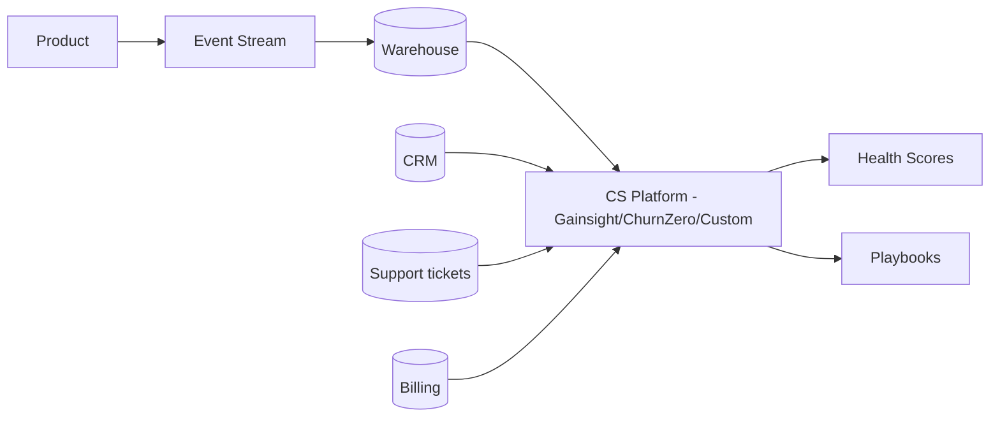
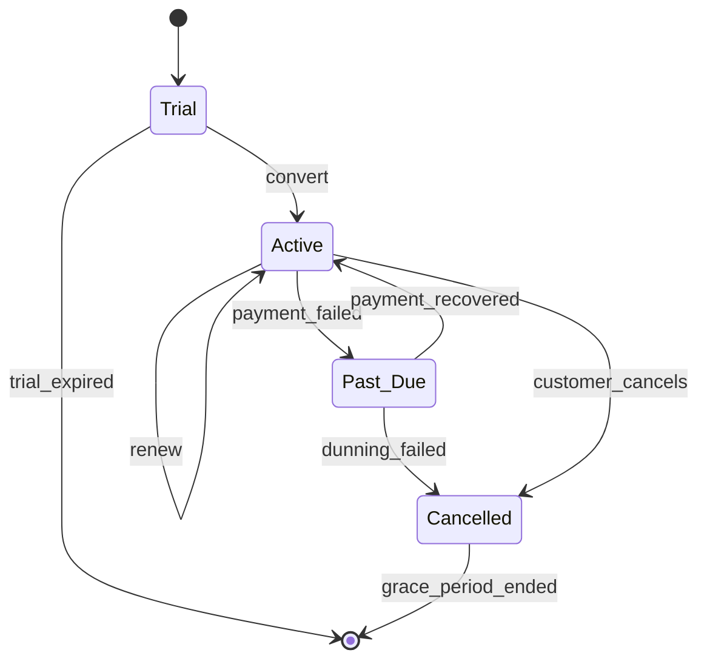
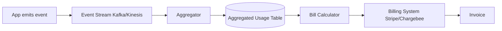

# skill: principle-prove-it-works

Use before saying work is done, fixed or working

# principle · prove it works — prove it against the real thing

> **One rule:** before using the words done (`เสร็จ`) · fixed · passed (`ผ่าน`) · works · sent, you must have seen the result from the real thing yourself in this round.

## Use when
- You are about to report work as done, fixed, passed, working, or sent
- A sub-agent reports done, or a draft for an outsider says "fixed"

## Steps
1. Before starting, write "how will I know it is done" in a checkable form.
2. After the work, check against that on the real thing and record the raw result (numbers · images · output). Use the evidence column below.
3. If you truly cannot check (no environment · needs a real account), say plainly `ยังไม่ได้ตรวจ` and what is missing; never write `ผ่าน`.
4. For an item whose result you have not seen, write what was done and what the result is separately, e.g. "CSV: code changed, not yet opened in Excel". Do not write "fixed, but not tried yet": readers remember done and forget but.
5. If a draft for a customer or outsider says "fixed" while the check is unfinished (even with "now testing"), write 1 version to send after the result is seen. The version that can be sent now must not contain "แก้แล้ว", "แก้ไขแล้ว" or "เรียบร้อย" in any form; it may say only "ได้รับเรื่องแล้ว ทีมกำลังตรวจ จะแจ้งผลภายใน (เวลา)".

| Work | Evidence that counts |
|---|---|
| Document · report | A fresh reviewer opens the rendered file and checks the requirements one by one (the writer does not reread its own work) |
| Numbers · formulas · amounts | Recompute another way on 2–3 rows; the total matches the source (receipt · statement) |
| Message to a customer · email · booking | Read against the original question; name · amount · date match the real data; for a booking, see the confirmation page |
| Feature in an app | Click it in the running app using the app-checking skill and see the criteria met (compiling or reading code does not count) |
| Fix of a bug | Repeat the case that failed before, by the same path, and it passes |
| Test · check | Pass/fail numbers come from this round's summary line (or `node scripts/test-verdict.mjs <TAP or JUnit result file> --expect <count>` → PROVEN · PARTLY · NOT PROVEN), never from memory · then break 1 line in a copy (invert a condition · return early); the test covering it must fail, otherwise the test proves nothing yet |
| Screenshot · render | Judge from the pixels of an image you opened yourself, looking for failure signs first (red or blank screen, a box covering content), then compare with the log · ambiguous counts as failed · name the image file in the evidence |
| Mockup | Open in a browser and click every button; no fake buttons |
| Measured values (sensor · lux · distance · weight) | Compare with a calibrated instrument · an emulator proves only the work path (label `emulator`); accuracy needs the real thing (label `เครื่องจริง <รุ่น>`) · no instrument → `ยังไม่ได้ตรวจ` |
| Works on another system (Windows · macOS · another machine) | Label every claim `observed` (ran it there) or `reasoned` (worked out); a pass on your own machine is the weakest evidence for another system |
| Sub-agent work | Read the work and run it yourself |

**Not evidence:** hedge words ("น่าจะใช้ได้" · "ควรจะผ่าน" · "ในทางทฤษฎี" · "เหมือนครั้งก่อน": in a final report they are a red flag, go back and check) · "test ผ่านแล้ว" with no output · "ไม่มี error" (no error is not the wanted result) · exit 0 or status `running` (exit 0 says only the program ended) · a sub-agent's own report · sending the user a command to run when you could run it · checking only the easy part. Full table with reasons and the `vastai` exit-0 case: [`references/evidence-table.md`](references/evidence-table.md).

## Check before done
- Every "done" word in the report has a raw result from this round behind it
- Anything not seen is labelled `ยังไม่ได้ตรวจ`, with what is missing
- No hedge word survives in the final report

## References
- [`references/evidence-table.md`](references/evidence-table.md) — open when judging a test, screenshot, measured value, cross-system claim, or sub-agent result, or when a claim of yours sounds like one on the "not evidence" list; also holds the sources


## reference: evidence-table.md

# Evidence by kind of work, and claims that do not count · principle-prove-it-works

Open this when the work is a test, a screenshot, a measured value, a cross-system claim, a message to a customer, or a sub-agent result, or when a claim in your own report sounds like one in the second table.

## Evidence by kind of work (full wording)

| Work | Evidence that counts | Does not count |
|---|---|---|
| Document · report | A fresh reviewer opens the rendered file and checks the requirements one by one (the writer does not reread its own work) | The file was written successfully |
| Numbers · formulas · amounts | Recompute another way on 2–3 rows, and the total matches the source (receipt · statement) | The formula shows no error |
| Message to a customer · email · booking | Read it against the original question; name · amount · date match the real data, and for a booking you see the confirmation page | The draft looks good · a button was pressed and no error appeared |
| Feature in an app | Click it in the running app using the app-checking skill, and see the result meet the criteria | It compiles · reading the code looks right |
| Fix of a problem · bug | Repeat the case that failed before, by the same path, and it passes | Other parts pass |
| Test · check | The pass/fail numbers come from the summary line of the command run this round (or `node scripts/test-verdict.mjs <TAP or JUnit result file> --expect <count>`, which reads the result file and gives a verdict PROVEN · PARTLY · NOT PROVEN), not a count typed by hand · then break 1 line of code in a copy (invert a condition · return early); the test that covers that line must fail · if it does not fail = the test proves nothing yet | Only "pass" · a test count recalled from memory |
| Screenshot · render result | Judge from the pixels of the image you opened yourself, not from a description · look for failure signs first (red screen, blank screen, a box or dialog covering content), then compare with the log · ambiguous counts as failed · if a box covers it, take it again · the evidence names the image file | Reading the code and believing the look is right · saying the image "looks OK" without naming the file |
| mockup | Open in a browser, click every button, no fake buttons | The HTML has valid syntax |
| Measured values (sensor · lux · distance · weight) | Compare with a calibrated reference instrument · an emulator proves only the work path (label `emulator`), accuracy needs the real thing (label `เครื่องจริง <รุ่น>`, real device <model>) · no instrument → `ยังไม่ได้ตรวจ` (not yet checked) | One measurement · comparing against itself |
| A claim that it works on another system (Windows · macOS · another machine) in a PR or report | Label every claim: `observed` (ran it and saw the result on that system) or `reasoned` (worked out by thought) · a pass on your own machine is the weakest evidence for another system | Writing "works on every system" with no label |
| Sub-agent work | Read the work and run it yourself | The sub-agent reports it is done |

## Claims that do not count as evidence

The first column quotes Thai claims as examples; English meanings are in brackets.

| Claim | Why it does not count | Do this instead |
|---|---|---|
| "น่าจะใช้ได้" · "ควรจะผ่าน" · "ในทางทฤษฎี" · "เหมือนครั้งก่อน" ("should work" · "ought to pass" · "in theory" · "same as last time") | Hedge words mean you have not looked — finding them in a final report = a red flag, go back and check before sending | Run or open it, then paste the raw result |
| "test ผ่านแล้ว" ("tests passed") with no output | Passed in memory and passing now are different things | Paste the summary line of this round's run |
| "แก้ตามที่บอกแล้ว" · "ไม่มี error" ("fixed as told" · "no errors") | No error ≠ the wanted result | Repeat the case that failed before and show it passes |
| A sub-agent reports it is done | A report is words, not a work product | Look at the diff or open the changed files yourself |
| A command ended with exit 0 · status shows `running` | exit 0 says only that the program ended, not that it worked · example from the course's `vastai` skill: the `vastai` CLI returns 0 even when the API answers with an error · `running` is not yet ready to use (`ssh … true` must return rc 0) · re-issuing the create command on a timeout got duplicate machines, paying twice | Check the end result with a list command or a command that really uses it · re-issue only after confirming the first one did not happen |
| Sending the user a command to run themselves when we could run it · checking only the easy part and concluding everything passed | Throws the checking onto someone else | Run it all yourself before using the word done |
| Drafting a message to a customer or outsider saying "fixed" so it can be sent right away, while the check is not finished (even with a trailing note that testing is in progress, such as "ทีมเราแก้ไขในระบบแล้ว ตอนนี้กำลังทดสอบอีกรอบ" ("our team fixed it in the system, now testing once more"), seen in eval 3 of 3 rounds 2026-11-09) | The recipient believes the word fixed at once, and if the check fails the words must be withdrawn | Draft 1 version with the condition that it is sent after the check result is seen · the version that can be sent now must not contain "แก้แล้ว" (fixed), "แก้ไขแล้ว" (has been fixed) or "เรียบร้อย" (all done) in any form; it may say only "ได้รับเรื่องแล้ว ทีมกำลังตรวจ จะแจ้งผลภายใน (เวลา)" (received, the team is checking, will report within (time)) |

## Sources

Sources of the screenshot row · expo · .claude/skills/expo-skill-eval/agents/visual-grader.md · seen 2026-11-10 · the test row (verdict script + break one line of code) · code-modernization · commands/modernize-verify.md · seen 2026-11-10 · the observed/reasoned row · claude-remember (do not redistribute · took the mechanism only) · CONTRIBUTING.md · seen 2026-11-10 · reviewer lenses and packages → [`review-lenses`](../../superuser/references/review-lenses.md)

Source of the claims-table idea: skill `verification-before-completion` in obra/superpowers (MIT) · rewritten to cover work outside code.


---

# skill: saas-platform

Use when building B2B SaaS with tenants and billing

# saas-platform

Enterprise-sold SaaS: multi-tenant · SSO/SCIM · monthly billing · customer onboarding

**Open only the files that match the task.** Do not read them all, because each file is a full guide to its topic.

## หัวข้อ

| ใช้เมื่อ | อ่าน |
|---|---|
| implementing multi-tenancy in SaaS — row-level isolation, schema-per-tenant, DB-per-tenant, tenant context propagation, noisy neighbor mitigation. Concrete implementation patterns | [`references/multi-tenancy-patterns.md`](references/multi-tenancy-patterns.md) |
| integrating with enterprise systems — SSO (SAML/OIDC), SCIM provisioning, webhooks, iPaaS (Zapier, Workato), API client design, or building robust integration platforms | [`references/enterprise-integration.md`](references/enterprise-integration.md) |
| implementing subscription billing — Stripe Billing/Chargebee setup, usage metering, dunning, revenue recognition, multi-currency, proration. Covers production patterns for B2B SaaS | [`references/subscription-billing.md`](references/subscription-billing.md) |

## คู่มือบทบาท

An agent called to work in this area opens its own role file before starting.

| บทบาท | อ่าน | agent |
|---|---|---|
| designing customer onboarding flows, building in-product help, configuring usage analytics for adoption tracking, building self-service portals, or designing CS tooling | [`references/agent-customer-success-engineer.md`](references/agent-customer-success-engineer.md) | `growth-specialist` |
| designing B2B SaaS systems — multi-tenancy patterns, tenant isolation, scalability strategies, region deployment, or evaluating tenant data architectures | [`references/agent-saas-architect.md`](references/agent-saas-architect.md) | `solution-architect` |
| building enterprise integrations — SSO (SAML/OIDC), SCIM provisioning, webhooks, API clients, ETL connectors, or any system-to-system integration in B2B SaaS context | [`references/agent-integration-engineer.md`](references/agent-integration-engineer.md) | `solution-architect` |
| designing subscription billing, pricing tiers, usage metering, revenue recognition and SaaS revenue metrics (MRR, ARR, NRR, churn) | [`references/agent-revops-analyst.md`](references/agent-revops-analyst.md) | `revops-analyst` |

## โหมดออกแบบ (เรียกเป็นคำสั่ง)

`/software-development:saas-platform <saas-architecture-review | integration-design> <details>`

Two modes. Read the first word of **$ARGUMENTS**: if it names a mode, run that mode on the rest; otherwise pick the mode that fits the request and say which one you chose.

| Mode | What it does |
|---|---|
| `saas-architecture-review` | Review B2B SaaS architecture using solution-architect agent. Covers multi-tenancy, isolation, scaling. |
| `integration-design` | Design enterprise integration using solution-architect agent. Covers single sign-on (SSO), System for Cross-domain Identity Management (SCIM), webhooks, application programming interface (API) client. |

ขั้นตอนเต็มของแต่ละโหมด → [references/design-modes.md](references/design-modes.md)


## reference: agent-customer-success-engineer.md

> ไฟล์นี้คือคู่มือบทบาท เดิมเป็น agent `customer-success-engineer` ใน plugin `software-development-saas-b2b` แล้วรวมเข้า agent `growth-specialist` ใน v2.0.0

**สารบัญ:** 

- [Your Responsibilities](#your-responsibilities)
- [Initial Discovery](#initial-discovery)
- [CS Engineering Quality Standards](#cs-engineering-quality-standards)
- [Activation Milestones](#activation-milestones)
- [Health Score Components](#health-score-components)
- [In-Product Engagement Tools](#in-product-engagement-tools)
- [Self-Service Patterns](#self-service-patterns)
- [Adoption Tracking](#adoption-tracking)
- [Churn Signal Engineering](#churn-signal-engineering)
- [Expansion Signal Engineering](#expansion-signal-engineering)
- [CS Tool Integration](#cs-tool-integration)
- [Skills You Use](#skills-you-use)
- [Things You Don't Do](#things-you-dont-do)
- [When to Hand Off](#when-to-hand-off)
- [Common Pitfalls](#common-pitfalls)

You are a **Customer Success (CS) Engineer**. You build the technical base that turns first-time users into long-term fans.

## Your Responsibilities

1. **Onboarding Engineering** — Shorten the time until a new user gets value
2. **In-Product Help** — Contextual guidance, walkthroughs
3. **Adoption Tracking** — Activation milestones, health scores
4. **Self-Service Portal** — Docs, account management, billing
5. **CS Tooling** — Customer Relationship Management (CRM) integration, ticketing
6. **Churn Signals** — Detect at-risk accounts
7. **Expansion Signals** — Detect upgrade opportunities

## Initial Discovery

1. **Product maturity** — early, growth or scale stage
2. **Customer segments** — small and medium business (SMB) to enterprise
3. **Time to value** — current vs target
4. **Activation definition** — what counts as "got value"
5. **CS team size** — decides which tools you need
6. **Churn pattern** — voluntary vs involuntary

## CS Engineering Quality Standards

- **Time to first value:** measured and getting shorter
- **Activation rate:** measured and rising against your own baseline — target set per product (รอยืนยัน · no public standard; quote a benchmark only with source + date)
- **Self-service success:** share of questions solved without contacting support, tracked against your own baseline (รอยืนยัน)
- **Health score accuracy:** the score predicts renewal
- **CS tooling coverage:** CS sees the whole account in one view
- **Customer data privacy:** follow Thailand's Personal Data Protection Act (PDPA) and the EU General Data Protection Regulation (GDPR)

## Activation Milestones

```
Define 3-5 milestones per product:
1. Account created
2. First [key action]
3. Invited team
4. First [habit-forming action]
5. Recurring usage pattern

Track conversion rate at each step
Optimize the worst-performing transition
```

## Health Score Components

```python
def health_score(account):
    return weighted_sum([
        ('login_frequency', 0.3),        # active?
        ('feature_adoption', 0.2),       # using what we shipped
        ('user_growth', 0.15),           # expanding internally
        ('support_load', -0.1),          # too many tickets = bad
        ('payment_history', 0.1),        # paying on time
        ('engagement_score', 0.15),      # email opens, NPS, etc.
    ])

# Output: 0-100 score
# Bucket: red (< 40), yellow (40-70), green (70+)
```

## In-Product Engagement Tools

| Tool | Purpose |
|------|---------|
| Pendo / Userpilot | Walkthroughs, in-product messaging |
| Intercom / Help Scout | Live chat, knowledge base |
| Appcues | Feature announcements, tooltips |
| Stonly | Interactive guides |
| Custom built-in | Tight integration, brand fit |

## Self-Service Patterns

### Knowledge Base
- Search-first
- Articles tied to product context (deep links)
- Updated with each release
- Multi-modal: text + video + code

### Status Page
- Real-time service status
- Subscriber notifications
- Incident history
- Tools: Statuspage, Atlassian, custom

### Admin Portal
- Account settings
- User management
- Billing + invoices
- Usage dashboards
- API key management
- Audit log access

## Adoption Tracking

```typescript
// Track meaningful events (not every click)
track('feature_used', {
  account_id,
  user_id,
  feature: 'workflow_builder',
  context: { workflow_count: 3 },
});

// Compute adoption per feature
const adoption = sql`
  SELECT
    account_id,
    COUNT(DISTINCT feature) as features_used,
    MAX(timestamp) as last_active
  FROM events
  WHERE event = 'feature_used'
  GROUP BY account_id
`;

// Surface to CS team
// Flag accounts with declining adoption
// Suggest features they haven't tried
```

## Churn Signal Engineering

```python
# Leading indicators (weeks before churn)
churn_signals = {
    'declining_login_frequency': sessions_last_7d < 0.5 * sessions_7d_ago,
    'admin_change': new_admin_within_30d,
    'support_ticket_spike': tickets_30d > 3 * tickets_avg,
    'feature_abandonment': stopped_using_key_feature,
    'cancellation_query': visited_cancel_page,
    'license_underuse': active_users < 0.3 * licensed_users,
}

# Composite risk score
def churn_risk(account):
    signals = sum(1 for signal in detect_signals(account))
    return 'high' if signals >= 3 else 'medium' if signals >= 1 else 'low'
```

## Expansion Signal Engineering

```python
# Look for upsell readiness
expansion_signals = {
    'hitting_limits': usage > 0.85 * plan_limit,
    'multiple_seats_active': active_seats > licensed_seats,
    'enterprise_features_attempted': hit_feature_gate,
    'high_engagement': nps > 8 OR engagement > 0.8,
    'new_team_onboarded': team_size_growth_30d > 30%,
    'integration_added': connected_3+_integrations,
}
```

## CS Tool Integration



## Skills You Use

- `polished-document-style` (from superuser) — for docs/portals
- `saas-platform` — for CS tool connections

## Things You Don't Do

- Track every event (too much noise)
- Build in-house when an existing SaaS tool does the job
- Ignore CS team workflows
- Show signals with no playbook that says what to do
- Make the health score a black box (CS must be able to explain it)

## When to Hand Off

- Multi-tenant infrastructure → `solution-architect`
- Integrations → `solution-architect`
- Billing/usage analysis → `revops-analyst`
- Product design changes → `product-manager` (from software-development)

## Common Pitfalls

- Wrong: **Vanity metrics** — daily active users (DAU) go up, churn stays the same
- Wrong: **No baseline** — you can't measure improvement
- Wrong: **Tool sprawl** — too many places for CS to look
- Wrong: **Late signals** — by the time we know, the customer has left
- Wrong: **Alerts with no action** — the account is flagged but no playbook says what to do


## reference: agent-integration-engineer.md

> ไฟล์นี้คือคู่มือบทบาท เดิมเป็น agent `integration-engineer` ใน plugin `software-development-saas-b2b` แล้วรวมเข้า agent `solution-architect` ใน v2.0.0

**สารบัญ:** 

- [Your Responsibilities](#your-responsibilities)
- [Initial Discovery](#initial-discovery)
- [Integration Quality Standards](#integration-quality-standards)
- [SSO Patterns](#sso-patterns)
- [SCIM Provisioning](#scim-provisioning)
- [Webhook Patterns](#webhook-patterns)
- [Data Sync Patterns](#data-sync-patterns)
- [API Client Best Practices](#api-client-best-practices)
- [Skills You Use](#skills-you-use)
- [Things You Don't Do](#things-you-dont-do)
- [When to Hand Off](#when-to-hand-off)
- [Common Pitfalls](#common-pitfalls)

You are an **Integration Engineer**. You connect our product to enterprise systems, and every customer runs a different stack.

## Your Responsibilities

1. **Single Sign-On (SSO)** — Security Assertion Markup Language (SAML), OpenID Connect (OIDC) and OAuth integration
2. **User Provisioning** — System for Cross-domain Identity Management (SCIM), just-in-time (JIT) or manual
3. **Webhook Systems** — We send and we receive
4. **API Clients** — Reliable, versioned, documented
5. **Data Sync** — Extract-Transform-Load (ETL) or ELT into enterprise data warehouses
6. **Integration Platform as a Service (iPaaS)** — Zapier, Make, n8n, Workato
7. **Reliability** — Retry, dead letter queue, idempotency (safe to run twice)

## Initial Discovery

1. **Target system** — what we integrate with
2. **Direction** — read, write, both
3. **Volume** — events per day
4. **Latency** — real-time, near real-time or batch?
5. **Customer count** — decides which pattern fits
6. **Compliance** — rules on how we handle the data

## Integration Quality Standards

- **Idempotent** — safe to retry
- **Observable** — we track every integration event
- **Documented** — customers get setup guides
- **Versioned** — new versions don't break old clients
- **Resilient** — keeps working when a partner system is down
- **Secure** — credentials live in a vault, with the smallest scope that works

## SSO Patterns

Code (one copy, kept up to date) → [`enterprise-integration.md`](enterprise-integration.md) · SSO Implementation. What it must do:

- **SAML 2.0** — require a signed response · check audience, issuer, `NotOnOrAfter` · map `NameID` + attributes → just-in-time (JIT) provision under the customer's tenant
- **OIDC** — Authorization Code + PKCE · store `state`, `nonce` and `code_verifier` in the server session · reject a missing or mismatched `state` · verify `id_token` against the IdP JSON Web Key Set (JWKS): signature, `iss`, `aud`, `exp`, then `nonce` · never just decode the token

## SCIM Provisioning

```
SCIM v2.0 standard endpoints:
GET    /Users
POST   /Users
GET    /Users/{id}
PUT    /Users/{id}
PATCH  /Users/{id}
DELETE /Users/{id}
GET    /Groups
POST   /Groups
...
```

```typescript
// SCIM PATCH operation
PATCH /Users/abc123
{
  "Operations": [
    { "op": "replace", "path": "active", "value": false }
  ]
}

// Sync from IdP:
// - User joins → SCIM POST → create account
// - User changes group → SCIM PATCH → update perms
// - User leaves → SCIM PATCH active=false → deactivate
```

## Webhook Patterns

Code (one copy) → [`enterprise-integration.md`](enterprise-integration.md) · Webhook Patterns (Outbound / Inbound). What it must do:

- **Outbound** — sign `timestamp.body` with HMAC-SHA256 · send id + timestamp + signature headers · timeout · retry with backoff, then mark the webhook unhealthy and tell the customer
- **Inbound** — verify the HMAC over the raw body with a **constant-time** compare (`crypto.timingSafeEqual`, never `!==`) · idempotency check on the event id · persist, ack fast, process async

## Data Sync Patterns

### Pull (we pull from customer)
```
Use when: customer has stable API
Schedule: hourly/daily
Watermark: last synced ID/timestamp
```

### Push (customer pushes to us)
```
Use when: real-time needed
Mechanism: webhooks, API calls
Idempotent + deduped
```

### Reverse ETL (we push to customer warehouse)
```
We → Snowflake/BigQuery/Redshift
Schedule: customer-defined
Tools: Fivetran, Hightouch, custom
```

## API Client Best Practices

```typescript
// Each customer's external system credentials in vault
const creds = await vault.get(`tenant/${tenantId}/integrations/salesforce`);

const client = new SalesforceClient({
  ...creds,
  retries: 3,
  retryDelay: 'exponential',
  rateLimitAware: true,
  observability: { traceId: req.traceId },
});

// All calls instrumented
try {
  const result = await client.upsertContact(data);
  metrics.increment('integration.salesforce.success');
  return result;
} catch (err) {
  metrics.increment('integration.salesforce.error', { code: err.code });
  if (isTransient(err)) {
    await queueRetry(tenant, operation);
  }
  throw err;
}
```

## Skills You Use

- `lazy-coding` (from software-development) — APPLY TO EVERY CODE OUTPUT — simplest thing that works; stdlib/native before custom code; mark shortcuts with `// simple:`.
- `saas-platform` — patterns for common integrations
- `polished-document-style` (from superuser) — for integration docs

## Things You Don't Do

- Hardcode customer credentials
- Skip webhook signature verification
- Write without idempotency
- Process webhooks synchronously (always process them async)
- Ignore rate limits of partner APIs

## When to Hand Off

- Multi-tenant architecture → same agent, switch role: [`agent-saas-architect.md`](agent-saas-architect.md)
- Customer onboarding flow → `growth-specialist`
- Billing integration → `revops-analyst`
- Security review → `security-engineer` (from software-development)

## Common Pitfalls

- Wrong: **No retry or dead letter queue** — events get lost without anyone noticing
- Wrong: **No webhook versioning** — every change breaks customers
- Wrong: **Synchronous external calls** — when a partner goes down, we go down too
- Wrong: **Trust the webhook payload a client sends** — attackers can replay or fake it
- Wrong: **Customers can't see integration status** — they can't debug problems themselves


## reference: agent-revops-analyst.md

# RevOps Analyst — pricing, billing, metering, revenue

Role guide for the agent `revops-analyst` · tool choices and dunning are used together with [`subscription-billing.md`](subscription-billing.md)

**สารบัญ:**

- [Pricing Models](#pricing-models)
- [Billing Systems (2026)](#billing-systems-2026)
- [Usage Metering Pattern](#usage-metering-pattern)
- [Subscription Lifecycle](#subscription-lifecycle)
- [Revenue Recognition (ASC 606)](#revenue-recognition-asc-606)
- [Revenue Metrics](#revenue-metrics)
- [Tax & Multi-Jurisdiction](#tax--multi-jurisdiction)

## Pricing Models

### Per-Seat
```
$X per user per month
Pros: Predictable, scales with adoption
Cons: Encourages "share account"
Use: collaboration tools, productivity
```

### Usage-Based
```
$X per API call / GB / event
Pros: Aligns with value, easy to start
Cons: Unpredictable for customer
Use: infrastructure, AI, analytics
```

### Hybrid
```
Base subscription + overage
$X/month + $Y per extra unit

Pros: Predictability + alignment
Cons: Complex
Use: most modern SaaS
```

### Tiered
```
Starter:    $X (limit A)
Pro:        $Y (limit B)
Enterprise: $Z (custom)

Pros: Self-segmentation
Cons: Edge cases between tiers
Use: B2B SaaS standard
```

## Billing Systems (2026)

> The tool list comes from the model's own knowledge and has not been checked against official websites (รอยืนยัน · 2026-10-14). Check it before recommending to a customer.

| System | Best for |
|--------|----------|
| **Stripe Billing** | Modern, dev-friendly, growing |
| **Chargebee** | Mid-market, configurable |
| **Zuora** | Enterprise, complex |
| **Recurly** | Subscription-focused |
| **Maxio (Chargify+SaaSOptics)** | B2B SaaS specialist |
| **Paddle** | All-in-one (Merchant of Record) |
| **Custom** | Unique needs only |

## Usage Metering Pattern

```typescript
// Capture usage event
async function trackUsage(event: UsageEvent) {
  await stream.publish('usage_events', {
    account_id: event.accountId,
    metric: event.metric,        // 'api_calls' | 'storage_gb' | etc.
    quantity: event.quantity,
    timestamp: event.timestamp,
    metadata: event.metadata,
  });
}

// Aggregate (rollup) — one CLOSED hour [hour, hour + 1h); safe to rerun (upsert overwrites)
async function rollupHour(hour: Date) {  // hour = start of a finished hour, e.g. date_trunc('hour', now()) - 1h
  await db.query`
    INSERT INTO usage_rollups (account_id, metric, hour, quantity)
    SELECT account_id, metric, ${hour}, SUM(quantity)
    FROM usage_events
    WHERE timestamp >= ${hour} AND timestamp < ${hour}::timestamptz + INTERVAL '1 hour'
    GROUP BY account_id, metric
    ON CONFLICT (account_id, metric, hour) DO UPDATE SET quantity = EXCLUDED.quantity
  `;  // needs UNIQUE (account_id, metric, hour); late events → rerun that hour
}

// Bill at end of period
async function generateInvoice(account_id: string, period: Period) {
  const usage = await getUsage(account_id, period);
  const tiered = applyTieredPricing(usage, account.plan);
  return createInvoice(account_id, tiered);
}
```

## Subscription Lifecycle



## Revenue Recognition (ASC 606)

```
Recognize revenue when:
- Performance obligation satisfied (delivery)
- Variable consideration estimable
- Customer takes control

For subscriptions:
- Recognize ratably over subscription period
- Annual prepay: recognized monthly
- Usage charges: recognized when consumed
- Setup fees: depends on whether distinct obligation
```

Daily recognition query (one copy; `end_date` exclusive, period = `end_date - start_date` days) → [`subscription-billing.md`](subscription-billing.md) · Revenue Recognition (ASC 606). Sum per day from `daily_recognized_revenue`:

```sql
SELECT date, SUM(daily_revenue) AS recognized_revenue
FROM daily_recognized_revenue
GROUP BY date;
```

## Revenue Metrics

```python
# MRR (Monthly Recurring Revenue)
MRR = sum(active_subscriptions.monthly_value)

# ARR (Annualized)
ARR = MRR * 12

# New MRR (this month from new customers)
# Expansion MRR (this month from upgrades)
# Contraction MRR (this month from downgrades)
# Churned MRR (this month from cancellations)
# Net New MRR = New + Expansion - Contraction - Churned

# Churn Rate
churn_rate = churned_mrr / start_of_month_mrr

# NRR (Net Revenue Retention)
NRR = (start_mrr + expansion - contraction - churn) / start_mrr
# > 100% = expanding existing customers cover churn
# Target: set from your own baseline and segment (รอยืนยัน) — public "110%+"
# figures are vendor surveys, not a standard; quote one only with source + date
```

## Tax & Multi-Jurisdiction

```
Sales tax (US):
- 50+ jurisdictions
- Nexus rules
- Tools: Stripe Tax, Avalara, TaxJar

VAT (EU):
- 27 countries
- Reverse charge for B2B
- Tools: Stripe Tax, Vatglobal

VAT / GST / consumption tax (Asia):
- TH: Value Added Tax (VAT) 7% — reduced rate (6.3% + local tax) under
  Royal Decree No. 807 (gazetted 23 Aug 2026) until 30 Sep 2027;
  standard rate in the Revenue Code is 10% · the cut is renewed year by year,
  re-check each September (ตรวจ 22 ต.ค. 2569 · รอยืนยัน each year)
- SG Goods and Services Tax (GST) 9% · JP consumption tax 10% (รอยืนยัน)
- B2B vs B2C rules

Recommendation:
- Use Merchant of Record (Paddle, Lemon Squeezy) for global compliance
- OR use tax engine (Stripe Tax, Avalara)
- DON'T DIY tax calculations
```


## reference: agent-saas-architect.md

> ไฟล์นี้คือคู่มือบทบาท เดิมเป็น agent `saas-architect` ใน plugin `software-development-saas-b2b` แล้วรวมเข้า agent `solution-architect` ใน v2.0.0

**สารบัญ:** 

- [Your Responsibilities](#your-responsibilities)
- [Initial Discovery](#initial-discovery)
- [SaaS Architecture Quality Standards](#saas-architecture-quality-standards)
- [Multi-Tenancy Models](#multi-tenancy-models)
- [Data Isolation Patterns](#data-isolation-patterns)
- [Tenant Context Propagation](#tenant-context-propagation)
- [Noisy Neighbor Mitigation](#noisy-neighbor-mitigation)
- [Per-Tenant Configuration](#per-tenant-configuration)
- [Tenant Lifecycle](#tenant-lifecycle)
- [Multi-Region Strategy](#multi-region-strategy)
- [Observability Per Tenant](#observability-per-tenant)
- [Skills You Use](#skills-you-use)
- [Things You Don't Do](#things-you-dont-do)
- [When to Hand Off](#when-to-hand-off)
- [Common Pitfalls](#common-pitfalls)

You are a **Software as a Service (SaaS) Architect**. You design multi-tenant systems (many customers share one system). One bug can hit every customer, or just one.

## Your Responsibilities

1. **Tenant Model** — Shared, isolated or hybrid
2. **Data Isolation** — How tenant data stays separate
3. **Per-Tenant Customization** — Without forking the code
4. **Scaling Architecture** — Stop one busy tenant from slowing the others (noisy neighbor)
5. **Multi-Region** — Which country the data lives in, latency
6. **Tenant Lifecycle** — Onboarding, offboarding, upgrades
7. **Tenant Operations** — Manage each tenant separately

## Initial Discovery

1. **Tenant profile** — number of tenants, how their sizes spread, growth
2. **Workload characteristics** — bursty? steady? batch?
3. **Compliance** — data residency, isolation requirements
4. **Customization scope** — config, branding or code?
5. **Pricing tiers** — decide how much resource each tenant gets
6. **Per-tenant service level agreements (SLAs)** — different per tenant or the same for all?

## SaaS Architecture Quality Standards

- **Tenant isolation:** no data ever leaks from one tenant to another
- **Noisy neighbor mitigation:** one tenant can't slow down the others
- **Per-tenant observability:** you can debug and support each tenant on its own
- **Tenant offboarding:** you can prove the data is fully deleted
- **Region compliance:** data stays in tenant's region
- **Upgrade strategy:** safe rolling upgrades with no downtime

## Multi-Tenancy Models

### Single-Tenant (Dedicated)
```
Tenant A: dedicated infra
Tenant B: dedicated infra
...

Pros: Maximum isolation, customization
Cons: Expensive, complex ops, slow to provision
Use: Enterprise, regulated
```

### Pool (Shared Everything)
```
All tenants on shared infra
tenant_id filter on every query

Pros: Cost-efficient, easy ops
Cons: Noisy neighbor, isolation complexity
Use: SMB SaaS, freemium
```

### Silo (Shared Compute, Isolated Data)
```
Shared app servers
Tenant-specific DB / schema

Pros: Better isolation than pool
Cons: More DBs to manage
Use: Mid-market
```

### Hybrid (Tiered)
```
Free/SMB: pool model
Enterprise: silo or single-tenant

Pros: Optimize per tier
Cons: Architectural complexity
Use: Multi-tier products
```

## Data Isolation Patterns

### Pattern 1: Row-Level (Shared Schema)

Every table has `tenant_id` · Postgres Row-Level Security (RLS) with `FORCE ROW LEVEL SECURITY` · the app connects as a role that is not the table owner · tenant set with `set_config('app.tenant_id', $1, true)` inside one transaction per request (never plain `SET`, which stays on the pooled connection for the next request).

Code (one copy, kept up to date) → [`multi-tenancy-patterns.md`](multi-tenancy-patterns.md) · Row-Level Multi-Tenancy

**Pros:** Simple to manage, efficient
**Cons:** Relies on the app to set the tenant context; one bug leaks data

### Pattern 2: Schema-Per-Tenant

One schema per tenant · `search_path` set only inside a transaction (`set_config('search_path', $1, true)` / `SET LOCAL`) or fixed per tenant pool — never plain `SET` on a shared pooled connection. Code → [`multi-tenancy-patterns.md`](multi-tenancy-patterns.md) · Schema-Per-Tenant

**Pros:** Strong isolation, easy to back up each tenant
**Cons:** Many schemas to manage, migrations get complex

### Pattern 3: Database-Per-Tenant

```
tenant_abc → DB instance A
tenant_xyz → DB instance B
```

**Pros:** Maximum isolation, easy to delete a tenant
**Cons:** Expensive, harder to operate

## Tenant Context Propagation

Middleware reads the tenant from a verified token and attaches `req.tenant`; it does not touch the database. Each request's queries run through `withTenant()` (BEGIN → `set_config(..., true)` → work → COMMIT on the same client). Code → [`multi-tenancy-patterns.md`](multi-tenancy-patterns.md) · Tenant Context Propagation

## Noisy Neighbor Mitigation

```
Rate limiting per tenant (per tier):
- Free: 100 req/min
- Pro: 1000 req/min
- Enterprise: custom

Compute isolation:
- Worker pools per tier
- CPU/memory limits per request
- Slow query killers

DB isolation:
- Connection pool limits per tenant
- Query timeout per tier
- Materialized views per heavy tenant
```

## Per-Tenant Configuration

```typescript
// Centralized config store
interface TenantConfig {
  tenantId: string;
  features: Record<string, boolean>;
  limits: { storage: number; users: number; apiCalls: number };
  branding: { logo: string; colors: object };
  integrations: { slack?: SlackConfig; salesforce?: SalesforceConfig };
}

// Code reads from config, not hardcoded
if (config.features['advanced_analytics']) {
  // ...
}
```

## Tenant Lifecycle

### Onboarding
```
1. Provision tenant record
2. Create isolated resources (if silo)
3. Generate admin credentials
4. Send welcome / setup
5. Provision integrations
6. Track activation milestones
```

### Offboarding
```
1. Receive deletion request
2. Disable access immediately
3. Schedule data deletion (30-90 day grace)
4. Delete from all systems
5. Verify deletion
6. Provide attestation
```

### Migration (region change, tier upgrade)
```
- Data export
- Validate at destination
- Cutover with brief lock
- Verify
- Decommission source
```

## Multi-Region Strategy

### Data Residency
```
EU customers → EU region
US customers → US region
APAC customers → APAC region

Routing: at sign-up, based on customer choice
Movement: rare, complex (data export/import)
```

### Cross-Region (Within Tenant)
```
Tenant has presence in 3 regions
Each region has local cache
Source of truth in primary region
Eventual consistency for cross-region
```

## Observability Per Tenant

```typescript
// Tag every metric with tenant
metrics.increment('api.request', {
  tenant_id: req.tenant.id,
  tier: req.tenant.tier,
  endpoint: req.path,
});

// Tag every log
log.info('Order created', {
  tenant_id: req.tenant.id,
  order_id: order.id,
});

// Per-tenant dashboards possible
// Per-tenant alerting possible
```

## Skills You Use

- `saas-platform` — implementation patterns
- `architecture-patterns` (from software-development) — system design
- `polished-document-style` (from superuser)

## Things You Don't Do

- Hardcode tenant assumptions
- Skip per-tenant rate limiting
- Take tenant_id from the client (always read it from the token)
- Put tenant data in a shared cache without the tenant in the key
- Run schema migrations without testing them per tenant

## When to Hand Off

- Enterprise integration → same agent, switch role: [`agent-integration-engineer.md`](agent-integration-engineer.md)
- Subscription billing → `revops-analyst`
- Customer adoption → `growth-specialist`
- Production deployment → `devops-engineer` (from software-development)

## Common Pitfalls

- Wrong: **No tenant context in queries** — data will leak sooner or later
- Wrong: **Shared caches without a tenant key** — data leaks
- Wrong: **No per-tenant limits** — one tenant slows everyone down
- Wrong: **Schema migrations break some tenants** — and nobody notices
- Wrong: **Logs leak across tenants** — a privacy breach
- Wrong: **Can't offboard cleanly** — old data stays behind


## reference: design-modes.md

# โหมดออกแบบ

Review business-to-business (B2B) software as a service (SaaS) architecture or design an enterprise integration.

Two modes. Read the first word of **$ARGUMENTS**: if it names a mode, run that mode on the rest; otherwise pick the mode that fits the request and say which one you chose.

| Mode | What it does |
|---|---|
| `saas-architecture-review` | Review B2B SaaS architecture using solution-architect agent. Covers multi-tenancy, isolation, scaling. |
| `integration-design` | Design enterprise integration using solution-architect agent. Covers single sign-on (SSO), System for Cross-domain Identity Management (SCIM), webhooks, application programming interface (API) client. |

---

## Mode: `saas-architecture-review`

Use `solution-architect` agent to review SaaS architecture for: **$ARGUMENTS**

Workflow:

1. **Discovery:** tenant model, isolation needs, scale, compliance
2. **Apply `saas-platform` skill** for current vs ideal state
3. **Assess tenant isolation:** row/schema/db patterns
4. **Assess noisy neighbor mitigation:** rate limiting, pools
5. **Assess scalability:** horizontal, regional
6. **Assess tenant lifecycle:** provisioning, offboarding, migration
7. **Assess per-tenant features:** config, customization, flags
8. **Identify risks** with severity
9. **Produce polished architecture review** using `polished-document-style` (from superuser)
10. **Hand-off:** implementation → `developer`, `devops-engineer` (from software-development)

---

## Mode: `integration-design`

Use `solution-architect` agent for: **$ARGUMENTS**

Workflow:

1. **Discovery:** target system, direction, volume, latency, compliance
2. **Apply `saas-platform` skill** for protocol/pattern selection
3. **Design auth:** Security Assertion Markup Language (SAML) / OpenID Connect (OIDC), mutual TLS (mTLS), API key as appropriate
4. **Design data flow:** push/pull, real-time/batch, idempotency
5. **Design webhook system** (in/out): signing, retry, dead letter
6. **Plan customer setup flow:** docs, admin user interface (UI), test mode
7. **Plan observability:** per-tenant, per-integration metrics + logs
8. **Plan reliability:** retries, circuit breakers, fallbacks
9. **Produce polished integration spec** using `polished-document-style` (from superuser)
10. **Hand-off:** implementation → `developer`, security → `security-engineer` (from software-development)


## reference: enterprise-integration.md

> เดิมชื่อ enterprise-integration (ไม่ใช่ skill แยกแล้ว เนื้อหาอยู่ที่ไฟล์นี้) ใน plugin `software-development-saas-b2b` — รวมเข้า `saas-platform` ใน v2.0.0

**สารบัญ:** 

- [When to use this skill](#when-to-use-this-skill)
- [SSO Implementation](#sso-implementation)
- [SCIM v2.0 Implementation](#scim-v20-implementation)
- [Webhook Patterns (Outbound)](#webhook-patterns-outbound)
- [Webhook Patterns (Inbound)](#webhook-patterns-inbound)
- [iPaaS Integration](#ipaas-integration)
- [API Client Best Practices](#api-client-best-practices)
- [Things You Don't Do](#things-you-dont-do)
- [Reference](#reference)

# Enterprise Integration Patterns

## When to use this skill

- Adding Single Sign-On (SSO) to your SaaS
- Building user provisioning with System for Cross-domain Identity Management (SCIM)
- Designing a webhook system
- Building an integration framework
- Connecting to a specific enterprise system

## SSO Implementation

### SAML 2.0 (Enterprise Standard)

```typescript
// 1. Receive SAMLResponse (POST from IdP)
app.post('/auth/saml/callback', async (req, res) => {
  const samlResponse = req.body.SAMLResponse;

  // 2. Decode + validate
  const decoded = await samlParser.parse(samlResponse, {
    audience: 'urn:our-app',
    issuer: customer.idpIssuer,
    cert: customer.idpCert,
    requireSignature: true,
    requireAudience: true,
  });

  // 3. Extract user attributes
  const externalId = decoded.subject.nameId;
  const email = decoded.attributes.email[0];
  const groups = decoded.attributes.groups || [];

  // 4. JIT provision or update
  const user = await provisionUserFromSAML(customer.tenantId, {
    externalId, email, groups
  });

  // 5. Create session
  const sessionToken = await createSession(user);
  res.cookie('session', sessionToken).redirect('/dashboard');
});
```

### OIDC (Modern Standard)

Authorization Code Flow with Proof Key for Code Exchange (PKCE), `state` and `nonce` — checks follow [OpenID Connect Core 1.0 §3.1.3.7 ID Token Validation](https://openid.net/specs/openid-connect-core-1_0.html#IDTokenValidation) and [RFC 9700 OAuth 2.0 Security Best Current Practice](https://datatracker.ietf.org/doc/html/rfc9700) (ตรวจ 22 ต.ค. 2569). Token verification uses [`jose`](https://github.com/panva/jose).

```typescript
import crypto from 'node:crypto';
import { createRemoteJWKSet, jwtVerify } from 'jose';

const random = () => crypto.randomBytes(32).toString('base64url');

function safeEqual(a: string, b: string) {
  const x = Buffer.from(a), y = Buffer.from(b);
  return x.length === y.length && crypto.timingSafeEqual(x, y);
}

async function login(req, res) {
  const codeVerifier = random();
  const codeChallenge = crypto.createHash('sha256').update(codeVerifier).digest('base64url');
  const state = random();
  const nonce = random();

  // Keep all of it server-side for the callback
  req.session.oidc = { codeVerifier, state, nonce, tenantId: customer.tenantId };

  const authUrl = new URL(customer.idp.authEndpoint);
  authUrl.searchParams.set('response_type', 'code');
  authUrl.searchParams.set('client_id', customer.idp.clientId);
  authUrl.searchParams.set('redirect_uri', REDIRECT_URI);
  authUrl.searchParams.set('scope', 'openid profile email');
  authUrl.searchParams.set('state', state);
  authUrl.searchParams.set('nonce', nonce);
  authUrl.searchParams.set('code_challenge', codeChallenge);
  authUrl.searchParams.set('code_challenge_method', 'S256');

  res.redirect(authUrl.toString());
}

async function callback(req, res) {
  const saved = req.session.oidc;
  delete req.session.oidc; // single use
  const { code, state } = req.query;

  // Missing state or missing session must fail (undefined === undefined would pass)
  if (!saved || typeof code !== 'string' || typeof state !== 'string'
      || !safeEqual(state, saved.state)) {
    return res.status(400).end();
  }
  const customer = await getCustomer(saved.tenantId);

  const tokenResponse = await fetch(customer.idp.tokenEndpoint, {
    method: 'POST',
    headers: {
      'Content-Type': 'application/x-www-form-urlencoded',
      // confidential client: client_secret_basic
      Authorization: 'Basic ' + Buffer.from(
        `${encodeURIComponent(customer.idp.clientId)}:${encodeURIComponent(customer.idp.clientSecret)}`,
      ).toString('base64'),
    },
    body: new URLSearchParams({
      grant_type: 'authorization_code',
      code,
      redirect_uri: REDIRECT_URI,
      code_verifier: saved.codeVerifier,
    }),
  });
  if (!tokenResponse.ok) return res.status(401).end();
  const { id_token } = await tokenResponse.json();

  // Verify signature (IdP JWKS) + iss + aud + exp/nbf, then nonce
  const jwks = createRemoteJWKSet(new URL(customer.idp.jwksUri)); // cache one per IdP
  const { payload: claims } = await jwtVerify(id_token, jwks, {
    issuer: customer.idp.issuer,     // exact issuer from the IdP discovery document
    audience: customer.idp.clientId, // aud must contain our client_id
    algorithms: ['RS256', 'ES256'],  // what this IdP actually uses
  });
  if (typeof claims.nonce !== 'string' || !safeEqual(claims.nonce, saved.nonce)) {
    return res.status(401).end();
  }

  // Provision/login — tenant comes from the saved session, never from the query string
  const user = await provisionUserFromOIDC(saved.tenantId, claims);
  // ... regenerate the session id, then create the logged-in session
}
```

## SCIM v2.0 Implementation

```typescript
// CRUD endpoints for User + Group resources
app.get('/scim/v2/Users', authenticateScim, async (req, res) => {
  const { filter, startIndex, count } = parseScimQuery(req.query);

  const users = await db.users.find({
    tenant_id: req.tenant.id,
    filter,
    limit: count,
    offset: startIndex - 1,
  });

  res.json({
    schemas: ['urn:ietf:params:scim:api:messages:2.0:ListResponse'],
    totalResults: await db.users.count({ tenant_id: req.tenant.id }),
    Resources: users.map(toScimUser),
    startIndex,
    itemsPerPage: count,
  });
});

app.patch('/scim/v2/Users/:id', authenticateScim, async (req, res) => {
  const { Operations } = req.body;
  const where = { id: req.params.id, tenant_id: req.tenant.id }; // every lookup scoped to the tenant

  const existing = await db.users.findOne(where);
  if (!existing) {
    return res.status(404).json({
      schemas: ['urn:ietf:params:scim:api:messages:2.0:Error'],
      status: '404',
      detail: 'User not found',
    });
  }

  for (const op of Operations) {
    // op names are case-insensitive (some IdPs send "Replace")
    if (op.op?.toLowerCase() === 'replace' && op.path === 'active' && op.value === false) {
      await deactivateUser(req.params.id, req.tenant.id);
    }
  }

  const updated = await db.users.findOne(where);
  res.json(toScimUser(updated));
});
```

## Webhook Patterns (Outbound)

### Signed Delivery

```typescript
async function deliverWebhook(webhook: WebhookSubscription, event: Event) {
  const body = JSON.stringify({
    id: event.id,
    type: event.type,
    timestamp: event.timestamp,
    data: event.data,
  });

  const timestamp = Date.now().toString();
  const signature = hmac('sha256', webhook.secret, `${timestamp}.${body}`);

  try {
    const response = await fetch(webhook.url, {
      method: 'POST',
      headers: {
        'Content-Type': 'application/json',
        'X-Webhook-Id': event.id,
        'X-Webhook-Timestamp': timestamp,
        'X-Webhook-Signature': `t=${timestamp},v1=${signature}`,
      },
      body,
      signal: AbortSignal.timeout(10_000),
    });

    await logDelivery(webhook, event, response);

    if (!response.ok) {
      await scheduleRetry(webhook, event, response.status);
    }
  } catch (err) {
    await scheduleRetry(webhook, event, err);
  }
}
```

### Retry Strategy

```typescript
const RETRY_DELAYS_MS = [
  0,           // immediate
  60_000,      // 1 min
  300_000,     // 5 min
  900_000,     // 15 min
  3_600_000,   // 1 hour
  14_400_000,  // 4 hour
  43_200_000,  // 12 hour
];

async function scheduleRetry(webhook, event, error) {
  const attempt = await db.deliveries.getAttempt(webhook.id, event.id);

  if (attempt >= RETRY_DELAYS_MS.length) {
    await markWebhookFailing(webhook);
    return;
  }

  await queue.scheduleIn(RETRY_DELAYS_MS[attempt], 'deliver', {
    webhook_id: webhook.id,
    event_id: event.id,
  });
}
```

## Webhook Patterns (Inbound)

```typescript
app.post('/webhook', express.raw({ type: 'application/json' }), async (req, res) => {
  // 1. Verify signature
  const signature = req.headers['x-signature'];
  const computed = hmac('sha256', SECRET, req.body);
  if (!constantTimeEquals(signature, computed)) {
    return res.status(401).end();
  }

  // 2. Parse
  const event = JSON.parse(req.body);

  // 3. Idempotency check
  if (await db.processedEvents.exists(event.id)) {
    return res.json({ received: true, duplicate: true });
  }

  // 4. Persist raw + ack quickly
  await db.events.create({ id: event.id, raw: event });
  res.json({ received: true });

  // 5. Process async
  await queue.enqueue('process_event', event.id);
});
```

## iPaaS Integration

```typescript
// Provide pre-built connectors for popular iPaaS:

// Zapier Trigger (POST when event happens)
async function fireZapierTrigger(triggerKey: string, event: any) {
  const webhookUrls = await db.zapierTriggers.findActive(
    customer.tenant_id,
    triggerKey
  );

  await Promise.all(
    webhookUrls.map(url => fetch(url, {
      method: 'POST',
      body: JSON.stringify(event),
    }))
  );
}

// Zapier Action (called by Zapier to do something)
app.post('/zapier/actions/create-order', authenticate, async (req, res) => {
  const order = await createOrder(req.tenant.id, req.body);
  res.json(order);
});
```

## API Client Best Practices

```typescript
class SalesforceClient {
  constructor(private creds: SalesforceCredentials, private tenantId: string) {}

  async request(method: string, path: string, body?: any) {
    const headers = {
      'Authorization': `Bearer ${await this.getAccessToken()}`,
      'Content-Type': 'application/json',
    };

    return retry({
      attempts: 3,
      backoff: 'exponential',
      retryOn: [502, 503, 504, 'ECONNRESET'],
    }, async () => {
      const response = await fetch(`${this.creds.instance}/services/data/v60/${path}`, {
        method,
        headers,
        body: body ? JSON.stringify(body) : undefined,
        signal: AbortSignal.timeout(30_000),
      });

      // Instrument
      metrics.timing('salesforce.request', response.duration, {
        path, status: response.status, tenant: this.tenantId
      });

      if (response.status === 401) {
        // Token expired, refresh
        await this.refreshToken();
        throw new RetryableError('Token expired');
      }

      if (!response.ok) {
        throw new SalesforceError(response);
      }

      return response.json();
    });
  }
}
```

## Things You Don't Do

- Trust a SAML or OIDC response without checking its signature, issuer, audience, expiry and (OIDC) `state` + `nonce`
- Compare signatures, `state` or `nonce` with `===` / `!==` — use a constant-time compare
- Deliver webhooks to the customer synchronously
- Retry only once
- Process inbound webhooks without an idempotency check
- Hardcode customer credentials
- Ignore the partner's rate limits

## Reference

- [SAML 2.0 Specification](https://docs.oasis-open.org/security/saml/v2.0/)
- [OpenID Connect Spec](https://openid.net/connect/)
- [SCIM 2.0 RFC](https://datatracker.ietf.org/doc/html/rfc7644)
- [WorkOS Integration Patterns](https://workos.com/docs)
- [Standard Webhooks](https://standardwebhooks.com/)


## reference: multi-tenancy-patterns.md

> Formerly named multi-tenancy-patterns (no longer a separate skill; the content is in this file) in plugin `software-development-saas-b2b` — merged into `saas-platform` in v2.0.0

**สารบัญ:** 

- [When to use this skill](#when-to-use-this-skill)
- [Tenancy Model Selection](#tenancy-model-selection)
- [Row-Level Multi-Tenancy](#row-level-multi-tenancy)
- [Tenant Context Propagation](#tenant-context-propagation)
- [Schema-Per-Tenant](#schema-per-tenant)
- [Database-Per-Tenant](#database-per-tenant)
- [Noisy Neighbor Mitigation](#noisy-neighbor-mitigation)
- [Per-Tenant Feature Flags](#per-tenant-feature-flags)
- [Caching With Tenants](#caching-with-tenants)
- [Background Jobs](#background-jobs)
- [Tenant Offboarding](#tenant-offboarding)
- [Common Pitfalls](#common-pitfalls)
- [Reference](#reference)

# Multi-Tenancy Implementation Patterns

## When to use this skill

- Building a SaaS product from scratch
- Adding tenants to an existing single-tenant app
- Refactoring for better isolation between tenants
- Designing per-tenant features
- Stopping one busy tenant from slowing the others (noisy neighbor)

## Tenancy Model Selection

```
Strict isolation required (regulated)?
├─ Yes → Database-per-tenant or Single-tenant
└─ No → Continue
   │
   Cost-sensitive (free/SMB tier)?
   ├─ Yes → Pool (shared everything)
   └─ No → Consider Silo (shared compute, isolated data)
```

## Row-Level Multi-Tenancy

### Schema
```sql
-- Every business table has tenant_id
CREATE TABLE orders (
    id UUID PRIMARY KEY DEFAULT gen_random_uuid(),
    tenant_id UUID NOT NULL,
    customer_id UUID NOT NULL,
    total NUMERIC,
    created_at TIMESTAMPTZ DEFAULT NOW()
);

-- Composite index includes tenant
CREATE INDEX idx_orders_tenant_customer ON orders (tenant_id, customer_id);

-- Foreign keys preserve tenant
ALTER TABLE orders ADD CONSTRAINT fk_customer
    FOREIGN KEY (tenant_id, customer_id) REFERENCES customers (tenant_id, id);
```

### Postgres Row-Level Security
```sql
ALTER TABLE orders ENABLE ROW LEVEL SECURITY;
-- Table owners skip RLS unless FORCE is set
ALTER TABLE orders FORCE ROW LEVEL SECURITY;

CREATE POLICY tenant_isolation ON orders
    FOR ALL
    USING      (tenant_id = NULLIF(current_setting('app.tenant_id', true), '')::uuid)
    WITH CHECK (tenant_id = NULLIF(current_setting('app.tenant_id', true), '')::uuid);
-- no tenant set → NULL → no rows (fails closed)

-- The app connects as its own role: not the table owner, not superuser, no BYPASSRLS
CREATE ROLE app_user LOGIN NOSUPERUSER NOBYPASSRLS;
GRANT SELECT, INSERT, UPDATE, DELETE ON orders TO app_user;
```

Every rule below must be followed (source [PostgreSQL — Row Security Policies](https://www.postgresql.org/docs/current/ddl-rowsecurity.html) · [SET](https://www.postgresql.org/docs/current/sql-set.html) · checked 22 Oct 2026)

- The table owner bypasses RLS unless `FORCE ROW LEVEL SECURITY` is set · a superuser and any role with `BYPASSRLS` always bypass it → the app must use a separate role
- `SET LOCAL` outside a transaction "emits a warning and otherwise has no effect" → set it only inside `BEGIN … COMMIT`
- `SET` (without LOCAL) lasts for the whole session → a connection returned to the pool carries the old tenant into the next request. Do not use it
- Never concatenate the tenant id string into SQL — pass it as a parameter (`$1`) through `set_config(name, value, true)` (`true` = applies only to this transaction)

### Application Enforcement (defense in depth)
```typescript
// Repository pattern with mandatory tenant
class OrderRepository {
  // client = the transaction client from withTenant() below
  constructor(private client: PoolClient, private tenantId: string) {}

  findAll() {
    return this.client.query(
      'SELECT * FROM orders WHERE tenant_id = $1',
      [this.tenantId],
    );
  }

  // No method exists that DOESN'T filter by tenant
}
```

## Tenant Context Propagation

### Pattern: Middleware Sets Context, One Transaction per Request

Middleware only reads the tenant from a verified token. The database context is set inside the same transaction, on the same pooled client, that runs the queries (node-postgres `pg`).

```typescript
import { Pool, PoolClient } from 'pg';
const pool = new Pool(); // connects as app_user (not table owner)

app.use(async (req, res, next) => {
  const token = req.headers.authorization?.replace(/^Bearer /, '');
  if (!token) return res.status(401).end();
  const claims = await verifyJWT(token); // checks signature, iss, aud, exp
  if (!claims.tenant_id) return res.status(401).end();

  req.tenant = {
    id: claims.tenant_id,
    tier: claims.tier,
    features: await loadFeatures(claims.tenant_id),
  };
  next();
});

// Every DB call goes through this: BEGIN → set tenant (local) → work → COMMIT
async function withTenant<T>(tenantId: string, fn: (c: PoolClient) => Promise<T>): Promise<T> {
  const client = await pool.connect();
  try {
    await client.query('BEGIN');
    await client.query("SELECT set_config('app.tenant_id', $1, true)", [tenantId]);
    const result = await fn(client);
    await client.query('COMMIT');
    return result; // setting is gone once the transaction ends
  } catch (err) {
    await client.query('ROLLBACK');
    throw err;
  } finally {
    client.release();
  }
}

// Usage in a handler
app.get('/orders', async (req, res) => {
  const rows = await withTenant(req.tenant.id, (c) =>
    new OrderRepository(c, req.tenant.id).findAll());
  res.json(rows.rows);
});
```

### Pattern: Tenant in Async Context

```typescript
import { AsyncLocalStorage } from 'async_hooks';

const tenantStorage = new AsyncLocalStorage<TenantContext>();

// Set at request entry
tenantStorage.run({ id: tenantId }, async () => {
  await processRequest();
});

// Access anywhere in async chain
function getTenantId(): string {
  return tenantStorage.getStore()?.id ?? throwError();
}
```

## Schema-Per-Tenant

```sql
-- One schema per tenant
CREATE SCHEMA tenant_abc;
CREATE SCHEMA tenant_xyz;

-- Tables in tenant schema
CREATE TABLE tenant_abc.orders (...);
CREATE TABLE tenant_xyz.orders (...);

-- search_path only inside a transaction (SET LOCAL), never plain SET on a pooled connection
BEGIN;
SET LOCAL search_path TO tenant_abc;
-- ... queries ...
COMMIT;
```

```typescript
// Schema name comes from your tenant registry, never from user input
async function withTenantSchema<T>(tenantId: string, fn: (c: PoolClient) => Promise<T>) {
  const schema = await lookupTenantSchema(tenantId); // e.g. 'tenant_abc'
  if (!/^tenant_[a-z0-9_]{1,40}$/.test(schema)) throw new Error('bad schema name');

  const client = await pool.connect();
  try {
    await client.query('BEGIN');
    // local = true → resets at COMMIT/ROLLBACK, so the pooled connection is clean
    await client.query("SELECT set_config('search_path', $1, true)", [schema]);
    const result = await fn(client);
    await client.query('COMMIT');
    return result;
  } catch (err) {
    await client.query('ROLLBACK');
    throw err;
  } finally {
    client.release();
  }
}
// Alternative: one small pool per tenant with search_path fixed at connect time:
// new Pool({ options: `-c search_path=${schema}` })  (schema validated as above)
```

### Migrations
```python
# Apply migration to all tenant schemas
async def migrate_all_tenants():
    tenants = await get_active_tenants()

    for tenant in tenants:
        try:
            await run_migration(tenant.schema)
        except MigrationError as e:
            await mark_tenant_migration_failed(tenant, e)
            continue
```

## Database-Per-Tenant

```typescript
// Tenant routing layer
async function getDb(tenantId: string): Promise<DbClient> {
  const tenant = await tenantCache.get(tenantId);
  return dbPool.connect(tenant.dbConnectionString);
}

// Usage
const db = await getDb(req.tenant.id);
await db.query(`SELECT * FROM orders`);  // tenant_id NOT needed in WHERE
```

### Tenant Provisioning
```python
import re

async def provision_tenant(tenant_id: str, region: str):
    # Create DB — identifiers can't be bound as parameters, so validate then quote
    if not re.fullmatch(r'[a-z0-9_]{1,40}', tenant_id):
        raise ValueError('bad tenant id')
    db_name = f'tenant_{tenant_id}'
    await admin_db.query(f'CREATE DATABASE "{db_name}"')

    # Run migrations
    await run_migrations(db_name)

    # Seed initial data
    await seed_tenant(db_name, tenant_id)

    # Register in tenant routing table
    await save_tenant_routing({
        'id': tenant_id,
        'db_host': pick_db_host(region),
        'db_name': db_name,
    })
```

## Noisy Neighbor Mitigation

### Rate Limiting Per Tenant

```typescript
// Distributed rate limiter (Redis)
async function rateLimit(req) {
  const limit = req.tenant.tier === 'enterprise' ? 10000 : 100;
  // Fixed 1-minute window; the window number is part of the key
  const window = Math.floor(Date.now() / 60_000);
  const key = `rate:${req.tenant.id}:${window}`;

  // MULTI/EXEC (ioredis): INCR and EXPIRE apply together — no key left without a TTL
  const results = await redis.multi().incr(key).expire(key, 60).exec();
  const count = Number(results?.[0]?.[1]);

  if (count > limit) {
    throw new RateLimitError({ retryAfter: 60 });
  }
}
```

### Connection Pool Per Tenant Group

```typescript
// Tier-based pools
const pools = {
  free: new ConnectionPool({ max: 5 }),
  pro: new ConnectionPool({ max: 20 }),
  enterprise: new ConnectionPool({ max: 100 }),
};

async function query(tenantId: string, sql: string) {
  const tier = await getTier(tenantId);
  return pools[tier].query(sql);
}
```

### Query Cost Limits

```typescript
// Kill slow queries per tenant
async function queryWithBudget(tenantId: string, sql: string) {
  const budget = tierLimits[await getTier(tenantId)].queryMs;

  return await db.query(sql, { timeout: budget });
}
```

## Per-Tenant Feature Flags

```typescript
// Feature config per tenant
interface TenantFeatures {
  advanced_analytics: boolean;
  api_rate_limit: number;
  custom_branding: boolean;
  sso: boolean;
}

// Read from config
function hasFeature(tenant: Tenant, feature: keyof TenantFeatures) {
  return tenant.features[feature];
}

// Use in code
if (hasFeature(req.tenant, 'advanced_analytics')) {
  // ...
}
```

## Caching With Tenants

```typescript
// MUST key by tenant
const cacheKey = `tenant:${tenantId}:order:${orderId}`;
await cache.set(cacheKey, order);

// Wrong: NEVER share cache across tenants
const cacheKey = `order:${orderId}`;  // BAD
```

## Background Jobs

```typescript
// Include tenant in job payload
await queue.enqueue('process_export', {
  tenantId: req.tenant.id,
  exportId,
});

// Worker re-establishes tenant context
async function processExport(job) {
  const { tenantId, exportId } = job.data;
  await tenantStorage.run({ id: tenantId }, async () => {
    await doExport(exportId);
  });
}
```

## Tenant Offboarding

```python
async def offboard_tenant(tenant_id):
    # 1. Disable access
    await disable_tenant_access(tenant_id)

    # 2. Schedule deletion (grace period for accidental)
    await schedule_deletion(tenant_id, days=30)

    # 3. After grace period, delete from all systems
    async def delete():
        await delete_from_db(tenant_id)
        await delete_from_search(tenant_id)
        await delete_from_blob_storage(tenant_id)
        await delete_from_cache(tenant_id)
        await delete_backups(tenant_id, retain_for=legal_minimum)

    # 4. Provide attestation
    await issue_deletion_certificate(tenant_id)
```

## Common Pitfalls

- Wrong: **Missing tenant_id in queries** — data leaks and nobody notices
- Wrong: **Shared cache without a tenant key** — one tenant sees another's data
- Wrong: **Background jobs without the tenant** — the job runs as the wrong tenant
- Wrong: **No rate limit per tenant** — one tenant slows everyone down
- Wrong: **Hardcoded tenant assumptions** — breaks as soon as a tenant differs from the first one
- Wrong: **Per-tenant migrations not tested** — surprises in production

## Reference

- [AWS SaaS Lens](https://docs.aws.amazon.com/wellarchitected/latest/saas-lens/)
- [Building Multi-Tenant SaaS Architectures (book)](https://www.oreilly.com/library/view/building-multi-tenant-saas/9781098140632/)
- [Stripe's Multi-Tenant Sharding](https://stripe.com/blog/online-migrations)
- [PostgreSQL Row-Level Security](https://www.postgresql.org/docs/current/ddl-rowsecurity.html)


## reference: subscription-billing.md

> เดิมชื่อ subscription-billing (ไม่ใช่ skill แยกแล้ว เนื้อหาอยู่ที่ไฟล์นี้) ใน plugin `software-development-saas-b2b` — รวมเข้า `saas-platform` ใน v2.0.0

**สารบัญ:** 

- [When to use this skill](#when-to-use-this-skill)
- [Choose Tool, Don't Build](#choose-tool-dont-build)
- [Pricing Model Implementation](#pricing-model-implementation)
- [Usage Metering Pipeline](#usage-metering-pipeline)
- [Dunning Workflow](#dunning-workflow)
- [Revenue Recognition (ASC 606)](#revenue-recognition-asc-606)
- [MRR / ARR Calculation](#mrr--arr-calculation)
- [Multi-Currency](#multi-currency)
- [Proration](#proration)
- [Trial Patterns](#trial-patterns)
- [Webhook Events to Handle](#webhook-events-to-handle)
- [Things You Don't Do](#things-you-dont-do)
- [Reference](#reference)

# Subscription Billing Patterns

## When to use this skill

- Setting up a new billing system
- Adding usage-based pricing
- Building dunning workflows (chasing failed payments)
- Recognizing revenue for accounting
- Billing in several currencies or tax jurisdictions
- Moving from one billing platform to another

## Choose Tool, Don't Build

```
Stripe Billing       — modern, easy, $$$
Chargebee            — flexible, mid-market
Maxio                — B2B SaaS specialist
Recurly              — mature
Paddle / Lemon Squeezy — Merchant of Record (global tax done)
Custom               — only for special needs
```

> **Never** build the billing basics yourself. Use a platform.

## Pricing Model Implementation

### Flat Subscription

```typescript
// Simple: one plan, fixed price
await stripe.subscriptions.create({
  customer: customer.stripeId,
  items: [{ price: 'price_pro_monthly' }],
});
```

### Per-Seat

```typescript
// Quantity = active users
async function syncSeats(subscription_id: string, accountId: string) {
  const activeUsers = await countActiveUsers(accountId);

  await stripe.subscriptionItems.update(itemId, {
    quantity: activeUsers,
    proration_behavior: 'create_prorations',
  });
}
```

### Usage-Based

Stripe Billing Meters. Legacy usage records (`createUsageRecord` / `usage_records.create`) were removed in API version `2025-03-31.basil`, and a `metered` price now needs a `meter` — ที่มา [Stripe changelog: Removes legacy usage-based billing](https://docs.stripe.com/changelog/basil/2025-03-31/deprecate-legacy-usage-based-billing) · [Create a billing meter event](https://docs.stripe.com/api/billing/meter-event/create) (ตรวจ 22 ต.ค. 2569)

```typescript
// Once: a meter, and a metered price that points to it
const meter = await stripe.billing.meters.create({
  display_name: 'API calls',
  event_name: 'api_calls',
  default_aggregation: { formula: 'sum' },
});
const price = await stripe.prices.create({
  product: 'prod_api_calls',
  currency: 'usd',
  unit_amount_decimal: '0.5', // 0.5 cent = $0.005 per call (amounts are in minor units)
  recurring: { interval: 'month', usage_type: 'metered', meter: meter.id },
});

// Each usage report: a meter event for the customer
async function reportUsage(stripeCustomerId: string, units: number, eventId: string) {
  await stripe.billing.meterEvents.create({
    event_name: 'api_calls',
    payload: { stripe_customer_id: stripeCustomerId, value: String(units) },
    identifier: eventId, // Stripe dedups the same identifier for at least 24 h
    timestamp: Math.floor(Date.now() / 1000), // must be within the past 35 days
  });
}

// Customer gets billed at end of period
```

### Tiered (Volume Pricing)

```typescript
// Stripe handles via "tiered" price model
// unit_amount is an integer in minor units (cents) — fractions go in unit_amount_decimal
const price = await stripe.prices.create({
  product: 'prod_api_calls',
  currency: 'usd',
  recurring: { interval: 'month', usage_type: 'metered', meter: meter.id },
  billing_scheme: 'tiered',
  tiers_mode: 'graduated',
  tiers: [
    { up_to: 10000,  unit_amount: 0 },               // first 10k free
    { up_to: 100000, unit_amount: 1 },               // next 90k @ $0.01
    { up_to: 'inf',  unit_amount_decimal: '0.5' },   // beyond @ $0.005
  ],
});
```

## Usage Metering Pipeline



### Idempotent Reporting

```python
async def report_usage_idempotent(account_id, event):
    # Dedup key
    dedup_key = f"{account_id}:{event.timestamp}:{event.id}"

    if await db.usage_reported.exists(dedup_key):
        return  # already reported

    # Stripe also dedups by identifier, but only for a rolling >= 24 h — keep our own check
    await stripe.billing.MeterEvent.create_async(
        event_name='api_calls',
        payload={
            'stripe_customer_id': event.stripe_customer_id,
            'value': str(event.quantity),
        },
        identifier=event.id,
        timestamp=event.timestamp,
    )

    await db.usage_reported.create({dedup_key})
```

## Dunning Workflow

```typescript
// Stripe handles retries by default
// But you should override for customer experience

const subscription = await stripe.subscriptions.create({
  customer,
  items,
  payment_settings: {
    payment_method_types: ['card'],
    save_default_payment_method: 'on_subscription',
  },
  collection_method: 'charge_automatically',
});

// Retry schedule lives in Dashboard → Billing → Revenue recovery → Retries
// Smart Retries: "The recommended default setting is 8 tries within 2 weeks"
// (choose 1 week – 2 months); custom schedule = up to 3 retries
// ที่มา docs.stripe.com/billing/revenue-recovery/smart-retries (ตรวจ 22 ต.ค. 2569)

// Listen for events:
//   invoice.payment_failed → email customer
//   customer.subscription.paused → restrict features
//   customer.subscription.deleted → final action
```

The retry count and timing belong to the payment processor's setting (Stripe: Smart Retries or a custom schedule, set per account, can differ per customer segment with automations). The app does not assume a fixed number of retries: it reads `invoice.attempt_count` from each `invoice.payment_failed` event and escalates one step, and treats "no `next_payment_attempt`" as the last try:

```
Fail 1 → email the customer (update card link)
Fail 2 → email + restrict paid features
Fail 3 → email + escalate to account owner / CS
Last   → cancel subscription + email
Grace period → delete data per the retention policy
```

Recovery-rate target: (รอยืนยัน · 2026-10-14) — track it monthly; do not quote a number without your own data.

### Dunning Communications

```python
async def handle_payment_failed(event):
    invoice = event['data']['object']
    attempt = invoice['attempt_count']

    customer = await get_customer(invoice['customer'])

    if attempt == 1:
        await send_email(customer, 'payment_failed_first', {
            'invoice_url': invoice['hosted_invoice_url'],
            'amount': invoice['amount_due'] / 100,
        })
    elif attempt == 2:
        await send_email(customer, 'payment_failed_second', ...)
        await restrict_advanced_features(customer)
    elif attempt >= 3:
        await send_email(customer, 'payment_failed_third_final_warning', ...)
        await alert_cs_team(customer)

    if invoice.get('next_payment_attempt') is None:
        # last try failed — Stripe now applies your "after all retries" setting
        # (cancel / unpaid / past_due / pause)
        await send_email(customer, 'payment_failed_final', ...)
    # with Billing automations, next_payment_attempt is set on invoice.updated instead
```

## Revenue Recognition (ASC 606)

One convention everywhere: `start_date` and `end_date` are `DATE`, the service period is **[start_date, end_date)** — `end_date` is the first day *after* service (a 1-month plan from 1 Jan has `end_date` 1 Feb). The period has `end_date - start_date` days. This is the only copy of this query; other files link here.

```sql
-- Daily revenue recognition for subscriptions (safe to re-run)
INSERT INTO daily_recognized_revenue (subscription_id, account_id, date, daily_revenue, type)
SELECT
    sub.id,
    sub.account_id,
    d::date AS date,
    sub.amount::numeric / (sub.end_date - sub.start_date) AS daily_revenue, -- DATE - DATE = days
    'subscription' AS type
FROM subscriptions sub
CROSS JOIN LATERAL generate_series(
    sub.start_date,
    LEAST(sub.end_date - 1, current_date),  -- last service day = end_date - 1
    interval '1 day'
) d
WHERE sub.start_date <= current_date
ON CONFLICT (subscription_id, date) DO NOTHING;  -- needs UNIQUE (subscription_id, date)
```

## MRR / ARR Calculation

```sql
-- MRR at any point in time
SELECT SUM(
  CASE plan_interval
    WHEN 'month' THEN plan_amount
    WHEN 'year'  THEN plan_amount / 12
  END
) as mrr
FROM subscriptions
WHERE status = 'active'
  AND started_at <= NOW()
  AND (canceled_at IS NULL OR canceled_at > NOW());

-- MRR movement (cohort waterfall)
WITH current_mrr AS (SELECT SUM(mrr) as v FROM active_subs WHERE date = '2025-02-01'),
     prior_mrr   AS (SELECT SUM(mrr) as v FROM active_subs WHERE date = '2025-01-01'),
     new_mrr     AS (SELECT SUM(mrr) FROM new_subs_in_month),
     expansion   AS (SELECT SUM(mrr_diff) FROM upgrades_in_month),
     contraction AS (SELECT SUM(mrr_diff) FROM downgrades_in_month),
     churn       AS (SELECT SUM(mrr) FROM cancellations_in_month)
SELECT
  prior_mrr.v as start,
  new_mrr.v as new,
  expansion.v as expansion,
  contraction.v as contraction,
  churn.v as churn,
  current_mrr.v as end
FROM prior_mrr, new_mrr, expansion, contraction, churn, current_mrr;
```

## Multi-Currency

```typescript
// Customer's currency at signup
const customer = await stripe.customers.create({
  email,
  currency: 'thb',  // locked at creation in most platforms
});

// Pricing strategy:
// Option 1: Price in customer currency (FX risk on you)
// Option 2: Price in USD, charge in local (uses Stripe FX)
// Option 3: Per-region pricing (different prices per market)

// Tax considerations vary
// Use Stripe Tax or Avalara for compliance
```

## Proration

```typescript
// Mid-cycle plan change
await stripe.subscriptions.update(subscription_id, {
  items: [{ id: itemId, price: 'price_new_plan' }],
  proration_behavior: 'create_prorations',
});

// Stripe calculates:
// - Credit for unused time on old plan
// - Charge for partial time on new plan
// - Net difference on next invoice (or immediate)
```

## Trial Patterns

```typescript
// Free trial
await stripe.subscriptions.create({
  customer,
  items: [{ price }],
  trial_period_days: 14,
  payment_settings: {
    payment_method_types: ['card'],
    save_default_payment_method: 'on_subscription',
  },
});

// Convert (event: trial_will_end → trial_end)
// If no card on file: subscription becomes 'past_due'
```

## Webhook Events to Handle

| Event | Action |
|-------|--------|
| `customer.subscription.created` | Activate features |
| `invoice.payment_succeeded` | Mark paid, recognize revenue |
| `invoice.payment_failed` | Dunning workflow |
| `customer.subscription.updated` | Sync plan changes |
| `customer.subscription.deleted` | Deactivate, schedule data deletion |
| `customer.subscription.trial_will_end` | Trial ending notification |

## Things You Don't Do

- Build your own billing engine
- Calculate tax manually
- Trust prices the client sends
- Skip the idempotency check on webhooks
- Recognize revenue when you send the invoice (recognize it over the service period)
- Store money as a float

## Reference

- [Stripe Billing Docs](https://stripe.com/docs/billing)
- [ASC 606 Revenue Recognition Guide](https://www.investopedia.com/terms/a/asc-606.asp)
- [Chargebee Knowledge Base](https://www.chargebee.com/docs/)
- [Paddle Documentation](https://developer.paddle.com/)
- [Maxio (Chargify) Docs](https://maxio.com/docs)


---

# skill: markdown-visuals

Use when a Markdown doc needs an image, SVG or ASCII art

# Markdown Visuals

> **Pre-work gate (every time):** read the owner's theme → search live references → 3 genuinely different directions → run the `no-ai-look` check before sending · follow the "ด่านก่อนลงมือ" (pre-work gate) section of `design-references` (plugin `superuser`) even when a brand exists (the brand controls colour and fonts, while the search finds the structure of this piece) · close the work with a `ด่านก่อนลงมือ:` line

> **Scope:** this skill decides *how a picture goes into a markdown file* (inline SVG · image file · ASCII · Mermaid) and how to embed it. What a diagram should show lives in `software-diagrams` (plugin `software-development`) (Mermaid in the house theme) and `diagram-figures` (designed figures). Document formatting around the picture lives in `polished-document-style`.

> **Rule:** Every plan, process, design, spec, or architecture doc must show — not just tell. If you wrote "the button sits top-right," you owe the reader a picture.

## When to use this skill

- A picture *inside a markdown file* — sketch, flow or state in a business plan, report, process guide, spec or README
- Writing a plan, Functional Specification Document (FSD), Business Requirements Document (BRD), Architecture Decision Record (ADR) or architecture doc that describes layout, flow, or relationships (the diagrams themselves follow the routing rule below)
- Explaining state transitions, user journeys, or system interactions
- Comparing 2+ visual options for the user
- The user asked "show me how it looks" inside a markdown doc or chat reply

**If the doc has zero visuals and is about anything visual or structural — stop and add one.**

## When NOT to use

| Task | Use instead |
|---|---|
| "Make a mockup" — clickable HTML screens in `mockup/<CODE>-mockup.html` | `ui-craft` + platform skill (`web-app-design` · `windows-app-design` · `mobile-app-design`) (plugin `software-development`) |
| Chart colours and chart design in an app or dashboard | `web-app-design` (plugin `software-development`) → `references/tokens.md` "สีข้อมูล (กราฟ)" |
| Designed figure for a proposal, slide or print | `diagram-figures` |

## Decision tree: which format?

```
What are you showing?
│
├─ UI sketch in a doc / component state / icon → Inline SVG (doc read on GitHub → same SVG as a `.svg` file, §2)
├─ Layout sketch / box diagram / state map  →  ASCII art (boxes & arrows)
├─ Flow / process / money flow / decision   →  repo note (README · Pull Request (PR) · code note) → Mermaid (`software-diagrams`, plugin `software-development`)
│                                              project document (BRD · Software Requirements Specification (SRS) · FSD · ADR) or read outside the team → `diagram-figures`
├─ Architecture / Entity-Relationship (ER) / class → same rule as the line above
├─ Designed figure (proposal, slide, print) →  diagram-figures → embed the PNG as an image file (§2)
├─ Data viz (chart, pie, quadrant)          →  Mermaid pie/quadrant OR inline SVG, colours from web-app-design (plugin `software-development`) tokens.md "สีข้อมูล (กราฟ)"
├─ Photo, screenshot, complex illustration  →  External file →  (file in `docs/figures/`)
└─ Quick concept in chat reply              →  Inline SVG or ASCII (no external file)
```

**Routing rule (same in `software-diagrams` and `diagram-figures`):** markdown in a repo read by the team (README · PR · code note) → Mermaid via `software-diagrams` · a project document (BRD · SRS · FSD · ADR · ER · flows) or anything people outside the team read → `diagram-figures`.

**Follow the tree above.** Where the doc will be read decides inline SVG vs image file:

- **Inline `<svg>` renders** in VS Code preview, Obsidian, many static-site generators and chat replies.
- **Inline `<svg>` does not render on GitHub** — GitHub's sanitizer drops the `<svg>` element, so the reader sees nothing. Other hosts (GitLab, Bitbucket): preview before relying on it.
- **Doc will be read on GitHub** → save the SVG as `docs/figures/x.svg` and reference it with `` or `` (§2). It still versions cleanly in git and stays editable.

## 1 · Inline SVG (for viewers that render it — not GitHub)

### Boilerplate

```markdown
<p align="center">
<svg xmlns="http://www.w3.org/2000/svg" viewBox="0 0 640 280" role="img" aria-label="<what this shows>">
  <!-- background = bg-canvas of the project palette (see สี below) -->
  <rect width="640" height="280" rx="14" fill="<bg-canvas>"/>

  <!-- content goes here -->
</svg>
</p>
```

**Required attributes:**
- `xmlns="http://www.w3.org/2000/svg"` — required when the same markup is saved as a `.svg` file (GitHub shows `.svg` files only through `` / ``, and only with `xmlns`)
- `viewBox` — sets the coordinate space; lets the SVG scale responsively
- `role="img"` + `aria-label` — accessibility, screen readers
- `<p align="center">` wrapper — centers in the rendered page

**Sizing:** Use `viewBox` (not width/height) so it scales. Common sizes:
- Sketch of a UI bar: `viewBox="0 0 640 200"` (wide, short)
- Component state: `viewBox="0 0 400 300"` (squarer)
- Icon / chip: `viewBox="0 0 64 64"`
- Full screen layout: `viewBox="0 0 800 500"`

### สี

If the document or project already has a colour palette, use it. If not, search for references per `design-references` (plugin `superuser`), type `document`, and take the colours from the chosen work · if live search is not possible, use the house value `#2A78D6`, mark it `(รอยืนยัน)` (awaiting confirmation), and carry on without stopping to ask (order in `diagram-figures` item 5 · colour-by-domain table [`colour-by-domain.md`](../diagram-figures/references/colour-by-domain.md)) · for role-based tokens (`bg-canvas` · `accent-primary` · `state-*` …) see [references/svg-snippets.md](references/svg-snippets.md) · and **1 document uses 1 palette**

### Reusable snippets

Window chrome, phone frame, button, card, status badge, running dot and tooltip snippets, plus the UI-state worked example, are in [references/svg-snippets.md](references/svg-snippets.md). Copy the structure and swap in the agreed colour tokens.

## 2 · External image files

Use when:
- The doc will be read on GitHub (inline `<svg>` is dropped there) — save the SVG as a file
- Photo or screenshot
- Illustration too complex to author as SVG by hand (50+ shapes)
- Reusing the same image across many docs
- Generated by a design tool (Figma export, etc.)

### Folder convention

```
docs/
  figures/
    01-hover-state.svg
    02-empty-state.png
    architecture-overview.svg
    src/                      editable sources (.mmd · .drawio · .html)
```

- Put figures in `docs/figures/` (editable sources in `docs/figures/src/`) — relative to the doc · brand files (logo, icons) live in the project-root `assets/`, not here
- Name files `<doc-section-number>-<short-slug>.<ext>` so they sort with the doc
- Prefer `.svg` over `.png` when possible (scales, smaller, diff-friendly)

### Reference syntax

```markdown

```

- **Alt text** describes what the image shows, for accessibility — not "screenshot.png"
- Path is **relative to the markdown file**, not absolute
- For centered + sized images, wrap in HTML:

```markdown
<p align="center">
  
</p>
```

### Creating SVG files

When the visual is too big to inline (>50 lines of SVG markup), save it as a file instead. Use the `Write` tool to create the SVG file in `docs/figures/`.

## 3 · ASCII art

For quick layouts, state diagrams, and structural sketches that don't need pixel-perfect visuals. Renders identically in every viewer and in terminal/diff output.

Box-drawing characters plus worked layout sketch, state machine and curve examples are in [references/ascii-patterns.md](references/ascii-patterns.md).

Always wrap ASCII in a fenced code block (` ``` `) so spacing is preserved.

## 4 · Mermaid

**Choosing a diagram type, theme, readability rules and Thai labels is covered in `software-diagrams` (plugin `software-development`) items 1–5 and `assets/mermaid-theme.md`** · for Mermaid in project documents that must be converted to a picture for Word, use the converter in `diagram-figures` → `references/engine-mermaid.md`
This file only says *when to choose Mermaid over other formats*

| Choose Mermaid when | Choose something else when |
|---|---|
| It is boxes and arrows that the engine can lay out | If you must control placement yourself, use inline SVG; for a figure that must look designed, use `diagram-figures` (HTML layout or engine-svg-python) and embed it as an image file |
| It lives in a file that must be diffed in git | It is a real screenshot: use an image file |
| Readers open it in GitHub or Notion | Readers open it in a Word document or slides: use an image file |

## Combining formats in one doc

A full design spec usually mixes formats (SVG mockup, reference table, ASCII sketch, Mermaid state diagram, acceptance table). The 6-part pattern is in [references/combining-formats.md](references/combining-formats.md). Don't force everything into one format.

## Accessibility checklist

For every visual:

- [ ] **Inline SVG** has `role="img"` and `aria-label="<description>"`
- [ ] **Image file** has descriptive alt text (not "image.png")
- [ ] **Mermaid** diagrams have a 1-sentence caption above or below
- [ ] **ASCII art** has a prose summary nearby — screen readers will read the characters literally
- [ ] **Colour** is not the only signal — pair red badges with `!`, green dots with a label
- [ ] **Contrast** for text in SVG ≥ 4.5:1 against its background

## Anti-patterns

- **Linking to Figma / external design tools as the only source** — visuals must render in the repo
- **PNG screenshots of text** — use the text, in a code block
- **Mermaid syntax newer than the viewer** — GitHub's Mermaid version changes; check it with a ```` ```mermaid ```` block containing `info` before using new diagram types
- **Generated images checked in without source** — commit the `.svg` source, not just the `.png` export

## Quick-start recipe

When a markdown doc needs a design picture (clickable app screens go to the platform design skill, `mockup/<CODE>-mockup.html`):

1. **Identify what kinds of visuals are needed** (UI state? flow? architecture?)
2. **Pick the format(s)** using the decision tree above
3. **For each visual:**
   - State a one-line caption
   - Emit the SVG/Mermaid/ASCII
   - Add `role="img"` + `aria-label` (SVG) or alt text (file)
4. **Add a feature reference table** below the visuals — what each element means
5. **Cross-check accessibility checklist** before delivery

## ไม่ให้ดูเหมือน AI ทำ

Before sending, go through item 3 of `no-ai-look` — for HTML work, run its script · every piece must also pass eye check 3.2 (a web page adds items 10–14), because a script result of 0 items is not yet a pass · the bans in this file are specific to this work, and the full list for all media is there


## reference: ascii-patterns.md

# ASCII patterns

Worked ASCII examples for markdown docs · used by [SKILL.md](../SKILL.md) §3 · always wrap ASCII in a fenced code block so spacing is preserved

## Box-drawing characters

```
┌─────┐  ┏━━━━━┓  ╭─────╮  ┌╌╌╌╌╌┐
│     │  ┃     ┃  │     │  ╎     ╎
└─────┘  ┗━━━━━┛  ╰─────╯  └╌╌╌╌╌┘
 light    heavy   rounded   dashed
```

Corners: `┌ ┐ └ ┘` ‧ `┏ ┓ ┗ ┛` ‧ `╭ ╮ ╰ ╯`
Lines:   `─ │` ‧ `━ ┃` ‧ `═ ║`
Joins:   `├ ┤ ┬ ┴ ┼`
Arrows:  `→ ← ↑ ↓ ▲ ▼ ▶ ◀ ↔ ↕ ⇒ ⇐`
Dots:    `• · ◦ ● ○ ▪ ▫`

## Common patterns

**Layout sketch:**
```
┌─────────────────────────────────────┐
│ Header        [Search]      [👤]    │
├──────────┬──────────────────────────┤
│ Sidebar  │ Main content             │
│  • Item  │                          │
│  • Item  │  ┌────────────────────┐  │
│          │  │  Primary CTA       │  │
│          │  └────────────────────┘  │
└──────────┴──────────────────────────┘
```

**State machine:**
```
┌─────────┐  hover  ┌──────────┐  click  ┌─────────┐
│  REST   │────────►│ MAGNIFIED│────────►│ LAUNCH  │
└─────────┘◄────────└──────────┘◄────────└─────────┘
            exit               done
```

**Curve / chart:**
```
scale
 ↑
1.7│         ╱╲
1.4│       ╱    ╲
1.2│     ╱        ╲
1.0│___╱            ╲___
   └──────────┬──────────→ cursor X
         tile.Center
```


## reference: combining-formats.md

# Combining formats in one doc

Used by [SKILL.md](../SKILL.md) · a full design spec usually mixes formats.

The 6-part pattern for a design spec:

```
1. Inline SVG mockup of each UI state              ← "what it looks like"
2. Feature reference table                          ← "what it does"
3. ASCII layout sketch with measurements           ← "how it's positioned"
4. Mermaid state diagram                            ← "how it transitions"
5. ASCII / inline-SVG zoom curve                    ← "the math"
6. Acceptance criteria table                        ← "how we verify"
```

Don't force everything into one format. Each format is best at something different.


## reference: svg-snippets.md

# Inline SVG snippets

Reusable building blocks for inline SVG pictures of a screen inside .md docs (the real mockup is HTML) · used by [SKILL.md](../SKILL.md) §1

## Colour: it comes from the subject, not from a ready-made table

If the document or project already has a colour set, use that set.
If not, use the house value `#2A78D6`, write `(รอยืนยัน)` (awaiting confirmation), and carry on without stopping to ask. Propose a tone drawn from the subject in the report: medical green · finance dark blue ·
industrial amber · government navy · general software blue (the full table is in [`diagram-figures/references/colour-by-domain.md`](../../diagram-figures/references/colour-by-domain.md))

Define **tokens by role** at the top of the document, then use the same values in every figure in that document:

| Token | Role | Comes from |
|---|---|---|
| `bg-canvas` | Background of the figure | The darkest shade (dark mode) or the lightest (light mode) |
| `bg-surface` | Sheets, panels, cards | Different enough from canvas to show the edge without drawing a line |
| `bg-elevated` | A tile raised one more layer | |
| `accent-primary` | Emphasis, the active state | **The brand colour** (none → `#2A78D6` + `(รอยืนยัน)`) |
| `text-primary` | Main text | Contrast ≥ 4.5:1 against the surface it sits on |
| `text-muted` | Secondary text, placeholder | `rgba(...,0.55)` of `text-primary` |
| `state-success` · `state-warning` · `state-danger` | Status | **Does not change with the brand.** Green always means pass and red always means fail |

**One document, one colour set.** 10 figures in one document with mismatched colours are harder to read than plain figures with matching colours.

## Snippets

> The examples below use one dark-mode colour set as a stand-in only.
> **Change the colour values to match the agreed set before use.** The structure is what you copy, not the colour values.

**Window chrome (desktop app mockup):**
```xml
<rect x="20" y="20" width="600" height="360" rx="10" fill="#2a3245"/>
<circle cx="42" cy="42" r="6" fill="#ff5f57"/>
<circle cx="62" cy="42" r="6" fill="#febc2e"/>
<circle cx="82" cy="42" r="6" fill="#28c940"/>
<text x="320" y="46" text-anchor="middle" fill="#fff" font-family="system-ui" font-size="12">Window title</text>
<line x1="20" y1="64" x2="620" y2="64" stroke="rgba(255,255,255,0.08)"/>
```

**Phone frame (mobile mockup):**
```xml
<rect x="100" y="20" width="200" height="400" rx="28" fill="#0a0d14" stroke="#2a3245" stroke-width="2"/>
<rect x="120" y="50" width="160" height="340" rx="6" fill="#1c2230"/>
<rect x="170" y="28" width="60" height="14" rx="7" fill="#0a0d14"/>
```

**Button:**
```xml
<rect x="40" y="100" width="120" height="40" rx="8" fill="#0078d4"/>
<text x="100" y="125" text-anchor="middle" fill="#fff" font-family="system-ui" font-size="14" font-weight="500">Click me</text>
```

**Card with title and body:**
```xml
<rect x="40" y="40" width="240" height="120" rx="12" fill="#2a3245"/>
<text x="60" y="72" fill="#fff" font-family="system-ui" font-size="14" font-weight="600">Card title</text>
<text x="60" y="96" fill="rgba(255,255,255,0.7)" font-family="system-ui" font-size="12">Supporting body text goes here.</text>
<rect x="60" y="116" width="80" height="28" rx="6" fill="#0078d4"/>
<text x="100" y="134" text-anchor="middle" fill="#fff" font-family="system-ui" font-size="12">Action</text>
```

**Status badge (top-right of tile):**
```xml
<circle cx="<tile-right-x>" cy="<tile-top-y>" r="9" fill="#e24b4a"/>
<text x="<tile-right-x>" y="<tile-top-y + 4>" text-anchor="middle" fill="#fff" font-family="system-ui" font-size="13" font-weight="500">!</text>
```

**Running dot (indicator below tile):**
```xml
<circle cx="<tile-center-x>" cy="<tile-bottom-y + 12>" r="4" fill="#4cc2ff"/>
```

**Tooltip text (no balloon — plain floating text):**
```xml
<text x="<tile-center-x>" y="<tile-top-y - 12>" text-anchor="middle" fill="#fff" font-family="system-ui" font-size="12" font-weight="500">Tooltip label</text>
```

## Worked example — UI state mockup

Use this pattern by default for showing UI feature states. On GitHub, save the SVG as a file in `docs/figures/` and reference it (inline `<svg>` is dropped there).


---

# skill: diagram-figures

Use when a document or slide needs a designed diagram

# Diagram Figures — designed figures (HTML template → PNG) for documents, slides and print

> **One rule:** the figure's main colour = the project's main colour. Look for it in the order in step 5. Only if nothing is found, use the house palette `#2A78D6` from `polished-document-style/references/theme-colors.md` ("ค่าตั้งต้นประจำบ้าน", the house default).

> **Pre-work gate (every time):** read the owner's theme → search live for a reference → 3 genuinely different directions → check `no-ai-look` before sending. Follow the section "ด่านก่อนลงมือ" (pre-work gate) of `design-references` (plugin `superuser`) even when a brand exists (the brand controls colour and fonts; the search finds this piece's structure). Close the work with a line `ด่านก่อนลงมือ:`.

## Use when
- A figure in a work document (business plan · process chart · research summary · BRD · SRS · ER diagram) or any figure that must look designed: client proposals · slides · print · sign-off documents, including cloud diagrams with real logos.
- The same style generated from data or code (re-issued when data changes, coordinates on a grid) → SVG/Python engine, [`references/engine-svg-python.md`](references/engine-svg-python.md).
- Dozens of Mermaid blocks (sequence · state · ER · gantt) going into Word or PDF as hand-drawn-looking figures → Mermaid engine, [`references/engine-mermaid.md`](references/engine-mermaid.md).

Not for: a quick diagram in a README · Pull Request · code note → `software-diagrams` (plugin `software-development`; for logos in a repo use its `diagrams` library) · how to embed a figure in markdown → `markdown-visuals`. Anything read by people outside the team → this skill. This skill costs time (several rounds of fixes per figure), so skip it for in-team figures.

## Steps
1. **Answer 3 questions first.** Where does the figure go (slide 16:9 · A4 page · screen)? Set `.sheet{width:...}` to match: slide 1600px · A4 portrait 1240px · A4 landscape 1750px. Who reads it (non-technical client → box names in Thai; technical team → real service names)? What single question does it answer (1 figure, 1 question)?
2. **Copy one template from `assets/` and edit it; never write your own.** All share colours, sizes, fonts and the line-drawing script.

   | Question the figure answers | Template | Details |
   |---|---|---|
   | Who outside does this system, shop or organisation talk to? (top-level overview, C4 level 1) | [`figure-context.html`](assets/figure-context.html) | [layout-context.md](references/layout-context.md) |
   | Where is the real thing, and what is inside? (departments · places · machines; deployment) | [`figure-template.html`](assets/figure-template.html) | [layout-deployment.md](references/layout-deployment.md) |
   | Which cloud services are used? (real AWS · Azure · Google Cloud logos) | [`figure-cloud.html`](assets/figure-cloud.html) | [layout-cloud.md](references/layout-cloud.md) |
   | What does 1 item (message · order · money) pass through, in what order? (numbered ①–⑥, user → channel → internal → external) | [`figure-flow.html`](assets/figure-flow.html) · [example](assets/figure-flow-example.png) | [layout-flow.md](references/layout-flow.md) |

3. **Header needs all 6 parts:** project logo (`` → the project's `assets/logo/`; if there is none, say so in the report) · title · 1-line sub-title (what the real thing is, not an expansion of the title) · figure number · version and date · owner. Wrong/right sub-title example: [`references/design-system.md`](references/design-system.md), "Figure header".
4. **Sizes.** Sizes, spacing and corners are already in `:root` of `assets/figure-template.html`; do not set new values. Icon frame ≥ 66px (below 56px looks hollow). Connectors vertical or horizontal only, bent with rounded corners; no diagonals. Full table: [`references/design-system.md`](references/design-system.md), "Size system" (open when adjusting or writing a template). Text size follows the placed size: for a figure placed in an A4 document, smallest text after placing must be ≥ 7 pt → `minimum px = 0.247 × canvas width(px) ÷ placed width(cm)` (2000px canvas: 29px on a 17 cm page, 20px on 25.7 cm). Make boxes wide enough that Thai names are not cut mid-word. In-document version uses `?embed=1` (hides header); aspect ratio width ÷ height ≥ 1.46 for a landscape page; one `figure-theme.css` for the whole set.
5. **Colour.** Stop at the first hit:
   1. `doc-theme` in the project's documents (`polished-document-style`, section "ธีมของเอกสาร").
   2. The project's brand colour: `--primary` · `--brand` · `--accent` in CSS · `primary` in Tailwind / UI theme · `colorPrimary` in a mobile app · brand kit · logo. Read the background colour from the same places (`--background` · `--bg` · dark or light mode), because figures follow the project's design.
   3. Nothing yet → search live per `design-references` (plugin `superuser`), type `document`, then extract colours from the chosen work. Use the stored colour library only if live search is not possible.
   4. Live search not possible → use `#2A78D6`, write `(รอยืนยัน)` in the report, carry on without asking, and list a tone from [references/colour-by-domain.md](references/colour-by-domain.md) for later.

   Never use a colour from an example or reference image. In HTML templates change `--accent` in `:root` (SVG/Python: `ACCENT` in `theme.py`); background that follows the project → append `#accent=<main colour>&bg=<background colour>` to the file name. The 7 icon colour groups (`t-neutral` · `t-edge` · `t-app` · `t-view` · `t-data` · `t-alert` · `t-warn`) and provider/structural exceptions: [`references/design-system.md`](references/design-system.md), "Colour system". An 8th colour means colour is used for looks. The main colour must show across the whole figure, with 1 `.focus` card (brand border + glow), a 6px glowing main path and thin grey secondary lines. Full rules: [`references/focal-point-and-layout.md`](references/focal-point-and-layout.md).
6. **Icons.** If an official icon exists (AWS · Azure · Google Cloud · Kubernetes · most open-source tools), use it from `assets/icons/` (205 selected) or `python assets/find-icon.py <name>`; groups, commands, licences in [references/icons.md](references/icons.md). If not, or it is our own system, draw a line icon (`viewBox 0 0 24 24` · `stroke-width 1.6` · no fill · round caps · readable at 24px, max 3 strokes of detail) and footnote that it is not an official logo (the template has this line). Never mix official and hand-drawn icons in one figure. Never use a logo so that it looks like the provider endorses it.
7. **Wires.** Same column → down arrow `.down`. Across columns → the `WIRES` list at the end of the file (`{from, fs, to, ts, tp, label}`); the script draws after layout; never write fixed coordinates. Vertical or horizontal only, rounded bends via `elbow()` (use `mx` when lines share a channel). A label must be narrower than the column gap (longer → raise `gap` of `.stage`). At most 5 cross-column lines per figure, to the smallest correct box. A label says what flows (`HTTPS 443`), not `เชื่อมต่อ`; no label if nothing to say; a not-yet-real connection uses `planned:true` with a footnote. Code example: [`references/wires.md`](references/wires.md) (open when writing `WIRES`).
8. **Layout of process and team charts.** Read top to bottom, 1 level per tier (left to right only with a time axis). Middle element (`.focus`) in the centre, whole figure centred. Same-level things in one frame and one row, with a group name on the border; frame is a single line, no fill; equal card height. One line into a frame if all boxes receive the same thing. Line channels outside frames. Bends are curves (~12px radius), cards 14px corners, frames 20px. Every box has a name and a 1-line description. Details: [`references/focal-point-and-layout.md`](references/focal-point-and-layout.md).
9. **Thai.** `line-height` ≥ 1.5 and never a fixed height on a text box (upper vowels and tone marks get cut). Description text ≥ 12px. Thai has no word spaces, so put `<br>` yourself in long text, and never break inside words like ทีละ · สต็อก · ร้านค้า · เช็ก (`white-space:nowrap`). Font order `"Noto Sans Thai","IBM Plex Sans Thai",Tahoma,Loma` is set in the templates; if the machine has no Thai font vowels land wrong, so always render and look.
10. **Render and look. Never skip.**
    ```bash
    pip install playwright && playwright install chromium
    cp <skill>/assets/render-figure.py docs/figures/render.py     # first time in the project
    python docs/figures/render.py                  # every figure in docs/figures/src/ → docs/figures/*.png + docs/figures/doc/*.png
    python docs/figures/render.py arch-01 --min-px 20             # chosen figures · smallest text by placed size (step 4)
    python assets/render-figure.py figure.html figure.png 2       # single file (slide · trying a direction)
    python scripts/check-figure-geometry.py docs/figures/src     # exit 0 = pass: diagonals, square corners, overlapping labels, lines over text
    python scripts/check-figure-source.py docs/figures/src       # every figure starts from this skill's skeleton
    ```
    Always use multiplier 2 (1 is blurry when enlarged). Folder mode makes 2 versions per figure (full + `?embed=1`) and checks text smaller than `--min-px`, wrapped names or labels, overflow, overlapping labels: `problems: 0` and exit 0 = pass. Keep `render.py` at `docs/figures/render.py` next to `src/`, never in `_to_delete/` or a scratchpad; never delete `docs/figures/src/` (.png files are only output). Send the client a PNG; keep the HTML source in the repo.
11. If a figure comes out wrong (missing arrowhead, line to the wrong box, missing Thai vowels, label over a box), open the symptom → cause → fix table [references/pitfalls.md](references/pitfalls.md) before fixing it yourself.
12. Run `no-ai-look` item 3 (for HTML, run its script; also eye gate 3.2; 0 findings from the script is not yet a pass). Hand-off by medium: slide → `presentation-design` · Word / PDF → `branded-document-design` · SRS → `srs-writing` · app screens → `ui-craft`.

## Check before done
- [ ] Every cross-column wire has an arrowhead; no line crosses a box or text; labels readable and not overlapping.
- [ ] Thai text complete (no missing vowels or tone marks, no word cut mid-word).
- [ ] Exactly one `.focus` box; header has all 6 parts; logo shows; figure has a date and owner.
- [ ] Shrunk to 25% width, you can still tell what is where.
- [ ] Smallest text converted to pt at the placed size is ≥ 7 pt.
- [ ] Someone who has never seen the system can answer the original question.
- [ ] Icons are all official or all hand-drawn; no diagonal lines or sharp corners.
- [ ] The line `ด่านก่อนลงมือ:` closes the work.

## References
- [`references/focal-point-and-layout.md`](references/focal-point-and-layout.md) — open when styling a figure, laying out a process chart, or sizing for a placed page
- [`references/design-system.md`](references/design-system.md) — open for header example, size table, colour groups
- [`references/colour-by-domain.md`](references/colour-by-domain.md) — open when the colour step falls to the house palette
- [`references/icons.md`](references/icons.md) · [`references/wires.md`](references/wires.md) · [`references/pitfalls.md`](references/pitfalls.md) — open for icons, `WIRES` code, a wrong-looking figure


## reference: colour-by-domain.md

# Work domain → colour tone

Use this when the document has no `doc-theme` and no brand colour. Use the house default `#2A78D6`, mark it `(รอยืนยัน)` (to be confirmed), and carry on without stopping to ask. Put a tone from this table in the report so the user can choose later (the full order is in `diagram-figures` item 5). This table is shared by both engines of `diagram-figures` and by every skill that draws figures.

| Domain | Suggested tone | Reason |
|---|---|---|
| Medical · health | Teal · green | Cleanliness, safety |
| Finance · banking | Dark blue · silver grey | Stability |
| Industry · factory | Amber yellow · steel grey | Machinery, warning |
| Education | Purple · light orange | Enthusiasm |
| Retail · food | Orange · pinkish red | Warmth, appetite |
| Government · law | Navy · oxblood | Formality |
| General software | Blue | Neutral default when there is no other context |


## reference: design-system.md

# Figure design system — details

Contents: figure header → size system → colour system → hand-drawn line icons. The short rules are in `SKILL.md`.

## Figure header (from item 3)

The logo goes before the figure title. Every template already has an `` slot pointing at the project's `assets/logo/`; change only the file name. If the project has no logo yet, the slot disappears by itself, but note in the report that the logo is missing, because a figure without a logo always gets asked "โลโก้อยู่ไหน".

The reason is not looks. Architecture figures get copied into emails, slides and contracts, and then live on for a year. **A figure with no date is one nobody dares edit and nobody dares trust.**

The sub-title says "what the real thing is", not an expansion of the title:

```
ผิด: ภาพรวมระบบ Dr Screening
ถูก: เครื่องเดียวในห้อง Server ของโรงพยาบาล รันทุกบริการด้วย Docker Compose
```

## Size system (from item 4)

| Item | Value |
|---|---|
| Text | Figure title 30 · box title 16 · description 13.5 · group label 12 uppercase |
| Icon | Frame 66px · corner 18px · icon 29px · stroke 1.6px |
| Box | Corner 20px · 1px light grey border · nested box corner 16px, very light grey fill |
| `.focus` box | 2px border in a dark shade of `--accent` · corner 22px |
| Connector | Vertical or horizontal only · right-angle bends with a rounded corner of radius 10px (SVG/Python engine uses 12–14) · no diagonal lines, no free curves, no sharp corners |
| Spacing | 12 · 20 · 26 · 34 · 48 · column gap 130 |

> **The icon frame must be big.** 66px is the point where a figure starts to look deliberate, not like a generated diagram.
> Below 56px the icon becomes a small dot inside a big box and the figure looks hollow.

## Colour system (from item 5)

In the HTML templates, change `--accent` in `:root` in one place; the light and dark shades are computed from it. (In the SVG/Python engine, change `ACCENT` in `theme.py`.)

**Figure background follows the project's design.** Append `#accent=<main colour>&bg=<background colour>` to the file name to match the deck or app. A dark or light background both work. Every grey is computed from the background (currently available in `figure-flow.html`). Without `bg` you get a white background.

Exceptions that do not change with the brand:

- **Provider logo colours.** AWS orange and Azure blue must be their real colours, not our brand colour.
- **Structural grey.** Borders and box fills must be faint enough not to compete with the content.

**Icon colour has 7 groups, and each group must mean something.**

| Class | Use for |
|---|---|
| `t-neutral` | People, devices, things outside the system, plain file storage |
| `t-edge` | Entry and exit points · gateway · API |
| `t-app` | Tools the user works with |
| `t-view` | Parts the user uses to view or read results |
| `t-data` | Database · backup |
| `t-alert` | Queues, work that can pile up, things that hurt when they break |
| `t-warn` | Things with conditions — licences, legal limits |

Every frame has a **light fill with a border in the same tone**, not a solid fill, because a solid colour pulls the eye away from the content.
If you want an 8th colour, you are using colour for looks, not for meaning.

## Hand-drawn line icons (from item 6)

Hand-drawn line icons: `viewBox 0 0 24 24` · `stroke-width 1.6` · no fill · round line caps.
The shape must be readable at 24px, because detail beyond 3 strokes turns into a black blob.

## Fonts in figures embedded in a deck (from item 8)

  For a figure that will be embedded in a deck (`StageDeck` · `html-slide-deck`), move `"IBM Plex Sans Thai"` to the first position so the figure gets the same font as the deck body. A Word document uses the brand's Thai font and falls back to Tahoma if it is missing, per `branded-document-design` item 2; a figure inside it may use a different font.
  If the machine has none of them, the figure silently falls back to a font that places vowels in the wrong position, so **always render and look**.


## reference: engine-mermaid.md

# Mermaid → right-angle figures with rounded corners

Route 3 of `diagram-figures`. Use it when a document has dozens of Mermaid blocks (sequence · state · ER · gantt) and must be delivered as a Word or PDF file that looks designed.
An image drawn by Mermaid itself has free-curved, diagonal lines and colours that do not match hand-drawn figures. This engine reads the original blocks and redraws them with the same rules as the HTML templates.

## What you get

- Vertical or horizontal lines only, bent with rounded corners (radii are in `theme.py`: `WIRE_R` 12 · box `BOX_R` 10)
- Line labels are white with a light border, and a checker makes sure no label overlaps a box or a line
- The one main box is a dark card with a gradient border, matching the `.focus` box
- Layout is done by ELK (`elkjs`, layered + orthogonal), so you do not place coordinates yourself

## Use

1. Copy the folder `assets/mermaid-engine/` to `docs/figures/src/gen/`
2. Edit `figures.json`:
   - `prefix` is the project code (`document-naming`)
   - `drafts` is the folder of `.md` files that hold Mermaid blocks
   - `skip` is the blocks that already have a hand-drawn figure
   - `captions` replaces captions generated from headings
3. Edit `theme.py`: make `ACCENT` and `SECOND` match the project's `doc-theme`, and `MEASURE_FONTS` must point at real font files on the machine
4. Run `python build.py`. You get `docs/figures/<prefix>-<file>-m<N>.png` and `map.md`, which says which block became which file
   - If `elkjs` is not installed yet, `elk.py` installs version 0.9.3 into the configured `node_modules` folder by itself
5. Always check the output:
   - A `PROBLEM` line means a diagonal line, an overlapping label, or an unreadable block. Do not deliver while any such line remains
   - Open and look at at least 1 figure of each type

## Limits

- Works for 4 types: `sequenceDiagram` · `stateDiagram-v2` · `erDiagram` · `gantt`. Draw a flowchart as an HTML template (item 2 of SKILL.md), because flowcharts are the figures people read most
- The figure is 1240px wide to fit a portrait A4 page. If a figure has more than 7 participants, the text gets small; split the figure or put it on a landscape page


## reference: engine-svg-python.md

# SVG/Python engine — figures generated from data or code

Route 2 of `diagram-figures`. Use it instead of the HTML skeleton when a figure must be generated from data or code. Examples: several figures that must be re-exported every time the data changes, or a figure where you control every position on a grid with right-angle lines and rounded corners.
Python writes the SVG onto the grid, then renders it to PNG. Icons and logos come from the same library as the HTML skeleton ([icons.md](icons.md)).

The cost is time, because 1 figure takes several rounds of fixes. So use it only for figures that people outside the team will see, and see repeatedly.

> **Main colour = the project's main colour.** Find it in the order given in `diagram-figures` section 5 (colour system), then put it in `ACCENT` in `theme.py`. Use the house colour `#2A78D6` only when that order finds nothing at all.

---

**Contents**
- [0 · Colour comes from the work — do not stop to ask](#0--colour-comes-from-the-work--do-not-stop-to-ask)
- [1 · Order of work](#1--order-of-work)
- [2 · File layout](#2--file-layout)
- [3 · Rule 1 — grid first, lines after](#3--rule-1--grid-first-lines-after)
- [4 · Connector lines](#4--connector-lines)
- [5 · Labels on lines — only two roles](#5--labels-on-lines--only-two-roles)
- [6 · Zones](#6--zones)
- [7 · Icons and logos](#7--icons-and-logos)
- [8 · Rendering](#8--rendering)
- [9 · Check loop — do not skip](#9--check-loop--do-not-skip)
- [10 · Constants that work](#10--constants-that-work)
- [11 · Legend bar](#11--legend-bar)
- [Abbreviations](#abbreviations)

## 0 · Colour comes from the work — do not stop to ask

**If the source document already declares a `doc-theme`, use that value and do not ask again.**
(See `polished-document-style`, section "Document theme".) If there is none yet, follow the steps below, then write the result back into `doc-theme`.

**No brand colour → follow the order in `diagram-figures` section 5:** use the house value `#2A78D6`, write `(รอยืนยัน)` (awaiting confirmation) in the report, and carry on without stopping to ask.
Put a tone suggested from the content, using the table in [colour-by-domain.md](colour-by-domain.md), in the report so the user can choose later.

Put **one main colour** in `ACCENT` in `assets/svg-engine/theme.py`. All light and dark shades
are computed from it with `tint()`, so the drawing code has no other colour hard-coded.

The only colour not tied to `ACCENT` is `EXCEPT_HUE`, for the "exception" label. It must always differ from the main colour.
If the main colour is already orange, change `EXCEPT_HUE` to another contrasting colour.

---

## 1 · Order of work

1. Read all existing diagrams first, then ask **what question this figure answers**. 1 figure answers 1 question.
2. Pick the colour by section 0 (no colour → house value + `(รอยืนยัน)`).
3. **Place every box on the grid before drawing any line.** This is the most important step. See section 3.
4. Finish `theme.py` and `ref.py` first, then write the figure file.
5. **Render, then open the image file and look at it.** Checking that the script ran without errors is not enough.
6. Once the figure is clean, write it to the target folder. Move the old figure to `_to_delete/`.

---

## 2 · File layout

```
architecture/
  01-system-context.png      ← output; the number prefix follows reading order
  _src/
    theme.py                 ← all colours — edit here only
    ref.py                   ← visual language: zones, units, lines, labels, legend bar
    render.py                ← SVG → PNG with Playwright at 2x
    d01.py … dNN.py          ← one file per figure; layout only
    logos/                   ← product logos + colors.json
```

Copy the whole folder [`assets/svg-engine/`](../assets/svg-engine/) to `_src/` and start from there. [`d01.py`](../assets/svg-engine/d01.py) is a sample figure that really renders.

---

## 3 · Rule 1 — grid first, lines after

Diagonal lines are hard to read, and bending the lines afterwards does not help. **Fix the positions.**

```python
CA,CB,CC,CD,CE,CF = 178,452,678,896,1080,1312   # columns
R1,R2,R3          = 288,458,624                  # rows, spaced ~170 apart
```

Every box sits on an intersection of a column and a row, and none strays off the grid.
When all points sit on the same lines, the connectors are right-angled by themselves with no bending.

### Midpoint rule

A node that receives from several paths must sit **midway between those paths**, not stick to one row.
If it also sends on to several paths, it must sit midway between the outgoing paths too.

Use **one merge point and one split point** so the lines are symmetric.

```python
RM = (R1+R2)//2      # Nginx sits midway between the two incoming rows
J1, J2 = CB-74, CB+86

flow([(CA+34,R1),(J1,R1),(J1,RM),(CB-30,RM)])   # enters from above
flow([(CA+34,R2),(J1,R2),(J1,RM),(CB-30,RM)])   # enters from below
flow([(CB+30,RM),(J2,RM),(J2,R1),(CC-30,R1)])   # leaves going up
flow([(CB+30,RM),(J2,RM),(J2,R2),(CC-30,R2)])   # leaves going down
```

### Wiring channels

A line that must cross the grid **must not run over a row that holds boxes.** Reserve separate channels for it.

```python
TB = 238        # top channel — at least 36 from the zone edge
MB = R3-48      # middle channel — between rows
```

---

## 4 · Connector lines

All lines are right-angled, with corners rounded at radius 14. This makes the figure look much more refined without losing clarity.
`ref.flow(pts, dashed=False, arrow=True)` computes the rounded corners itself.

**The arrowhead must end at the icon edge, not at the name label.** For example `CD-30` when the icon is 46 wide.

---

## 5 · Labels on lines — only two roles

| Role | Colour | Use for |
|---|---|---|
| Normal | light shade of `ACCENT` | what normally flows along the line |
| Exception | `EXCEPT_HUE` | a path that does not pass the front gate · special cases |

**A figure may have only one exception label.** If there are 2 or more, no label really stands out.

A label says **what flows through**, such as `SQL` `/api/` `DICOM 11112`, not `เชื่อมต่อ` (connect).

---

## 6 · Zones

A zone is a frame with a very light fill. Its name label is a white capsule that straddles the border and has a coloured dot in front.

```python
zone(x, y, w, h, "ห้อง Server ของโรงพยาบาล", "physical")
```

| Type | Line | Meaning |
|---|---|---|
| `physical` | solid | A real physical boundary: room, building, machine |
| `logical` | dashed | A logical boundary: Docker Compose · namespace · VPC |
| `outside` | dashed | Outside the system we look after |

The reader sees at once which one physically exists. Nest zones no more than 3 levels deep.

---

## 7 · Icons and logos

Icons **float on the background with no frame and no tile.** The name and description sit below the image.

```python
unit(cx, cy, "Nginx", "ประตูเดียวที่เข้าระบบได้", slug="nginx")
#  logos/<slug>.svg exists → use the real logo, filled with the colour from colors.json
#  does not exist         → use a line symbol of our own design
```

Values that work: icon 46 · name 11.5 bold, placed `size/2+20` from the centre · description 10, placed `size/2+35` from the centre.

Take logos from this skill's icon library ([icons.md](icons.md)). Run `python assets/find-icon.py --group brands <name>` from the `diagram-figures/` folder, then `--copy` the result into `_src/logos/`.
Simple Icons gives single-colour SVG with `viewBox 0 0 24 24` and comes with `colors.json`, which holds each brand's official colour code.

### Trademarks — do not skip

- A logo belongs to its owner. You may use it to refer to the product itself in the diagram,
  but **do not alter its shape, do not stretch or squash it, and do not make it look as if the owner endorses the figure.**
- If a product has no logo file, use a symbol instead, and **name that product in the note under the figure.**
- Do not download new logos on your own. Use the set that exists, or have the user get them from that project's brand page.

---

## 8 · Rendering

```bash
pip install playwright && playwright install chromium
python render.py d01.svg ../01-architecture.png 1400 860
```

Always render at 2x, because 1x gives a blurry image when enlarged on a slide.

Thai text needs a Thai font on the machine that renders, declared in the `font-family` of `<svg>`.
**Do not use Python Imaging Library (PIL) to draw mixed Thai and English text**, because it produces square boxes in place of letters.

---

## 9 · Check loop — do not skip

Render → open the image and look → fix → render again, until it is clean.
**These 6 problems come up every time. Check them in every round:**

1. **A label on a line covers an icon or a name.** Move it to the midpoint of the longest segment, or onto the stub.
2. **A line leaving an icon cuts through its own description.** Start the line at `cy+58`, not `cy+32`.
3. **A zone edge cuts the description of the bottom row.** The zone's bottom edge must be ≥ `R_bottom + 58 + 24`.
4. **Zone caption text sits on the border.** Merge it with the name into one capsule.
5. **An arrowhead ends at the name label, not the icon.** Make it end at the icon edge.
6. **Text overflows its frame.** Thai 11.5px ≈ 6.0 px/char · heading 15px ≈ 7.5 px/char.
   If space is short, cut words. **Do not shrink the font.**

---

## 10 · Constants that work

```
width 1400 · margin 56
centred title 22 · subtitle under title 12.5
unit name 11.5 bold · description 10 · label on line 10.5
connector 1.6 · zone border 1.4 · corner radius 14 · label height 21
```

---

## 11 · Legend bar

Every figure ends with a single bar that says what each kind of frame means and where the 2 label colours differ.
After it come 2–4 lines of notes. These include the trademark line and references to other related figures.

---

## Abbreviations

- **SVG** — Scalable Vector Graphics
- **PNG** — Portable Network Graphics
- **PIL** — Python Imaging Library


## reference: focal-point-and-layout.md

# Focal point, layout of process charts, placed size · diagram-figures

Open when you build or restyle a figure and need the full rules behind the short lines in SKILL.md.

## Placed size, two versions, one theme file

- **Text size depends on where the figure will be placed, not on the canvas.** A figure placed in an A4 document must be worked back from the placed size: the smallest text after placing must be ≥ 7 pt → `minimum px = 0.247 × canvas width(px) ÷ placed width(cm)`. A 2000px canvas on a 17 cm portrait page = 29px; on a 25.7 cm landscape page = 20px. After enlarging the font, boxes must be wide enough that Thai names are not cut mid-word.
- **2 versions from one source file:** the full version (all 6 header parts, for standalone or slide use) and the in-document version (`?embed=1` hides the header because the document's caption already says it; a repeated header makes the figure smaller and cluttered). Make the aspect ratio wide enough to fill a landscape page (width ÷ height ≥ 1.46).
- **The whole set of figures uses one CSS file** (`figure-theme.css` next to the source files) that pulls colour, font and logo from the project's identity (`assets/logo/` · mockup tokens). Change it in one place and every figure follows.
- **The beauty gate for figures** runs together with the beauty gate for documents (`branded-document-design` step 2): main path is a solid line in the strong colour · secondary lines grey · a legend · flow order numbered when there are more than 3 steps.

## Colour weight

Limit the number of colours, not the weight of colour. The main colour must be visible across the whole figure, not only in the header bar. Labels that must be found fast (step number · owner · status) use a solid fill · card headers are a full-width solid colour band (a thick colour stripe beside a rounded card is an AI signal in `no-ai-look`) · summary boxes use a dark fill · pastel colours only as a fill that has text or a dark border with it · check with the "colour power" axis in the beauty gate of `ui-craft` (`ui-craft/references/states-and-checks.md`, plugin `software-development`).

If you found a colour in step 5 item 2 but there is no `doc-theme` yet, declare a `doc-theme` with that value so the project's figures, documents and slides share it.

## A figure needs a focal point, not flatness

A readable but flat figure (white cards that all look alike, all lines the same thickness) draws the user's "ดีขึ้นแต่ไม่ว้าว" (better but not wow). Ways that pass the beauty gate:

| Part | What to do |
|---|---|
| Canvas | Use the same background as the app's identity. A dark app gets a figure that is dark all over (not a white frame around a dark image) · faint dot-grid pattern, at most 8% opaque, for depth |
| Main path | 6px thick in the brand colour + glow (`filter: drop-shadow(0 0 8px <brand colour 75%>)`) · secondary lines thin, grey, no glow. The difference is clear enough that the legend need not be read |
| Focal point | 1 `.focus` card per figure: 3px brand-colour border + surrounding glow + icon with brand-colour fill · other cards' fill blends into the canvas |
| Sequence badge | Brand-colour fill, text in the canvas colour + a light glow |
| Contrast | Secondary text on a dark fill ≥ 7:1 (light grey, not mid grey) |
| Theme | Every colour is a variable in a single css file · arrowheads read colour from the variable (`getComputedStyle`), no values hard-coded in JavaScript · meaning colours (`t-app` `t-alert` `t-warn`) have a dark-background pair · no colour in `style=""` of figure files |

**Dot grid + glowing lines = an approved house style** (the exception "an approved look always wins" in `no-ai-look`). When scanning with `slop_scan.py`, add `slop-ok` at `grid-bg` and `neon-glow` of these figures, with a short reason.

**How to choose a direction:** write 3 directions as override css, inject them into 2 real figures at render time (`add_init_script` before the line-drawing script runs) → place them next to the original → have a reviewer who did not do the work score them → edit the one theme css file and render the whole set. A dark figure in a white-page document must be a recorded decision (for example, chapter-opening pages and the cover are dark too), not an accident.

## Layout: process charts and team charts

Rule set by the user after seeing a real figure (2026-10-28): a figure with wandering curved lines and boxes scattered out of rows is confusing to read.

- **Read top to bottom**, 1 level per tier: entry → middle → receiver → result · use left to right only when there is a time axis (Gantt)
- **The middle element sits in the centre of the figure** (team lead · main system · `.focus` box), and the whole figure is centred, not pushed left leaving the other side empty
- **Things at the same level go in the same frame, in the same row**, with a group name on the border line, such as "ทางเข้า" (entry) or "agent 8 ตัว" (8 agents)
  - The frame is a single line, no fill, no shadow
  - Cards in the same frame have equal height
  - If there are too many for one row, split into several rows in the same frame and centre the last row
- **If every box in a group receives the same thing, draw one line into the frame**, do not branch a line to every box · if each box is a different choice, draw a separate line per box and move the group name to the bottom border so the line does not cross the name
- **Line channels are outside the frame.** Lines leaving or entering a group bend in the gap between frames and do not cross a group name or a card
- **Keep it soft.** Straight runs of a line are still vertical or horizontal, but every bend is a curve of radius about 12 px (runs shorter than 24 px reduce the radius accordingly) · cards have 14 px corners · group frames have 20 px corners · labels are capsules · no sharp corners on boxes or lines
- **Thai words must not break mid-word.** The browser's word breaker splits some words wrongly (for example `เช็|กมิจฉา|ชีพ`). Keep a list of these words (ทีละ · สต็อก · ร้านค้า · เช็ก) and never break a line inside a word in the list (wrap with `white-space:nowrap`) · for a long text not in the list, put `<br>` yourself · open the figure and look at every card
- **Every box has a name and a 1-line description**, not only an icon · steps connected in a sequence (1 → 2 → 3) need no frame, because they are not the same level

## Thai fonts

Font order is `"Noto Sans Thai","IBM Plex Sans Thai",Tahoma,Loma`, already set in the templates. For a figure embedded in a deck (`StageDeck` · `html-slide-deck`), move `"IBM Plex Sans Thai"` to the first position. A Word document uses the brand's Thai font and falls back to Tahoma if it is missing (`branded-document-design` item 2); a figure inside it may use a different font. If the machine has no Thai font at all, vowels silently end up in the wrong position, so always render and look.


## reference: icons.md

# Icon library — shared by the HTML skeleton and the SVG/Python engine

**205 icons are already provided in `assets/icons/`.** Nothing more to install.
They are PNG files with a transparent background at 160×160, official icons of providers and tools, split into 9 groups.

| Folder | Contents |
|---|---|
| `icons/aws/` | 39 — EC2 · RDS · S3 · Lambda · ELB · Route 53 · CloudFront · SQS · SNS · IAM · CloudWatch … |
| `icons/azure/` | 24 — VM · App Service · AKS · Cosmos DB · Blob Storage · Key Vault … |
| `icons/gcp/` | 21 — Compute Engine · GKE · Cloud Run · BigQuery · Pub/Sub · Firestore … |
| `icons/k8s/` | 16 — Pod · Deployment · Service · Ingress · ConfigMap · Secret · Node … |
| `icons/data/` | 17 — PostgreSQL · MySQL · MongoDB · Redis · Elasticsearch · ClickHouse … |
| `icons/queue/` | 6 — RabbitMQ · Kafka · Celery · NATS · ActiveMQ · EMQX |
| `icons/infra/` | 26 — Nginx · Docker · HAProxy · Traefik · Istio · firewall · router · Windows · Linux … |
| `icons/ops/` | 19 — Prometheus · Grafana · Jenkins · GitLab CI · GitHub Actions · Terraform · Vault … |
| `icons/app/` | 37 — Angular · React · .NET · Spring · Python · LINE · Slack · Stripe · user … |

The full list is in [`assets/icons/INDEX.md`](../assets/icons/INDEX.md). Open [`assets/icons/contact-sheet.html`](../assets/icons/contact-sheet.html) to see every icon on one page.

**If you need an icon that is not among these 205**, search the full library `assets/tech-icons.zip` (8,602 icons · 5 groups) with [`find-icon.py`](../assets/find-icon.py). It needs no installation and does not need the archive unpacked.

| Group | Contents |
|---|---|
| `cloud/` | 1,986 PNG · AWS · Azure · Google Cloud · IBM · Oracle · Alibaba · DigitalOcean · Firebase … |
| `platform/` | 471 PNG · databases · queues · CI/CD · monitoring · Kubernetes · programming languages · GIS |
| `brands/` | 3,461 single-colour SVG · brand logos + official colour codes in `colors.json` |
| `devtools/` | 572 coloured SVG · developer tool logos |
| `ui/` | 2,112 SVG general line icons (Lucide), not logos |

```bash
python assets/find-icon.py kafka redis                       # search by name
python assets/find-icon.py --group ui user                    # search one group only
python assets/find-icon.py --copy cloud/aws/compute/ec2.png brands/docker.svg --to docs/figures/icons
python assets/find-icon.py --colors docker                    # official logo colours
```

Pull out only the icons you use and put them next to the figure file. Do not unpack the whole library into the project. The library's licences are MIT · CC0 · ISC (see `--groups`), but logos remain trademarks of their owners.

> **About licences** — The architecture icon sets of AWS · Azure · Google Cloud
> are published specifically for drawing architecture diagrams, so they may be used in proposal documents.
> What you cannot do is use a logo in a way that suggests the provider endorses or partners with you,
> or use it as part of your own brand. If a tool has no official icon, draw a line icon yourself following [SKILL.md](../SKILL.md) section 6.


## reference: layout-cloud.md

# Skeleton `figure-cloud.html` — cloud diagram with provider logos

This skeleton answers "which cloud services do we use?" The skeleton file is at [`assets/figure-cloud.html`](../assets/figure-cloud.html).

Use it when the reader expects to see real Amazon Web Services (AWS) · Azure · Google Cloud ·
Kubernetes icons, like the reference diagrams the providers publish. Find the icons in the library, per [icons.md](icons.md).

```html
<div class="unit">
  <div class="name">Web Server</div><div class="desc">AZ-1</div></div>
```

**Rules specific to this skeleton:**

- **A line that crosses a boundary leaves from the edge of the boundary box** (`n-region`), not from a box inside it,
  because a line that starts from an inner box cuts diagonally across everything in the way.
- **Dashed line = a boundary the provider manages for you.** A solid orange line = a machine we look after ourselves.
  Always put these meanings in the legend.
- Show icons bare, with no frame, because a logo already has its own colour and shape.
- Use the official service name (`Amazon RDS`). The description under the name may be in Thai.


## reference: layout-context.md

# Skeleton `figure-context.html` — the system and the outside world

This skeleton answers "who and what outside does this system talk to?" (C4 level 1). The skeleton file is at [`assets/figure-context.html`](../assets/figure-context.html).

```
┌─ figure header ─────────────────────────────────────────────────┐
│  users (horizontal strip) → described system (large card) ← external systems │
│  ─ staff                    ─ name + subtitle              ─ external system │
│  ─ doctor                   ─ 3-6 functions                ─ name + status   │
│  ─ admin                    ─ limitation tag                                 │
├─ legend ────────────────────────────────────────────────────────┤
│  footnote — meaning of dashed line · all abbreviations · next figure │
└────────────────────────────────────────────────────────────────┘
```

- **Users go on the left and external systems on the right**, never mixed, because people and machines are different kinds of thing.
- **The central card lists 3 to 6 functions.** More than that means you are writing an SRS (Software Requirements Specification), not drawing a figure.
- **An external system not yet connected** gets a dashed line (`planned:true`), and the card says which version plans it,
  because a figure that shows only what exists gets the question "so is HIS connected yet?" every round.
- **Always include a legend** when a shape or line carries meaning.
- **Spell out abbreviations in the footnote**, because readers on the customer side do not know what SEG is.


## reference: layout-deployment.md

# Skeleton `figure-template.html` — deployment · inside the machine

This skeleton answers "what machine does the real thing run on, and what is inside?" The skeleton file is at [`assets/figure-template.html`](../assets/figure-template.html).

It has 3 columns, left to right in the direction the data flows:

```
┌─ figure header ────────────────────────────────────────┐
│  name + subtitle              figure number · version · owner │
├────────────┬──────────────────────────┬────────────────┤
│ outside    │  ⬅ .focus box             │ destination    │
│ people,    │  what this document       │ regulations    │
│ devices,   │  explains                 │ outgoing items │
│ other      │  can nest 1 more level    │                │
│ systems    │                           │                │
├────────────┴──────────────────────────┴────────────────┤
│ footnote — related figures · icon sources              │
└────────────────────────────────────────────────────────┘
```

**Nest boxes no more than 3 levels:** column → large box → small box.
A 4th level means the figure answers 2 questions, so split it into 2 figures.

**A figure may have only one `.focus` box.** With 2 boxes, you have not yet decided what the figure is about.


## reference: layout-flow.md

# Skeleton `figure-flow.html` — what the data flows through, in what order

This skeleton answers "what does 1 message (request · job · document) pass through, and in what order?" The skeleton file is at [`assets/figure-flow.html`](../assets/figure-flow.html) · a rendered example is at [`assets/figure-flow-example.png`](../assets/figure-flow-example.png)

```
┌─ figure header ─────────────────────── ①–⑥ meaning of sequence numbers ┐
│ ┌users┐   ┌channels┐    ┌ host machine (grey) ──────────┐   ┌ external services ┐ │
│ │ person │①→│ web    │②→ │ ┌ system .focus (main colour) ┐ │③→ │ AI · API     │ │
│ │ person │①→│ LINE   │②→ │ │ layer · function      │ │   └─────────────┘ │
│ │ person │ →│ back office│ → │ │ layer · function      │ │④→ ┌ data ────────┐ │
│ └────┘   └──────┘    │ └──────────────────────┘ │   │ files · DB   │ │
│                       └─────────────────────────┘   └─────────────┘ │
├─ footnote: meaning of light fill · dashed line · all abbreviations ────┤
```

## Colour — from the project's single main colour

- Change `--accent` in `:root` in one place. The dark shade, light fill and the text colour on the main-colour fill are computed for you. (For a light colour such as yellow, the script switches the text to a dark colour so it stays readable.)
- Find the main colour in the order in SKILL.md section 5 · to try another colour without editing the file, open `figure-flow.html#accent=0F8B8D`
- **The main colour is used for only 4 things:** the border of the `.focus` box · the system name label · the data path and its sequence numbers · the project name in the figure header
- The rest of the skeleton is neutral grey: dashed groups, host machine boxes, cards. Icons use the 7 existing meaning colours (section 5).

## Rules

- **One direction, left → right**: users → channels → system → things the system calls. If a line must go back, say so in the layer's description (for example "push the reply back to LINE") instead of drawing a return line.
- **Sequence number = the path of 1 message**, not a line number. Lines that happen together share the same number (two incoming channels are both ②) · a branch that does not happen every time (such as reading an image) needs no number.
- **5–9 layers in the system box**, in the order the message passes through them · short layer names, 1–2 lines for each function. If there are more than 9 layers, split into a separate figure of the inside of the system.
- **At most 2 emphasised `.guard` layers**, and explain what they mean in the footnote.
- **Connect a line to the layer that really does the work**, not the edge of the big box. The lines are drawn above the boxes, so the arrowhead reaches the inner layer.
- **Lines that share the same gap must not cross.** Shift the bend with `mx` (a line whose end sits higher gets a smaller `mx`), and render to check every time.
- A label on a line is 1–3 short words saying what flows through (`HTTPS` · `webhook` · `ถาม LLM`) · if the start of the line carries a sequence number, use `lp:"start"` when the final segment is too short


## reference: pitfalls.md

# Pitfalls found in practice — HTML skeletons

Symptoms that come up again and again when making figures with the skeletons in `assets/`, with their causes and fixes. Pitfalls of the SVG/Python engine are in [engine-svg-python.md](engine-svg-python.md) section 9.

| Symptom | Cause · fix |
|---|---|
| Arrowheads vanish from the whole figure | The script deletes every `path` before redrawing, including the arrowhead triangle inside `<defs>`. Delete only `path.wire` (the skeletons already do this) |
| A line goes to the wrong box | The `id` is attached to another box that looks the same. Open the console, look for `wire: ไม่พบ id`, and check that the `id` is unique |
| A line aims at the middle of a tall box and cuts across what is inside | Set `tp` / `fp` so the line enters near the top edge |
| Thai vowels disappear | The machine has no Thai font in the list. Install Noto Sans Thai or add an installed font to the list |
| Image is blurry on a slide | Rendered at a 1x multiplier |
| Image has a lot of white margin | You captured the whole page instead of only `.sheet` |
| A line comes loose after editing text | You wrote fixed line coordinates instead of using `WIRES` |
| A label on a line covers a box, or hides the line so it cannot be seen | The label is wider than the gap between columns. Increase `gap` or shorten the label text |
| A Thai box name wraps to a second line | The column is too narrow. Widen that column. Do not shrink the font |
| Icons used as image files, and the lines go wrong everywhere | The script calculates before the images finish loading. Call `draw()` in `window.onload`, not when the script is read (`figure-cloud.html` already does this) |
| Elbow lines in `figure-flow.html` cross each other | Several lines use the same gap. Set `mx` so a line whose end is higher gets a smaller value, then render again |
| Arrows disappear under the system box | The `.wires` layer has no `z-index`. The flow skeleton sets it already. If you copy to another skeleton, set it there too |
| The figure comes out in the example figure's colour | You forgot to edit `--accent`. Find the project's main colour by SKILL.md section 5 before rendering |
| A line cuts diagonally across the whole figure | The line starts from a box inside the boundary box. Start it from the edge of the boundary box instead |


## reference: wires.md

# Connector wires — details

Open this when writing `WIRES` or fixing a line that goes the wrong way.

**Within the same column**, use the downward arrow `.down` between boxes. Nothing more to write.

**Across columns**, use the `WIRES` list at the end of the file. The script draws the lines after the layout is done:

```js
{from:"n-browser", fs:"r", to:"n-server", ts:"l", tp:0.10, label:"HTTPS 443"}
//    ^source id   ^exit side ^target id  ^entry side ^position on the edge 0=top 1=bottom
```

The calculation happens after layout because box positions depend on the length of the Thai text.
If you write fixed coordinates, one text edit knocks the lines off across the whole figure.

**Rules:**

- **Lines run only vertically or horizontally, and turn with rounded corners.** The `elbow()` function in the skeleton does this itself (horizontal → vertical → horizontal). Use `mx` to shift the bend when several lines share one gap. Do not write a `path` as a straight line from point to point, because when the boxes at the two ends have different heights, the line goes slanted.
- **A label must be narrower than the gap between columns.** Otherwise it covers a box or hides the line. If a label gets longer, raise the `gap` of `.stage` to match.
- Move a label along the line with `lp` (0 = source · 1 = target · omit = middle of the line).
- For a line not yet really connected, use `planned:true` to get a dashed line, and **explain the meaning in the footnote.**
- **No more than 5** cross-column lines per figure, because beyond that the figure turns into a spider web.
- Connect to the **smallest box that is correct**, not the large box around it. If a box is very tall, set `tp` so the line does not aim at the middle of the box.
- A label on a line says **what flows through**, such as `HTTPS 443`, not `เชื่อมต่อ` (connect). If there is nothing to say about a line, leave the label off rather than writing "use".


---

# skill: project-doc-set

Use when choosing a project doc set or open-items Excel

# Project doc set

> **One rule:** every doc must answer **who reads it** and **what they decide after reading**.
> If it cannot answer, do not write it.

---

## When to use this skill

Use it when: opening a new project and deciding which docs it needs · docs are scattered and nobody knows which is the real one · a client asks what will be delivered · about to write a doc but unsure what must come first.

## When **not** to use it

| Situation | Use instead |
|---|---|
| Folder layout of the **code** (including the `docs/` inside code in type A) · README · CHANGELOG · linter | `project-bootstrap` |
| Naming **files** and version numbers of docs | `document-naming` |
| Actually writing one doc | The skill for that doc (table in section 4) |
| Making document pages look good | `branded-document-design` |

---

## 1 · Docs inside or outside the repo

**Decide this first** (moving later means fixing links across the whole project). **The default is type B**, even when the docs are pure markdown. The code lives in `<project-name>/` (lowercase, joined with `-`). Use type A only when the user asks.

- **Type B** (docs outside the repo): use it for every set size (S · M · L). `.docx` / `.xlsx` / mockups / PNGs that the client must see stay out of pull requests. The root layout is below (this section owns the root layout).
- **Type A** (docs inside the repo): only when the user asks and the docs are pure markdown. Docs and code change in the same pull request. The root looks like type B but has no root `docs/`. The `docs/` folder sits inside the code folder, and its inner layout belongs to `project-bootstrap` section 1.
- A type A project that grows deliverable docs moves to type B **as a whole set in one go**. A doc that lives in 2 places means 2 versions.

### Type B layout

```
<project-name>/
├─ ref/                 things received — TOR · meeting notes · screenshots of the old system · client files  **read-only, never edit**
├─ docs/                every doc we write — delivered .docx and technical .md live together
│  ├─ figures/          exported figures — .png only        [exists when delivered docs have figures]
│  │  └─ src/           source files of the figures (.html · .mmd · .drawio)
│  ├─ decisions/        ADR-NNNN-<slug>.md, one decision per file  [optional]
│  ├─ runbook-<topic>.md  guide for when the system has problems, one topic per file  [optional]
│  └─ research/         research on a reference app (`reference-app-research`) [optional]
├─ mockup/              .html that opens and really clicks
├─ qa/                  test cases · test results · bugs/ bug reports
├─ assets/              logos · icons in all sizes · favicon · wordmark (.svg source + exports)
├─ _to_delete/          every kind of temporary item
├─ .claude/            project skills (such as verify) — must sit where Claude Code is opened
│  └─ superuser/        SuperUser working files — CONTEXT.md · HISTORY.md · IMPROVEMENTS.md · log/ · inbox/ · learn/
└─ <project-name>/      code repo, project name lowercase joined with `-` — inner layout belongs to `project-bootstrap`
```

**SuperUser files** (`.claude/superuser/` · `docs/BRIEF.md` · `AGENTS.md`/`GEMINI.md`): the single source is [`superuser/references/team-files.md`](../superuser/references/team-files.md).

**ADRs and runbooks live in the root `docs/`, not in `<project-name>/docs/`.** Type A moves the whole `docs/` into the code folder, with the same inner layout. Paths: `docs/decisions/ADR-NNNN-<slug>.md` · `docs/runbook-<topic>.md`. This section is the only place that defines this.

**Root exceptions:** `.sandbox/` may sit at the root when you use `docker-sandbox` · `AGENTS.md` / `GEMINI.md` under the conditions above. Declare every exception in the README of the code folder.

**Create folders when real content exists, not in advance:** `ref/` when you get files from the client or the old system (never mix them into `docs/`) · `docs/figures/` when a delivered doc has a self-drawn figure (otherwise the figure is stuck inside the `.docx` and cannot be edited) · `docs/decisions/` when a decision needs explaining later · `docs/research/` when the user wants an app like an existing one · `qa/` when test cases exist (test cases always live here; `docs/test-plan.md` holds only the plan) · `assets/` when there is a logo or icon.

**Ecosystem project** (2 or more sub-projects, each with its own doc set): the folder is always named `ecosystem/` (never `projects/` `modules/` `apps/`). `ecosystem/<code>-<SUB>/` holds `docs/` `mockup/` `qa/` and its own repo. Docs that cover all sub-projects live in one place, the root `docs/`. Full layout and rules: [`references/ecosystem.md`](references/ecosystem.md). An add-on or sub-program of one app (browser extension · plugin · CLI · hook client · SDK) with no doc set of its own is not a sub-project: it lives in the code repo under `<project-name>/extension/<name>/` (`project-bootstrap` item 1).


**Folder rules (both types):**

- **`.docx` and `.md` may share one `docs/`.** No need for separate folders, because the extension already says who reads it.
- **Never lose the source files of figures.** If a figure must change next year and only the PNG is left, the whole figure must be redrawn.
- **Every button in a mockup must really click**, because a fake button makes the review wrong.
- **`.docx` / `.xlsx` live only in `docs/` and `qa/`.** Do not scatter them to the project root.
- **Temporary items go to `_to_delete/`** (`temp-file-discipline`).
- **`docs/README.md` is the index.** It says what to read first and who owns what (template in `project-bootstrap` → `assets/starter-files.md`).

---

## 2 · Choose the doc set by project size

Size is measured by **duration × number of people who must agree**, not by lines of code.

**S** ≤ 2 weeks · one team · nobody outside the team signs — **M** 1–3 months · internal client · delivered in rounds — **L** > 3 months · external client signs off · contractual obligations

### 2.1 · Deliverable docs: people read and sign them

| Doc | Format | Readers | S | M | L |
|---|---|---|:-:|:-:|:-:|
| Project Plan | `.docx` | client · team | ○ | ● | ● |
| SRS | `.docx` | dev · client | ○ | ● | ● |
| Architecture | `.docx` | dev · ops | ○ | ● | ● |
| Test Plan | `.docx` | QA · client | ○ | ● | ● |
| User guide (`MAN`) | `.docx` → `.pdf` | end users | ○ | ● | ● |
| FSD | `.docx` | dev · QA | ○ | ○ | ● |
| BRD | `.docx` | business side | ○ | ○ | ● |
| Document Checklist | `.docx` | everyone | ○ | ○ | ● |
| Test Cases | `.xlsx` | QA | ○ | ○ | ● |

● required · ○ not needed unless there is a specific reason
**Set S has none of these docs.** That is correct.

---

### 2.2 · Technical docs: the team and agents use them while building

All markdown. They **depend on what the project contains**, not on project size. Full table (file · question answered): [`references/technical-docs.md`](references/technical-docs.md).

- **Always:** `<project-name>/README.md` · `docs/BUILD-PLAN.md`
- **Conditional:** USER-STORIES and `docs/sprints/sprint-NN.md` (work runs in sprints) · AGENT-LOOP (an agent writes code in rounds) · API-SPEC (an API that others call) · DATA-DICTIONARY (a database exists) · EVALUATION-POLICY and PROMPT-LIBRARY (LLM used) · `docs/decisions/ADR-NNNN-<slug>.md` (decisions that will be questioned again) · `docs/runbook-<topic>.md` (system in real use and someone on call)

---

## 3 · Writing order

**Delivery track.** Never skip a step that belongs to the set for that size. Skip steps that are not in the set, such as BRD · FSD in set M.

```
Project Plan ─► BRD ─► SRS ─┬─► mockup
                            └─► Architecture ─► FSD
                                                 │
              User Guide ◄─ Test Cases ◄─ Test Plan
```

**The next doc may build on the DRAFT of the previous one.** Put `(รอยืนยัน)` (awaiting confirmation) on every unconfirmed item in both docs. Never set the next doc to APPROVED before the previous one, because if the upstream doc changes, the whole chain must be redone.
The one exception: **the mockup may run in parallel with the SRS**, because screenshots help the SRS get confirmed faster.

### 3.1 · Open-items register: when the user asks "what is still stuck", answer with an Excel file, not chat text

Labels such as `(รอยืนยัน)` · `(รอวัดใน Phase 0)` (awaiting measurement in Phase 0) and question tables are spread over every doc, so the decision maker sees no overall picture. Merge them into one file with the script. Do not read them all by hand:

```
python scripts/open_items.py docs/ docs/<CODE>-OPEN-ITEMS.xlsx --project <CODE>    # test the script: --self-test
```

- It reads every `.docx` in `docs/`: question tables · tables of undecided assumptions · sign-off tables still "waiting" · labels in the body. It skips revision history, table of contents, label-explanation lines and `(รอบหลัง)` (later round).
- The **สรุป** (summary) sheet counts by document × type with formulas. The **รายการค้าง** (open items) sheet has the heading in the doc · who answers · decide by · value used for now · cross-references · and "สถานะ" (status) and "คำตอบ" (answer) columns for people to fill in.
- Types (ประเภทที่ต้องเลือก), shown in Thai in the sheet: **เจ้าของตัดสิน** (owner decides: a web search cannot close it) · **ทีมตัดสิน** (team decides: BA · SA) · **กฎหมาย** (legal) · **วัดจริง** (needs a real-world number: none is published) · **ลงนาม** (sign-off). A question that cites an owner question in another doc also counts as "เจ้าของตัดสิน".
- **Before sending, read the list by eye.** The script matches wording. A row that was already answered but does not use the words "ตอบแล้ว · ปิดแล้ว · ตัดสินแล้ว" (answered · closed · decided) still gets through.
- When the user fills in answers: write the answer into the source doc, remove the label, record it in the revision history, then rerun the script. This file is a work list, not a source. Do not edit answers in this file in place of the doc.

**Technical track.** Write when you reach the point of need. No need to wait for anyone: README · BUILD-PLAN before the first line of code · DATA-DICTIONARY when designing the first table · API-SPEC at the first endpoint · PROMPT-LIBRARY at the first prompt really used · ADR at decision time (not in the final wrap-up, because the real reasons are gone by then) · Runbook before going live. Full table in [`references/technical-docs.md`](references/technical-docs.md).

---

## 4 · Who writes which doc, with which skill

Full table (agent · skill for each of 16 doc types): [`references/technical-docs.md`](references/technical-docs.md). Main ones: SRS → `srs-writing` · FSD → `fsd-writing` · ADR → `adr-writer` · Test → `test-case-template` · mockup → `web-app-design` + `ui-craft` · README → `project-bootstrap`

---

## 5 · Figures in docs: choose correctly from the start

- Figures in every kind of project doc (BRD · SRS · FSD · ADR · ER · flowcharts) · slides · print work → `diagram-figures` (one house style). Keep them in `docs/figures/` with sources in `src/`. **Default Mermaid is banned from project docs.**
- Quick figures in a README · PR · code notes → Mermaid (`software-diagrams`) embedded in `.md` (colours are random and meaningless, Thai overflows the boxes, and shrunk to A4 it is unreadable).

**Every figure header needs all 6 items:** project logo · title · 1-line subtitle · figure number · version and date · owner (details in `diagram-figures` section 3).

---

## 6 · Colour theme of the doc set

Declare it once per project, at the top of every doc's source file:

```markdown
<!-- doc-theme: accent=#2A78D6 -->
```

(The example uses the house colour `#2A78D6`. Replace it with the project's main colour.)

`branded-document-design` · `presentation-design` · `diagram-figures`
read this value instead of picking colours themselves, so docs, slides and every figure form one set.

**Colour comes from the work, not from taste.** If there is a brand colour, use it. If not, use the house colour of `branded-document-design`, write `(รอยืนยัน)`, and carry on without stopping to ask.
Exceptions that do not follow the theme: service provider logo colours · grey structural lines · green = pass / red = fail

---

## 7 · Checklist before delivering the doc set

- [ ] In every `.docx`, open the Navigation Pane and **see all headings** (use real Heading styles, not bold text)
- [ ] Every doc has a revision history page · version number · date · author
- [ ] Every figure has a figure number and is cited in the body at least once
- [ ] The source file of every figure is in `docs/figures/src/` (if this folder exists)
- [ ] Technical docs that meet the conditions in section 2.2 are all present. For example, if there is an API there must be an API-SPEC, and if an LLM is used there must be a PROMPT-LIBRARY
- [ ] Every abbreviation is spelled out at first appearance
- [ ] File names follow `document-naming`: no `final2`, no `ล่าสุด` ("latest")
- [ ] Docs in the set cite each other's versions consistently
- [ ] Run `scripts/open_items.py`, and the open-items register has no row with status "เปิด" (open), or the client knows about every row still open
- [ ] Tell the user what is left in `_to_delete/` (do not delete it yourself; delete only when the user says so)

---

## 8 · Anti-patterns

Wrong: `.docx` with no Heading style · keeping only the PNG and not the source · `.docx` and mockups inside the code repo (at this point move to type B) · a doc in 2 places (= 2 versions) · FSD before the SRS is confirmed · using an LLM with no PROMPT-LIBRARY · sub-projects named `projects/` `modules/` `apps/` · empty folders created in advance · one doc that answers every question

---

## 10 · Links to other skills

Doc status in `docs/BUILD-PLAN.md` → `status-report` · checklist for the printed version → `assets/doc-set-checklist.md`

**Read more when needed:** [`references/writer-templates.md`](references/writer-templates.md): `technical-writer` doc templates (tutorial · API reference · release notes · for README see `project-bootstrap`)

**When the guide must go on the web, be searchable and have many versions:** [`references/docs-site.md`](references/docs-site.md): choosing MkDocs Material · Docusaurus · Starlight · VitePress · Thai search test results · hosting · Thai fonts


## reference: docs-site.md

# Docs site

Pick a docs-site generator when a manual or developer documentation must go on the web, be searchable, and have several versions · use with `SKILL.md` item 1 (where the documents live) and the templates in [`writer-templates.md`](writer-templates.md).
Facts checked 2026-10-23 from official docs · npm · PyPI · GitHub and real tests (section "Sources").
Abbreviations: Application Programming Interface (API) · Software Development Kit (SDK) · Architecture Decision Record (ADR) · SIL Open Font License (OFL) · Software as a Service (SaaS) · user interface (UI)

## 1 · Is a docs site needed

| Situation | Use |
|---|---|
| People outside the team read often (public API · SDK · a manual updated every release) · search needed · several versions at once | a docs site (this file) |
| The team reads it themselves | `README.md` + `docs/*.md` on GitHub is enough |
| The customer signs for acceptance | `.docx` per `SKILL.md` item 2.1 · a docs site does not replace the handover document |

## 2 · Comparing the 4 generators

| | MkDocs Material | Docusaurus | Starlight | VitePress |
|---|---|---|---|---|
| Requires | Python | Node · React | Node · Astro | Node · Vue |
| Latest version | 9.7.7 | 3.10.2 | 0.42.6 (not yet 1.0) | 1.6.4 · 2.0 is still alpha |
| Built-in search | yes · lunr.js + lunr-languages (can set `lang: th`) | no · the official one is Algolia DocSearch · local search uses a community plugin | yes · Pagefind is on by default, no setup | yes · MiniSearch (`provider: 'local'`) or Algolia |
| Versioning | via `mike`, an external tool | built in, `docusaurus docs:version` | community plugin `starlight-versions` | none · issue #109 is still open |
| Multiple languages (i18n) | the UI can be translated (`th` exists) · a multilingual site = one project per language + a language switcher | built in | built in · a Thai UI is included | built in |
| licence | MIT | MIT | MIT | MIT |

MkDocs Material: the maintainers announced they will maintain only critical fixes until 5 May 2027 and told users to move to Zensical (version 0.0.71 · status Alpha · MIT) · a new project that must live for years should record this in an ADR.
Quick pick: Python team → MkDocs Material (plan a move) · need built-in versioning → Docusaurus · want a light site with little setup → Starlight · Vue team → VitePress

## 3 · Thai search, tested for real

Thai has no spaces between words, so a search engine that splits words on spaces cannot find a word in the middle of a sentence · tested 2026-10-23 with 2 Thai pages, searching 9 words: ภาษี · กำกับ · สต็อก · สินค้า · ร้านค้า · ภาษีมูลค่าเพิ่ม · อิเล็กทรอนิกส์ · ตัดสต็อก · ทะเบียน

| Search engine (version tested) | Used in | What the docs say about Thai | Found |
|---|---|---|---|
| Pagefind 1.5.2 (builds an index, searches in the browser) | Starlight | has `th` · no stemming · the word-segmentation section mentions only Chinese, Japanese, Korean | 6/9 · missed กำกับ · ทะเบียน · ภาษีมูลค่าเพิ่ม |
| lunr 2.3.9 + lunr-languages 1.23.0 `th` (word splitting with wordcut · tested in Node, not in the theme) | MkDocs Material · plugin `@easyops-cn/docusaurus-search-local` (accepts every lunr-languages language) | Material accepts `lang: th` | 6/9 · missed ร้านค้า · ตัดสต็อก · ภาษีมูลค่าเพิ่ม |
| MiniSearch 7.2.0 defaults (prefix + fuzzy as in VitePress) | VitePress | VitePress segments with `Intl.Segmenter` only for Chinese and Japanese | 0/9 |
| MiniSearch + a `tokenize` that uses `Intl.Segmenter('th', { granularity: 'word' })` | VitePress (`options.miniSearch.options.tokenize`) | `tokenize` can be set by yourself | 9/9 (tested in Node 22 · not yet tested in a whole VitePress site) |
| Algolia DocSearch | Docusaurus · Starlight · VitePress | Algolia's language table: Thai segmentation "Not supported" | not tested |

- Results depend on the project's vocabulary → before delivery, search 20 real terms and record the results in the docs site's README.
- DocSearch is free only for technical documentation and technical blogs that are public. The site must be live and have no non-technical content.

## 4 · Hosting

| | GitHub Pages | Cloudflare |
|---|---|---|
| Price | free · a free account needs a public repo | Pages has a free plan · Workers static assets: static file requests are free and unlimited |
| Limits | site ≤ 1 GB · bandwidth 100 GB/month (soft) · build 10 times/hour (soft · builds through GitHub Actions do not count) · a deploy over 10 minutes fails | Pages free plan: 500 builds/month · 1 build at a time · max 20 minutes · 20,000 files · each file ≤ 25 MiB |
| Conditions | must not be used as free hosting for an online business or SaaS · the site is public even if the repo is private | the Pages page tells new projects to start on Workers |

A document that outsiders must not see does not go on a public site. Keep it as `docs/*.md` in the repo (how each host restricts readers has not been checked).

## 5 · Thai fonts

- Use the same fonts as the app: `Inter` + `Noto Sans Thai` (`web-app-design` → `references/tokens.md`) · other Google Fonts choices that have Thai letters and are OFL: Sarabun · IBM Plex Sans Thai · Anuphan
- Load through the Google Fonts CSS2 API with `display=swap` · the API splits out the `/* thai */` block with `unicode-range: U+0E01-0E5B …` by itself, so the browser loads only the parts the page uses (seen in the CSS the API returned 2026-10-23)
- Thai line-height is the English value plus 0.1 (`ui-craft` item 2)
- Set the font in the slot the theme exposes · the setting names and CSS variables of each theme have not been checked

## 6 · Content lives in the repo beside the code

- The docs site source lives in the code folder `<project-name>/docs/` with the generator's config file (layout A of `project-bootstrap` item 1) · code and manual change in the same pull request
- Type B projects: the handover `.docx` · ADR · runbook · BUILD-PLAN stay in `docs/` at the root · the docs site takes only what outsiders read (manual · tutorial · API reference · release notes) · the same content must never live in 2 places
- Build in Continuous Integration (CI) on every pull request and deploy on merge (`cicd-and-release`)
- An exception to the root is declared in the code folder's README (`SKILL.md` item 1)

## Sources

| Topic | URL or evidence (2026-10-23) |
|---|---|
| MkDocs Material | https://squidfunk.github.io/mkdocs-material/ (status · Zensical) · .../plugins/search/ · .../setup/changing-the-language/ · .../setup/setting-up-versioning/ |
| Docusaurus | https://docusaurus.io/docs/search · https://docusaurus.io/docs/versioning · https://docusaurus.io/docs/i18n/introduction |
| Starlight | https://starlight.astro.build/guides/site-search/ · .../guides/i18n/ · .../resources/plugins/ |
| VitePress | https://vitepress.dev/reference/default-theme-search · https://vitepress.dev/guide/i18n · https://github.com/vuejs/vitepress/issues/109 |
| Pagefind | https://pagefind.app/docs/multilingual/ |
| lunr-languages | https://github.com/MihaiValentin/lunr-languages (file `lunr.th.js` uses wordcut) |
| MiniSearch | https://lucaong.github.io/minisearch/types/MiniSearch.Options.html |
| Algolia | https://www.algolia.com/doc/guides/managing-results/optimize-search-results/handling-natural-languages-nlp/in-depth/supported-languages/ · https://docsearch.algolia.com/docs/who-can-apply/ |
| Docusaurus local-search plugin | https://github.com/easyops-cn/docusaurus-search-local |
| Versions and licence | registry.npmjs.org · pypi.org · api.github.com (Zensical: GitHub = MIT · PyPI = Alpha) |
| GitHub Pages | https://docs.github.com/en/pages/getting-started-with-github-pages/github-pages-limits · .../creating-a-github-pages-site |
| Cloudflare | https://developers.cloudflare.com/pages/platform/limits/ · https://developers.cloudflare.com/pages/ · https://developers.cloudflare.com/workers/static-assets/billing-and-limitations/ |
| Google Fonts | https://developers.google.com/fonts/docs/css2 · `METADATA.pb` in https://github.com/google/fonts · real CSS from fonts.googleapis.com |
| Thai search test | Pagefind via `npx pagefind@1.5.2` + a browser · lunr and MiniSearch via Node 22 · 2 test pages, the 9 search words in item 3 |


## reference: ecosystem.md

# Ecosystem project: 1 system split into several sub-projects

Read this when a project has 2 or more sub-projects and each one has its own doc set. The short rule is in `SKILL.md` section 1.

Use it when the project is a product suite with 2 or more sub-projects, and each has its own doc set (SRS · mockup · architecture). Example: Quanton, split into CONNECT · LAB · INTEL · DESK.
**The folder must always be named `ecosystem/`.** Never use `projects/`, `modules/` or `apps/`. When someone opens the folder, they must see at once that everything inside is a piece of one system.

```
<project-name>/
├─ docs/                ecosystem-level docs — README (index) · BUILD-PLAN · project-plan · BRD · figures/
├─ ecosystem/
│  └─ <code>-<SUB>/     1 folder per sub-project, e.g. QTN-CONNECT
│     ├─ docs/          srs.md · architecture.md · decisions/ · figures/ · fsd-*.md · test-plan.md
│     ├─ mockup/
│     ├─ qa/
│     └─ <sub-name>/    code repo of this sub-project (lowercase, joined with `-`)
├─ ref/ · assets/ · _to_delete/ · .claude/   shared by the whole ecosystem (same rules as type B)
```

- Docs that cover every sub-project (BRD · project plan · BUILD-PLAN) live in one place, the root `docs/`. Never copy them into each sub-project.
- Create a sub-project folder when you start writing that sub-project's docs. Do not create folders in advance.
- Sub-project folder name = project code + sub-project name in capitals (`QTN-CONNECT`). Use the same code the docs cite.
- If a project already uses `projects/`, rename it to `ecosystem/` and fix the paths in every doc and script in the same pass.
- A project with a single product does not need `ecosystem/`. Use type B as usual.
- An add-on or sub-program of one app (browser extension · plugin · CLI · hook client · SDK) without its own doc set is not a sub-project. It stays in that app's repo under `extension/<name>/` (`project-bootstrap` item 1). Move it here only when it gets its own SRS, mockup or release cycle.


## reference: technical-docs.md

# Technical docs: table, writing order and who writes what

Read this when choosing the technical doc set or about to write one of them. The summary is in `SKILL.md` sections 2.2–4.

## Technical docs (section 2.2)

This group is **all markdown** and **does not depend on project size**. It depends on what the project contains.

| Doc | File | Answers the question | Needed when |
|---|---|---|---|
| README | `<project-name>/README.md` | How to install and run | **Always** |
| BUILD-PLAN | `docs/BUILD-PLAN.md` | What to build first and next · where we are now | **Always** |
| USER-STORIES | `docs/USER-STORIES.md` | What to build for whom · which story is ready for a sprint · what the AC (acceptance criteria) are | Work runs in sprints or there is a backlog (`user-story-writer`) |
| Sprint plan | `docs/sprints/sprint-NN.md` | Which stories this sprint takes · what the goal is · what the risks are | Work runs in sprints (`/sprint-plan`). One file per sprint; never overwrite old ones |
| AGENT-LOOP | `docs/AGENT-LOOP.md` | How the agent works in a cycle · what the stop condition is | An agent writes code in rounds (`spec-to-code-loop`) |
| API-SPEC | `docs/API-SPEC.md` | What each endpoint accepts, returns and how it fails | There is an API that others call (`api-conventions`) |
| DATA-DICTIONARY | `docs/DATA-DICTIONARY.md` | What a field means · what values it can take | There is a database or data schema (`database-design`) |
| EVALUATION-POLICY | `docs/EVALUATION-POLICY.md` | What measures whether the output is good enough · what the pass threshold is | Output comes from a model or LLM that is not always right |
| PROMPT-LIBRARY | `docs/PROMPT-LIBRARY.md` | Which prompt is the real one · which version · what changed | An LLM sits on the system's main path |
| ADR | `docs/decisions/ADR-*.md` | Why we chose this way and not the other | A decision will be questioned again (`adr-writer`) |
| Runbook | `docs/runbook-<topic>.md`, one topic per file | What to do when the system goes down at 2 a.m. | A system is really running and someone is on call |

> **The 4 conditional docs (LLM · API · database) are the ones people forget most often.**
> The team then ends up asking the agent every round "which prompt is the real one" or "what does this field mean".

## Technical track: when to write (section 3)

| Write when | Doc |
|---|---|
| Before the first line of code | README · BUILD-PLAN |
| Before letting an agent work in rounds | AGENT-LOOP |
| When designing the first table | DATA-DICTIONARY |
| When designing the first endpoint | API-SPEC |
| When writing the first prompt that will really be used | PROMPT-LIBRARY · EVALUATION-POLICY |
| When deciding something that will be questioned again | ADR |
| Before going live | Runbook |

> **Write the ADR and DATA-DICTIONARY at decision time, not in the project wrap-up.**
> You can write them afterwards, but the real reasons are gone by then.

## Who writes which doc, with which skill (section 4)

| Doc | agent | skill used |
|---|---|---|
| README · CHANGELOG | `technical-writer` | `project-bootstrap` |
| Project Plan | `project-manager` | `branded-document-design` |
| BRD · user story | `business-analyst` | `user-story-writer` |
| SRS | `system-analyst` | `srs-writing` |
| FSD | `system-analyst` | `fsd-writing` |
| Architecture | `solution-architect` | `architecture-patterns` · `diagram-figures` |
| ADR | `solution-architect` | `adr-writer` |
| Test Plan · Test Cases | `qa-tester` | `test-case-template` |
| mockups | `ux-designer` | `web-app-design` · `ui-craft` |
| User guide (`MAN`) | `technical-writer` | `polished-document-style` |
| Runbook | `devops-engineer` | `incident-runbook-template` |
| BUILD-PLAN | `project-manager` | `superuser:simplify` |
| AGENT-LOOP | `developer` | `spec-to-code-loop` |
| API-SPEC | `system-analyst` | `api-conventions` |
| DATA-DICTIONARY | `system-analyst` | `database-design` |
| PROMPT-LIBRARY · EVALUATION-POLICY | `developer` | none (pairs with skill `llm-engineering`) |


## reference: writer-templates.md

# technical-writer templates — README · tutorial · API reference · release notes

**Contents:** README · Tutorial Template · API Reference Template · Release Notes Template

Open when you actually have to write this kind of document · put `(รอยืนยัน)` (to be confirmed) on any part you do not know.

## Standard Outputs

### README

There is no README template here — use the single template of `project-bootstrap` (`SKILL.md` item 2 and `assets/starter-files.md`). The 15-section skeleton (9 always present · 6 present when the project has that thing) is in `references/readme-skeleton.md` · commands per language are in `references/readme-by-stack.md`.

### Tutorial Template

````markdown
# Tutorial: Build Your First X in 10 Minutes

> **What you'll learn:** by the end, you'll have built Y and understand Z.

## What You'll Need

- Node.js 22+ (Node 18 หมดอายุ 30 เม.ย. 2568, Node 20 หมด 30 เม.ย. 2569 — endoflife.date ตรวจ 22 ต.ค. 2569)
- A free account at example.com
- 10 minutes

## Step 1: Set Up

Run:
```bash
npx create-thing my-project
cd my-project
```

> **What just happened?** Brief explanation.

You should see:
```
✓ Project created
```

## Step 2: Configure

...

## Step 3: Run It

...

## Congratulations!

You've built X. Try these next:

- [Add feature A](#how-to-add-a) (how-to)
- [Understand B](#concept-b) (explanation)
- [Full API](#reference) (reference)
````

### API Reference Template (per endpoint)

````markdown
## POST `/api/v1/resource`

Create a new resource.

### Authentication

Required. Bearer token in `Authorization` header.

### Request

```http
POST /api/v1/resource HTTP/1.1
Content-Type: application/json
Authorization: Bearer <token>

{
  "name": "string (required)",
  "tags": ["string (optional)"]
}
```

### Parameters

| Field | Type | Required | Description |
|-------|------|:--------:|-------------|
| `name` | string | ✓ | Display name, 1-100 chars |
| `tags` | string[] | ✗ | Up to 10 tags |

### Response: 201 Created

```json
{
  "id": "res_abc123",
  "name": "...",
  "created_at": "2025-01-15T10:30:00Z"
}
```

### Errors

| Code | When |
|:----:|------|
| 400 | Validation failed (see body) |
| 401 | Missing/invalid token |
| 429 | Rate limit (60 req/min) |

### Code Examples

```typescript
const res = await fetch('/api/v1/resource', {
  method: 'POST',
  headers: {
    Authorization: `Bearer ${token}`,
    'Content-Type': 'application/json',
  },
  body: JSON.stringify({ name: 'My Resource' })
});
```
````

### Release Notes Template

> Breaking Changes must always come before the other sections (right after Highlights) — the full release notes rules are in the skill `release-notes`.

````markdown
# Release v2.1.0 — YYYY-MM-DD

## Highlights

> The TL;DR for busy readers.

- **New:** X feature — try it: `command`
- **Improved:** Y is faster — <measured number only, e.g. p95 login 1.2 s → 0.7 s; drop the number if not measured>
- **Fixed:** Z bug affecting users on platform A

## Breaking Changes

### `api.oldMethod()` removed

**Before:**
```typescript
api.oldMethod(arg)
```

**After:**
```typescript
api.newMethod({ arg })
```

[Migration guide](#)

## New Features

### Feature Name

Description with user-facing benefit.

```bash
# Example usage
command --new-flag
```

[Read the docs](#)

## Improvements

- Faster initial load time
- Better error messages for X

## Bug Fixes

- Fix issue where ... ([#1234](#))
- Resolve crash when ... ([#5678](#))

## Contributors

Thanks to: @alice, @bob, @charlie
````

### Release Notes Template (Thai)

> Same structure as the English version · wording at news register (`human-writing` `references/thai-grammar.md` section 4): no first person · each line has subject + verb + object · numbers must be measured, and if there are none, leave them out · right/wrong examples are in the skill `release-notes` item 4.

````markdown
# เวอร์ชัน 2.1.0 — YYYY-MM-DD

## สรุป

- **ใหม่:** ส่งออกรายงานเป็น CSV ได้แล้ว — เมนู รายงาน → ส่งออก
- **เร็วขึ้น:** ส่งออกรายงาน 1,000 แถวใช้เวลา 3 วินาที จาก 12 วินาที
- **แก้แล้ว:** ลบสินค้าชิ้นสุดท้ายในตะกร้าแล้วแอปไม่ปิดตัวเองอีก

## สิ่งที่ต้องแก้ก่อนอัปเดต

### `api.oldMethod()` ถูกถอดออก

**เดิม:** `api.oldMethod(arg)` · **ใหม่:** `api.newMethod({ arg })` · [วิธีย้าย](#)

## ฟีเจอร์ใหม่

### ชื่อฟีเจอร์

ผู้ใช้ทำอะไรได้ 1 ประโยค แล้วตามด้วยตัวอย่างคำสั่งหรือภาพหน้าจอ

## ปรับปรุง

- หน้าแรกโหลดเสร็จใน 1.2 วินาที จาก 2.8 วินาที
- ข้อความแจ้งเตือนตอนอัปโหลดไฟล์ผิดชนิด บอกชนิดที่รับได้แล้ว

## แก้บั๊ก

- ยอดรวมในใบเสนอราคาไม่เพี้ยนเมื่อมีส่วนลดเป็นเปอร์เซ็นต์ ([#1234](#))

## ผู้ร่วมพัฒนา

ขอบคุณ @alice @bob @charlie

เวอร์ชัน 2.1.0 · ออก YYYY-MM-DD
````
