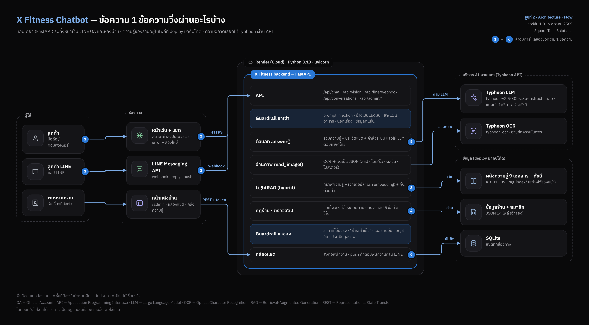

# 1. ชื่อโครงงานและผู้จัดทำ

| หัวข้อ | รายละเอียด |
|---|---|
| ชื่อโครงงาน | Clinic Booking Assistant — ผู้ช่วยจองคิวคลินิกผ่าน LINE |
| ผู้จัดทำ | 6500001 ชื่อ นามสกุล · 6500002 ชื่อ นามสกุล |
| เทคโนโลยีหลัก | FastAPI · SQLite · LINE Messaging API |

> ข้อมูลทั้งหมดในเอกสารนี้เป็นข้อมูลจำลอง ไม่ใช่ข้อมูลผู้ป่วยจริง

# 2. ภาพรวมระบบ

ผู้ป่วยจองคิวผ่าน LINE ระบบตรวจ**เวลาว่างของแพทย์**จากฐานข้อมูลก่อนยืนยัน ไม่ให้ AI เดาเวลาเอง ค่าตั้งทั้งหมดอยู่ใน `config.yaml`



## 2.1 ขั้นตอนการจอง

1. ผู้ป่วยพิมพ์วันและแผนกที่ต้องการ
2. ระบบดึงเวลาว่างจาก `slots` แล้วเสนอ 3 ช่วงแรก
3. ผู้ป่วยเลือก → ระบบล็อกคิวและส่ง**ใบนัด**กลับ

## 2.2 สิ่งที่ระบบไม่ทำ

- ไม่วินิจฉัยอาการ · ไม่แนะนำยา
- ไม่ยืนยันคิวที่ฐานข้อมูลบอกว่าเต็ม

> [!WARNING]
> ถ้าผู้ป่วยพิมพ์อาการฉุกเฉิน ระบบตอบให้โทร 1669 ทันทีและไม่จองคิว

# 3. ผลการทดสอบ

ผลรวม **ผ่าน 9/10 กรณี** · เวลาตอบเฉลี่ย 1.3 วินาที

| รหัส | ข้อความที่ส่ง | ผลที่ได้ | ผ่าน/ไม่ผ่าน | เวลา (วินาที) |
|---|---|---|---|---|
| T01 | จองทันตกรรมพรุ่งนี้เช้า | เสนอ 09:00 · 09:30 · 10:00 | ผ่าน | 1.2 |
| T02 | ขอเลื่อนนัดวันศุกร์ | แสดงนัดเดิมแล้วเสนอเวลาใหม่ | ผ่าน | 1.5 |
| T03 | ยกเลิกนัด | ยืนยันก่อนยกเลิก | ผ่าน | 0.9 |
| T04 | จองวันอาทิตย์ | แจ้งว่าคลินิกปิด | ผ่าน | 0.8 |
| T05 | หมอคนไหนว่าง | รายชื่อแพทย์ที่มีคิวว่าง | ผ่าน | 1.6 |
| T06 | เจ็บหน้าอกมาก | ให้โทร 1669 ไม่จองคิว | ผ่าน | 0.7 |
| T07 | จองให้แม่ | ขอชื่อและเบอร์ผู้ป่วย | ผ่าน | 1.3 |
| T08 | จอง 3 คิวพร้อมกัน | จำกัด 1 คิวต่อครั้ง | ผ่าน | 1.1 |
| T09 | ค่าตรวจเท่าไร | ราคาจากตารางค่าบริการ | ผ่าน | 1.4 |
| T10 | จองตอนเที่ยงคืน | เสนอเวลานอกเวลาทำการ | ไม่ผ่าน | 2.1 |

> [!TIP]
> แก้ T10 โดยกรองช่วงเวลาด้วยเวลาทำการจาก `config.yaml` ก่อนส่งให้ AI เรียง

# 4. ภาคผนวก — คำสั่งรันระบบ

```
cd clinic-bot
python -m uvicorn app.main:app --reload
```
