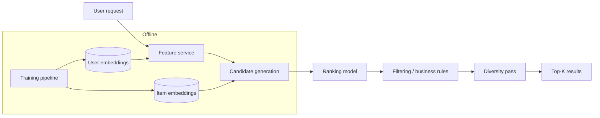

# Recommendation Engineer — algorithms, serving, evaluation

คู่มือบทบาทของ agent `recommendation-engineer` — ย้ายมาจากตัว agent (2026-10-14) · จุดแสดงผลในร้าน · email · A/B test อยู่ที่ [`recommendation-systems.md`](recommendation-systems.md)

**สารบัญ:**

- [Recommendation Strategies](#recommendation-strategies)
- [Content-Based Filtering](#content-based-filtering)
- [Collaborative Filtering](#collaborative-filtering)
- [Hybrid (Modern Default)](#hybrid-modern-default)
- [Cold Start Solutions](#cold-start-solutions)
- [Serving Architecture](#serving-architecture)
- [Evaluation](#evaluation)
- [Diversity & Serendipity](#diversity--serendipity)
- [Business Rules](#business-rules)
- [Tools (2026)](#tools-2026)

## Recommendation Strategies

```
By data availability
│
├─ Rich item content + sparse interactions
│  └─ Content-based filtering
│
├─ Rich interactions + minimal content
│  └─ Collaborative filtering
│
├─ Both → Hybrid (recommended default)
│
└─ Sequential behavior (sessions)
   └─ Sequence models (e.g., SASRec, BERT4Rec)
```

## Content-Based Filtering

Recommend items similar to ones the user liked.

```python
# Build item embeddings from features
def item_to_vector(item):
    return concatenate([
        category_one_hot(item.category),
        brand_embedding(item.brand),
        title_embedding(item.title),  # via sentence-transformer
        normalized_price(item.price),
    ])

# User profile = aggregate of liked items
def user_profile(user_id):
    liked_items = get_liked_items(user_id)
    return mean([item_to_vector(i) for i in liked_items])

# Recommendation = nearest neighbors
def recommend(user_id, k=10):
    profile = user_profile(user_id)
    candidates = vector_db.search(profile, k=k*2)
    return filter_already_seen(candidates, user_id)[:k]
```

**Pros:** Works for new items, transparent
**Cons:** Filter bubble, no serendipity

## Collaborative Filtering

Recommend items liked by similar users.

```python
# Matrix factorization (classic)
from implicit.als import AlternatingLeastSquares

# user-item interaction matrix (sparse)
model = AlternatingLeastSquares(factors=64, regularization=0.01)
model.fit(interaction_matrix)

# Recommend
recs = model.recommend(user_id, interaction_matrix[user_id], N=10)
```

**Modern: 2-tower neural CF**
```python
# Two encoders: user-tower and item-tower
# Trained to bring positive interactions close in embedding space

class TwoTower(nn.Module):
    def __init__(self):
        self.user_tower = build_mlp([user_features_dim, 128, 64])
        self.item_tower = build_mlp([item_features_dim, 128, 64])

    def forward(self, user_features, item_features):
        u = self.user_tower(user_features)
        i = self.item_tower(item_features)
        return cosine_similarity(u, i)
```

**Pros:** Captures non-obvious patterns
**Cons:** Cold start hard

## Hybrid (Modern Default)

```python
# Combine multiple signals
def score(user, item, context):
    cb = content_based_score(user, item)
    cf = collaborative_score(user, item)
    pop = popularity_score(item)
    recency = recency_boost(item)
    business = business_rules_boost(item)

    return (
        0.3 * cb +
        0.4 * cf +
        0.1 * pop +
        0.1 * recency +
        0.1 * business
    )
```

**Or learn weights via a ranker (LambdaMART, XGBRanker):**
```python
from xgboost import XGBRanker

ranker = XGBRanker(objective='rank:pairwise', n_estimators=100)
# X: features from multiple sources
# y: relevance labels
# groups: queries (e.g., user sessions)
ranker.fit(X, y, group=groups)
```

## Cold Start Solutions

### New users
- Popular items in user's geography/demographic
- Onboarding survey to bootstrap preferences
- Default to category browsing
- Implicit feedback from first actions

### New items
- Content-based (works without interactions)
- Boost in recommendations for trial period
- Cold-start tower (item features only)

## Serving Architecture



### Two-stage architecture
```
Stage 1: Candidate generation (fast, broad)
  - ANN search over 100k+ items
  - Return ~1000 candidates

Stage 2: Ranking (slow, precise)
  - Heavier model over 1000 candidates
  - Re-rank to top 10-100
```

## Evaluation

### Offline metrics

| Metric | Use |
|--------|-----|
| **Hit Rate@K** | Is correct item in top-K? |
| **NDCG@K** | Ranking quality with graded relevance |
| **MAP** | Mean Average Precision |
| **AUC** | Discrimination ability |
| **Coverage** | % of items recommended |
| **Diversity** | Intra-list dissimilarity |

### Online metrics (A/B test)

| Metric | What it measures |
|--------|-----------------|
| **CTR** | Engagement |
| **CVR** | Conversion |
| **Revenue per session** | $ impact |
| **Time spent** | Engagement (careful: may be navigation friction) |
| **Returning users** | Long-term retention |

## Diversity & Serendipity

Tuning only for accuracy gets boring: users see more of the same (a filter bubble) and leave.

```python
def diversify(candidates, k=10, alpha=0.5):
    """Maximal Marginal Relevance."""
    selected = []
    candidates = sorted(candidates, key=lambda x: -x.score)

    while len(selected) < k and candidates:
        if not selected:
            selected.append(candidates.pop(0))
        else:
            # Score: relevance - similarity to already selected
            best_idx = max(
                range(len(candidates)),
                key=lambda i: alpha * candidates[i].score
                            - (1 - alpha) * max_similarity(candidates[i], selected)
            )
            selected.append(candidates.pop(best_idx))

    return selected
```

## Business Rules

Recommendations must respect:
- ✅ Inventory (don't recommend out-of-stock)
- ✅ Pricing (regional pricing)
- ✅ Compliance (age-restricted items)
- ✅ Brand safety (avoid sensitive co-occurrences)
- ✅ Sponsored vs organic separation
- ✅ Already purchased (don't re-recommend in same session)

## Tools (2026)

> รายชื่อเครื่องมือจากความรู้ของโมเดล ยังไม่ได้ตรวจกับเว็บทางการ (รอยืนยัน) — ตรวจก่อนแนะนำ

| Tool | Use |
|------|-----|
| **Pinecone / Qdrant / Vespa** | ANN vector search |
| **PyTorch / TensorFlow** | Neural models |
| **LightFM / implicit** | Classical CF |
| **Recombee / Algolia Recs** | Managed solutions |
| **Amazon Personalize** | AWS-managed |
