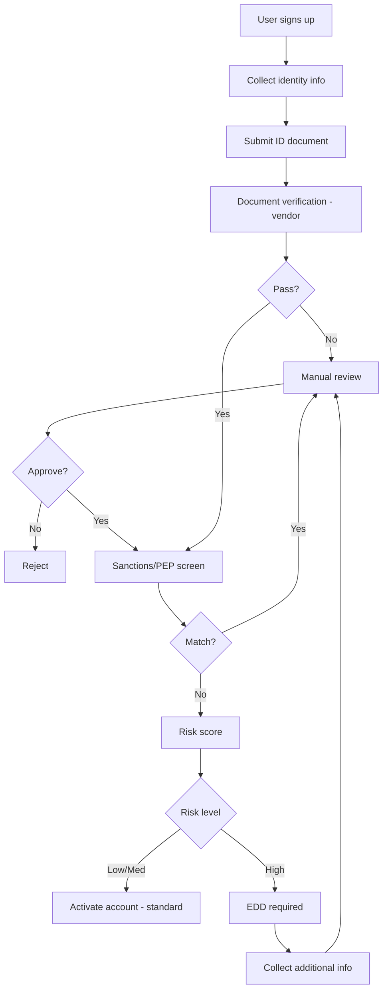

> เดิมชื่อ kyc-aml-patterns (ไม่ใช่ skill แยกแล้ว เนื้อหาอยู่ที่ไฟล์นี้) ใน plugin `software-company-fintech` — รวมเข้า `fintech-payments` ใน v2.0.0

**สารบัญ:** 

- [When to use this skill](#when-to-use-this-skill)
- [The 5 Pillars of AML Program](#the-5-pillars-of-aml-program)
- [Customer Due Diligence (CDD) Tiers](#customer-due-diligence-cdd-tiers)
- [Onboarding Flow Pattern](#onboarding-flow-pattern)
- [Vendor Selection](#vendor-selection)
- [Sanctions Screening](#sanctions-screening)
- [PEP (Politically Exposed Persons)](#pep-politically-exposed-persons)
- [Transaction Monitoring Rules](#transaction-monitoring-rules)
- [Suspicious Activity Report (SAR) Workflow](#suspicious-activity-report-sar-workflow)
- [Data Retention](#data-retention)
- [Risk-Based Approach](#risk-based-approach)
- [Common Pitfalls](#common-pitfalls)
- [Quality Targets](#quality-targets)
- [Reference](#reference)

# KYC / AML Implementation Patterns

## When to use this skill

- Onboarding customers in financial products
- Building transaction monitoring for Anti-Money Laundering (AML)
- Implementing sanctions and Politically Exposed Person (PEP) screening
- Designing suspicious activity workflow
- Choosing Know Your Customer (KYC) vendors (Sumsub, Jumio, Onfido, etc.)
- Building risk-based customer due diligence

## The 5 Pillars of AML Program

```
1. Internal controls (policies, procedures)
2. Designated compliance officer
3. Ongoing training
4. Independent audit
5. Customer Due Diligence (CDD)
```

This file covers how to build #5 in software.

## Customer Due Diligence (CDD) Tiers

### Tier 1: Customer Identification Program (CIP) — All customers

**Required for everyone:**
- Full legal name
- Date of birth
- Address
- ID number (national ID, passport)
- ID document verification

### Tier 2: Enhanced Due Diligence (EDD) — High-risk customers

**Required for:**
- Politically Exposed Persons (PEP)
- High-risk jurisdictions (FATF grey/black list)
- High net-worth individuals
- Cash-intensive businesses
- Sanctions list matches (after investigation)

**Additional:**
- Source of funds documentation
- Source of wealth (for high-net-worth)
- Beneficial ownership for entities
- Higher monitoring threshold

### Tier 3: Ongoing Monitoring — Everyone

**Continuous:**
- Sanctions list rescreening (daily)
- PEP list rescreening (weekly)
- Transaction monitoring (real-time)
- Adverse media — negative news about the customer (monthly)

## Onboarding Flow Pattern



## Vendor Selection

| Vendor | Best for | Coverage |
|--------|----------|----------|
| **Sumsub** | Global, comprehensive | 220+ countries |
| **Jumio** | Mature, enterprise | Global |
| **Onfido** | UK/EU focus, dev-friendly | Global, EU strong |
| **Veriff** | Real-time video, modern | Global |
| **Trulioo** | Many data sources | Global |
| **Persona** | Customizable workflows | Global, US strong |
| **AuthBridge** | India, SEA | Asia focus |

**Choose based on:**
- Geographic coverage of YOUR customers
- Available ID types (national ID specific to country)
- Integration ease
- Cost per check (often $1-5)
- How fast the vendor finishes manual reviews (SLA)

## Sanctions Screening

### Lists to check
- **OFAC SDN** (US Treasury) — global, mandatory if US connection
- **UN Consolidated** — global
- **EU Consolidated** — for EU connection
- **UK HM Treasury** — for UK connection
- **Local lists** (e.g., Thailand's Anti-Money Laundering Office (AMLO) sanctions list)

### Matching strategy

```typescript
// Use fuzzy matching with thresholds
// Don't rely on exact match (names spelling varies)

const match = await sanctionsApi.screen({
  name: customer.fullName,
  dob: customer.dateOfBirth,
  nationality: customer.nationality,
  threshold: 0.85, // 0-1 score
});

if (match.score > 0.95) {
  // Likely match — auto-block + escalate
  await escalate(match);
} else if (match.score > 0.85) {
  // Possible match — manual review
  await queueForReview(match);
}
```

### Anti-patterns
- Exact match only (misses 80% of real matches)
- One-time check only (lists update daily)
- Blocking every fuzzy match (floods you with false positives)
- Manual lists in spreadsheets (use API services)

## PEP (Politically Exposed Persons)

Categories:
- **Domestic PEPs** — local government officials
- **Foreign PEPs** — foreign government officials
- **International organization PEPs** — UN, IMF, etc.
- **Family/Close associates** — extends to relatives

**Implementation:**
- Use commercial database (Refinitiv, Dow Jones, ComplyAdvantage)
- Auto-screen on onboarding
- Rescreen monthly
- A PEP needs EDD, not automatic rejection
- Record who approved, at the right management level

## Transaction Monitoring Rules

### Rule categories

**Velocity rules:**
- Cumulative volume per period
- Transaction count per period
- Sudden spike from baseline

**Threshold rules:**
- Single transaction > $10,000 (US Currency Transaction Report, CTR)
- Thailand (reports to AMLO): cash transactions of 2,000,000 baht or more; property transactions over 5,000,000 baht (Tilleke & Gibbins, "Thailand: Anti-Money Laundering", Sep 2025) `(รอยืนยัน — official Ministerial Regulation on amlo.go.th not reachable on 22 ต.ค. 2569; electronic-transfer thresholds not checked)`
- Several transactions kept just under the threshold (structuring)

**Pattern rules:**
- Round amounts ($1000, $5000, $10000)
- Repeated small transactions (smurfing)
- Geographic risk (high-risk jurisdiction)
- Time patterns (always at 3am)

**Behavioral rules:**
- Deviation from customer baseline
- Activity inconsistent with stated purpose
- Many new counterparties appear suddenly

### Implementation tiers

```
Tier 1: Static rules
  - Fast, deterministic
  - Easy to explain
  - Use for hard limits

Tier 2: Statistical models
  - Anomaly detection
  - Per-customer baseline
  - Catches subtle patterns

Tier 3: ML models
  - Network analysis
  - Embedding-based similarity
  - Hardest to explain
```

## Suspicious Activity Report (SAR) Workflow

```
1. Alert fires (rule or model)
   ↓
2. Investigator reviews (within 5 days)
   ↓
3. Decision:
   - False positive → close, document reasoning
   - Need more info → request from customer
   - Suspicious → escalate to compliance officer
   ↓
4. Compliance officer reviews
   ↓
5. If reportable: file SAR within regulatory deadline
   - Thailand (AMLO): within 7 days of decision `(รอยืนยัน — no source; check amlo.go.th before relying on it)`
   - US (FinCEN): within 30 days of detection
   ↓
6. Continue customer relationship per legal advice
   (often: continue normally, don't tip off)
```

## Data Retention

| Data | Retention (US / EU baseline) | Reason |
|------|-----------|--------|
| KYC documents | 5 years post-relationship | AML regulations |
| Sanctions screening results | 5 years | Audit trail |
| SARs | 5 years | Regulatory |
| Transaction monitoring alerts | 5 years | Audit |
| Customer communications | 5 years | Dispute resolution |

**Thailand:** the Anti-Money Laundering Act B.E. 2542 (พ.ร.บ.ป้องกันและปราบปรามการฟอกเงิน) section 22 sets the periods for customer due diligence (CDD) records and transaction records, and the 2015 amendment changed the retention period (Tilleke & Gibbins, Sep 2025). The exact years — possibly 10 years for CDD records after the relationship ends — are `(รอยืนยัน)`: check the Act and the Anti-Money Laundering Board (AMLB) ordinance on safe-keeping CDD information (2016) on amlo.go.th. Until confirmed, keep Thai records for the longer period.

> Note: Clashes with a deletion request? For Thai users this is the Personal Data Protection Act (PDPA); for EU users the GDPR "right to erasure". Both let you keep data that another law requires you to keep, so AML retention usually wins — record the legal basis and delete when the period ends. Details → `pdpa-compliance`.

## Risk-Based Approach

Treat customers by risk level, not all the same:

```typescript
function calculateRiskScore(customer: Customer): RiskLevel {
  let score = 0;

  // Geography
  if (highRiskJurisdictions.includes(customer.country)) score += 30;

  // Customer type
  if (customer.type === 'business') score += 10;
  if (customer.industry === 'crypto') score += 20;
  if (customer.industry === 'cash-intensive') score += 15;

  // Politics
  if (customer.isPEP) score += 25;

  // Sanctions proximity
  if (customer.sanctionsMatchScore > 0.7) score += 40;

  if (score < 20) return 'LOW';
  if (score < 50) return 'MEDIUM';
  return 'HIGH';
}

// Adjust monitoring frequency, transaction limits, etc. by risk level
```

## Common Pitfalls

- Wrong: **One-time checks** — must be ongoing
- Wrong: **Treating low-risk as no monitoring needed**
- Wrong: **Over-reliance on vendor** — you're still responsible
- Wrong: **Alert fatigue** — too many false positives → real ones missed
- Wrong: **No documentation** — the regulator will ask you to show your reasoning
- Wrong: **Mixing fraud + AML** — they have different goals and different rules
- Wrong: **Auto-block on PEP** — a PEP is not a criminal. Do EDD instead

## Quality Targets

- False positive rate: set your own target from your baseline (example figure only — published AML alert false-positive rates are often far higher than 5%, so a < 5% target is rarely realistic)
- Median time to resolve an alert < 5 days
- 100% of SARs filed within the regulatory deadline
- Review and tune rules every quarter
- Independent audit of the program every year

## Reference

- [FATF Recommendations](https://www.fatf-gafi.org/)
- [AMLO Thailand](https://www.amlo.go.th/)
- [FinCEN US](https://www.fincen.gov/)
- [Wolfsberg Group standards](https://www.wolfsberg-principles.com/)
- [OFAC SDN List](https://sanctionssearch.ofac.treas.gov/)
