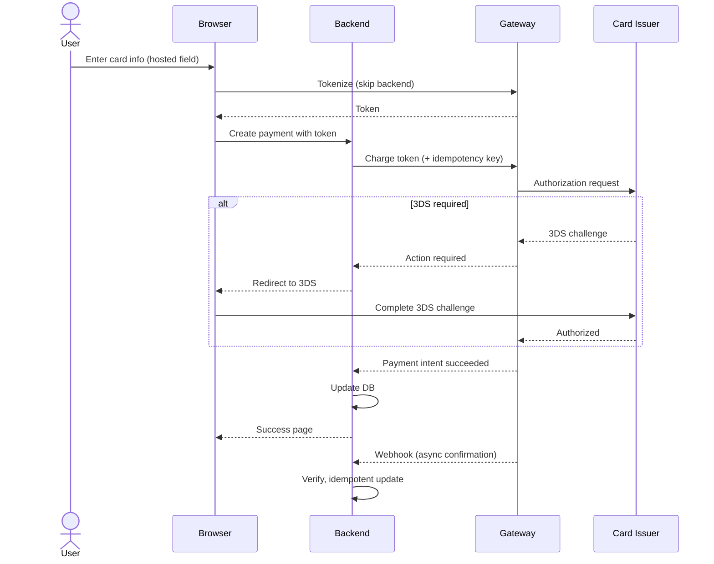

> เดิมชื่อ payment-gateway-integration (ไม่ใช่ skill แยกแล้ว เนื้อหาอยู่ที่ไฟล์นี้) ใน plugin `software-company-fintech` — รวมเข้า `fintech-payments` ใน v2.0.0

**สารบัญ:** 

- [When to use this skill](#when-to-use-this-skill)
- [Gateway Selection (Detailed)](#gateway-selection-detailed)
- [Card Payment Flow (Generic)](#card-payment-flow-generic)
- [Critical Patterns](#critical-patterns)
- [Retry Strategy](#retry-strategy)
- [Multi-Currency Handling](#multi-currency-handling)
- [Settlement Reconciliation](#settlement-reconciliation)
- [Refund Edge Cases](#refund-edge-cases)
- [Common Pitfalls](#common-pitfalls)
- [Reference](#reference)

# Payment Gateway Integration Patterns

## When to use this skill

- Adding payments to a new product
- Migrating gateways
- Implementing 3D Secure (3DS) / Strong Customer Authentication (SCA)
- Building reliable webhook processing
- Handling multi-currency payments
- Implementing recurring billing / subscriptions

## Gateway Selection (Detailed)

### Comparison Matrix

Settlement times and coverage change often and were not re-checked on 2026-10-14 `(รอยืนยัน)` — confirm on each vendor's current pricing page before quoting them. Omise traded as "Opn Payments" for about two years and went back to the Omise name in March 2025 (omise.co post "Omise unveils bold rebranding…", 18 Mar 2025; also brandinside.asia and thaipr.net — ตรวจ 22 ต.ค. 2569).

| Gateway | Card | Wallets | Local TH | Local SEA | Settlement | Best for |
|---------|:----:|:-------:|:--------:|:---------:|:----------:|----------|
| **Stripe** | ✅ Excellent | Apple/Google | 🟡 PromptPay | 🟡 Some | T+2-7 | Global, SaaS, subscriptions |
| **Adyen** | ✅ Excellent | All major | ✅ | ✅ | T+1 | Enterprise, global retail |
| **Omise** | ✅ | ✅ TH-specific | ✅ Comprehensive | 🟡 | T+1 | Thailand-first |
| **2C2P** | ✅ | ✅ | ✅ | ✅ SEA-strong | T+1-2 | SEA regional |
| **Braintree** | ✅ | PayPal+ | 🟡 | 🟡 | T+2 | PayPal users |
| **Razorpay** | ✅ | UPI | ❌ | 🟡 | T+2 | India |
| **Square** | ✅ | Cash App | ❌ | ❌ | T+1 | US/CA in-person |

## Card Payment Flow (Generic)



## Critical Patterns

### Pattern 1: Use Idempotency Keys ALWAYS

```typescript
// Generate ONCE per business operation, reuse on retry
const idempotencyKey = `order_${orderId}_charge_v1`;

const paymentIntent = await stripe.paymentIntents.create({
  amount: orderTotal,
  currency: 'thb',
  payment_method: paymentMethodId,
  confirm: true,
}, {
  idempotencyKey: idempotencyKey, // ← prevents double-charge
});

// On retry, gateway returns same payment intent
```

### Pattern 2: Handle 3D Secure / SCA

```typescript
// Strong Customer Authentication required in EU/UK
// Many TH banks also enforce 3DS

const paymentIntent = await stripe.paymentIntents.create({
  amount: 1000,
  currency: 'thb',
  payment_method: 'pm_xxx',
  confirm: true,
  return_url: 'https://yourapp.com/payment-return',
});

if (paymentIntent.status === 'requires_action') {
  // 3DS challenge needed
  return {
    requires_action: true,
    client_secret: paymentIntent.client_secret,
    next_action: paymentIntent.next_action,
  };
  // Frontend uses Stripe.js to handle the challenge
}
```

### Pattern 3: Reliable Webhook Processing

```typescript
// 1. Receive webhook
app.post('/webhooks/stripe', express.raw({ type: 'application/json' }), async (req, res) => {
  // 2. Verify signature (CRITICAL) — on the raw body, not parsed JSON
  let event: Stripe.Event;
  try {
    event = stripe.webhooks.constructEvent(
      req.body,
      req.headers['stripe-signature']!,
      process.env.STRIPE_WEBHOOK_SECRET!
    );
  } catch {
    return res.status(400).send('Invalid signature');
  }

  try {
    // 3. Store raw event FIRST. event.id is the PRIMARY KEY:
    //    INSERT ... ON CONFLICT (id) DO NOTHING → a duplicate delivery inserts nothing
    const inserted = await db.webhookEvents.insertIfAbsent({
      id: event.id,
      type: event.type,
      payload: event,
      status: 'PENDING',
    });

    // 4. Enqueue BEFORE the ack, whenever the stored row is still PENDING — not only when it
    //    was just inserted. So if enqueue throws → 500 → the gateway's retry finds the row
    //    PENDING and enqueues again. If the process dies, the sweeper below picks the row up.
    //    (A duplicate enqueue is harmless: the worker claims the event atomically.)
    const stored = inserted ? { status: 'PENDING' } : await db.webhookEvents.findById(event.id);
    if (stored.status === 'PENDING') {
      await queue.enqueue('process-webhook', { eventId: event.id });
    }

    // 5. Ack fast (within a few seconds) — the last step, nothing after it can fail
    return res.json({ received: true, duplicate: !inserted });
  } catch (err) {
    log.error('Webhook error', err);
    return res.status(500).send('Error');
  }
});

// Sweeper (cron every few minutes): re-enqueue events stuck in PENDING,
// e.g. stored but never enqueued because the process crashed.
async function sweepPendingWebhooks() {
  const stuck = await db.webhookEvents.findPendingOlderThan({ minutes: 5 });
  for (const e of stuck) await queue.enqueue('process-webhook', { eventId: e.id });
}

// Worker (separate) — may be enqueued twice for one event (sweeper + retry), so it CLAIMS
// the event atomically instead of check-then-act:
//   UPDATE webhook_events SET status = 'PROCESSING'
//   WHERE id = $1 AND status IN ('PENDING', 'FAILED')
// Only the worker that changed 1 row goes on. Handlers must still be idempotent
// (e.g. handleRefund keyed on the refund id): a worker can crash after the handler ran
// but before PROCESSED is written. A sweeper may also reset rows stuck in PROCESSING
// for a long time back to PENDING.
async function processWebhook(eventId: string) {
  const claimed = await db.webhookEvents.claim(eventId); // rowCount of the UPDATE above
  if (claimed !== 1) return; // someone else has it, or it is already PROCESSED
  const evt = await db.webhookEvents.findById(eventId);

  try {
    switch (evt.type) {
      case 'payment_intent.succeeded':
        await handlePaymentSucceeded(evt.payload.data.object);
        break;
      case 'payment_intent.payment_failed':
        await handlePaymentFailed(evt.payload.data.object);
        break;
      case 'charge.refunded':
        await handleRefund(evt.payload.data.object);
        break;
      // ... other handlers
    }

    await db.webhookEvents.update(eventId, { status: 'PROCESSED' });
  } catch (err) {
    await db.webhookEvents.update(eventId, {
      status: 'FAILED',
      error: err.message,
      attempts: { increment: 1 },
    });
    throw err; // re-throw for retry
  }
}
```

### Pattern 4: Verify Webhook with API (Belt + Suspenders)

```typescript
// Webhook says payment succeeded — but verify via API
async function handlePaymentSucceeded(eventPayload: any) {
  // Don't trust webhook payload alone
  const intent = await stripe.paymentIntents.retrieve(eventPayload.id);

  if (intent.status !== 'succeeded') {
    log.warn('Webhook claimed success but API disagrees', { id: intent.id });
    return; // Don't take action
  }

  // Now we can safely update our DB
  await db.payments.update(intent.metadata.orderId, {
    status: 'PAID',
    paidAt: new Date(intent.created * 1000),
  });
}
```

### Pattern 5: Subscription Billing

```typescript
// Initial setup
const customer = await stripe.customers.create({
  email: user.email,
  metadata: { userId: user.id },
});

const subscription = await stripe.subscriptions.create({
  customer: customer.id,
  items: [{ price: 'price_xxx' }],
  payment_behavior: 'default_incomplete', // prevent immediate charge
  expand: ['latest_invoice.payment_intent'],
});

// Handle webhooks:
// - invoice.paid → activate features
// - invoice.payment_failed → dunning flow
// - customer.subscription.updated → sync state
// - customer.subscription.deleted → revoke access
```

## Retry Strategy

```typescript
// Webhook retries — gateway will retry, so:
// - Don't fail fast
// - Be idempotent
// - Log everything

// Manual retries (e.g., failed authorization):
const retryDelays = [0, 60_000, 300_000, 3_600_000]; // 0s, 1min, 5min, 1hr

async function retryPayment(paymentId: string, attempt: number = 0) {
  if (attempt >= retryDelays.length) {
    await markAsFailed(paymentId);
    return;
  }

  await sleep(retryDelays[attempt]);

  try {
    await chargePayment(paymentId);
  } catch (err) {
    if (isRetryable(err)) {
      await retryPayment(paymentId, attempt + 1);
    } else {
      await markAsFailed(paymentId);
    }
  }
}
```

## Multi-Currency Handling

```typescript
// Always store currency with amount
interface Money {
  amount: bigint;        // integer in the currency's minor unit (THB satang, USD cents; JPY has 0 decimals, KWD 3)
  currency: string;      // ISO 4217 code
}

// Never assume USD
// Never assume 2 decimals — don't hard-code `/ 100`
// Never mix currencies in calculations
// Always use FX rate at transaction time

// Display formatting (per locale) — display only, never feed the result back into math:
function format(money: Money, locale: string): string {
  const fmt = new Intl.NumberFormat(locale, { style: 'currency', currency: money.currency });
  const digits = fmt.resolvedOptions().maximumFractionDigits; // ISO 4217 minor unit: THB 2, JPY 0, KWD 3
  return fmt.format(Number(money.amount) / 10 ** digits);
}
// The gateway's own amount rules can differ from ISO 4217 for a few currencies
// (Stripe lists its "zero-decimal" and special cases) — convert with the gateway's table at the API edge.
```

## Settlement Reconciliation

```typescript
// Daily job — match transaction by transaction, not one day total against another.
// A payout is net of fees and batches several days, so "sum of payouts = payments paid today" never holds.
const toUnix = (d: Date) => Math.floor(d.getTime() / 1000); // Stripe `created` filters take Unix seconds

async function reconcileDay(date: Date) {
  // 1. Gateway view: one entry per charge / refund (gross amount, minor units)
  const gateway = new Map<string, bigint>(); // source id (ch_… / re_…) → amount
  for await (const t of stripe.balanceTransactions.list({
    created: { gte: toUnix(startOfDay(date)), lt: toUnix(startOfNextDay(date)) },
    limit: 100, // auto-pagination walks every page; the default page is only 10
  })) {
    if (!['charge', 'payment', 'refund', 'payment_refund'].includes(t.type)) continue; // fees, payouts, adjustments: own checks
    gateway.set(t.source as string, BigInt(t.amount)); // t.fee and t.net are there too
  }
  // Note: balance transactions are in the SETTLEMENT currency. If you charge in another
  // currency, compare against the charge amount instead, or store both in your DB.

  // 2. Our view: same ids, same sign convention (refunds negative)
  const ours = await db.ledger.entriesByGatewayIdOnDate(date); // Map<string, bigint>

  // 3. Every difference, both directions
  const mismatches = [];
  for (const [id, amt] of gateway) if (ours.get(id) !== amt) mismatches.push({ id, gateway: amt, ours: ours.get(id) });
  for (const [id, amt] of ours) if (!gateway.has(id)) mismatches.push({ id, gateway: undefined, ours: amt });

  if (mismatches.length > 0) {
    await alerts.fire({ severity: 'P1', title: 'Settlement reconciliation mismatch', data: { date, mismatches } });
  }
}

// Bank side — match each payout (already net of fees) to one bank deposit
async function reconcilePayouts(date: Date) {
  for await (const p of stripe.payouts.list({
    arrival_date: { gte: toUnix(startOfDay(date)), lt: toUnix(startOfNextDay(date)) },
    limit: 100,
  })) {
    const deposit = await bankApi.findDeposit({ reference: p.id, date });
    if (!deposit || deposit.amount !== BigInt(p.amount)) {
      await alerts.fire({ severity: 'P2', title: 'Bank deposit mismatch', data: { payout: p.id } });
    }
    // Which charges make up this payout: balanceTransactions.list({ payout: p.id })
  }
}
```

## Refund Edge Cases

```typescript
// 1. Refund must equal or be less than captured amount
// 2. Cannot refund a refund
// 3. Some methods can't be refunded (e.g., PromptPay QR — manual process)
// 4. Refund timing varies by method
//    - Card: 5-10 business days for customer to see
//    - Bank transfer: 1-3 days
//    - Wallet: usually instant

// Partial refund pattern — the idempotency key comes from a STORED refund request.
// ❌ `refund_${paymentId}_${Date.now()}` → new key on every retry → timeout + retry = refunded twice
// ❌ `refund_${paymentId}_${amount}`     → two real refunds of the same amount share a key → the 2nd is silently dropped
// ✅ one refund_requests row per real refund; its id is the key; every retry reuses it

// Step 1: record the request once (inside a transaction, payment row locked)
async function requestRefund(paymentId: string, clientRequestId: string, amountCents?: bigint) {
  return db.transaction(async (tx) => {
    const payment = await tx.payments.findByIdForUpdate(paymentId); // SELECT ... FOR UPDATE

    // Same request sent twice (double click, client retry) → same row back.
    // refund_requests has UNIQUE (client_request_id).
    // Same id with a different amount is a client bug → refuse (same rule as transfer()).
    const existing = await tx.refundRequests.findByClientRequestId(clientRequestId);
    if (existing) {
      if (amountCents !== undefined && existing.amount !== amountCents) {
        throw new IdempotencyKeyReusedError(); // same key, different body
      }
      return existing;
    }

    // Count PENDING + SUBMITTED + SUCCEEDED requests, so two requests in flight can't overshoot
    const reserved = await tx.refundRequests.sumNotFailed(paymentId);
    const available = payment.amount - reserved;
    const refundAmount = amountCents ?? available;

    if (refundAmount <= 0n) throw new Error('Already fully refunded');
    if (refundAmount > available) throw new Error('Refund exceeds available');

    return tx.refundRequests.create({
      id: crypto.randomUUID(), paymentId, clientRequestId,
      amount: refundAmount, status: 'PENDING',
    });
  });
}

// Step 2: send it — safe to run again (worker retry, timeout) with the same id
async function executeRefund(refundRequestId: string) {
  const rr = await db.refundRequests.findById(refundRequestId);
  if (rr.status !== 'PENDING') return rr; // already done
  const payment = await db.payments.findById(rr.paymentId);

  // Stripe Node: the key is a request option (2nd argument), not a param.
  // Stripe may prune a key after 24 h — for a retry later than that, first look for
  // an existing refund with metadata.refundRequestId before calling create again.
  // Network error / timeout → leave PENDING and retry later (same key).
  // Definite rejection (e.g. StripeInvalidRequestError) → mark FAILED so the amount is freed.
  const refund = await stripe.refunds.create({
    payment_intent: payment.gatewayId,
    amount: Number(rr.amount),
    metadata: { refundRequestId: rr.id },
  }, {
    idempotencyKey: `refund_${rr.id}`,
  });

  await db.transaction(async (tx) => {
    // refund.status can be pending / requires_action / succeeded / failed / canceled.
    // Not final yet → SUBMITTED (still counted as reserved); the webhook
    // (refund.updated) later moves it to SUCCEEDED or FAILED and re-runs this total.
    const status =
      refund.status === 'succeeded' ? 'SUCCEEDED'
      : refund.status === 'failed' || refund.status === 'canceled' ? 'FAILED'
      : 'SUBMITTED';
    await tx.refundRequests.update(rr.id, { gatewayRefundId: refund.id, status });
    const refunded = await tx.refundRequests.sumSucceeded(rr.paymentId);
    await tx.payments.update(rr.paymentId, {
      refunded,
      status: refunded === payment.amount ? 'REFUNDED' : 'PARTIALLY_REFUNDED', // total, not this one refund
    });
  });
}
```

## Common Pitfalls

- ❌ **Trust webhook order** — events can arrive in any order
- ❌ **Trust webhook amount** — check it with the API
- ❌ **No idempotency** — a network glitch charges the customer twice
- ❌ **Process webhook inline** — slow replies make the gateway retry and create duplicates
- ❌ **Store card numbers** — even encrypted, they keep your system in PCI scope
- ❌ **Skip 3DS** — many payments get declined in the EU
- ❌ **Hard-code currency** — breaks when you add new markets
- ❌ **Sync state from gateway only on demand** — your data drifts further from the gateway's over time
- ❌ **Mix gateway IDs with internal IDs** — store both, in separate fields
- ❌ **No reconciliation** — small daily differences add up to a big monthly loss

## Reference

- [Stripe Webhooks](https://stripe.com/docs/webhooks)
- [Adyen Webhooks](https://docs.adyen.com/development-resources/webhooks)
- [Omise Webhooks](https://www.omise.co/webhooks)
- [PCI-DSS Tokenization](https://www.pcisecuritystandards.org/)
- [3D Secure 2.0 Spec](https://www.emvco.com/emv-technologies/3d-secure/)
