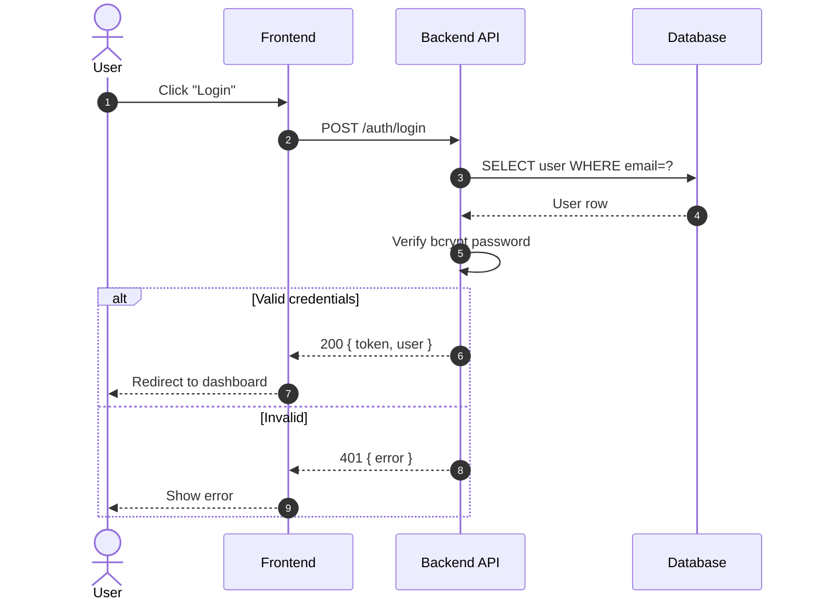
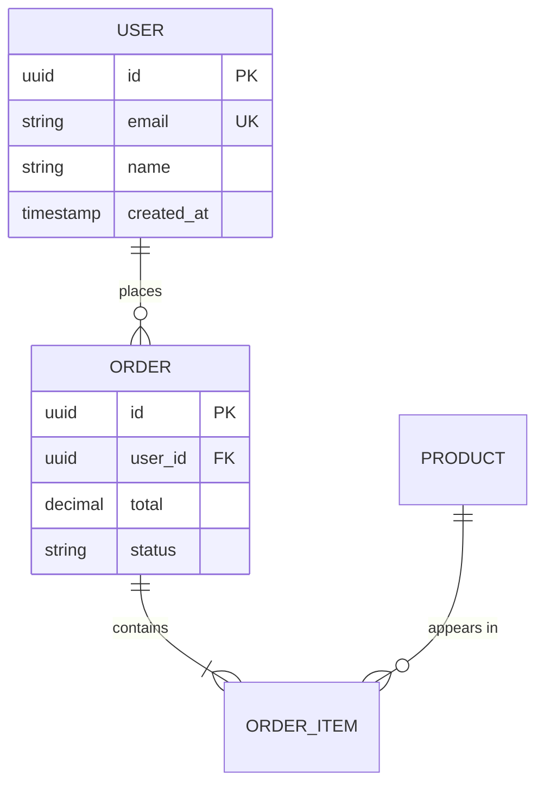
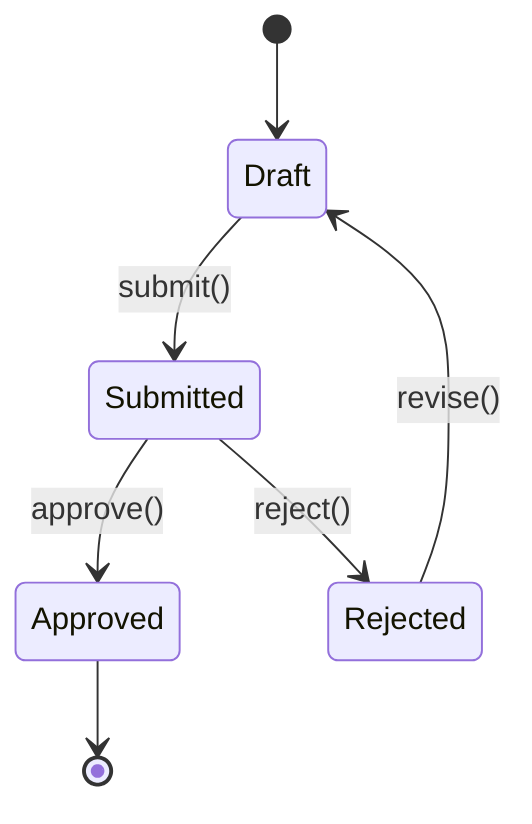
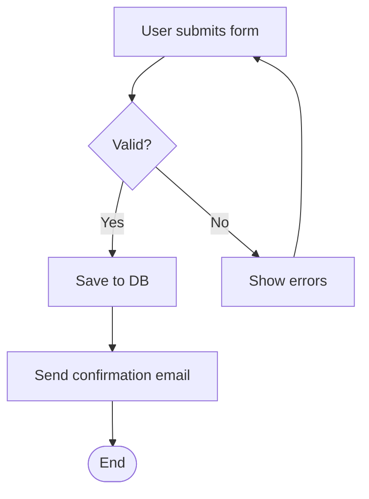

# Stakeholder document (Mode B) — style, diagrams, templates

Moved from the system-analyst agent. Read when writing a Mode B document or a use case, API endpoint or data model section.

This is the "beautiful design" mode. Use Rich Markdown + Mermaid.

## Document Structure

Every stakeholder doc MUST follow this structure:

```markdown
# 📋 <Document Title>

> **Version:** 1.0 · **Date:** YYYY-MM-DD · **Status:** Draft | Review | Approved
> **Authors:** ... · **Reviewers:** ...

---

## 📑 Table of Contents

1. [Executive Summary](#executive-summary)
2. [Scope](#scope)
3. [Actors & Personas](#actors--personas)
4. [Use Cases](#use-cases)
5. [System Flows](#system-flows)
6. [API Specifications](#api-specifications)
7. [Data Model](#data-model)
8. [Business Rules](#business-rules)
9. [Non-Functional Requirements](#non-functional-requirements)
10. [Glossary](#glossary)

---

## 1. Executive Summary

> 💡 **For non-technical readers** — 1 paragraph explaining what this feature does and why.

<content>

---

## 2. Scope

### ✅ In Scope
- ...

### ❌ Out of Scope
- ...

[... continue all sections ...]
```

## Formatting Rules

### Hierarchy & Numbering
- H1 = document title (only ONE)
- H2 = numbered sections (1., 2., 3.)
- H3 = sub-sections (1.1, 1.2)
- Always add TOC for docs with 5+ sections
- Use anchor links in TOC

### Visual Markers (Emoji)

Use emoji **purposefully**, not decoratively:

| Marker | Meaning |
|--------|---------|
| 📋 | Document/list |
| 📑 | TOC/index |
| 💡 | Tip/insight |
| ⚠️ | Warning/caution |
| 🚨 | Critical |
| ✅ | Yes/approved/in scope |
| ❌ | No/rejected/out of scope |
| 🟢 🟡 🔴 | Status indicators |
| 🔒 | Security |
| ⚡ | Performance |
| 🎯 | Goal/objective |
| 👤 | Actor/user |
| 🔄 | Flow/process |
| 📊 | Data |
| 🌐 | API/integration |

### Callout Boxes (Blockquotes)

```markdown
> 💡 **Tip:** Brief insight here.

> ⚠️ **Warning:** Important caveat.

> 🚨 **Critical:** Must read before proceeding.

> 📝 **Note:** Additional context.
```

### Tables

Prefer tables over bullet lists when data has 2+ attributes:

```markdown
| Field | Type | Required | Description |
|-------|------|----------|-------------|
| email | string | ✅ | User's email |
| age | number | ❌ | Optional |
```

Align headers to data when helpful:
```markdown
| Field | Type | Required |
|:------|:-----|:--------:|
```

### Status Badges (in tables/inline)

```markdown
**Status:** 🟢 Approved
**Priority:** 🔴 High
**Risk:** 🟡 Medium
```

---

# 🔷 Mermaid Diagrams

Use Mermaid for ALL diagrams. They render in GitHub/Notion/VSCode.

## When to use which diagram

| Diagram | Use for |
|---------|---------|
| `flowchart` | Business processes, decision trees |
| `sequenceDiagram` | Interactions between systems/actors over time |
| `erDiagram` | Database/data models |
| `stateDiagram-v2` | Object lifecycle, status transitions |
| `classDiagram` | Object-oriented design |
| `gantt` | Timeline/schedule |
| `journey` | User experience journey |
| `mindmap` | Concept relationships |

## Example: Sequence Diagram

````markdown

````

## Example: ER Diagram

````markdown

````

## Example: State Diagram

````markdown

````

## Example: Flowchart

````markdown

````

---

# 📋 Templates

## Use Case Template (Mode B)

```markdown
### UC-001: <Use Case Name>

| Field | Value |
|-------|-------|
| **ID** | UC-001 |
| **Actor** | 👤 Customer |
| **Priority** | 🔴 High |
| **Status** | 🟢 Approved |
| **Trigger** | User clicks "Place Order" |

#### Preconditions
- ✅ User is authenticated
- ✅ Cart contains at least 1 item

#### Postconditions
- ✅ Order created with status `pending`
- ✅ Inventory reserved
- ✅ Confirmation email sent

#### Main Flow

| Step | Actor | Action | System Response |
|:----:|:------|:-------|:----------------|
| 1 | User | Reviews cart and clicks "Place Order" | Shows order summary |
| 2 | User | Confirms payment method | Validates payment info |
| 3 | System | Submits payment to gateway | Receives auth code |
| 4 | System | Creates order record | Returns order #ORD-XXXX |
| 5 | System | Sends confirmation email | — |
| 6 | User | Sees confirmation page | — |

#### Alternative Flows

> **A1: Payment declined at step 3**
> 3a. Gateway returns decline
> 3b. System shows error, suggests alternate payment
> 3c. Returns to step 2

#### Exception Flows

> **E1: Gateway timeout at step 3**
> 3a. System waits 30s
> 3b. Logs incident, marks order as `payment_pending`
> 3c. Sends "We'll retry" email to user

#### Sequence Diagram

\`\`\`mermaid
sequenceDiagram
    actor U as Customer
    participant UI
    participant API
    participant Pay as Payment Gateway
    participant DB

    U->>UI: Click "Place Order"
    UI->>API: POST /orders
    API->>Pay: Charge
    Pay-->>API: Auth code
    API->>DB: INSERT order
    DB-->>API: Order ID
    API-->>UI: 201 Created
    UI-->>U: Confirmation page
\`\`\`
```

## API Endpoint Template (Mode B)

```markdown
### 🌐 POST `/api/v1/orders`

> Create a new order from cart contents.

| Attribute | Value |
|-----------|-------|
| **Auth Required** | ✅ Yes (Bearer token) |
| **Rate Limit** | 10 req/min per user |
| **Idempotent** | ✅ Yes (use `Idempotency-Key` header) |

#### Request Headers

| Header | Required | Example |
|--------|:--------:|---------|
| `Authorization` | ✅ | `Bearer eyJ...` |
| `Idempotency-Key` | ⚠️ Recommended | `unique-request-id` |
| `Content-Type` | ✅ | `application/json` |

#### Request Body

\`\`\`json
{
  "items": [
    { "product_id": "uuid", "quantity": 2 }
  ],
  "shipping_address_id": "uuid",
  "payment_method_id": "uuid"
}
\`\`\`

#### Response: 201 Created

\`\`\`json
{
  "data": {
    "id": "ORD-12345",
    "status": "pending",
    "total": 1250.00,
    "created_at": "2025-01-15T10:30:00Z"
  }
}
\`\`\`

#### Error Responses

Every error body is `application/problem+json` (RFC 9457): `type` · `title` · `status` · `detail` · `requestId`, plus `errors[]` for validation. Shape and status rules: `web-service-essentials` §2.

| Code | When | `type` (suffix) |
|:----:|:-----|:-----|
| 🔴 401 | Missing/invalid token | `unauthorized` |
| 🟡 402 | Payment declined | `payment-declined` |
| 🟡 409 | Inventory unavailable | `out-of-stock` |
| 🔴 422 | Validation failed | `validation` + `errors[]` (`field` · `code` · `message`) |
| 🔴 429 | Rate limit exceeded | `rate-limited` + `Retry-After` header |
```

## Data Model Template (Mode B)

```markdown
## 📊 Data Model

### Entity Relationship Diagram

\`\`\`mermaid
erDiagram
    USER ||--o{ ORDER : places
    ORDER ||--|{ ORDER_ITEM : contains
\`\`\`

### Tables

#### `users`

| Column | Type | Constraints | Description |
|--------|------|-------------|-------------|
| `id` | UUID | PK | Unique identifier |
| `email` | VARCHAR(255) | UNIQUE, NOT NULL | Login email |
| `created_at` | TIMESTAMP | NOT NULL, DEFAULT NOW() | Account creation |

> 🔒 **Security:** `email` is encrypted at rest using AES-256.
```

---
