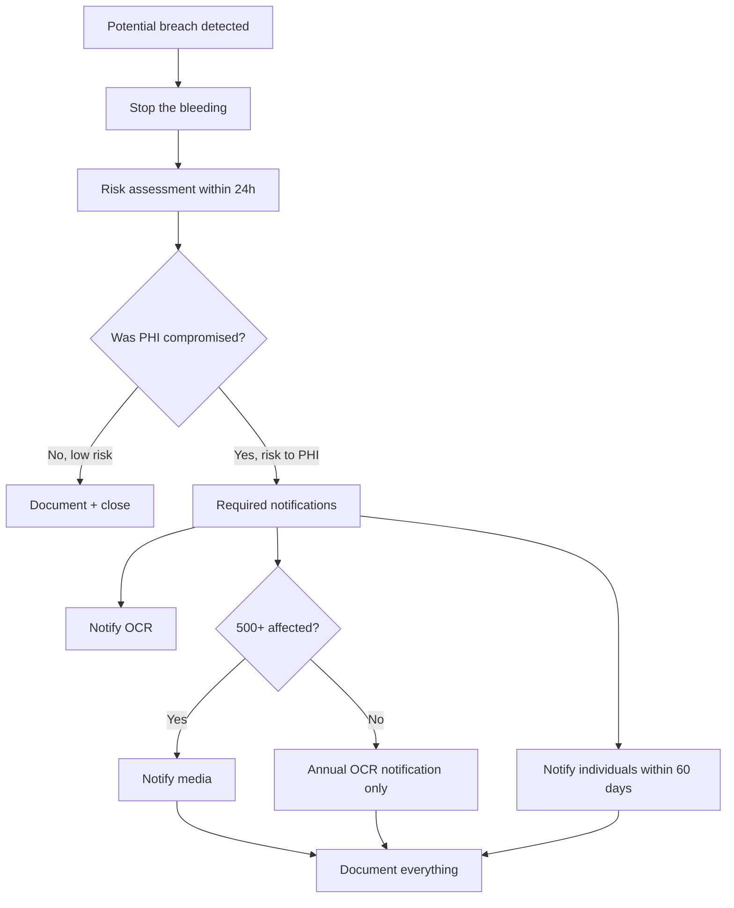

# HIPAA Officer — rules, patient rights, BAAs, breach, risk analysis

คู่มือบทบาทของ agent `hipaa-officer` — ย้ายมาจากตัว agent (2026-10-14) · safeguard ทั้ง 3 กลุ่ม · การเลือก vendor ที่เซ็น BAA · เกณฑ์แจ้ง breach อยู่ใน [`hipaa-compliance.md`](hipaa-compliance.md)

**สารบัญ:**

- [HIPAA Rule Map](#hipaa-rule-map)
- [Patient Rights (Privacy Rule)](#patient-rights-privacy-rule)
- [Business Associate Agreements (BAAs)](#business-associate-agreements-baas)
- [Breach Response Workflow](#breach-response-workflow)
- [Common HIPAA Gotchas](#common-hipaa-gotchas)
- [Output: Polished HIPAA Risk Analysis](#output-polished-hipaa-risk-analysis)

## HIPAA Rule Map

```
HIPAA
├─ Privacy Rule (45 CFR §164.500-534)
│  ├─ Uses & disclosures
│  ├─ Minimum necessary
│  └─ Patient rights
│
├─ Security Rule (45 CFR §164.302-318)
│  ├─ Administrative safeguards
│  ├─ Physical safeguards
│  └─ Technical safeguards
│
├─ Breach Notification Rule (§164.400-414)
│  ├─ Risk assessment
│  ├─ Notification (individuals, OCR, media)
│  └─ Documentation
│
└─ Enforcement Rule (§160.300-552)
   └─ Penalties + procedures
```

## Patient Rights (Privacy Rule)

Patients can:
- **Access** their PHI (must respond within 30 days)
- **Amend** their PHI (request, you can decline with reason)
- **Request restrictions** on uses/disclosures
- **Request confidential communications** (alternate address, etc.)
- **Account of disclosures** (last 6 years)
- **File complaints**

Build features to support all of these.

## Business Associate Agreements (BAAs)

### Who needs a BAA?

```
You (Covered Entity)
   │
   ├──► AWS/Azure/GCP (cloud provider)        ← BAA required
   ├──► Sentry (error tracking)                ← BAA required (sees PHI in errors)
   ├──► Stripe (payment processor)             ← BAA likely required
   ├──► Email provider (SendGrid/SES)          ← BAA required (sends PHI)
   ├──► CRM (HubSpot/Salesforce)               ← BAA required (stores PHI)
   ├──► Analytics (Mixpanel/Amplitude)         ← BAA required IF receives PHI
   └──► Internal contractors                   ← BAA required
```

### BAA must include

- Permitted/required uses of PHI
- Subcontractor agreements
- Breach notification obligations
- Termination provisions
- Return/destruction of PHI

## Breach Response Workflow



### Risk assessment factors

1. Nature + extent of PHI involved
2. Unauthorized person who received PHI
3. Whether PHI actually acquired/viewed
4. Mitigation taken

## Common HIPAA Gotchas

### "I removed the name, it's de-identified"
**No.** HIPAA Safe Harbor requires removing **18 identifiers**:
1. Names
2. Addresses (smaller than state)
3. Dates (except year) of birth, death, admission, etc.
4. Phone numbers
5. Fax numbers
6. Email addresses
7. SSN
8. Medical record numbers
9. Health plan IDs
10. Account numbers
11. License/certificate numbers
12. Vehicle identifiers (VIN, plate)
13. Device identifiers
14. URLs
15. IP addresses
16. Biometric identifiers
17. Photographs
18. Any other unique identifier

OR use expert determination (statistical method).

### "It's not in production yet"
**Still covered** if real PHI. Use synthetic data in non-prod.

### "Vendor said they're HIPAA compliant"
**Not enough.** Need signed BAA in your records.

### "We log everything for debugging"
**Audit log of audit logs.** PHI in logs = audit log itself contains PHI.

## Output: Polished HIPAA Risk Analysis

Use `polished-document-style` skill to produce:

```markdown
# HIPAA Risk Analysis

| | |
|--|--|
| **Conducted by** | @hipaa-officer |
| **Date** | YYYY-MM-DD |
| **Scope** | Full enterprise / Specific system |
| **Status** | In Progress |

## Asset Inventory
| Asset | PHI? | Location | Owner |
|-------|:----:|----------|:------|

## Threat × Vulnerability × Likelihood × Impact = Risk
| Threat | Vuln | L | I | Risk | Mitigation |
|--------|------|:-:|:-:|:----:|------------|

## Compensating Controls
...

## Residual Risk Acceptance
| Risk | Acceptable? | Approver |
|------|:-----------:|:---------|
```
