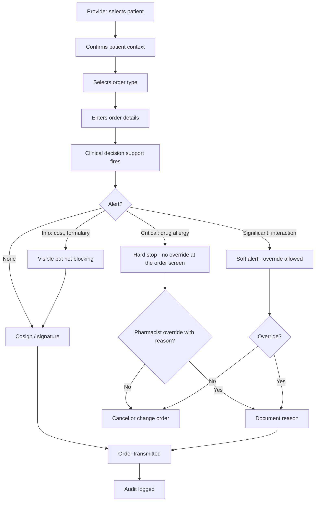

> เดิมชื่อ clinical-workflows (ไม่ใช่ skill แยกแล้ว เนื้อหาอยู่ที่ไฟล์นี้) ใน plugin `software-company-healthcare` — รวมเข้า `healthcare-systems` ใน v2.0.0

**สารบัญ:** 

- [When to use this skill](#when-to-use-this-skill)
- [Clinical Software Principles](#clinical-software-principles)
- [Order Entry Pattern (CPOE)](#order-entry-pattern-cpoe)
- [Medication Workflow](#medication-workflow)
- [Clinical Decision Support (CDS)](#clinical-decision-support-cds)
- [Patient Handoff (Shift Change, Transfer)](#patient-handoff-shift-change-transfer)
- Patient: Jane Doe, MRN 12345, Room 304
- [Care Plan Management](#care-plan-management)
- [Patient Safety Patterns](#patient-safety-patterns)
- [Workflow Design Heuristics](#workflow-design-heuristics)
- [Common Pitfalls](#common-pitfalls)
- [Reference](#reference)

# Clinical Workflows

## When to use this skill

- Designing computerized provider order entry (CPOE)
- Building clinical decision support
- Building a medication workflow
- Designing patient handoff
- Managing care plans
- Shift change / signout tools

## Clinical Software Principles

### 1. Software supports the clinician, never replaces judgment
- A person must acknowledge each alert; never dismiss it automatically
- A human makes the final decision
- Record the reason for every override

### 2. Right info, right time, right format
- Don't bury critical info in long blocks of text
- Highlight what changed from the patient's baseline
- Use one color and icon per severity level across the whole system

### 3. Workflow > features
- Map the current clinical workflow first
- The new process must be FASTER than paper
- If it adds friction, staff stop using it or work around it

### 4. Cognitive load matters
- Doctors see 20+ patients per shift
- Every extra click is a patient safety issue
- Make common actions the default

## Order Entry Pattern (CPOE)



### Critical principles
- **Patient context lock** — confirm the patient before the order, and lock the patient while the order is entered
- **Allergy/interaction checks** — run them during entry, not after
- **Override documentation** — required, and pharmacy reviews it
- **Hard stop means no override for the prescriber** — only a pharmacist (or the role your safety committee names) can release it, with a recorded reason
- **Order set support** — ready-made groups of orders for a protocol (e.g., sepsis bundle)

## Medication Workflow

```
Prescribe → Verify → Dispense → Administer → Monitor

Each step:
- Different actor (often)
- Independent verification
- Logged
```

### 5 Rights of Medication
1. Right patient
2. Right drug
3. Right dose
4. Right route
5. Right time

The software MUST enforce all 5.

### Pattern: Bedside Medication Administration

The code checks all 5 rights against the active order. An override is an awaited step: if the nurse gives no reason, or a hard stop is hit, the function stops and nothing is recorded as given.

```typescript
async function administerMedication(scan: {
  patientWristbandBarcode: string;
  medicationBarcode: string;
  nurseId: string;
  dose: { value: number; unit: string };   // what the nurse is about to give
  route: string;                           // e.g. 'PO', 'IV'
}) {
  // 1. Verify patient
  const patient = await getPatientByBarcode(scan.patientWristbandBarcode);
  if (!patient) throw new Error('Patient barcode not recognized');

  // 2. Get scheduled meds for this patient
  const dueMeds = await getDueMedications(patient.id);

  // 3. Verify medication
  const med = await getMedicationByBarcode(scan.medicationBarcode);
  const matching = dueMeds.find(m => m.medicationCode === med.code);

  if (!matching) {
    // Wrong medication for this patient
    await alert.fire({
      severity: 'CRITICAL',
      type: 'MED_PATIENT_MISMATCH',
      patient: patient.id,
      attempted: med.code,
      nurse: scan.nurseId,
    });
    throw new ClinicalError('Medication does not match patient orders');
  }

  // 4. Verify dose against the order (same unit, same amount)
  if (scan.dose.unit !== matching.dose.unit || scan.dose.value !== matching.dose.value) {
    throw new ClinicalError('Dose does not match the order'); // hard stop: no bedside override
  }

  // 5. Verify route against the order
  if (scan.route !== matching.route) {
    throw new ClinicalError('Route does not match the order'); // hard stop
  }

  // 6. Verify timing — soft stop: allowed only with a recorded reason
  let overrideReason: string | null = null;
  if (!matching.isWithinWindow(now())) {
    const override = await requestOverride({
      reason: 'Outside scheduled window',
      nurseId: scan.nurseId,
      orderId: matching.orderId,
    }); // waits for the nurse; returns { approved, reasonText }
    if (!override.approved || !override.reasonText?.trim()) {
      throw new ClinicalError('Administration stopped: no override reason recorded');
    }
    overrideReason = override.reasonText;
  }

  // 7. Document administration
  await db.medicationAdministrations.create({
    patientId: patient.id,
    medicationCode: med.code,
    dose: scan.dose,
    route: scan.route,
    administeredBy: scan.nurseId,
    administeredAt: now(),
    orderId: matching.orderId,
    overrideReason,
  });
}
```

## Clinical Decision Support (CDS)

### Types of alerts

| Type | Trigger | UX |
|------|---------|----|
| **Hard stop** (critical) | Will cause harm | Block. The prescriber cannot override; only a pharmacist can, with a reason |
| **Significant** (warning) | Important consideration | Soft alert, override + reason |
| **Informational** (info) | Useful info | Visible, non-blocking |
| **Suggestion** (low) | Could be better | Quiet, dismissible |

### Avoid Alert Fatigue

```python
# Track alert burden per user
# Too many = ignored = bad outcomes

ALERT_BUDGET_PER_PATIENT = 5  # not a hard rule, but signal

# Suppress redundant alerts
# Don't fire same alert if user just overrode
# Tune thresholds based on actual harm signal
```

### CDS Hooks (modern pattern)

Flow between the electronic health record (EHR) and the CDS service:

```
Trigger: patient-view, order-select, order-sign, encounter-discharge

EHR → CDS Service:
{
  "hook": "order-select",
  "hookInstance": "...",
  "context": {
    "patientId": "...",
    "userId": "...",
    "selections": [...]
  },
  "prefetch": { "patient": {...}, "medications": [...] }
}

CDS Service → EHR (cards):
{
  "cards": [
    {
      "summary": "Drug interaction: warfarin + aspirin",
      "indicator": "warning",
      "source": { "label": "CDS Service" },
      "suggestions": [...]
    }
  ]
}
```

## Patient Handoff (Shift Change, Transfer)

### SBAR Format
- **S**ituation — what's happening now
- **B**ackground — relevant history
- **A**ssessment — current state, concerns
- **R**ecommendation — what's needed

```markdown
## Patient: Jane Doe, MRN 12345, Room 304

### S - Situation
65F admitted 2 days ago for pneumonia. Currently stable on oxygen (O2).

### B - Background
- Active: type 2 diabetes mellitus (DM2, controlled), hypertension (HTN)
- Allergies: penicillin (PCN), sulfa
- Admit diagnosis (dx): community-acquired pneumonia (CAP), right lower lobe
- Cultures pending

### A - Assessment
- Vitals stable last 12h (96/min, 16/min, 110/68, 99.4F, 95% on 2L)
- Tolerating oral intake (PO), eating 50%
- Intravenous (IV) antibiotics (abx): Cefepime, day 3 of 7
- White blood cell count (WBC) trending down (15 → 12 → 9)

### R - Recommendations / Plan
- Continue current abx
- Discontinue (D/C) O2 if oxygen saturation (SpO2) > 92% on room air (RA)
- Discharge planning for tomorrow if cultures finalize
- Watch for altered mental status (AMS) (sundowning at home)

### Tasks for incoming
- Check 6am labs: complete blood count (CBC), basic metabolic panel (BMP), troponin
- Page Dr. Smith if hemodynamics change
- Family update call at 10am
```

## Care Plan Management

```typescript
interface CarePlan {
  id: string;
  patientId: string;
  status: 'active' | 'completed' | 'cancelled';
  intent: 'plan' | 'order' | 'proposal';
  category: string;        // e.g., 'diabetes-management'
  startDate: Date;
  endDate?: Date;
  goals: Goal[];
  activities: PlannedActivity[];
  careTeam: CareTeamMember[];
}

interface Goal {
  description: string;
  targetMeasure?: string;   // e.g., 'HbA1c < 7.0'
  targetDate?: Date;
  status: 'proposed' | 'in-progress' | 'achieved' | 'not-achieved';
}

interface PlannedActivity {
  type: 'medication' | 'lab' | 'visit' | 'procedure' | 'lifestyle';
  description: string;
  scheduledPeriod?: { start: Date; end?: Date };
  performer?: string;
}
```

## Patient Safety Patterns

### Wrong-patient prevention
- Always show 2+ identifiers
- Confirm before high-risk actions
- Use barcode scanning where possible
- Lock patient context during sensitive operations

### Medication safety
- Enforce the 5 rights
- Flag look-alike/sound-alike (LASA) drug pairs
- Check dose ranges for children and older adults
- Check allergies and drug-drug interactions (DDI) at order entry

### Critical results
- Set a hard time limit to notify the provider (e.g., 1 hour for critical labs)
- Escalate automatically if nobody acknowledges
- Confirm the loop is closed: the provider confirms receipt

## Workflow Design Heuristics

### Reduce clicks
- Pre-fill common values
- Suggest values based on history
- Offer bulk actions where they fit

### Match real workflow
- Tab through fields in clinical order, not data model order
- Group by clinical concept, not table structure
- Allow non-linear entry

### Forgive interruptions
- Save state often
- Let the user resume where they left off
- A phone call during entry must not lose their work

### Build for the worst case
- Tired nurse at 3am
- Multiple interruptions
- Patient deteriorating

## Common Pitfalls

- Wrong: **Designing for an ideal workflow** — real clinical work is chaotic
- Wrong: **Alert fatigue** — users stop seeing any alert
- Wrong: **No patient context lock** — leads to wrong-patient errors
- Wrong: **Treating medication like any other transaction** — the stakes are much higher
- Wrong: **No override documentation** — nobody can review override patterns
- Wrong: **One-size-fits-all UX** — ICU ≠ outpatient ≠ ED

## Reference

- [AHRQ Patient Safety](https://www.ahrq.gov/topics/patient-safety/index.html)
- [Joint Commission Patient Safety Goals](https://www.jointcommission.org/standards/national-patient-safety-goals/)
- [CDS Hooks specification](https://cds-hooks.org/)
- [ISMP (Institute for Safe Medication Practices)](https://www.ismp.org/)
