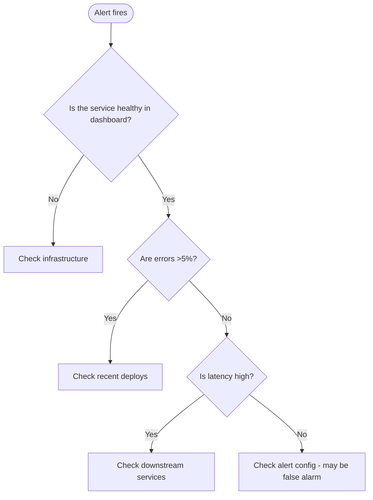

# Runbook Template

**สารบัญ:** แม่แบบเต็ม 1 บล็อก: TL;DR · How to Detect · Diagnosis · Mitigation Steps (ขั้น 1–5) · Escalation Path · Verification · After Resolution · Related Runbooks · Background

- [แม่แบบทั้งไฟล์](#runbook-template) อยู่ในบล็อกเดียว ให้คัดลอกทั้งบล็อกไปเป็นไฟล์ runbook ใหม่

แม่แบบเต็มของ runbook หนึ่งฉบับ ให้คัดลอกไปกรอกต่อได้ทันที ส่วนกฎว่าแต่ละส่วนต้องมีอะไรอยู่ใน `SKILL.md`

````markdown
# Runbook: <Alert Name or Failure Mode>

| | |
|--|--|
| **Severity** | SEV1 \| SEV2 \| SEV3 \| SEV4 (table in `postmortem-template`) |
| **Service** | service-name |
| **Owner Team** | @team-name |
| **Last Reviewed** | YYYY-MM-DD |
| **Linked Alert** | [Grafana/PagerDuty link] |

---

## TL;DR (30 seconds)

> One paragraph: what's broken, what to do first, who to call.

## How to Detect

**Symptoms:**
- User-facing: ...
- Internal: ...

**Alerts that fire:**
- [Alert Name](link) — fires when ...
- [Another Alert](link) — fires when ...

**Dashboards to check:**
- [Main Dashboard](link)
- [Service Health](link)

## Diagnosis (60 seconds)



### Quick checks (run in order)

**1. Is service responding?**
```bash
curl -fsS https://api.example.com/health || echo "DOWN"
```

**2. Are recent deploys suspicious?**
```bash
gh release list --repo our-org/service --limit 5
```

**3. Check error rate in logs:**
```bash
# Last 10 min of 5xx errors
kubectl logs -n prod deployment/api --since=10m | grep -c '"status":5'
```

**4. Check downstream dependencies:**
- Database: [Dashboard link]
- Redis: [Dashboard link]
- External API: [Status page link]

## Mitigation Steps

> **Human approval:** an agent only proposes the command and its expected effect. A human on-call runs it or approves it before it touches production (`principle-proceed-on-reversible-work`, `incident-response` Phase 3).

Try mitigations in order of risk (lowest first) — the same order as `incident-response` Phase 3:

### Step 1: Disable the broken feature or reduce load (low risk)
```bash
# Turn off the feature flag of the suspect feature
./scripts/flag.sh set new-checkout off --env prod

# Or enable rate limiting
kubectl set env deployment/api -n prod RATE_LIMIT_AGGRESSIVE=true
```

**Expected effect:** Error rate drops within 2 min
**VERIFY:** `./scripts/flag.sh get new-checkout --env prod` → `off` · dashboard 5xx panel < 1% for 2 min
**If doesn't work:** Go to Step 2

### Step 2: Scale up (medium risk)
```bash
kubectl scale deployment/api -n prod --replicas=10
```

**Expected effect:** Latency improves within 3 min
**VERIFY:** `kubectl get deployment/api -n prod` → READY `10/10` · p95 panel back under threshold
**Caveats:** Will increase cost, monitor budget alerts

### Step 3: Rollback recent deploy (higher risk)
```bash
kubectl rollout undo deployment/api -n prod
```

**Expected effect:** Reverts to previous version
**VERIFY:** `kubectl rollout status deployment/api -n prod` → `successfully rolled out` · running image tag = previous release
**Caveats:** Check for schema migrations before rolling back. A rollout undo does not delete data, but old code may break on a schema the new release already migrated — roll back only if the migration is backward-compatible

### Step 4: Block bad traffic at the WAF or firewall (high risk)
```bash
# Block the abusive IP range / path at the web application firewall (WAF)
./scripts/waf-block.sh --cidr 203.0.113.0/24 --ttl 1h
```

**Expected effect:** Abusive traffic stops reaching the service
**VERIFY:** `./scripts/waf-block.sh list` shows the CIDR with TTL · requests from that range in access log → 0 · request rate from real users unchanged
**Caveats:** Can block real users; set a TTL (time to live) and check the allow list

### Step 5: Failover to backup region (last resort)
```bash
# Update DNS to point to backup region
./scripts/failover-to-us-west.sh
```

**Expected effect:** All traffic shifts to backup
**VERIFY:** `dig +short api.example.com` → backup region IP · backup region request rate ≈ previous primary rate · primary → 0
**Caveats:** Some user data may need migration, full rollback complex

## Escalation Path

```
You can't resolve in 15 min
  ↓
1. Page secondary on-call (PagerDuty group: team-secondary)
  ↓
You both can't in 30 min
  ↓
2. Page service owner team (team-owner)
  ↓
Still SEV1 after 45 min
  ↓
3. Page incident commander on-call (IC)
  ↓
SEV1 still active after 1h
  ↓
4. Page engineering leadership
```

## Verification (after mitigation)

Confirm the issue is resolved:

- [ ] Error rate back to baseline
- [ ] Latency p95 < threshold
- [ ] Status page updated to "Operational"
- [ ] No new alerts firing
- [ ] Customer reports stopped
- [ ] Monitor for 30 min before considering resolved

## After Resolution

1. **Document in incident channel**: what happened, what you did
2. **Update status page**: clear incident, post resolution message
3. **Create postmortem ticket**: if SEV1/SEV2, schedule postmortem
4. **Update this runbook**: if you learned something new

> Use `postmortem-template` skill for the full analysis

## Related Runbooks

- [Database connection issues](link)
- [Cache failure](link)
- [Authentication service down](link)

## Background / Why this happens

Optional section: brief context on why this failure mode exists.
Useful for new on-call engineers.
````
