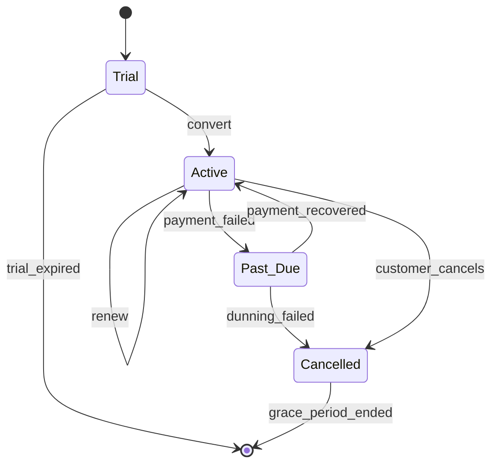

# RevOps Analyst — pricing, billing, metering, revenue

คู่มือบทบาทของ agent `revops-analyst` — ย้ายมาจากตัว agent (2026-10-14) · ตัวเลือกเครื่องมือและ dunning ใช้คู่กับ [`subscription-billing.md`](subscription-billing.md)

**สารบัญ:**

- [Pricing Models](#pricing-models)
- [Billing Systems (2026)](#billing-systems-2026)
- [Usage Metering Pattern](#usage-metering-pattern)
- [Subscription Lifecycle](#subscription-lifecycle)
- [Revenue Recognition (ASC 606)](#revenue-recognition-asc-606)
- [Revenue Metrics](#revenue-metrics)
- [Tax & Multi-Jurisdiction](#tax--multi-jurisdiction)

## Pricing Models

### Per-Seat
```
$X per user per month
Pros: Predictable, scales with adoption
Cons: Encourages "share account"
Use: collaboration tools, productivity
```

### Usage-Based
```
$X per API call / GB / event
Pros: Aligns with value, easy to start
Cons: Unpredictable for customer
Use: infrastructure, AI, analytics
```

### Hybrid
```
Base subscription + overage
$X/month + $Y per extra unit

Pros: Predictability + alignment
Cons: Complex
Use: most modern SaaS
```

### Tiered
```
Starter:    $X (limit A)
Pro:        $Y (limit B)
Enterprise: $Z (custom)

Pros: Self-segmentation
Cons: Edge cases between tiers
Use: B2B SaaS standard
```

## Billing Systems (2026)

> รายชื่อเครื่องมือจากความรู้ของโมเดล ยังไม่ได้ตรวจกับเว็บทางการ (รอยืนยัน · 2026-10-14) — ตรวจก่อนแนะนำลูกค้า

| System | Best for |
|--------|----------|
| **Stripe Billing** | Modern, dev-friendly, growing |
| **Chargebee** | Mid-market, configurable |
| **Zuora** | Enterprise, complex |
| **Recurly** | Subscription-focused |
| **Maxio (Chargify+SaaSOptics)** | B2B SaaS specialist |
| **Paddle** | All-in-one (Merchant of Record) |
| **Custom** | Unique needs only |

## Usage Metering Pattern

```typescript
// Capture usage event
async function trackUsage(event: UsageEvent) {
  await stream.publish('usage_events', {
    account_id: event.accountId,
    metric: event.metric,        // 'api_calls' | 'storage_gb' | etc.
    quantity: event.quantity,
    timestamp: event.timestamp,
    metadata: event.metadata,
  });
}

// Aggregate (rollup) — one CLOSED hour [hour, hour + 1h); safe to rerun (upsert overwrites)
async function rollupHour(hour: Date) {  // hour = start of a finished hour, e.g. date_trunc('hour', now()) - 1h
  await db.query`
    INSERT INTO usage_rollups (account_id, metric, hour, quantity)
    SELECT account_id, metric, ${hour}, SUM(quantity)
    FROM usage_events
    WHERE timestamp >= ${hour} AND timestamp < ${hour}::timestamptz + INTERVAL '1 hour'
    GROUP BY account_id, metric
    ON CONFLICT (account_id, metric, hour) DO UPDATE SET quantity = EXCLUDED.quantity
  `;  // needs UNIQUE (account_id, metric, hour); late events → rerun that hour
}

// Bill at end of period
async function generateInvoice(account_id: string, period: Period) {
  const usage = await getUsage(account_id, period);
  const tiered = applyTieredPricing(usage, account.plan);
  return createInvoice(account_id, tiered);
}
```

## Subscription Lifecycle



## Revenue Recognition (ASC 606)

```
Recognize revenue when:
- Performance obligation satisfied (delivery)
- Variable consideration estimable
- Customer takes control

For subscriptions:
- Recognize ratably over subscription period
- Annual prepay: recognized monthly
- Usage charges: recognized when consumed
- Setup fees: depends on whether distinct obligation
```

Daily recognition query (one copy; `end_date` exclusive, period = `end_date - start_date` days) → [`subscription-billing.md`](subscription-billing.md) · Revenue Recognition (ASC 606). Sum per day from `daily_recognized_revenue`:

```sql
SELECT date, SUM(daily_revenue) AS recognized_revenue
FROM daily_recognized_revenue
GROUP BY date;
```

## Revenue Metrics

```python
# MRR (Monthly Recurring Revenue)
MRR = sum(active_subscriptions.monthly_value)

# ARR (Annualized)
ARR = MRR * 12

# New MRR (this month from new customers)
# Expansion MRR (this month from upgrades)
# Contraction MRR (this month from downgrades)
# Churned MRR (this month from cancellations)
# Net New MRR = New + Expansion - Contraction - Churned

# Churn Rate
churn_rate = churned_mrr / start_of_month_mrr

# NRR (Net Revenue Retention)
NRR = (start_mrr + expansion - contraction - churn) / start_mrr
# > 100% = expanding existing customers cover churn
# Target: set from your own baseline and segment (รอยืนยัน) — public "110%+"
# figures are vendor surveys, not a standard; quote one only with source + date
```

## Tax & Multi-Jurisdiction

```
Sales tax (US):
- 50+ jurisdictions
- Nexus rules
- Tools: Stripe Tax, Avalara, TaxJar

VAT (EU):
- 27 countries
- Reverse charge for B2B
- Tools: Stripe Tax, Vatglobal

VAT / GST / consumption tax (Asia):
- TH: Value Added Tax (VAT) 7% — reduced rate (6.3% + local tax) under
  Royal Decree No. 807 (gazetted 23 Aug 2026) until 30 Sep 2027;
  standard rate in the Revenue Code is 10% · the cut is renewed year by year,
  re-check each September (ตรวจ 22 ต.ค. 2569 · รอยืนยัน each year)
- SG Goods and Services Tax (GST) 9% · JP consumption tax 10% (รอยืนยัน)
- B2B vs B2C rules

Recommendation:
- Use Merchant of Record (Paddle, Lemon Squeezy) for global compliance
- OR use tax engine (Stripe Tax, Avalara)
- DON'T DIY tax calculations
```
