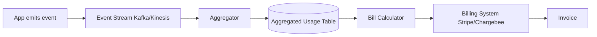

> เดิมชื่อ subscription-billing (ไม่ใช่ skill แยกแล้ว เนื้อหาอยู่ที่ไฟล์นี้) ใน plugin `software-company-saas-b2b` — รวมเข้า `saas-platform` ใน v2.0.0

**สารบัญ:** 

- [When to use this skill](#when-to-use-this-skill)
- [Choose Tool, Don't Build](#choose-tool-dont-build)
- [Pricing Model Implementation](#pricing-model-implementation)
- [Usage Metering Pipeline](#usage-metering-pipeline)
- [Dunning Workflow](#dunning-workflow)
- [Revenue Recognition (ASC 606)](#revenue-recognition-asc-606)
- [MRR / ARR Calculation](#mrr--arr-calculation)
- [Multi-Currency](#multi-currency)
- [Proration](#proration)
- [Trial Patterns](#trial-patterns)
- [Webhook Events to Handle](#webhook-events-to-handle)
- [Things You Don't Do](#things-you-dont-do)
- [Reference](#reference)

# Subscription Billing Patterns

## When to use this skill

- Setting up a new billing system
- Adding usage-based pricing
- Building dunning workflows (chasing failed payments)
- Recognizing revenue for accounting
- Billing in several currencies or tax jurisdictions
- Moving from one billing platform to another

## Choose Tool, Don't Build

```
Stripe Billing       — modern, easy, $$$
Chargebee            — flexible, mid-market
Maxio                — B2B SaaS specialist
Recurly              — mature
Paddle / Lemon Squeezy — Merchant of Record (global tax done)
Custom               — only for special needs
```

> 💡 **Never** build the billing basics yourself. Use a platform.

## Pricing Model Implementation

### Flat Subscription

```typescript
// Simple: one plan, fixed price
await stripe.subscriptions.create({
  customer: customer.stripeId,
  items: [{ price: 'price_pro_monthly' }],
});
```

### Per-Seat

```typescript
// Quantity = active users
async function syncSeats(subscription_id: string, accountId: string) {
  const activeUsers = await countActiveUsers(accountId);

  await stripe.subscriptionItems.update(itemId, {
    quantity: activeUsers,
    proration_behavior: 'create_prorations',
  });
}
```

### Usage-Based

Stripe Billing Meters. Legacy usage records (`createUsageRecord` / `usage_records.create`) were removed in API version `2025-03-31.basil`, and a `metered` price now needs a `meter` — ที่มา [Stripe changelog: Removes legacy usage-based billing](https://docs.stripe.com/changelog/basil/2025-03-31/deprecate-legacy-usage-based-billing) · [Create a billing meter event](https://docs.stripe.com/api/billing/meter-event/create) (ตรวจ 22 ต.ค. 2569)

```typescript
// Once: a meter, and a metered price that points to it
const meter = await stripe.billing.meters.create({
  display_name: 'API calls',
  event_name: 'api_calls',
  default_aggregation: { formula: 'sum' },
});
const price = await stripe.prices.create({
  product: 'prod_api_calls',
  currency: 'usd',
  unit_amount_decimal: '0.5', // 0.5 cent = $0.005 per call (amounts are in minor units)
  recurring: { interval: 'month', usage_type: 'metered', meter: meter.id },
});

// Each usage report: a meter event for the customer
async function reportUsage(stripeCustomerId: string, units: number, eventId: string) {
  await stripe.billing.meterEvents.create({
    event_name: 'api_calls',
    payload: { stripe_customer_id: stripeCustomerId, value: String(units) },
    identifier: eventId, // Stripe dedups the same identifier for at least 24 h
    timestamp: Math.floor(Date.now() / 1000), // must be within the past 35 days
  });
}

// Customer gets billed at end of period
```

### Tiered (Volume Pricing)

```typescript
// Stripe handles via "tiered" price model
// unit_amount is an integer in minor units (cents) — fractions go in unit_amount_decimal
const price = await stripe.prices.create({
  product: 'prod_api_calls',
  currency: 'usd',
  recurring: { interval: 'month', usage_type: 'metered', meter: meter.id },
  billing_scheme: 'tiered',
  tiers_mode: 'graduated',
  tiers: [
    { up_to: 10000,  unit_amount: 0 },               // first 10k free
    { up_to: 100000, unit_amount: 1 },               // next 90k @ $0.01
    { up_to: 'inf',  unit_amount_decimal: '0.5' },   // beyond @ $0.005
  ],
});
```

## Usage Metering Pipeline



### Idempotent Reporting

```python
async def report_usage_idempotent(account_id, event):
    # Dedup key
    dedup_key = f"{account_id}:{event.timestamp}:{event.id}"

    if await db.usage_reported.exists(dedup_key):
        return  # already reported

    # Stripe also dedups by identifier, but only for a rolling >= 24 h — keep our own check
    await stripe.billing.MeterEvent.create_async(
        event_name='api_calls',
        payload={
            'stripe_customer_id': event.stripe_customer_id,
            'value': str(event.quantity),
        },
        identifier=event.id,
        timestamp=event.timestamp,
    )

    await db.usage_reported.create({dedup_key})
```

## Dunning Workflow

```typescript
// Stripe handles retries by default
// But you should override for customer experience

const subscription = await stripe.subscriptions.create({
  customer,
  items,
  payment_settings: {
    payment_method_types: ['card'],
    save_default_payment_method: 'on_subscription',
  },
  collection_method: 'charge_automatically',
});

// Retry schedule lives in Dashboard → Billing → Revenue recovery → Retries
// Smart Retries: "The recommended default setting is 8 tries within 2 weeks"
// (choose 1 week – 2 months); custom schedule = up to 3 retries
// ที่มา docs.stripe.com/billing/revenue-recovery/smart-retries (ตรวจ 22 ต.ค. 2569)

// Listen for events:
//   invoice.payment_failed → email customer
//   customer.subscription.paused → restrict features
//   customer.subscription.deleted → final action
```

The retry count and timing belong to the payment processor's setting (Stripe: Smart Retries or a custom schedule, set per account, can differ per customer segment with automations). The app does not assume a fixed number of retries: it reads `invoice.attempt_count` from each `invoice.payment_failed` event and escalates one step, and treats "no `next_payment_attempt`" as the last try:

```
Fail 1 → email the customer (update card link)
Fail 2 → email + restrict paid features
Fail 3 → email + escalate to account owner / CS
Last   → cancel subscription + email
Grace period → delete data per the retention policy
```

Recovery-rate target: (รอยืนยัน · 2026-10-14) — track it monthly; do not quote a number without your own data.

### Dunning Communications

```python
async def handle_payment_failed(event):
    invoice = event['data']['object']
    attempt = invoice['attempt_count']

    customer = await get_customer(invoice['customer'])

    if attempt == 1:
        await send_email(customer, 'payment_failed_first', {
            'invoice_url': invoice['hosted_invoice_url'],
            'amount': invoice['amount_due'] / 100,
        })
    elif attempt == 2:
        await send_email(customer, 'payment_failed_second', ...)
        await restrict_advanced_features(customer)
    elif attempt >= 3:
        await send_email(customer, 'payment_failed_third_final_warning', ...)
        await alert_cs_team(customer)

    if invoice.get('next_payment_attempt') is None:
        # last try failed — Stripe now applies your "after all retries" setting
        # (cancel / unpaid / past_due / pause)
        await send_email(customer, 'payment_failed_final', ...)
    # with Billing automations, next_payment_attempt is set on invoice.updated instead
```

## Revenue Recognition (ASC 606)

One convention everywhere: `start_date` and `end_date` are `DATE`, the service period is **[start_date, end_date)** — `end_date` is the first day *after* service (a 1-month plan from 1 Jan has `end_date` 1 Feb). The period has `end_date - start_date` days. This is the only copy of this query; other files link here.

```sql
-- Daily revenue recognition for subscriptions (safe to re-run)
INSERT INTO daily_recognized_revenue (subscription_id, account_id, date, daily_revenue, type)
SELECT
    sub.id,
    sub.account_id,
    d::date AS date,
    sub.amount::numeric / (sub.end_date - sub.start_date) AS daily_revenue, -- DATE - DATE = days
    'subscription' AS type
FROM subscriptions sub
CROSS JOIN LATERAL generate_series(
    sub.start_date,
    LEAST(sub.end_date - 1, current_date),  -- last service day = end_date - 1
    interval '1 day'
) d
WHERE sub.start_date <= current_date
ON CONFLICT (subscription_id, date) DO NOTHING;  -- needs UNIQUE (subscription_id, date)
```

## MRR / ARR Calculation

```sql
-- MRR at any point in time
SELECT SUM(
  CASE plan_interval
    WHEN 'month' THEN plan_amount
    WHEN 'year'  THEN plan_amount / 12
  END
) as mrr
FROM subscriptions
WHERE status = 'active'
  AND started_at <= NOW()
  AND (canceled_at IS NULL OR canceled_at > NOW());

-- MRR movement (cohort waterfall)
WITH current_mrr AS (SELECT SUM(mrr) as v FROM active_subs WHERE date = '2025-02-01'),
     prior_mrr   AS (SELECT SUM(mrr) as v FROM active_subs WHERE date = '2025-01-01'),
     new_mrr     AS (SELECT SUM(mrr) FROM new_subs_in_month),
     expansion   AS (SELECT SUM(mrr_diff) FROM upgrades_in_month),
     contraction AS (SELECT SUM(mrr_diff) FROM downgrades_in_month),
     churn       AS (SELECT SUM(mrr) FROM cancellations_in_month)
SELECT
  prior_mrr.v as start,
  new_mrr.v as new,
  expansion.v as expansion,
  contraction.v as contraction,
  churn.v as churn,
  current_mrr.v as end
FROM prior_mrr, new_mrr, expansion, contraction, churn, current_mrr;
```

## Multi-Currency

```typescript
// Customer's currency at signup
const customer = await stripe.customers.create({
  email,
  currency: 'thb',  // locked at creation in most platforms
});

// Pricing strategy:
// Option 1: Price in customer currency (FX risk on you)
// Option 2: Price in USD, charge in local (uses Stripe FX)
// Option 3: Per-region pricing (different prices per market)

// Tax considerations vary
// Use Stripe Tax or Avalara for compliance
```

## Proration

```typescript
// Mid-cycle plan change
await stripe.subscriptions.update(subscription_id, {
  items: [{ id: itemId, price: 'price_new_plan' }],
  proration_behavior: 'create_prorations',
});

// Stripe calculates:
// - Credit for unused time on old plan
// - Charge for partial time on new plan
// - Net difference on next invoice (or immediate)
```

## Trial Patterns

```typescript
// Free trial
await stripe.subscriptions.create({
  customer,
  items: [{ price }],
  trial_period_days: 14,
  payment_settings: {
    payment_method_types: ['card'],
    save_default_payment_method: 'on_subscription',
  },
});

// Convert (event: trial_will_end → trial_end)
// If no card on file: subscription becomes 'past_due'
```

## Webhook Events to Handle

| Event | Action |
|-------|--------|
| `customer.subscription.created` | Activate features |
| `invoice.payment_succeeded` | Mark paid, recognize revenue |
| `invoice.payment_failed` | Dunning workflow |
| `customer.subscription.updated` | Sync plan changes |
| `customer.subscription.deleted` | Deactivate, schedule data deletion |
| `customer.subscription.trial_will_end` | Trial ending notification |

## Things You Don't Do

- ❌ Build your own billing engine
- ❌ Calculate tax manually
- ❌ Trust prices the client sends
- ❌ Skip the idempotency check on webhooks
- ❌ Recognize revenue when you send the invoice (recognize it over the service period)
- ❌ Store money as a float

## Reference

- [Stripe Billing Docs](https://stripe.com/docs/billing)
- [ASC 606 Revenue Recognition Guide](https://www.investopedia.com/terms/a/asc-606.asp)
- [Chargebee Knowledge Base](https://www.chargebee.com/docs/)
- [Paddle Documentation](https://developer.paddle.com/)
- [Maxio (Chargify) Docs](https://maxio.com/docs)
