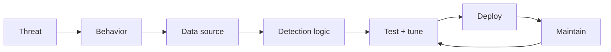

> เดิมชื่อ threat-detection-patterns (ไม่ใช่ skill แยกแล้ว เนื้อหาอยู่ที่ไฟล์นี้) ใน plugin `software-company-cybersecurity` — รวมเข้า `security-operations` ใน v2.0.0

**สารบัญ:** 

- [When to use this skill](#when-to-use-this-skill)
- [Detection Engineering Process](#detection-engineering-process)
- [Detection Categories](#detection-categories)
- [MITRE ATT&CK Coverage](#mitre-attck-coverage)
- [Detection Examples (Splunk SPL)](#detection-examples-splunk-spl)
- [Sigma Rules (Vendor-Agnostic)](#sigma-rules-vendor-agnostic)
- [False Positive Reduction](#false-positive-reduction)
- [Behavioral Baselines](#behavioral-baselines)
- [Common Pitfalls](#common-pitfalls)
- [Reference](#reference)

# Threat Detection Patterns

## When to use this skill

- Writing new detection rules for SIEM
- Tuning existing rules for false positives
- Mapping detections to MITRE ATT&CK
- Designing a detection coverage strategy
- Building behavioral analytics

## Detection Engineering Process



## Detection Categories

### 1. Signature-based (known bad)
- Specific IOCs (hashes, IPs, domains)
- Known malware patterns
- Known exploit signatures
- **Pros:** Few false positives, fast
- **Cons:** Easy to evade, reactive

### 2. Behavioral
- Patterns of malicious activity
- TTPs (Tactics, Techniques, Procedures)
- Multi-event sequences
- **Pros:** Catches unknown malware, harder to evade
- **Cons:** More false positives, complex

### 3. Anomaly-based
- Statistical deviations
- ML-based scoring
- Peer comparison
- **Pros:** Catches attacks no one has seen before
- **Cons:** Many false positives, hard to triage

## MITRE ATT&CK Coverage

```
Tactic                Common detections
─────────────────────────────────────────────
Initial Access        Suspicious email, malicious links/attachments
Execution             PowerShell encoded, scripting from Office
Persistence           New scheduled tasks, registry Run keys
Privilege Escalation  Token theft, UAC bypass
Defense Evasion       Log clear, AV disable, alternate data streams
Credential Access     LSASS access, Mimikatz behaviors
Discovery             Network scan, account enum
Lateral Movement      WMI, PsExec, remote services
Collection            Keylogger, screenshot, audio capture
Command and Control   DNS tunneling, encrypted, rare destinations
Exfiltration          Large outbound, compressed archives
Impact                Mass file modification, encryption
```

## Detection Examples (Splunk SPL)

> **ยังไม่ได้ตรวจ** — query ด้านล่างเขียนตามไวยากรณ์ใน Splunk docs แต่ยังไม่ได้รันกับ Splunk จริง ชื่อ index และชื่อ field ขึ้นกับ add-on ที่ติดตั้ง (ตัวอย่างใช้ `index=sysmon` = Microsoft Sysmon ผ่าน Splunk Add-on for Sysmon และ `index=wineventlog` = Windows Security log) — ปรับให้ตรงของจริงแล้วทดสอบกับข้อมูลย้อนหลังก่อนเปิดใช้
>
> กฎไวยากรณ์ที่พลาดบ่อย: wildcard `*` ใช้ได้ใน `search` (ต้นท่อ) เท่านั้น — ใน `where` ต้องใช้ `like(field, "%x")` หรือ `match(field, "regex")` · หมายเหตุใน SPL เขียนด้วย triple backtick ไม่ใช่ `#` · `stdev()` เป็นฟังก์ชันของ `stats` ใช้ใน `eval` ไม่ได้

Event ที่ใช้: Sysmon `EventCode=1` = process create · `10` = process access · `13` = registry value set · Windows Security `4688` = process create (ต้องเปิด audit + command line) · `4624`/`4625` = logon สำเร็จ/ล้มเหลว · `4697` = ติดตั้ง service · `4698` = สร้าง scheduled task

### Suspicious PowerShell

```spl
index=sysmon EventCode=1 Image="*\\powershell.exe"
| eval is_encoded=if(match(CommandLine, "(?i)\s[-/]e(c|n(c(o(d(e(d(c(o(m(m(a(n(d)?)?)?)?)?)?)?)?)?)?)?)?)?\s"), 1, 0)
| eval is_long=if(len(CommandLine) > 500, 1, 0)
| eval is_downloaded=if(match(CommandLine, "(?i)(IEX|invoke-expression|downloadstring|downloadfile)"), 1, 0)
| where is_encoded=1 OR is_long=1 OR is_downloaded=1
| stats count by Computer, User, CommandLine
```

### LSASS Access (Credential Theft)

```spl
index=sysmon EventCode=10 TargetImage="*\\lsass.exe"
    NOT (SourceImage="*\\System32\\svchost.exe"
      OR SourceImage="*\\System32\\wininit.exe"
      OR SourceImage="*\\Windows Defender\\MsMpEng.exe")
| stats count by Computer, SourceImage, User
```

### Unusual Logon Patterns

After-hours interactive logon by an admin account (`admin_users.csv` = your own lookup of admin accounts)

```spl
index=wineventlog EventCode=4624 Logon_Type=2
    [| inputlookup admin_users.csv | fields user]
| eval hour=tonumber(strftime(_time, "%H"))
| where hour < 6 OR hour > 22
| stats count by Computer, user, src_ip
```

### Brute Force

More than 10 failed logons from one source to one account within a 10-minute bucket

```spl
index=wineventlog EventCode=4625
| bin _time span=10m
| stats count by _time, src_ip, user
| where count > 10
```

### Beaconing (C2)

Regular periodic outbound: many connections with almost the same gap between them

```spl
index=netflow
| sort 0 src_ip dest_ip dest_port _time
| streamstats current=f last(_time) as prev_time by src_ip dest_ip dest_port
| eval interval=_time - prev_time
| stats count as connections avg(interval) as avg_interval stdev(interval) as std_dev
    by src_ip dest_ip dest_port
| where connections > 100 AND std_dev < 5
```

### Unusual Process Trees

Word spawning PowerShell

```spl
index=sysmon EventCode=1 ParentImage="*\\winword.exe" Image="*\\powershell.exe"
| table _time Computer User ParentCommandLine CommandLine
```

## Sigma Rules (Vendor-Agnostic)

`id` ต้องเป็น UUID (สร้างใหม่ทุกกฎ เช่น `python -c "import uuid; print(uuid.uuid4())"`) · กฎใหม่เริ่ม `status: experimental` แล้วค่อยเลื่อนเป็น `test`/`stable` เมื่อทดสอบกับข้อมูลจริงแล้ว — ที่มา [Sigma rule specification](https://github.com/SigmaHQ/sigma-specification)

```yaml
title: PowerShell Encoded Command
id: b7964e9f-a411-4ecf-adc4-3a08cbda12c4
status: experimental
description: Detects encoded PowerShell commands
references:
  - https://attack.mitre.org/techniques/T1059/001/
tags:
  - attack.execution
  - attack.t1059.001
logsource:
  category: process_creation
  product: windows
detection:
  selection:
    Image|endswith: '\powershell.exe'
    CommandLine|contains:
      - ' -enc '
      - ' -EncodedCommand '
  condition: selection
falsepositives:
  - Legitimate admin scripts
level: medium
```

## False Positive Reduction

### Strategies

1. **Allowlist** — Skip known-good signers and paths
2. **Frequency** — Suppress the same alert repeating
3. **Combine** — Require several signals before alerting
4. **Context** — Weigh privileged accounts and sensitive systems

### Tuning Process

```python
# Track FP rate per rule
fp_rate = false_positives / total_alerts

if fp_rate > 0.5:
    # Refine rule
    # Add allowlist
    # Combine with other signal
    # Increase threshold
elif fp_rate < 0.05:
    # Possibly miss-tuned (catching too little)
    # Or rule is excellent

# Target: 5-20% FP rate per rule
```

## Behavioral Baselines

```python
# Per-user baseline
def compute_baseline(user_id, days=30):
    history = get_logon_events(user_id, days)

    return {
        'typical_hours': histogram_of_hours(history),
        'typical_sources': set_of_ips(history),
        'typical_target_systems': set_of_systems(history),
        'logon_frequency': events_per_day_distribution(history),
    }

# Detect anomalies
def is_anomalous(event, baseline):
    score = 0

    if event.hour not in baseline.typical_hours:
        score += 1
    if event.src_ip not in baseline.typical_sources:
        score += 1
    if event.target not in baseline.typical_target_systems:
        score += 1

    return score >= 2
```

## Common Pitfalls

- ❌ **Too generic** — flags legitimate activity constantly
- ❌ **Too specific** — misses variations
- ❌ **No threshold** — one event fires an alert
- ❌ **No suppression** — alert fatigue
- ❌ **No tuning** — rules drift out of date
- ❌ **No context** — admins doing normal admin work get flagged

## Reference

- [MITRE ATT&CK](https://attack.mitre.org/)
- [Sigma Rules Repository](https://github.com/SigmaHQ/sigma)
- [Atomic Red Team](https://github.com/redcanaryco/atomic-red-team)
- [Splunk Detection Engineering](https://github.com/splunk/security_content)
- [CISA Cyber Resource Hub](https://www.cisa.gov/cyber-resource-hub)
