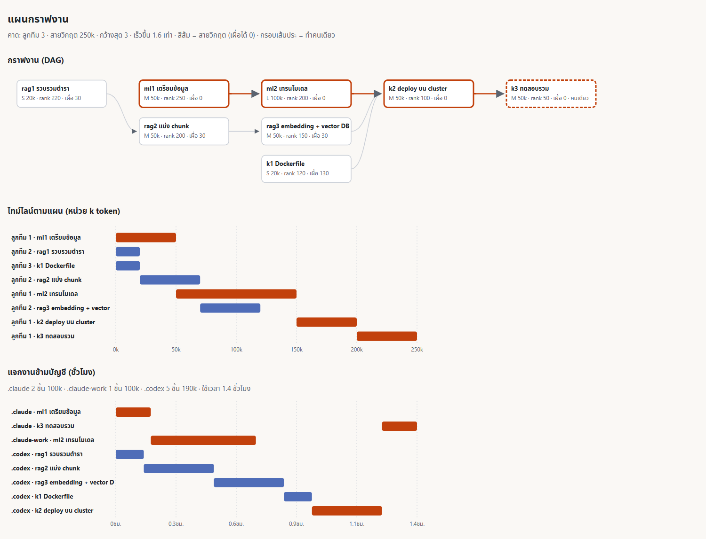

# ตัวอย่าง planner: วางกราฟงาน แจกงานข้ามบัญชี และเทียบกับงานจริง

ตัวอย่างนี้ใช้ planner ของ superuser (`parallel-split-and-merge/scripts/plan.mjs`) กับงานสมมติ 8 ชิ้น 3 สาย (RAG · MLOps · Kubernetes) บัญชี 3 บัญชี และ log งานลูกทีมที่ทำไปแล้วครึ่งทาง ทุกไฟล์ในโฟลเดอร์นี้เป็นข้อมูล**ตัวอย่าง** ไม่ใช่ตัวเลขจริง ส่วนผลลัพธ์ทุกชิ้นได้จากการรันคำสั่งจริง (2026-10-27 · superuser 3.11.0)



## ไฟล์ในโฟลเดอร์

| ไฟล์ | คืออะไร |
|---|---|
| [`tasks.json`](tasks.json) | แผนงานรูปแบบเดียวกับ lab: `depends_on` · `exclusive` (ทำคนเดียว) · ขนาด `S` `M` `L` · `tool` เมื่อชิ้นนั้นต้องใช้เครื่องมือใดเครื่องมือหนึ่ง |
| [`accounts.json`](accounts.json) | บัญชี LLM 3 บัญชี: ขนาดถังโควตา (`cap_k`) · ความเร็ว · งานพร้อมกันได้กี่ชิ้น · น้ำหนักคะแนน |
| [`quota.json`](quota.json) | โควตาที่เหลือ รูปเดียวกับที่ `quota.mjs snapshot` สร้าง · `.claude` ใช้ไปแล้ว 80% |
| [`log/2026-10-27/runs.jsonl`](log/2026-10-27/runs.jsonl) | log งานลูกทีมรูปเดียวกับที่ hook จด: เสร็จแล้ว 2 ชิ้น ยังทำอยู่ 2 ชิ้น |
| [`out-plan.md`](out-plan.md) · [`out-accounts.md`](out-accounts.md) · [`out-actual.md`](out-actual.md) | ผลลัพธ์เต็มของคำสั่งทั้ง 3 ขั้นด้านล่าง |
| [`plan.html`](plan.html) · [`plan.png`](plan.png) | รูป DAG และ Gantt (เปิด HTML ในเบราว์เซอร์ได้เลย · PNG คือภาพหน้าจอของหน้านั้น) |

## ขั้น 1 · วางกราฟและจัดลำดับ (บัญชีเดียว)

```bash
node <plugin>/skills/parallel-split-and-merge/scripts/plan.mjs tasks.json
```

```
คาด: ลูกทีม 3 · สายวิกฤต 250k · กว้างสุด 3 · เร็วขึ้น 1.6 เท่า
- สายวิกฤต: เตรียมข้อมูล → เทรนโมเดล → deploy บน cluster → ทดสอบรวม (250k)
```

- **สายวิกฤตอยู่ที่สาย MLOps** เพราะเทรนโมเดลมีขนาด L (100k) ส่วนสาย RAG ยาวรวม 120k ก่อนถึง deploy จึงมีค่าเผื่อ 30k
- planner ปล่อย `ml1` ก่อน เพราะ rank สูงสุด (250) ส่วน `k1 Dockerfile` มีค่าเผื่อ 130k จึงเลื่อนไปทำทีหลังได้มาก
- ใส่ `--html plan.html` เพื่อได้รูป และ `--mermaid` เพื่อได้ flowchart ไว้วางใน markdown

## ขั้น 2 · แจกงานข้ามบัญชี (① เรียง ② กรอง ③ ให้คะแนน ④ จอง)

```bash
node plan.mjs tasks.json --accounts accounts.json --quota quota.json --now 2026-10-27T09:00:00Z --html plan.html
```

| ชิ้น | บัญชี | เริ่ม → จบ (ชม.) | คะแนน | U · F · R · V · L |
|---|---|---|---|---|
| ml1 เตรียมข้อมูล | .claude | 0 → 0.2 | 0.689 | 0.96 · 0.63 · 0.20 · 1.00 · 0.00 |
| rag1 รวบรวมตำรา | .codex | 0 → 0.1 | 0.501 | 0.83 · 0.10 · 1.00 · 0.00 · 0.00 |
| ml2 เทรนโมเดล | .claude-work | 0.2 → 0.7 | 0.635 | 0.86 · 0.28 · 0.90 · 0.67 · 0.00 |
| k1 Dockerfile | .codex | 0.8 → 0.9 | 0.45 | 0.85 · 0.25 · 0.40 · 0.00 · 0.00 |

(ตัดมา 4 จาก 8 แถว ฉบับเต็มอยู่ใน [`out-accounts.md`](out-accounts.md))

วิธีอ่าน:
- **`ml1` ได้ `.claude`** แม้ถังเหลือแค่ 80k เพราะรีเซ็ตในอีก 1 ชั่วโมง (U = 24/25 = 0.96 สูงสุด) และชิ้นนี้อยู่บนสายวิกฤต บัญชีนี้เร็วที่สุด (V = 1)
- **`k1` ไปได้แค่ `.codex`** เพราะชิ้นนี้ระบุ `"tool": "codex"` ขั้น ② จึงตัดบัญชี claude ทิ้งก่อนให้คะแนน
- **`ml2` ระบุ `"tool": "claude"`** และ `.claude` เหลือ 80k − 50k (ที่จองให้ `ml1` แล้ว) = 30k ไม่พอสำหรับ 100k × 1.2 จึงไปลง `.claude-work` นี่คือผลของขั้น ④ ที่จองโควตาทันที
- **ชิ้นที่ไม่ระบุ tool ไปกองที่ `.codex` หลายชิ้น** เพราะน้ำหนัก F ให้คะแนนถังเล็กที่ใส่ได้พอดีสูง ถ้าอยากให้ความเร็วชนะ ให้เพิ่มน้ำหนัก `V` ใน `accounts.json`
- `--now` กำหนดเวลาตอนคิดโควตาให้ตัวอย่างได้ผลเดิมทุกครั้ง ใช้งานจริงไม่ต้องใส่

## ขั้น 3 · ระหว่างทำงาน (⑤ คาดการณ์และย้าย ⑥ เรียนรู้ ✦ ส่งไม้)

```bash
node plan.mjs tasks.json --log log --accounts accounts.json --quota quota.json --now 2026-10-27T09:00:00Z --actual
```

ตัดมาบางบรรทัดและบางคอลัมน์ ฉบับเต็มอยู่ใน [`out-actual.md`](out-actual.md)

```
เกิดจริง 4 จาก 8 ชิ้น · ใช้เวลารวม 16 นาที (สายวิกฤตยังไม่ครบ) · ยังไม่ได้ปล่อย: rag3 k1 k2 k3

| .claude      | 80k / 400k  | 1 ชม. | 300k/ชม. | 277.6k/ชม. (1 งาน) → แก้ speed_k_per_hour ใน accounts.json |
| .claude-work | 360k / 400k | 4 ชม. | 200k/ชม. | 224k/ชม. (1 งาน) → แก้ speed_k_per_hour ใน accounts.json |

- ml2: .claude ต้องใช้ราว 120k แต่เหลือ 80k → ส่งไม้ให้ .claude-work: ลูกทีมบน .claude เขียนใบส่งต่อ
  .claude/superuser/handoff/ml2.md ... แล้วเปิดงานบน .claude-work ด้วยคำอธิบาย "ml2: ทำต่อจากใบส่งต่อ ไม่เริ่มใหม่"
```

- **⑤ และ ✦:** ใน log งาน `ml2` (100k) ยังทำอยู่บน `.claude` ที่เหลือโควตา 80k ไม่พอกับ 100k × 1.2 planner จึงเสนอย้ายไป `.claude-work` ซึ่ง tool ตรงและคะแนนสูงสุด พร้อมบอกวิธีส่งไม้ด้วยใบ `handoff`
- **⑥:** `ml1` ใช้ 61k ใน 15 นาที เท่ากับ 244k ต่อชั่วโมง ถ่วงกับค่าที่ตั้งไว้ 300k แบบ EMA (0.6 × 300 + 0.4 × 244) ได้ 277.6k จึงแนะนำให้แก้ค่าใน `accounts.json`
- ผูกงานจริงกับชิ้นในแผนได้เพราะคำอธิบายงานของลูกทีมขึ้นต้นด้วย id ของชิ้น เช่น `ml1: เตรียมข้อมูล` (กฎใน `team-roles.md` "แบ่งงาน" ข้อ 7)

## ตั้งค่าให้ใช้กับบัญชีจริง

1. ตั้ง status line ของแต่ละบัญชีให้เรียก `node <plugin>/skills/parallel-split-and-merge/scripts/quota.mjs record` เพื่อจดโควตาที่เหลือลง `~/.claude/superuser/quota/` (ช่อง `rate_limits` มีเฉพาะแผน Pro/Max หลัง response แรกของ session ตาม[เอกสาร status line](https://code.claude.com/docs/en/statusline) · ตรวจ 2026-10-27)
2. คัดลอก [`plugins/superuser/skills/superuser/templates/accounts.json`](../../../plugins/superuser/skills/superuser/templates/accounts.json) ไปที่ `~/.claude/superuser/accounts.json` แล้วแก้ชื่อบัญชีให้ตรงกับชื่อโฟลเดอร์ของ `CLAUDE_CONFIG_DIR` (ไม่ตั้ง = `.claude`)
3. ก่อนแจกงาน รัน `node quota.mjs snapshot --out quota.json` แล้วส่ง `--accounts` กับ `--quota` ให้ `plan.mjs`

รายละเอียดสูตรและข้อจำกัดอยู่ใน [`parallel-split-and-merge/SKILL.md`](../../../plugins/superuser/skills/parallel-split-and-merge/SKILL.md) หัวข้อ planner และ "หลายบัญชี LLM" · น้ำหนัก U F R V L และค่า S/M/L เป็นค่าตั้งต้นจากคอร์ส CWN2026 ยังไม่ได้วัดกับงานจริง
