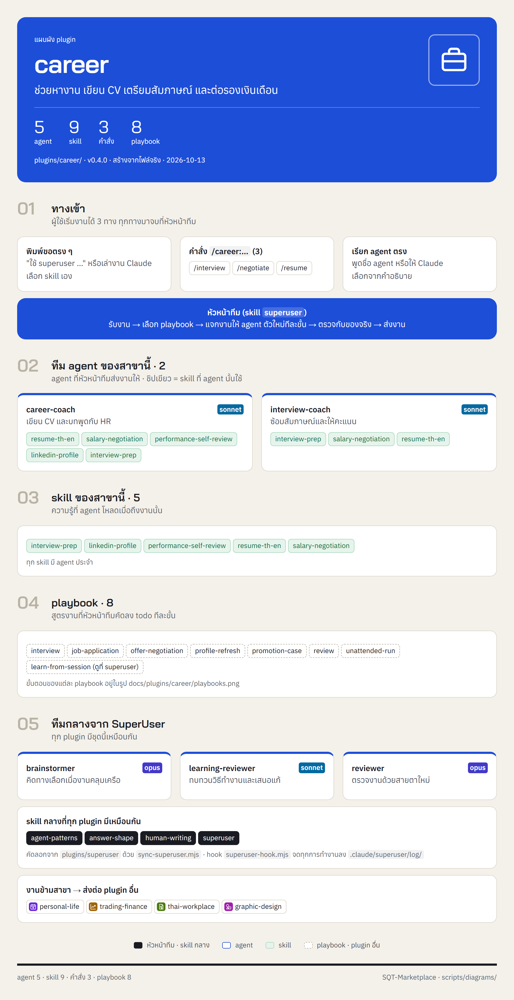
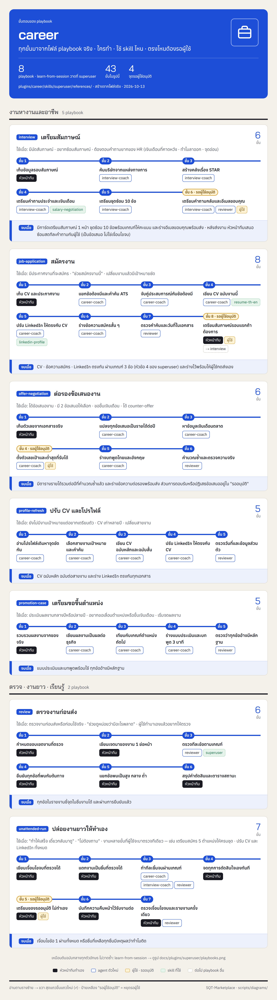

<!-- สร้างโดย scripts/diagrams/pages.py · แก้ที่สคริปต์ ไม่แก้ที่นี่ -->

# career

ช่วยหางาน เขียน CV เตรียมสัมภาษณ์ และต่อรองเงินเดือน

agent 5 · skill 9 · คำสั่ง 3 · playbook 8 · ส่งงานต่อให้ [`personal-life`](../personal-life/README.md) · [`trading-finance`](../trading-finance/README.md) · [`thai-workplace`](../thai-workplace/README.md) · [`graphic-design`](../graphic-design/README.md)

[← ทุก plugin](../README.md) · ต้นฉบับ: [`plugins/career/`](../../../plugins/career/)

## SuperUser ทำงานอย่างไร

หัวหน้าทีมรับงาน → เลือก playbook → แจกงานทีละขั้น → ตรวจก่อนตัดสินใจ → ส่งผล → เรียนรู้

## แผนผัง plugin

มี agent ไหน ใช้ skill อะไร มีคำสั่งอะไร และส่งงานต่อให้ plugin ไหน

## ขั้นตอนของ playbook

แต่ละ playbook ทำกี่ขั้น ใครทำขั้นไหน ใช้ skill ไหน ตรงไหนรอผู้ใช้

## playbook ทั้งหมด

| playbook | ทำอะไร | ขั้น |
|---|---|---|
| `interview` | เตรียมสัมภาษณ์ | 6 |
| `job-application` | สมัครงาน | 8 |
| `learn-from-session` | เรียนรู้จากงานที่ทำ (เหมือนต้นฉบับกลาง ดูที่ [`superuser`](../superuser/README.md)) | 7 |
| `offer-negotiation` | ต่อรองข้อเสนองาน | 6 |
| `profile-refresh` | ปรับ CV และโปรไฟล์ | 5 |
| `promotion-case` | เตรียมขอขึ้นตำแหน่ง | 5 |
| `review` | ตรวจงานก่อนส่ง | 6 |
| `unattended-run` | ปล่อยงานยาวให้ทำเอง | 7 |
