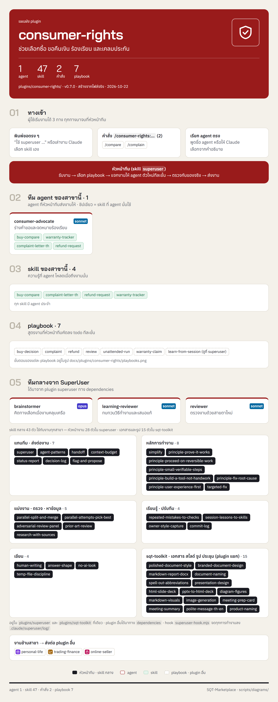
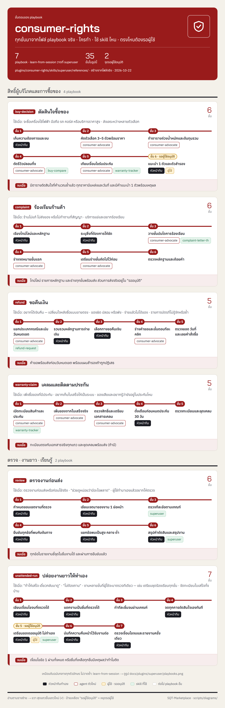

<!-- สร้างโดย scripts/diagrams/pages.py · แก้ที่สคริปต์ ไม่แก้ที่นี่ -->

# consumer-rights

ช่วยเลือกซื้อ ขอคืนเงิน ร้องเรียน และเคลมประกัน

agent 1 · skill 47 · คำสั่ง 2 · playbook 7 · ส่งงานต่อให้ [`personal-life`](../personal-life/README.md) · [`trading-finance`](../trading-finance/README.md) · [`online-seller`](../online-seller/README.md)

[← ทุก plugin](../README.md) · ต้นฉบับ: [`plugins/consumer-rights/`](../../../plugins/consumer-rights/)

## SuperUser ทำงานอย่างไร

หัวหน้าทีมรับงาน → เลือก playbook → แจกงานทีละขั้น → ตรวจก่อนตัดสินใจ → ส่งผล → เรียนรู้

## แผนผัง plugin

มี agent ไหน ใช้ skill อะไร มีคำสั่งอะไร และส่งงานต่อให้ plugin ไหน

## ขั้นตอนของ playbook

แต่ละ playbook ทำกี่ขั้น ใครทำขั้นไหน ใช้ skill ไหน ตรงไหนรอผู้ใช้

## playbook ทั้งหมด

| playbook | ทำอะไร | ขั้น |
|---|---|---|
| `buy-decision` | ตัดสินใจซื้อของ | 6 |
| `complaint` | ร้องเรียนร้านค้า | 6 |
| `learn-from-session` | เรียนรู้จากงานที่ทำ (เหมือนต้นฉบับกลาง ดูที่ [`superuser`](../superuser/README.md)) | 7 |
| `refund` | ขอคืนเงิน | 5 |
| `review` | ตรวจงานก่อนส่ง | 6 |
| `unattended-run` | ปล่อยงานยาวให้ทำเอง | 7 |
| `warranty-claim` | เคลมและติดตามประกัน | 5 |
