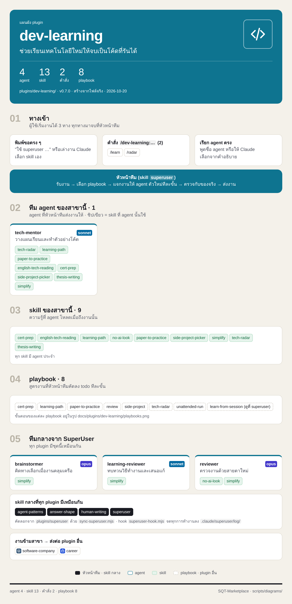
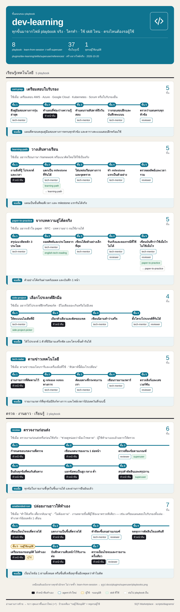

<!-- สร้างโดย scripts/diagrams/pages.py · แก้ที่สคริปต์ ไม่แก้ที่นี่ -->

# dev-learning

ช่วยเรียนเทคโนโลยีใหม่ให้จบเป็นโค้ดที่รันได้

agent 4 · skill 13 · คำสั่ง 2 · playbook 8 · ส่งงานต่อให้ [`software-company`](../software-company/README.md) · [`career`](../career/README.md)

[← ทุก plugin](../README.md) · ต้นฉบับ: [`plugins/dev-learning/`](../../../plugins/dev-learning/)

## SuperUser ทำงานอย่างไร

หัวหน้าทีมรับงาน → เลือก playbook → แจกงานทีละขั้น → ตรวจก่อนตัดสินใจ → ส่งผล → เรียนรู้

## แผนผัง plugin

มี agent ไหน ใช้ skill อะไร มีคำสั่งอะไร และส่งงานต่อให้ plugin ไหน

## ขั้นตอนของ playbook

แต่ละ playbook ทำกี่ขั้น ใครทำขั้นไหน ใช้ skill ไหน ตรงไหนรอผู้ใช้

## playbook ทั้งหมด

| playbook | ทำอะไร | ขั้น |
|---|---|---|
| `cert-prep` | เตรียมสอบใบรับรอง | 5 |
| `learn-from-session` | เรียนรู้จากงานที่ทำ (เหมือนต้นฉบับกลาง ดูที่ [`superuser`](../superuser/README.md)) | 7 |
| `learning-path` | วางเส้นทางเรียน | 5 |
| `paper-to-practice` | จากบทความสู่โค้ดจริง | 5 |
| `review` | ตรวจงานก่อนส่ง | 6 |
| `side-project` | เลือกโปรเจกต์ฝึกมือ | 4 |
| `tech-radar` | ตามข่าวเทคโนโลยี | 5 |
| `unattended-run` | ปล่อยงานยาวให้ทำเอง | 7 |
