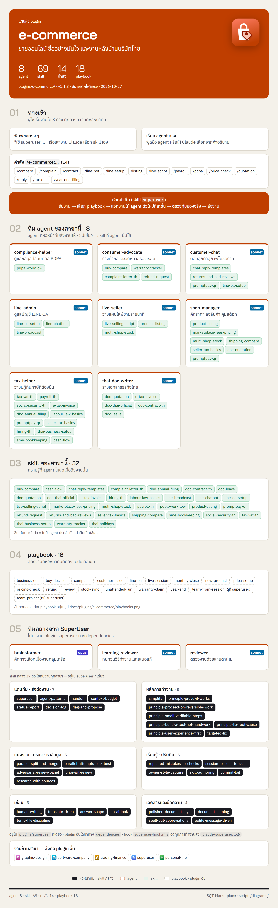

<!-- สร้างโดย scripts/diagrams/pages.py · แก้ที่สคริปต์ ไม่แก้ที่นี่ -->

# e-commerce

ขายออนไลน์ ซื้ออย่างมั่นใจ และงานหลังบ้านบริษัทไทย

agent 8 · skill 69 (ของ plugin 32 · ของกลางจาก superuser 37) · คำสั่ง 14 · playbook 18 · ส่งงานต่อให้ [`graphic-design`](../graphic-design/README.md) · [`software-company`](../software-company/README.md) · [`trading-finance`](../trading-finance/README.md) · [`superuser`](../superuser/README.md) · [`personal-life`](../personal-life/README.md)

[← ทุก plugin](../README.md) · ต้นฉบับ: [`plugins/e-commerce/`](../../../plugins/e-commerce/)

## SuperUser ทำงานอย่างไร

หัวหน้าทีมรับงาน → เลือก playbook → แจกงานทีละขั้น → ตรวจก่อนตัดสินใจ → ส่งผล → เรียนรู้

## แผนผัง plugin

มี agent ไหน ใช้ skill อะไร มีคำสั่งอะไร และส่งงานต่อให้ plugin ไหน

## ขั้นตอนของ playbook

แต่ละ playbook ทำกี่ขั้น ใครทำขั้นไหน ใช้ skill ไหน ตรงไหนรอผู้ใช้

## playbook ทั้งหมด

| playbook | ทำอะไร | ขั้น |
|---|---|---|
| `business-doc` | ร่างเอกสารธุรกิจ | 5 |
| `buy-decision` | ตัดสินใจซื้อของ | 6 |
| `complaint` | ร้องเรียนร้านค้า | 6 |
| `customer-issue` | แก้ปัญหาลูกค้าและรีวิว | 5 |
| `learn-from-session` | เรียนรู้จากงานที่ทำ (เหมือนต้นฉบับกลาง ดูที่ [`superuser`](../superuser/README.md)) | 7 |
| `line-oa` | ตั้งและใช้ LINE OA | 6 |
| `live-session` | วางแผนไลฟ์ขาย | 4 |
| `monthly-close` | ปิดเงินเดือนประจำเดือน | 6 |
| `new-product` | ลงสินค้าใหม่ | 6 |
| `pdpa-setup` | ตั้งระบบ PDPA | 5 |
| `pricing-check` | ตรวจราคาและกำไร | 5 |
| `refund` | ขอคืนเงิน | 5 |
| `review` | ตรวจงานที่เสร็จแล้ว | 6 |
| `stock-sync` | ซิงก์สต็อกหลายร้าน | 5 |
| `team-project` | งานใหญ่หลายวัน คนกับ agent ร่วมทีม (เหมือนต้นฉบับกลาง ดูที่ [`superuser`](../superuser/README.md)) | 9 |
| `unattended-run` | งานยาวไม่ต้องเฝ้า | 7 |
| `warranty-claim` | เคลมและติดตามประกัน | 5 |
| `year-end` | ปิดปีและยื่นประจำปี | 5 |
