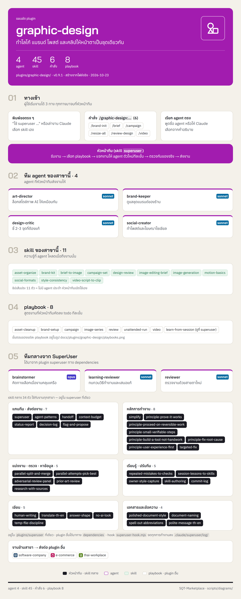
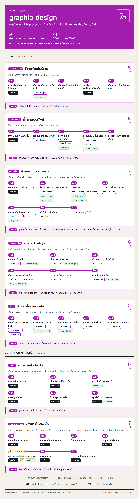

<!-- สร้างโดย scripts/diagrams/pages.py · แก้ที่สคริปต์ ไม่แก้ที่นี่ -->

# graphic-design

ทำโลโก้ แบรนด์ โพสต์ และคลิปให้หน้าตาเป็นชุดเดียวกัน

agent 4 · skill 45 · คำสั่ง 6 · playbook 8 · ส่งงานต่อให้ [`software-company`](../software-company/README.md) · [`e-commerce`](../e-commerce/README.md) · [`thai-workplace`](../thai-workplace/README.md)

[← ทุก plugin](../README.md) · ต้นฉบับ: [`plugins/graphic-design/`](../../../plugins/graphic-design/)

## SuperUser ทำงานอย่างไร

หัวหน้าทีมรับงาน → เลือก playbook → แจกงานทีละขั้น → ตรวจก่อนตัดสินใจ → ส่งผล → เรียนรู้

## แผนผัง plugin

มี agent ไหน ใช้ skill อะไร มีคำสั่งอะไร และส่งงานต่อให้ plugin ไหน

## ขั้นตอนของ playbook

แต่ละ playbook ทำกี่ขั้น ใครทำขั้นไหน ใช้ skill ไหน ตรงไหนรอผู้ใช้

## playbook ทั้งหมด

| playbook | ทำอะไร | ขั้น |
|---|---|---|
| `asset-cleanup` | จัดระเบียบไฟล์งาน | 5 |
| `brand-setup` | ตั้งชุดแบรนด์ใหม่ | 5 |
| `campaign` | ทำแคมเปญหลายขนาด | 7 |
| `image-series` | ทำภาพ AI เป็นชุด | 6 |
| `learn-from-session` | เรียนรู้จากงานที่ทำ (เหมือนต้นฉบับกลาง ดูที่ [`superuser`](../superuser/README.md)) | 7 |
| `review` | ตรวจงานที่เสร็จแล้ว | 6 |
| `unattended-run` | งานยาวไม่ต้องเฝ้า | 7 |
| `video` | ทำคลิปสั้นจากสคริปต์ | 5 |
