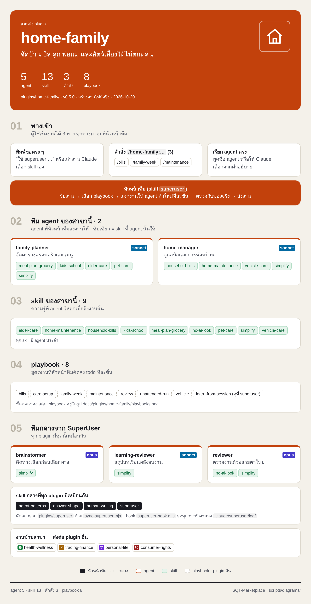
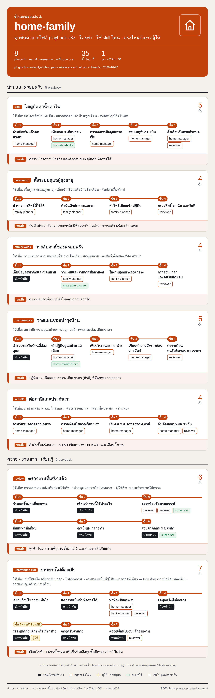

<!-- สร้างโดย scripts/diagrams/pages.py · แก้ที่สคริปต์ ไม่แก้ที่นี่ -->

# home-family

จัดบ้าน บิล ลูก พ่อแม่ และสัตว์เลี้ยงให้ไม่ตกหล่น

agent 5 · skill 13 · คำสั่ง 3 · playbook 8 · ส่งงานต่อให้ [`health-wellness`](../health-wellness/README.md) · [`trading-finance`](../trading-finance/README.md) · [`personal-life`](../personal-life/README.md) · [`consumer-rights`](../consumer-rights/README.md)

[← ทุก plugin](../README.md) · ต้นฉบับ: [`plugins/home-family/`](../../../plugins/home-family/)

## SuperUser ทำงานอย่างไร

หัวหน้าทีมรับงาน → เลือก playbook → แจกงานทีละขั้น → ตรวจก่อนตัดสินใจ → ส่งผล → เรียนรู้

## แผนผัง plugin

มี agent ไหน ใช้ skill อะไร มีคำสั่งอะไร และส่งงานต่อให้ plugin ไหน

## ขั้นตอนของ playbook

แต่ละ playbook ทำกี่ขั้น ใครทำขั้นไหน ใช้ skill ไหน ตรงไหนรอผู้ใช้

## playbook ทั้งหมด

| playbook | ทำอะไร | ขั้น |
|---|---|---|
| `bills` | ไล่ดูบิลค่าน้ำค่าไฟ | 5 |
| `care-setup` | ตั้งระบบดูแลผู้สูงอายุ | 4 |
| `family-week` | วางสัปดาห์ของครอบครัว | 4 |
| `learn-from-session` | เรียนรู้จากงานที่ทำ (เหมือนต้นฉบับกลาง ดูที่ [`superuser`](../superuser/README.md)) | 7 |
| `maintenance` | วางแผนซ่อมบำรุงบ้าน | 5 |
| `review` | ตรวจงานที่เสร็จแล้ว | 6 |
| `unattended-run` | งานยาวไม่ต้องเฝ้า | 7 |
| `vehicle` | ต่อภาษีและประกันรถ | 4 |
