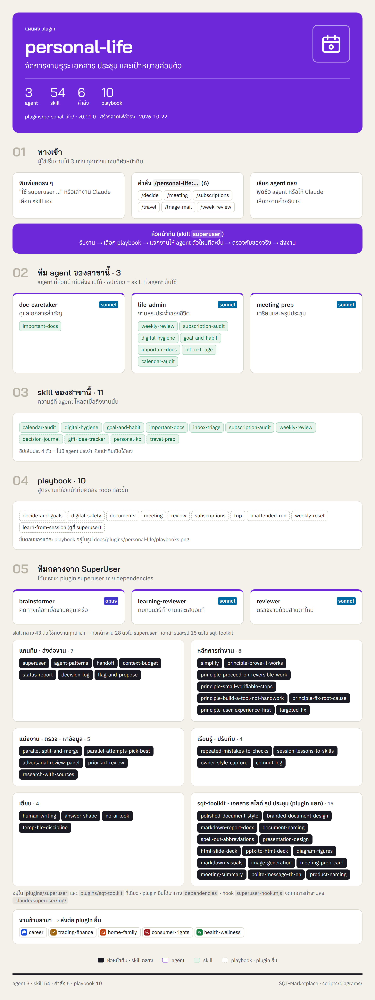

<!-- สร้างโดย scripts/diagrams/pages.py · แก้ที่สคริปต์ ไม่แก้ที่นี่ -->

# personal-life

จัดการงานธุระ เอกสาร ประชุม และเป้าหมายส่วนตัว

agent 3 · skill 54 · คำสั่ง 6 · playbook 10 · ส่งงานต่อให้ [`career`](../career/README.md) · [`trading-finance`](../trading-finance/README.md) · [`home-family`](../home-family/README.md) · [`consumer-rights`](../consumer-rights/README.md) · [`health-wellness`](../health-wellness/README.md)

[← ทุก plugin](../README.md) · ต้นฉบับ: [`plugins/personal-life/`](../../../plugins/personal-life/)

## SuperUser ทำงานอย่างไร

หัวหน้าทีมรับงาน → เลือก playbook → แจกงานทีละขั้น → ตรวจก่อนตัดสินใจ → ส่งผล → เรียนรู้

## แผนผัง plugin

มี agent ไหน ใช้ skill อะไร มีคำสั่งอะไร และส่งงานต่อให้ plugin ไหน

## ขั้นตอนของ playbook

แต่ละ playbook ทำกี่ขั้น ใครทำขั้นไหน ใช้ skill ไหน ตรงไหนรอผู้ใช้

## playbook ทั้งหมด

| playbook | ทำอะไร | ขั้น |
|---|---|---|
| `decide-and-goals` | ตัดสินใจและตั้งเป้า | 4 |
| `digital-safety` | ความปลอดภัยออนไลน์ | 5 |
| `documents` | จัดเอกสารสำคัญ | 4 |
| `learn-from-session` | เรียนรู้จากงานที่ผ่านมา (เหมือนต้นฉบับกลาง ดูที่ [`superuser`](../superuser/README.md)) | 7 |
| `meeting` | เตรียมและสรุปประชุม | 4 |
| `review` | ตรวจงานก่อนส่ง | 6 |
| `subscriptions` | ตรวจค่าสมาชิกรายเดือน | 5 |
| `trip` | เตรียมเที่ยว | 4 |
| `unattended-run` | ให้ทำงานยาวเอง | 7 |
| `weekly-reset` | รีเซ็ตประจำสัปดาห์ | 5 |
