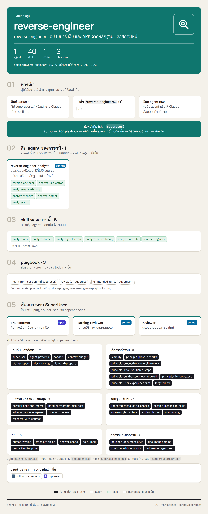
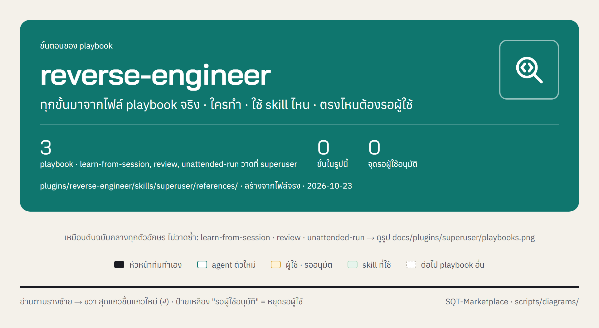

<!-- สร้างโดย scripts/diagrams/pages.py · แก้ที่สคริปต์ ไม่แก้ที่นี่ -->

# reverse-engineer

reverse engineer แอป ไบนารี เว็บ และ APK จากหลักฐาน แล้วสร้างใหม่

agent 1 · skill 40 · คำสั่ง 1 · playbook 3 · ส่งงานต่อให้ [`software-company`](../software-company/README.md) · [`superuser`](../superuser/README.md)

[← ทุก plugin](../README.md) · ต้นฉบับ: [`plugins/reverse-engineer/`](../../../plugins/reverse-engineer/)

## SuperUser ทำงานอย่างไร

หัวหน้าทีมรับงาน → เลือก playbook → แจกงานทีละขั้น → ตรวจก่อนตัดสินใจ → ส่งผล → เรียนรู้

## แผนผัง plugin

มี agent ไหน ใช้ skill อะไร มีคำสั่งอะไร และส่งงานต่อให้ plugin ไหน

## ขั้นตอนของ playbook

แต่ละ playbook ทำกี่ขั้น ใครทำขั้นไหน ใช้ skill ไหน ตรงไหนรอผู้ใช้

## playbook ทั้งหมด

| playbook | ทำอะไร | ขั้น |
|---|---|---|
| `learn-from-session` | เรียนรู้จากงานที่ทำ (เหมือนต้นฉบับกลาง ดูที่ [`superuser`](../superuser/README.md)) | 7 |
| `review` | ตรวจงานก่อนส่ง (เหมือนต้นฉบับกลาง ดูที่ [`superuser`](../superuser/README.md)) | 6 |
| `unattended-run` | ปล่อยงานยาวให้ทำเอง (เหมือนต้นฉบับกลาง ดูที่ [`superuser`](../superuser/README.md)) | 7 |
