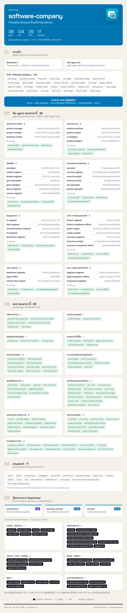

<!-- สร้างโดย scripts/diagrams/pages.py · แก้ที่สคริปต์ ไม่แก้ที่นี่ -->

# software-company

ทีมซอฟต์แวร์ครบชุด ตั้งแต่โจทย์จนส่งมอบ

agent 38 · skill 134 (ของ plugin 96 · ของกลางจาก superuser 38) · คำสั่ง 29 · playbook 17 · ส่งงานต่อให้ —

[← ทุก plugin](../README.md) · ต้นฉบับ: [`plugins/software-company/`](../../../plugins/software-company/)

## SuperUser ทำงานอย่างไร

หัวหน้าทีมรับงาน → เลือก playbook → แจกงานทีละขั้น → ตรวจก่อนตัดสินใจ → ส่งผล → เรียนรู้

## แผนผัง plugin

มี agent ไหน ใช้ skill อะไร มีคำสั่งอะไร และส่งงานต่อให้ plugin ไหน

## ขั้นตอนของ playbook

แต่ละ playbook ทำกี่ขั้น ใครทำขั้นไหน ใช้ skill ไหน ตรงไหนรอผู้ใช้

## playbook ทั้งหมด

| playbook | ทำอะไร | ขั้น |
|---|---|---|
| `bug-fix` | แก้บั๊ก | 10 |
| `feature` | เพิ่มฟีเจอร์ | 10 |
| `housekeeping` | เก็บกวาดเครื่อง | 5 |
| `investigation` | สืบหาคำตอบ | 9 |
| `learn-from-session` | เรียนรู้จากงานที่ผ่านมา (เหมือนต้นฉบับกลาง ดูที่ [`superuser`](../superuser/README.md)) | 7 |
| `new-project` | เริ่มโปรเจกต์ใหม่ | 10 |
| `performance` | ทำให้เร็วขึ้น | 9 |
| `pickup-and-pause` | รับงานต่อและพักงาน | 8 |
| `project-docs` | เขียนเอกสารโปรเจกต์ | 8 |
| `prototype` | ลองของก่อนตัดสินใจ | 7 |
| `refactor` | จัดโค้ดใหม่ | 9 |
| `review` | รีวิวโค้ด | 6 |
| `ship` | ส่งมอบงาน | 9 |
| `skill-authoring` | เขียน skill ใหม่ | 8 |
| `team-project` | งานใหญ่หลายวัน คนกับ agent ร่วมทีม (เหมือนต้นฉบับกลาง ดูที่ [`superuser`](../superuser/README.md)) | 9 |
| `unattended-run` | ปล่อยให้ทำเองยาว ๆ | 7 |
| `visual-parity` | ทำหน้าจอให้ตรงต้นแบบ | 9 |
