<!-- สร้างโดย scripts/diagrams/pages.py · แก้ที่สคริปต์ ไม่แก้ที่นี่ -->

# superuser

ทีมผู้ช่วยทำงานหลายขั้นให้จบพร้อมตรวจ

agent 3 · skill 39 (ของ plugin 0 · ของกลางจาก superuser 39) · คำสั่ง 0 · playbook 7 · ส่งงานต่อให้ —

[← ทุก plugin](../README.md) · ต้นฉบับ: [`plugins/superuser/`](../../../plugins/superuser/)

## แผนผัง plugin

เรื่องเข้ามาทางไหน ไปถึง agent ไหน ใช้ skill อะไร

## SuperUser ทำงานอย่างไร

หัวหน้าทีมรับงาน → จัดขนาด → แจกงาน → ตรวจซ้ำจนผ่าน → ส่งมอบ → เรียนรู้

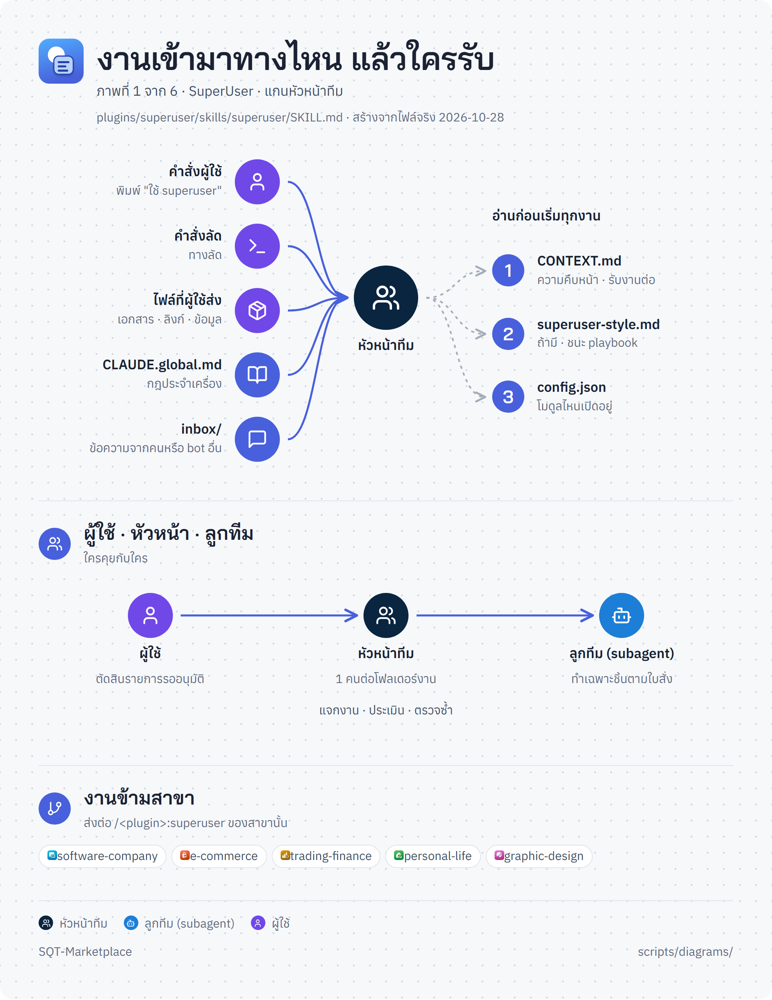

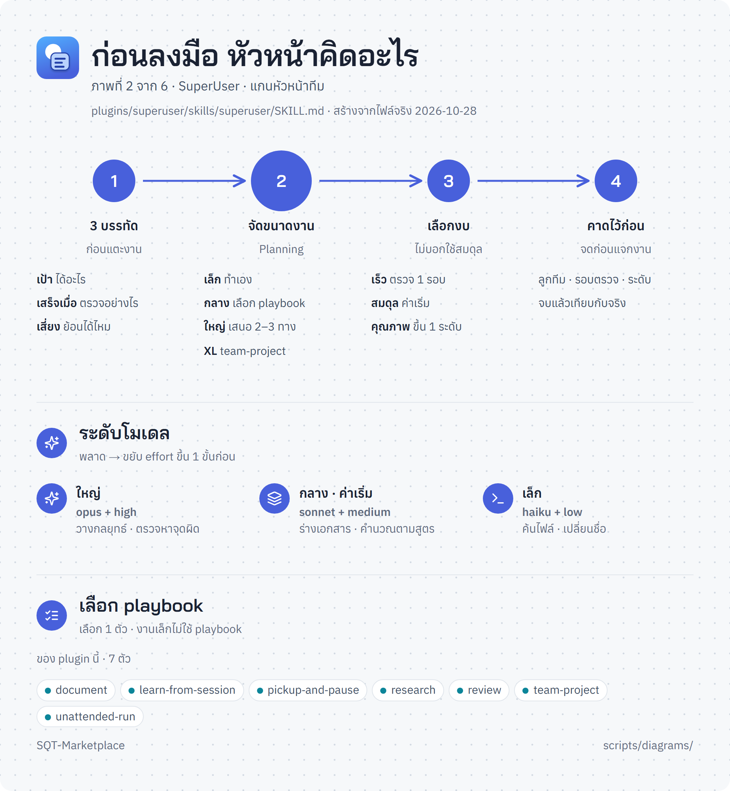

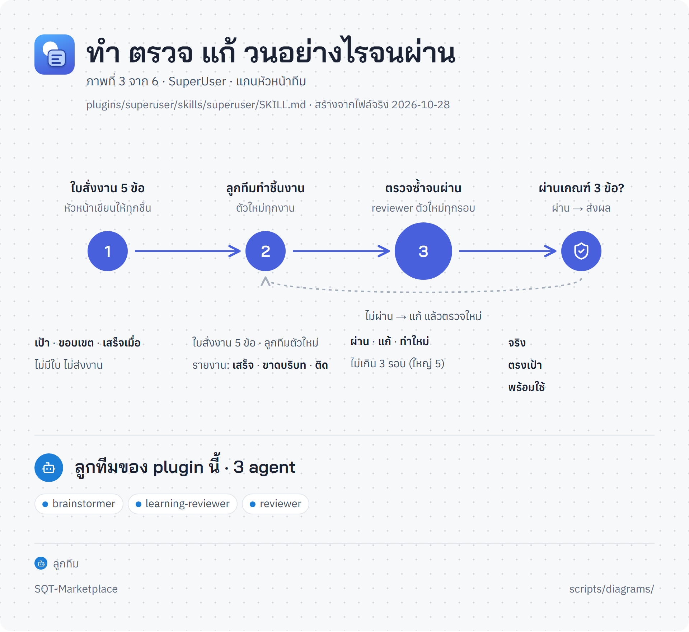

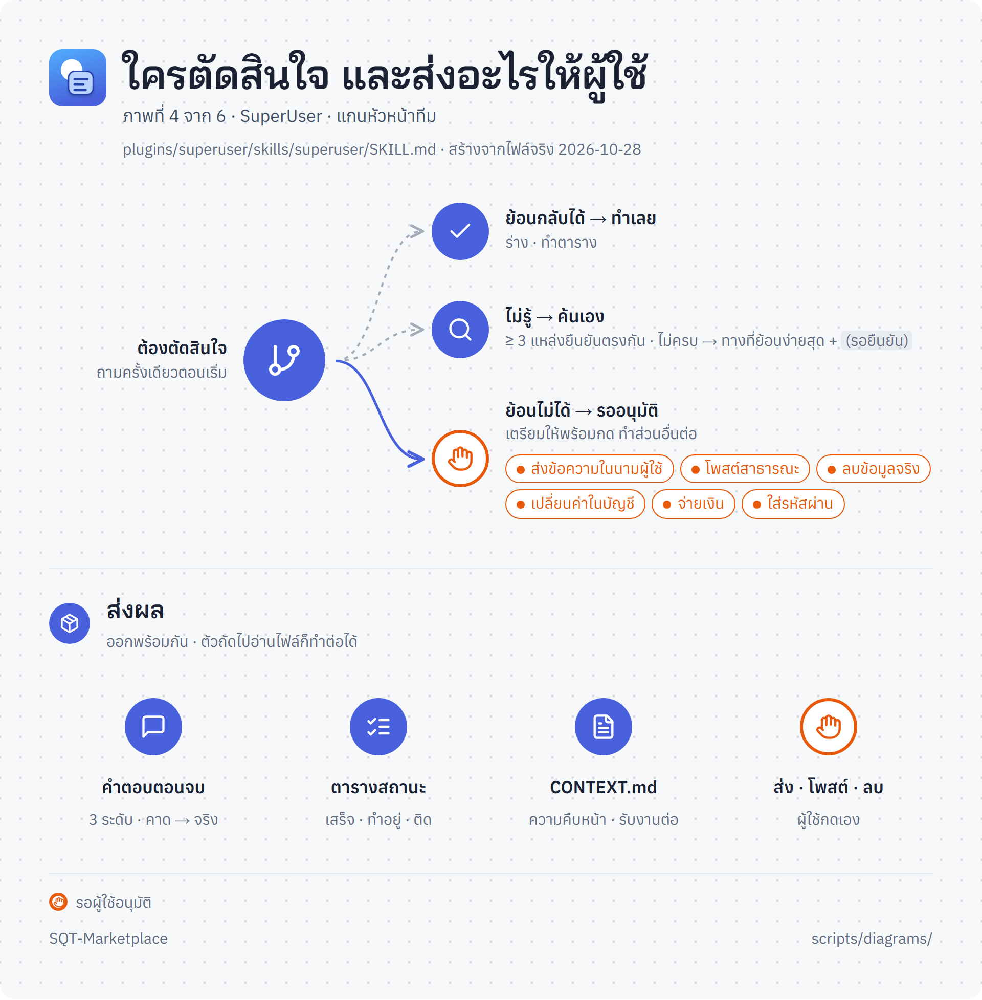

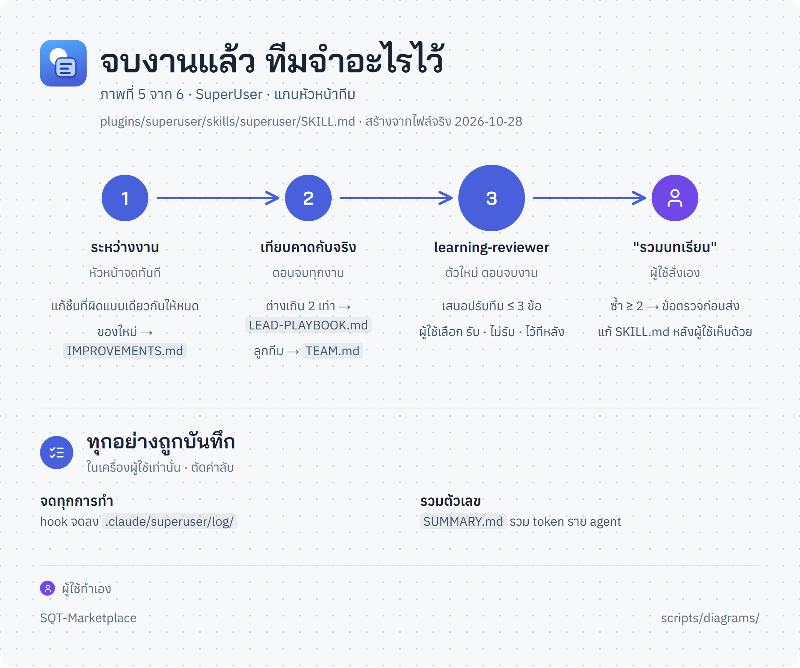

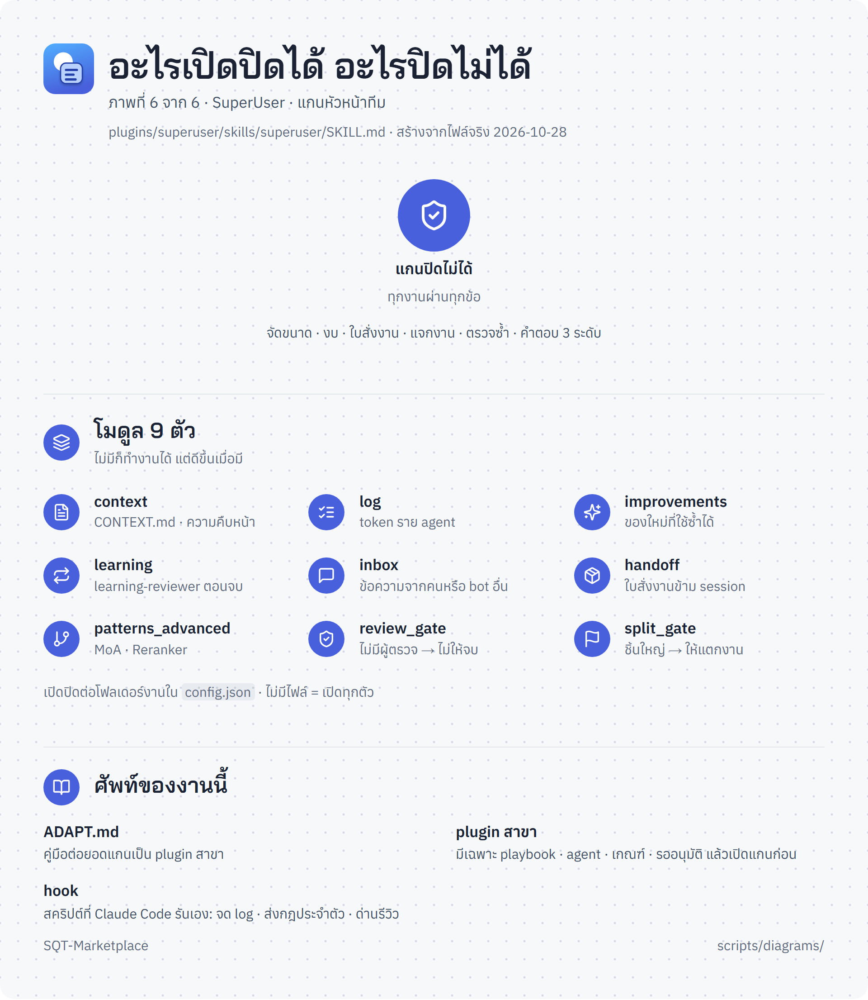

## playbook ทั้งหมด

| playbook | ทำอะไร | ขั้น |
|---|---|---|
| [`document`](#pb-document) | เขียนเอกสาร | 8 |
| [`learn-from-session`](#pb-learn-from-session) | เรียนรู้จากงานที่ทำ | 7 |
| [`pickup-and-pause`](#pb-pickup-and-pause) | รับงานต่อ · หยุดงาน | 8 |
| [`research`](#pb-research) | ค้นคว้าหาคำตอบ | 7 |
| [`review`](#pb-review) | ตรวจงานก่อนส่ง | 6 |
| [`team-project`](#pb-team-project) | งานใหญ่หลายวัน คนกับ agent ร่วมทีม | 9 |
| [`unattended-run`](#pb-unattended-run) | ปล่อยงานยาวให้ทำเอง | 7 |

### เขียนเอกสาร · `document`

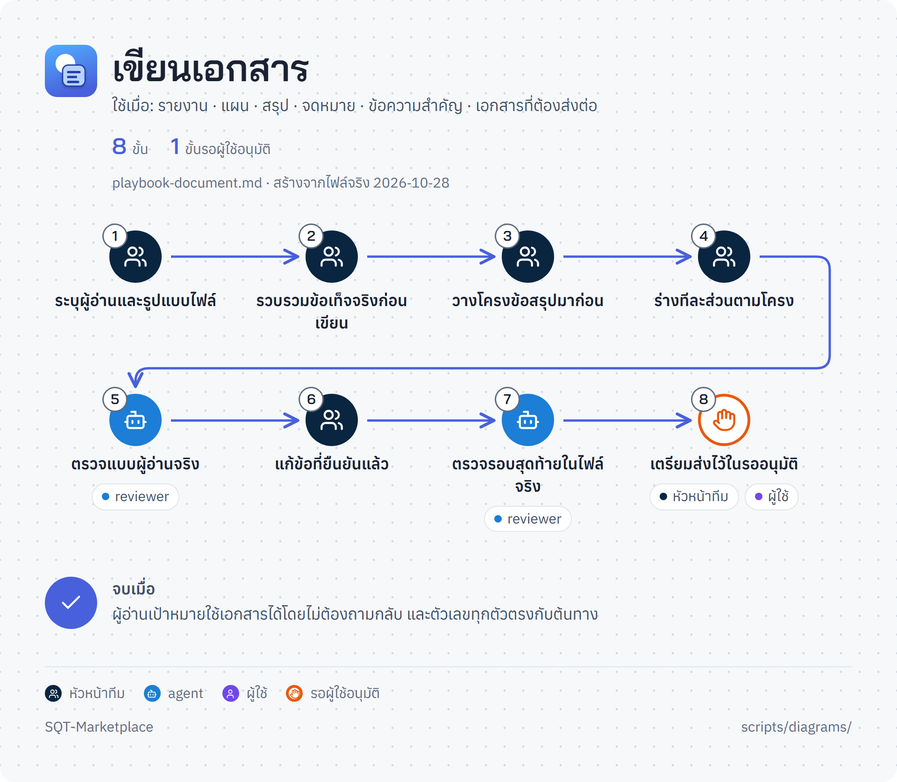

### เรียนรู้จากงานที่ทำ · `learn-from-session`

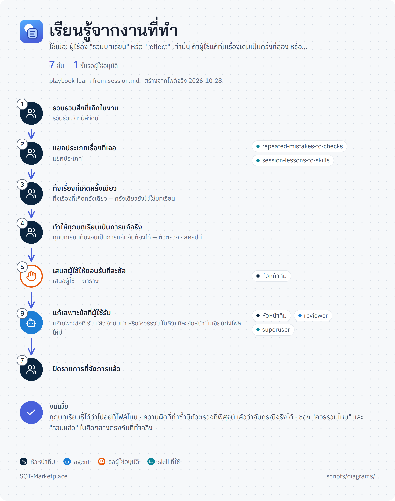

### รับงานต่อ · หยุดงาน · `pickup-and-pause`

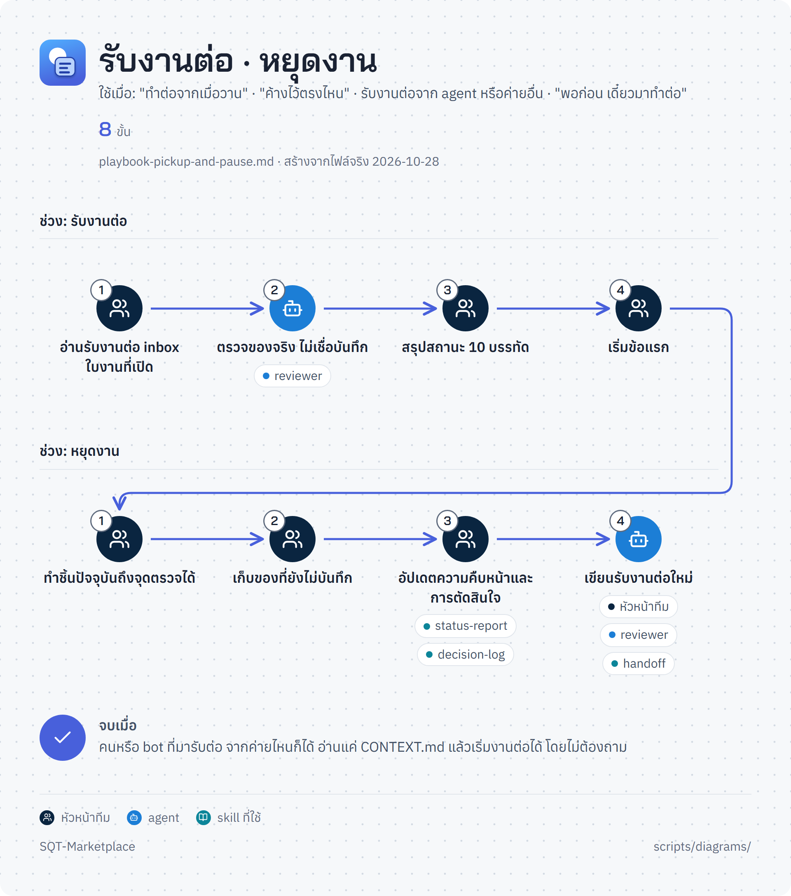

### ค้นคว้าหาคำตอบ · `research`

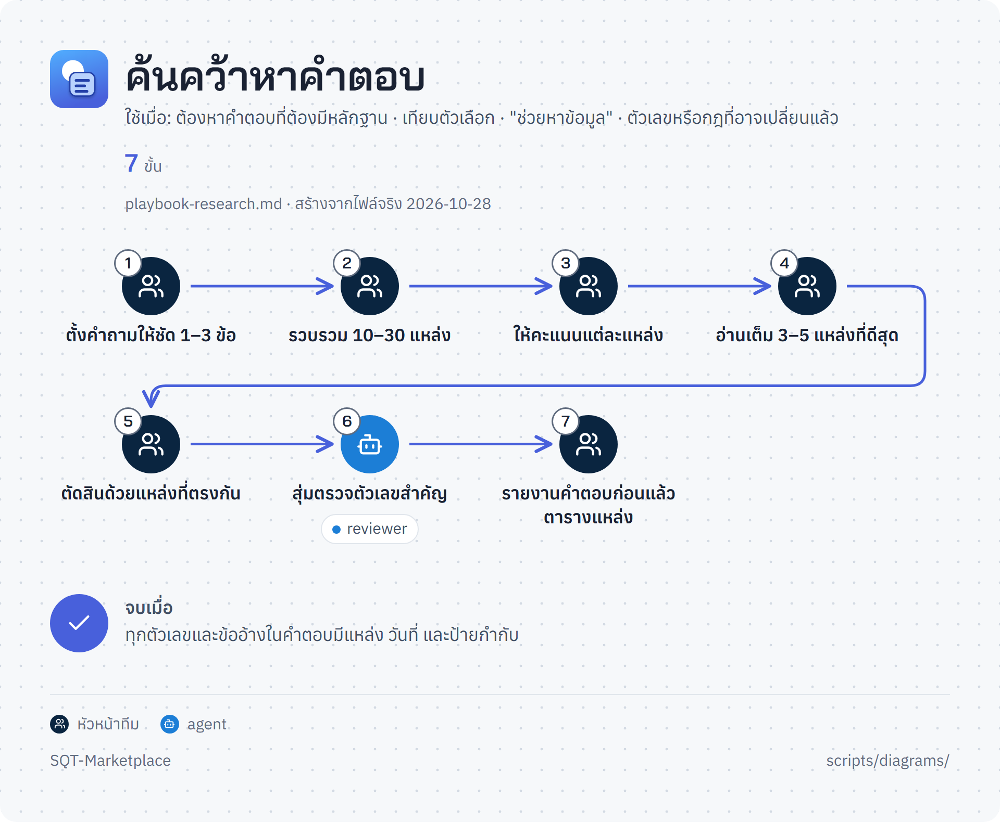

### ตรวจงานก่อนส่ง · `review`

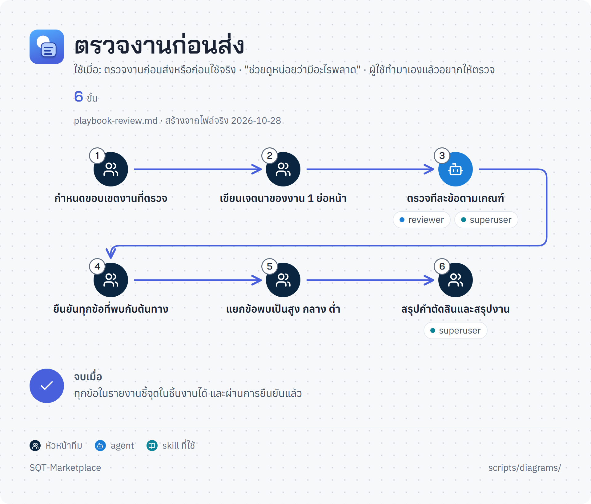

### งานใหญ่หลายวัน คนกับ agent ร่วมทีม · `team-project`

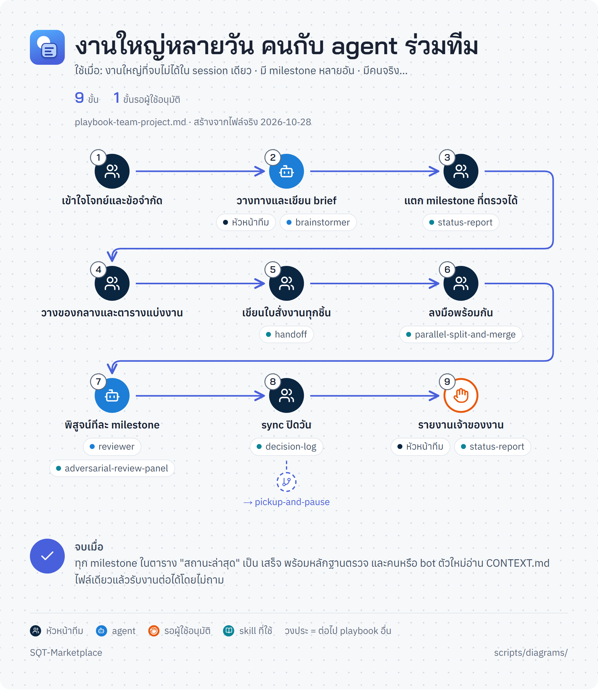

### ปล่อยงานยาวให้ทำเอง · `unattended-run`

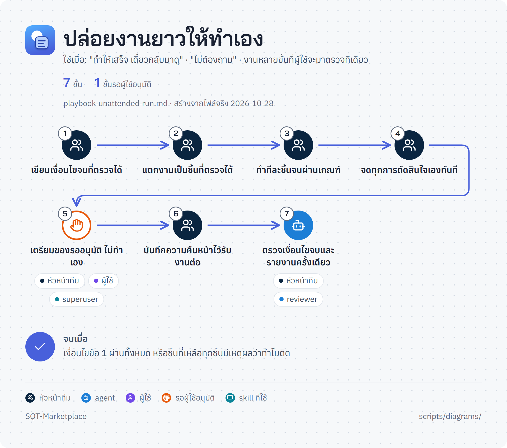
