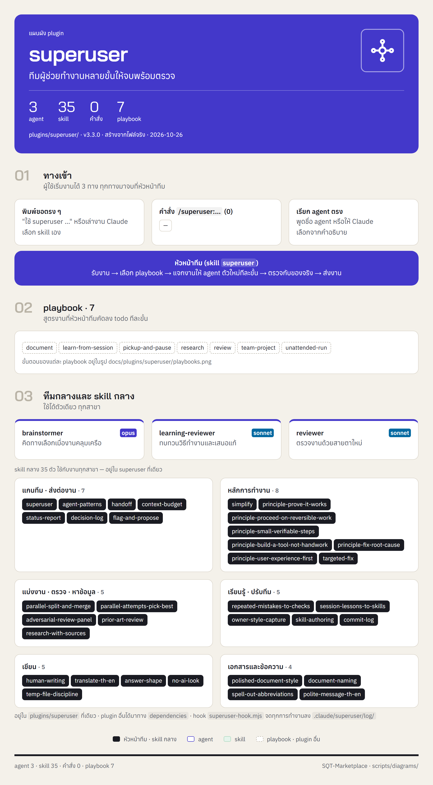
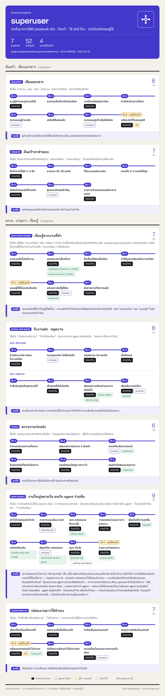

<!-- สร้างโดย scripts/diagrams/pages.py · แก้ที่สคริปต์ ไม่แก้ที่นี่ -->

# superuser

ทีมผู้ช่วยทำงานหลายขั้นให้จบพร้อมตรวจ

agent 3 · skill 6 · คำสั่ง 0 · playbook 5 · ส่งงานต่อให้ —

[← ทุก plugin](../README.md) · ต้นฉบับ: [`plugins/superuser/`](../../../plugins/superuser/)

## SuperUser ทำงานอย่างไร

หัวหน้าทีมรับงาน → เลือก playbook → แจกงานทีละขั้น → ตรวจก่อนตัดสินใจ → ส่งผล → เรียนรู้

## แผนผัง plugin

มี agent ไหน ใช้ skill อะไร มีคำสั่งอะไร และส่งงานต่อให้ plugin ไหน

## ขั้นตอนของ playbook

แต่ละ playbook ทำกี่ขั้น ใครทำขั้นไหน ใช้ skill ไหน ตรงไหนรอผู้ใช้

## playbook ทั้งหมด

| playbook | ทำอะไร | ขั้น |
|---|---|---|
| `document` | เขียนเอกสาร | 8 |
| `learn-from-session` | เรียนรู้จากงานที่ทำ | 7 |
| `research` | ค้นคว้าหาคำตอบ | 7 |
| `review` | ตรวจงานก่อนส่ง | 6 |
| `unattended-run` | ปล่อยงานยาวให้ทำเอง | 7 |
