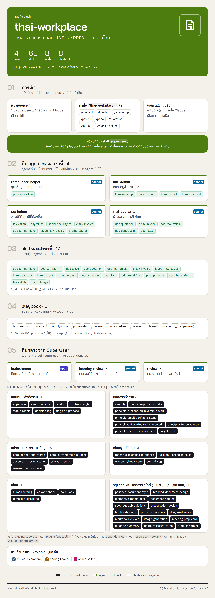
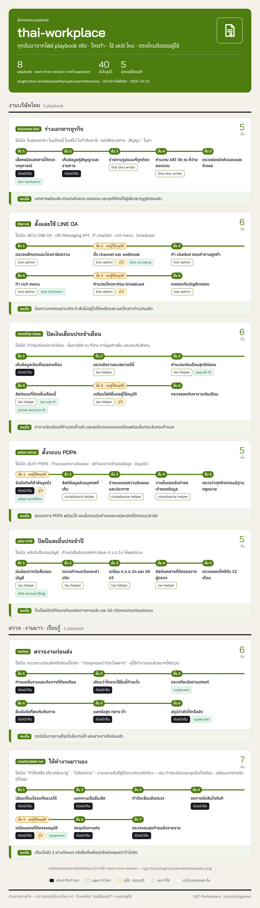

<!-- สร้างโดย scripts/diagrams/pages.py · แก้ที่สคริปต์ ไม่แก้ที่นี่ -->

# thai-workplace

เอกสาร ภาษี เงินเดือน LINE และ PDPA ของบริษัทไทย

agent 4 · skill 60 · คำสั่ง 8 · playbook 8 · ส่งงานต่อให้ [`software-company`](../software-company/README.md) · [`trading-finance`](../trading-finance/README.md) · [`online-seller`](../online-seller/README.md)

[← ทุก plugin](../README.md) · ต้นฉบับ: [`plugins/thai-workplace/`](../../../plugins/thai-workplace/)

## SuperUser ทำงานอย่างไร

หัวหน้าทีมรับงาน → เลือก playbook → แจกงานทีละขั้น → ตรวจก่อนตัดสินใจ → ส่งผล → เรียนรู้

## แผนผัง plugin

มี agent ไหน ใช้ skill อะไร มีคำสั่งอะไร และส่งงานต่อให้ plugin ไหน

## ขั้นตอนของ playbook

แต่ละ playbook ทำกี่ขั้น ใครทำขั้นไหน ใช้ skill ไหน ตรงไหนรอผู้ใช้

## playbook ทั้งหมด

| playbook | ทำอะไร | ขั้น |
|---|---|---|
| `business-doc` | ร่างเอกสารธุรกิจ | 5 |
| `learn-from-session` | เรียนรู้จากงานที่ผ่านมา (เหมือนต้นฉบับกลาง ดูที่ [`superuser`](../superuser/README.md)) | 7 |
| `line-oa` | ตั้งและใช้ LINE OA | 6 |
| `monthly-close` | ปิดเงินเดือนประจำเดือน | 6 |
| `pdpa-setup` | ตั้งระบบ PDPA | 5 |
| `review` | ตรวจงานก่อนส่ง | 6 |
| `unattended-run` | ให้ทำงานยาวเอง | 7 |
| `year-end` | ปิดปีและยื่นประจำปี | 5 |
