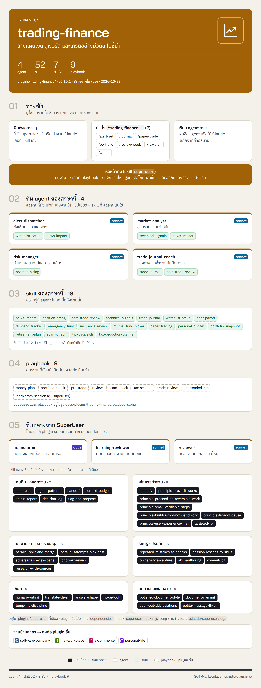
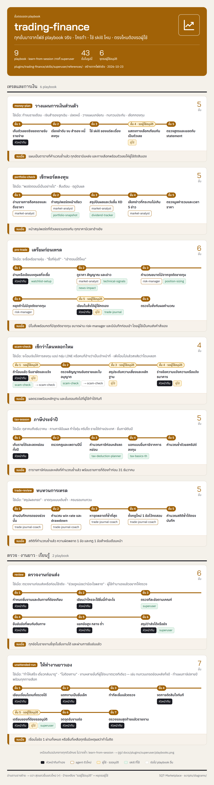

<!-- สร้างโดย scripts/diagrams/pages.py · แก้ที่สคริปต์ ไม่แก้ที่นี่ -->

# trading-finance

วางแผนเงิน ดูพอร์ต และเทรดอย่างมีวินัย ไม่ชี้นำ

agent 4 · skill 52 · คำสั่ง 7 · playbook 9 · ส่งงานต่อให้ [`software-company`](../software-company/README.md) · [`thai-workplace`](../thai-workplace/README.md) · [`e-commerce`](../e-commerce/README.md) · [`personal-life`](../personal-life/README.md)

[← ทุก plugin](../README.md) · ต้นฉบับ: [`plugins/trading-finance/`](../../../plugins/trading-finance/)

## SuperUser ทำงานอย่างไร

หัวหน้าทีมรับงาน → เลือก playbook → แจกงานทีละขั้น → ตรวจก่อนตัดสินใจ → ส่งผล → เรียนรู้

## แผนผัง plugin

มี agent ไหน ใช้ skill อะไร มีคำสั่งอะไร และส่งงานต่อให้ plugin ไหน

## ขั้นตอนของ playbook

แต่ละ playbook ทำกี่ขั้น ใครทำขั้นไหน ใช้ skill ไหน ตรงไหนรอผู้ใช้

## playbook ทั้งหมด

| playbook | ทำอะไร | ขั้น |
|---|---|---|
| `learn-from-session` | เรียนรู้จากงานที่ผ่านมา (เหมือนต้นฉบับกลาง ดูที่ [`superuser`](../superuser/README.md)) | 7 |
| `money-plan` | วางแผนการเงินส่วนตัว | 5 |
| `portfolio-check` | เช็กพอร์ตลงทุน | 5 |
| `pre-trade` | เตรียมก่อนเทรด | 6 |
| `review` | ตรวจงานก่อนส่ง | 6 |
| `scam-check` | เช็กว่าโดนหลอกไหม | 4 |
| `tax-season` | ภาษีประจำปี | 5 |
| `trade-review` | ทบทวนการเทรด | 5 |
| `unattended-run` | ให้ทำงานยาวเอง | 7 |
